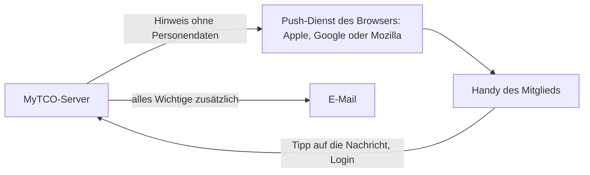

[← ADR-Index](adr-index.md)

# ADR-001: MyTCO startet als installierbare Web-App, die Store-App folgt bei Bedarf

**Status:** Entschieden · **Datum:** 2026-10-29 · **Issue:** #7

## Kontext

Die Zielsetzung verlangt eine einfache Mobile-App für Android und iOS (N-APP-01) mit
Benachrichtigungen per Push und E-Mail (N-APP-02) und eine Admin-Oberfläche (N-APP-03).
Das Anforderungsdokument v1.2 spricht dagegen von einer Web-App mit möglicher App später.

Randbedingungen:

- **Termin:** Admin-Seite und Mitglieder-Login bis 28.02.2027 (Roadmap). Push wird
  frühestens mit *CM-Betrieb* (30.06.2027) gebraucht (A-ANMELDUNG-08).
- **Ehrenamt:** Entwicklung und Betrieb ehrenamtlich, langfristig, eventuell mit weiteren
  Mitbetreuenden; Übergabe muss möglich sein (Issue #10).
- **Kosten:** laufend im niedrigen dreistelligen Bereich pro Jahr (N-KOSTEN-01).
- **Zielgruppe:** Mitglieder jeden Alters (N-BARRIEREFREI-01), überwiegend auf dem Handy
  (N-DESIGN-02); der Admin arbeitet am PC.
- **Abhängigkeitsschutz:** Der Hook `dep-guard` erkennt `npm`/`pnpm`/`yarn`/`bun`, aber
  nicht `npx expo install`, `flutter pub add` oder `dart pub add`.

**Für den Vorstand** sind Varianten, Budget und offene Fragen in der
[Entscheidungsgrundlage App-Varianten](../recherche/2026-10-29-app-varianten-vorstand.html)
zusammengefasst.

**Legende der Angaben:** **B·n** = belegt mit Quelle n (unten) · **S** = Schätzung ·
**V** = Vermutung, nicht geprüft · **PT** = Personentag zu 8 Stunden. Wechselkurs USD → CHF
ca. 0.80 (**S**).

## Optionen

| Option | Dafür | Dagegen |
|--------|-------|---------|
| **A · Installierbare Web-App (PWA)** — Webseite, die sich auf den Startbildschirm legen lässt und dann wie eine App startet | Kein Store, keine Konten, keine Prüfung, Updates ohne Store spätestens beim nächsten Start der App (S); Plattformkosten CHF 0; eine Sprache; Webtechnik am weitesten verbreitet (React: 44.7 % der Befragten, B·13); einfach automatisch zu testen (S) | Push auf dem iPhone erst ab iOS 16.4 und nur, wenn die App auf dem Startbildschirm liegt (B·6); nicht im Store auffindbar |
| **B · Plattformübergreifende App mit React Native / Expo** | Echte Store-App; zuverlässiger Push auf beiden Plattformen über Expo, Versand kostenlos (B·9, B·10); dieselbe Sprache (JavaScript/TypeScript) wie eine Web-App (S); Builds in der Cloud im Gratisplan bis 15 iOS- und 15 Android-Builds (B·11) | Apple USD 99/Jahr (B·1), Google USD 25 einmalig (B·3); Vereinskonto braucht D-U-N-S-Nummer und Zeichnungsberechtigte (B·1); jede Version durch die Store-Prüfung, Demo-Konto für Apple nötig (B·5, B·8); Einrichten ca. 3–6 PT, danach ca. 1–2 PT/Jahr Store-Pflichten (S); `dep-guard` deckt `npx expo install` nicht ab |
| **C · Plattformübergreifende App mit Flutter** | Echte Store-App; sehr gute Werkzeuge und eingebautes Testen (S) | Kosten und Prüfprozess wie B; Sprache Dart seltener als JavaScript/TypeScript, fürs Backend vermutlich eine zweite Sprache (S); `dep-guard` deckt `flutter pub add` nicht ab |
| **D · Web-App zuerst, Store-App später als Hülle** — wie A; bei Bedarf packt Capacitor dieselbe Web-App in eine Store-App mit echtem Push (B·12) | Alle Vorteile von A für den Start; der Weg in die Stores bleibt offen, Oberfläche und Logik werden weiterverwendet (S); Store-Kosten erst, wenn die Hülle kommt | Beim Umstieg dieselben Store-Pflichten wie B, dazu ein zweiter Push-Weg über APNs und FCM (B·12); Ablehnungsrisiko bei Apple für „verpackte Websites“ (Regel 4.2, B·8) etwas höher als bei B (S) |

**Admin-Oberfläche:** (1) Teil derselben App, sichtbar nur mit Rolle Admin · (2) eigene
Web-App mit eigenem Login und eigener Auslieferung · (3) gemeinsame Codebasis mit zwei
Ausgaben (bei B und C naheliegend, weil Admin-Arbeit am PC stattfindet, S).

## Entscheidung

**MyTCO wird zuerst als installierbare Web-App (PWA) gebaut, mit der Admin-Oberfläche als
Teil derselben App und Push per Web Push; eine Store-App für iOS und Android bleibt
ausdrücklich das Ziel und wird mit Capacitor aus derselben Web-App erzeugt, sobald ein
Reevaluations-Trigger greift (Option D).**

Begründung:

- **Termin:** Bis 28.02.2027 braucht es weder Store-Konten noch D-U-N-S-Nummer noch eine
  Store-Prüfung; die Zeit geht ganz in Login und Mitgliederverwaltung.
- **Ehrenamt und Übergabe:** eine Sprache, eine Auslieferung, keine jährlichen
  Store-Pflichten; Webkenntnisse sind am leichtesten zu finden (S, gestützt auf B·13).
- **Kosten:** Plattformkosten CHF 0, solange keine Store-App nötig ist.
- **Nichts verbaut:** Der Weg zur Store-App führt über dieselbe Codebasis; Oberfläche und
  Logik bleiben, neu kommt der native Push dazu (siehe Konsequenzen). Ein späterer Wechsel
  von B oder C zurück ins Web wäre teurer (S).
- **Admin als Teil der App:** Ein Login, eine Auslieferung. Die Admin-Seiten sind für den
  PC ausgelegt, funktionieren aber auch auf dem Handy. Die Berechtigung prüft immer der
  Server, nie nur die Oberfläche.

Das konkrete Web-Framework ist **nicht** Teil dieser Entscheidung; es fällt zusammen mit
Backend und Hosting in Issue #8, weil verbreitete Web-Frameworks beides abdecken. Bedingung
aus dieser ADR: Es muss eine PWA mit Service Worker und Web Push erlauben und sich mit
Capacitor verpacken lassen.

### Push-Konzept in Grundzügen

- **Dienst:** Web Push nach W3C-Standard über die Push-Dienste der Browser. Kostenlos,
  ohne Entwicklerkonto, auch auf dem iPhone (B·6).
- **Inhalt:** Keine Personendaten in der Nachricht — weder Namen, Resultate noch
  Kontaktdaten. Nur ein Hinweis wie „Neues Spiel in deiner Gruppe — öffne MyTCO“. Details
  erst nach dem Login.
- **Einwilligung:** Push nur nach ausdrücklichem Einschalten durch das Mitglied; auf dem
  iPhone kann die Erlaubnis ohnehin nur nach einem Tipp auf einen Knopf erfragt werden (B·6).
- **E-Mail ist die Grundlage:** Alles, was ein Mitglied wissen muss, geht auch per E-Mail.
  Push ist eine Ergänzung, weil iPhones ihn nur nach der Installation auf dem
  Startbildschirm und erst ab iOS 16.4 bekommen (B·6).
- **Installation erleichtern:** Eine Anleitung in drei Schritten mit QR-Code gehört in den
  Brief mit den Zugangsdaten (A-LOGIN-01). Seit iOS 26 öffnet jedes Symbol auf dem
  Startbildschirm als Web-App (B·7).
- Welche Ereignisse einen Push auslösen und wie das Mitglied ihn abbestellt, legt das
  Fachmodell (#3) bzw. die Etappe *CM-Betrieb* fest; Datenschutz und Einwilligung prüft
  das Datenschutzkonzept (#5).

## Konsequenzen

**Leichter:** Start ohne Store-Konten und Prüfung; Updates sofort; ein Testwerkzeug für
alles, auch in der Safari-Engine (S); `dep-guard` deckt `npm` bereits ab, eine Erweiterung
des Hooks ist für den Start nicht nötig.

**Schwerer:** iPhone-Nutzer müssen MyTCO selbst auf den Startbildschirm legen, sonst kein
Push. Ein Teil der Mitglieder wird das nicht tun (S) — deshalb E-Mail als Grundlage. MyTCO
ist nicht im App Store auffindbar; Mitglieder erreichen es über Link oder QR-Code.

**Beim späteren Umstieg auf die Store-App:** Die Hülle verschickt Push nativ über APNs
(Apple) und FCM (Google), nicht über Web Push (B·12). Der Server braucht dann einen zweiten
Push-Weg, ein Firebase-Projekt mit Google-Konto und einen APNs-Schlüssel von Apple. Beide
Konten gehören in die Kontenübersicht (#10), der Datenfluss zu Google und Apple ins
Datenschutzkonzept (#5).

**Kosten** (nur App-Plattform; Hosting und E-Mail-Versand → Issues #8 und #9):

| Posten | Einmalig | Wiederkehrend | Ab wann |
|--------|----------|---------------|---------|
| Web-App inkl. Web Push | CHF 0 | CHF 0 | sofort |
| Apple Developer Program | — | USD 99/Jahr, ca. CHF 80 (B·1, S) — CHF 0 mit Gebührenerlass (B·2), ob der TCO berechtigt ist: offen | erst mit der Store-App |
| Google Play Console | USD 25, ca. CHF 20 (B·3, S) | — | erst mit der Store-App |
| Aufwand Store-App (Capacitor-Hülle, nativer Push-Weg, Konten, Store-Einträge) | ca. 4–7 PT (S) | ca. 1–2 PT/Jahr Store-Pflichten (S) | erst mit der Store-App |

**Gebührenerlass bei Apple:** Apple erlässt die Jahresgebühr für Non-Profits, die von
einer zuständigen Behörde als solche anerkannt sind, juristische Person sind und in ihren
Apps nichts verkaufen (B·2). Ob ein Schweizer Sportverein darunter fällt, ist offen.
*Vermutung:* Massgeblich wäre eine Steuerbefreiung wegen Gemeinnützigkeit; Sportvereine,
die vor allem ihren Mitgliedern dienen, erhalten diese oft nicht (V). Die Frage geht an
den Vorstand. Für Google ist kein Erlass bekannt (V).

**Was eine Store-App vorab braucht** (rechtzeitig vor dem Umstieg zu klären): ein
Vereinskonto statt eines Privatkontos (Übergabe, #10); dafür bei Apple eine D-U-N-S-Nummer,
eine eigene Website, eine E-Mail-Adresse mit Vereins-Domain und eine Person, die den Verein
rechtlich binden darf (B·1). Bei Google brauchen persönliche Konten vor der ersten
Veröffentlichung einen Test mit mindestens 12 Personen über 14 Tage (B·4);
Organisationskonten vermutlich nicht (V). Für iOS-Builds braucht es einen Mac oder einen
Cloud-Build-Dienst (S).

## Reevaluations-Trigger

Die Entscheidung wird neu bewertet, sobald eines eintritt:

1. **Push-Abdeckung zu tief:** Vier Wochen nachdem Push eingeführt ist (Etappe
   *CM-Betrieb*), hat weniger als die Hälfte der aktiven iPhone-Nutzer Push eingeschaltet
   (Schwelle und Frist: S).
2. **Der Verein verlangt einen Store-Eintrag** oder die Zielgruppe findet MyTCO ohne Store
   nicht.
3. **Der Vorstand klärt den Gebührenerlass positiv** — dann fällt der grösste laufende
   Kostenpunkt der Store-App weg.
4. **Apple schränkt Web-Apps oder Web Push auf iOS ein** (wie 2024 in der EU kurzzeitig
   angekündigt, V).

Bei Trigger 1–3 wird dem Projektleiter die Capacitor-Hülle zur Entscheidung vorgelegt;
kommt sie, wird `dep-guard` für die zusätzlichen Paketquellen geprüft.

## Quellen

Abgerufen am 29.10.2026.

1. [Apple: Enrollment](https://developer.apple.com/programs/enroll/) — USD 99 pro Mitgliedsjahr; Anforderungen an Organisationen (D-U-N-S, Website, Zeichnungsberechtigung)
2. [Apple: Fee Waiver](https://developer.apple.com/support/fee-waiver/) — Gebührenerlass für anerkannte Non-Profits ohne Verkäufe in der App
3. [Google Play: Registrierung](https://support.google.com/googleplay/android-developer/answer/6112435?hl=en) — USD 25 einmalig
4. [Google Play: Testpflicht für persönliche Konten](https://support.google.com/googleplay/android-developer/answer/14151465?hl=en) — 12 Tester, 14 Tage
5. [Apple: App Review](https://developer.apple.com/distribute/app-review/) — 50 % in unter 24 h, 90 % in unter 48 h geprüft
6. [WebKit: Web Push for Web Apps on iOS and iPadOS](https://webkit.org/blog/13878/web-push-for-web-apps-on-ios-and-ipados/) — ab iOS 16.4, nur vom Startbildschirm, kein Entwicklerkonto nötig
7. [WebKit: News from WWDC25](https://webkit.org/?p=16993) — iOS 26 öffnet jedes Startbildschirm-Symbol als Web-App; bestätigt von [heise](https://heise.de/-10749652)
8. [Apple: App Review Guidelines](https://developer.apple.com/app-store/review/guidelines/) — 2.1 Demo-Konto, 4.2 keine verpackten Websites, 5.1.1(v) Kontolöschung
9. [Expo: Push FAQ](https://docs.expo.dev/push-notifications/faq/) — Versand ohne Kosten
10. [Expo: Push Overview](https://docs.expo.dev/push-notifications/overview/) — über FCM und APNs
11. [Expo: Pricing](https://expo.dev/pricing) — Gratisplan 15 iOS- und 15 Android-Builds
12. [Capacitor: Push Notifications](https://capacitorjs.com/docs/apis/push-notifications) — nativer Push über APNs und FCM
13. [Stack Overflow Developer Survey 2025](https://survey.stackoverflow.co/2025/technology) — React 44.7 % aller Befragten
