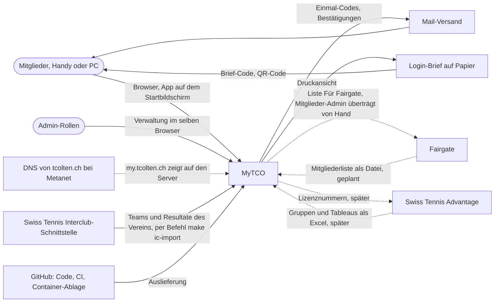
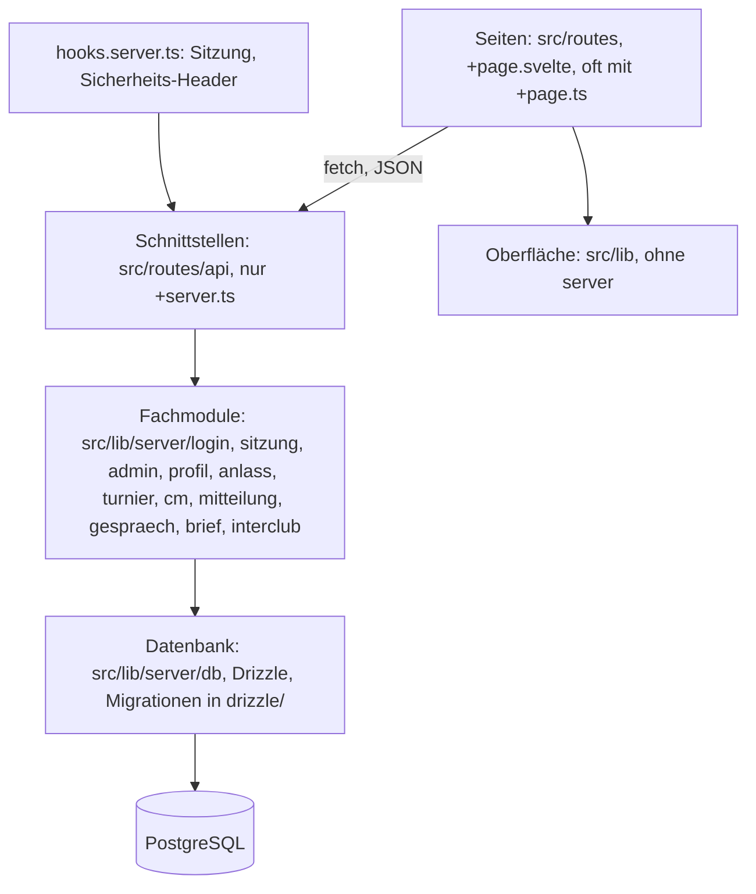
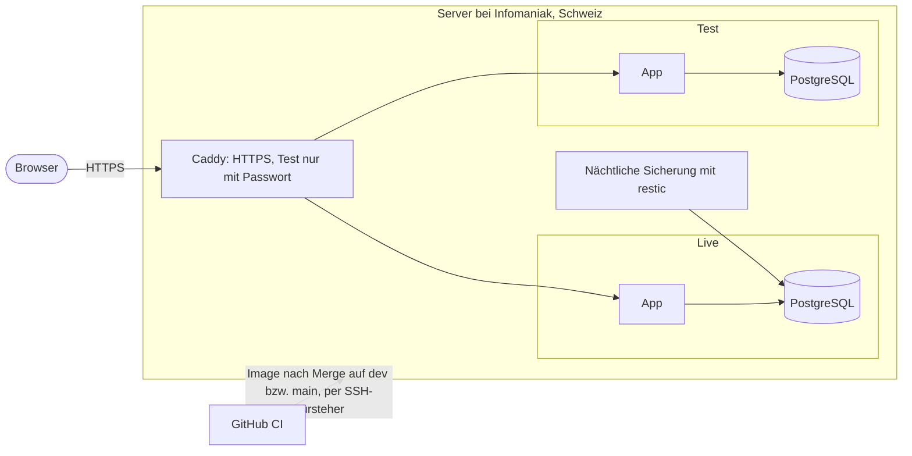

[← Übersicht](index.md)

# Architektur nach arc42

Gesamtbild von MyTCO für die Nachfolge im Verein, den Website-Betreuer von tcolten.ch und
neue Claude-Sessions. Diese Seite verweist auf die Einzeldokumente und wiederholt sie nicht;
was dort steht, gilt. Kapitel ohne eigene Aussage fehlen (Laufzeitsicht: Login-Ablauf im
[Sicherheitskonzept](sicherheitskonzept.md#login); Begriffe im [Glossar](glossar.md)).

## 1 Ziele und Randbedingungen

MyTCO ist die Mitglieder-App des Tennis-Club Olten: Login ohne Passwort, eigene Angaben,
Anlässe, Mitteilungen per Push und E-Mail, Anmeldung zur Clubmeisterschaft, später deren
Resultate und Lizenzanträge.
Mitglieder-Admins pflegen darin die Mitglieder, CM- und Lizenz-Admins ihre Bereiche, der
MyTCO-Admin vergibt die Rollen. Umfang und Termine: [Roadmap](roadmap.md),
[Anforderungen](anforderungen/anforderungen.md).

| Qualitätsziel | Bedeutet | Anforderung |
|---------------|----------|-------------|
| **Einfach für alle** | Mitglieder jeden Alters kommen ohne Hilfe hinein und zurecht; zuerst fürs Handy | N-BARRIEREFREI-01, N-DESIGN-02 |
| **Datenschutz** | Nur nötige Daten, in der Schweiz oder EU/EWR, nach nDSG; Kontaktdaten anderer nur, soweit der Verein es festlegt | N-DATENSCHUTZ-01, -02 |
| **Übergabefähig** | Ehrenamtlich betreut; Ziel ist, dass eine Nachfolge übernehmen kann, heute nur geplant zusammen mit dem Projektleiter (siehe Kapitel 11) | [Betrieb und Übergabe](betrieb-und-uebergabe.md) |

**Randbedingungen:** laufende Kosten im niedrigen dreistelligen Bereich pro Jahr
(N-KOSTEN-01, [Kosten](kosten.md)); Daten in der Schweiz oder EU/EWR (DS-01), der Server in
der Schweiz ([ADR-003](adr/adr-003-hosting-infomaniak-vps.md)); vorerst
ohne Anbindung an Fairgate und ohne Einbindung in tcolten.ch (N-EIGENSTAENDIG-01); der Code
entsteht mit Claude Code, die Regeln dafür erzwingen Prüfungen in Hook und CI.

## 3 Kontextabgrenzung

| Nachbar | Was fliesst | Stand |
|---------|-------------|-------|
| **Mail-Versand** | Einmal-Codes und Bestätigungen über einen austauschbaren SMTP-Zugang | Anbieter hängt an K-11 (Postfach bei Metanet oder Scaleway, [ADR-003](adr/adr-003-hosting-infomaniak-vps.md)) |
| **Login-Brief** | Brief-Code und QR-Code zum ersten Login; MyTCO erzeugt die Druckansicht, gedruckt wird ausserhalb | wer druckt, hängt an K-16.1 |
| **tcolten.ch** | Nur die Adresse: `my.tcolten.ch` und `test.my.tcolten.ch` zeigen auf den Server von MyTCO; die Website selbst bleibt bei Metanet und ist nicht verbunden | Annahme K-10, DNS nur mit Freigabe des Website-Betreuers ([Recherche](recherche/2026-11-04-tcolten-website.md)) |
| **Fairgate** | Keine Schnittstelle. Hinein per Datei (A-MITGLIED-07), hinaus von Hand über die Liste *Für Fairgate* (A-KONTO-02) | [ADR-006](adr/adr-006-eigenstaendig-ohne-fairgate.md); Einlesen hängt an K-45 |
| **Swiss Tennis Advantage** | MyTCO liefert die Lizenznummern zum Einfügen in Advantage (A-ADVANTAGE-01) und übernimmt Gruppen und Tableaus als Excel (A-ADVANTAGE-02); Resultate liefert MyTCO als Liste, eingetragen werden sie in Advantage von Hand (A-ADVANTAGE-04) | ab Etappe *CM-Betrieb* |
| **Swiss Tennis Interclub-Schnittstelle** | Der Server von MyTCO liest die Interclub-Teams und -Resultate des Vereins (`low-scalability.microservices.swisstennis.ch/interclub`, ohne Login, nicht dokumentiert und nicht offiziell freigegeben). In Teil 1 nur über den Befehl `make ic-import`; hinaus gehen nur Vereinsnummer und Team-Nummern, keine Personendaten | [ADR-011](adr/adr-011-interclub-schnittstelle-swiss-tennis.md), [#81](https://github.com/konstantinniedermann/tco-app/issues/81) |
| **GitHub** | Code, CI, Container-Ablage; liefert auf den Server aus | [CI/CD und Release](ci-cd-und-release.md) |

## 4 Lösungsstrategie

| Entscheid | Kern | ADR |
|-----------|------|-----|
| Web-App zuerst | Installierbare Web-App (PWA) mit Admin-Bereich in derselben App; Store-App später als Hülle mit Capacitor | [ADR-001](adr/adr-001-web-app-zuerst.md) |
| Technik | TypeScript, SvelteKit, PostgreSQL; die Oberfläche holt Daten nur über Schnittstellen (Bauregel) | [ADR-002](adr/adr-002-sveltekit-postgresql.md) |
| Hosting | Eigener Server bei Infomaniak in der Schweiz, Test und Live getrennt darauf | [ADR-003](adr/adr-003-hosting-infomaniak-vps.md) |
| Login | Einmal-Code per Brief oder Mail, kein Passwort, lange Sitzung | [ADR-004](adr/adr-004-login-einmal-code.md) |
| Passkey | Freiwillig, als Komfort, mit SimpleWebAuthn | [ADR-005](adr/adr-005-passkey-simplewebauthn.md) |
| Eigenständig | Eigene Mitgliederliste, keine Anbindung an Fairgate | [ADR-006](adr/adr-006-eigenstaendig-ohne-fairgate.md) |
| Versionen | Jeder Merge nach `dev` mit Code bekommt seine eigene Versionsnummer | [ADR-007](adr/adr-007-version-pro-merge.md) |
| Löschfristen | Ein täglicher Zeitgeber in der App ruft den Löschlauf auf, kein Cron, kein Datenbank-Job | [ADR-008](adr/adr-008-zeitgeber-in-der-app.md) |
| Grüner Stand | Der Pre-Push-Hook prüft einen schon grün geprüften Stand nicht noch einmal voll; die CI prüft jeden Push auf `dev` | [ADR-009](adr/adr-009-gruener-stand.md) |
| Öffentliches Repo | Repo öffentlich: CI gratis, `main` geschützt; nie echte Mitgliederdaten im Repo | [ADR-010](adr/adr-010-repo-oeffentlich.md) |
| Interclub | Der Server liest die Interclub-Daten von der nicht dokumentierten Schnittstelle von Swiss Tennis, ohne Anfrage; Kopie in der Datenbank | [ADR-011](adr/adr-011-interclub-schnittstelle-swiss-tennis.md) |

## 5 Bausteinsicht

| Baustein | Aufgabe | Regel |
|----------|---------|-------|
| **Seiten** (`src/routes/**/+page.*`) | Bildschirme für Mitglieder und `verwaltung/` für die Admin-Rollen; laden Daten im Browser | keine Server-Dateien ausser `+server.ts`, keine Form Actions, keine Remote Functions ([ADR-002](adr/adr-002-sveltekit-postgresql.md), Prüfung `bauregel`) |
| **Schnittstellen** (`src/routes/api/**/+server.ts`) | JSON für die Seiten; `api/admin/` nur für Verwaltungsrollen, je Bereich Lesen und Schreiben getrennt (`src/lib/verwaltung/bereiche.ts`: Mitglieder schreibt `mitglieder`, Clubmeisterschaft `cm`, Rollen `mytco`; `mytco` liest alle Bereiche) | Admin-Routen nutzen nur die Einträge aus `ADMIN_SCHNITTSTELLEN` (`src/lib/server/admin/schnittstellen.ts`), `TURNIER_SCHNITTSTELLEN` (`src/lib/server/turnier/schnittstellen.ts`), `CM_ADMIN_SCHNITTSTELLEN` (`src/lib/server/cm/verwaltung-schnittstellen.ts`), `GESPRAECH_ADMIN_SCHNITTSTELLEN` (`src/lib/server/gespraech/verwaltung-schnittstellen.ts`), `MITTEILUNG_ADMIN_SCHNITTSTELLEN` (`src/lib/server/mitteilung/verwaltung-schnittstellen.ts`) oder `ANLASS_ADMIN_SCHNITTSTELLEN` (`src/lib/server/anlass/verwaltung-schnittstellen.ts`), die Sitzung, Bereich und Art prüfen, dazu den frischen Mail-Code (SI-08); während *Ansicht als …* weist der Hook jedes Speichern ab (SI-20) |
| **Fachmodule** (`src/lib/server/<thema>/`) | Fachregeln aus dem [Fachmodell](fachmodell.md) (`FR-NN`) und Rechte aus [Rollen und Rechte](rollen-und-rechte.md) (`RR-NN`) | Rechte prüft immer der Server; `liest`, `schreibt` und `mitKonto` (`admin/rechte.ts`) nutzen nur die Schnittstellen-Dateien der Verwaltung (Prüfung `bauregel`); Importe zwischen den Modulen nur in eine Richtung (ESLint, `eslint.config.js`) |
| **Gespräch mit der Turnierleitung** (`src/lib/server/gespraech/`, Tabellen `gespraech`, `nachricht`) | Fachmodell FR-50 bis FR-54: Mitglied schreibt, CM-Admins antworten und setzen den Zustand; Schnittstellen für Mitglieder `/api/cm/[id]/gespraech`, für die Verwaltung `/api/admin/gespraeche/…` und `/api/admin/turniere/[id]/gespraeche`; Meldung an die Kontaktperson über `meldeMitgliedern` (ohne Inhalt und Namen); Löschung nach dem Turnierjahr in `raeumeAuf` | Antworten und Zustand nur bis Ende des Turnierjahres, Rechte prüft der Server |
| **Interclub** (`src/lib/server/interclub/`, Tabellen `ic_*`) | Kopie der Teams, Begegnungen, Ranglisten und Auf-/Abstiegsspiele des Vereins von Swiss Tennis; Import mit Formprüfung (`import.ts`, Befehl `make ic-import`), Ansicht für Mitglieder (`/api/interclub`) | Nur der Server fragt Swiss Tennis ab ([ADR-011](adr/adr-011-interclub-schnittstelle-swiss-tennis.md)); die Ansicht liest nur die Kopie |
| **Datenbank** (`src/lib/server/db/`, `drizzle/`) | Schema und Migrationen | Migrationen fügen nur hinzu, damit der Rückfall auf das vorherige Image geht ([CI/CD und Release](ci-cd-und-release.md#auslieferung)) |
| **Oberfläche** (`src/lib/` ohne `server/`) | Bausteine und Tokens (`ui/`, `design/`), Teile je Thema (`verwaltung/`, `login/`, `profil/`, `anlass/`, `turnier/`, `cm/`, `mitteilung/`, `interclub/`, `push/`, `hilfe/`, `datenschutz/`) | nur aus dem [UI-Leitbild](ui-leitbild.md) |
| **Zeitgeber** (`src/lib/server/zeitgeber.ts`, gestartet in `hooks.server.ts`) | Täglicher Takt in der App (erster Lauf kurz nach dem Start), ruft den Löschlauf `raeumeAuf` (`src/lib/server/admin/loeschung.ts`) | `ZEITGEBER=aus` schaltet ihn ab (E2E); ein Datenbank-Sperrschloss verhindert parallele Läufe ([ADR-008](adr/adr-008-zeitgeber-in-der-app.md)) |
| **Skripte** (`scripts/`) | Ersten Admin festlegen, Seed, Testdaten, Musterbrief, Prüfungen für Hook und CI | Befehle über `make help` |
| **Betrieb** (`betrieb/`) | Einrichtung, Auslieferung und Sicherung auf dem Server | siehe Kapitel 7 |

Welche Pfade zu welcher Aufgabe gehören: [Context-Scopes](context-scopes.md).

## 7 Verteilungssicht

Geplant, der Server ist noch nicht in Betrieb ([#39](https://github.com/konstantinniedermann/tco-app/issues/39));
lokal nachgewiesen mit `make betrieb-nachweis`.

| Element | Was | Mehr dazu |
|---------|-----|-----------|
| **Server** | Infomaniak VPS mit Linux, gehärtet nach SI-13 | [ADR-003](adr/adr-003-hosting-infomaniak-vps.md), [Sicherheitskonzept](sicherheitskonzept.md) |
| **Test und Live** | je App und eigene Datenbank, getrennt; Test nur mit erfundenen Daten | [CI/CD und Release](ci-cd-und-release.md#umgebungen) |
| **Adressen** | `my.tcolten.ch` (Live), `test.my.tcolten.ch` (Test); bis dahin eine Übergangsadresse aus der IP des Servers | Annahme K-10 |
| **Auslieferung** | Merge nach `dev` liefert auf Test, Merge des PR nach `main` auf Live | [CI/CD und Release](ci-cd-und-release.md#auslieferung) |
| **Sicherung** | nächtlich mit Probe; das Ziel hängt an K-03 und K-48 | [Betrieb und Übergabe](betrieb-und-uebergabe.md#sicherung) |
| **Einrichtung von Hand** | Türsteher, Geheimnisse, Sicherungsziel, Timer | [`betrieb/README.md`](../betrieb/README.md) |
| **Store-App** | gibt es nicht; käme später als Hülle derselben Web-App ([ADR-001](adr/adr-001-web-app-zuerst.md), hängt an K-22) | [CI/CD und Release](ci-cd-und-release.md#ausblick-store-app) |

## 8 Querschnittskonzepte

| Thema | Wo |
|-------|-----|
| Login, Sitzung, Zugang zur Verwaltung | [Sicherheitskonzept](sicherheitskonzept.md#login), [ADR-004](adr/adr-004-login-einmal-code.md) |
| Rollen und Rechte | [Rollen und Rechte](rollen-und-rechte.md) |
| Löschfristen zur Laufzeit | Der Zeitgeber der App löscht täglich, was fällig ist: ausgetretene Mitglieder nach 1 Jahr, vorgemerkte nach 7 Tagen, Verlauf nach 12 Monaten, Antworten zu Anlässen ein Jahr nach Beginn des Anlasses ([Datenschutzkonzept](datenschutz.md#löschen)) |
| Personendaten, Löschen, Logs | [Datenschutzkonzept](datenschutz.md) (`DS-NN`), [Datenschutzerklärung](datenschutzerklaerung.md) |
| Sicherheit | [Sicherheitskonzept](sicherheitskonzept.md) (`SI-NN`) |
| Oberfläche, Sprache, Barrierefreiheit | [UI-Leitbild](ui-leitbild.md) (`UI-NN`) |
| Tests und Nachweis | [Testkonzept](testkonzept.md) |
| Konten, Geheimnisse, Übergabe | [Betrieb und Übergabe](betrieb-und-uebergabe.md) |

**Annahmen zu offenen Fragen:** Vieles hängt an Antworten des Vereins (IDs `K-NN`). Wird
ohne Antwort gebaut, ist die Annahme dort markiert, wo sie wirkt; `make annahmen` listet sie
auf und meldet sie, sobald die Antwort da ist. Regel und Schreibweisen:
[Abklärungen](abklaerungen.md).

**Erfundene Testdaten:** In Repo, Tests und Test-Umgebung stehen nie echte Mitgliederdaten
(DS-08); echte Vereinsunterlagen liegen nur im gitignorierten Ordner `intern/`.

## 11 Risiken

Die einzelnen Restrisiken stehen im [Sicherheitskonzept](sicherheitskonzept.md#restrisiken),
die offenen Fragen in den [Abklärungen](abklaerungen.md). Für das Ganze am wichtigsten:

- **Ein einziger Betreuer.** Code, Server und Zugangsdaten kennt heute nur der Projektleiter.
  Dagegen: Übergabe-Checkliste und Konten auf den Verein ([Betrieb und Übergabe](betrieb-und-uebergabe.md));
  wo die Zugangsdaten liegen, hängt an K-49.
- **Swiss Tennis ändert oder sperrt die Schnittstelle.** Nur der Bereich Interclub fällt weg; die App zeigt den letzten Stand
  ([ADR-011](adr/adr-011-interclub-schnittstelle-swiss-tennis.md)).
- **Zwei Mitgliederlisten.** MyTCO und Fairgate können auseinanderlaufen
  ([ADR-006](adr/adr-006-eigenstaendig-ohne-fairgate.md)).
- **Wer das Postfach hat, hat das Konto.** Folge des Logins ohne Passwort
  ([ADR-004](adr/adr-004-login-einmal-code.md)).
