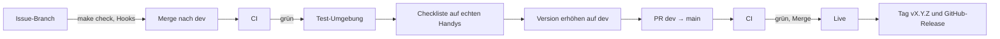

[← Übersicht](index.md)

# CI/CD und Release

Wie eine Änderung vom Commit auf den Server kommt. Grundlage: Web-App ([ADR-001](adr/adr-001-web-app-zuerst.md)),
SvelteKit und PostgreSQL ([ADR-002](adr/adr-002-sveltekit-postgresql.md)), eigener Server bei
Infomaniak ([ADR-003](adr/adr-003-hosting-infomaniak-vps.md)). Was getestet wird, steht im
[Testkonzept](testkonzept.md); der Ablauf pro Issue im Skill `tco-branching`.

**Legende:** **B** = belegt (Quelle genannt) · **S** = Schätzung · **V** = Vermutung, nicht geprüft.

## Umgebungen

Beide laufen auf demselben Server, aber getrennt: je ein eigener PostgreSQL-Container mit
eigenem Benutzer und eigene Docker-Netze. Die Test-App erreicht die Live-Datenbank nicht.

| | Test | Live |
|---|------|------|
| Adresse | `test.my.tcolten.ch`, nur mit Passwort | `my.tcolten.ch` |
| Ausgeliefert bei | Merge nach `dev` | Merge des PR `dev` → `main` |
| Daten | nur erfundene Testdaten; bei jeder Auslieferung neu aufgesetzt | Mitgliederdaten |
| E-Mail | nur an die Adresse des Projektleiters, alle anderen werden verworfen | an die Mitglieder |
| Push, Schlüssel | eigene | eigene |

Beide Adressen richtet der Website-Betreuer ein (K-10). Auf der Test-Umgebung läuft die
[Checkliste vor dem Release](testkonzept.md#checkliste-vor-dem-release). Echte Daten kommen
dort nie hin (DS-08).

**Wer baut die Auslieferung:** Das Code-Gerüst (#15) baut die CI-Prüfungen. Server,
Umgebungen und Auslieferung baut [#32](https://github.com/konstantinniedermann/tco-app/issues/32),
sobald Konten und Adresse geklärt sind (K-04, K-10), spätestens vor dem Release
*Mitglieder-Login*.

## Ablauf

- **Freigabe:** Der Merge des PR nach `main` geht ohne weiteren Knopf live; `main` ist
  immer, was live läuft. Gemergt wird erst, wenn der Projektleiter die Checkliste auf Test
  abgehakt und das Release freigegeben hat.
- **Version:** Vor dem PR erhöht ein Commit auf `dev` die Version in `package.json` und macht
  aus *Unveröffentlicht* in den [Versionen](versionen.md) die neue Nummer. Nach der
  erfolgreichen Live-Auslieferung setzt die CI den Tag und das GitHub-Release; nur dieser
  Schritt darf ins Repo schreiben.
- **Merge:** Auf GitHub ist nur der Merge-Commit erlaubt (Squash und Rebase abgeschaltet).
  „Branch nach dem Merge löschen“ bleibt aus, sonst löscht der PR `dev` → `main` den
  Branch `dev`.
- **Fehlerbehebungen** nehmen denselben Weg über `dev`; ein eigener Hotfix-Weg lohnt bei
  diesem Umfang nicht.
- Released wird, wenn ein Stand es wert ist, nicht nach jedem Issue: Jedes Release braucht
  die Checkliste. Bis zum Code-Gerüst gibt es nur Doku; diese Releases erhalten keine
  Versionsnummer.

## Auslieferung

1. **Bauen:** Die CI baut das Docker-Image und legt es in der privaten Container-Ablage von
   GitHub ab.
2. **Verbinden:** Die CI meldet sich per SSH auf dem Server an, mit je einem eigenen
   Schlüssel für Test und Live. Der Schlüssel darf nur das Auslieferungs-Skript starten.
3. **Auf dem Server:** Bei Live zuerst eine Sicherung der Datenbank, mit denselben Regeln wie
   die nächtliche Sicherung (verschlüsselt, Schweiz, 30 Tage, [ADR-003](adr/adr-003-hosting-infomaniak-vps.md)).
   Dann neues Image holen, Migrationen ausführen, Container neu starten.
4. **Prüfen:** Antwortet die App nicht innert einer Minute (S) auf ihre Statusabfrage,
   startet das Skript wieder das vorherige Image. Der CI meldet es nur „ok“ oder „Fehler“,
   keine Logs der App, denn CI-Logs liegen bei GitHub in den USA (DS-01, DS-06).
5. **Abschluss Live:** Tag `vX.Y.Z` auf `main` und GitHub-Release mit dem Text aus den
   [Versionen](versionen.md).

**Zurück auf die vorherige Version:** Das vorherige Image bleibt auf dem Server; ein Befehl
startet es wieder. Damit das ohne Datenverlust geht, fügen Migrationen nur hinzu. Was die
alte Version noch braucht, wird erst ein Release später entfernt.

### Schutz des Auslieferungswegs

Wer ausliefern kann, kommt an die Mitgliederdaten. Deshalb:

- Das Skript nimmt nur zwei Angaben an: `test` oder `live` und den Digest eines Images aus
  der eigenen Container-Ablage. Beides wird streng geprüft und nie über eine Shell
  ausgewertet.
- Der Live-Lauf startet nur bei einem Push auf `main`.
- Nur der Auslieferungs-Job fordert den SSH-Schlüssel an, und er führt keine npm-Pakete
  aus. GitHub gibt ein Geheimnis nur an Schritte, die es anfordern; ein Schadpaket in den
  Tests kommt so nicht an den Schlüssel. Alle anderen Jobs haben nur Leserechte aufs Repo.
- **Kein GitHub Pro:** Schutz von `main` auf GitHub, Geheimnisse nur für eine Umgebung und
  „nur `main` darf ausliefern“ gibt es für private Repos erst ab Pro (B:
  [GitHub Docs](https://docs.github.com/en/actions/reference/workflows-and-actions/deployments-and-environments),
  Antwort der API). Der Projektleiter hat sich dagegen entschieden; die Auslieferung bleibt
  automatisch.
- **Restrisiko:** Wer ins Repo pushen kann (heute nur der Projektleiter), kann einen
  Workflow schreiben, der den Live-Schlüssel nutzt, oder direkt auf `main` pushen; davor
  schützt nur der lokale Hook. Das bewertet das Sicherheitskonzept
  ([#6](https://github.com/konstantinniedermann/tco-app/issues/6)).

### Geheimnisse

| Wo | Was |
|----|-----|
| GitHub | SSH-Schlüssel für Test und für Live, Fingerabdruck des Servers |
| CI-Lauf | kurzlebiges Token zum Lesen der Container-Ablage, das die CI für den Pull mitgibt; auf dem Server bleibt kein dauerhaftes Token |
| Server | Datenbank-Passwörter, Schlüssel für Push, Zugang zum E-Mail-Versand, Passwort der Test-Umgebung |

Nichts davon steht im Repo. Wo die Geheimnisse für eine Nachfolge dokumentiert sind, regelt
[#10](https://github.com/konstantinniedermann/tco-app/issues/10).

## Prüfungen in der CI

`make check` führt lokal dieselben Prüfungen aus wie die CI; nur der Secret-Scan läuft lokal
über den Hook bzw. `make secrets`. Die CI läuft bei PRs und auf `dev` und `main`, nicht auf
Issue-Branches (dort decken die Git-Hooks ab).

| Prüfung | Quelle | Stand |
|---------|--------|-------|
| Doku-Check (Links, Konfliktmarker, Mermaid) | — | vorhanden |
| Secret-Scan über die ganze Historie (gitleaks) | — | vorhanden |
| ESLint mit Svelte-Regeln, Prettier | ADR-002, Arbeitsregeln | mit #15 |
| `svelte-check`, Runes-Modus fest eingeschaltet | ADR-002 | mit #15 |
| Bauregel: unter `src/routes` keine `*.server.ts` ausser `+server.ts`, keine Form Actions | ADR-002 | mit #15 |
| Build als reine Web-App (für die spätere Store-App) | ADR-002 | mit #15 |
| Vitest: Fachlogik und Rechte (mit PostgreSQL in der CI), Abdeckung mindestens 90 % | Testkonzept | mit #15 |
| Jede `FR-`, `RR-` und umgesetzte `A-`-ID hat einen Test | Testkonzept | mit #15 |
| Testdaten und Seed-Daten nur mit `@example.org` | Testkonzept | mit #15 |
| Playwright Ende-zu-Ende in drei Umgebungen mit axe; Screenshots 30 Tage, im PR verlinkt | Testkonzept | mit #15 |
| Malware-Prüfung der npm-Pakete (OSV-Gate, Kopie aus Munica) | dieses Konzept | mit #15 |
| Docker-Image baut | ADR-003 | mit #15 |

## Abhängigkeiten

- **Neue Pakete** nur nach Freigabe durch den Projektleiter (Hook `dep-guard`).
- **Installieren** mit `npm ci --ignore-scripts`: genau die Versionen aus der Lock-Datei,
  ohne Installationsskripte der Pakete. Was das eigene Projekt beim Installieren braucht
  (z. B. `svelte-kit sync`), läuft als eigener Schritt.
- **Malware-Prüfung:** Das OSV-Gate prüft die Lock-Datei gegen die Datenbank bekannter
  Schadpakete und bricht die CI ab.
- **Updates:** Dependabot schlägt wöchentlich Updates für npm, Docker-Images und GitHub
  Actions vor, als PR auf `dev`. Hauptversionen werden einzeln geprüft.

## Versionen

- Schema `Hauptversion.Nebenversion.Korrektur`. Die erste Version mit Code ist `0.1.0`, das
  erste Release *Mitglieder-Login* wird `1.0.0`.
- **Nebenversion** für eine neue Etappe oder Funktion, **Korrektur** für Fehlerbehebungen,
  **Hauptversion** nur, wenn Mitglieder etwas umstellen müssen (z. B. Umstieg auf die
  Store-App).
- Die Version steht in `package.json`, in der Fusszeile der App und als Tag auf `main`.

## Alte Versionen auf dem Handy

Die Web-App speichert sich auf dem Handy zwischen (Service Worker). Damit niemand mit einer
alten Version arbeitet:

- Eine neue Version lädt **beim nächsten Start** von selbst.
- Der Server nennt bei jeder Antwort die **Mindestversion**, die er versteht. Ist eine
  offene App älter, lädt sie neu; eine angefangene Eingabe bleibt dabei erhalten.
- Die Mindestversion steigt nur, wenn eine Schnittstelle sich unverträglich ändert. Sonst
  bleiben Schnittstellen mit dem vorherigen Release verträglich.

## Actions-Minuten

Der Gratisplan des GitHub-Kontos hat 2000 Minuten pro Monat, **geteilt mit den anderen
privaten Repos** (B: Messung in Munica, Stand 10/2026). Munica allein braucht fest über
1200 Minuten; im September 2026 war das Kontingent aufgebraucht (B, ebenda). Ist auch das
Budget erschöpft, startet GitHub keine Jobs mehr, also auch keine Auslieferung.

- CI nur bei PRs und auf `dev`/`main`; Issue-Branches prüfen lokal.
- Läufe derselben Branch brechen den vorherigen ab.
- Änderungen nur an der Doku lösen weder Ende-zu-Ende-Tests noch eine Auslieferung aus.
- Grob 8 Minuten pro Merge nach `dev` mit Code (S), bei rund 30 im Monat etwa 250 Minuten
  (S). Mit #15 wird gemessen; reicht das Kontingent nicht, laufen die Ende-zu-Ende-Tests nur
  beim PR nach `main`.
- **Notfall ohne Minuten:** Der Projektleiter startet das Auslieferungs-Skript von Hand auf
  dem Server, oder das Budget des Kontos wird erhöht.

## Ausblick: Store-App

Erst wenn ein Trigger aus ADR-001 greift (K-22). Dann:

- Capacitor packt den Web-Build in eine App für iOS und Android.
- iOS braucht einen Mac oder einen Build-Dienst; macOS-Läufe kosten bei GitHub ein
  Vielfaches der Linux-Minuten (V).
- Testverteilung über TestFlight (Apple) und interne Tests (Google), dann die Prüfung durch
  die Stores. Der Upload in die Stores ist ein eigener, von Hand ausgelöster Schritt nach dem
  Release.
- Die Store-App prüft dieselbe Mindestversion, zeigt aber statt Neuladen „Bitte
  aktualisieren“ mit Link in den Store.
