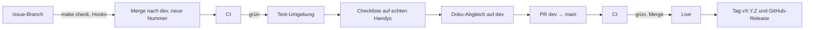

[← Übersicht](index.md)

# CI/CD und Release

Wie eine Änderung vom Commit auf den Server kommt. Grundlage: Web-App ([ADR-001](adr/adr-001-web-app-zuerst.md)),
SvelteKit und PostgreSQL ([ADR-002](adr/adr-002-sveltekit-postgresql.md)), eigener Server bei
Infomaniak ([ADR-003](adr/adr-003-hosting-infomaniak-vps.md)). Was getestet wird, steht im
[Testkonzept](testkonzept.md); der Ablauf pro Issue im Skill `tco-branching`.

**Legende:** **B** = belegt (Quelle genannt) · **S** = Schätzung · **V** = Vermutung, nicht geprüft.

## Umgebungen

Beide laufen auf demselben Server, aber getrennt: je ein eigener PostgreSQL-Container mit
eigenem Benutzer und eigene Docker-Netze. Die Test-App erreicht die Live-Datenbank nicht.

| | Test | Live |
|---|------|------|
| Adresse | `test.my.tcolten.ch`, nur mit Passwort (Annahme K-10) | `my.tcolten.ch` (Annahme K-10) |
| Rolle | Demo und Checkliste | Testgruppe (Pilotphase), später alle Mitglieder |
| Ausgeliefert bei | Merge nach `dev` | Merge des PR `dev` → `main` |
| Daten | nur erfundene Testdaten; bei jeder Auslieferung neu aufgesetzt | Mitgliederdaten |
| E-Mail | alle Mails gehen an die Adresse des Projektleiters, der Betreff nennt den ursprünglichen Empfänger (hängt an K-11) | an die Mitglieder |
| Push, Schlüssel | eigene | eigene |

Beide Adressen richtet der Website-Betreuer ein (Annahme K-10: Test und Live unter `tcolten.ch`).
Bis dahin gilt eine Übergangsadresse, die sich aus der IP des Servers bildet; die Adressen sind
Einstellungen, am Code ändert sich dafür nichts. Die Demo soll auf Test laufen, Live bleibt leer bis zur
Testgruppe. Auf der Test-Umgebung läuft die
[Checkliste vor dem Release](testkonzept.md#checkliste-vor-dem-release). Echte Daten kommen
dort nie hin (DS-08).

**Wer baut die Auslieferung:** Das Code-Gerüst (#15) hat die CI-Prüfungen gebaut.
[#32](https://github.com/konstantinniedermann/tco-app/issues/32) baute den lokal belegbaren Teil:
Einrichtung, Auslieferung, Sicherung und die CI-Jobs, nachgewiesen mit `make betrieb-nachweis`
(43 Prüfungen auf Docker Desktop, alle ok). Den echten Server nimmt
[#39](https://github.com/konstantinniedermann/tco-app/issues/39) in Betrieb (hängt an #32, blockiert
#29; die Konten laufen auf eine Vereinsadresse, K-04.1; die Adresse hängt an K-10), spätestens vor dem Pilot der [Testgruppe](testgruppe.md) (Etappe *Pilot*).
Bis dahin sind die Auslieferungs-Jobs ausgeschaltet.

## Ablauf

- **Freigabe:** Der Merge des PR nach `main` geht ohne weiteren Knopf live; `main` ist
  immer, was live läuft. Gemergt wird erst, wenn der Projektleiter die Checkliste auf Test
  abgehakt und das Release freigegeben hat (ohne Server: Ausnahmen unter [Versionen](#versionen)).
- **Doku-Abgleich:** Vor jedem Release, auch einem reinen Doku-Release, wird die Doku gegen
  Code und Konfiguration abgeglichen; Korrekturen kommen als eigener Commit auf `dev`. Danach
  prüft `make release-check`, ob Version, [Versionen](versionen.md) und Tags zusammenpassen
  (genau ein Abschnitt pro Version, der von `package.json` zuoberst; die Version sinkt nicht;
  «Unveröffentlicht» ist leer, sobald sie sich ändert; kein Tag ohne Abschnitt und keiner auf
  einer Version mit dem Marker «nicht ausgeliefert»);
  enthält das Release Code (auch Skripte oder Workflows), muss die Version seit dem letzten
  Release gestiegen sein, nur bei reiner Doku bleibt sie. Ein Befund, der Mitglieder, Vorstand oder Betrieb in die Irre führt,
  hält das Release auf. Ablauf im Skill `tco-branching`.
- **Version:** Das Release erhöht die Version nicht, Live bekommt die Nummer, die `dev` gerade
  trägt (Vergabe beim Merge, siehe [Versionen](#versionen)). Nach der erfolgreichen
  Live-Auslieferung setzt die CI den Tag und das GitHub-Release; dessen Text fasst alle
  Abschnitte der [Versionen](versionen.md) seit dem letzten GitHub-Release zusammen (beim
  ersten alle). Nur dieser
  Schritt darf ins Repo schreiben. Solange Live ausgeschaltet ist, gilt ein eigener Ablauf
  (siehe [Versionen](#versionen)).
- **Merge:** Auf GitHub ist nur der Merge-Commit erlaubt (Squash und Rebase abgeschaltet).
  „Branch nach dem Merge löschen“ bleibt aus, sonst löscht der PR `dev` → `main` den
  Branch `dev`.
- **Fehlerbehebungen** nehmen denselben Weg über `dev`; ein eigener Hotfix-Weg lohnt bei
  diesem Umfang nicht.
- Released wird, wenn ein Stand es wert ist, nicht nach jedem Issue: Jedes Release braucht
  die Checkliste, sobald Test läuft. Die Doku-Stände vor dem Code-Gerüst haben keine Versionsnummer.

## Auslieferung

Gebaut wird einmal, auf `dev`. Live bekommt **nur das Image, das zuvor auf Test erfolgreich
ausgeliefert wurde** (Docker-Builds sind nicht bitgenau wiederholbar, ein Neubau wäre ein
anderes Image). Dafür trägt ein Image das Kennzeichen `code-<Hash>`; der Hash bildet sich über
alle versionierten Dateien ausser der Doku (gleiche Regel wie `nur-doku.ts`). Ein reiner
Doku-Merge ändert ihn nicht.

1. **Prüfen:** Job `image` baut das Image und startet es im Rauchtest (Container mit
   PostgreSQL, Migration, `/api/status` = `ok`). Das läuft bei jeder Codeänderung und ist
   sofort aktiv.
2. **Bauen (`bauen`, nur `dev`):** Image bauen und mit dem Commit als Kennzeichen
   (`commit-<sha>`) in die private Container-Ablage von GitHub legen.
3. **Verbinden (`ausliefern`):** Die CI meldet sich per SSH beim **Türsteher** auf dem Server,
   mit je einem eigenen Schlüssel für Test und Live. Der Schlüssel darf nur den Türsteher
   starten; die Umgebung steht im Schlüssel, nicht in der Anfrage. Übergeben wird nur der
   Digest des Images. Der Schlüssel wird je Zweig gewählt, ohne Rückfall auf den anderen; ein
   leeres Geheimnis ergibt `fehler`.
4. **Auf dem Server:** Das Image holen und **die Einrichtung daraus entnehmen** (Compose-Dateien,
   Caddy-Teil der Umgebung, Skripte). Sie reist im Image mit, das Image wird dafür nicht
   gestartet. Bei Live zuerst eine Sicherung der Datenbank, **bevor** irgendetwas übernommen
   wird; scheitert sie, bleibt alles, wie es war. Dann die Einrichtung übernehmen (gemeinsame
   Teile wie die Caddy-Grundkonfiguration nur bei Live oder solange Live noch nie ausgeliefert wurde, vorher prüft `caddy validate`; eine
   ungültige Konfiguration wird abgewiesen, die alte bleibt aktiv). Danach lädt Caddy die neue
   Konfiguration, und der Proxy-Container wird neu erstellt, wenn sich sein Image (z. B. ein
   Update von Dependabot) oder `proxy.env` geändert hat. Dann Migrationen ausführen, Container
   neu starten. Auf Test wird die Datenbank dabei neu aufgesetzt. Bricht der Lauf mitten in der
   Übernahme ab, wird alles Übernommene zurückgesetzt.
   **Testdaten (nur Test, nur wenn das Image das Skript enthält, Schritt «testdaten laden»):** Nach der Migration legt
   `scripts/testdaten.ts` die erfundenen Mitglieder samt Konto an und schickt für Erika Beispiel
   einen Brief-Code per Mail («Brief-Code für die Test-Umgebung», mit Code, Gültigkeit und
   Adresse der App); durch die Umleitung («[Test für <Adresse>] » vor dem Betreff) landet sie beim Projektleiter. Das Skript bricht ab,
   ohne etwas zu schreiben, wenn `MAIL_NUR_AN` leer ist (also nie auf Live, auch nicht von Hand)
   oder schon Mitglieder da sind; dann scheitert die Auslieferung. Scheitert nur die Mail,
   bleiben die Testdaten, und das Protokoll hält «Mail mit Brief-Code nicht versandt» fest. Code
   und Adressen stehen nie im Protokoll.
5. **Prüfen:** Antwortet die App nicht innert einer Minute (`MYTCO_WARTEZEIT`, 60 s) auf ihre Statusabfrage,
   startet das Skript wieder das vorherige Image. Die CI erfährt nur `ok` oder `fehler`,
   keine Logs der App, denn CI-Logs liegen bei GitHub in den USA (DS-01, DS-06).
6. **Freigeben (`freigeben`, nur `dev`):** Erst nach einer geglückten Auslieferung auf Test
   setzt dieser Job das Kennzeichen `code-<Hash>`. Ohne Auslieferung auf Test gibt es kein
   solches Kennzeichen, also auch nichts für Live.
7. **Live (`finden`, nur `main`):** Der Job sucht über `code-<Hash>` das Image, das auf Test lief.
   Fehlt es, endet der Lauf mit `fehler`, es wird nicht neu gebaut. **Vorab** prüft `finden`
   das Release (Version gültig, Abschnitt in den [Versionen](versionen.md) vorhanden, Tag noch
   frei), damit Live nie ausgeliefert wird und danach das Release scheitert. Dann liefert
   `ausliefern` an Live.
8. **Abschluss Live (`release`):** Tag `vX.Y.Z` auf `main` und GitHub-Release mit dem Text aus den
   [Versionen](versionen.md).

**Zwei Schalter:** Die Jobs `bauen`, `finden`, `ausliefern`, `freigeben` und `release` laufen nur,
wenn die Repo-Variable der Umgebung auf `an` steht: `AUSLIEFERUNG_TEST` (für `dev`) bzw.
`AUSLIEFERUNG_LIVE` (für `main`). So kann die Demo auf Test laufen, während Live noch aus ist.
Stehen sie nicht auf `an`, gelten die Jobs als übersprungen, nicht als fehlgeschlagen. Aktiv ist
nur der Rauchtest.

**Sicherung und Probe:** `sichern` schreibt die Datenbank verschlüsselt mit restic ins
Sicherungsziel, ohne unverschlüsselte Datei, und löscht Sicherungen nach 30 Tagen, gezählt ab der neuesten Sicherung
(DS-06, [ADR-003](adr/adr-003-hosting-infomaniak-vps.md)). Nächtlich läuft das für Live über einen
Timer, danach prüft `probe` die frische Sicherung in einer Wegwerf-Datenbank ohne Verbindung nach
aussen. Eingespielt und zurückgespielt werden nur vollständige Läufe. Die Probe-Daten bleiben
auf dem Server (SI-16); die Sicherung selbst verlässt ihn nur verschlüsselt, Richtung
S3-kompatiblem Ziel (Vorschlag in [Betrieb und Übergabe](betrieb-und-uebergabe.md#sicherung), festgelegt mit dem Hosting).

- **30 Tage:** restic zählt sie je Umgebung und Datei (Dump, Zählung) ab der neuesten Sicherung,
  nicht ab heute. Bleibt die Sicherung aus, bleiben auch die alten erhalten.
- **Sicherungsziel:** Das Ziel legt der Betrieb einmal von Hand an (`betrieb/README.md`).
  `sichern` legt nie selbst eines an; fehlt es oder ist es falsch eingetragen, meldet es
  `fehler`, und eine Live-Auslieferung bricht vor jeder Änderung ab (ausser bei der ersten, solange noch keine Live-Datenbank läuft).
- **Wiederherstellen:** Vor dem Einspielen werden die Tabellen der App samt der Liste der
  Migrationen geleert, alles in einer Transaktion. So bleibt keine Tabelle einer späteren
  Migration stehen, und die nächste Auslieferung migriert wieder sauber. Scheitert etwas,
  bleibt der alte Stand.

**Befehle auf dem Server** (Einzelheiten in `betrieb/README.md`):

| Befehl | Zweck |
|--------|-------|
| `zurueck <umgebung>` | Zurück auf das vorherige Image. Migrationen fügen nur hinzu, darum geht das ohne Datenverlust; was die alte Version noch braucht, wird erst ein Release später entfernt |
| `sichern <umgebung> [ohne-aufraeumen]` | Datenbank sichern; mit `ohne-aufraeumen` ohne das Löschen nach 30 Tagen (`forget --prune`) |
| `wiederherstellen <umgebung> [lauf] [ohne-sicherung]` | Eine Sicherung derselben Umgebung zurückspielen. Sichert vorher den jetzigen Stand (ohne Aufräumen; scheitert das, ändert sich nichts); ohne Lauf der bis dahin neueste. Der Notschalter `ohne-sicherung` lässt diese Sicherung weg und steht im Protokoll; nur von Hand auf dem Server, nie aus der CI oder dem Türsteher. Auf Test findet der Befehl keinen Snapshot einer Live-Sicherung (DS-08) |
| `probe <umgebung> [lauf]` | Sicherung in einer Wegwerf-Datenbank einspielen, mit der Zählung vergleichen, `ok` oder `fehler` |

**Netz und Header:** Ein Caddy-Proxy nimmt 80 und 443 an und erreicht beide Apps; die Datenbanken
hängen nur an ihrem internen Netz, die Test-App erreicht Live nicht. Caddy behält die
Content-Security-Policy der App und setzt `frame-ancestors 'none'` nur, wo keine besteht;
HSTS, `nosniff` und Referrer-Policy setzt er genau einmal, auch für `/_app/*`. Er führt kein
Zugriffsprotokoll. Sein Betriebslog (Stufe INFO: Start, Zertifikate, Anfragen an die
Admin-Schnittstelle, Fehler und Warnungen) geht ins Docker-Log des Proxys; ein Filter entfernt
daraus Client-Adresse und Weiterleitungs-Köpfe jedes Eintrags, es bleiben keine IP-Adressen
(DS-06). Die INFO-Einträge der Admin-Schnittstelle braucht `make betrieb-nachweis` als
Gegenprobe, dass der Filter etwas zu filtern hatte. Test verlangt ein Passwort.

**Protokolle auf dem Server:** Was docker, psql und die App bei Auslieferung und Sicherung
ausgeben, steht nur in `<umgebung>/protokoll.log` (je Umgebung, nur für den Betriebsbenutzer
lesbar). Werte aus der Datenbank kommen dort nicht hin: Scheitert das Einspielen, schreibt
`wiederherstellen` nur den Fehlercode (`psql` mit `VERBOSITY=sqlstate`) und `probe` nur die Zahl
der Fehlerzeilen von `pg_restore`; Hauptzeile, `DETAIL` und `CONTEXT` der Meldungen werden
verworfen (DS-06). Docker-Logs der Container rotieren nach Grösse (5 × 10 MB). Eine Rotation
nach Zeit (höchstens 30 Tage, DS-06) für beide richtet
[#39](https://github.com/konstantinniedermann/tco-app/issues/39) ein.

### Schutz des Auslieferungswegs

Wer ausliefern kann, kommt an die Mitgliederdaten. Deshalb:

- Das Skript nimmt nur zwei Angaben an: `test` oder `live` und den Digest eines Images aus
  der eigenen Container-Ablage. Beides wird streng geprüft und nie über eine Shell
  ausgewertet.
- Auf Live ist die Umleitung der Mails (`MAIL_NUR_AN`, nur für Test) gesperrt: Steht in
  `live/geheim.env` ein Wert, verweigern `ausliefern live` und `zurueck live` jede Änderung
  und melden `fehler`; der Grund steht nur im Protokoll.
- Der Live-Lauf startet nur bei einem Push auf `main` und nur mit einem Image, das auf Test
  ausgeliefert wurde.
- Der Türsteher und seine Eingabeprüfung werden **von Hand** eingerichtet und nie von der CI
  geändert. Er schützt den **Eingang**: Er nimmt nur einen Digest an, die Umgebung kommt aus
  dem Schlüssel. **Gegen ein schädliches Image schützt er nicht.** Das `ausliefern` aus dem
  Image läuft auf dem Server als Benutzer `mytco` mit Zugang zu Docker, und das reicht so weit
  wie root. Ein solches Image kann auch den Türsteher selbst, die Schlüssel in
  `authorized_keys` und die systemd-Einheiten umschreiben.
- Die Rechte der Workflows prüft `workflow-rechte.ts` in der CI: Die Workflow-Ebene hat nur
  `contents: read`, und kein Job hat mehr als vorgegeben: `packages: write` nur `bauen` und
  `freigeben`, `packages: read` nur `finden` und `ausliefern`, `contents: write` nur `release`, die SSH-Geheimnisse
  nur `ausliefern`.
- Nur der Auslieferungs-Job fordert den SSH-Schlüssel an. Er führt keine npm-Pakete, keine
  fremden Actions und nichts aus Caches oder Artefakten anderer Jobs aus. GitHub gibt ein
  Geheimnis nur an Schritte, die es anfordern; ein Schadpaket in den Tests kommt so nicht
  an den Schlüssel. Welche Rechte die einzelnen Jobs haben, legt der Punkt zu
  `workflow-rechte.ts` oben fest.
- **Öffentliches Repo, `main` auf GitHub geschützt:** Das Repo ist öffentlich (seit
  06.11.2026, Entscheid des Projektleiters wegen der Actions-Minuten). Damit gibt es den
  Schutz von `main` ohne GitHub Pro (B:
  [GitHub Docs](https://docs.github.com/en/get-started/learning-about-github/githubs-plans)).
  Die Regel «main schützen» lässt Änderungen an `main` nur über einen PR mit Merge-Commit
  zu, verlangt grüne Prüfungen (`Prüfen (Lint, Tests, Build)`, `Doku (make docs)`,
  `gitleaks (ganze Historie)`) und verbietet Force-Push und Löschen; Ausnahmen hat niemand.
  Freigaben verlangt sie keine (0): Jedes Konto mit Schreibrecht kann selbst einen PR nach
  `main` öffnen und mergen, auch von einem anderen Branch als `dev`; die Regel erzwingt nur
  PR, Merge-Commit und grüne Prüfungen. Die Ende-zu-Ende-Tests sind bewusst keine verlangte
  Prüfung: Läuft der Job nicht (nur Doku), meldet er sich unter einem anderen Namen, und eine
  verlangte Prüfung, die nie kommt, sperrt den PR. Dass sie vor dem Release grün sind, sichert
  der Ablauf «warten bis grün» (Skill `tco-branching`). Workflows aus Forks laufen erst nach
  Freigabe durch den Projektleiter. Geheimnisse nur für eine Umgebung und „nur `main` darf
  ausliefern“ (Deployment-Umgebungen) gibt es für öffentliche Repos ebenfalls gratis (B:
  [GitHub Docs](https://docs.github.com/en/actions/reference/workflows-and-actions/deployments-and-environments),
  ebenso der Link oben); sie sind noch nicht eingerichtet ([#61](https://github.com/konstantinniedermann/tco-app/issues/61)).
  Die Auslieferung bleibt automatisch.
- **Restrisiko** (bewertet im [Sicherheitskonzept](sicherheitskonzept.md#restrisiken), unter
  Bedingungen: Zwei-Faktor-Login auf allen Konten mit Schreibrecht (SI-15), die
  Hauptansprechperson nutzt ihren Zugang nur zum Lesen; neu bewerten bei einer Übergabe, wenn das
  Repo das Konto wechselt, [Betrieb und Übergabe](betrieb-und-uebergabe.md#übergabe-checkliste)). Die
  Reichweite ist dort am 02.11.2026 richtiggestellt worden und **vom Projektleiter neu zu
  bestätigen**:
  - Wer ins Repo pushen kann, kann zwar nicht mehr direkt auf `main` pushen (Regel «main
    schützen» auf GitHub, zusätzlich der lokale Hook), aber selbst einen PR nach `main`
    mergen, sobald die verlangten Prüfungen grün sind, und auf `dev` einen Workflow
    schreiben, der den Live-Schlüssel nutzt (davor schützt nichts, solange die Schlüssel
    nicht in Deployment-Umgebungen liegen). Weil das `ausliefern` aus dem Image auf dem Server läuft, reicht
    das bis zu root auf dem Server: Geheimnisse beider Umgebungen, Sicherungszugang,
    Türsteher und Schlüssel. Getrennte Schlüssel für Test und Live helfen nur gegen einen
    gestohlenen Schlüssel allein; ein schädliches Image, das nur auf Test kommt, erreicht über
    denselben Server trotzdem Live. Pushen können der Projektleiter und die Hauptansprechperson
    im Vorstand: Mitarbeitende eines Repos auf einem Privatkonto haben immer
    Schreibrecht (B: [GitHub Docs](https://docs.github.com/en/account-and-profile/reference/permission-levels-for-a-personal-account-repository)).
    Eine reine Leserolle gibt es erst in einer Organisation; das Repo bleibt bis zu einer
    Übergabe auf dem Privatkonto ([Betrieb und Übergabe](betrieb-und-uebergabe.md#konten)).
  - Ein Schadpaket im Bau landet im Image und läuft damit live, auch ohne den Schlüssel, und
    mit dem `ausliefern` des Images auch als root-gleicher Benutzer auf dem Server.
    Dagegen helfen nur die Malware-Prüfung und die Prüfung der Pakete vor der Aufnahme.

### Geheimnisse

| Wo | Was |
|----|-----|
| GitHub (Secrets) | `SSH_SCHLUESSEL_TEST`, `SSH_SCHLUESSEL_LIVE`, `SSH_BEKANNTE_HOSTS` (die `known_hosts`-Zeile des Servers mit seinem öffentlichen Schlüssel, kein Fingerabdruck), `SERVER_ADRESSE` |
| GitHub (Variablen, keine Geheimnisse) | `AUSLIEFERUNG_TEST`, `AUSLIEFERUNG_LIVE` |
| CI-Lauf | kurzlebiges Token zum Lesen der Container-Ablage, das die CI für den Pull mitgibt; auf dem Server bleibt kein dauerhaftes Token |
| Server, je Umgebung | `geheim.env`: Datenbank-Passwort, Schlüssel für die Codes (`MYTCO_CODE_SCHLUESSEL`, je eigener für Test und Live), Zugang zum E-Mail-Versand (`MYTCO_SMTP_URL`), Absender, Kontakt, Adresse der Umgebung, auf Test der einzige Mail-Empfänger (Projektleiter); VAPID-Schlüsselpaar für Push (`MYTCO_VAPID_OEFFENTLICH`, `MYTCO_VAPID_PRIVAT`, optional, je eigenes für Test und Live) |
| Server, gemeinsam | `proxy.env` (Adressen, Passwort-Hash für Test), `sicherung.env` (Ziel und Zugang der Sicherung) |

Die Dateien liegen nur auf dem Server (Rechte 600), im Repo stehen Vorlagen ohne Werte. Welche davon
ausserhalb des Servers aufbewahrt werden müssen und wo, steht in
[Betrieb und Übergabe](betrieb-und-uebergabe.md#geheimnisse).

## Einstellungen der App

Die App liest ihre Einstellungen aus Umgebungsvariablen. Lokal stehen sie in `.env` (Vorlage
`.env.example`, kopieren); `make dev`, `make dev-handy`, `make seed` und `make admin` brechen ohne diese Datei ab. Fehlt ein
`MYTCO_*`-Pflichtwert, startet der Server nicht. Fehlt `DATABASE_URL`, startet er zwar, aber
`/api/status` meldet einen Fehler und der Login antwortet mit einem Serverfehler. Beim Bauen
werden sie nicht geprüft.

| Variable | Inhalt | Pflicht |
|----------|--------|---------|
| `DATABASE_URL` | Verbindung zur PostgreSQL-Datenbank der Umgebung | ja |
| `ORIGIN` | Öffentliche Adresse der Umgebung (z. B. `https://my.tcolten.ch`). Daraus leitet der Server die Adresse für Passkeys ab: Ein Wechsel macht alle Passkeys ungültig. Bei einem Adresswechsel (K-10) zusammen mit `MYTCO_ADRESSE` und den Adressen in `proxy.env` ändern | ja (auf dem Server) |
| `MYTCO_CODE_SCHLUESSEL` | Geheimer Schlüssel für die Codes (HMAC), mindestens 32 Zeichen, je eigener für Test und Live. Ein Wechsel macht alle offenen Codes ungültig. Mit `NODE_ENV=production` (Docker-Image) lehnt die App den Beispielwert aus `.env.example` ab | ja |
| `MYTCO_SMTP_URL` | Zugang zum Mail-Versand als SMTP-URL. Annahme K-11: Der Anbieter ist offen und wird nur über diese Einstellung gewechselt | ja |
| `MYTCO_VAPID_OEFFENTLICH`, `MYTCO_VAPID_PRIVAT` | VAPID-Schlüsselpaar für Push (SI-22), base64url, nur zusammen; erzeugen mit `npx web-push generate-vapid-keys`. Beide leer: Push ist aus, Mitteilungen gehen nur per E-Mail. Ein Wechsel macht alle Push-Anmeldungen ungültig: danach auf dieser Umgebung `DELETE FROM push_abo;`, die Mitglieder schalten Push neu ein (der Hinweis auf der Startseite erscheint wieder). Mit `NODE_ENV=production` lehnt die App das Beispielpaar aus `.env.example` ab | nein |
| `MAIL_NUR_AN` | Nur Test: alle Mails werden an diese eine Adresse umgeleitet. Auf Live leer. Ein Wert, der keine Mail-Adresse ist, lässt die App nicht starten. Ohne sie lädt `scripts/testdaten.ts` nichts | nein |
| `MYTCO_MAIL_ABSENDER` | Absender der Code-Mails | ja |
| `MYTCO_KONTAKT` | Ansprechperson bei Login-Problemen als freier Text für «Wende dich an …», steht im Brief, in der Meldung «Code schon benutzt» und auf der Seite Hilfe (ohne Login lesbar, `/api/kontakt`; darum eine Vereins-Adresse, keine private Nummer; Annahme K-21) | ja |
| `MYTCO_ADRESSE` | App-Adresse für Brief und QR-Code, Standard `https://my.tcolten.ch` (Annahme K-10) | nein |
| `ZEITGEBER` | Nur lokal und im E2E: `aus` schaltet den täglichen Löschlauf ab ([ADR-008](adr/adr-008-zeitgeber-in-der-app.md)); auf Test und Live nicht durchgereicht (`betrieb/compose.umgebung.yml`), dort läuft er immer | nein |

Hinter dem Reverse Proxy liest `adapter-node` die Client-IP aus einer Kopfzeile, die nur der
Proxy setzt (`ADDRESS_HEADER`, bei `X-Forwarded-For` dazu `XFF_DEPTH`; gesetzt in
`betrieb/compose.umgebung.yml`). Sonst teilen alle
Mitglieder die IP des Proxys, und die Bremsen pro IP sperren alle zusammen. `PROTOCOL_HEADER`
nur setzen, wenn der Proxy die Kopfzeile zuverlässig setzt. Die E2E-Tests setzen sie nur,
damit WebKit das Cookie auf `http://localhost` annimmt. IPv6-Clients fasst die App vor dem
Zählen selbst auf ihr /64-Netz zusammen (`ip-schluessel.ts`), der Proxy muss das nicht tun.
Mail-Versand nur mit TLS: `smtps://` oder `smtp://…?requireTLS=true`. Mit `NODE_ENV=production`
lehnt die App jede andere SMTP-URL ab. Ausnahme sind Hosts, die nie zu einem echten Empfänger
führen: `localhost`, `127.0.0.1`, `[::1]` und Namen auf `.invalid` (so läuft das Image im Rauchtest).

**Mails lokal und in der CI:** Mailpit (`axllent/mailpit:v1.33`) fängt alle Mails ab, lokal
über `docker-compose.yml` (`make db`; SMTP auf Port 51025, Oberfläche auf
`http://localhost:58025`), in der CI als Service des E2E-Jobs. Die E2E-Tests lesen den
Mail-Code über die Schnittstelle von Mailpit.

## Prüfungen in der CI

`make check` führt lokal dieselben Prüfungen aus wie die CI, ausser der Malware-Prüfung und
dem Rauchtest des Images (beide nur CI; den Rauchtest gibt es lokal einzeln als `make rauchtest`); der Secret-Scan läuft lokal über den Hook bzw. `make secrets`. Die CI läuft bei PRs und
auf `dev` und `main`, nicht auf Issue-Branches (dort decken die Git-Hooks ab). Von Hand lässt sich ein Lauf für jeden Branch starten (`gh workflow run check.yml --ref <branch>`); er prüft wie bei Code und liefert nie aus. Änderungen nur
an der Doku führen trotzdem `make docs` aus, inklusive Test-ID-Prüfung. Ob eine Änderung
nur Doku ist, entscheidet `nur-doku.ts` in der Fassung des Basis-Commits. Doku ist, was unter
`docs/` liegt oder auf `.md` endet, **ausser `docs/datenschutzerklaerung.md`**: Die App baut
sie in die Seite «Datenschutz» ein (DS-09), darum zählt sie als Code (Tests, Image, Version).

| Prüfung | Quelle | Stand |
|---------|--------|-------|
| Doku-Check (Links, Konfliktmarker, Mermaid) | — | vorhanden |
| Secret-Scan (gitleaks): Hook über die gestagten Änderungen, CI und `make secrets` über die ganze Historie | — | Hook und CI |
| Secret-Scanning von GitHub mit Sperre beim Push (Einstellung im Repo, gratis für öffentliche Repos) | — | GitHub |
| ESLint mit Svelte-Regeln, Prettier | ADR-002, Arbeitsregeln | vorhanden |
| `svelte-check`, Typprüfung des Service Workers (`tsc`), Runes-Modus fest eingeschaltet | ADR-002 | vorhanden |
| Bauregel: unter `src/routes` keine `*.server.ts` ausser `+server.ts`, keine Form Actions; Admin-Routen nutzen nur Einträge aus `ADMIN_SCHNITTSTELLEN`, `TURNIER_SCHNITTSTELLEN`, `CM_ADMIN_SCHNITTSTELLEN` und `GESPRAECH_ADMIN_SCHNITTSTELLEN` (Clubmeisterschaft: Turnier, Anmeldungen, Gespräch), `MITTEILUNG_ADMIN_SCHNITTSTELLEN` (Mitteilungen der Verwaltung) bzw. `ANLASS_ADMIN_SCHNITTSTELLEN` (Anlässe der Verwaltung; alle sechs deckt der Rechte-Test ab, Tabelle `VERWALTUNGS_DATEIEN` in `scripts/pruefungen/bauregel.ts`) und reichen `holeAdminDienste()` bzw. `holeMitteilungAdminDienste()` aus `src/lib/server/dienste.ts` nur weiter; andere Routen nutzen `lib/server/admin` und die am Pfad gesperrten Verwaltungs-Dateien (`turnier/schnittstellen.ts` und `verwaltung-schnittstellen.ts` in `cm/`, `gespraech/`, `mitteilung/` und `anlass/`) nicht und holen aus `dienste.ts` nur die sechs Einstiege der Mitglieder (Erlaubt-Liste); Importe mit Namen in Anführungszeichen gelten nach denselben Regeln | ADR-002, RR-07 | vorhanden |
| Build als reine Web-App (für die spätere Store-App) | ADR-002 | vorhanden |
| Vitest: Fachlogik und Rechte (mit PostgreSQL in der CI), Abdeckung mindestens 90 % | Testkonzept | vorhanden |
| Jede umgesetzte `FR-`, `RR-` und `A-`-ID hat einen Test | Testkonzept | vorhanden |
| Testdaten und Seed-Daten nur mit `@example.org` | Testkonzept | vorhanden |
| Playwright Ende-zu-Ende in drei Umgebungen mit axe, in der CI als ein Job pro Umgebung parallel (je nur mit ihrem Browser); Screenshots als Artefakt pro Umgebung, 30 Tage; im offiziellen Playwright-Image (Browser und Systempakete schon drin, Version aus `package-lock.json`), Datenbank und Mailpit über die Service-Namen; jeder Lauf läuft über `scripts/e2e.ts` auf einer eigenen, danach gelöschten Datenbank (`mytco_e2e_…`) im Postgres-Service und baut in einen eigenen, danach gelöschten Ordner (`.e2e-build/…`) | Testkonzept | vorhanden |
| Malware-Prüfung der npm-Pakete (OSV-Gate, Kopie aus Munica) | dieses Konzept | nur CI |
| Docker-Image baut | ADR-003 | vorhanden |
| Rauchtest des Images (Start, Migration, `/api/status`) | ADR-003 | vorhanden |
| Rechte der Workflows (`workflow-rechte.ts`) | dieses Konzept | vorhanden |
| Übersprungene oder bedingte Tests nur mit Kommentar `skip: <Grund>` (`skip.ts`) | Testkonzept | vorhanden |
| Annahmen zu beantworteten Fragen an den Verein aufgelöst (`annahmen.ts`) | Abklärungen | vorhanden |
| Oberfläche nur aus Tokens des Leitbilds (`design-tokens.ts`, `design-festwerte.ts`) | UI-Leitbild | vorhanden |
| Node-Hauptversion wie in `.nvmrc`, sonst enden Prüfskripte still (`pruefe-node.sh`) | — | vorhanden |
| Jeder Merge nach `dev` mit Code erhöht die Version um einen Schritt, mit Abschnitt in den Versionen (`version-merge.ts`) | dieses Konzept | nur Hook (Push auf `dev`) |

gitleaks und osv-scanner werden als Binary geladen (bei Störungen von GitHub bis zu 5 Wiederholungen im Abstand von 15 s) und danach per SHA-256 geprüft.

**Grüner Stand** (`gruener-stand.ts`): Ein grünes `make check` merkt sich den geprüften Stand,
aber nur, wenn vor und nach der Prüfung nichts Uncommittetes herumlag und kein Commit dazukam.
Der Pre-Push-Hook lässt `make check` aus, wenn der gepushte Stand schon grün geprüft ist und
seither nur Doku und die Versionsnummer (in `package.json` und `package-lock.json`, sonst
wörtlich verglichen) dazukamen. Die Mockups unter `docs/ui-mockups/` zählen dabei als Code,
weil ein E2E-Test sie liest. Das ist der Normalfall beim Push des Feature-Branches nach dem Review und beim
Push des Merge-Commits auf `dev`. Kam fremder Code von `dev` dazu, prüft der Hook voll, und
ebenso im Zweifel (keine Liste, unlesbare Datei). Die Liste liegt unversioniert im
gemeinsamen Git-Ordner, gilt also für alle Worktrees. Die CI prüft jeden Push auf `dev`
unabhängig davon. Begründung: [ADR-009](adr/adr-009-gruener-stand.md).

## Abhängigkeiten

- **Neue Pakete** nur nach Freigabe durch den Projektleiter (Hook `dep-guard`). Er prüft
  auch Runner-Befehle (`npx`, `npm exec`/`create`/`init`, `pnpm dlx`, `yarn dlx`, `bunx`):
  erlaubt sind nur Pakete aus `package.json` oder bereits installierte.
- **Installieren** mit `npm ci --ignore-scripts`: genau die Versionen aus der Lock-Datei,
  ohne Installationsskripte der Pakete. Was das eigene Projekt beim Installieren braucht
  (z. B. `svelte-kit sync`), läuft als eigener Schritt.
- **Malware-Prüfung:** Das OSV-Gate prüft die Lock-Datei gegen die Datenbank bekannter
  Schadpakete und bricht die CI ab.
- **Updates:** Dependabot schlägt wöchentlich Updates für npm, Docker-Images und GitHub
  Actions vor, als PR auf `dev`. Hauptversionen werden einzeln geprüft.
- **Playwright-Image in der CI** (`mcr.microsoft.com/playwright:v<Version>-noble`, freigegeben
  vom Projektleiter am 06.11.2026): Die E2E-Jobs laufen darin, weil die Installation der
  Systempakete über apt immer wieder am langsamen Ubuntu-Spiegel hing. Die Version liest der
  Job `aenderung` aus der Lock-Datei (`@playwright/test`); ein Update von Playwright durch
  Dependabot zieht das Image also mit. Kein eigener Eintrag bei Dependabot.
- **Keine Hauptversionen von Node, PostgreSQL und Caddy** über Dependabot (dort ausgeschlossen).
  Die Node-Hauptversion wird mit `engines` (`package.json`) und `.nvmrc` von Hand gewechselt.
  Eine neue Hauptversion von PostgreSQL liest die Daten von Live nicht: Auf Test (leere
  Datenbank) ginge sie durch, Live fiele aus. Sie braucht einen eigenen Plan mit Sicherung,
  Dump und Wiederherstellung in die neue Version. Caddy-Hauptversionen können die
  Konfiguration ändern.
- **Nicht von Dependabot erfasst:** die Digests von restic (`betrieb/bin/lib.sh`) und der
  Registry des Nachweises (`betrieb/nachweis/nachweis.sh`) stehen in Shell-Dateien. Sie werden
  von Hand geprüft. Nach einem restic-Update `make betrieb-nachweis` laufen lassen: Das Lesen
  der Snapshot-Liste (`lib.sh` → `snapshot_zeilen`) hängt an der Feldreihenfolge von restic, und
  `sicherungsziel` liest wie restic die erste Zeile `RESTIC_REPOSITORY=`. Startet ein neues
  Image restic über ein Shell-Skript statt direkt, kann restic die letzte nehmen. Ebenso die Service-Images in
  `check.yml` (PostgreSQL, Mailpit): nach einem Dependabot-Update von `docker-compose.yml` von Hand
  nachziehen.

## Versionen

- Schema `Hauptversion.Nebenversion.Korrektur`. Die erste Version mit Code ist `0.1.0`, das
  erste Release *Mitglieder-Login* wird `1.0.0`. Davor gehen eine oder mehrere Vorabversionen 0.x für den
  Pilot der [Testgruppe](testgruppe.md) auf Live (Etappe *Pilot*), mit Checkliste auf Test wie
  jedes Release.
- **Jeder Merge nach `dev` mit Code bekommt eine neue Nummer**, im Merge-Commit selbst
  (`package.json`, `package-lock.json` und ein eigener Abschnitt zuoberst in den
  [Versionen](versionen.md)). Reine Doku (Regel aus `nur-doku.ts`) lässt die Nummer stehen.
  Die Nummer vergibt, wer mergt, nicht der Feature-Branch: So beanspruchen zwei parallele
  Sessions nie dieselbe Nummer (Begründung:
  [ADR-007](adr/adr-007-version-pro-merge.md)). Der Pre-Push-Hook weist einen Push auf `dev` ab, in dem ein
  Merge mit Code die Version nicht um genau einen Schritt erhöht, sein Abschnitt nicht zuoberst
  steht oder reine Doku die Version erhöht (`version-merge.ts`); was schon auf `main` liegt, prüft er nicht.
  Er prüft jeden Commit der Hauptlinie von `dev` einzeln: Ein direkter Commit oder ein Fast-Forward-Merge
  mit Code scheitert, sofern nicht jeder Commit die Version erhöht; darum mergt der Skill immer mit `--no-ff`. Weil der Hook nur lokal
  läuft, werden auch die PRs von Dependabot im Hauptordner gemergt, nicht auf GitHub.
- **Korrektur** (`x.y.Z`) ist der Normalfall bei jedem Merge mit Code. **Nebenversion**
  (`0.X.0`, Korrektur zurück auf 0) setzt Claude, wenn etwas Grösseres dazukommt: eine neue
  Etappe oder eine spürbare neue Funktion. **Hauptversion** (`X.0.0`) nur im Auftrag des
  Projektleiters.
- Getaggt wird nur die Nummer, mit der ein Release live geht. Die Zwischenstände davor haben
  keinen Tag und keinen Marker; sie gehen mit diesem Release live.
- Die Version steht in `package.json`, in der Fusszeile der App und, sobald Live ausgeliefert
  wird, als Tag auf `main`.
- **Solange `AUSLIEFERUNG_LIVE` aus ist,** gibt es keinen Tag und kein GitHub-Release, denn
  der Job `release` läuft dann nicht. Ein Release besteht aus dem Doku-Abgleich und dem PR
  nach `main`. Die Releases 0.1.0 bis 0.5.0 tragen in den [Versionen](versionen.md) noch den
  Marker «nicht ausgeliefert» aus dem früheren Ablauf; neue Abschnitte bekommen ihn nicht. Tags werden nicht von Hand gesetzt, auch nicht
  nachträglich; den ersten setzt die CI bei der ersten Live-Auslieferung.
- **Die Checkliste entfällt nur, solange `AUSLIEFERUNG_TEST` aus ist** (es gibt kein Test).
  Läuft Test schon und Live noch nicht, wird sie vor dem Release auf Test abgehakt.

## Alte Versionen auf dem Handy

Die Web-App speichert sich auf dem Handy zwischen (Service Worker). Damit niemand mit einer
alten Version arbeitet:

- Eine neue Version lädt **beim nächsten Start** von selbst.
- Der Server nennt bei jeder Antwort die **Mindestversion**, die er versteht. Ist eine
  offene App älter, lädt sie neu; eine angefangene Eingabe bleibt dabei erhalten.
- Die Mindestversion steigt nur, wenn eine Schnittstelle sich unverträglich ändert. Sonst
  bleiben Schnittstellen mit dem vorherigen Release verträglich.

## Actions-Minuten

Das Repo ist öffentlich; für öffentliche Repos sind die Standard-Runner von GitHub gratis
und ohne Kontingent (B: Abrechnung des Kontos, öffentliche Repos mit 0 verrechnet). Bis
06.11.2026 war es privat und teilte die 2000 Gratisminuten pro Monat mit den anderen
privaten Repos des Kontos; MyTCO allein brauchte im November in sechs Tagen über 1100
Minuten (B: Abrechnung des Kontos). Das war der Grund für den Wechsel
([ADR-010](adr/adr-010-repo-oeffentlich.md)). Die Regeln unten
bleiben, weil sie auch die Wartezeit kurz halten.

- CI nur bei PRs und auf `dev`/`main`; Issue-Branches prüfen lokal.
- Nur PR-Läufe brechen den vorherigen ab. Jeder Push auf `dev`/`main` läuft für sich, auch
  wenn weitere folgen; sonst könnte ein späterer Push den wartenden Lauf eines Code-Pushs
  verdrängen und ihn ungetestet lassen. Ausnahme ist der Secret-Scan (`secret-scan.yml`): Er
  bricht auch auf `dev`/`main` den vorherigen Lauf ab. Dabei geht nichts verloren, weil jeder
  Lauf die ganze Historie prüft.
- Änderungen nur an der Doku lösen weder Ende-zu-Ende-Tests noch eine Auslieferung aus.
- **Gemessen** (erster Lauf auf `dev`, 01.11.2026, B): ein Merge mit Code dauert rund
  3 Minuten und kostet 11 abgerechnete Minuten. GitHub rundet jeden Job auf ganze Minuten
  auf, gezählt werden 7 Jobs inklusive Secret-Scan. Ein reiner Doku-Merge kostet 3 Minuten.
  Seit den Ende-zu-Ende-Tests auf drei Geräten kostet ein voller Lauf rund 20 abgerechnete
  Minuten (B: Jobdauern auf `dev`, 06.11.2026).
- **Notfall ohne CI** (GitHub-Ausfall oder das Repo wird wieder privat und die Minuten sind
  aufgebraucht): Ohne CI gibt es auch kein Image. Der Projektleiter baut
  es dann lokal für den Server (`--platform linux/amd64`, sein Mac baut sonst für arm64),
  schiebt es mit einem eigenen, kurzlebigen Token (nur `packages: write`) in
  die Container-Ablage und startet die Auslieferung mit dem Digest von Hand auf dem Server
  (Ablauf in `betrieb/README.md`). Die Regel «Live nur mit dem Image, das auf Test lief» prüft
  dann niemand automatisch; sie liegt bei ihm. Oder das Budget des Kontos wird erhöht.

## Ausblick: Store-App

Erst wenn ein Trigger aus ADR-001 greift (K-22). Dann:

- Capacitor packt den Web-Build in eine App für iOS und Android.
- iOS braucht einen Mac oder einen Build-Dienst; macOS-Läufe kosten bei GitHub ein
  Vielfaches der Linux-Minuten (V).
- Testverteilung über TestFlight (Apple) und interne Tests (Google), dann die Prüfung durch
  die Stores. Der Upload in die Stores ist ein eigener, von Hand ausgelöster Schritt nach dem
  Release.
- Die Store-App prüft dieselbe Mindestversion, zeigt aber statt Neuladen „Bitte
  aktualisieren“ mit Link in den Store.
