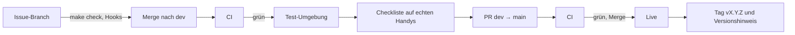

[← Übersicht](index.md)

# CI/CD und Release

Wie eine Änderung vom Commit auf den Server kommt. Grundlage: Web-App ([ADR-001](adr/adr-001-web-app-zuerst.md)),
SvelteKit und PostgreSQL ([ADR-002](adr/adr-002-sveltekit-postgresql.md)), eigener Server bei
Infomaniak ([ADR-003](adr/adr-003-hosting-infomaniak-vps.md)). Was getestet wird, steht im
[Testkonzept](testkonzept.md); der Ablauf pro Issue im Skill `tco-branching`.

**Legende:** **S** = Schätzung · **V** = Vermutung, nicht geprüft.

## Umgebungen

Beide laufen auf demselben Server, in getrennten Containern mit getrennter Datenbank.

| | Test | Live |
|---|------|------|
| Adresse | `test.my.tcolten.ch`, mit Passwort (K-10) | `my.tcolten.ch` (K-10) |
| Ausgeliefert bei | Merge nach `dev` | Merge des PR `dev` → `main` |
| Daten | nur erfundene Testdaten; bei jeder Auslieferung neu aufgesetzt | Mitgliederdaten |
| E-Mail | nur an die Adresse des Projektleiters, alle anderen werden verworfen | an die Mitglieder |
| Push, Schlüssel | eigene | eigene |

Die Test-Umgebung ist der Ort für die [Checkliste vor dem Release](testkonzept.md#checkliste-vor-dem-release).
Echte Daten kommen dort nie hin (DS-08).

## Ablauf

- Der Merge des PR nach `main` ist die Freigabe; danach geht es ohne weiteren Knopf live.
  `main` ist immer, was live läuft.
- Fehlerbehebungen nehmen denselben Weg über `dev`. Bei diesem Umfang ist das schnell genug,
  ein eigener Hotfix-Weg lohnt nicht.
- Released wird, wenn ein Stand es wert ist (meist am Ende einer Session oder Etappe), nicht
  nach jedem Issue: Jedes Release braucht die Checkliste.

## Auslieferung

1. **Bauen:** Die CI baut das Docker-Image und legt es in der privaten Container-Ablage von
   GitHub ab.
2. **Verbinden:** Die CI meldet sich per SSH auf dem Server an. Der Schlüssel dafür darf nur
   das Auslieferungs-Skript starten (Umgebung und Image als Angabe), keine anderen Befehle.
3. **Auf dem Server:** bei Live zuerst Sicherung der Datenbank, dann neues Image holen,
   Migrationen ausführen, Container neu starten.
4. **Prüfen:** Antwortet die App nicht innert einer Minute (S) auf ihre Statusabfrage,
   startet das Skript wieder das vorherige Image, und die CI meldet den Fehler.
5. **Abschluss Live:** Tag `vX.Y.Z` auf `main` und ein GitHub-Release mit dem Text aus den
   [Versionen](versionen.md).

**Zurück auf die vorherige Version:** Das vorherige Image bleibt auf dem Server; ein Befehl
startet es wieder. Damit das ohne Datenverlust geht, fügen Migrationen nur hinzu. Was die
alte Version noch braucht, wird erst ein Release später entfernt.

**Geheimnisse:** Bei GitHub liegen nur der SSH-Schlüssel und der Fingerabdruck des Servers.
Datenbank-Passwort, Schlüssel für Push und Zugang zum E-Mail-Versand liegen nur auf dem
Server, nie im Repo und nie bei GitHub. Wo sie dokumentiert sind, regelt
[#10](https://github.com/konstantinniedermann/tco-app/issues/10).

## Prüfungen in der CI

`make check` führt lokal dieselben Prüfungen aus wie die CI. Die CI läuft bei PRs und auf
`dev` und `main`, nicht auf Issue-Branches (dort decken die Git-Hooks ab).

| Prüfung | Quelle | Stand |
|---------|--------|-------|
| Doku-Check (Links, Konfliktmarker, Mermaid) | — | vorhanden |
| Secret-Scan über die ganze Historie (gitleaks) | — | vorhanden |
| ESLint und Prettier | Arbeitsregeln | mit #15 |
| `svelte-check`, Runes-Modus fest eingeschaltet | ADR-002 | mit #15 |
| Bauregel: unter `src/routes` keine `*.server.ts` ausser `+server.ts`, keine Form Actions | ADR-002 | mit #15 |
| Build als reine Web-App (für die spätere Store-App) | ADR-002 | mit #15 |
| Vitest: Fachlogik und Rechte, Abdeckung mindestens 90 % | Testkonzept | mit #15 |
| Jede `FR-`, `RR-` und umgesetzte `A-`-ID hat einen Test | Testkonzept | mit #15 |
| Testdaten und Seed-Daten nur mit `@example.org` | Testkonzept | mit #15 |
| Playwright Ende-zu-Ende in drei Umgebungen mit axe; Screenshots 30 Tage | Testkonzept | mit #15 |
| Malware-Prüfung der npm-Pakete (OSV-Gate aus Munica) | dieses Konzept | mit #15 |
| Docker-Image baut | ADR-003 | mit #15 |

## Abhängigkeiten

- **Neue Pakete** nur nach Freigabe durch den Projektleiter (Hook `dep-guard`).
- **Installieren** mit `npm ci --ignore-scripts`: genau die Versionen aus der Lock-Datei,
  ohne Installationsskripte der Pakete.
- **Malware-Prüfung:** Das OSV-Gate aus Munica prüft die Lock-Datei gegen die Datenbank
  bekannter Schadpakete und bricht die CI ab.
- **Updates:** Dependabot schlägt wöchentlich Updates für npm, Docker-Images und GitHub
  Actions vor, als PR auf `dev`. Hauptversionen werden einzeln geprüft.

## Versionen

- Schema `Hauptversion.Nebenversion.Korrektur`. Bis zum ersten Release *Mitglieder-Login*
  `0.x`, dann `1.0.0`.
- **Nebenversion** für eine neue Etappe oder Funktion, **Korrektur** für Fehlerbehebungen,
  **Hauptversion** nur, wenn Mitglieder etwas umstellen müssen (z. B. Umstieg auf die
  Store-App).
- Die Version steht in `package.json`, in der Fusszeile der App und als Tag auf `main`.
  Beim Release wird der Abschnitt *Unveröffentlicht* der [Versionen](versionen.md) zur
  neuen Versionsnummer.

## Alte Versionen auf dem Handy

Die Web-App speichert sich auf dem Handy zwischen (Service Worker). Damit niemand mit einer
alten Version arbeitet:

- Eine neue Version lädt **beim nächsten Start** von selbst.
- Der Server nennt bei jeder Antwort die **Mindestversion**, die er versteht. Ist eine
  offene App älter, lädt sie sofort neu.
- Die Mindestversion steigt nur, wenn eine Schnittstelle sich unverträglich ändert. Sonst
  bleiben Schnittstellen mit dem vorherigen Release verträglich.

## Actions-Minuten

Der Gratisplan des GitHub-Kontos hat 2000 Minuten pro Monat, **geteilt mit den anderen
privaten Repos**; Munica braucht davon schon über die Hälfte (siehe dort,
`docs/ci-cd-und-versionierung.md`). MyTCO bleibt deshalb sparsam:

- CI nur bei PRs und auf `dev`/`main`; Issue-Branches prüfen lokal.
- Läufe derselben Branch brechen den vorherigen ab.
- Grob 8 Minuten pro Merge nach `dev` (CI mit Ende-zu-Ende-Tests und Auslieferung auf Test,
  S), bei rund 30 Merges im Monat also etwa 250 Minuten (S). Mit #15 wird gemessen; reicht
  das Kontingent nicht, laufen die Ende-zu-Ende-Tests nur noch beim PR nach `main`.

## Ausblick: Store-App

Erst wenn ein Trigger aus ADR-001 greift (K-22). Dann:

- Capacitor packt den Web-Build in eine App für iOS und Android.
- iOS braucht einen Mac oder einen Build-Dienst; macOS-Läufe kosten bei GitHub ein
  Vielfaches der Linux-Minuten (V).
- Testverteilung über TestFlight (Apple) und interne Tests (Google), dann die Prüfung durch
  die Stores. Der Upload in die Stores ist ein eigener, von Hand ausgelöster Schritt nach dem
  Release.
- Die Store-App prüft dieselbe Mindestversion, zeigt aber statt Neuladen „Bitte
  aktualisieren“ mit Link in den Store.
