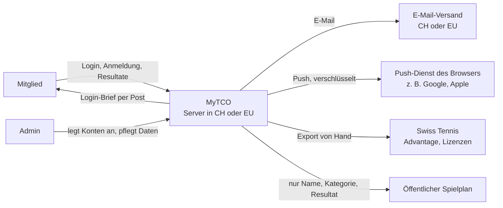

[← Übersicht](index.md)

# Datenschutzkonzept

Wie MyTCO mit Personendaten umgeht, gestützt auf das Schweizer Datenschutzgesetz (nDSG,
SR 235.1) und die Datenschutzverordnung (DSV, SR 235.11). Die DSGVO der EU gilt für MyTCO
nicht: Der Verein sitzt in der Schweiz und richtet sich an seine Mitglieder.

**Für wen:** Der **Vorstand** sieht hier, wofür der Verein verantwortlich ist und was er
entscheiden muss. Die **Technik** findet in den [Vorgaben](#vorgaben-für-technik-und-hosting)
verbindliche Regeln, auf die ADRs, Issues und Tests verweisen (`DS-NN`).

**Grundlage für jede Funktion:** Dieses Konzept beschreibt alles, was MyTCO mit
Personendaten tut. Was hier nicht steht, baut MyTCO nicht — erst wird das Konzept
angepasst, dann die Funktion. Wann das nötig ist, regelt der Abschnitt
[Änderungen an diesem Konzept](#änderungen-an-diesem-konzept).

**Legende:** **Vorschlag K-NN** = Vorschlag des Projektleiters, vom Vorstand zu bestätigen;
die Frage steht mit dieser ID in den [Abklärungen](abklaerungen.md). **V** = Vermutung,
nicht geprüft. Personen sind mit ihrer Rolle benannt ([Glossar](glossar.md)).

## Auf einen Blick

- MyTCO speichert nur, was Login, Clubmeisterschaft und Lizenzanträge brauchen — keine
  Gesundheitsdaten, keine anderen besonders schützenswerten Daten, kein Profiling.
- Verantwortlich ist der **TC Olten als Verein**. Mitglieder wenden sich an eine Person, die
  der Vorstand bestimmt.
- Daten liegen in der **Schweiz oder der EU**. Kein Tracking, keine Werbung.
- Kontaktdaten sehen nur die eigenen Gegner und der Doppelpartner, und nur während des
  Turniers.
- Nach einem Austritt wird das Konto sofort gesperrt, die Personendaten sind nach
  3 Monaten gelöscht.
- Mitglieder erhalten eine [Datenschutzerklärung](datenschutzerklaerung.md), die in der App
  jederzeit erreichbar ist.

## Verantwortung

| Wer | Rolle nach nDSG | Was | Grundlage |
|-----|-----------------|-----|-----------|
| TC Olten (Verein) | Verantwortlicher | Entscheidet über Zweck und Mittel, beantwortet Anfragen, meldet Datenpannen | Art. 5 lit. j nDSG |
| Vorstand | Organ des Vereins | Gibt dieses Konzept und die Datenschutzerklärung frei, bestimmt die Ansprechperson | — |
| Ansprechperson für Datenschutz | vom Vorstand bestimmt, **Vorschlag K-06:** Präsidium | Nimmt Anfragen von Mitgliedern über eine Vereinsadresse entgegen | Art. 19 Abs. 2 lit. a nDSG |
| Projektleiter, Admins, Verantwortliche CM und Lizenzen | handeln für den Verein | Bearbeiten Daten nur im Rahmen dieses Konzepts und ihrer Rolle ([Rollen und Rechte](https://github.com/konstantinniedermann/tco-app/issues/4)) | Art. 6 nDSG |
| Hoster, E-Mail-Versand | Auftragsbearbeiter | Bearbeiten Daten nur im Auftrag des Vereins, mit Vertrag | Art. 9 nDSG |
| Swiss Tennis | eigener Verantwortlicher | Erhält Lizenzanträge und Anmeldungen zur Clubmeisterschaft | Art. 19 Abs. 2 lit. c nDSG |

Der Projektleiter baut und betreibt MyTCO ehrenamtlich, **verantwortet** die Bearbeitung
aber nicht. So bleibt die Verantwortung beim Verein, auch wenn der Betrieb übergeben wird
([Betrieb und Übergabe](https://github.com/konstantinniedermann/tco-app/issues/10)).

**Warum der Vorstand das wissen muss:** Wer die Informations- oder Auskunftspflicht
vorsätzlich verletzt oder Daten ohne Vertrag einem Auftragsbearbeiter gibt, kann persönlich
gebüsst werden, bis CHF 250'000 (Art. 60–61 nDSG). Gebüsst wird die verantwortliche
Person, nicht der Verein.

## Grundsätze

Das nDSG verlangt für Vereine keine Einwilligung, solange die Bearbeitung die Grundsätze
einhält und für die Betroffenen erkennbar ist (Art. 6, Art. 30–31 nDSG). MyTCO setzt sie
so um:

| Grundsatz | Umsetzung in MyTCO | Grundlage |
|-----------|--------------------|-----------|
| Rechtmässig, nach Treu und Glauben | Nur Vereinszwecke: Login, Clubmeisterschaft, Lizenzanträge | Art. 6 Abs. 1–2 |
| Verhältnismässig, Datenminimierung | Nur Felder aus dem [Verzeichnis](#verzeichnis-der-bearbeitungen); Jahrgang statt Geburtsdatum, wo es reicht | Art. 6 Abs. 2 |
| Zweckbindung | Daten werden nur für den Zweck verwendet, für den sie erhoben wurden | Art. 6 Abs. 3 |
| Erkennbarkeit | Datenschutzerklärung in der App und auf dem Login-Brief; Hinweis vor der CM-Anmeldung | Art. 6 Abs. 3, Art. 19 |
| Löschen, wenn nicht mehr nötig | [Löschkonzept](#löschkonzept) mit festen Fristen | Art. 6 Abs. 4 |
| Richtigkeit | Mitglied korrigiert E-Mail und Telefon selbst, Admin den Rest | Art. 6 Abs. 5 |
| Datenschutz durch Technik und Voreinstellungen | Sparsamste Einstellung ist Standard (Sichtbarkeit, Benachrichtigungen) | Art. 7 |
| Datensicherheit | Grundsätze in [DS-15](#vorgaben-für-technik-und-hosting), Details im [Sicherheitskonzept](https://github.com/konstantinniedermann/tco-app/issues/6) | Art. 8, Art. 1–6 DSV |

**Keine Folgenabschätzung nötig:** Eine Datenschutz-Folgenabschätzung braucht es nur bei
voraussichtlich hohem Risiko (Art. 22 nDSG). MyTCO bearbeitet keine besonders
schützenswerten Daten (Art. 5 lit. c nDSG), betreibt kein Profiling und trifft keine
automatisierten Einzelentscheidungen. Kommt eines davon dazu, ist die Frage neu zu stellen.

## Datenflüsse

Der Push-Dienst steht oft ausserhalb von Schweiz und EU. Er erhält die Nachricht
verschlüsselt und kann sie nicht lesen ([DS-02](#vorgaben-für-technik-und-hosting)).

## Verzeichnis der Bearbeitungen

Ein Verzeichnis ist für den Verein nicht Pflicht: Organisationen mit weniger als 250
Mitarbeitenden sind befreit, solange sie nicht umfangreich besonders schützenswerte Daten
bearbeiten oder Profiling mit hohem Risiko betreiben (Art. 12 Abs. 5 nDSG, Art. 24 DSV).
MyTCO führt es trotzdem, weil es die Grundlage für die Datenschutzerklärung und für jede
neue Funktion ist.

### Datenkategorien

**Vorschlag K-07** — nur diese Felder. Ein neues Feld braucht zuerst eine Zeile hier.

| Feld | Wozu | Pflicht | Quelle |
|------|------|---------|--------|
| Vorname, Nachname | Konto, Anmeldung, Resultate | ja | Admin |
| Postadresse | Login-Brief mit Einmalpasswort | ja | Admin |
| E-Mail-Adresse | Bestätigungen, Benachrichtigungen, Passwort zurücksetzen | ja | Admin oder Mitglied |
| Telefonnummer | Absprache der Gruppenspiele mit Gegnern | nein | Admin oder Mitglied |
| Geschlecht | Zulassung zu CM-Kategorien | ja | Admin |
| Jahrgang | Zulassung zu Alterskategorien; volles Geburtsdatum nur, falls Swiss Tennis es verlangt (K-40) | ja | Admin |
| Lizenznummer | Export an Swiss Tennis, Lizenzanträge | nein | Mitglied beim ersten Login |
| Klassierung | Zulassung zu CM-Kategorien | nein | Mitglied oder Admin (K-28) |
| E-Mail und Telefon eines Elternteils | nur bei Spielern unter 16 ohne Konto: Absprache der Gruppenspiele ([Minderjährige](#minderjährige)) | nein | Admin |
| Konto: Rollen, Passwort (nur als Hash), letzter Login | Login und Berechtigungen | ja | MyTCO |
| Benachrichtigungs-Einstellungen, Push-Abos | Benachrichtigungen, die das Mitglied gewählt hat | nein | Mitglied |
| Anmeldungen, Spiele, Resultate | Clubmeisterschaft | — | Mitglied, Admin |
| Lizenzanträge und Stornos | Lizenzanträge an Swiss Tennis | — | Mitglied |

**Nicht** gespeichert werden: Gesundheitsdaten (auch nicht als Grund für eine Abmeldung
oder ein Forfait), Fotos, Standort, Bankdaten, Mitgliederbeiträge und Rechnungen (bleiben in Fairgate).

### Bearbeitungen

Wer was sieht, legt [Rollen und Rechte](https://github.com/konstantinniedermann/tco-app/issues/4)
im Detail fest; dieses Verzeichnis setzt die Obergrenze.

| Bearbeitung | Daten | Wer sieht sie | Empfänger ausserhalb | Wie lange | Etappe |
|-------------|-------|---------------|----------------------|-----------|--------|
| Konto anlegen und Login | Name, Postadresse, E-Mail, Konto | Mitglied selbst, Admin | Post (Brief), E-Mail-Versand | bis Austritt + 3 Monate | Mitglieder-Login |
| Mitgliederverwaltung | alle Stammdaten | Admin | — | bis Austritt + 3 Monate | Mitglieder-Login |
| Eigene Daten ändern | E-Mail, Telefon | Mitglied selbst | — | wie Konto | Mitglieder-Login |
| Anmeldung zur CM | Name, Kategorien, Klassierung, Doppelpartner | Admin, Verantwortliche CM; Name und Kategorie für alle Mitglieder | Swiss Tennis (Export für Advantage) | wie Resultate | CM-Anmeldung |
| Auswahl des Doppelpartners | Name der verfügbaren Spieler | angemeldete Mitglieder | — | bis Anmeldeschluss | CM-Anmeldung |
| Kontakt unter Spielern | E-Mail, Telefon | eigene Gegner und Doppelpartner, **Vorschlag K-31** | — | bis Ende der CM | CM-Betrieb |
| Resultate und Ranglisten | Name, Kategorie, Resultat | alle Mitglieder | Swiss Tennis (zum Eintragen in Advantage) | dauerhaft, als Vereinsgeschichte | CM-Betrieb |
| Öffentlicher Spielplan | Name, Kategorie, Platz, Zeit, Resultat | alle, ohne Login, **Vorschlag K-39** | — | bis Ende der CM | später |
| Benachrichtigungen | E-Mail, Push-Abo, Inhalt der Nachricht | Mitglied selbst | E-Mail-Versand, Push-Dienst | bis Abmeldung oder Austritt | CM-Betrieb |
| Lizenzanträge | Name, Lizenznummer, Jahrgang, Antrag | Mitglied selbst, Lizenzverantwortlicher | Swiss Tennis (von Hand eingetragen) | bis Ende des Folgejahres | Lizenzanträge |
| Technischer Betrieb | IP-Adresse, Zeitpunkt, Fehler | Betrieb | Hoster | höchstens 30 Tage | Mitglieder-Login |

## Löschkonzept

| Anlass | Was passiert | Frist |
|--------|--------------|-------|
| Austritt aus dem Verein | Konto sofort gesperrt; danach alle Daten aus dem [Verzeichnis](#datenkategorien) gelöscht, auch Push-Abos und Einstellungen. Nur der Name bleibt in abgeschlossenen Resultaten (**Vorschlag K-38**) | 3 Monate nach Austritt |
| Ende einer Clubmeisterschaft | Kontaktdaten sind für Gegner und Doppelpartner nicht mehr sichtbar; der öffentliche Spielplan geht offline | mit dem Finalwochenende |
| Abgeschlossene Clubmeisterschaft | Anmeldungen ohne Spiel werden gelöscht; Resultate und Ranglisten bleiben | 3 Monate nach Ende |
| Lizenzantrag eingetragen | Antrag gelöscht | Ende des Folgejahres |
| Einmalpasswort | ungültig nach dem ersten Login oder nach Ablauf | sofort |
| Logs des Betriebs | gelöscht | 30 Tage |
| Backups | Daten verschwinden mit dem Ende der Aufbewahrung | höchstens 30 Tage nach Löschung |
| Wunsch eines Mitglieds | Löschung wie bei Austritt, soweit keine Aufbewahrungspflicht besteht (K-38) | 30 Tage |

Wie MyTCO von einem Austritt erfährt, solange Fairgate nicht angebunden ist, klärt K-14.
Resultate sind zugleich bei Swiss Tennis gespeichert; MyTCO kann sie dort nicht löschen.

## Minderjährige

Das nDSG kennt kein festes Mindestalter. Massgebend ist, ob die Person urteilsfähig ist
(Art. 16 ZGB) — in der Praxis ab etwa 13 bis 16 Jahren (V).

**Vorschlag K-08:** Bis zu den Junioren-Funktionen (A-ANLASS-02, ab 2028) gilt:

- Ein eigenes Konto erhalten nur Mitglieder ab **16 Jahren**.
- Jüngere Spieler erfasst höchstens der Admin für die Clubmeisterschaft, ohne Login. Als
  Kontakt für Gegner hinterlegt er die Kontaktdaten eines Elternteils, nicht die des Kindes.
- Die Regel für Konten von Eltern und Kindern wird mit den Junioren-Funktionen ergänzt;
  das ist eine Änderung nach [diesem Abschnitt](#änderungen-an-diesem-konzept).

## Sichtbarkeit von Kontaktdaten

**Vorschlag K-31:** Wer sich zur Clubmeisterschaft anmeldet, sieht vor dem Absenden diesen
Hinweis:

> Mit der Anmeldung sind Ihre E-Mail-Adresse und Telefonnummer für Ihre Gegner und Ihren
> Doppelpartner sichtbar, damit Sie die Gruppenspiele absprechen können. Nach dem
> Finalwochenende sind sie nicht mehr sichtbar.

Das genügt nach nDSG: Die Bekanntgabe ist für die Teilnahme nötig, beschränkt auf die
Mitspieler und zeitlich begrenzt (Art. 6 Abs. 2–3, Art. 31 Abs. 1 nDSG). Eine Einwilligung
mit Häkchen ist nicht nötig. Wer seine Telefonnummer nicht zeigen will, lässt sie leer oder
bittet den Admin, sie zu verbergen; die E-Mail-Adresse bleibt für die Absprache sichtbar.

Andere Mitglieder ausserhalb der eigenen Spiele sehen nur Name, Kategorie und Resultate,
keine Kontaktdaten.

## Datenstandort und Dienste im Ausland

- Daten dürfen in Staaten liegen, deren Datenschutz der Bundesrat als angemessen anerkennt
  (Art. 16 Abs. 1 nDSG, Anhang 1 DSV). Dazu gehören alle Staaten der EU und des EWR.
- MyTCO legt fest: **Schweiz bevorzugt, EU/EWR erlaubt** — für Server, Datenbank, Dateien,
  Backups und E-Mail-Versand ([DS-01](#vorgaben-für-technik-und-hosting)).
- Dienste in anderen Staaten (z. B. USA) erhalten keine lesbaren Personendaten. Das betrifft
  heute nur die Push-Dienste der Browser- und Handy-Hersteller, die Web Push zustellen
  ([ADR-001](adr/adr-001-web-app-zuerst.md)): Die Nachricht ist verschlüsselt, und ihr Inhalt
  nennt keine anderen Mitglieder ([DS-02](#vorgaben-für-technik-und-hosting)).

## Rechte der Mitglieder

| Recht | Wie MyTCO es erfüllt | Grundlage |
|-------|----------------------|-----------|
| Information | Datenschutzerklärung in der App (auch ohne Login) und auf dem Login-Brief. Der Brief geht spätestens einen Monat, nachdem der Admin das Konto angelegt hat, an das Mitglied | Art. 19 Abs. 3 und 5 nDSG |
| Auskunft | Ansprechperson antwortet kostenlos innert 30 Tagen; der Admin exportiert dazu alle Daten des Mitglieds | Art. 25 nDSG, Art. 18 DSV |
| Herausgabe | derselbe Export in einem gängigen Dateiformat | Art. 28 nDSG |
| Berichtigung | E-Mail und Telefon selbst in der App, alles andere über den Admin | Art. 32 Abs. 1 nDSG |
| Löschung | nach dem [Löschkonzept](#löschkonzept) | Art. 32 Abs. 2 nDSG |

**Datenpannen:** Gelangen Daten in falsche Hände und droht dadurch ein hohes Risiko für die
Mitglieder, meldet der Verein das so rasch wie möglich dem EDÖB und informiert die
Betroffenen, wenn es zu ihrem Schutz nötig ist (Art. 24 nDSG). Den Ablauf legt das
[Sicherheitskonzept](https://github.com/konstantinniedermann/tco-app/issues/6) fest.

## Vorgaben für Technik und Hosting

Verbindlich für ADRs (insbesondere [Backend und Hosting](https://github.com/konstantinniedermann/tco-app/issues/8)),
Code und Tests. Eine Abweichung braucht zuerst eine Änderung dieses Konzepts.

| ID | Vorgabe | Grundlage |
|----|---------|-----------|
| DS-01 | Server, Datenbank, Dateien, Backups und E-Mail-Versand liegen in der Schweiz oder in der EU/EWR | Art. 16 nDSG, Anhang 1 DSV |
| DS-02 | Dienste ausserhalb von Schweiz und EU/EWR erhalten keine lesbaren Personendaten. Push-Nachrichten sind Ende-zu-Ende-verschlüsselt (Web Push) und nennen keine anderen Mitglieder („Neues Resultat in Ihrer Gruppe“, nicht „X hat 6:3 gemeldet“) | Art. 16 nDSG, Art. 7 nDSG |
| DS-03 | Hoster und E-Mail-Versand nur mit Auftragsbearbeitungsvertrag oder AGB, die Art. 9 nDSG abdecken (K-09). Jeder Auftragsbearbeiter steht in der Datenschutzerklärung | Art. 9 nDSG |
| DS-04 | Kein Tracking, keine Analyse-Dienste, keine Werbung. Schriften, Skripte und Bilder liefert MyTCO selbst aus, nicht über fremde Server (z. B. CDN, Google Fonts), damit beim Aufruf keine Daten an Dritte gehen | Art. 6 Abs. 2, Art. 7 nDSG |
| DS-05 | Nur technisch nötige Cookies und Speicher im Browser (Sitzung, Einstellungen); deshalb kein Cookie-Banner | Art. 6 Abs. 2 nDSG |
| DS-06 | Nur Felder aus dem [Verzeichnis](#datenkategorien). Keine Freitextfelder, in denen Gesundheitsdaten landen können (z. B. Grund einer Abmeldung) | Art. 6 Abs. 2, Art. 5 lit. c nDSG |
| DS-07 | Datenschutzfreundliche Voreinstellungen: Sichtbarkeit nur so weit wie im Verzeichnis, Benachrichtigungen erst nach Wahl des Mitglieds | Art. 7 Abs. 3 nDSG |
| DS-08 | Die Fristen des [Löschkonzepts](#löschkonzept) sind technisch umgesetzt — automatisch oder als geführter Ablauf für den Admin — und erfassen Push-Abos und Exporte. Backups rotieren innert 30 Tagen | Art. 6 Abs. 4 nDSG |
| DS-09 | Der Admin kann alle Daten eines Mitglieds als Datei exportieren (Auskunft und Herausgabe) | Art. 25, Art. 28 nDSG |
| DS-10 | Logs enthalten keine Inhalte: keine Passwörter, Kontaktdaten, Resultate oder Anfragetexte, nur technische Angaben; Aufbewahrung höchstens 30 Tage | Art. 6 Abs. 2 und 4 nDSG |
| DS-11 | Entwicklung und Tests nur mit erfundenen Daten; nie eine Kopie der Produktivdaten ausserhalb des Betriebs | Art. 6 Abs. 3, Art. 8 nDSG |
| DS-12 | E-Mails an mehrere Mitglieder nie mit sichtbaren Adressen anderer Empfänger | Art. 6 Abs. 3 nDSG |
| DS-13 | Exporte (Advantage, Lizenzliste) enthalten nur die Felder, die Swiss Tennis braucht | Art. 6 Abs. 2 nDSG |
| DS-14 | Öffentliche Seiten zeigen nur, was das Verzeichnis als öffentlich nennt, und sind für Suchmaschinen gesperrt | Art. 6 Abs. 2, Art. 7 nDSG |
| DS-15 | Datensicherheit nach Stand der Technik: verschlüsselte Übertragung, Passwörter nur als Hash, Zugriff nach Rolle. Details im [Sicherheitskonzept](https://github.com/konstantinniedermann/tco-app/issues/6) | Art. 8 nDSG, Art. 1–6 DSV |
| DS-16 | Die Datenschutzerklärung ist in MyTCO jederzeit erreichbar, auch ohne Login, und auf dem Login-Brief genannt | Art. 19 nDSG |

## Datenschutzerklärung

Den Text für die Mitglieder enthält der [Entwurf der Datenschutzerklärung](datenschutzerklaerung.md).
Er leitet sich aus diesem Konzept ab und wird mit ihm geändert. Freigabe durch den
Vorstand (K-06). Für eine spätere Store-App (N-APP-04) dient sie auch als Angabe in den
App-Stores.

## Offene Fragen an den Verein

Alle Vorschläge oben gelten als Annahme, bis der Vorstand sie bestätigt. Die Fragen stehen
in den [Abklärungen](abklaerungen.md):

| ID | Thema | Vorschlag in diesem Konzept |
|----|-------|------------------------------|
| K-06 | Verantwortliche Person, Freigabe der Datenschutzerklärung | Ansprechperson: Präsidium, über eine Vereinsadresse |
| K-07 | Welche Daten MyTCO speichert | Felder im [Verzeichnis](#datenkategorien) |
| K-08 | Junioren und Minderjährige | eigenes Konto ab 16, Jüngere ohne Login |
| K-09 | Auftragsbearbeitungsvertrag mit dem Hoster | Pflicht nach DS-03 |
| K-14 | Wie MyTCO von Austritten erfährt | — |
| K-31 | Kontaktdaten für Gegner und Doppelpartner | sichtbar mit Hinweis, bis Ende der CM |
| K-38 | Löschfrist nach Austritt, Aufbewahrungspflichten | 3 Monate; Name bleibt in Resultaten |
| K-39 | Öffentlicher Spielplan | Name, Kategorie, Platz, Zeit, Resultat |
| K-40 | Volles Geburtsdatum oder Jahrgang | Jahrgang |
| K-41 | Informieren Statuten oder Beitrittsformular über die Datenbearbeitung | — |

## Änderungen an diesem Konzept

Das Konzept wird **vor** der Umsetzung angepasst, wenn eine neue oder geänderte Funktion

- ein neues Feld oder eine neue Art von Personendaten erhebt,
- Daten für einen neuen Zweck verwendet,
- Daten anderen Personen oder Rollen zeigt als bisher,
- Daten an einen neuen Empfänger oder Dienst gibt (auch Auftragsbearbeiter),
- Daten länger aufbewahrt, oder
- eine Vorgabe `DS-NN` berührt.

Dann gilt: Verzeichnis, Löschkonzept und betroffene Vorgaben nachführen, die
[Datenschutzerklärung](datenschutzerklaerung.md) anpassen und eine neue Frage in den
[Abklärungen](abklaerungen.md) eintragen, wenn der Vorstand zustimmen muss. Jedes Issue
prüft das im Abschnitt *Datenschutz* der Issue-Vorlage
([Issue-Konventionen](issue-konventionen.md#datenschutz)).
