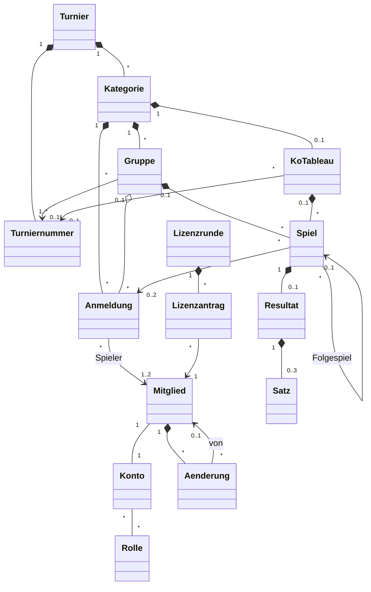

[← Übersicht](index.md)

# Fachmodell

Welche fachlichen Objekte MyTCO kennt, wie sie zusammenhängen und welche Regeln gelten —
für die Etappen *Mitglieder-Login* bis *Lizenzanträge*. Technikneutral; Grundlage für
Datenbank und Code ([Backend und Hosting](https://github.com/konstantinniedermann/tco-app/issues/8)).
Begriffe stehen im [Glossar](glossar.md), Anforderungs-IDs in den
[Anforderungen](anforderungen/anforderungen.md).

**Namen im Code:** die Objektnamen aus dem Diagramm, deutsch und ohne Umlaute
(`Mitglied`, `Anmeldung`, `KoTableau`). So bleiben Doku, Oberfläche und Code bei einem Wort.

**P** = personenbezogene Attribute des Objekts, geregelt im [Datenschutzkonzept](datenschutz.md).
**Annahme K-NN** = vom Verein noch zu bestätigen, Frage in den [Abklärungen](abklaerungen.md).

**Rollen:** Was CM- und Lizenzverantwortlicher dürfen, darf auch der Admin
([RR-02](rollen-und-rechte.md#grundsätze)).

**Junioren:** Junioren sind Mitglieder und spielen ab der Clubmeisterschaft 2027 mit; der
CM-Verantwortliche kann sie auch anmelden (A-ANMELDUNG-06, K-46). Vorschlag K-08: Ein Mitglied
führt das Konto seines Kindes (*verwaltet von*, ohne eigene E-Mail und ohne eigenes Login); ab
einer Altersgrenze des Vereins erhält der Junior ein eigenes Login.

## Überblick

## Objekte

### Mitglieder und Konten

| Objekt | Attribute | P |
|--------|-----------|---|
| **Mitglied** | Mitgliedernummer (aus Fairgate; Pflicht beim Einlesen und beim Befehl *Admin festlegen*, sonst freiwillig, A-MITGLIED-07; eindeutig ohne Rücksicht auf Gross-/Kleinschreibung, gespeichert wie eingegeben), Vorname, Nachname, Postadresse, E-Mail (eindeutig, FR-25; fehlt bei Junioren, die ein Elternteil führt), Telefon, Geschlecht, Jahrgang (K-40.2; für Lizenzanträge hängt an K-40.1), Lizenznummer (optional), Klassierung (optional, pflegt das Mitglied selbst — Annahme K-28), Status *aktiv / ausgetreten / Löschung vorgemerkt / gelöscht*, Austrittsdatum, *verwaltet von* (Mitglied, nur bei Junioren ohne eigenes Login, Vorschlag K-08), *für Fairgate offen seit* (Zeitpunkt, gesetzt, wenn das Mitglied Adresse, E-Mail oder Telefon selbst ändert; gelöscht, wenn der Admin die Angaben nach Fairgate übertragen hat — Annahme K-19.2, A-KONTO-02) | alle ausser Status |
| **Konto** | Brief-Code und Mail-Code getrennt, je nur als Hash mit Ablauf; beim Brief-Code dazu *benutzt am*, beim Mail-Code die Zahl der Fehlversuche (FR-24). Sitzungsversion, Sitzungen (eine je Gerät, mit *angemeldet am* und *zuletzt genutzt*), Daten beim ersten Login ergänzt ja/nein, gesperrt ja/nein, Benachrichtigung per E-Mail / Push ja/nein, Passkeys (je Gerät öffentlicher Schlüssel und Kennung, freiwillig, A-LOGIN-07). Je Sitzung die Bestätigung der Verwaltung mit Zeitpunkt, Admin-Code als Hash mit Ablauf und Fehlversuchen (SI-08) | alle |
| **Rolle** | Name. Welche Rollen es gibt und was sie dürfen, legt [Rollen und Rechte](rollen-und-rechte.md) fest | — |
| **Aenderung** | Eintrag im Änderungsverlauf: Mitglied, von (Mitglied, das die Änderung ausgelöst hat; leer bei automatisch, dann *MyTCO*), Feld oder Aktion, Zeitpunkt; ohne alte und neue Werte (FR-26) | Mitglied, von |

### Clubmeisterschaft

| Objekt | Attribute | P |
|--------|-----------|---|
| **Turnier** | Jahr, Name, Anmeldeschluss, Status (siehe [Lebenszyklen](#lebenszyklen)) | — |
| **Turniernummer** | Nummer bei Swiss Tennis, Bezeichnung (z. B. Gruppenphase, Finalwochenende — Annahme K-25.4) | — |
| **Kategorie** | Name, Geschlecht (Herren / Damen / Mixed / offen), Jahrgang von–bis (Alterskategorie, optional), Klassierung von–bis (Klassierungsbereich), Einzel oder Doppel | — |
| **Anmeldung** | Kategorie, 1 Spieler (Einzel) oder 2 (Doppel), Wildcard-Antrag ja/nein, Kommentar, Status, angemeldet am, Gruppe (nach Auslosung), Rang-Korrektur (optional) | Spieler, Kommentar |
| **Gruppe** | Kategorie, Name, Turniernummer. Die Rangliste wird aus den Resultaten berechnet, nicht gespeichert | — |
| **KoTableau** | Kategorie, Grösse (Anzahl Positionen), Turniernummer. Kommt aus Advantage | — |
| **Spiel** | Gruppe *oder* KoTableau mit Runde (z. B. Viertelfinal) und Position, Anmeldung A und B (im KO leer, bis bekannt), Folgespiel (nur KO) | — (über die Anmeldung) |
| **Resultat** | Spiel, Sätze, Sonderfall (keiner / w.o. / Aufgabe), Sieger, gemeldet von, gemeldet am, Status, bestätigt von | Sätze, gemeldet von, bestätigt von |
| **Satz** | Games A, Games B, Tiebreak-Punkte (optional). Höchstens 3 Sätze, der dritte evtl. als Match-Tiebreak (Annahme K-41) | — |

### Lizenzen

| Objekt | Attribute | P |
|--------|-----------|---|
| **Lizenzrunde** | Jahr, Stichtag (setzt der Lizenzverantwortliche) | — |
| **Lizenzantrag** | Mitglied, Art (Bestellung / Aktualisierung / Storno), Status, beantragt am, exportiert am, Lizenzrunde | Mitglied, Art |

## Fachregeln

**Status:** `geplant` · `umgesetzt` (mit Test, siehe [Testkonzept](testkonzept.md#anforderung--testfall))

| ID | Regel | Anforderung | Status |
|----|-------|-------------|--------|
| FR-01 | Ein Mitglied hat genau ein Konto. Der Admin legt beides zusammen an; der Brief-Code entsteht beim Erzeugen der Briefe, ausser bei Junioren, die ein Elternteil führt (Vorschlag K-08) | A-MITGLIED-01, A-LOGIN-01 | umgesetzt\* (Konto ohne Brief-Code; Briefe mit Etappe 2) |
| FR-02 | Beim ersten Login ergänzt das Mitglied fehlende Daten (u. a. Lizenznummer, Klassierung), bevor es etwas anderes tun kann | A-LOGIN-03 | geplant |
| FR-03 | Ein Konto hat mindestens die Rolle *Mitglied*; der Admin vergibt weitere | A-ROLLE-01 | umgesetzt |
| FR-04 | Austritt: Konto sofort gesperrt, Status *ausgetreten* (inaktiv). Tritt das Mitglied innert der Frist wieder ein, wird es wieder *aktiv*. Nach der Frist wird das Konto gelöscht und das Mitglied auf Vor- und Nachname reduziert (Status *gelöscht*), damit vergangene Resultate lesbar bleiben (Vorschlag K-38: Frist 1 Jahr). Löschen: Login sofort gesperrt, eine Woche rückgängig machbar (zurück in den Zustand davor), danach wie nach der Frist | [Datenschutz](datenschutz.md#löschen) | geplant |
| FR-05 | Anmelden geht nur, solange das Turnier den Status *Anmeldung offen* hat (bis Anmeldeschluss) | A-ANMELDUNG-07 | geplant |
| FR-06 | Ein Spieler hat je Turnier höchstens 3 Anmeldungen, die nicht *abgelehnt* oder *zurückgezogen* sind. Wildcard-Anträge zählen mit; ein Doppel zählt für beide Partner (Annahme K-27) | A-ANMELDUNG-02 | geplant |
| FR-07 | MyTCO schlägt nur Kategorien vor, die nach Geschlecht, Jahrgang und Klassierung passen; im Doppel muss auch der Partner passen (Annahme K-27) | A-ANMELDUNG-03 | geplant |
| FR-08 | Für eine Kategorie ausserhalb des eigenen Klassierungsbereichs meldet man sich mit Wildcard-Antrag und Kommentar an. Die Anmeldung bleibt *beantragt*, bis der CM-Verantwortliche sie bestätigt oder ablehnt. Kommentar und Wildcard sehen nur der Spieler, der CM-Verantwortliche und der Admin | A-ANMELDUNG-10 | geplant |
| FR-09 | Ein Doppelpartner muss die Anmeldung nicht bestätigen; er wird benachrichtigt (Annahme K-27). Jedes Mitglied steht je Kategorie in höchstens einer Anmeldung | A-ANMELDUNG-04 | geplant |
| FR-10 | Bis zum Anmeldeschluss kann ein Spieler seine Anmeldung selbst zurückziehen (Annahme K-29); danach nur der CM-Verantwortliche | A-ANMELDUNG-06 | geplant |
| FR-11 | Der Kommentar enthält keine Gesundheitsangaben; die Eingabemaske weist darauf hin | [Datenschutz](datenschutz.md#welche-daten) | geplant |
| FR-12 | Gruppen und KO-Tableaus entstehen in Advantage und werden übernommen; MyTCO lost nicht selbst aus | A-ADVANTAGE-02, A-ADVANTAGE-03 | geplant |
| FR-13 | Eine Kategorie spielt Gruppen, KO oder zuerst Gruppen und dann KO. Ein Spiel gehört entweder zu einer Gruppe oder zu einem KoTableau | A-ADVANTAGE-03 | geplant |
| FR-14 | Im KO rückt der Sieger eines bestätigten Resultats ins Folgespiel; so sieht jeder, gegen wen er in der nächsten Runde spielen würde | A-RESULTAT-01 | geplant |
| FR-15 | Rangliste je Gruppe nach gewonnenen Spielen; bei Gleichstand 1. Direktbegegnung, 2. Satzdifferenz, 3. Gamedifferenz; danach Korrektur durch den CM-Verantwortlichen | A-RESULTAT-06, [Glossar](glossar.md#clubmeisterschaft-und-turnier) | geplant |
| FR-16 | Ein Spieler des Spiels meldet das Resultat, der Gegner bestätigt oder bestreitet es. Ohne Reaktion gilt es nach 3 Tagen als bestätigt; bei Streit entscheidet der CM-Verantwortliche (Annahme K-32) | A-RESULTAT-03, A-RESULTAT-04 | geplant |
| FR-17 | Erfasst der CM-Verantwortliche ein Resultat, ist es sofort bestätigt | A-RESULTAT-07 | geplant |
| FR-18 | Rangliste und Folgespiele rechnen nur mit bestätigten Resultaten | A-RESULTAT-06 | geplant |
| FR-19 | Gegner und Doppelpartner sehen E-Mail und Telefon, bis das Turnier *abgeschlossen* ist | N-DATENSCHUTZ-02, K-31 | geplant |
| FR-20 | Ein Mitglied hat je Lizenzrunde höchstens einen offenen Lizenzantrag. Zurückziehen geht, solange er *beantragt* ist | A-LIZENZ-01, A-LIZENZ-02 | geplant |
| FR-21 | Ein Antrag gehört zur nächsten Lizenzrunde, deren Stichtag noch nicht vorbei ist. Storno entspricht der Sistierung bei Swiss Tennis (Annahme K-34) | A-LIZENZ-03 | geplant |
| FR-22 | Der Export einer Lizenzrunde setzt alle ihre beantragten Anträge auf *exportiert*; der Lizenzverantwortliche hakt sie nach dem Eintragen bei Swiss Tennis als *erledigt* ab | A-LIZENZ-04 | geplant |
| FR-23 | Exporte an Swiss Tennis enthalten nur die Felder, die Swiss Tennis braucht (vor allem Lizenznummern) | A-ADVANTAGE-01, A-ADVANTAGE-04, A-LIZENZ-04, DS-04 | geplant |
| FR-24 | Ein Einmal-Code gilt nur einmal. Ein neuer Code ersetzt nur den alten derselben Art (Brief-Code oder Mail-Code); ein Login mit einem der beiden macht beide ungültig, der Brief-Code gilt dann als benutzt. Danach bleibt das Gerät eingeloggt, bis die Sitzung ein Jahr nicht genutzt wurde. Erhöht der Admin die Sitzungsversion, enden alle Sitzungen des Kontos (in der Verwaltung, #43) | A-LOGIN-08, A-LOGIN-09 | umgesetzt |
| FR-25 | Eine E-Mail-Adresse gehört zu höchstens einem Mitglied. Ändert das Mitglied sie, gilt die neue erst nach Eingabe je eines Codes von der alten und von der neuen Adresse. Ist die alte nicht erreichbar, ändert der Admin sie nach Rückfrage; die alte erhält dann einen Hinweis | A-LOGIN-10, A-KONTO-01, [SI-09](sicherheitskonzept.md#vorgaben) | geplant (eindeutige Adresse und Selbständerung mit zwei Codes umgesetzt mit [#50](https://github.com/konstantinniedermann/tco-app/issues/50); Hinweis an die alte Adresse bei Änderung durch den Admin offen) |
| FR-26 | Einen Eintrag im Änderungsverlauf erzeugen, egal ob durch Admin, Mitglied oder automatisch: jede Änderung an den Feldern des Mitglieds, an Rollen, sowie die Aktionen neuer Brief-Code, Sitzungen beendet, in Fairgate übertragen und Export. Login-Vorgänge (Codes, Fehlversuche, Sitzungen) erzeugen keinen Eintrag (SI-05). Einträge werden nach 12 Monaten gelöscht, beim Status *gelöscht* des Mitglieds (FR-04) schon früher | A-MITGLIED-06, [SI-12](sicherheitskonzept.md#vorgaben) | geplant (Einträge und Verlauf für Felder und Rollen seit Etappe 1 von #43; Löschung nach 12 Monaten kommt mit Etappe 3) |

## Lebenszyklen

| Objekt | Zustände |
|--------|----------|
| Turnier | *in Vorbereitung* → *Anmeldung offen* → *Anmeldung geschlossen* → *läuft* → *abgeschlossen* |
| Anmeldung | *bestätigt* (ohne Wildcard sofort) · *beantragt* → *bestätigt* / *abgelehnt* (mit Wildcard) · jederzeit → *zurückgezogen* (FR-10) |
| Resultat | *gemeldet* → *bestätigt* / *bestritten* → *bestätigt* (Entscheid des CM-Verantwortlichen) |
| Lizenzantrag | *beantragt* → *exportiert* → *erledigt* · *beantragt* → *zurückgezogen* |
| Mitglied | *aktiv* → *ausgetreten* (inaktiv) → *gelöscht* nach der Frist, nur noch der Name · *ausgetreten* → *aktiv* bei Wiedereintritt · *aktiv* oder *ausgetreten* → *Löschung vorgemerkt* → *gelöscht* nach einer Woche; dazwischen rückgängig machbar, zurück in den Zustand davor (*aktiv*, oder *ausgetreten* mit dem alten Austrittsdatum) (FR-04) |

## Ausblick

Nicht Teil dieser Etappen, aber so angelegt, dass sie andocken
(N-ERWEITERBAR-01):

- **Anlässe** (Junioren-Training, weitere Turniere): eigenes Objekt *Anlass* mit
  Anmeldungen; das Turnier bleibt eigenständig.
- **Junioren-Funktionen** (Training, Turniere, Junioren-Leiter). Konten für Junioren gibt es
  schon ab der CM 2027, siehe oben.
- **Spielplan fürs Finalwochenende:** *Platz* und Termin am Spiel (A-SPIELPLAN).
- **Newsfeed, Lizenzliste als PDF, Registrierung:** eigene Objekte, keine Änderung an den
  bestehenden.
