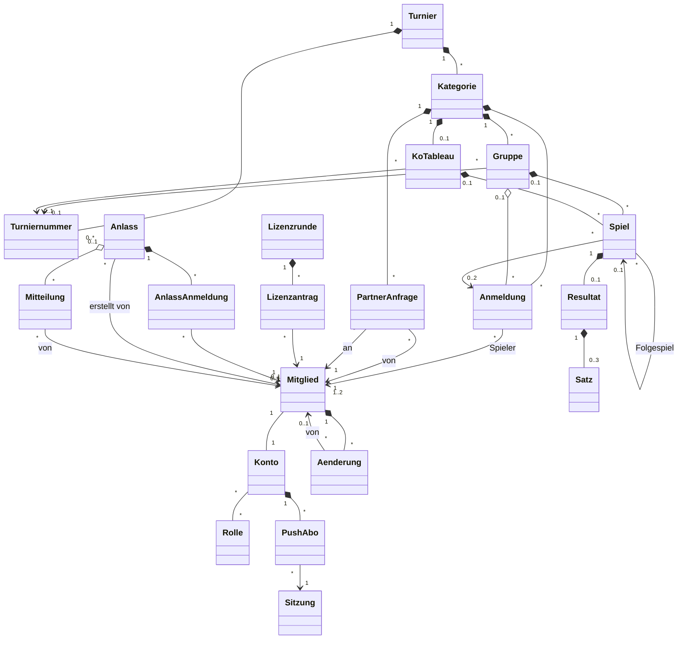

[← Übersicht](index.md)

# Fachmodell

Welche fachlichen Objekte MyTCO kennt, wie sie zusammenhängen und welche Regeln gelten —
für die Etappen *Mitglieder-Login* bis *Lizenzanträge*. Technikneutral; Grundlage für
Datenbank und Code ([Backend und Hosting](https://github.com/konstantinniedermann/tco-app/issues/8)).
Begriffe stehen im [Glossar](glossar.md), Anforderungs-IDs in den
[Anforderungen](anforderungen/anforderungen.md).

**Namen im Code:** die Objektnamen aus dem Diagramm, deutsch und ohne Umlaute
(`Mitglied`, `Anmeldung`, `KoTableau`). So bleiben Doku, Oberfläche und Code bei einem Wort.

**P** = personenbezogene Attribute des Objekts, geregelt im [Datenschutzkonzept](datenschutz.md).
**Annahme K-NN** = vom Verein noch zu bestätigen, Frage in den [Abklärungen](abklaerungen.md).

**Rollen:** Jede Admin-Rolle ändert nur in ihrem Bereich; der MyTCO-Admin liest alle Bereiche,
ändert aber nichts ausser Rollen ([RR-07](rollen-und-rechte.md#grundsätze)).

**Junioren:** Junioren sind Mitglieder und spielen ab der Clubmeisterschaft 2027 mit; der
CM-Admin kann sie auch anmelden (A-ANMELDUNG-06, K-46). Vorschlag K-08: Ein Mitglied
führt das Konto seines Kindes (*verwaltet von*, ohne eigene E-Mail und ohne eigenes Login); ab
einer Altersgrenze des Vereins erhält der Junior ein eigenes Login.

## Überblick

`AnlassAnmeldung` ist im Diagramm die *Anmeldung (Anlass)*, zur Unterscheidung von der
Anmeldung zu einem Turnier (im Code `anlassAnmeldung`).

## Objekte

### Mitglieder und Konten

| Objekt | Attribute | P |
|--------|-----------|---|
| **Mitglied** | Mitgliedernummer (aus Fairgate; Pflicht beim Einlesen und beim Befehl *Admin festlegen*, sonst freiwillig, A-MITGLIED-07; eindeutig ohne Rücksicht auf Gross-/Kleinschreibung, gespeichert wie eingegeben), Vorname, Nachname, Rufname (freiwillig, pflegt das Mitglied selbst; höchstens 10 Zeichen, leer = keiner, gleich wie der Vorname gilt in der Anzeige als keiner), Postadresse, E-Mail (eindeutig, FR-25; fehlt bei Junioren, die ein Elternteil führt), Telefon, Geschlecht, Jahrgang (K-40.2; für Lizenzanträge hängt an K-40.1), Lizenznummer (optional), Klassierung (optional, pflegt das Mitglied selbst — Annahme K-28; Werte N1–N4, R1–R9 oder *keine Lizenz*, Skala: Annahme K-25.1; fehlt sie, ist sie *nicht angegeben*), Status *aktiv / ausgetreten / Löschung vorgemerkt / gelöscht*, Austrittsdatum, *vorgemerkt am* und *Status vor dem Vormerken* (für die Bedenkzeit und die Rücknahme), *verwaltet von* (Mitglied, nur bei Junioren ohne eigenes Login, Vorschlag K-08), *für Fairgate offen seit* (Zeitpunkt, gesetzt, wenn das Mitglied Adresse, E-Mail oder Telefon selbst ändert; gelöscht, wenn der Mitglieder-Admin die Angaben nach Fairgate übertragen hat — Annahme K-19.2, A-KONTO-02) | alle ausser Status |
| **Konto** | Brief-Code und Mail-Code getrennt, je nur als Hash mit Ablauf; beim Brief-Code dazu *benutzt am*, beim Mail-Code die Zahl der Fehlversuche (FR-24). Sitzungsversion, Sitzungen (eine je Gerät, mit *angemeldet am* und *zuletzt genutzt*), Daten beim ersten Login ergänzt ja/nein (geplant mit FR-02), gesperrt ja/nein, Themen *Anlässe* / *Clubmeisterschaft* / *Verein* ja/nein (für neue Konten an, FR-41), Passkeys (je Gerät öffentlicher Schlüssel, Kennung, Zähler, Übertragungswege, Domain, Gerätename, eingerichtet am, zuletzt benutzt; freiwillig, A-LOGIN-07) und die zufällige Passkey-Kennung des Kontos (gesetzt beim ersten Versuch, einen Passkey einzurichten). Je Sitzung ein Merker für den Passkey-Hinweis (gesetzt beim Login per Code) und die Bestätigung der Verwaltung mit Zeitpunkt, Admin-Code als Hash mit Ablauf und Fehlversuchen (SI-08), dazu die Rolle einer laufenden *Ansicht als …* (nur beim MyTCO-Admin, A-ROLLE-09) | alle |
| **Rolle** | Name. Welche Rollen es gibt und was sie dürfen, legt [Rollen und Rechte](rollen-und-rechte.md) fest | — |
| **Aenderung** | Eintrag im Änderungsverlauf: Mitglied, von (Mitglied, das die Änderung ausgelöst hat; leer bei automatisch, dann *MyTCO*; ist das auslösende Konto gelöscht, *gelöschtes Konto*), Feld oder Aktion, Zeitpunkt; ohne alte und neue Werte (FR-26) | Mitglied, von |

### Anlässe

| Objekt | Attribute | Personendaten |
|--------|-----------|---|
| **Anlass** | Titel, Beginn, Ort, Einladung (Text), Anmeldeschluss, Kalender-Kennung (zufällig, für den Link ohne Login), Termin geändert am, erstellt von (Mitglieder-Admin), erstellt am. Gilt für alle aktiven Mitglieder (**Annahme K-50**) | erstellt von |
| **Anmeldung (Anlass)** | Anlass, Mitglied, Antwort *kommt* / *kommt nicht*, Bemerkung (optional, nur bei *kommt nicht*), geändert am. Auch die Abmeldung heisst *Anmeldung* (Glossar) | Antwort, Bemerkung |

### Mitteilungen

| Objekt | Attribute | P |
|--------|-----------|---|
| **Push-Abo** | Konto, Sitzung, Adresse beim Push-Dienst, zwei Schlüssel, eingerichtet am. Gehört zur Sitzung und endet mit ihr (FR-40) | Konto |
| **Mitteilung** | Bezug (Anlass oder Verein; die Clubmeisterschaft folgt später), Anlass (bei Bezug Anlass), Absender (Mitglied), Zeit, Titel, Text, Auswahl der Empfänger, Weg, Zahlen (Push zugestellt, E-Mails verschickt, ersatzweise per E-Mail, nicht erreichbar). Keine Empfängernamen (FR-45) | Absender |

### Clubmeisterschaft

| Objekt | Attribute | P |
|--------|-----------|---|
| **Turnier** | Jahr (eindeutig), Name, Anmeldeschluss (Datum), Status, erstellt am, Kontaktperson (freiwillig, ein Mitglied mit Rolle CM-Admin; Mitglieder sehen sie nur, solange sie CM-Admin ist); *Anmeldung offen* gilt nur bis zum Anmeldeschluss (FR-33, siehe [Lebenszyklen](#lebenszyklen)) | — |
| **Turniernummer** | Nummer bei Swiss Tennis, Bezeichnung (z. B. Gruppenphase, Finalwochenende — Annahme K-25.4), Reihenfolge. Freiwillig, 0 bis n je Turnier: Swiss Tennis vergibt sie oft erst später | — |
| **Kategorie** | Name, Geschlecht (Herren / Damen / Mixed nur im Doppel / offen), Jahrgang von–bis (Alterskategorie, nur im Einzel, je Ende optional), Einzel mit Klassierung von–bis (Klassierungsbereich) **oder** Doppel mit Mindestsumme (vorbelegt 9, Annahme K-51), Status *aktiv* / *abgesagt* | — |
| **Anmeldung** | Kategorie, Spieler (1 im Einzel, 1–2 im Doppel), Kommentar (nur beim Wildcard-Antrag: kein eigenes Feld, sondern eine Anmeldung mit Kommentar, die als *beantragt* beginnt; höchstens 300 Zeichen), Kommentar *sucht Partner* (nur im Doppel, wenn ein Spieler allein angemeldet ist, 0–120 Zeichen), Status *bestätigt* / *beantragt* / *abgelehnt* / *zurückgezogen*, angemeldet am, Gruppe (nach Auslosung), Rang-Korrektur (optional) | Spieler, Kommentar, Kommentar *sucht Partner* |
| **Partner-Anfrage** | Kategorie, von (Mitglied), an (Mitglied), gestellt am; höchstens eine offene Anfrage je Anfragendem und Kategorie, nicht an sich selbst. Erledigte Anfragen werden gelöscht (FR-48) | von, an |
| **Gespräch** | Turnier, Mitglied, Zustand *offen* / *erledigt*, zuletzt geöffnet vom Mitglied, Zeit der letzten Nachricht; höchstens eines je Mitglied und Turnier (FR-50) | Turnier, Mitglied |
| **Nachricht** | Gespräch, von (Mitglied oder Turnierleitung), bei der Turnierleitung der antwortende CM-Admin, Text (1–1000 Zeichen), gesendet am; nicht änderbar (FR-50) | antwortender Admin |
| **Gruppe** | Kategorie, Name, Turniernummer. Die Rangliste wird aus den Resultaten berechnet, nicht gespeichert | — |
| **KoTableau** | Kategorie, Grösse (Anzahl Positionen), Turniernummer. Kommt aus Advantage | — |
| **Spiel** | Gruppe *oder* KoTableau mit Runde (z. B. Viertelfinal) und Position, Anmeldung A und B (im KO leer, bis bekannt), Folgespiel (nur KO) | — (über die Anmeldung) |
| **Resultat** | Spiel, Sätze, Sonderfall (keiner / w.o. / Aufgabe), Sieger, gemeldet von, gemeldet am, Status, bestätigt von | Sätze, gemeldet von, bestätigt von |
| **Satz** | Games A, Games B, Tiebreak-Punkte (optional). Höchstens 3 Sätze, der dritte evtl. als Match-Tiebreak (Annahme K-41) | — |

### Lizenzen

| Objekt | Attribute | P |
|--------|-----------|---|
| **Lizenzrunde** | Jahr, Stichtag (setzt der Lizenz-Admin) | — |
| **Lizenzantrag** | Mitglied, Art (Bestellung / Aktualisierung / Storno), Status, beantragt am, exportiert am, Lizenzrunde | Mitglied, Art |

## Fachregeln

**Status:** `geplant` · `umgesetzt` (mit Test, siehe [Testkonzept](testkonzept.md#anforderung--testfall))

| ID | Regel | Anforderung | Status |
|----|-------|-------------|--------|
| FR-01 | Ein Mitglied hat genau ein Konto. Der Mitglieder-Admin legt beides zusammen an; der Brief-Code entsteht beim Erzeugen der Briefe, ausser bei Junioren, die ein Elternteil führt (Vorschlag K-08) | A-MITGLIED-01, A-LOGIN-01 | umgesetzt |
| FR-02 | Beim ersten Login ergänzt das Mitglied fehlende Daten (u. a. Lizenznummer), bevor es etwas anderes tun kann; die Klassierung fragt die CM-Seite ab (FR-37) | A-LOGIN-03 | geplant |
| FR-03 | Ein Konto hat mindestens die Rolle *Mitglied*; der MyTCO-Admin vergibt weitere | A-ROLLE-01 | umgesetzt |
| FR-04 | Austritt: Der Mitglieder-Admin erfasst ihn; Status *ausgetreten* (inaktiv), Login sofort gesperrt, Sitzungen und Push-Abos weg; Passkeys und Rollen bleiben und wirken nach einem Wiedereintritt wieder. Einzel- und Doppel-Anmeldungen zur CM (auch Wildcard-Anträge) werden bis zum Datum des Anmeldeschlusses zurückgezogen, auch wenn der CM-Admin die Anmeldung vorher von Hand geschlossen hat (Doppel: die ganze Anmeldung wird zurückgezogen, der Partner bekommt eine Meldung ohne Grund); danach bleiben sie stehen. Offene Partner-Anfragen verfallen (und werden gelöscht), Antworten zu kommenden Anlässen werden gelöscht, die Markierung *für Fairgate offen* entfällt. Tritt das Mitglied innert der Frist wieder ein, wird es wieder *aktiv*. Nach der Frist (Austritt plus 1 Jahr, Vorschlag K-38) löscht ein täglicher Zeitgeber der App das Mitglied: Es bleibt nur Vor- und Nachname (Status *gelöscht*), damit vergangene Resultate lesbar bleiben; Konto mit Sitzungen, Passkeys, Rollen und Push-Abos, das eigene Verlauf-Einträge und die Antworten zu Anlässen entfallen. Anmeldungen zur CM behalten den Namen (die Anmeldeliste der Verwaltung zeigt neben dem Namen «ausgetreten», «wird gelöscht» oder «gelöscht»; CM-Änderungen an der Anmeldung eines gelöschten Mitglieds schreiben keinen Verlauf), der Wildcard-Kommentar von Einzel-Anmeldungen und der Kommentar *sucht Partner* von Doppel-Anmeldungen werden geleert, offene Partner-Anfragen verfallen; Verweise als *erstellt von*, Urheber oder Absender werden leer und erscheinen als *gelöschtes Konto*. Löschen durch den Mitglieder-Admin: Status *Löschung vorgemerkt* (Anzeige «wird gelöscht»), Login sofort gesperrt, eine Woche rückgängig machbar (zurück in den Zustand davor), danach wie nach der Frist. Die Frist nach dem Austritt und die Bedenkzeit rechnen nach Schweizer Kalenderzeit; gelöscht wird nie vor dem angezeigten Datum | [Datenschutz](datenschutz.md#löschen) | umgesetzt |
| FR-05 | Anmelden geht nur, solange das Turnier den Status *Anmeldung offen* hat (bis Anmeldeschluss) | A-ANMELDUNG-07 | umgesetzt |
| FR-06 | Ein Spieler hat je Turnier höchstens 3 Anmeldungen, die nicht *abgelehnt* oder *zurückgezogen* sind. Wildcard-Anträge zählen mit; ein Doppel zählt für beide Partner; offene Anfragen zählen nicht | A-ANMELDUNG-02 | umgesetzt |
| FR-07 | MyTCO schlägt nur Kategorien vor, die nach Geschlecht, Jahrgang und Klassierung passen; im Doppel nach Geschlecht beider Spieler (Mixed: eine Frau, ein Mann) und der Mindestsumme der Klassierungen, ohne Jahrgang (Skala wie oben, Annahme K-51) | A-ANMELDUNG-03 | umgesetzt |
| FR-08 | Nur im Einzel, nur für eine stärkere Kategorie, die allein wegen der Klassierung nicht passt, meldet man sich mit Wildcard-Antrag und Pflichtkommentar an. Die Anmeldung bleibt *beantragt*, bis der CM-Admin sie bestätigt oder ablehnt. Kommentar und Wildcard sehen nur der Spieler, der CM-Admin und, nur lesend, der MyTCO-Admin. Bei der Ablehnung kann der CM-Admin einen kurzen Grund mitgeben (freiwillig); er steht nur in der Meldung an den Spieler und wird nicht gespeichert. Nach einer Ablehnung ist ein neuer Antrag möglich | A-ANMELDUNG-10 | umgesetzt |
| FR-09 | Ein Doppelpartner wird angefragt und nimmt an oder lehnt ab (Entscheid Projektleiter). Jedes Mitglied steht je Kategorie in höchstens einer Anmeldung | A-ANMELDUNG-04 | umgesetzt |
| FR-10 | Bis zum Anmeldeschluss kann ein Spieler seine Anmeldung selbst zurückziehen (Annahme K-29); danach nur der CM-Admin; im Doppel zieht Abmelden das Paar zurück, der Partner bekommt eine Meldung | A-ANMELDUNG-06 | umgesetzt |
| FR-11 | Der Kommentar enthält keine Gesundheitsangaben; die Eingabemaske weist darauf hin | [Datenschutz](datenschutz.md#welche-daten) | geplant |
| FR-12 | Gruppen und KO-Tableaus entstehen in Advantage und werden übernommen; MyTCO lost nicht selbst aus | A-ADVANTAGE-02, A-ADVANTAGE-03 | geplant |
| FR-13 | Eine Kategorie spielt Gruppen, KO oder zuerst Gruppen und dann KO. Ein Spiel gehört entweder zu einer Gruppe oder zu einem KoTableau | A-ADVANTAGE-03 | geplant |
| FR-14 | Im KO rückt der Sieger eines bestätigten Resultats ins Folgespiel; so sieht jeder, gegen wen er in der nächsten Runde spielen würde | A-RESULTAT-01 | geplant |
| FR-15 | Rangliste je Gruppe nach gewonnenen Spielen; bei Gleichstand 1. Direktbegegnung, 2. Satzdifferenz, 3. Gamedifferenz; danach Korrektur durch den CM-Admin | A-RESULTAT-06, [Glossar](glossar.md#clubmeisterschaft-und-turnier) | geplant |
| FR-16 | Ein Spieler des Spiels meldet das Resultat, der Gegner bestätigt oder bestreitet es. Ohne Reaktion gilt es nach 3 Tagen als bestätigt; bei Streit entscheidet der CM-Admin (Annahme K-32) | A-RESULTAT-03, A-RESULTAT-04 | geplant |
| FR-17 | Erfasst der CM-Admin ein Resultat, ist es sofort bestätigt | A-RESULTAT-07 | geplant |
| FR-18 | Die Rangliste einer Gruppe rechnet schon mit gemeldeten Resultaten; bis zur Bestätigung tragen sie die Plakette «unbestätigt». Folgespiele im KO entstehen nur aus bestätigten Resultaten (#66) | A-RESULTAT-06 | geplant |
| FR-19 | Gegner und Doppelpartner sehen E-Mail und Telefon, bis das Turnier *abgeschlossen* ist; der Doppelpartner erst nach dem Annehmen der Anfrage; ist der Partner ausgetreten oder zum Löschen vorgemerkt, sieht der andere nur noch den Namen. Vorher sieht nur der Angefragte Name, Klassierung und Telefon (sonst E-Mail) des Anfragenden, der sie mit der Anfrage freigibt | N-DATENSCHUTZ-02, K-31 | umgesetzt (Doppelpartner) |
| FR-20 | Ein Mitglied hat je Lizenzrunde höchstens einen offenen Lizenzantrag. Zurückziehen geht, solange er *beantragt* ist | A-LIZENZ-01, A-LIZENZ-02 | geplant |
| FR-21 | Ein Antrag gehört zur nächsten Lizenzrunde, deren Stichtag noch nicht vorbei ist. Storno entspricht der Sistierung bei Swiss Tennis (Annahme K-34) | A-LIZENZ-03 | geplant |
| FR-22 | Der Export einer Lizenzrunde setzt alle ihre beantragten Anträge auf *exportiert*; der Lizenz-Admin hakt sie nach dem Eintragen bei Swiss Tennis als *erledigt* ab | A-LIZENZ-04 | geplant |
| FR-23 | Exporte an Swiss Tennis enthalten nur die Felder, die Swiss Tennis braucht (vor allem Lizenznummern) | A-ADVANTAGE-01, A-ADVANTAGE-04, A-LIZENZ-04, DS-04 | geplant |
| FR-24 | Ein Einmal-Code gilt nur einmal. Ein neuer Code ersetzt nur den alten derselben Art (Brief-Code oder Mail-Code); ein Login mit einem der beiden macht beide ungültig, der Brief-Code gilt dann als benutzt. Danach bleibt das Gerät eingeloggt, bis die Sitzung ein Jahr nicht genutzt wurde. Erhöht der Mitglieder-Admin die Sitzungsversion, enden alle Sitzungen des Kontos (in der Verwaltung, #43) | A-LOGIN-08, A-LOGIN-09 | umgesetzt |
| FR-25 | Eine E-Mail-Adresse gehört zu höchstens einem Mitglied. Ändert das Mitglied sie, gilt die neue erst nach Eingabe je eines Codes von der alten und von der neuen Adresse. Ist die alte nicht erreichbar, ändert der Mitglieder-Admin sie nach Rückfrage; die alte erhält dann einen Hinweis | A-LOGIN-10, A-KONTO-01, [SI-09](sicherheitskonzept.md#vorgaben) | umgesetzt (Selbständerung mit zwei Codes [#50](https://github.com/konstantinniedermann/tco-app/issues/50), Hinweis an die alte Adresse [#43](https://github.com/konstantinniedermann/tco-app/issues/43)) |
| FR-26 | Einen Eintrag im Änderungsverlauf erzeugen, egal ob durch die Verwaltung, das Mitglied oder automatisch: jede Änderung an den Feldern des Mitglieds, an Rollen, sowie die Aktionen Mitglied angelegt (auch per Einlesen), neuer Brief-Code, Sitzungen beendet, in Fairgate übertragen, Austritt, Wiedereintritt, Löschung vorgemerkt und zurückgenommen, Auskunft erstellt und jede Änderung des CM-Admins an einer Anmeldung, neutral als «CM-Anmeldung geändert» (FR-46). Login-Vorgänge (Codes, Fehlversuche, Sitzungen) erzeugen keinen Eintrag (SI-05). Einträge werden nach 12 Monaten vom Zeitgeber gelöscht, beim Status *gelöscht* des Mitglieds (FR-04) schon früher | A-MITGLIED-06, [SI-12](sicherheitskonzept.md#vorgaben) | umgesetzt |
| FR-27 | Ein Anlass ist für alle aktiven Mitglieder sichtbar, solange sein Beginn nicht vorbei ist | A-ANLASS-01 | umgesetzt |
| FR-28 | An- und abmelden geht bis zum Anmeldeschluss (einschliesslich der Minute); der Anmeldeschluss liegt nicht nach dem Beginn | A-ANLASS-01 | umgesetzt |
| FR-29 | Je Mitglied und Anlass gibt es höchstens eine Antwort, *kommt* oder *kommt nicht*; eine neue Antwort ersetzt die alte | A-ANLASS-01 | umgesetzt |
| FR-30 | Eine Bemerkung gibt es nur bei *kommt nicht*, höchstens 500 Zeichen; wechselt die Antwort auf *kommt*, wird sie gelöscht | A-ANLASS-01 | umgesetzt |
| FR-31 | Löscht der Mitglieder-Admin einen Anlass, sind alle Antworten dazu mit gelöscht | A-ANLASS-01 | umgesetzt |
| FR-32 | Ändert der Mitglieder-Admin Beginn oder Ort, bleiben die Antworten; eine Antwort, die älter ist als die Änderung, gilt als *zu prüfen*, bis das Mitglied erneut antwortet oder der Anmeldeschluss vorbei ist | A-ANLASS-01 | umgesetzt |
| FR-33 | Ein Turnier hat ein Jahr (2020–2100, je Jahr eines), einen Namen (1–120 Zeichen) und einen Anmeldeschluss im Turnierjahr. Turniernummern sind freiwillig (Ziffern, 1–12; Bezeichnung 1–60 Zeichen). Gespeichert wird *in Vorbereitung*, *Anmeldung offen* oder *Anmeldung geschlossen*; wirksam gilt *Anmeldung geschlossen*, wenn *offen* gespeichert ist und der Anmeldeschluss vorbei ist (offen bis und mit 23:59 Schweizer Zeit des Tages). Öffnen geht aus *in Vorbereitung* oder *Anmeldung geschlossen*, nur vor Ablauf des Anmeldeschlusses und mit mindestens einer nicht abgesagten Kategorie; schliessen nur aus wirksam *offen*; Jahr, Name, Anmeldeschluss und Turniernummern bleiben in jedem Status änderbar, wer nach Ablauf wieder öffnen will, verschiebt zuerst den Anmeldeschluss; zurück nach *in Vorbereitung* gibt es nicht | A-TURNIER-01, A-TURNIER-02, A-ANMELDUNG-07 | umgesetzt |
| FR-34 | Eine Kategorie hat einen Namen (1–60 Zeichen, unter den nicht abgesagten des Turniers eindeutig ohne Gross-/Kleinschreibung) und im Einzel Jahrgang von/bis (je freiwillig, 1900 bis Turnierjahr, von ≤ bis; das Doppel hat keinen Jahrgang). Im Einzel gilt ein Klassierungsbereich (von/bis Pflicht, von nicht schwächer als bis; Reihenfolge stark nach schwach N1–N4, R1–R9); im Doppel eine Mindestsumme 0–20 (vorbelegt 9) ohne Klassierungsbereich. *Mixed* gibt es nur im Doppel | A-TURNIER-03 | umgesetzt (Doppel ohne Jahrgang mit #59) |
| FR-35 | Eine Kategorie sagt der CM-Admin ab (Rückfrage vorher); der Status *abgesagt* hat keinen Rückweg. Die Turnierseite zeigt sie mit Plakette *abgesagt* ohne Link. Absagen geht nur ohne aktive Anmeldungen (*bestätigt* oder *beantragt*); offene Anfragen der Kategorie verfallen (und werden gelöscht), der Anfragende bekommt eine Meldung | A-TURNIER-03 | umgesetzt |
| FR-36 | Ändert der CM-Admin eine Kategorie so, dass aktive Anmeldungen nicht mehr passen, warnt MyTCO mit der Zahl; gespeichert wird erst nach Bestätigung. Im Doppel zählen Paare nach Geschlecht und Mindestsumme, Spieler, die allein suchen, nach Geschlecht. Einzel/Doppel wechseln nur ohne aktive Anmeldungen; offene Partner-Anfragen der Kategorie verfallen dabei (und werden gelöscht), der Anfragende bekommt eine Meldung | A-TURNIER-03 | umgesetzt |
| FR-37 | Vor der ersten CM-Anmeldung muss das Mitglied Klassierung, Geschlecht und Jahrgang angegeben haben; Geschlecht und Jahrgang trägt es einmal selbst ein, wenn sie leer sind, die Klassierung jederzeit | A-ANMELDUNG-03 | umgesetzt |
| FR-40 | Push gilt je Gerät und nur nach Einschalten durch das Mitglied; das Abo gehört zur Sitzung und endet mit ihr | N-APP-02 | umgesetzt |
| FR-41 | Themen *Anlässe*, *Clubmeisterschaft*, *Verein*, für neue Konten an; sie gelten für Push und E-Mail einer Mitteilung, nicht für Bestätigungen und Codes | N-APP-02 | umgesetzt |
| FR-42 | Eine Mitteilung verschickt nur der Mitglieder-Admin (Anlass, Verein), von Hand, nach Vorschau und Rückfrage; Titel 1–50, Text 1–200 Zeichen | N-APP-02 | umgesetzt |
| FR-43 | Empfänger sind aktive Mitglieder; beim Anlass genau eine Auswahl *alle*, *noch keine Antwort*, *kommt*, *kommt nicht*, *zu prüfen* (wie FR-32); wer das Thema abgeschaltet hat, fällt weg | N-APP-02 | umgesetzt |
| FR-44 | Weg *nur Push*, *Push, sonst E-Mail*, *Push und E-Mail*; bei *Push, sonst E-Mail* bekommt eine E-Mail, wer kein Abo hat oder bei wem jeder Push scheiterte | N-APP-02 | umgesetzt |
| FR-45 | Der Verlauf nennt Zeit, Absender, Titel, Text, Auswahl, Weg und Zahlen, keine Empfängernamen; Einträge älter als 365 Tage löscht der nächste Versand | N-APP-02 | umgesetzt |
| FR-46 | Der CM-Admin meldet von Hand an und verschiebt auch gegen FR-06, FR-07 und den Anmeldeschluss: MyTCO warnt, nach Bestätigung gilt es; nicht während *in Vorbereitung*. Im Doppel auch zusammenlegen, eine offene Anfrage als Paar anmelden oder löschen, Partner ändern (mit oder ohne Ersatz; die alte Anmeldung wird *zurückgezogen*, das neue Paar ist eine neue Anmeldung). Anmelden, Verschieben, Löschen und Entscheiden stehen im Änderungsverlauf des Spielers neutral als «CM-Anmeldung geändert», mit dem CM-Admin als Urheber, ohne Kategorie, Wildcard oder Entscheid, weil auch der Mitglieder-Admin den Verlauf sieht (FR-26) | A-ANMELDUNG-06 | umgesetzt |
| FR-47 | Meldungen der CM an Einzelne (Wildcard-Antrag an die CM-Admins, Entscheid, Änderung durch den CM-Admin) gehen *Push, sonst E-Mail*; die Themen (FR-41) gelten nicht | A-ANMELDUNG-06, A-ANMELDUNG-10 | umgesetzt |
| FR-48 | Partner-Anfrage: nur an Mitglieder mit Login, die passen; höchstens eine eigene offene Anfrage je Kategorie, Anfragen an einen selbst unbegrenzt; Annehmen setzt ein Login beider voraus, prüft FR-06, FR-07 und den Anmeldeschluss neu und lässt die übrigen offenen Anfragen beider in der Kategorie verfallen; nach dem Anmeldeschluss ändern Mitglieder nichts mehr an Anfragen, der CM-Admin meldet sie als Paar an oder löscht sie (sie verfällt, der Anfragende bekommt eine Meldung); Ablehnen ohne Grund; erledigte Anfragen werden gelöscht | A-ANMELDUNG-04 | umgesetzt |
| FR-49 | Wer allein im Doppel angemeldet ist, *sucht Partner* und kann einen Kommentar (0–120 Zeichen) setzen, den alle Mitglieder sehen; er wird gelöscht, sobald ein Partner gefunden ist oder der Spieler abmeldet | A-ANMELDUNG-04 | umgesetzt |
| FR-50 | Ein Gespräch je Mitglied und Turnier; es entsteht mit der ersten Nachricht. Eine Nachricht hat 1–1000 Zeichen, nur Text, und lässt sich nicht ändern oder löschen | A-TURNIER-04 | umgesetzt |
| FR-51 | Schreiben darf ein aktives Mitglied, solange das Turnier für Mitglieder sichtbar ist, eine gültige Kontaktperson hat und das Turnierjahr nicht vorbei ist; die Kontaktperson selbst schreibt nicht als Mitglied. Sonst nur lesen. Antworten dürfen CM-Admins bis Ende des Turnierjahres | A-TURNIER-04 | umgesetzt |
| FR-52 | Zustand *offen*/*erledigt*: Eine Nachricht des Mitglieds setzt *offen*, eine Antwort ändert ihn nicht; jeder CM-Admin setzt ihn | A-TURNIER-04 | umgesetzt |
| FR-53 | Meldung ohne Inhalt und ohne Namen (DS-05): bei einer Nachricht des Mitglieds nur an die gültige Kontaktperson, bei einer Antwort ans Mitglied; das Mitglied sieht nie, welcher Admin antwortet | A-TURNIER-04 | geplant |
| FR-54 | Gelöscht werden die Gespräche eines Turniers ab dem 1.1. nach dem Turnierjahr (Zürich) und das Gespräch eines Mitglieds bei seiner endgültigen Löschung | A-TURNIER-04 | geplant |

## Lebenszyklen

| Objekt | Zustände |
|--------|----------|
| Turnier | *in Vorbereitung* → *Anmeldung offen* ⇄ *Anmeldung geschlossen* (wieder öffnen nur vor dem Anmeldeschluss, FR-33; von selbst geschlossen nach dem Anmeldeschluss) → *läuft* → *abgeschlossen* |
| Kategorie | *aktiv* → *abgesagt* (FR-35) |
| Partner-Anfrage | *offen* → *angenommen* (wird Anmeldung) / *abgelehnt* / *zurückgezogen* / *verfallen* (einer der beiden hat inzwischen einen Partner, Austritt oder Löschung, Kategorie abgesagt oder Art gewechselt, verschoben oder vom CM-Admin gelöscht; FR-04, FR-35, FR-36, FR-46, FR-48); erledigte Anfragen werden sofort gelöscht |
| Gespräch | *offen* ⇄ *erledigt*: Nachricht des Mitglieds → *offen*, jeder CM-Admin setzt beides (FR-52); gelöscht nach FR-54 |
| Anmeldung | *bestätigt* (ohne Wildcard sofort) · *beantragt* → *bestätigt* / *abgelehnt* (mit Wildcard) · → *zurückgezogen*: durch das Mitglied bis zum Anmeldeschluss (FR-10), bei Austritt oder Löschvormerkung bis zum Datum des Anmeldeschlusses, auch nach vorzeitigem Schliessen von Hand (FR-04), durch den CM-Admin jederzeit (FR-46) |
| Resultat | *gemeldet* → *bestätigt* / *bestritten* → *bestätigt* (Entscheid des CM-Admins) |
| Lizenzantrag | *beantragt* → *exportiert* → *erledigt* · *beantragt* → *zurückgezogen* |
| Mitglied | *aktiv* → *ausgetreten* (inaktiv) → *gelöscht* nach der Frist (Austritt plus 1 Jahr), nur noch der Name · *ausgetreten* → *aktiv* bei Wiedereintritt · *aktiv* oder *ausgetreten* → *Löschung vorgemerkt* → *gelöscht* nach einer Woche; dazwischen rückgängig machbar, zurück in den Zustand davor (*aktiv*, oder *ausgetreten* mit dem alten Austrittsdatum) (FR-04) |

## Ausblick

Nicht Teil dieser Etappen, aber so angelegt, dass sie andocken
(N-ERWEITERBAR-01):

- **Weitere Anlässe** (Junioren-Training, weitere Turniere): *Anlass* gibt es schon (siehe oben,
  für alle Mitglieder, ohne Zielgruppe); Zielgruppen, Teilnehmerlisten und Mails kommen dazu. Das
  Turnier bleibt eigenständig.
- **Junioren-Funktionen** (Training, Turniere, Junioren-Leiter). Konten für Junioren gibt es
  schon ab der CM 2027, siehe oben.
- **Spielplan fürs Finalwochenende:** *Platz* und Termin am Spiel (A-SPIELPLAN).
- **Newsfeed, Lizenzliste als PDF, Registrierung:** eigene Objekte, keine Änderung an den
  bestehenden.
