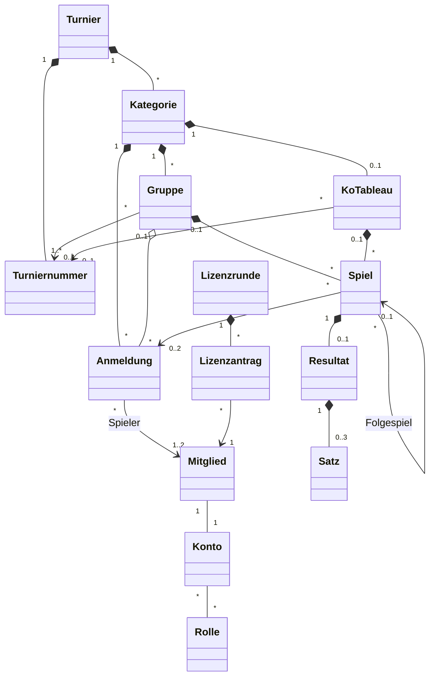

[← Übersicht](index.md)

# Fachmodell

Welche fachlichen Objekte MyTCO kennt, wie sie zusammenhängen und welche Regeln gelten —
für die Etappen *Mitglieder-Login* bis *Lizenzanträge*. Technikneutral; Grundlage für
Datenbank und Code ([Backend und Hosting](https://github.com/konstantinniedermann/tco-app/issues/8)).
Begriffe stehen im [Glossar](glossar.md), Anforderungs-IDs in den
[Anforderungen](anforderungen/anforderungen.md).

**Namen im Code:** die Objektnamen aus dem Diagramm, deutsch und ohne Umlaute
(`Mitglied`, `Anmeldung`, `KoTableau`). So bleiben Doku, Oberfläche und Code bei einem Wort.

**P** = personenbezogene Attribute des Objekts, geregelt im [Datenschutzkonzept](datenschutz.md).
**Annahme K-NN** = vom Verein noch zu bestätigen, Frage in den [Abklärungen](abklaerungen.md).

**Rollen:** Was CM- und Lizenzverantwortlicher dürfen, darf auch der Admin
([RR-02](rollen-und-rechte.md#grundsätze)).

**Junioren:** Im MVP behandelt MyTCO alle Mitglieder gleich, wie Volljährige. Junioren,
Eltern und Konten für Minderjährige kommen mit den Junioren-Funktionen (K-08).

## Überblick

## Objekte

### Mitglieder und Konten

| Objekt | Attribute | P |
|--------|-----------|---|
| **Mitglied** | Vorname, Nachname, Postadresse, E-Mail, Telefon, Geschlecht, Jahrgang (K-40), Lizenznummer (optional), Klassierung (optional, pflegt das Mitglied selbst — Annahme K-28), Status *aktiv / ausgetreten / gelöscht*, Austrittsdatum | alle ausser Status |
| **Konto** | Einmal-Code (nur als Hash, mit Ablauf und Zahl der Fehlversuche), Sitzungsversion, Daten beim ersten Login ergänzt ja/nein, gesperrt ja/nein, Benachrichtigung per E-Mail / Push ja/nein | alle |
| **Rolle** | Name. Welche Rollen es gibt und was sie dürfen, legt [Rollen und Rechte](rollen-und-rechte.md) fest | — |

### Clubmeisterschaft

| Objekt | Attribute | P |
|--------|-----------|---|
| **Turnier** | Jahr, Name, Anmeldeschluss, Status (siehe [Lebenszyklen](#lebenszyklen)) | — |
| **Turniernummer** | Nummer bei Swiss Tennis, Bezeichnung (z. B. Gruppenphase, Finalwochenende — Annahme K-25) | — |
| **Kategorie** | Name, Geschlecht (Herren / Damen / Mixed / offen), Jahrgang von–bis (Alterskategorie, optional), Klassierung von–bis (Klassierungsbereich), Einzel oder Doppel | — |
| **Anmeldung** | Kategorie, 1 Spieler (Einzel) oder 2 (Doppel), Wildcard-Antrag ja/nein, Kommentar, Status, angemeldet am, Gruppe (nach Auslosung), Rang-Korrektur (optional) | Spieler, Kommentar |
| **Gruppe** | Kategorie, Name, Turniernummer. Die Rangliste wird aus den Resultaten berechnet, nicht gespeichert | — |
| **KoTableau** | Kategorie, Grösse (Anzahl Positionen), Turniernummer. Kommt aus Advantage | — |
| **Spiel** | Gruppe *oder* KoTableau mit Runde (z. B. Viertelfinal) und Position, Anmeldung A und B (im KO leer, bis bekannt), Folgespiel (nur KO) | — (über die Anmeldung) |
| **Resultat** | Spiel, Sätze, Sonderfall (keiner / w.o. / Aufgabe), Sieger, gemeldet von, gemeldet am, Status, bestätigt von | Sätze, gemeldet von, bestätigt von |
| **Satz** | Games A, Games B, Tiebreak-Punkte (optional). Höchstens 3 Sätze, der dritte evtl. als Match-Tiebreak (Annahme K-41) | — |

### Lizenzen

| Objekt | Attribute | P |
|--------|-----------|---|
| **Lizenzrunde** | Jahr, Stichtag (setzt der Lizenzverantwortliche) | — |
| **Lizenzantrag** | Mitglied, Art (Bestellung / Aktualisierung / Storno), Status, beantragt am, exportiert am, Lizenzrunde | Mitglied, Art |

## Fachregeln

| ID | Regel | Anforderung |
|----|-------|-------------|
| FR-01 | Ein Mitglied hat genau ein Konto. Der Admin legt beides zusammen an; das Konto startet mit einem Einmal-Code für den Brief | A-MITGLIED-01, A-LOGIN-01 |
| FR-02 | Beim ersten Login ergänzt das Mitglied fehlende Daten (u. a. Lizenznummer, Klassierung), bevor es etwas anderes tun kann | A-LOGIN-03 |
| FR-03 | Ein Konto hat mindestens die Rolle *Mitglied*; der Admin vergibt weitere | A-ROLLE-01 |
| FR-04 | Austritt: Konto sofort gesperrt. Nach 3 Monaten wird das Konto gelöscht und das Mitglied auf Vor- und Nachname reduziert (Status *gelöscht*), damit vergangene Resultate lesbar bleiben | [Datenschutz](datenschutz.md#löschen), Annahme K-38 |
| FR-05 | Anmelden geht nur, solange das Turnier den Status *Anmeldung offen* hat (bis Anmeldeschluss) | A-ANMELDUNG-07 |
| FR-06 | Ein Spieler hat je Turnier höchstens 3 Anmeldungen, die nicht *abgelehnt* oder *zurückgezogen* sind. Wildcard-Anträge zählen mit; ein Doppel zählt für beide Partner (Annahme K-27) | A-ANMELDUNG-02 |
| FR-07 | MyTCO schlägt nur Kategorien vor, die nach Geschlecht, Jahrgang und Klassierung passen; im Doppel muss auch der Partner passen (Annahme K-27) | A-ANMELDUNG-03 |
| FR-08 | Für eine Kategorie ausserhalb des eigenen Klassierungsbereichs meldet man sich mit Wildcard-Antrag und Kommentar an. Die Anmeldung bleibt *beantragt*, bis der CM-Verantwortliche sie bestätigt oder ablehnt. Kommentar und Wildcard sehen nur der Spieler, der CM-Verantwortliche und der Admin | A-ANMELDUNG-10 |
| FR-09 | Ein Doppelpartner muss die Anmeldung nicht bestätigen; er wird benachrichtigt (Annahme K-27). Jedes Mitglied steht je Kategorie in höchstens einer Anmeldung | A-ANMELDUNG-04 |
| FR-10 | Bis zum Anmeldeschluss kann ein Spieler seine Anmeldung selbst zurückziehen (Annahme K-29); danach nur der CM-Verantwortliche | A-ANMELDUNG-06 |
| FR-11 | Der Kommentar enthält keine Gesundheitsangaben; die Eingabemaske weist darauf hin | [Datenschutz](datenschutz.md#welche-daten) |
| FR-12 | Gruppen und KO-Tableaus entstehen in Advantage und werden übernommen; MyTCO lost nicht selbst aus | A-ADVANTAGE-02, A-ADVANTAGE-03 |
| FR-13 | Eine Kategorie spielt Gruppen, KO oder zuerst Gruppen und dann KO. Ein Spiel gehört entweder zu einer Gruppe oder zu einem KoTableau | A-ADVANTAGE-03 |
| FR-14 | Im KO rückt der Sieger eines bestätigten Resultats ins Folgespiel; so sieht jeder, gegen wen er in der nächsten Runde spielen würde | A-RESULTAT-01 |
| FR-15 | Rangliste je Gruppe nach gewonnenen Spielen; bei Gleichstand 1. Direktbegegnung, 2. Satzdifferenz, 3. Gamedifferenz; danach Korrektur durch den CM-Verantwortlichen | A-RESULTAT-06, [Glossar](glossar.md#clubmeisterschaft-und-turnier) |
| FR-16 | Ein Spieler des Spiels meldet das Resultat, der Gegner bestätigt oder bestreitet es. Ohne Reaktion gilt es nach 3 Tagen als bestätigt; bei Streit entscheidet der CM-Verantwortliche (Annahme K-32) | A-RESULTAT-03, A-RESULTAT-04 |
| FR-17 | Erfasst der CM-Verantwortliche ein Resultat, ist es sofort bestätigt | A-RESULTAT-07 |
| FR-18 | Rangliste und Folgespiele rechnen nur mit bestätigten Resultaten | A-RESULTAT-06 |
| FR-19 | Gegner und Doppelpartner sehen E-Mail und Telefon, bis das Turnier *abgeschlossen* ist | N-DATENSCHUTZ-02, K-31 |
| FR-20 | Ein Mitglied hat je Lizenzrunde höchstens einen offenen Lizenzantrag. Zurückziehen geht, solange er *beantragt* ist | A-LIZENZ-01, A-LIZENZ-02 |
| FR-21 | Ein Antrag gehört zur nächsten Lizenzrunde, deren Stichtag noch nicht vorbei ist. Storno entspricht der Sistierung bei Swiss Tennis (Annahme K-34) | A-LIZENZ-03 |
| FR-22 | Der Export einer Lizenzrunde setzt alle ihre beantragten Anträge auf *exportiert*; der Lizenzverantwortliche hakt sie nach dem Eintragen bei Swiss Tennis als *erledigt* ab | A-LIZENZ-04 |
| FR-23 | Exporte an Swiss Tennis enthalten nur die Felder, die Swiss Tennis braucht (vor allem Lizenznummern) | A-ADVANTAGE-01, A-ADVANTAGE-04, A-LIZENZ-04, DS-04 |
| FR-24 | Ein Einmal-Code gilt nur einmal. Danach bleibt das Gerät eingeloggt, bis die Sitzung ein Jahr nicht genutzt wurde. Erhöht der Admin die Sitzungsversion, enden alle Sitzungen des Kontos | A-LOGIN-08, A-LOGIN-09 |

## Lebenszyklen

| Objekt | Zustände |
|--------|----------|
| Turnier | *in Vorbereitung* → *Anmeldung offen* → *Anmeldung geschlossen* → *läuft* → *abgeschlossen* |
| Anmeldung | *bestätigt* (ohne Wildcard sofort) · *beantragt* → *bestätigt* / *abgelehnt* (mit Wildcard) · jederzeit → *zurückgezogen* (FR-10) |
| Resultat | *gemeldet* → *bestätigt* / *bestritten* → *bestätigt* (Entscheid des CM-Verantwortlichen) |
| Lizenzantrag | *beantragt* → *exportiert* → *erledigt* · *beantragt* → *zurückgezogen* |
| Mitglied | *aktiv* → *ausgetreten* → *gelöscht* nach 3 Monaten, nur noch der Name (FR-04) |

## Ausblick

Nicht Teil dieser Etappen, aber so angelegt, dass sie andocken
(N-ERWEITERBAR-01):

- **Anlässe** (Junioren-Training, weitere Turniere): eigenes Objekt *Anlass* mit
  Anmeldungen; das Turnier bleibt eigenständig.
- **Junioren:** Mitglied ohne Konto oder Konto der Eltern (K-08).
- **Spielplan fürs Finalwochenende:** *Platz* und Termin am Spiel (A-SPIELPLAN).
- **Newsfeed, Lizenzliste als PDF, Registrierung:** eigene Objekte, keine Änderung an den
  bestehenden.
