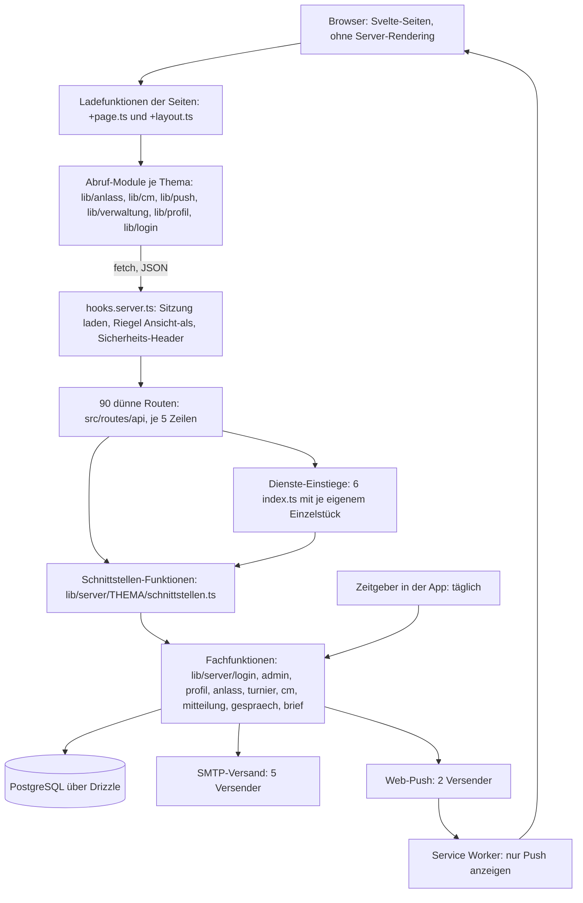

[← Übersicht](index.md)

# Refactoring-Analyse MyTCO

Dieses Dokument ist das Gedächtnis des Refactorings. Wer nur dieses Dokument liest, soll
weiterarbeiten können: Es enthält den Ist-Zustand, die Befunde, das Zielbild, den Plan mit Status
je Schritt, die Entscheide und die offenen Fragen. Sammel-Issue:
[#80](https://github.com/konstantinniedermann/tco-app/issues/80).

- **Stand des Dokuments:** 14.11.2026, nach Schritt 16, Teil 1 (CM-Seite umgesetzt, Review offen, nicht gemergt); davor Schritt 15 (Läufe 1, 1b und 2, Review je «ok», Version 0.22.1); davor Schritt 14 (Review «ok», Version 0.20.21); zuvor Schritt 12a (Review «ok», Version 0.20.19). Die Etappen 0 und 1 sind umgesetzt; die Zwischenrevision am
  Ende der Etappe 1 (Abschnitt 1c) ist am Checkpoint entschieden und eingearbeitet (E-41 bis E-44).
  Danach die Etappe 2.
- **Stand der Analyse (Abschnitte 1 bis 5 und 10):** 11.11.2026, Version 0.20.5, vor Schritt 01.
  Zahlen und Fundstellen dort gelten für diesen Stand; was die Etappe 0 berichtigt hat, steht
  beim Befund. Der Vermerk «Nachtrag» ohne Schrittnummer meint den zweiten Durchgang der Analyse
  vom selben Tag (Testqualität und Oberfläche: B-28 bis B-36, F-13, F-14).
- **Markierungen:** **[geändert]** und **[neu]** kennzeichnen nur noch, was die Zwischenrevision
  am Ende der Etappe 0 und die Entscheide des Projektleiters vom 11.11.2026 (E-28 bis E-32)
  geändert haben, dazu die Nachträge der Etappe 1 und was die Zwischenrevision am Ende der
  Etappe 1 mit den Entscheiden vom 12.11.2026 (E-41 bis E-44) geändert hat. Die Markierungen früherer Durchgänge sind entfernt; was davor wie lautete,
  zeigt der Git-Verlauf dieser Datei.
- **Aufbau:** Abschnitte 1 bis 5 Befunde, 6 Zielbild, 7 Plan, 8 Entscheide, 9 Fragen, 10 Grenzen;
  Anhang A und B Anweisungsdateien, Anhang C das Protokoll der Etappe 0, Anhang D das der Etappe 1
  (bis D.15, Schritt 12a), Anhang E das der Etappe 2 (bis E.11, Schritt 16 Teil 1).

## Stand und nächster Schritt

*Diesen Abschnitt führt jeder Lauf nach.*

| | |
|---|---|
| **Phase** | 4 Umsetzung. **Etappe 0 abgeschlossen** (Checkpoint 11.11.2026, Abschnitt 1b). **Etappe 1 umgesetzt** (Schritte 06, 06a, 07 bis 12, alle auf `dev`, Versionen 0.20.10 bis 0.20.18); Zwischenrevision und Checkpoint am Etappenende erledigt am 12.11.2026 (Abschnitt 1c, E-41 bis E-44) und in Zielbild und Plan eingearbeitet. Der nachgeschobene Schritt **12a** (E-42) ist umgesetzt und gemergt (0.20.19). **Etappe 2:** Schritt 13 erledigt (zwei Läufe, Review je «ok», Version 0.20.20); Schritt 14 erledigt (Review «ok», Version 0.20.21); **Schritt 15 erledigt** (Läufe 1, 1b mit Interclub und 2; Review je «ok» am 14.11.2026, Version 0.22.1); **Schritt 16 erledigt** (CM-Seite; Review «ok» am 14.11.2026; die Doppel-Seite ist verworfen, F-30: A, E-51; Version 0.22.2); **Schritt 17 erledigt** (Review «ok» am 14.11.2026, Checkpoint E-21 erledigt: E-52, E-53; Version 0.22.4) |
| **Erledigte Schritte** | Etappe 0: 01 bis 05 (Kurzfassung in 7.2, Protokoll in Anhang C). Etappe 1: 06 (0.20.10), 06a (0.20.11), 07 (0.20.12), 08 (0.20.13), 09 (0.20.14), 10 (0.20.16), 11 (0.20.17), 12 (0.20.18), 12a (0.20.19), alle mit Review «ok» auf `dev` und grüner CI (Ergebnisse in 7.3, Protokolle in Anhang D) |
| **Zuletzt erledigt** | **17** (14.11.2026, Review «ok», Checkpoint E-21 erledigt mit E-52 und E-53, gemergt als Version 0.22.4; davor der Nachtrag zu Schritt 16 als Version 0.22.3, E-54; Ergebnis in 7.4, Protokoll Anhang E.12): Vorab-E2E `tests/e2e/anmeldungsliste-ablauf.test.ts` (vier Fälle je Handy, auf dem alten Stand grün, einmal rot), `Aktionsdialog` um `neben` (zweite Entscheid-Taste) und `ohneHaupttaste` erweitert, die fünf Rückfragen der Einzel-Anmeldungsliste darauf (`fuehreAus`, eigene Sperre und rohe Dialoge weg); der Wildcard-Antrag nutzt den Baustein (nicht von Hand). Sichtbar anders: die Warnung als Liste (Bilder für E-21 im Scratchpad, siehe E.12) und drei Randfälle (E.12); `cm-verwaltung`, `turnier`, `cm-anmeldung`, `cm-doppel-verwaltung` grün; voller `make check` grün (2427 Tests, E2E 524/64, 5,4 Minuten). Davor **16** (14.11.2026, Review «ok», gemergt als Version 0.22.2; Teil 2 mit der Doppel-Seite verworfen, F-30: A, E-51; Ergebnis in 7.4, Protokoll Anhang E.11): Vorab-E2E `tests/e2e/cm-ablauf.test.ts` (drei Fälle je Handy, auf dem alten Stand grün, einmal rot), die Ablauf-Funktion `src/lib/cm/ablauf.ts` mit 15 Einheitsfällen (Abdeckung 100 %), sieben der acht Handler der CM-Seite darauf, `angabenSenden` bleibt von Hand (Abbruchstelle 2), die zwei Text-Dialoge als `src/lib/cm/Textdialog.svelte`; Sätze, Reihenfolge und Fokus unverändert, Markup gleich bis auf die `id`s; für die Nutzerin nichts; voller `make check` grün (2427 Tests, E2E 516/60, 5,3 Minuten). Davor **15, Lauf 2** (14.11.2026, Review «ok», mit Lauf 1 und 1b gemergt als Version 0.22.1; Ergebnis in 7.4, Protokoll Anhang E.9): die vier Listen der Verwaltung (`turniere`, `anlaesse`, `verlauf`, `mitglieder`) laden ihr erstes Laden in einer neuen `+page.ts` über den Wächter (Fall `verwaltung`); eine Störung bleibt eine Meldung in der Seite (`zeilen: null`, keine Fehlerseite); `mitglieder` lädt nach Suche und Filter weiter im Baustein, ohne zweite Abfrage beim Einhängen; Vorab-Tests (E2E 5 Fälle je Gerät, auf dem alten Stand grün, einmal rot) und 13 Einheitsfälle der vier Ladefunktionen; für die Nutzerin nur die zwei Folgen aus E-48; voller `make check` grün (2412 Tests, E2E 510/57, 3,9 Minuten). Davor **15, Lauf 1b (Interclub)** (14.11.2026, Review «ok» am 14.11.2026 zusammen mit Lauf 1; Ergebnis in 7.4, Nachmessen Anhang E.7, Protokoll Anhang E.8): `origin/dev` mit #81 eingemergt (Layout in der Fassung von `dev`, Entscheide des Branches neu E-48 bis E-50), Vorab-Tests für die drei Interclub-Seiten und das Wurzel-Layout (E2E vier Fälle mehr und drei Adressen mehr in der Tabelle, 15 Einheitsfälle, je Gruppe einmal rot), Wurzel-Layout auf `ladeSitzung` (Typ `Sitzung` mit `interclub`), die drei Interclub-Ladefunktionen auf dem Wächter (Fall `mitglied`); keine Zeile mehr in der Wächter-Tabelle, Fälle L und M benannt und unverändert; für die Nutzerin ändert sich nichts; voller `make check` grün (2399 Tests, E2E 495/57, 3,4 Minuten). Davor **15, Lauf 1** (13.11.2026, Branch `refactor/schritt-15`, nicht gemergt; Ergebnis in 7.4, Protokoll Anhang E.6): Vorab-Tests in drei Teilen (E2E 21 Fälle auf drei Geräten, 91 Einheitsfälle der Ladefunktionen, je Teil einmal rot), `ladeSitzung` und die Wächter-Tabelle `src/lib/login/waechter.ts` mit zwei Hüllen und sechs benannten Fällen (neu `verwaltung-zugang`), 22 Ladefunktionen, das Wurzel-Layout, 17 Stellen nach einer Aktion und das Abmelden umgestellt, `hilfe/+page.ts` auf `ladeKontakt`; keine Ladefunktion ruft `fetch`, keine Seite schreibt die Umleitung zum Login; für die Nutzerin ändert sich nichts; voller `make check` grün (2300 Tests, E2E 477/57, 4,1 Minuten); Review «ok» am 14.11.2026 (mit Lauf 1b). Davor **14** (13.11.2026, Review «ok» ohne Befund, Version 0.20.21; Ergebnis in 7.4, Protokoll Anhang E.4): `verwaltung/api.ts` nach Bereichen geteilt, in `zugang-api.ts`, `anlass-api.ts`, `gespraech-api.ts`, `mitglieder-api.ts` und `turnier-api.ts`; `api.ts` bleibt der Kern (`Antwort<T>`, Vertrag, `lese`, `schicke`) und reicht nichts weiter; 42 Dateien wechseln nur Import-Zeilen, 44 Tests auf fünf Dateien verteilt, keiner geändert; voller `make check` grün (2156 Tests, E2E 414/57). Davor **13, Lauf 2** (13.11.2026, Branch `refactor/schritt-13`, nicht gemergt; Ergebnis in 7.4, Protokoll Anhang E.3): Profil, Login, Passkey und `hatSitzung` auf dem Baustein, Umbenennung `ergebnis` → `art`, beide Kleinfragen aufgenommen (`{ art }` beim E-Mail-Wechsel, vier benannte Anfragen der Login-Seiten), N-09 (`src/lib/anlass/antwort.ts`), Wortlisten der Verträge an den Typ gebunden, `abruf.ts` in der Abdeckung; die Lint-Regel zu `fetch` verworfen (98 Meldungen am heutigen Repo, Vorschlag an Schritt 15); voller `make check` grün (2156 Tests, E2E 414/57). Davor **13, Lauf 1** Abruf-Baustein (13.11.2026, Review «ok» ohne Befund; Protokoll Anhang E.2): Vorab-Tests (27 Fälle, E.1 Zeilen 1 bis 34 und 57, alle auf dem alten Stand grün, je Modul einmal rot), Tabelle `STATUS_DES_WORTS` in `src/lib/fehler.ts`, Baustein `src/lib/abruf.ts` (17 Fälle, Abdeckung 100 %), `anlass`, `push`, `cm`, Verwaltung und `mitteilung-api` darauf, N-10 als `src/lib/cm/ablehnung.ts`; Diff der bestehenden Tests leer, keine `.svelte`-Datei; Abbruchstelle von `Antwort<T>` nicht eingetreten; voller `make check` grün (2134 Tests, E2E 414/57). Davor **12a** Reste der Bauregel (12.11.2026, Review «ok» nach einer Korrekturrunde, Version 0.20.19; Ergebnis in 7.3, Protokoll in Anhang D.15): Punkte (1) bis (5) gebaut, (6) begründet verworfen (Schritt 20, Hinweis (e)), `.mts`, `.cts`, `.mjs` und `.cjs` aufgenommen; Korrekturrunde nach dem Review (M-1: das Muster für Texte verschluckte echte Importe; jetzt prüft jede Regel zwei Lesarten ohne Kommentare); `bauregel.test.ts` 122 → 200, je Form vorher rot; Vergleich alt gegen neu: 0 Fälle «alt Befund, neu keiner» über 25 843 536 eigene und 22 526 400 Fälle des Reviewers (Wahrheit vom TypeScript-Parser); voller `make check` grün, kein Diff unter `src/`. Davor **12** Importregeln scharf gestellt (12.11.2026, Review «ok», Nachreview des Nachtrags «ok», Version 0.20.18; Ergebnis in 7.3, Protokoll in Anhang D.14): Test «`AUSNAHMEN` ist leer», Lint-Meldung ohne veraltete Ausnahmen, jede Regel der Importrichtung einmal verletzt (22 Proben), neue Regel der Bauregel: `liest`/`schreibt` nur in den Dateien von `VERWALTUNGS_DATEIEN`. **Damit ist die Etappe 1 umgesetzt.** Davor **11** (Review «ok» für beide Läufe, Version 0.20.17; Anhang D.12, D.13). Davor **10** `getSitzung` in `sitzung/schnittstellen.ts`, `ANSICHT_ROLLEN` und `AnsichtRolle` in `login/sitzung.ts`, `AUSNAHMEN` 4 → 1: Review «ok» ohne Befund, Version 0.20.16 (Ergebnis in 7.3, Protokoll in Anhang D.10). Davor **09** Verwaltung der Anlässe in `anlass/verwaltung-schnittstellen.ts` (Variante A von F-17, E-38), samt der Lücke «Namen in Anführungszeichen» der Bauregel: Review «ok» nach einer Korrekturrunde, Version 0.20.14 (Ergebnis in 7.3, Protokoll in Anhang D.8). Davor **08** eine Fehlerform und eine Liste der Fehlerwörter (`src/lib/fehler.ts`): Review «ok» ohne Befund vor dem Merge, Version 0.20.13, umgesetzt nach Variante A von F-21 (vorläufig) (Ergebnis in 7.3, Nachmessen in Anhang D.5, Protokoll in Anhang D.6). Davor 07 (Version 0.20.12, Anhang D.4) |
| **Nächster offener Schritt** | **18** (`basis.css` in mehrere Dateien schneiden, in der bestehenden Reihenfolge, E-13; Absicherung `make css-vergleich`; Dateien unter `src/lib/design/`). Vorher die Prüfliste (b) lesen, samt dem Hinweis aus dem Review von Schritt 16 (`tests/e2e/cm-ablauf.test.ts` sucht an einer Stelle über `div.karte`). **Schritt 17** ist erledigt: Review «ok» am 14.11.2026, die Liste bleibt (E-52), die Wettlauf-Abweichungen sind angenommen (E-53), Version 0.22.4 (Ergebnis in 7.4, Protokoll E.12). Für die Übergangsregel «Ab Schritt 17» gilt die benannte Ausnahme der Doppel-Seite (E-51). Offene Hinweise aus den Reviews der Schritte 16 und 17 stehen in E.11 und E.12 (Nachtrag im UI-Leitbild spätestens in Schritt 24, toter Getter `Seite.meldung`, `warnungText` nur noch im eigenen Test). Etappe 2 läuft ohne Halt mit Kurzbericht je Schritt (E-45) |
| **Wartet auf Freigabe des Projektleiters** | nichts. Checkpoint E-21 zu Schritt 17 erledigt am 14.11.2026 (E-52, E-53). Checkpoint am Ende der Etappe 1 erledigt am 12.11.2026 (E-41 bis E-44); die Berichtigungen der `CLAUDE.md` sind eingespielt (E-43) |
| **Offene Fragen** | **F-15** (Version, solange es Test nicht gibt): vor Schritt 23, Abschnitt 9.1. Alle anderen Fragen sind beantwortet (F-28: A, E-48; F-29: A, E-49; F-30: A, E-51; F-22 durch den Ablauf erledigt, F-23 in F-26 aufgegangen); das Nachmessen von Lauf 1b (E.7) hat keine neue Frage |
| **Checkpoint Etappe 0, Nachweis** | E2E dreimal voll grün auf `bad624f` (Version 0.20.9): je 414 bestanden, 57 übersprungen, 3,8 / 5,3 / 4,1 Minuten (gemessen vom Orchestrator); CI auf `dev` zum Merge von Schritt 05 grün (Lauf 43046410032, alle Prüf-Jobs und E2E auf drei Geräten) |
| **Vorab nachzumessen** | vor Schritt 19, 20, 23 (was, steht je in der Spalte «Nachmessen vorab»; Übersicht in 7.7). **Für Schritt 16 erledigt am 14.11.2026 (Anhang E.10):** kein Entscheid des Projektleiters nötig, keine neue Frage; die Doppel-Seite wird **aufgenommen** (drei Handler, als zweiter Teil mit eigener Abbruchstelle; `suchen` und `neuLaden` bleiben von Hand); die Funktion passt für sieben der acht Handler der CM-Seite, `angabenSenden` nur mit eigener Angabe; den Fokus nach einer Aktion hält heute eine einzige E2E-Stelle, vier Handler haben keinen E2E-Fall, darum vier Vorab-E2E (`tests/e2e/cm-ablauf.test.ts`, ohne Mail-Code) zusätzlich zu den Einheitstests; «rund 250 Zeilen» eher 170 bis 210; keine gemeinsame Datei mit Schritt 17. **Für Schritt 15, Lauf 1b (Interclub) erledigt am 14.11.2026 (Anhang E.7):** mit #81 39 Adressen, 30 Ladefunktionen, 25 «nur der Wächter wechselt»; kein neuer Fall in der Wächter-Tabelle, zwei neue benannte Fälle L und M ausserhalb der Tabelle; zwei Ränder des Layouts; ein Vorab-Test aus Lauf 1 muss mit dem Merge mit. **Für Schritt 15 erledigt am 13.11.2026 (Anhang E.5):** Tabelle aller 36 Adressen mit Ziel; 17 statt 14 Stellen «nach einer Aktion»; acht benannte Fälle mehr (D bis K); Vorab-Test als E2E-Tabelle ohne Konto und Mail-Code plus Einheitstests der Ladefunktionen der Verwaltung; Wächter als Tabelle in `src/lib/login/waechter.ts` mit zwei Hüllen, `ladeSitzung` in `sitzung.ts`; zwei Läufe, ein Merge; Lauf 1 ändert für die Nutzerin nichts, Lauf 2 (vier Listen) freigegeben mit F-28 (E-48). **Für Schritt 13 erledigt am 12.11.2026 (Anhang E.1):** kein Entscheid des Projektleiters nötig, der Baustein erhält jeden heutigen Rand; «ein Wort gilt nur mit seinem Status» bleibt, dazu «für 401, 404 und 429 genügt der Status»; 57 Zeilen Vorab-Tests; Baustein `src/lib/abruf.ts`; drei Seiten statt vier (`willkommen` liest kein Ergebnis); N-09 aufnehmen, N-10 als geteilte Liste unter `src/lib/cm/`. Für Schritt 07 erledigt am 12.11.2026 (Anhang D.3), für Schritt 08 am 12.11.2026 (Anhang D.5), für Schritt 09 am 12.11.2026 (Anhang D.7), für Schritt 10 am 12.11.2026 (Anhang D.9: Ort ist ein neues Modul `sitzung/`, kein Entscheid nötig), für Schritt 11 am 12.11.2026 (Anhang D.11: Zuordnung 9 Turnier, 13 CM, 4 Gespräch bestätigt; mit den Mitteilungen 23 Funktionen und 20 Routen; `AUSNAHMEN` ist schon nach Schritt 11 leer; Empfehlung zwei Teile 11a und 11b, F-22). Schritte 06 und 06a brauchen keines |
| **Nächster Checkpoint** | **Jetzt:** Schritt 17 vor dem Merge (Vorher-Nachher-Bild, E-21; Bilder und Abweichungen in E.12). Sonst läuft Etappe 2 ohne Halt mit Kurzbericht je Schritt (E-45); sonst nur bei den in E-45 genannten Anlässen. Am Ende der Etappe 2 Zwischenrevision und Checkpoint |
| **Erledigt ausserhalb des Plans** | Worktree und Branch `doppel-anfragen-verfallen` entfernt (E-14). Die Vorschläge B.3a bis B.3c, B.4a, B.5 und B.6 stehen als Eintrag vom 11.11.2026 in der gemeinsamen `beobachtungen.md` der CAS-Projekte (E-25). Die Änderungen an der Projekt-`CLAUDE.md` aus der Zwischenrevision sind eingespielt (E-29); der Agent `refactor-analyst` hat das Werkzeug Edit (E-32) |
| **Hinweis für den Orchestrator** | Die Agent-Typen `refactor-*` kennt eine Session erst, wenn sie nach dem Merge von Schritt 01 gestartet wurde. Sonst denselben Text als allgemeinen Agenten mit dem genannten Modell starten |

**Kennzeichnung der Belege**

- **[G]** selbst gelesen oder gemessen (Datei, Git, GitHub)
- **[E]** aus Erkundung: Stichprobe, Textsuche oder Auszug, nicht die ganze Datei gelesen
- **[V]** Vermutung, nicht belegt

**Begriffe, die oft vorkommen**

- *Schnittstelle*: eine Adresse unter `/api/…`, über die die Oberfläche Daten holt oder speichert.
- *Worktree*: eine zweite Arbeitskopie desselben Repos in einem eigenen Ordner, damit mehrere
  Sessions gleichzeitig arbeiten können.
- *E2E-Test* (Ende-zu-Ende): Ein Test bedient die laufende App im Browser wie ein Mensch.
- *Charakterisierungstest*: Ein Test, der das heutige Verhalten festhält, bevor umgebaut wird.
- *Hotspot*: Datei, die auffallend oft geändert wurde.
- *Flake*: Test, der ohne Code-Änderung manchmal rot und manchmal grün ist.

---

## 1 Kurzfazit

1. **Der Anwendungscode ist in gutem Zustand.** Er ist einheitlich aufgebaut, sorgfältig
   kommentiert, gut getestet (rund 1550 Einheits- und Datenbanktests, 162 E2E-Tests auf drei
   Geräten) und enthält fast keine Notlösungen (kein einziges `TODO`, vier Lint-Ausnahmen). Ein
   «grundlegendes Refactoring» des Codes ist die falsche Grösse. Richtig ist **gezieltes
   Aufräumen** an wenigen, klar benennbaren Stellen. [G]
2. **Die Wachstumsspuren im Code sind Duplikate und fehlende gemeinsame Bausteine**, nicht
   falsche Architektur: dieselben Hilfsfunktionen in sechs Server-Modulen, fünfmal derselbe
   Mail-Versender, sechs eigene Varianten des Abrufs von Schnittstellen in der Oberfläche, der
   Anmelde-Wächter in jeder Seite kopiert, eine Seite mit über 1000 Zeilen, ein Stylesheet mit
   2287 Zeilen. [G]
3. **Der grösste Befund liegt nicht im Code, sondern im Verhältnis von Prozess und Doku zum
   Code.** 58 % aller Commits ändern nur Doku. Die Doku ist in Bytes grösser als der
   Anwendungscode. Die 17 meistgeänderten Dateien sind bis auf eine Doku- oder Prozessdateien.
   Es gibt 38 Versionsabschnitte und 27 Merges nach `main`, aber keinen Server, kein Release,
   keinen Tag und keinen einzigen Nutzer. [G]
4. **Eine ganze Auslieferungskette ist gebaut, aber nie in echt gelaufen** (rund 2900 Zeilen
   Betriebsskripte, 2000 Zeilen Tests dazu, fünf CI-Jobs). Sie ist nicht Teil des Refactorings
   und soll nicht angefasst werden; sie ist aber ein Risiko, das benannt gehört. [G]
5. **Das Sicherheitsnetz ist stark, hat aber eine schwache Stelle:** Die E2E-Tests sind auf dem
   iPhone-Profil unter Last wacklig (drei offene Beobachtungen, acht Fallen-Notizen). Weil E2E
   das Hauptnetz für den Umbau der Oberfläche ist, kommt das zuerst. [G]
   **Nachtrag:** Die gelesene Stichprobe (9 Testdateien neben dem Code, 5 E2E-Dateien, die
   Hilfen) prüft durchwegs Verhalten, nicht Wortlaut des Quelltexts. Das Netz trägt die Etappen
   0 und 1 fast ohne Zusatz. Es hat zwei Löcher (Verdrahtung der Routen, Vertrag zwischen Server
   und Oberfläche: B-28, B-29) und einige Tests, die bei Etappe 2 ohne Verhaltensänderung rot
   würden (B-31). [G]
6. **Jetzt ist der günstigste Zeitpunkt für Aufräumarbeiten, die später teuer werden:**
   Solange es kein Live gibt, lassen sich interne Schnittstellen und (falls gewünscht) die
   19 Migrationen ohne Rücksicht auf Altdaten ändern. [G]
7. **Die Anweisungsdateien sind knapp und wirksam, erzeugen aber Nebenwirkungen:** Regeln wie
   «keine neue Abhängigkeit», «erst Leitbild, dann Code» und «jeder Merge eine Version» sind
   sinnvoll, haben aber Eigenbau-Prüfskripte, Doku-Hotspots und eine garantierte Kollisionsstelle
   für parallele Sessions hervorgebracht. [G]

**Empfehlung in einem Satz [geändert]:** 27 kleine Schritte in fünf Etappen (Abschnitt 7),
davon nur rund die Hälfte am Code; die grösste Wirkung haben die Entscheide des Projektleiters zu Arbeitsweise und
Doku-Umfang (Fragen F-01, F-09, F-11).

---

## 1a Was sich in Phase 3 geändert hat (11.11.2026)

Gegenüber der ersten Fassung (Commit `7e4b68a`): Die Fragen F-01 bis F-14 sind beantwortet, jede
wie empfohlen (E-07 bis E-22, Abschnitt 9). Der Plan wurde von 27 auf 25 Schritte neu geschnitten
und nummeriert (7.1); mit den Schritten 06a (E-28) und 12a (E-42) sind es heute 27. Schritt 01 wurde ein Startpaket (die neue
`CLAUDE.md` und die Änderungen an Skill und Agenten gelten von Anfang an). Jeder Schritt nennt
Modell, Weg und Nachmessen; kein Schritt hat das Risiko «hoch». Checkpoints und feste Freigaben
stehen in 7.7. Die Lockerungen (Versionsregel E-07, Doku-Rhythmus E-17) gelten erst nach dem
Refactoring.

---

## 1b Zwischenrevision Etappe 0 (11.11.2026) [neu]

Stand: `origin/dev` nach dem Merge von Schritt 05 (Commit `bad624f`, Version 0.20.9). Gelesen:
dieses Dokument (Abschnitte 1 bis 2.3, B-12 bis B-15, 5 bis 10, Anhang B), `CLAUDE.md`, der Diff
`3593dde..HEAD`, die neuen Tests und Werkzeuge ganz (`grundpruefung.db.test.ts`, `routen.test.ts`,
`importrichtung.test.ts`, `eslint.config.js`, Diffs von `scripts/e2e.ts`, `vite.config.ts`,
`playwright.config.ts`, `Makefile`), `bauregel.ts` ganz, alle sieben `index.ts`, die Köpfe und
Hilfsfunktionen aller `schnittstellen.ts`, `hooks.server.ts`, `.githooks/pre-commit`. Nichts gebaut,
nichts getestet. Was nicht geprüft ist, steht in Abschnitt 10.

**Urteil**

1. **Das Zielbild (Abschnitt 6) trägt.** Zwei Sätze sind in 6.1 Punkt 8 ergänzt.
2. **Der Plan der Etappe 1 ging auf, aber nicht so, wie er dastand.** Die zwei Fristen von F-16
   widersprachen sich; dafür gibt es den neuen kleinen Schritt 06a vor Schritt 07. Schritt 09
   ist grösser als «niedrig» und braucht ein Nachmessen, Schritt 10 hatte kein Ziel für
   `getSitzung`, Schritt 11 ist beim Gespräch kleiner als geplant. Kein Schritt entfällt.
3. **Das Netz trägt die Schritte 06, 06a, 07 und 10.** Für 08, 09 und 11 hat es je eine Stelle mit
   falschem Grün (Fehlerwörter; eine neue Verwaltungs-Liste fällt aus den Rechte-Schleifen). Drei
   kleine Charakterisierungstests fehlten im Plan (jetzt bei 06, 07 und 09 unter «Absicherung»).
4. **Die Reihenfolge 06 → 06a → 07 → 08 → 09 → 10 → 11 → 12 stimmt** (Begründung in 7.7).
5. **Checkpoint-Nachweis liegt vor** (Tabelle «Stand und nächster Schritt»).

**Entschieden am Checkpoint (11.11.2026)**

| Thema | Entscheid | Steht jetzt |
|-------|-----------|-------------|
| F-16, Rechteprüfung und Dienst-Typen | A1: neuer Schritt 06a vor Schritt 07 (E-28) | Zeile 06a und «Hinweise zu Schritt 06a» in 7.3 |
| F-18, Vorschlag zur `CLAUDE.md` | gilt ganz, ist eingespielt (E-29) | geltende `CLAUDE.md`; Befund A-17 |
| F-19, Ok für Etappe 1 | ja, mit den Änderungen der Revision; Checkpoint nach jedem Schritt (E-30) | 7.3 bis 7.7 |
| Dokument straffen | ja (E-31) | diese Fassung; Protokoll der Etappe 0 in Anhang C |
| Werkzeug des Analysten | `refactor-analyst` hat Edit, nur für dieses Dokument (E-32) | `.claude/agents/refactor-analyst.md`, Anhang B.2c |
| F-17, F-15 | bleiben offen | Abschnitt 9 |

**Wo die Inhalte der Revision jetzt stehen**

| Inhalt | Ort |
|--------|-----|
| Änderungen am Plan (06 bis 12, 18 bis 21, Zählung) | Zeilen und «Hinweise zu Schritt NN» in 7.3 bis 7.6, markiert mit [geändert] oder [neu] |
| «Trägt das Netz die Etappe 1?» | 7.3, Unterabschnitt «Was das Netz für die Etappe 1 deckt» |
| Reihenfolge, Kosten in Versionen | 7.7 |
| Befunde B-37 bis B-41 | 3.2 (B-39, B-40, B-41), 3.3 (B-38 bei B-12), 3.6 (B-37); Nachtrag bei B-03 |
| Befunde A-14 bis A-18 | Abschnitt 5 |
| Zielbild, zwei Sätze | 6.1 Punkt 8 |
| Fragen F-15 bis F-19 | Abschnitt 9 |
| Nicht geprüft, dünn belegt | Abschnitt 10 |

**Unverändert geprüft, stimmt:** die Schritte 13 bis 17, 22 bis 25 (keine veraltete Angabe gefunden;
nur die Zeilen gelesen, nicht die Dateien dahinter). Abschnitt 6.3 passt zu 06a («Rechteprüfung …
höchstens der Ablageort»).

**Vorschläge zum Dokument, umgesetzt (E-31):** Protokoll der Etappe 0 in Anhang C; die Prüfliste (b)
bei Etappe 2 (7.4); Nachträge aus den Tabellenzellen in «Hinweise zu Schritt NN»; Status der
erledigten Schritte kurz; Abschnitt 9 als Tabelle; Kopf mit «Stand der Analyse»; alte Markierungen
entfernt; Anhang A als Verweis. Tabelle 7.1 (alte und neue Nummern) bleibt vorn, weil ältere
Commits und Berichte die alten Nummern nennen.

---

## 1c Zwischenrevision Etappe 1 (12.11.2026) [neu]

Stand: `origin/dev` nach dem Merge von Schritt 12 (Commit `c77a9f8`, Version 0.20.18). Gelesen:
dieses Dokument (Kopf, 1 bis 1b, 6, 7.2 bis 7.7 ohne die «Hinweise» zu 06 bis 11, 8 bis 10,
Anhang A; aus Anhang D ganz D.14, sonst je «Was kein Test sieht», «Ausserhalb des Schritts», «Für
die Folgeschritte», Reviews und «Zum Ablauf», dazu «Die Gegenseite» aus D.5), `CLAUDE.md`,
`docs/beobachtungen.md`, `git diff bad624f..HEAD --stat`. Am Code ganz: `http.ts`, `fehler.ts`,
`dienste.ts`, `admin/rechte.ts`, `sitzung/schnittstellen.ts`, `gespraech/antworten.ts`,
`cm/verwaltung-meldung.ts`, `tests/hilfen/verwaltungs-listen.ts`, `turnierjahre.ts`, die Routen
`sitzung`, `status`, `kontakt`; für die Etappe 2 `anlass/api.ts`, `push/api.ts`, `login/anmelden.ts`,
`login/sitzung.ts`, `verwaltung/umleiten.ts`, elf Ladefunktionen, `cm/api.ts` und `verwaltung/api.ts`
bis und mit der Deutung. Alles Übrige per Textsuche [E]. Nichts gebaut, nichts getestet. Was nicht
geprüft ist, steht in Abschnitt 10.

**[geändert] Stand nach dem Checkpoint (12.11.2026):** Der Abschnitt war als Vorschlag geschrieben.
Die Vorschläge der Tabellen Z und P, die Plan-Zeile 12a, die Zuordnung der Befunde N und Teil 1
der Tabelle C sind entschieden und **eingearbeitet (E-41 bis E-44)**; wo, zeigt die Tabelle
«Entschieden am Checkpoint». Die Tabellen unten bleiben als Herleitung im Wortlaut der Revision
stehen; es gelten Zielbild (6.1) und Plan (7.3 bis 7.7). **«Vorschlag, nicht eingespielt» gilt nur
noch für C-7 bis C-10 und für die Punkte zur Arbeitsweise.**

**Urteil**

1. **Die Etappe 1 hat das Zielbild für den Server erreicht** (6.1 Punkte 1, 2, 3 und 8). Vier
   Sätze des Zielbilds sagen mehr, als gebaut ist, und gehören berichtigt (Tabelle Z). Keine
   Abweichung ist ein Mangel am Code; es sind benannte Ausnahmen, die im Zielbild fehlen.
2. **Der Rest des Plans trägt, aber die Schritte 13 und 15 stehen zu knapp da.** Schritt 13
   widerspricht sich (Tests «unverändert grün» und zugleich «das Ergebnis heisst `art`»: zwei der
   sieben Module heissen heute `ergebnis`). Schritt 15 nennt «niedrig» und «kein Nachmessen», hat
   aber fünf verschiedene Wächter und keinen Test, der sie festhält. Kein Schritt entfällt.
3. **Das Netz trägt die Schritte 14, 16, 17 und 18.** Für 13 und 15 gibt es falsches Grün
   (Tabelle «Netz»). Zwei Charakterisierungstests fehlen im Plan: die Sonderfälle der Abruf-Module
   vor 13, die Umleitungen ohne Sitzung vor 15.
4. **Die Reihenfolge 13 → 14 → 15 → 16 → 17 → 18 stimmt**, mit einer neuen Abhängigkeit: 16 braucht
   15 (die neun Stellen «abgemeldet → Login» der CM-Seite).
5. **Die Reste der Bauregel sind klein, aber sie sind Schutz-Code ohne Schritt.** Vorschlag: ein
   eigener kleiner Schritt 12a (Plan-Zeile unten, Frage F-25).
6. **Die `CLAUDE.md` stimmt in der Wirkung, an fünf Sätzen nicht mehr im Wortlaut** (Tabelle C,
   Frage F-26).
7. **Bleibt (gut gelöst):** `fehler.ts` als eine Liste, gegen die Server, Oberfläche und Tests
   getippt sind; `dienste.ts` als oberste Schicht mit privaten Versendern und Erlaubt-Liste in der
   Bauregel; die Tabelle `VERWALTUNGS_DATEIEN` (Schutz am Pfad statt am Namen);
   `tests/hilfen/verwaltungs-listen.ts`; der Test «`AUSNAHMEN` ist leer»; der Vergleich alter gegen
   neuer Bauregel über gestellte Fälle im Review; die Abruf-Module nehmen `holen` als Parameter und
   sind darum ohne Browser prüfbar. [G]

**Entschieden am Checkpoint (12.11.2026) [neu]**

| Thema | Entscheid | Steht jetzt |
|-------|-----------|-------------|
| F-24, Ok für die Etappe 2 | ja, mit den Änderungen der Revision (E-41) | Zeilen 13, 15, 16 und «Hinweise zu Schritt 13» bis «16» in 7.4; Nachtrag zur Prüfliste (b); 7.7 |
| F-25, Reste der Bauregel | eigener Schritt 12a vor Schritt 13 (E-42) | Zeile 12a, «Hinweise zu Schritt 12a» und die Zeile 12a in «Was das Netz für die Etappe 1 deckt» in 7.3; 7.7 |
| F-26 und F-23, `CLAUDE.md` | C-1, C-2, C-3 und C-5 gelten und sind eingespielt; C-4 bleibt unverändert, weil Schritt 13 umbenennt; C-7 bis C-10 bleiben Entwurf für Schritt 24 (E-43) | geltende `CLAUDE.md` [G: am 12.11.2026 im Stand `4fcdbd4` gelesen]; Tabelle C unten |
| F-27, Umleitungen in Schritt 15 | nicht vereinheitlichen; das heutige Verhalten bleibt genau, Abweichungen als benannte Fälle (E-44) | Zeile 15 und «Hinweise zu Schritt 15» in 7.4; 6.1 Punkt 5 |
| Tabelle Z, Zielbild | eingearbeitet (E-41 bis E-44): Z-1 bis Z-5 und Z-8 | 6.1 Punkte 1, 2, 3, 4, 5 und 8 |
| Tabelle P, Rest des Plans | eingearbeitet (E-41 bis E-44): P-13a bis P-13e, P-15a bis P-15f, P-16, P-20, P-21, P-77; der Hinweis zu Schritt 14 | 7.4 (Zeilen und Hinweise 13 bis 16), 7.5 (Schritt 20), 7.6 (Schritt 21), 7.7 |
| Befunde N-01 bis N-18 | Zuordnung entschieden (E-41, E-42) | Spalte «Entschieden» der Tabelle N unten; die Befunde selbst bleiben hier stehen |
| Vorschläge zum Dokument | nachgeführt | Kopf von Abschnitt 9, Überschriften «Ergebnis Schritt 07» bis «09», 7.7, «Stand und nächster Schritt» |
| Arbeitsweise (sieben Punkte) | **nicht entschieden**, bleibt Vorschlag | Liste «Arbeitsweise» unten; Protokolle sind nicht ausgelagert |
| F-15 | bleibt offen | Abschnitt 9.1, vor Schritt 23 |

**Offen geblieben, als Kleinfragen im Plan vermerkt [neu]** (kein Entscheid des Projektleiters
nötig, solange das Nachmessen nichts anderes zeigt): die Doppel-Seite in Schritt 16 (1c gab keine
Empfehlung; «Hinweise zu Schritt 16»); «ein Wort gilt nur mit seinem Status» und die doppelten
Sätze des Anlasses in Schritt 13 («Hinweise zu Schritt 13»); `.mts`/`.cts` und die zwei
Hilfsdateien in Schritt 12a («Hinweise zu Schritt 12a»); ob der Umfang von Hinweis (d) zu Schritt
20 passt («Hinweise zu Schritt 20»).

**Z: Zielbild 6.1 nach der Etappe 1** (eingearbeitet (E-41 bis E-44) in 6.1; hier der Wortlaut der Revision)

| Punkt | Stand | Abweichung mit Beleg | Vorschlag zum Wortlaut |
|-------|-------|----------------------|------------------------|
| 1 Grundbausteine | erreicht [G: `http.ts`] | (a) Antworten bauen auch Dateien, die keine Schnittstellen-Dateien sind: `admin/rechte.ts` (401, 403), `admin/ansicht.ts` (403 `nur-ansehen`), `gespraech/antworten.ts`; alle mit `antwort` aus `http.ts`. (b) `/api/status` und `/api/kontakt` bauen ihre Antwort in der Route mit `json()` und eigenem Kopf `no-store` [G]. (c) «ändernd» steht an 18 Stellen weiter von Hand (`if (!istJson(e)) return formatFehler()`; Login und Passkey ohne Sitzung zu Recht) [G, Textsuche] | Z-1: «Arbeitstitel» streichen. Satz dazu: «Antworten entstehen nur mit diesen Bausteinen: in Schnittstellen-Dateien, ihren Antwort-Hilfen, der Rechteprüfung und dem Riegel der Ansicht. Ausnahme: Status und Kontakt antworten in der Route.» |
| 2 Zusammenbau | erreicht: zwei Mail-Versender, ein Push-Versender, eine Instanz der Bremsen, acht Einstiege [G: `dienste.ts`] | «Die Routen holen ihre Dienste nur von dort» stimmt für drei Routen nicht: `/api/sitzung` und `/api/status` holen `holeDb`, `/api/kontakt` `leseEinstellungen` [G]; für `getSitzung` bewusst so (D.9). Die Zeit von `getSitzung` kommt aus der Vorgabe `() => new Date()` in der Signatur, nicht aus Diensten | Z-2: «Arbeitstitel» streichen. «… Die Routen holen ihre Dienste nur von dort; drei Routen ohne Dienste (Sitzung, Status, Kontakt) holen nur die Datenbank oder die Einstellungen.» |
| 3 Fehlerform | erreicht nach E-36 [G: `fehler.ts`, `antwort`] | Der Satz nennt die Zusatzangaben nicht (neun Wörter tragen eine). Nicht erreicht und nicht versprochen: Feldnamen in `felder` sind frei, ein Wort ist nicht an seinen Status gebunden (D.6) | Z-3: «`{ fehler, felder? }`, dazu Zusatzangaben nur, wo `src/lib/fehler.ts` sie für ein Wort nennt; …» |
| 4 Abruf-Baustein | offen (Schritt 13) | «die Module enthalten nur noch ihre Adressen und Typen» ist nicht erreichbar: Sie enthalten heute Meldungstexte (`MELDUNG`, `MELDUNG_PROFIL`), Anzeige-Hilfen (`doppelZurWahl`, `vorschauZeilen`) und je die Liste der Wörter, die sie kennen [G] | Z-4: «… die Module je Thema deuten keinen Statuscode mehr; sie nennen ihre Adressen, Typen und die Fehlerwörter, die sie kennen.» |
| 5 Wächter | offen (Schritt 15) | Es gibt zwei Orte, nicht einen: die Ladefunktion (`redirect`) und die laufende Aktion im Baustein (`goto`; `leiteUm` in der Verwaltung, in der Mitglieder-App von Hand) [G] | Z-5: «… die jede Ladefunktion aufruft und die auch nach einer Aktion gilt; keine Seite und kein Baustein schreibt die Umleitung zum Login selbst.» |
| 6, 7 | offen (16, 17, 18) | von der Etappe 1 nicht berührt; kein Diff unter `src/lib/design/` [G] | keiner |
| 8 Importrichtung | erreicht: `AUSNAHMEN` ist `[]`, durch Test gehalten [G] | Im Satz fehlen: das Thema `sitzung/` (setzt drei Themen zusammen), die Form «Verwaltungs-Schnittstellen je Thema in eigener Datei» (E-38). Der Dienst-Typ `MitteilungAdminDienste` (`mitteilung/typen.ts`) ist der Typ von fünf Themen (`admin`, `turnier`, `cm`, `gespraech`, `mitteilung`); vier Themen holen ihn bei den Mitteilungen [G, Textsuche] | Z-8: Satz dazu: «Schnittstellen der Verwaltung liegen je Thema in einer eigenen Datei mit eigener Liste; der Schutz hängt am Dateipfad (E-38).» Der Name des Typs: Befund N-12 |

**P: Rest des Plans** (eingearbeitet (E-41 bis E-44) in 7.4 bis 7.7; hier der Wortlaut der Revision.
Was nicht genannt ist, stimmt: Ziel, Dateien, Modell, Weg. P-15f ist mit E-44 entschieden: Die
Abweichungen bleiben)

| Schritt | Urteil | Vorschlag |
|--------:|--------|-----------|
| 13 | **Zu ändern.** (1) Die Dateiliste ist unvollständig: `verwaltung/mitteilung-api.ts` (baut auf `lese`/`schicke`), `login/sitzung.ts`; `Holen` und `Json` holen `anlass`, `cm`, `push` und `push/geraet.ts` heute aus `verwaltung/api.ts` [G]. (2) Widerspruch: `profil/angaben.ts`, `login/anmelden.ts` und über sie `passkey.ts` heissen `ergebnis`, vier Seiten lesen es (`login`, `login/mail`, `profil`, `willkommen`) [G, Textsuche] **[berichtigt, E.1: drei; `willkommen` liest kein Ergebnis eines Abruf-Moduls]**; «Tests unverändert grün» und «heisst `art`» gehen nicht zusammen. (3) Jedes Modul lässt ein Wort nur mit seinem Status gelten (`409 && fehler === …`); ein Baustein, der nur das Wort liest, ändert die Ränder. (4) Die Module weichen bei Sonderfällen voneinander ab: 204 ohne Körper ist nur in `cm` ein Erfolg, in `verwaltung`, `anlass`, `push` eine Störung (der Server sendet 204 nur für Gespräch, Logout und Passkey [G]); `anmelden` deutet 429 ohne den Körper zu lesen, `verwaltung` nur mit lesbarem JSON; `eingabe` ohne `felder` ist im Profil gültig, sonst Störung (D.5); 401 wird in Profil und Login zur Störung | **P-13a:** Dateiliste ergänzen; `Holen` und `Json` ziehen in den Baustein (Ort z. B. `src/lib/abruf.ts` neben `fehler.ts` und `json-post.ts`; `src/lib/api/` verwechselt sich mit `src/routes/api/`). **P-13b:** ein Schritt, zwei Läufe mit je eigenem Review (wie Schritt 11): Lauf 1 Baustein und die Module mit `art` (`anlass`, `cm`, `push`, `verwaltung`, `mitteilung-api`), Tests unverändert; Lauf 2 `profil`, `anmelden`, `passkey` mit Umbenennung `ergebnis` → `art`, Tests und vier Seiten ändern nur den Namen (der Reviewer prüft das am Diff). **P-13c:** «Nachmessen vorab» erweitern: je Modul eine Tabelle der Sonderfälle oben, und der Entscheid «Wort gilt nur mit seinem Status» (dann eine Tabelle Wort → Status in `fehler.ts`, die auch N-08 schliesst). **P-13d:** Absicherung: vorab je Sonderfall ein Fall in den Einheitstests der Module (Charakterisierung), darunter die zwei entfallenen «Status allein genügt» mit `ungeprueft(…, {})`. **P-13e:** nimmt N-09 und N-10 auf. Die Zeilennummern der `page.route`-Stellen in der Prüfliste (b) neu bestimmen: fünf sind seit Schritt 08 um eine Zeile verschoben (`anlass:148`, `mitteilungen:206`, `verwaltung:209`, `:388`, `:588`) [G] |
| 14 | stimmt | Hinweis: `Antwort<T>`, `lese`, `schicke` bleiben an einer Stelle (61 Dateien importieren `verwaltung/api.ts` [G, gezählt per Textsuche]); `api.test.ts` (550 Zeilen) wird mitgeteilt, Fälle verschoben, nicht geändert; keine Sammeldatei, die alles weiterreicht (sonst bleibt der Hotspot) |
| 15 | **Zu ändern.** Fünf Wächter statt einem [G]: Startseite (drei Ziele: `/login/mail`, `/willkommen`, `/login`); `profil`, fünf CM-Ladefunktionen, `anlass/[id]` (Mail-Code, sonst `/login`); `profil/email` (nur `/login`, kein Mail-Code); Verwaltung (Layout und elf `+page.ts` mit dem dreizeiligen Block, `kein-admin` → `/`); `verwaltung/rollen` (derselbe Block, aber `kein-admin` → `/verwaltung`). Dazu die laufende Aktion: `leiteUm` in der Verwaltung, in der Mitglieder-App `goto('/login')` von Hand ohne Mail-Code (CM-Seite neun Stellen, Doppel-Seite fünf). Vier Ladefunktionen rufen `fetch('/api/sitzung')` selbst und deuten 401 am Status. Im Baustein laden vier Seiten, nicht zwei: `turniere`, `anlaesse`, `mitglieder`, `verlauf`; die letzten zwei laden nach Suche und Filter erneut | **P-15a:** «Nachmessen vorab: ja»: Tabelle aller Einstiege mit heutigem Ziel, mit und ohne wartende Mail-Anfrage. **P-15b:** Risiko «mittel» (27 Ladefunktionen, kein Test ruft eine [G: keine Testdatei unter `src/routes/` ausserhalb `api/`]). **P-15c:** Absicherung vorab: ein Test «ohne Sitzung auf jeder geschützten Seite → heutiges Ziel» (E2E-Schleife oder Einheitstests der Ladefunktionen mit gestelltem `fetch`), einmal rot. **P-15d:** Dateien: ein typisierter Abruf der Sitzung in `src/lib/login/sitzung.ts` auf dem Baustein aus 13; die vier `fetch('/api/sitzung')` und `/api/kontakt` in `hilfe/+page.ts` verschwinden. **P-15e:** «die beiden Seiten» → das erste Laden von vier Seiten; erneutes Laden nach Suche bleibt im Baustein. **P-15f:** Ob die Abweichungen (`profil/email`, `rollen`, Aktionen ohne Mail-Code) bleiben, entscheidet F-27 |
| 16 | stimmt, eine Abhängigkeit fehlt | **P-16:** Voraussetzung «04, 13, 15»: Die Ablauf-Funktion nimmt «abgemeldet → Login» aus 15 statt neun eigener Stellen. Die Doppel-Seite (`doppel/[kid]/+page.svelte`, 425 Zeilen, fünf Stellen) steht in keinem Schritt: aufnehmen oder im Bericht ausdrücklich verwerfen |
| 17, 18 | stimmen | keiner. Schritt 18 hängt weiter nur an 04; `basis.css` hat unverändert 2287 Zeilen [G] |
| 19 | stimmt | keiner (Nachmessen offen, wie vermerkt) |
| 20 | stimmt, drei Hinweise dazu | **P-20:** «Hinweise zu Schritt 20» um (c) bis (e) ergänzen, je «aufnehmen oder ausdrücklich verwerfen»: (c) N-11, (d) N-12, (e) N-06 |
| 21 | stimmt, Liste ergänzen | **P-21:** Die Doku nennt aus der Etappe 1: `dienste.ts`, `src/lib/fehler.ts`, `verwaltung-schnittstellen.ts` je Thema, `sitzung/`, `tests/hilfen/verwaltungs-listen.ts`, den Test `mail-nur-an.db.test.ts`, `tests/hilfen/turnierjahre.ts`. `docs/arc42.md` hat in der Etappe 1 sechs Zeilen geändert [G], die Bausteinsicht ist nicht nachgezogen [E] |
| 22, 23, 25 | stimmen | keiner; F-15 bleibt vor 23 |
| 24 | stimmt | Entwurf für die Dauerregeln: Tabelle C, Teil 2 |
| 7.7 | zwei Angaben veraltet | **P-77:** «12 wartet auf Review und Merge» streichen; Kosten: die Etappe 1 hat neun Versionen gebraucht (0.20.10 bis 0.20.18: acht Schritte, 0.20.15 stammt aus einer parallelen Session [G: `docs/versionen.md`]); die Etappe 2 kostet mindestens sechs. Nachmessen: 15 kommt dazu |

**Netz: Was die Etappe 2 trägt** (aus dem Code gelesen, nichts ausgeführt)

| Schritt | Trägt | Falsches Grün, Lücke |
|--------:|-------|----------------------|
| 13 | Acht Testdateien der Abruf-Module (1693 Zeilen) halten die Ergebnisse je Status und Wort fest; `svelte-check` jedes Fehlerwort (seit Schritt 08) | Die Tests füttern von Hand gebaute Antworten: Ein Sonderfall, den kein Fall stellt, bleibt grün (darum P-13d). E2E läuft fast nur Erfolgswege; Fehlerwege im Browser nur an 13 `page.route`-Stellen, drei davon mit Fehlerwort (D.5). Was eine Seite aus `art` macht, prüft kein Einheitstest; in Lauf 2 hält es nur der Typprüfer |
| 14 | `svelte-check` vollständig (nur Exporte wandern), Einheitstests, E2E Verwaltung | nichts Benennbares |
| 15 | E2E: Startseite ohne Sitzung (drei Ziele), «SI-07» (Login und Verwaltung), `bewegung` für `/api/sitzung`; Einheitstests für `umleiten.ts`, `mailanfrage.ts`, `sitzung.ts` | Kein Test hält fest, wohin `/profil`, `/profil/email`, die CM-Seiten, `/anlass/[id]` und die einzelnen Verwaltungsseiten ohne Sitzung führen [E, Textsuche in `tests/e2e/`]. Ein vereinheitlichter Wächter ändert `profil/email` und `rollen` unbemerkt (darum P-15c) |
| 16 | alle `cm-*`-E2E, `navigation` («lädt nicht neu»), neue Einheitstests der Ablauf-Funktion | Fokus nach einer Aktion nur dort, wo ein E2E ihn prüft [V] |
| 17 | `cm-verwaltung`, `turnier`, `cm-anmeldung`; Checkpoint mit Bild (E-21) | die sichtbare Abweichung ist gewollt und geht an den Projektleiter |
| 18 | `make css-vergleich` (Beweis Zeichen für Zeichen) | SPA-Build nicht verglichen (steht beim Schritt) |

Die Vertragstests der Etappe 0 (Grundprüfung, Routen-Test, Rechte-Matrix) berühren die Etappe 2
nicht. Sie geben dem Reviewer eine billige Probe: In den Schritten 13 bis 18 ist der Diff unter
`src/lib/server/` und `src/routes/api/` leer, ausser in 13 für N-10.

**Vorschlag für eine neue Plan-Zeile: Schritt 12a** (eingearbeitet (E-42) als Zeile 12a in 7.3, dort mit der Spalte «Status»; hier der Wortlaut der Revision)

| Nr. | Ziel | Dateien | Nutzen | Risiko | Absicherung | Voraussetzung | Modell | Weg | Nachmessen vorab |
|----:|------|---------|--------|--------|-------------|---------------|--------|-----|------------------|
| 12a | Reste der Bauregel: (1) Importpfade werden vor jeder Regel normalisiert, auch in den Routen-Regeln (`zielVon` für alle, `ADMIN_MODUL` gegen den aufgelösten Pfad); (2) Kommentare werden nicht innerhalb von Texten entfernt (`//` im Pfad, Zeilenkommentar hinter einem Anführungszeichen); (3) `export { x as 'actions' }` gilt als Form Action; (4) `import.meta.glob`, `require` und ein berechnetes `import()` in einer geprüften Datei sind ein Befund; (5) keine Datei reicht `liest`, `schreibt` oder `mitKonto` weiter; (6) die zwei Hilfsdateien `gespraech/antworten.ts` und `cm/verwaltung-meldung.ts`: Regel aufnehmen oder im Bericht begründet verwerfen. Kein App-Code, kein Verhalten | `scripts/pruefungen/bauregel.ts`, `bauregel.test.ts`, `docs/ci-cd-und-release.md` (Zeile zur Bauregel), der Eintrag in `docs/beobachtungen.md` | Der Schutz hängt nicht mehr an der Schreibweise; die offene Beobachtung «Sicherheit» ist zu (N-01 bis N-05) | niedrig für die App, mittel für das Werkzeug (zwei Reviews der Etappe 1 brauchten an dieser Datei eine zweite Runde) | Je Form ein Fall, vorher rot; Vergleich alter gegen neuer Bauregel über gestellte Fälle schon durch den Umsetzer: nirgends lockerer, strenger nur bei den genannten Formen; am echten Repo `bauregel: ok` | 12 | Opus | Subagent | nein (die Formen stehen in D.4, D.8, D.13, D.14) |

**N: Neue Befunde aus der Etappe 1 ohne Schritt** (Einzelheiten in Anhang D; Schweregrad für den
heutigen Stand, in dem kein Code die Lücke nutzt). **[geändert]** Die Spalte «Entschieden» nennt
die Zuordnung, die seit dem Checkpoint gilt (E-41, E-42). «Beobachtung» heisst: Der Befund bleibt
hier stehen und hat keinen Schritt; ein Eintrag in `docs/beobachtungen.md` ist damit nicht
angelegt (dieser Lauf durfte nur dieses Dokument ändern).

| Nr. | Befund, Fundstelle | Schwere | Zuordnung (Vorschlag) | Entschieden [neu] |
|-----|--------------------|---------|-----------------------|-------------------|
| N-01 | `//` im Importpfad verschwindet als Kommentar (`bauregel.ts` → `ohneKommentare`; D.14, Beobachtung «Sicherheit») [G] | mittel (Schutz), heute ungenutzt | 12a | **12a**, Punkt (2); **erledigt** in 12a (D.15) |
| N-02 | Nicht normalisierte Pfade (`..`, `./`) in den Routen-Regeln (`ADMIN_MODUL`); die Regel für `liest`/`schreibt` normalisiert schon (D.14) [G] | mittel, heute ungenutzt | 12a | **12a**, Punkt (1); **erledigt** in 12a (D.15) |
| N-03 | `import.meta.glob`, `require`, berechnetes `import()` ausserhalb der Routen, `.mts`/`.cts` (D.14) | niedrig | 12a (als Befund melden) | **12a**, Punkt (4); `.mts`/`.cts` nennt die Zeile nicht: Kleinfrage in den Hinweisen zu 12a. **Erledigt** in 12a, `.mts`, `.cts`, `.mjs` und `.cjs` aufgenommen (D.15) |
| N-04 | Weiterreichen: `export { liest } from` in einer Datei der Tabelle (D.14); über eine Datei unter `src/lib/` ausserhalb von `server/` (D.4) | niedrig | 12a für `liest`/`schreibt`/`mitKonto`; der Rest bleibt als benannte Grenze («jede Datei für sich») | **12a**, Punkt (5) für `liest`/`schreibt`/`mitKonto`; der Rest **Beobachtung** (benannte Grenze). Punkt (5) **erledigt** in 12a (D.15) |
| N-05 | `export { x as 'actions' }` erkennt `exportiertActions` nicht (D.8) [G] | niedrig | 12a | **12a**, Punkt (3); **erledigt** in 12a (D.15) |
| N-06 | Die Hilfsdateien `gespraech/antworten.ts` und `cm/verwaltung-meldung.ts` kennt die Bauregel nicht; eine Mitglieder-Route dürfte sie importieren (D.12, D.13) | niedrig | 12a, sonst Hinweis (e) zu Schritt 20 | **12a**, Punkt (6); verwirft 12a die Regel, dann **Schritt 20**, Hinweis (e). **Verworfen** in 12a (Begründung D.15), damit **Schritt 20**, Hinweis (e) |
| N-07 | Admin-Routen prüfen den Namen gegen die Vereinigung der Listen, nicht gegen die Liste ihrer Datei (D.8, D.13) | niedrig: `alleVerwaltung()` bricht bei doppeltem Namen ab [G] | bleibt als Beobachtung | **Beobachtung** |
| N-08 | Der Typ bindet kein Fehlerwort an seinen Status (`antwort(404, { fehler: 'veraltet' })` geht durch); Feldnamen in `felder` frei; Zusatzangaben liest die Oberfläche mit `as` (D.6) | niedrig bis mittel | Schritt 13 (P-13c); der Rest bleibt | **Schritt 13** (Nachmessen: Wort nur mit seinem Status); Feldnamen und Zusatzangaben **Beobachtung** |
| N-09 | Die Sätze des Anlasses stehen doppelt: `ANTWORT_MELDUNG` (`anlass/angaben.ts`) sendet der Server, die Seite zeigt ihren eigenen, heute wortgleichen Satz mit fester «500» [G] | niedrig | Schritt 13: aufnehmen oder ausdrücklich verwerfen | **Schritt 13** (aufnehmen oder ausdrücklich verwerfen) |
| N-10 | `FEHLER` (`cm/schnittstellen.ts`) und `ABGELEHNT` (`src/lib/cm/api.ts`) doppelt, nicht gegeneinander geprüft; ein neuer Grund des Servers fällt in der Oberfläche als Störung an (D.6) [G] | mittel | Schritt 13: eine geteilte Liste | **Schritt 13** (eine geteilte Liste) |
| N-11 | Die Listen der Mitglieder stehen an zwei Stellen von Hand (`mitgliederDienste()` in der Grundprüfung, `MITGLIEDER` im Routen-Test); fehlt eine neue Liste in der ersten, läuft sie durch keine 401/415-Schleife (D.8) [G] | niedrig bis mittel | Schritt 20, Hinweis (c): eine Datei wie `verwaltungs-listen.ts` | **Schritt 20**, Hinweis (c) |
| N-12 | `MitteilungAdminDienste` heisst nach den Mitteilungen, ist aber der Dienst-Typ von fünf Themen (D.12) [G] | niedrig (Name) | Schritt 20, Hinweis (d); Umbenennen berührt die Erlaubt-Liste der Bauregel und rund 30 Dateien | **Schritt 20**, Hinweis (d) |
| N-13 | `getSitzung` nimmt die Zeit als Vorgabe `() => new Date()`; die Route reicht keine Dienste (D.9). Dieselbe Vorgabe steht in vier Fachdiensten und im Hook [G] | niedrig | bleibt (bewusst, D.9); Wortlaut in Z-2 und C-9 | **Beobachtung** (bleibt bewusst so) |
| N-14 | `/api/status` und `/api/kontakt` bauen ihre Antwort in der Route [G]; vor dem Refactoring so | niedrig | bleibt als benannte Ausnahme (Z-1) | **Beobachtung**; als Ausnahme benannt in 6.1 Punkte 1 und 2 |
| N-15 | Zwei entfallene Fälle «Status allein genügt» (`push/api.test.ts` 401, `verwaltung/api.test.ts` 404; D.6) | niedrig | Schritt 13, vorab (P-13d) | **Schritt 13**, Vorab-Tests |
| N-16 | Turnierjahre: Der Zähler lebt im Modul, die Datenbank im Lauf. Läuft eine Testdatei im Watch-Modus ein zweites Mal gegen dieselbe Datenbank, vergibt sie dieselben Jahre [V, aus `tests/hilfen/turnierjahre.ts` gelesen, nicht ausgeführt] | niedrig (nur lokal) | bleibt als Beobachtung | **Beobachtung** |
| N-17 | Kein Test baut einen Push-Versender; der Zweig mit VAPID-Paar in `holePush` läuft nie (D.4) | niedrig bis mittel | bleibt als Beobachtung (kein Refactoring) | **Beobachtung** |
| N-18 | Dass `src/lib/fehler.ts` nichts importiert, setzt kein Werkzeug durch (D.6) | niedrig | bleibt | **Beobachtung** |

Die vier offenen Einträge in `docs/beobachtungen.md` ohne Bezug zur Etappe 1 (Kostenseite, Anfragen
im Doppel, Spielersuche, Grenze im Gespräch) sind Fachthemen und bleiben dort (Feature-Stopp). Der
Eintrag «festes Turnierjahr in den E2E-Hilfen» ist Schritt 20.

**C: Vorschlag zur Projekt-`CLAUDE.md`** (Diff-Text. **[geändert]** Teil 1: C-1, C-2, C-3 und C-5 sind eingespielt, C-4 und C-6 bleiben unverändert (E-43). Teil 2: Vorschlag, nicht eingespielt)

*Teil 1: Berichtigungen, weil der Satz nicht mehr stimmt oder den Plan nicht trifft.*

| Nr. | Alter Satz | Neuer Satz | Begründung |
|-----|-----------|------------|------------|
| C-1 | «Eine neue Liste der Verwaltung kommt in Grundprüfung, Routen-Test, Rechte-Matrix und Bauregel.» | «Eine neue Liste der Verwaltung kommt in `tests/hilfen/verwaltungs-listen.ts` und in die Tabelle der Bauregel; eine neue Liste der Mitglieder in Grundprüfung und Routen-Test.» | Seit Schritt 09 sind es zwei Stellen (F-23); zu den Listen der Mitglieder schwieg die Regel (N-11) |
| C-2 | «Die Importrichtung zwischen den Server-Modulen setzt ESLint durch. Keine neue Ausnahme in `AUSNAHMEN` (`eslint.config.js`) ohne Entscheid des Projektleiters; ab Schritt 12 ist die Liste leer.» | «Die Importrichtung zwischen den Server-Modulen setzt ESLint ohne Ausnahme durch; eine Ausnahme in `AUSNAHMEN` (`eslint.config.js`) nur mit Entscheid des Projektleiters.» | «ab Schritt 12» ist Stand und Historie, den Stand hält ein Test (D.14) |
| C-3 | «Statuscode und Antwort baut nur die Schnittstellen-Funktion.» | «Statuscode und Antwort bauen nur Schnittstellen-Dateien, ihre Antwort-Hilfen, die Rechteprüfung und der Riegel der Ansicht, immer mit den Bausteinen aus `src/lib/server/http.ts`; nie eine Fachfunktion.» | Der Satz ist bei `admin/rechte.ts`, `admin/ansicht.ts` und `gespraech/antworten.ts` gedehnt (D.13); gemeint ist die Schicht, nicht die einzelne Funktion |
| C-4 | «Ab Schritt 13: Abruf-Module nutzen den gemeinsamen Abruf-Baustein; keine eigene Deutung von Statuscodes, das Ergebnis heisst `art`.» | unverändert, **wenn** P-13b gilt (Umbenennung in Lauf 2). Sonst: «…; keine eigene Deutung von Statuscodes.» | Zwei Module heissen heute `ergebnis`; die Regel stimmt nur mit dem Plan überein, wenn der Schritt umbenennt |
| C-5 | «Ab Schritt 15: Die Anmeldung prüft nur die gemeinsame Wächter-Funktion in der Ladefunktion; Seiten laden ihre Daten in `+page.ts`, nicht im Baustein.» | «Ab Schritt 15: Fehlende Sitzung, Rolle oder Bestätigung behandelt nur die gemeinsame Wächter-Funktion, in der Ladefunktion und nach einer Aktion; keine Seite schreibt die Umleitung zum Login selbst, keine Ladefunktion ruft `fetch` direkt. Das erste Laden einer Seite steht in `+page.ts`; im Baustein nur erneutes Laden nach Eingabe oder Aktion.» | Der alte Satz deckt die Aktion im Baustein nicht und verbietet wörtlich die Suche der Mitgliederliste (P-15) |
| C-6 | «Ab Schritt 17 …», «Ab Schritt 18 …» | unverändert | stimmen mit den Zeilen 16 bis 18 überein [G] |

*Teil 2: Übergangsregeln der Etappe 1 als Dauerregeln unter «Server — Bauregeln» (ohne «Ab Schritt
NN», das nach der Aufnahmeregel Historie ist). Entwurf für Schritt 24; früher nur mit F-26, Antwort A.
**[geändert]** Entschieden ist Antwort B (E-43): C-7 bis C-10 bleiben Vorschlag bis Schritt 24.*

| Nr. | Alter Satz (Übergangsblock) | Neuer Satz (Dauerregel) | Begründung |
|-----|------------------------------|-------------------------|------------|
| C-7 | «Ab Schritt 06: Antwort, JSON-Prüfung, Körper lesen und die Standardantworten kommen nur aus `src/lib/server/http.ts`; kein Themen-Modul definiert sie selbst.» | derselbe Satz ohne «Ab Schritt 06:»; geht in C-3 auf | gilt seit 0.20.10 immer |
| C-8 | «Ab Schritt 06a: `liest` und `schreibt` kommen nur aus `src/lib/server/admin/rechte.ts`; keine neue Schnittstelle prüft Rollen selbst (`zugang.pruefe`). Typen, die ein anderes Modul braucht, stehen nicht in einer `schnittstellen.ts`.» zusammen mit «Jede Schnittstelle der Verwaltung läuft über `liest` oder `schreibt` und steht in einer der Schnittstellen-Listen; unter `api/admin/` gibt es keine Schnittstelle ausserhalb der Listen.» | «Rechte prüft nur der Server. Jede Schnittstelle der Verwaltung läuft über `liest` oder `schreibt` aus `src/lib/server/admin/rechte.ts`, liegt in der Verwaltungs-Datei ihres Themas und steht in deren Liste; keine Schnittstelle prüft Rollen selbst. Typen, die ein anderes Modul braucht, stehen nicht in einer Schnittstellen-Datei.» | zwei Sätze zum selben Gegenstand werden einer; die Bauregel setzt den ersten Teil durch (D.14) |
| C-9 | «Ab Schritt 07: Im Server (unter `src/`, ohne Tests) entstehen Dienste, Mail- und Push-Versender nur in `src/lib/server/dienste.ts`; Skripte und Tests bauen ihre eigenen. Kein Modul unter `src/lib/server/` importiert diese Datei.» | derselbe Satz ohne «Ab Schritt 07:»; der zweite Satz entfällt | den zweiten Satz setzt ESLint durch (C-2); dass Versender nur dort entstehen, prüft kein Werkzeug (D.4), darum bleibt der erste |
| C-10 | «Ab Schritt 08: eine Fehlerform `{ fehler, felder? }`; Zusatzangaben nur, wo `src/lib/fehler.ts` sie für ein Wort nennt. Fehlerwörter nur aus dieser Liste, die Server und Oberfläche teilen.» | derselbe Satz ohne «Ab Schritt 08:» | gilt seit 0.20.13 immer |

Nicht vorgeschlagen: eine Regel zu 12a (Prüfwerkzeug, kein Verhalten der Sessions) und eine
Änderung an «Die Zeit kommt über die Dienste (`jetzt`), nie direkt aus `new Date()`»: Die Vorgaben
in `http.ts`, vier Fachdiensten, `getSitzung` und im Hook sind die Uhr selbst [G]; der Satz meint
Fachlogik. Wer ihn schärfen will, tut es in Schritt 24. Anhang A («Schrittnummern in den
Übergangsregeln») zieht mit, sobald Teil 2 gilt.

**Arbeitsweise: Reibung der Etappe 1 und Vorschläge** (Vorschlag, nicht eingespielt; am Checkpoint nicht entschieden)

- **Analyst ohne Edit (E-32):** in jedem Lauf der Etappe 1 und in diesem [G]. Das Frontmatter nennt
  Edit, der Lauf bekommt es nicht [V: die Werkzeugliste des Aufrufs schneidet sie]. Vorschlag: den
  Schreibweg per Skript (Kopie, jede Fundstelle genau einmal) in `refactor-analyst.md` als Normalfall
  beschreiben, statt ihn in jedem Auftrag zu wiederholen.
- **Zwei Reviews mit zweiter Runde (07, 09), beide an der Bauregel:** Bei jedem Schritt, der
  `bauregel.ts` ändert, gehört der Vergleich alter gegen neuer Fassung über gestellte Fälle in die
  «Absicherung» des Umsetzers, nicht erst ins Review; und das Modell ist von Anfang an Opus
  (Schritt 12 stand mit Sonnet im Plan und lief mit Opus).
- **Rote Läufe ohne Bezug zum Schritt** (Flake der Turnierjahre in der CI; drei E2E-Tests rot,
  während eine andere Session E2E fuhr, D.10): Vor dem vollen `make check` Last und fremde
  Prüfläufe ansehen (so in Schritt 12 gemacht) und das in `refactor-implementer.md` festhalten; ein
  roter Lauf unter fremder Last wird einmal wiederholt und protokolliert.
- **Unterbruch durch eine Nutzungsgrenze (11):** Grosse Schritte von vornherein in Läufen mit je
  committetem Zwischenstand und eigenem Review planen (13 und 15); F-22 hat sich so von selbst
  erledigt.
- **Parallele Session mergte dazwischen:** hat nichts gebrochen, kostet aber eine Version (0.20.15).
  Kein Vorschlag ausser der Zahl in 7.7 (P-77).
- **Dieses Dokument ist für einen Lauf zu gross** (5965 Zeilen; ein Lesezugriff fasst rund 300):
  Die Revision konnte Anhang D nicht ganz lesen. Vorschlag: die Protokolle (Anhang C und D) in eine
  eigene Datei je Etappe auslagern; der Stand bleibt hier.
- **Nachführen nach dem Merge:** Vier Stellen sind veraltet stehen geblieben (Liste unten). Der
  Orchestrator führt nach jedem Merge eine feste Liste nach: Statuszeile, Überschrift «Ergebnis
  Schritt NN», 7.7, Kopf von Abschnitt 9.

**Vorschläge zum Dokument** ([geändert] alle vier nachgeführt am 12.11.2026)

- «Erledigte Schritte» in «Stand und nächster Schritt» nannte nur 01 bis 06: nachgeführt.
- Die Überschriften «Ergebnis Schritt 07», «08» und «09» in 7.3 sagten noch «Review und Merge
  offen»: nachgeführt. Stehen geblieben ist dieselbe Angabe in der Spalte «Status» der Zeile 09
  (die Zeilen der erledigten Schritte durfte dieser Lauf nicht ändern); es gilt die Überschrift.
- 7.7 sagte «12 wartet auf Review und Merge» und «acht weitere» Versionen (P-77): nachgeführt.
- Der Kopf von Abschnitt 9 nannte «drei offene Fragen: F-15, F-22 und F-23»: nachgeführt, offen
  ist nur F-15.

**Zum Checkpoint:** Die vier Fragen F-24 bis F-27 in 9.1 sind beantwortet, jede wie empfohlen
(E-41 bis E-44).

---

## 2 Ist-Architektur

### 2.1 Zahlen [G]

| Bereich | Dateien | Zeilen | Bemerkung |
|---------|--------:|-------:|-----------|
| Anwendungscode `src/` ohne Tests | 311 | 30 445 | davon 10 612 in 65 Svelte-Dateien, 2492 CSS |
| Tests neben dem Code (`src/**/*.test.ts`) | 115 | 26 118 | Einheit und Datenbank |
| `tests/` (E2E, Betrieb, Hilfen) | 47 | 10 640 | 25 E2E-Dateien |
| `scripts/` (Prüfskripte, Seed, CI) | 50 | 4 521 | davon 14 Prüfskripte mit eigenen Tests |
| `betrieb/` (Auslieferung, Sicherung) | 20 | 2 860 | Shell, Compose, Caddy |
| Doku `docs/**/*.md` | 86 | 18 509 | 1,55 MB; Anwendungscode ohne Tests: 1,05 MB |
| Migrationen `drizzle/*.sql` | 19 | 282 | dazu 20 000 Zeilen erzeugte Schnappschüsse |

- 18 Tabellen, 90 Schnittstellen-Dateien (`+server.ts`), 35 Seiten.
- 9 Laufzeit-Abhängigkeiten, 21 Entwicklungs-Abhängigkeiten; jede wird benutzt.
- Repo: erster Commit 29.10.2026, 1073 Commits an 12 Arbeitstagen, davon 195 Merges.
  Nicht-Merge-Commits nach Präfix: 396 `docs`, 212 `fix`, 186 `feat`, 63 `test`, 13 `refactor`,
  7 `chore`.
- GitHub: 21 offene, 27 geschlossene Issues; keine Repo-Variablen gesetzt (Auslieferung aus),
  kein Release, kein Tag.
- CI: letzte 100 Läufe (5. bis 9.11.): 91 grün, 8 rot, 1 abgebrochen; auf `dev` 76 grün, 3 rot;
  Median 4,7 Minuten, längster 25 Minuten.

### 2.2 Bausteine und Flüsse



**Was das Bild sagt:** Die App ist eine reine Browser-App (kein Server-Rendering, `ssr = false`)
vor einer JSON-Schnittstelle. Der Server von SvelteKit dient nur als Träger der Schnittstellen.
Das ist eine bewusste Bauregel (ADR-002), damit dieselbe Oberfläche später in eine Store-App
verpackt werden kann. Die Regel ist durchgehend eingehalten. [G]

### 2.3 Tatsächliche Hauptabläufe

**A — Eine Anfrage an die Schnittstelle** [G]
(`src/hooks.server.ts` → `handle`; `src/lib/server/login/schnittstellen.ts` → `ladeSitzungSicher`;
`src/lib/server/admin/ansicht.ts` → `riegel`)

1. Für jede Adresse unter `/api/` liest der Hook das Sitzungs-Cookie, sucht die Sitzung in der
   Datenbank (ein Join über Sitzung, Konto, Mitglied) und legt das Konto in `locals.konto`.
   Alle 24 Stunden wird die Sitzung verlängert. Ein Fehler dabei gilt als «nicht angemeldet».
2. Läuft eine «Ansicht als …», weist der Hook jede schreibende Anfrage ab (ausser vier
   erlaubten Adressen).
3. Die Route (5 Zeilen) holt den Dienst-Einstieg ihres Themas und ruft genau eine
   Schnittstellen-Funktion auf.
4. Die Schnittstellen-Funktion prüft in dieser Reihenfolge: JSON-Format bei Schreibzugriffen
   (sonst 415, das ist der Schutz gegen fremde Formulare), Sitzung (401), bei der Verwaltung
   Rolle, Bereich und frische Code-Bestätigung (403 mit vier verschiedenen Gründen), dann die
   Eingabe (400), dann ruft sie die Fachfunktion.
5. Die Fachfunktion arbeitet in einer Datenbank-Transaktion mit ausdrücklichen Sperren und gibt
   ein Ergebnis als Wort zurück (`'ok'`, `'voll'`, `'veraltet'` …). Die Schnittstelle übersetzt
   es in Statuscode und `{ fehler: '…' }`.
6. Die Antwort bekommt immer `cache-control: no-store` und drei Sicherheits-Header.

**B — Eine Seite der Mitglieder-App** [G]
(`src/routes/+layout.ts`, `src/routes/+page.ts`, `src/routes/clubmeisterschaft/[id]/+page.ts`)

1. Das Wurzel-Layout fragt `/api/sitzung` (für das Band «Ansicht als …»).
2. Die Seite fragt in ihrer Ladefunktion selbst noch einmal `/api/sitzung` oder ihre eigene
   Schnittstelle. Bei 401 prüft sie, ob im Browser-Speicher ein Mail-Code wartet, und leitet
   nach `/login/mail` oder `/login` um. Dieser Block steht in jeder Seite einzeln.
3. Nach dem Speichern übernimmt die Seite die Antwort des Servers als neuen Stand, ohne neu zu
   laden.

**C — Verwaltung** [G]
(`src/routes/verwaltung/+layout.ts`, `src/lib/verwaltung/umleiten.ts`,
`src/lib/server/admin/schnittstellen.ts` → `mitRolle`, `liest`, `schreibt`)

1. Das Layout der Verwaltung holt den Zugang (`/api/admin/zugang`): angemeldet, Rollen,
   bestätigt per Mail-Code.
2. Es leitet um: ohne Sitzung zur Anmeldung, ohne Rolle zur Startseite, ohne Bestätigung zur
   Seite «Verwaltung öffnen», ausserhalb des eigenen Bereichs zur ersten erlaubten Seite.
3. Jede Unterseite wiederholt die Kette «abgemeldet / kein Admin / unbestätigt» für ihren
   eigenen Abruf.
4. Auf dem Server setzt allein `mitRolle` die Rechte durch; die Oberfläche blendet nur aus.

**D — Login** [G] (`src/lib/server/login/dienst.ts`, `sitzung.ts`, `index.ts`)

- Brief-Code oder Mail-Code werden mit bedingten `UPDATE`-Anweisungen atomar eingelöst; danach
  entsteht eine Sitzung (zufällige Kennung, in der Datenbank nur als Hash).
- Begrenzungen gegen Durchprobieren («Bremsen») und die offenen Passkey-Anfragen liegen im
  Arbeitsspeicher des einen Prozesses; nach einem Neustart sind sie leer.

**E — Anmeldung zur Clubmeisterschaft** [G]
(`src/lib/server/cm/schnittstellen.ts` → `postCmAnmeldung`, `antwortMitMail`;
`src/lib/server/cm/anmeldungen.ts` → `trageEin`, `meldeAb`)

1. Transaktion: Mitglied sperren, dann Kategorie und Turnier, dann prüfen (offen, Angaben
   vollständig, passt, nicht schon angemeldet, höchstens drei), dann eintragen.
2. Danach liest die Schnittstelle die ganze CM-Ansicht neu und **wartet auf die
   Bestätigungsmail**, bevor sie antwortet.
3. Meldungen an Dritte (Partner, CM-Admins) laufen ohne Warten nebenher und schlucken Fehler.

**F — Mitteilung an viele** [E] (`src/lib/server/mitteilung/`, `src/lib/verwaltung/mitteilung-api.ts`)

- Vorschau und Senden sind getrennte Schnittstellen. Beim Senden kommt die Antwort erst, wenn
  alle Pushes und Mails durch sind (eigener Mail-Versender mit offenen Verbindungen).

**G — Löschfristen** [G] (`src/lib/server/zeitgeber.ts`, `src/hooks.server.ts` → `init`)

- Beim Start und danach täglich ruft der Prozess den Löschlauf auf. `ZEITGEBER=aus` schaltet
  ihn für E2E ab.

**H — Vom Code bis «live» (geplant, nie gelaufen)** [G]
(`.github/workflows/check.yml`, `betrieb/bin/`, `scripts/ci/`)

- Push auf `dev`: Prüfen, E2E auf drei Geräten, Malware-Prüfung, Image mit Rauchtest. Wäre die
  Repo-Variable `AUSLIEFERUNG_TEST` gesetzt, folgten Bauen, Ausliefern per SSH und Freigeben.
- Push auf `main`: dasselbe, dann «Finden» des auf Test gelaufenen Images, Ausliefern auf Live,
  Release mit Tag.
- Heute enden beide Wege nach den Prüfungen. Die Variablen sind nicht gesetzt.

**I — Arbeitsablauf einer Session** [G]
(`.claude/skills/tco-branching/SKILL.md`, `.githooks/pre-commit`, `.githooks/pre-push`)

1. Worktree ab `origin/dev`, Label `in-arbeit`.
2. Jeder Commit: Secret-Scan, dann `make docs` (nur Doku) oder `make check-schnell` (Code).
3. Jeder Push mit Code: `make check` vollständig (inklusive E2E und Image), ausser der Stand ist
   schon als «grün» gemerkt.
4. Merge im Hauptordner mit Merge-Commit; bei Code: Version erhöhen, Abschnitt in
   `docs/versionen.md`, Push; der Hook prüft die Versionsregel.
5. Worktree und Branch sofort entfernen.
6. «Release»: Doku-Abgleich in eigenem Branch, `make release-check`, PR `dev` → `main`, danach
   `main` zurück nach `dev` mergen.

---

## 3 Befunde nach Thema

Schweregrad: **hoch** = bremst oder gefährdet das Projekt spürbar; **mittel** = kostet laufend
Aufwand oder birgt ein benennbares Risiko; **niedrig** = Schönheitsfehler oder kleine Altlast.

### 3.1 Verhältnis von Prozess und Doku zum Code

#### B-01 — Prozess und Doku wiegen schwerer als der Code · hoch · [G]

- **Fundstelle:** Git-Historie; `docs/` gesamt; `docs/beobachtungen.md`, `docs/versionen.md`.
- **Messung:** 507 von 878 Nicht-Merge-Commits ändern nur Doku (58 %). `docs/**/*.md` hat
  1,55 MB, der Anwendungscode ohne Tests 1,05 MB. Meistgeänderte Dateien:
  `docs/beobachtungen.md` (141 Commits), `docs/versionen.md` (105), `docs/ui-leitbild.md` (82),
  `docs/datenschutz.md` (71), `docs/fachmodell.md` (70), `docs/ci-cd-und-release.md` (64). Die
  erste Code-Datei folgt auf Platz 9 (`src/lib/design/basis.css`, 56). In acht Tagen gab es
  sieben Beobachtungs-Auswertungen mit zusammen 214 Einträgen.
- **Auswirkung:** Ein grosser Teil der Arbeitszeit und des Kontexts jeder Session fliesst in
  das Nachführen von Texten. Jede Code-Änderung zieht mehrere Doku-Dateien nach (Fachmodell,
  Datenschutz, Rollen, Testkonzept, Versionen, README, Context-Scopes). Für ein Projekt ohne
  Nutzer ist das viel.
- **Einordnung:** Die Doku ist inhaltlich gut und für Datenschutz und Übergabe gewollt. Der
  Befund ist die **Dichte**, nicht die Existenz. Was davon bleibt, ist ein Entscheid des
  Projektleiters (F-09, F-11).
- **Entschieden (E-15, E-17):** Pläne und Specs gelten als Geschichte; die
  Doku-Pflichten werden nach dem Refactoring auf «vor einer Auslieferung» gebündelt (Schritt 24).

#### B-02 — Auslieferungskette ist gebaut, aber nie in echt gelaufen · mittel · [G]

- **Fundstelle:** `betrieb/` (2860 Zeilen, darunter `betrieb/nachweis/nachweis.sh` mit 1300),
  `tests/betrieb/` (1993 Zeilen), `.github/workflows/check.yml` Jobs `bauen`, `finden`,
  `ausliefern`, `freigeben`, `release`; `scripts/ci/`, `scripts/pruefungen/release.ts`,
  `workflow-rechte.ts`.
- **Messung:** Keine Repo-Variable gesetzt, kein Tag, kein GitHub-Release; der Server ist laut
  `docs/arc42.md` Kapitel 7 nicht in Betrieb (Issue #39 offen).
- **Auswirkung:** Rund 5000 Zeilen Betriebscode und -tests sind nur gegen Attrappen und einen
  lokalen Nachbau geprüft. Die ersten echten Läufe werden Überraschungen bringen. Für das
  Refactoring heisst das: **nicht anfassen**, denn es gibt kein Netz, das einen Fehler dort
  zeigen würde.

#### B-03 — Version pro Merge erzeugt eine feste Kollisionsstelle · mittel · [G]

- **Fundstelle:** [ADR-007](adr/adr-007-version-pro-merge.md), `docs/versionen.md`,
  `scripts/pruefungen/version-merge.ts`, `scripts/pruefungen/gruener-stand.ts`,
  `.githooks/pre-push`, Skill `tco-branching` Schritt 4.
- **Messung:** Version 0.20.5 nach 13 Tagen; 38 Versionsabschnitte; jeder Merge mit Code
  ändert `package.json`, `package-lock.json` und `docs/versionen.md`.
- **Auswirkung:** Drei Dateien, die jede parallele Session anfassen muss. Der Skill beschreibt
  eigens, was zu tun ist, wenn der Push deshalb abgewiesen wird. Um die Folge (doppelte volle
  Prüfung) zu mildern, kam ein zweiter Mechanismus dazu («grüner Stand»,
  [ADR-009](adr/adr-009-gruener-stand.md)). Das ist ein Mechanismus, der einen Mechanismus
  repariert.
- **Einordnung:** Für das Refactoring gilt die Regel weiter (E-01). Ob sie danach bleibt, ist
  Frage F-01.
- **Entschieden (E-07):** Die Regel fällt nach dem Refactoring; Umsetzung in Schritt 23.
- **[neu] Nachtrag aus der Zwischenrevision Etappe 0 [G]:** Die Etappe 0 hat vier Versionen erzeugt
  (0.20.6 bis 0.20.9, `docs/versionen.md`), alle für Tests und Werkzeug «ohne Wirkung auf die
  App». Die Etappe 1 erzeugt acht weitere (7.7).

#### B-04 — Doku verspricht Verhalten, das der Code nicht hat · mittel · [G]

- **Fundstelle:** `docs/ci-cd-und-release.md`, Abschnitt «Alte Versionen auf dem Handy»;
  `src/service-worker/index.ts`; `src/lib/server/version.ts` → `MINDESTVERSION`,
  `istVersionVertraeglich`; `src/lib/server/status.ts`.
- **Beobachtung:** Die Doku sagt: Die App speichert sich über den Service Worker zwischen, der
  Server nennt bei jeder Antwort die Mindestversion, eine ältere offene App lädt neu. Im Code
  hat der Service Worker ausdrücklich keinen Zwischenspeicher, die Mindestversion steht nur in
  der Antwort von `/api/status`, und `istVersionVertraeglich` wird nur von Tests aufgerufen.
- **Auswirkung:** Nach einer Auslieferung arbeitet eine offene App mit altem Code gegen neue
  Schnittstellen, ohne dass etwas sie zum Neuladen bringt. Heute folgenlos (kein Live), ab dem
  ersten Release ein echter Fehlerfall. Siehe F-03.
- **Entschieden (E-09):** Bordmittel von SvelteKit, Eigenbau entfernen (Schritt 19).
- **Weitere veraltete Stellen:** `docs/index.md` («Die Doku entsteht vor dem Code», «was fehlt,
  ist ein Issue im Milestone Fundament»); `README.md` Abschnitt «Stand» nennt die Phase
  «Fundament», obwohl Funktionen bis zur Etappe CM-Anmeldung gebaut sind.

#### B-05 — Context-Scopes zählen einzelne Dateien auf · niedrig · [G]

- **Fundstelle:** `docs/context-scopes.md` (48 Commits; einzelne Tabellenzeilen über 1500 Zeichen).
- **Auswirkung:** Die Tabelle muss bei jeder neuen oder verschobenen Datei nachgeführt werden
  und wird beim Refactoring mit jedem Schritt falsch. Sie verweist zudem auf Pläne und Specs
  als Lesestoff, die den Code von damals beschreiben (B-06).

#### B-06 — Pläne und Specs als lebende Doku geführt · niedrig · [G]

- **Fundstelle:** `docs/superpowers/` (46 Dateien, 12 302 Zeilen).
- **Auswirkung:** Die Dateien sind Geschichte (die Prüfung `annahmen.ts` behandelt sie so),
  werden aber in `docs/context-scopes.md` als «relevante Pfade» genannt. Wer sie lädt, liest
  überholte Code-Auszüge. Siehe F-09.
- **Entschieden (E-15):** als Geschichte kennzeichnen, aus den Context-Scopes nehmen
  (Schritt 22).

### 3.2 Prüfskripte, Tests und CI

#### B-07 — Eigenbau-Prüfer statt vorhandener Werkzeuge · mittel · [G]

- **Fundstelle:** `scripts/pruefungen/bauregel.ts` (257 Zeilen, erkennt Importe und Exporte mit
  regulären Ausdrücken, kennt feste Dateinamen wie `SCHNITTSTELLEN_DATEI`, `AUS_INDEX`);
  `scripts/pruefungen/workflow-rechte.ts` (182 Zeilen, liest YAML von Hand, Kommentar «ohne
  YAML-Paket»).
- **Auswirkung:** Die Bauregel ist an die heutige Ordnerstruktur genagelt: Jeder Umbau der
  Server-Module muss das Prüfskript mitändern, und ein Fehler darin fällt nicht auf. Ein Teil
  liesse sich mit ESLint ausdrücken, das schon Abhängigkeit ist (`no-restricted-imports`,
  `no-restricted-syntax`). Der Eigenbau ist eine Folge der Regel «keine neuen Abhängigkeiten»
  (A-06).
- **Nachtrag (nach Lektüre von `bauregel.test.ts`, 302 Zeilen):** Der Teil «Admin-Routen» ist
  mehr als eine Stilregel. Er stellt sicher, dass jede Route unter `api/admin/` nur Funktionen
  aus den drei Listen (`ADMIN_SCHNITTSTELLEN`, `TURNIER_SCHNITTSTELLEN`,
  `MITTEILUNG_ADMIN_SCHNITTSTELLEN`) benutzt und die Dienste nur als erstes Argument weiterreicht.
  Genau über diese Listen laufen die Rechte-Tests (B-28). Die Bauregel ist damit das Bindeglied
  zwischen Verdrahtung und Rechteprüfung und **bleibt**. Das kann ESLint nicht ersetzen. Der
  Befund reduziert sich auf: feste Pfade im Skript, und die Tests des Skripts nageln Meldungen
  samt Pfad fest (sie werden bei den Schritten 07, 09 und 11 rot und müssen mitgeändert werden;
  das ist gewollt). Schritt 12 ist entsprechend geändert.
- **Stand nach Schritt 12 (12.11.2026):** Die Bauregel bleibt ganz. Feste Dateinamen stehen nur
  noch in der Tabelle `VERWALTUNGS_DATEIEN` (sechs Zeilen) und in `ADMIN_MODUL`; die Sperrliste
  nach Namen ist seit Schritt 11 weg. Schritt 12 hat ihr eine Regel hinzugefügt, die aus derselben
  Tabelle gespeist wird (`liest`/`schreibt` nur dort). Die Richtung zwischen den Server-Modulen
  prüft ESLint (Bordmittel, ohne Ausnahme); was ESLint ohne Verdopplung der Tabelle nicht kann,
  bleibt in der Bauregel (D.14). Eigenbau bleibt das Lesen der Importe mit regulären Ausdrücken.

#### B-08 — Der Nachweis «Anforderung hat einen Test» prüft Text · mittel · [G]

- **Fundstelle:** `scripts/pruefungen/test-ids.ts` → `fehlendeTests`.
- **Beobachtung:** Eine als «umgesetzt» markierte Regel (`FR-NN`, `RR-NN`, `A-…`) gilt als
  getestet, wenn ihre ID als Wort in irgendeiner ausgeführten Testdatei vorkommt, auch nur in
  einem Kommentar.
- **Auswirkung:** Die Prüfung ist grün, auch wenn kein Test die Regel wirklich prüft. Sie ist
  nützlich als Erinnerung, aber kein Beleg. Beim Refactoring darf «test-ids: ok» nicht als
  Nachweis für erhaltenes Verhalten gelten.

#### B-09 — Lücken im Netz der CI · mittel · [G]

- **Fundstelle:** `.github/workflows/check.yml`, `Makefile` → `check`, `vitest.config.ts`.
- **Beobachtungen:**
  1. Integriert wird lokal: Die CI sieht einen Stand erst nach dem Push auf `dev`. Davor
     schützt nur der lokale Hook, der sich über den «grünen Stand» selbst abkürzen kann. Drei
     von 79 Läufen auf `dev` waren rot.
  2. `make betrieb-nachweis`, der einzige Ende-zu-Ende-Beleg der Auslieferung, läuft weder in
     der CI noch in `make check`.
  3. `make release-check` läuft nur lokal.
  4. Die Abdeckungsschwelle von 90 % gilt nur für `src/lib/server`, `src/lib/turnier` und zwei
     Dateien. Die 65 Svelte-Dateien (10 612 Zeilen) haben keine eigenen Tests; sie sind nur
     über E2E gedeckt.
  5. Kein Werkzeug meldet toten Code, ungenutzte Exporte oder Zyklen zwischen Modulen.
  6. Der Pre-Commit-Hook lässt Datenbanktests und E2E aus; ein Folgefehler in einem anderen
     Ordner fällt erst im vollen `make check` auf (so auch in den gemeinsamen Beobachtungen
     vom 08.11. festgehalten).

#### B-10 — E2E-Tests auf dem iPhone-Profil unter Last wacklig · hoch · [G]

- **Fundstelle:** `docs/beobachtungen.md` (drei offene Einträge zu `tests/e2e/verwaltung.test.ts`
  und `tests/e2e/benachrichtigungen.test.ts`); 30 Aufrufe von `test.setTimeout` in 10 Dateien
  (29 zwischen 90 und 180 Sekunden; berichtigt in Schritt 02, vorher «14»); `waitForTimeout` in
  `tests/e2e/hilfe.test.ts`, `mitgliedschaft.test.ts`, `profil.test.ts` und `verwaltung.test.ts`
  (berichtigt in Schritt 02, vorher nur die ersten zwei); acht Fallen-Notizen im Session-Gedächtnis zu E2E und CI.
- **Auswirkung:** E2E ist das einzige Netz für die Oberfläche. Wenn es ohne Grund rot wird,
  kostet jeder Refactoring-Schritt zusätzliche Läufe, und ein echter Fehler wird leichter als
  «wieder ein Flake» abgetan. Darum Schritt 02 vor allem anderen.

#### B-11 — E2E-Hilfen rufen Fachfunktionen des Servers direkt · niedrig · [G]

- **Fundstelle:** `tests/e2e/hilfen/login.ts` (466 Zeilen, importiert rund 15 Module aus
  `src/lib/server/`); `legeTurnierAn(festesJahr)` und `legeOffenesTurnierAn(festesJahr, …)` als
  Rest (offene Beobachtung vom 09.11.).
- **Auswirkung:** Ein Umbau der Server-Module bricht die E2E-Hilfen. Gut daran: Es ist eine
  einzige Fassade, die Tests selbst bleiben unberührt.

#### B-39 — Die Bauregel gilt für jede Datei unter `src/routes/`, auch für Tests · niedrig · [G] [neu]

- **Fundstelle:** `scripts/pruefungen/bauregel.ts` → `pruefeBauregel` (`inRoutes`, `ADMIN_MODUL`);
  Folge: `src/lib/server/routen.test.ts` liegt nicht neben den Routen (Kopf der Datei). Unter
  `src/routes/api/` liegen heute drei Tests (`bremsen.db.test.ts`, `kontakt/kontakt.test.ts`,
  `status/status.db.test.ts`); keiner importiert `lib/server/admin`.
- **Auswirkung:** Ein Test neben einer Route kann die Verwaltung nicht direkt prüfen. Das ist
  hinnehmbar; eine Ausnahme für Tests wäre eine Änderung am Schutz. Empfehlung: so lassen.

#### B-40 — Über `make` geht der Exit-Code eines Skripts verloren · niedrig · [E] [neu]

- **Fundstelle:** `Makefile` → `css-vergleich`; `scripts/css-vergleich.ts` (Exit 1 für «anders»,
  2 für falschen Aufruf); belegt von Hand in Schritt 04 (Anhang C.4), in der Zwischenrevision nicht
  nachgestellt.
- **Auswirkung:** `make` meldet für jeden Fehlschlag denselben Wert. Wer «anders» von «falsch
  aufgerufen» unterscheiden muss (Schritt 18), ruft das Skript direkt auf. Kein Umbau nötig.

#### B-41 — Der Test der Importrichtung liest Quelltext der App · niedrig · [G] [neu]

- **Fundstelle:** `scripts/importrichtung.test.ts` → «Ausnahme … ist noch nötig» (`lintFiles` über
  die echten Dateien) und die zwei Ordner-Wächter (`readdirSync`); `CLAUDE.md`, «Tests»: «Kein
  Test liest Quelltext der App».
- **Auswirkung:** Gewollt und nützlich, aber quer zum Wortlaut der Regel.
- **Erledigt (E-29):** Die `CLAUDE.md` sagt jetzt: «Die Struktur prüfen nur ESLint und die
  Prüfskripte unter `scripts/`.»

### 3.3 Server

#### B-12 — Gemeinsame Bausteine der Schnittstellen fehlen oder liegen am falschen Ort · mittel · [G]

- **Fundstelle:** `src/lib/server/login/schnittstellen.ts` → `antwort`, `istJson`,
  `leseKoerper`, `formatFehler`, `Ereignis` (von acht anderen Modulen importiert);
  `nichtGefunden` sechsmal definiert (`admin`, `anlass`, `cm`, `gespraech`, `mitteilung`,
  `turnier`), `jetzt(d)` sechsmal, `mitSitzung` dreimal (`anlass`, `cm`, `mitteilung`),
  `mitKonto` zweimal (`admin`, `profil`), `eingabeFehler` zweimal.
- **Auswirkung:** Wer das Verhalten einer Grundprüfung ändert (z. B. die Antwort bei fehlender
  Sitzung), muss sechs Stellen finden. Das Login-Modul ist dadurch von allen abhängig gemacht,
  obwohl es fachlich nichts mit ihnen zu tun hat.
- **[neu] Berichtigt durch B-38:** «`mitKonto` zweimal» stimmt nur dem Namen nach, und `aendernd`
  gibt es in zwei Formen.

#### B-38 — Berichtigung zu B-12: zwei der «Duplikate» sind keine · niedrig · [G] [neu]

- **Fundstelle:** `admin/schnittstellen.ts` → `mitKonto` (prüft Rolle, kann 403 antworten) gegen
  `profil/schnittstellen.ts` → `mitKonto` (nur Sitzung); `cm/schnittstellen.ts` → `aendernd` (ohne
  Körper) gegen `profil/schnittstellen.ts` → `aendernd` (mit Körper).
- **Auswirkung:** «`mitKonto` zweimal» in B-12 verleitet dazu, zwei verschiedene Prüfungen
  zusammenzulegen. Schritt 06 ist an diesen Stellen ein Entwurf, kein Verschieben (Hinweise zu
  Schritt 06 in 7.3).

#### B-13 — Der Zusammenbau der Dienste ist über sechs Dateien verteilt · mittel · [G]

- **Fundstelle:** `src/lib/server/{login,admin,profil,cm,mitteilung,anlass}/index.ts`.
- **Beobachtung:** Jede Datei hält ihr eigenes Einzelstück in einer Modulvariablen. Der
  SMTP-Versender wird fünfmal erzeugt (`erstelleSmtpMailer` in `login`, `admin`, `profil`, `cm`,
  `mitteilung`), der Web-Push-Versender zweimal (`cm`, `mitteilung`).
  `holeMitteilungAdminDienste` baut auf `holeAdminDienste` auf; die Turnier-Routen und der
  Austritt holen ihre Dienste aus `mitteilung/index.ts`.
- **Auswirkung:** Fünf offene SMTP-Zugänge statt einem, und es ist nirgends auf einen Blick zu
  sehen, was der Server beim Start braucht. Die Tests sind davon nicht betroffen: Sie reichen
  ihre Dienste selbst hinein (das ist gut gelöst und bleibt).

#### B-14 — Modulgrenzen sind verwischt, es gibt gegenseitige Abhängigkeiten · mittel · [G]

- **Fundstelle und Messung** (Importe zwischen den Ordnern unter `src/lib/server/`, ohne Tests):
  `admin` ↔ `cm` (4 und 5), `admin` ↔ `mitteilung` (2 und 2), `cm` ↔ `gespraech`,
  `gespraech` ↔ `turnier`, `mitteilung` ↔ `turnier`, `login` → `admin` und `login` → `gespraech`
  (`getSitzung` berechnet Rollen und offene Gespräche), `profil` → `admin` (6).
- **Beispiele für falschen Ort:**
  - Die Verwaltung der Anlässe (`getAdminAnlaesse` … `postAdminAnlassLoeschen`) steht in
    `src/lib/server/admin/schnittstellen.ts`, die Fachlogik in `anlass/`.
  - Die Verwaltung der CM-Anmeldungen liegt fachlich in `cm/verwaltung.ts` und
    `cm/verwaltung-doppel.ts`, ihre Schnittstellen aber in `turnier/schnittstellen.ts`,
    zusammen mit denen des Gesprächs.
  - `admin/` ist zugleich Mitgliederverwaltung, Rollen, Zugang zur Verwaltung, Löschlauf,
    Einlesen, Briefe und Auskunft (27 Dateien).
- **Auswirkung:** Die Ordnernamen sagen nicht verlässlich, wo etwas liegt. Das erklärt, warum
  `docs/context-scopes.md` einzelne Dateien aufzählen muss (B-05).
- **Einordnung:** Keine der Abhängigkeiten ist ein Fehler zur Laufzeit. Der Befund betrifft
  Auffindbarkeit und Änderbarkeit. Wie weit neu geschnitten wird, ist Frage F-06.
- **Entschieden (E-12):** nur die klaren Fälle (Schritte 09 bis 11); `admin/` bleibt ein Modul.
- **Stand nach Schritt 12 (12.11.2026), Endstand der Etappe 1:** Die Regel der Importrichtung gilt ohne Ausnahme (`AUSNAHMEN` leer, ein Test hält das fest; jede Regel einmal verletzt, D.14). Dazu prüft die Bauregel, dass `liest`/`schreibt` nur in den Schnittstellen-Dateien der Verwaltung stehen. Offen wie geplant: Fachlogik-Importe zwischen Themen in beide Richtungen (Anhang C.5, «Bewusst nicht erfasst»); `admin/` bleibt ein Modul (E-12).
- **Stand nach Schritt 11 (12.11.2026):** Die Schnittstellen der CM-Anmeldungsverwaltung stehen in `cm/verwaltung-schnittstellen.ts`, die der Verwaltung des Gesprächs in `gespraech/verwaltung-schnittstellen.ts`, die der Mitteilungs-Verwaltung in `mitteilung/verwaltung-schnittstellen.ts`; `turnier/schnittstellen.ts` hat nur noch Turnier und Kategorien. Keine Datei importiert mehr die Schnittstellen eines anderen Moduls (`AUSNAHMEN` leer). Fachlogik-Importe zwischen Themen gibt es weiter in beide Richtungen (z. B. `cm` → `turnier/turniere.ts` und `turnier` → `cm/anmeldungen.ts`, `turnier` → `cm/verwaltung-meldung.ts`); sie sind nach Zielbild erlaubt, der Schritt hat sie nicht verringert (D.11).
- **Stand nach Schritt 10 (12.11.2026):** `login` → `admin` zählte zwei Dateien (`login/schnittstellen.ts` für `getSitzung`, `login/sitzung.ts` für den Typ `AnsichtRolle`). Beide sind weg: `getSitzung` steht im Thema `sitzung/`, der Typ in `login/sitzung.ts`; `login` importiert kein Thema mehr (D.9, D.10).
- **Nachmessen (Schritt 05, 11.11.2026):** Die Zahlen stimmen unverändert. Als Verletzung der Zielrichtung zählen davon nur Importe von Schnittstellen-Dateien und die von `login` aus (19 Stellen, alle in `AUSNAHMEN`, `eslint.config.js`); die Fachlogik-Importe zwischen Themen (z. B. `cm` → `admin/mitglieder.ts`) sind nach Zielbild erlaubt und nicht erfasst.

#### B-15 — Fehlerform der Schnittstellen ist uneinheitlich · niedrig · [G]

- **Fundstelle:** `src/lib/server/*/schnittstellen.ts`; `src/lib/verwaltung/mitteilung-api.ts` →
  `mitMeldungen`; `src/lib/server/cm/schnittstellen.ts` → `FEHLER`; `src/lib/cm/api.ts` →
  `ABGELEHNT`.
- **Beobachtung:** Eingabefehler kommen in drei Formen: `felder` als Objekt (meist), `feld` als
  einzelner Name (Anlass, «vergeben»), `felder` als Liste (Mitteilungen; die Oberfläche hat
  dafür einen Übersetzer). Die 23 Fehlerwörter sind lose Zeichenketten; die Liste der
  Ablehnungsgründe der CM wird auf dem Server und in der Oberfläche getrennt gepflegt.
- **Berichtigt (Nachmessen Schritt 08, Anhang D.5; Tabelle «Vorab nachzumessen» in 7.7):** Es sind
  **41 Fehlerwörter**, nicht 23 (18 sendet der Server über eine Variable aus der Fachfunktion).
  `vergeben` ist kein Eingabefehler (409), und dazu kommen Zusatzangaben zu einem Wort (F-21).
  **Erledigt in Schritt 08 (Anhang D.6):** eine Liste in `src/lib/fehler.ts`, `felder` immer
  «Feldname → Satz», 401 immer mit `abgemeldet`; Zusatzangaben bleiben, je Wort benannt.

#### B-16 — Zustand im Arbeitsspeicher des Prozesses · niedrig · [G] (Absicht: [V])

- **Fundstelle:** `src/lib/server/login/bremse.ts`, `login/challenge.ts` → `ChallengeSpeicher`,
  `profil/email-wechsel.ts` → `WechselSpeicher`.
- **Auswirkung:** Begrenzungen, offene Passkey-Anfragen und laufende E-Mail-Wechsel gehen bei
  jedem Neustart und jeder Auslieferung verloren und gelten nur für einen Prozess. Für einen
  Verein mit einem Server ist das vertretbar. Es soll **bleiben**, aber als Randbedingung
  dokumentiert sein.

#### B-17 — Bestätigungsmail liegt im Antwortweg · niedrig · [G]

- **Fundstelle:** `src/lib/server/cm/schnittstellen.ts` → `antwortMitMail` (wartet auf
  `d.bestaetigung`), im Gegensatz zu `meldeMitgliedern` (läuft nebenher);
  `src/lib/verwaltung/mitteilung-api.ts` → Kommentar zu `sendeMitteilung`.
- **Auswirkung:** Die Antwort auf «Anmelden» dauert so lange wie der SMTP-Versand. Beim
  Senden einer Mitteilung an alle wartet der Browser auf Hunderte Mails; ob das an eine
  Zeitgrenze stösst, ist nicht geprüft [V].

#### B-18 — Halbfertiges und Ungenutztes · niedrig · [G] / [E]

- `MINDESTVERSION` und `istVersionVertraeglich` (siehe B-04). [G]
- `npm run build:spa` mit `@sveltejs/adapter-static`: wird in jedem `make check` und jedem
  CI-Lauf gebaut, das Ergebnis wird nirgends verwendet. Es hält die Bauregel für eine spätere
  Store-App wach (ADR-001, ADR-002). Siehe F-04. [G] **Entschieden (E-10): bleibt.**
- Rund 60 exportierte Namen in `src/lib/` werden in keiner anderen Datei verwendet, weitere 35
  nur von Tests. Das meiste sind Typen und Konstanten, also harmlos; gefunden mit einer groben
  Textsuche, nicht mit einem Werkzeug. [E]
- `legeTurnierAn(festesJahr)` in den E2E-Hilfen (B-11). [G]

#### B-19 — Migrationen tragen Altlasten für Daten, die es nie gab · niedrig · [G]

- **Fundstelle:** `drizzle/0000` bis `0018`; `drizzle/0009_rollen_schaerfen.sql`,
  `0013_mitgliedschaft.sql`, `0016_steep_spiral.sql` (mit `DELETE` und `UPDATE` für Bestandsdaten);
  `src/lib/server/db/migration-0009.db.test.ts`, `migration-0013.db.test.ts`.
- **Beobachtung:** 19 Migrationen in zehn Tagen; drei bereinigen Daten, die nur in lokalen
  Testdatenbanken existierten. Die ersten 16 haben sprechende Namen, die letzten drei
  Zufallsnamen. Parallele Branches haben dieselbe Nummer vergeben (Fallen-Notiz).
- **Auswirkung:** Gering. Solange kein Live existiert, liesse sich alles auf eine Basis
  zusammenlegen; danach nie mehr. Siehe F-02.
- **Entschieden (E-08):** nicht im Refactoring; eigener Vorgang unmittelbar vor dem
  ersten Live.

### 3.4 Oberfläche

#### B-20 — Sechs eigene Abruf-Module mit je eigener Deutung der Antworten · mittel · [G]

- **Fundstelle:** `src/lib/anlass/api.ts` → `rufe`, `src/lib/cm/api.ts` → `rufe`,
  `src/lib/push/api.ts` → `rufe`, `src/lib/verwaltung/api.ts` → `rufe`, `deute` (501 Zeilen, ein
  Ergebnis-Typ mit 31 Varianten, lange Kette von `if`), `src/lib/profil/angaben.ts` → `deute`,
  `schicke`, `src/lib/login/passkey.ts` → `leseJson`.
- **Auswirkung:** Ein neues Fehlerwort heisst: Server, Deutung im passenden Modul, Ergebnis-Typ
  und Seite anfassen. Die Regeln «401 heisst abgemeldet, 404 heisst nicht gefunden, alles
  andere Störung» stehen sechsmal da. `verwaltung/api.ts` ist ein Hotspot (19 Commits).
- **Nachtrag (bestätigt, [G]):** Dazu kommen zwei Schreibweisen für dasselbe: Fünf Module
  melden das Ergebnis als `art` (`anlass`, `cm`, `push`, `verwaltung`, `mitteilung-api`), zwei
  als `ergebnis` (`src/lib/login/anmelden.ts`, `src/lib/profil/angaben.ts`). Die Profil-Seite
  benutzt beide nebeneinander. Gut und zu erhalten: Jedes Modul nimmt den Abruf als Argument
  (`holen`), darum sind die Tests (`api.test.ts`) ohne Browser möglich und überstehen Schritt 13
  unverändert **[berichtigt: in Lauf 1 unverändert; in Lauf 2 ändern Profil- und Login-Tests den
  Namen `ergebnis` → `art` und beim E-Mail-Wechsel die Form `{ art }`, E.3]**.
- **Erledigt in Schritt 13 (Anhang E.2, E.3):** Ein Baustein `src/lib/abruf.ts` deutet die
  Statuscodes; die neun Abruf-Module nennen keinen Statuscode mehr, sondern ihren Vertrag (Wörter
  und drei Angaben zum Körper) und bilden nur Zusatzangaben ab. Ein neues Fehlerwort heisst jetzt:
  Server, Liste in `fehler.ts` mit Status, Ergebnis-Typ des Moduls (die Wortliste folgt ihm als
  Typ) und Seite. Alle einzelnen Abrufe heissen `art`; die Ausnahmen der Form stehen in E.3.

#### B-21 — Der Anmelde-Wächter ist in jede Seite kopiert · mittel · [G]

- **Fundstelle:** `src/routes/+page.ts`, `src/routes/anlass/[id]/+page.ts`,
  `src/routes/clubmeisterschaft/[id]/+page.ts`, `src/routes/profil/+page.ts` und weitere: Block
  «abgemeldet → wartet ein Mail-Code? → `/login/mail` oder `/login`»; in der Verwaltung
  `src/lib/verwaltung/umleiten.ts` → `leiteUm` und zusätzlich in jeder `+page.ts` die Kette
  abgemeldet / kein Admin / unbestätigt. 47 Stellen im Code nennen `/login`.
- **Nebenbefund (im Nachtrag korrigiert):** `/api/sitzung` wird nur beim ersten Laden und
  während einer «Ansicht als …» doppelt geholt (Wurzel-Layout und Seite). Sonst lädt das
  Wurzel-Layout einmal, und jede Seite prüft bei jedem Wechsel selbst. Diese Prüfung je
  Seitenwechsel ist gewollt: So merkt die App sofort, wenn die Sitzung inzwischen beendet wurde
  (Kommentar in `src/routes/+layout.ts`; `tests/e2e/verwaltung.test.ts` «SI-07»). Sie darf beim
  Aufräumen nicht verloren gehen (siehe Schritt 15).
- **Nachtrag, zweiter Ladeort:** 24 von 35 Seiten laden ihre Daten in `+page.ts`. Zwei Seiten
  der Verwaltung laden stattdessen erst im Baustein (`$effect` mit `lade()`):
  `src/routes/verwaltung/turniere/+page.svelte` und `src/routes/verwaltung/anlaesse/+page.svelte`. [G]
- **Auswirkung:** Eine Änderung am Einstieg (z. B. ein dritter Login-Weg) muss an vielen
  Stellen nachgezogen werden; eine vergessene Stelle zeigt dann eine Fehlerseite statt der
  Anmeldung.

#### B-22 — Einzelne Seiten und Bausteine sind sehr gross · mittel · [G]

- **Fundstelle:** `src/routes/clubmeisterschaft/[id]/+page.svelte` (1038 Zeilen, davon 478
  Skript, drei Dialoge, neun verschiedene Schreib-Aufrufe; 19 Commits, 10 davon `fix`),
  `src/lib/verwaltung/DoppelListe.svelte` (740), `src/routes/profil/+page.svelte` (644),
  `src/lib/verwaltung/Anmeldungsliste.svelte` (508),
  `src/routes/verwaltung/mitglieder/[id]/+page.svelte` (447).
- **Auswirkung:** Abläufe und Zustand (welcher Dialog offen, wohin der Fokus geht, welche
  Meldung steht) liegen in der Seite und sind nur über E2E prüfbar. Die Fix-Häufung zeigt, dass
  Änderungen dort Nebenwirkungen haben.
- **Nachtrag (alle vier Dateien ganz gelesen, [G]) — der Befund wird enger gefasst:** Die
  Länge allein ist nicht das Problem.
  - *CM-Seite:* Das Markup ist schon sauber in neun benannte Abschnitte (Svelte-«Snippets»)
    gegliedert. Lang ist das Skript: Acht Handler (`anmelden`, `abmelden`, `annehmen`,
    `ablehnen`, `zurueckziehen`, `wildcardSenden`, `suchtextSenden`, `angabenSenden`) wiederholen
    dasselbe Gerüst (Sperre setzen, Meldung leeren, aufrufen, je Antwort verzweigen, bei
    «abgemeldet» zum Login, sonst neu laden) auf rund 330 Zeilen. Die Dialoge «Wildcard» und
    «Kommentar ändern» sind bis auf Texte gleich. Das ist der eigentliche Befund (B-34).
  - *`DoppelListe.svelte`:* gut gebaut. Acht Dialoge sind über den Baustein `Aktionsdialog`
    nur beschrieben, nicht ausprogrammiert. Die 740 Zeilen sind Inhalt, kein Durcheinander.
    **Bleibt, wie sie ist.**
  - *`Anmeldungsliste.svelte`:* die ältere Fassung desselben Musters, mit fünf Dialogen von Hand
    und einer eigenen Funktion `fuehreAus` (B-34).
  - *Profil-Seite:* drei voneinander unabhängige Teile in einer Datei (eigene Angaben, Passkeys,
    Abmelden). Sie teilen nur `nurAnsehen` und die geladenen Daten. Leicht zu trennen, aber der
    Nutzen ist klein.

#### B-23 — Ein einziges globales Stylesheet · mittel · [G]

- **Fundstelle:** `src/lib/design/basis.css` (2287 Zeilen; im Nachtrag nachgezählt: 123
  Klassen in 304 Selektoren); keine der 65 Svelte-Dateien hat einen eigenen `<style>`-Block. Meistgeänderte Code-Datei (56 Commits, 25
  davon `fix`); `docs/ui-leitbild.md` als zweite Quelle (82 Commits, 26 davon `fix`).
- **Auswirkung:** Jede Arbeit an der Oberfläche trifft dieselbe Datei (Reibung beim Mergen), und
  eine Regel kann Seiten verändern, die niemand im Blick hat. Die Prüfung `design-tokens.ts`
  gleicht nur die Farb- und Massangaben mit dem Leitbild ab, nicht die Bausteine.
- **Einordnung:** Die Bündelung ist Folge der Dauerregel «Oberfläche nur aus Tokens und
  Bausteinen des Leitbilds». Ob das eine Datei bleiben muss, ist Frage F-07.
- **Nachtrag (ganze Datei per Skript ausgewertet, [G]):**
  - **Keine tote Klasse:** Jede der 123 Klassen kommt in `src/` vor. Das Stylesheet ist
    gepflegt; hier gibt es nichts wegzuräumen.
  - **Kaum doppelte Regeln:** 21 Selektoren stehen mehr als einmal da, fast alle gewollt
    (Grundregel und Abweichung für PC, Druck oder reduzierte Bewegung).
  - **Abhängigkeit von der Reihenfolge: ja, aber gebündelt.** Es gibt keine Ebenen (`@layer`).
    Das PC-Layout steht als ein Block am Schluss (`@container app (min-width: 60rem)`, Zeilen
    1851 bis rund 2095) und übersteuert die Grundregeln davor allein dadurch, dass es später
    kommt. Dazu 6 `!important`, 5 Blöcke für reduzierte Bewegung, 24 Regeln für Seitenübergänge.
  - **Folge für Schritt 18:** Aufteilen nach Bausteinen würde die PC-Regeln zu ihren Bausteinen
    ziehen und damit die Reihenfolge ändern. Sicher ist nur ein Schnitt **in der bestehenden
    Reihenfolge**. Dann ist das gebaute Stylesheet vor und nach dem Schritt Zeichen für Zeichen
    gleich, und genau das ist der Beweis (Schritt 04 neu).

#### B-24 — Eigenbau von Browser-Verhalten im Wurzel-Layout · niedrig · [G]

- **Fundstelle:** `src/routes/+layout.svelte` (231 Zeilen, 27 Commits), `src/lib/ui/navigation.ts`,
  `kopftitel.ts`, `klappe.ts`, `tastatur.ts` (zusammen rund 540 Zeilen), `tests/e2e/bewegung.test.ts`.
- **Beobachtung:** Weil nur ein innerer Bereich scrollt (App-Gefühl mit fester Kopfleiste und
  Reitern), führt die App Scroll-Position, Seitenübergänge und Tastatur-Verhalten selbst.
- **Einordnung:** Bewusste Gestaltung, gut in testbare Module ausgelagert. **Bleibt.** Es ist
  aber die empfindlichste Stelle der Oberfläche; Schritte an Layout und Navigation brauchen den
  vollen E2E-Lauf auf allen drei Geräten.

#### B-25 — Kein gemeinsamer Ort für Code, den Server und Browser teilen · niedrig · [G]

- **Fundstelle:** `src/lib/verwaltung/api.ts` importiert Typen aus rund 20 Dateien unter
  `src/lib/server/`; `src/lib/verwaltung/bereiche.ts` (die Rechte-Matrix) liegt bei der
  Oberfläche und wird vom Server importiert (`admin/schnittstellen.ts`); `src/lib/turnier/`,
  `src/lib/anlass/zeit.ts`, `src/lib/name.ts` werden von beiden Seiten benutzt.
- **Auswirkung:** Die Richtung der Abhängigkeiten ist nicht aus dem Ordner ablesbar. Geteilt
  werden heute nur Typen und reine Funktionen, darum ohne Schaden.

### 3.5 Arbeitsumgebung

#### B-26 — Der Ablauf erzeugt wiederkehrende Fallen · mittel · [G]

- **Fundstelle:** Session-Gedächtnis des Projekts: 50 Einträge in 13 Tagen, davon 28 als «Falle»
  benannt. Verteilung nach dem Index: 8 zu E2E und CI, 5 zu lokaler Datenbank und Migrationen,
  4 zu Worktree und Schutz-Hooks, der Rest zu einzelnen Werkzeugen.
- **Auswirkung:** Jede Falle ist eine Stelle, an der eine Session Zeit verloren hat. Die Lösung
  war jeweils eine Notiz für die nächste Session, nicht eine Vereinfachung des Ablaufs. Das
  Gedächtnis wächst so zur zweiten, unversionierten Anweisungsdatei (siehe A-02).

#### B-27 — Reste im Repo · niedrig · [G]

- Worktree `.claude/worktrees/doppel-anfragen-verfallen` mit Branch
  `feat/doppel-anfragen-verfallen`: kein eigener Commit, 15 Commits hinter `dev`, keine
  uncommitteten Änderungen. Die zugehörige Aufgabe steht in `docs/beobachtungen.md`
  (Entscheid vom 09.11.: «mitlöschen», Umsetzung offen).
- Offener Dependabot-Branch `dependabot/npm_and_yarn/dev/typescript-7.0.2` (Hauptversion;
  `package.json` nagelt TypeScript auf 6.0.3 fest).
- Siehe F-08.
- **Entschieden (E-14):** Worktree und Branch werden entfernt, das Update bleibt liegen.

### 3.6 Testqualität (Nachtrag)

**Gelesen (ganz):** `admin/rechte-matrix.db.test.ts`, `anlass/schnittstellen.db.test.ts`,
`login/schnittstellen.db.test.ts`, `cm/anmeldungen.db.test.ts`, `ansicht-riegel.test.ts`,
`src/lib/verwaltung/api.test.ts`, `src/lib/ui/navigation.test.ts`,
`scripts/pruefungen/bauregel.test.ts`, `scripts/pruefungen/test-ids.test.ts`; E2E:
`cm-anmeldung.test.ts`, `navigation.test.ts`, `bewegung.test.ts`, `mockups.test.ts`,
`verwaltung.test.ts` (rund zwei Drittel), die Hilfen `tests/e2e/hilfen/seite.ts` und
`tests/hilfen/anfrage.ts`. Dazu die allgemeinen Schleifen in `admin/schnittstellen.db.test.ts`,
`turnier/schnittstellen.db.test.ts` und `mitteilung/admin-schnittstellen.db.test.ts` und
Zählungen über alle Tests.

**Urteil:** Die Tests prüfen Verhalten. Keiner der gelesenen Tests liest Quelltext der App, keiner
vergleicht Schnappschüsse (`toMatchSnapshot` und `toHaveScreenshot` kommen im Repo nicht vor),
keiner baut die Implementierung nach.

- Die Datenbanktests laufen gegen echtes PostgreSQL und rufen die echten Fachfunktionen. Sie
  prüfen Ergebnis **und** Zustand der Tabellen, auch den Wettlauf zweier gleichzeitiger
  Anmeldungen (`cm/anmeldungen.db.test.ts`, «FR-06: zwei gleichzeitige Anmeldungen …» hält dafür
  absichtlich Sperren fest) und dass nichts Vertrauliches herausgeht (derselbe Test sucht im
  ganzen Antwort-JSON nach Telefonnummern und Klassierungen).
- Attrappen gibt es nur an den Rändern: Mail-Versand, Push, Uhr, im Browser-Code der Abruf.
- Die E2E-Tests sind Abläufe aus Sicht eines Menschen. Sie suchen Elemente überwiegend über
  Rolle und Beschriftung (947 `getByRole`, 185 `getByLabel` gegen 146 Stellen mit CSS-Selektor),
  prüfen auf jedem Bildschirm die Barrierefreiheit mit axe und sammeln Konsolenfehler.
- Die Prüfskript-Tests prüfen ihre Skripte gründlich, auch Umgehungsversuche.

Die folgenden Befunde sind die Stellen, an denen dieses gute Netz für den Plan nicht reicht oder
ihm im Weg steht.

#### B-28 — Die Verdrahtung der Routen prüft kein Test · mittel · [G]

- **Fundstelle:** `tests/hilfen/anfrage.ts` → `ereignis`; alle `*/schnittstellen.db.test.ts`
  (rufen z. B. `postAnmeldung(d, ereignis(…))` direkt, mit einem selbst gebauten Dienste-Objekt);
  die 90 `+server.ts` und die sechs `index.ts`. Nur zwei Routen haben einen eigenen Test
  (`src/routes/api/kontakt/kontakt.test.ts`, `src/routes/api/status/status.db.test.ts`); von den
  Dienste-Einstiegen prüft ein Test nur «liefert dieselbe Instanz» (`holeLoginDienst`).
- **Beobachtung:** Welche Route welche Funktion unter welcher Methode mit welchen Diensten
  aufruft, steht nur in den Routen selbst. Geprüft wird das für die Admin-Routen als Text durch
  die Bauregel (B-07), sonst nur mittelbar durch E2E.
- **Auswirkung (falsches Grün):** Schritt 07 (ein Zusammenbau der Dienste) und die Schritte 09
  bis 11 (Routen umhängen) ändern genau diese Verdrahtung. Ein vertauschter Import, eine Route
  mit dem falschen Dienste-Einstieg oder ein zweiter Satz Bremsen bliebe in allen Einheits- und
  Datenbanktests grün. Darum bekommt Schritt 03 einen Routen-Test.

#### B-29 — Server und Oberfläche prüfen ihren Vertrag getrennt, jede Seite gegen eigene Annahmen · mittel · [G]

- **Fundstelle:** `src/lib/verwaltung/api.test.ts` (543 Zeilen: füttert erfundene Antworten wie
  `{ fehler: 'eingabe', felder }` und prüft Pfad, Methode und Körper als feste Werte);
  die `schnittstellen.db.test.ts` (prüfen dieselben Formen von der anderen Seite, z. B.
  `{ fehler: 'eingabe', feld: 'bemerkung' }` in `anlass/schnittstellen.db.test.ts`);
  12 Stellen in den E2E-Tests, an denen die Antwort des Servers gestellt ist (`page.route`,
  z. B. «letzter MyTCO-Admin» und «503» in `tests/e2e/verwaltung.test.ts`). **Berichtigt
  (Anhang D.5; Tabelle «Vorab nachzumessen» in 7.7):** 13 Stellen, davon tragen drei ein
  Fehlerwort.
- **Beobachtung:** Die Typen der Daten teilen sich beide Seiten (gut). Adressen, Methoden und
  Fehlerwörter teilen sie nicht: Sie stehen als Zeichenketten je einmal im Server, in der
  Oberfläche und in zwei Testsätzen.
- **Auswirkung (falsches Grün):** Ändert Schritt 08 die Fehlerform nur auf einer Seite, bleiben
  beide Testsätze grün, weil jeder seine eigene Annahme prüft. Auffallen würde es nur, wenn ein
  E2E-Test genau diesen Fehlerweg echt durchläuft. Abhilfe in Schritt 08: eine gemeinsame Liste
  der Fehlerwörter, die Server, Oberfläche und beide Testsätze importieren.
- **Für die Fehlerwörter erledigt in Schritt 08 (Anhang D.6):** Server (`antwort`), Abruf-Module
  und die gestellten Antworten der Einheitstests und der drei `page.route`-Stellen sind gegen
  `src/lib/fehler.ts` getippt; ein Wort oder eine Form, die nur eine Seite kennt, macht
  `svelte-check` rot. Adressen und Methoden teilen die Seiten weiter nicht.
- **Schritt 13 (Anhang E.2, E.3):** Wort und Status sind jetzt an einer Stelle gebunden
  (`STATUS_DES_WORTS`, im Baustein durchgesetzt; der Server ist nicht daran gebunden, N-08). Server
  und Oberfläche teilen dazu die Ablehnungsgründe der CM (`src/lib/cm/ablehnung.ts`) und die Sätze
  der Antwort auf einen Anlass (`src/lib/anlass/antwort.ts`); ein Grund oder Satz, den nur eine
  Seite kennt, ist ein Typfehler bzw. fällt im Datenbanktest auf. Adressen stehen weiter je einmal
  im Server und im Abruf-Modul; die Seiten nennen keine mehr.

#### B-30 — Mitglieder-Schnittstellen haben keine Liste und keine durchgehende Grundprüfung · niedrig · [G]

- **Fundstelle:** `admin/schnittstellen.db.test.ts` («jede Admin-Schnittstelle antwortet ohne
  Sitzung 401, ohne Rolle 403, unbestätigt 403» über alle 26 Einträge),
  `turnier/schnittstellen.db.test.ts` (dasselbe über 26 Einträge, dazu «MyTCO-Admin liest nur»),
  `admin/rechte-matrix.db.test.ts` (jede schreibende Schnittstelle der drei Listen → 403 für den
  MyTCO-Admin, mit Vergleich aller Tabellen vorher und nachher). Dagegen `cm/schnittstellen.ts`
  (12 Funktionen), `anlass` (4), `profil` (6), `gespraech` (7), `login/passkey-schnittstellen.ts`
  (7), `mitteilung` (Mitglieder-Teil): keine Liste; 401 und 415 sind dort je an einzelnen
  Funktionen geprüft (in `cm/schnittstellen.db.test.ts` je zwei Stellen für zwölf Funktionen).
- **Auswirkung:** Für die Verwaltung ist der Vertrag «401/403» lückenlos und wächst von selbst
  mit (eine neue Funktion in der Liste wird automatisch geprüft). Für die Mitglieder-Seite hängt
  es an der Sorgfalt je Funktion. «415 ohne JSON» ist nirgends über alle schreibenden
  Schnittstellen geprüft. Schritt 06 fasst genau diese Grundprüfungen an.

#### B-37 — Die Menge der Verwaltungs-Listen führen fünf Stellen von Hand · mittel · [G] [neu]

- **Fundstelle:** `src/lib/server/admin/rechte-matrix.db.test.ts` (zweimal die drei Listen
  zusammengefügt); `admin/schnittstellen.db.test.ts`, `turnier/schnittstellen.db.test.ts`,
  `mitteilung/admin-schnittstellen.db.test.ts` (je eine Schleife über die eigene Liste, feste Zahl);
  `grundpruefung.db.test.ts` → `verwaltungsDienste`; `routen.test.ts` → `VERWALTUNG`;
  `scripts/pruefungen/bauregel.ts` → `adminSchnittstellen`.
- **Auswirkung:** Nichts zwingt eine neue Liste in alle fünf. Der Routen-Test fängt nur, dass eine
  Admin-Route eine ungelistete Funktion ruft, nicht, dass eine Liste ungeprüft bleibt. Die Schritte
  09 und 11 legen neue Listen an: darum der Charakterisierungstest in Schritt 09 («Absicherung»)
  und die Regel in der `CLAUDE.md`, «Tests» (E-29).
- **Berichtigt (Nachmessen D.7):** Die Zählung «fünf Stellen» stimmt, genauer sind es in
  `bauregel.ts` acht Stellen und in der Rechte-Matrix zwei; die Schleife der Mitteilungen prüft
  nur «CM-Admin 403», weder 401 noch `unbestaetigt` über alle Einträge.
- **Stand nach Schritt 09 (D.8):** zwei Stellen. Grundprüfung, Routen-Test und Rechte-Matrix nehmen
  die Listen aus `tests/hilfen/verwaltungs-listen.ts`, die Bauregel aus ihrer Tabelle
  `VERWALTUNGS_DATEIEN`. Eine Liste, die in der Datei der Tests fehlt, macht den Routen-Test rot; eine,
  die in der Tabelle fehlt, macht die Bauregel am echten Repo rot (beides belegt, D.8). Die Schleifen
  je Modul (`admin` 21, `turnier` 26, `mitteilung` 6, `anlass` 5) bleiben zusätzlich, mit fester Zahl.
- **Stand nach Schritt 11 (D.12, D.13):** weiter zwei Stellen, jetzt mit sechs Listen; je Modul eine
  Rechte-Schleife mit fester Zahl (`admin` 21, `turnier` 9, `cm` 13, `gespraech` 4, `mitteilung` 6,
  `anlass` 5). Die Fundstelle `mitteilung/admin-schnittstellen.db.test.ts` heisst jetzt
  `mitteilung/verwaltung-schnittstellen.db.test.ts`.

#### B-31 — Einige E2E-Tests hängen an Einzelheiten, die Etappe 2 ändert · mittel · [G]

- **Fundstellen und was bricht (falsches Rot):**
  1. `tests/e2e/bewegung.test.ts`, «Reiter ist beim Antippen sofort aktiv, auch wenn der Server
     langsam antwortet»: Der Test verzögert `/api/sitzung` um zwei Sekunden und erwartet, dass
     der Seitenwechsel so lange wartet. Er setzt also voraus, dass die Profil-Seite beim Wechsel
     `/api/sitzung` holt. Die erste Fassung von Schritt 15 hätte das geändert; die heutige Fassung
     lässt es stehen, der Test bleibt aber die Probe darauf.
  2. `tests/e2e/navigation.test.ts`, «Anmelden auf der CM-Seite lädt die Seite nicht neu»: zählt
     Anfragen an `/api/cm`. Sinnvoll, aber an die heutige Ladeweise gebunden (Schritte 13, 16).
  3. 34 verschiedene CSS-Klassen dienen als Selektor, am häufigsten `.karte`, `.plakette`,
     `.klappe`, `.kopf`, `.kachel`, `.reiter`, `.kopf-titel`, `.karte-kopf`, `.rollbereich`.
     Beim Zerlegen von Seiten (Schritte 16 und 17) müssen Klassen und Verschachtelung gleich
     bleiben; Schritt 18 ändert keine Namen.
  4. `tests/e2e/hilfen/seite.ts` → `wartetAufVorladen` greift in das Innere von SvelteKit
     (`app.dictionary`, `app.nodes`) und sucht die Reiter über `nav.reiter a[href]`. Eine
     Routen-Gruppe (im Plan nicht mehr vorgesehen) oder ein Update von SvelteKit kann das brechen; fast jeder
     E2E-Test ruft die Funktion beim Anmelden.
  5. `pruefeBildschirm` macht für das Bild `.schale` und `.rollbereich` kurz lang; beide Namen
     sind damit fest.
- **Auswirkung:** Kein Fehler der Tests, aber jeder dieser Punkte kann einen Schritt der Etappe
  2 rot machen, obwohl das Verhalten stimmt. Die betroffenen Schritte nennen die Stelle jetzt.

#### B-32 — E2E prüft viel Wortlaut · niedrig · [G]

- **Fundstelle:** 256 Stellen mit `toHaveText` oder `toContainText`, 173 mit `getByText`, oft
  mit ganzen Sätzen («Mehr als 3 Anmeldungen gehen nicht. Melde dich zuerst irgendwo ab.»). Nur
  drei E2E-Dateien holen Texte aus dem Code (`MELDUNG` aus `src/lib/login/anmelden.ts`); sonst
  steht jeder Satz einmal in der Seite und einmal im Test.
- **Einordnung:** Das ist kein «Text statt Verhalten»: Die Sätze sind das, was das Mitglied
  sieht, und das UI-Leitbild macht Wortlaut zur Anforderung. Für das Refactoring ist es
  unkritisch, weil kein Schritt Texte ändert, und sogar nützlich: Eine versehentlich geänderte
  Meldung fällt auf. **Bleibt.** Der Preis: Jede gewollte Textänderung hat zwei Stellen.

#### B-33 — Die Screenshots sind Nachweise, kein Vergleichsnetz · niedrig · [G]

- **Fundstelle:** `tests/e2e/hilfen/seite.ts` → `pruefeBildschirm` (124 Aufrufe: benanntes Bild
  der ganzen Seite je Gerät nach `test-results/`, vorher axe-Prüfung und am PC «nichts ragt
  seitlich heraus»); `playwright.config.ts` → `screenshot: 'on'` (ein Bild am Ende jedes Tests).
- **Beobachtung:** Die Bilder enthalten Zufallsnamen (`Probe…`), zufällige Turnierjahre zwischen
  3000 und 9999 und laufende Daten. Sie werden nie verglichen, es gibt keine Vorlagenbilder.
- **Auswirkung:** Als Beleg «so sieht es aus» taugen sie, als Basis für einen Bildvergleich
  nicht: Zwei Läufe desselben Codes liefern verschiedene Bilder. Schritt 04 ist darum neu
  geschnitten (siehe dort und F-13).

### 3.7 Oberfläche (Nachtrag)

**Gelesen (ganz):** `src/routes/clubmeisterschaft/[id]/+page.svelte`,
`src/lib/verwaltung/DoppelListe.svelte`, `Anmeldungsliste.svelte`, `Aktionsdialog.svelte`,
`src/routes/profil/+page.svelte`, dazu drei kleinere Seiten (`anlass/[id]`,
`verwaltung/turniere`, `clubmeisterschaft/[id]/kategorie/[kid]`). Gezählt über alle 65
Svelte-Dateien: Wiederverwendung der Bausteine und wiederholtes Markup. `basis.css` per Skript
ausgewertet (Ergebnis bei B-23).

**Vorhandene gemeinsame Bausteine** (Zahl der Dateien, die sie einbinden): `Seitenkopf` 19,
`Name` 11, `Zurueck` 9; je 2: `Spielersuche`, `Zeilenaktionen`, `Zeilentasten`, `Kontakt`,
`CmKachel`, `Anleitung`, `Briefdruck`, `Mitteilungsformular`, `Mitteilungsverlauf` und die vier
Formulare der Verwaltung (`Angabenformular`, `Anlassformular`, `Turnierformular`,
`Kategorieformular`, je für «neu» und «ändern»); je 1: `Aktionsdialog`, `Reiter`, `Pfad`,
`AnsichtWahl`, `Mitgliedschaft`, `Benachrichtigungen`, `PushHinweis`. Die Formulare für «neu»
und «ändern» sind also schon geteilt; das ist gut gelöst.

#### B-34 — Derselbe Ablauf «Aktion mit Rückfrage» in drei Baustufen · mittel · [G]

- **Fundstelle:**
  1. `src/routes/clubmeisterschaft/[id]/+page.svelte`: acht Handler von Hand (rund 330 Zeilen),
     drei rohe Dialoge.
  2. `src/lib/verwaltung/Anmeldungsliste.svelte` → `fuehreAus` (eine Funktion für alle
     Aktionen) und fünf rohe Dialoge mit je eigenen Zeilen für Warnung, Fehler und Tasten.
  3. `src/lib/verwaltung/DoppelListe.svelte` mit `Aktionsdialog.svelte`: Ablauf, Warnung
     («Trotzdem …»), Fehler, Umleitung und Schutz vor veralteten Antworten stecken im Baustein;
     die Liste beschreibt acht Dialoge nur noch.
- **Messung:** 22 rohe `<dialog class="karte">` in 12 Dateien gegen 8 `Aktionsdialog` in einer
  Datei. Die Dialoge «Verschieben», «Klassierung korrigieren» und «Anmeldung löschen?» gibt es
  in beiden Listen fast gleich. Die Sperre gegen Doppelklick (`laeuft = true`) steht 42-mal in
  25 Dateien von Hand.
- **Auswirkung:** Das ist die deutlichste Wachstumsspur der Oberfläche: Der Baustein wurde beim
  dritten Mal gefunden, die beiden älteren Stellen wurden nicht nachgezogen. Der
  `Aktionsdialog` ist die Vorlage für die Schritte 16 und 17.

#### B-35 — Formularfelder sind überall von Hand verdrahtet · niedrig · [G]

- **Fundstelle:** 27 Stellen `class="feld"` in 15 Dateien; 60 von Hand gesetzte
  `aria-describedby` in 23 Dateien (Hilfe-Text, Fehler-Text, Zähler je mit eigener Kennung);
  die Auswahl der Klassierung viermal (CM-Seite, Profil, beide Listen).
- **Einordnung:** Ein Baustein «Feld» läge nahe. Er würde aber jedes Formular anfassen, und die
  Verdrahtung für Screenreader ist heute überall richtig und per axe geprüft. Das Risiko
  übersteigt den Nutzen. **Nicht im Plan**; als Frage F-14 festgehalten.
  **Entschieden (E-20): kein Baustein «Feld».**

#### B-36 — Kleine Uneinheitlichkeiten zwischen den Seiten · niedrig · [G]

- Ergebnis als `art` oder als `ergebnis` (siehe B-20).
- Daten laden in `+page.ts` (24 Seiten) oder im Baustein (2 Seiten, siehe B-21).
- Texte für alle Bereiche liegen verstreut: `MELDUNG` in `src/lib/login/anmelden.ts` wird von
  16 Svelte-Dateien für die allgemeine Störungsmeldung benutzt; die Profil-Seite holt
  `feldMeldung` aus `src/lib/verwaltung/anzeige.ts`.
- **Auswirkung:** gering; wird in den Schritten 13 und 14 mit erledigt.

---

## 4 Was gut gelöst ist und bleiben soll

| Was | Wo | Warum es bleibt |
|-----|----|-----------------|
| Dünne Routen, die genau eine Schnittstellen-Funktion aufrufen | `src/routes/api/**/+server.ts` | Die ganze Logik ist ohne Framework testbar [G] |
| Rechte an einer Stelle | `src/lib/server/admin/schnittstellen.ts` → `mitRolle`, `liest`, `schreibt`; `src/lib/verwaltung/bereiche.ts`; `src/lib/server/admin/rechte-matrix.db.test.ts` | Eine Matrix, ein Durchsetzungspunkt, ein Matrix-Test [G] |
| «Ansicht als …» in zwei Schichten | `src/lib/server/admin/ansicht.ts` → `riegel`, dazu die Prüfung in `mitRolle` | Einfach und doppelt gesichert [G] |
| Login, Codes, Sitzung | `src/lib/server/login/dienst.ts`, `sitzung.ts`, `codes.ts` | Atomare Einlösung, nur Hashes gespeichert, keine Details in Logs [G] |
| Fachfunktionen mit Wort-Ergebnissen und ausdrücklicher Sperr-Reihenfolge | `src/lib/server/cm/anmeldungen.ts` → `sperreMitglieder`, `sperreKategorieUndTurnier`, `trageEin` | Gleichzeitige Zugriffe sind durchdacht und getestet [G] |
| Dienste werden hineingereicht, die Zeit auch | `…Dienste`-Typen, `jetzt?: () => Date` | Tests brauchen keine Attrappen des Frameworks [G] |
| Einstellungen mit harter Prüfung beim Start | `src/lib/server/einstellungen.ts` → `leseEinstellungen` | Beispielwerte sind in Produktion verboten [G] |
| Datenbank-Schema mit Prüfregeln in der Datenbank | `src/lib/server/db/schema.ts` | Zustände sind auch ohne App-Code gültig [G] |
| Reine Funktionen für Anzeige und Regeln, mit Tests | `src/lib/turnier/passung.ts`, `src/lib/cm/anzeige.ts`, `src/lib/ui/*.ts` | Verhalten statt Text geprüft [E] |
| E2E auf eigener, frischer Datenbank je Lauf | `scripts/e2e.ts`, `playwright.config.ts` | Parallele Sessions stören sich nicht [G] |
| CI mit festgenagelten Actions, Rechte je Job, Malware-Prüfung, Secret-Scan | `.github/workflows/` | Sorgfältig und für ein öffentliches Repo angemessen [G] |
| Projekt-`CLAUDE.md` | `CLAUDE.md` | Kurz, nur Dauerregeln, hält sich an die eigene Aufnahmeregel [G] |
| Zeitgeber in der App | `src/lib/server/zeitgeber.ts`, ADR-008 | Für einen Server die einfachste Lösung [G] |
| Erfundene Testdaten, per Skript erzwungen | `scripts/pruefungen/testdaten.ts`, `scripts/erfundene-mitglieder.ts` | Schützt vor echten Mitgliederdaten im öffentlichen Repo [G] |
| Deutsche Fachsprache im Code | überall | Durchgehend und passend zum Glossar; nicht «vereinheitlichen» [G] |
| **Nachtrag:** Datenbanktests gegen echtes PostgreSQL, mit Zustand der Tabellen und Wettlauf-Fällen | `src/lib/server/cm/anmeldungen.db.test.ts` und die übrigen `*.db.test.ts` | Prüfen Verhalten, überstehen die Etappen 0 und 1 unverändert [G] |
| **Nachtrag:** Rechte-Tests, die über die Listen der Schnittstellen laufen | `admin/rechte-matrix.db.test.ts`, `admin/schnittstellen.db.test.ts`, `turnier/schnittstellen.db.test.ts` | Eine neue Schnittstelle wird ohne Zutun mitgeprüft; zusammen mit der Bauregel lückenlos für die Verwaltung [G] |
| **Nachtrag:** «Nichts im Log» als Prüfung in jeder Schnittstellen-Testdatei | `afterEach` in den `schnittstellen.db.test.ts` | Datenschutz-Zusage als Test, nicht als Vorsatz [G] |
| **Nachtrag:** E2E über Rolle und Beschriftung, axe und Konsolenfehler auf jedem Bildschirm | `tests/e2e/`, `tests/e2e/hilfen/seite.ts` → `pruefeBildschirm`, `sammleKonsolenfehler` | Barrierefreiheit und Fehlerfreiheit sind bei jedem Lauf mitgeprüft [G] |
| **Nachtrag:** Abruf-Module nehmen den Abruf als Argument | `holen`-Parameter in `src/lib/*/api.ts` | Ohne Browser testbar [G] |
| **Nachtrag:** `Aktionsdialog` und die `DoppelListe` | `src/lib/verwaltung/Aktionsdialog.svelte`, `DoppelListe.svelte` | Der richtige Baustein für «Aktion mit Rückfrage»; Vorlage, nicht Umbauziel [G] |
| **Nachtrag:** Gliederung grosser Seiten in benannte Abschnitte (Snippets) | `src/routes/clubmeisterschaft/[id]/+page.svelte`, `src/routes/profil/+page.svelte` | Das Markup ist lesbar; nicht ohne Not in viele Dateien zerlegen [G] |
| **Nachtrag:** Geteilte Formulare für «neu» und «ändern» | `src/lib/verwaltung/*formular.svelte` | Keine doppelten Formulare [G] |
| **Nachtrag:** Stylesheet ohne tote Klassen | `src/lib/design/basis.css` | Gepflegt; nur der Zuschnitt in Dateien steht zur Wahl [G] |

---

## 5 Befunde zu den Anweisungsdateien

Gelesen: Projekt-`CLAUDE.md`, gemeinsame `CLAUDE.md` der CAS-Projekte, Skill `tco-branching`,
die drei Agent-Definitionen `refactor-*`, `.githooks/`, `.mcp.json`, `.github/`, `Makefile`;
ausserhalb des Repos (nur gelesen): `~/.claude/settings.json`, `~/.claude/hooks/README.md`,
Skills `session-start` und `session-wrap-up`, Agent `cas-reviewer`, `PROVENANCE.md` der Skills,
`refactoring-ablauf.md`, die gemeinsame `beobachtungen.md` (Überschriften und Auszüge) und das
Session-Gedächtnis (Index ganz, zwei Fallen-Dateien ganz).

#### A-01 — Skill sagt «Release am Session-Ende», die Regel sagt «nur mit Freigabe» · mittel · [G]

- **Fundstelle:** `.claude/skills/tco-branching/SKILL.md`, «Arbeitsmodell»: «Merges macht
  Claude … Release `dev` → `main` am Session-Ende, wenn der Stand es wert ist.» Weiter unten
  verlangt derselbe Skill die Freigabe des Projektleiters für genau dieses Release.
- **Auswirkung:** Die erste Stelle liest sich wie eine Erlaubnis. Massgeblich ist E-06. Der
  Satz im Arbeitsmodell sollte die Freigabe nennen.

#### A-02 — Skill und Session-Gedächtnis widersprechen sich beim Arbeiten im Worktree · mittel · [G]

- **Fundstelle:** Skill Schritt 1 («mit dem Tool `EnterWorktree` in den Worktree wechseln»),
  Schritt 4 (`git -C $M …`); Gedächtnis: «EnterWorktree sperrt Subagenten», «im Worktree kein
  `git -C`, keine Schleifen mit git», «Skripte mit verstecktem git laufen im Worktree nicht».
- **Auswirkung:** Der versionierte Ablauf funktioniert nur zusammen mit unversionierten Notizen
  einer Maschine. Für das Refactoring mit Orchestrator und Subagenten (E-05) gilt der Skill
  nicht eins zu eins: Dort bleibt die Hauptsession im Hauptordner und arbeitet mit absoluten
  Pfaden. Dieser Ablauf steht in keiner Anweisungsdatei.

#### A-03 — Skill mischt Ablauf mit Dauerwissen und enthält feste Pfade · niedrig · [G]

- **Fundstelle:** Skill, rund 240 Zeilen; Absätze zu geteilter Datenbank, Migrationen,
  `.env` je Worktree, Dependabot; absolute Pfade `/Users/…` im öffentlichen Repo.
- **Auswirkung:** Wissen wie «eine eingespielte Migration wird nie neu erzeugt» steht nur im
  Ablauf-Skill und wird nur gelesen, wenn jemand gerade mergt.

#### A-04 — Der Projekt-`CLAUDE.md` fehlen die Bauregeln des Servers · mittel · [G]

- **Fundstelle:** `CLAUDE.md`, Abschnitt «Code — Dauerregeln» (drei Regeln).
- **Was fehlt:** das Muster Route → Dienste → Schnittstellen-Funktion → Fachfunktion; wo
  gemeinsame Bausteine liegen; die Fehlerform; «E2E nur über `npm run e2e`»; der Verweis auf
  dieses Dokument als Plan. Heute lernt eine neue Session das Muster durch Nachahmen, und
  genau so sind die Duplikate aus B-12 und B-20 entstanden [V].
- **Hinweis:** Die Regel «was im Leitbild fehlt, kommt erst ins Leitbild, dann in den Code» ist
  die wahrscheinliche Ursache der beiden Hotspots `docs/ui-leitbild.md` und `basis.css` [V].
  Die Regel ist sinnvoll; der Preis sollte bewusst sein.

#### A-05 — Die gemeinsamen Regeln erzeugen den hohen Doku-Anteil · mittel · [G]

- **Fundstelle:** Gemeinsame `CLAUDE.md`, «Umgang mit Befunden» (alles nach
  `docs/beobachtungen.md`); Skill `session-wrap-up` («nach jedem abgeschlossenen Issue» README,
  Doku, Labels, Memories prüfen); Skill `tco-branching` Schritt 4a (Doku-Audit vor jedem
  Release).
- **Auswirkung:** Die Regeln wirken wie gewollt und erklären B-01: 141 Commits an
  `docs/beobachtungen.md`, sieben Auswertungen in acht Tagen. Ob diese Dichte für MyTCO
  richtig ist, entscheidet der Projektleiter (F-11).

#### A-06 — «Keine neue Abhängigkeit» führt zu Eigenbau · niedrig · [G]

- **Fundstelle:** Gemeinsame `CLAUDE.md`, «Dependencies»; Hook `dep-guard`; Folge in
  `scripts/pruefungen/workflow-rechte.ts` («ohne YAML-Paket») und `bauregel.ts`.
- **Auswirkung:** Die Regel schützt vor erfundenen Paketen und bleibt. Es fehlt der Zusatz:
  Bevor ein Parser oder Prüfer selbst gebaut wird, wird dem Projektleiter das passende Paket
  zur Freigabe vorgeschlagen (die Regel sagt das, gelebt wurde der Eigenbau).

#### A-07 — Gemeinsame Skills passen nicht ganz auf tco-app · niedrig · [G]

- **Fundstelle:** `~/.claude/skills/session-wrap-up/SKILL.md` (erlaubt am Session-Ende
  `git push origin main` bei privaten Repos, nennt «Ruff/Lint»; tco-app ist öffentlich und hat
  ein Verbot für `main` — gedeckt nur durch den Ausnahme-Absatz, der Munica als Beispiel
  nennt); beide Skill-Beschreibungen zählen die Projekte auf, tco-app fehlt;
  `session-start` verweist auf eine `TODO.md` mit Stand Mai.

#### A-08 — Herkunftsdatei der Skills ist veraltet · niedrig · [G]

- **Fundstelle:** `~/.claude/skills/PROVENANCE.md`: «liegt in keinem Git-Repository» (es gibt
  dort ein `.git`), `session-start` fehlt in der Liste der eigenen Skills, «für Skills gibt es
  keine entsprechende Regel» (die gemeinsame `CLAUDE.md` hat sie inzwischen).

#### A-09 — Hooks der Benutzerebene: einer wirkungslos, keiner für TypeScript · niedrig · [G]

- **Fundstelle:** `~/.claude/settings.json` → `PostToolUse` `ruff-check.sh` (nur `.py`); die
  gemeinsame `CLAUDE.md` sagt «Linter und Formatter, erzwungen über Hook und CI».
- **Auswirkung:** In tco-app greift das Formatieren erst beim Commit (`.githooks/pre-commit`).
  Das genügt; die Aussage in der `CLAUDE.md` ist für dieses Projekt nur halb wahr. In der
  gemeinsamen `beobachtungen.md` steht dazu schon ein Eintrag.

#### A-10 — Schutz von `main` und Prod hängt an zwei Stellen, die Einstellungen kennen tco-app nicht · niedrig · [G]

- **Fundstelle:** `~/.claude/settings.json`: Auto-Modus als Standard, Sandbox aus,
  `git merge` vorab erlaubt; die Liste «sensible Ziele» nennt fly.io, Munica, Stripe, aber
  weder den Server von MyTCO noch dessen Container-Ablage.
- **Auswirkung:** Heute folgenlos (keine Auslieferung). Sobald Test und Live laufen, sollte
  MyTCO in dieser Liste stehen. Der Schutz von `main` liegt bei `.githooks/pre-push` und der
  Branch-Regel auf GitHub; beides ist vorhanden.

#### A-11 — Agent-Definitionen fürs Refactoring: kleine Lücken · niedrig · [G]

- **Fundstelle:** `.claude/agents/refactor-implementer.md`, `refactor-reviewer.md`.
- **Beobachtungen:**
  - Der Reviewer «liest nur», soll aber `make check` laufen lassen. Das baut, schreibt
    `test-results/` und merkt sich einen «grünen Stand». Das ist gewollt, sollte aber so
    dastehen.
  - Der Implementer hat keine Werkzeug-Einschränkung; «kein Merge, kein Push auf `dev`» steht
    nur als Satz da.
  - Analyst und Implementer schreiben beide in dieses Dokument. Weil die Schritte strikt
    nacheinander laufen (E-05), ist das unkritisch.
  - Es fehlt der Satz, dass nach jedem Schritt der **volle** `make check` Pflicht ist, auch
    wenn nur ein Ordner betroffen scheint (siehe B-09, Punkt 6).

#### A-12 — Commit-Präfixe: Regel und Praxis · niedrig · [G]

- **Fundstelle:** Gemeinsame `CLAUDE.md` (fünf Präfixe); `.github/ISSUE_TEMPLATE/aufgabe.md`
  (acht, darunter `chore`, `perf`, `ops`); `.github/dependabot.yml` (`chore`); 7 Commits mit
  `chore`. In der gemeinsamen `beobachtungen.md` schon notiert.

#### A-13 — Status der Issues sagt nicht, was gebaut ist · niedrig · [G]

- **Fundstelle:** GitHub, offene Issues mit Label `blocked` oder `needs-input`, deren Funktion
  laut `README.md` gebaut ist (z. B. Passkey, Hilfe beim Start, Mitteilungen, Login per Code).
- **Auswirkung:** 21 offene Issues wirken wie 21 offene Aufgaben. Tatsächlich warten viele auf
  Server oder Verein. Für das Refactoring ohne Belang; für die Übersicht des Projektleiters
  lohnt sich später ein Label «gebaut, wartet».

**Aus der Zwischenrevision Etappe 0 (11.11.2026) [neu]**

#### A-14 — Für Prüfwerkzeuge gibt es kein Commit-Präfix; die Etappe hat drei benutzt · niedrig · [G]

- **Fundstelle:** `e1f23be` `feat:` (Hilfsskript, mitten im Feature-Stopp), `d536f0b` `test:`
  (ändert `eslint.config.js`, keinen Test), `edf8d27` `fix:` (Werkzeug für E2E);
  `.claude/agents/refactor-implementer.md` nennt fünf Präfixe ohne `chore`.
- **Auswirkung:** Keine technische: Die Versionsregel hängt an den Dateien, nicht am Präfix [E,
  Textsuche in `version-merge.ts` und `nur-doku.ts`]. Die Historie liest sich aber falsch (ein
  `feat:` im Feature-Stopp). Gehört zum Vorschlag B.3a (`chore:`), nicht in die Projekt-`CLAUDE.md`.

#### A-15 — «Test zuerst rot» lässt sich nicht als Commit belegen · niedrig · [G]

- **Fundstelle:** `.githooks/pre-commit` → `make check-schnell` → `npm run test:einheit`: Ein Commit
  mit rotem Einheitstest wird abgewiesen (ein roter Datenbanktest nicht, er läuft dort nicht mit).
- **Auswirkung:** Das Rot steht nur im Bericht (so in den Schritten 03 bis 05 gemacht). Das ist
  in Ordnung und in `refactor-implementer.md` so verlangt; die `CLAUDE.md` braucht es nicht.

#### A-16 — «Nie zwei Builds oder Prüfläufe gleichzeitig» stand nur bei zwei Agenten · mittel · [G]

- **Fundstelle:** `.claude/agents/refactor-implementer.md` und `refactor-reviewer.md`; Auslöser der
  Fehlerseiten-Flakes war laut Protokoll von Schritt 02 (Anhang C.1) ein anderer Agent
  (`cas-reviewer`) [E].
- **Auswirkung:** Der eigene Build-Ordner (E-27) schützt den E2E-Lauf. Zwei `make check` oder
  `npm run build` im selben Ordner mischen weiterhin `build/` und `.svelte-kit/`. Die Regel
  band nur, wer eine der zwei Definitionen las.
- **Erledigt (E-29):** Die Regel steht in der `CLAUDE.md`, «Tests».

#### A-17 — Drei Stellen der `CLAUDE.md` passten nicht mehr zum Plan · niedrig · [G]

- «Ab Schritt 12: Die Importrichtung … setzt ESLint durch; keine neue Ausnahme»: ESLint setzt sie
  seit Schritt 05 durch; offen ist nur die Liste der Ausnahmen.
- «Ab Schritt 07: … kein zweiter Mail- oder Push-Versender»: Das Zielbild (6.1 Punkt 2) sieht
  einen zweiten Mail-Versender für den Massenversand vor.
- «Eine neue Schnittstelle der Verwaltung kommt in ihre Liste»: Seit Schritt 03 haben auch die
  Mitglieder Listen, und eine neue **Liste** nannte die Regel nicht (B-37).
- **Erledigt (E-29):** Alle drei Stellen sind in der geltenden `CLAUDE.md` berichtigt, dazu die
  Zeile «Ab Schritt 06a». Geprüft gegen die Aufnahmeregel (weist an, gilt immer, Schaden ohne die
  Regel).
- **Bewusst nicht in die `CLAUDE.md` aufgenommen:** «Test und Korrektur dürfen im selben Commit
  stehen, das Rot belegt der Bericht» (steht in `refactor-implementer.md`; ohne die Zeile entsteht
  kein Schaden, A-15); ein Commit-Präfix für Prüfwerkzeuge (kein Schaden, und die Präfixe regelt die
  gemeinsame `CLAUDE.md`, A-14, Vorschlag B.3a).
- **Kleine Ungenauigkeit, bleibt:** «Jede Schnittstelle der Verwaltung läuft über `liest` oder
  `schreibt`» stimmt für vier nicht (`getZugang`, `postZugang`, `postZugangCode`,
  `postAnsichtBeenden`: Sie öffnen den Zugang erst). Die Tests führen sie als benannte Ausnahmen.

#### A-18 — Die Schritte 07, 09 und 11 ändern die Bauregel, laufen aber als gewöhnliche Schritte · niedrig · [G]

- **Fundstelle:** Abschnitt 7.1 («Fable, wo eine Regel oder ein Schutz verändert wird»); Zeile 12
  («die Sicherheitsregel bleibt unangetastet»); `bauregel.ts` → `ERLAUBTER_IMPORT`, `AUS_INDEX`,
  `pruefeMitteilungImporte`.
- **Auswirkung:** Der Plan behandelte die Änderungen an der Bauregel als «feste Pfade». In den
  Schritten 09 und 11 sind es neue erlaubte Module und ein neuer Wächter. Empfehlung: Modell
  lassen, aber den Diff an `bauregel.ts` im Review ganz lesen und je Muster einen roten Fall
  verlangen. So steht es jetzt in den Zeilen 07, 09 und 11 («Absicherung»); das Muster für 09 und
  11 entscheidet der Projektleiter (F-17).
- **Berichtigt (Nachmessen D.7, Schritt 09):** `AUS_INDEX` heisst seit Schritt 07
  `VERWALTUNGS_EINSTIEGE`, `pruefeMitteilungImporte` heisst `pruefeVerwaltungImporte`. Es gibt drei
  Formen, nicht zwei; für `turnier/` und die vier Funktionen in `gespraech/` gab es ausserhalb von
  `api/admin/` gar keine Regel. F-17 ist mit A entschieden (E-38). Schritt 09 hat die Bauregel auf
  eine Tabelle umgestellt und die neue Datei am Pfad gesperrt; je geändertes Muster ist ein Fall
  rot belegt (D.8).

---

## 6 Zielbild

### 6.1 Code

1. **Ein Ort für die Grundbausteine der Schnittstellen** (`src/lib/server/http.ts`): Antwort
   bauen, JSON prüfen, Körper lesen, die Standardantworten (nicht gefunden, Eingabe, Format),
   «mit Sitzung», «ändernd», «jetzt». Kein Themen-Modul definiert sie selbst. **[geändert]**
   Antworten entstehen nur mit diesen Bausteinen: in Schnittstellen-Dateien, ihren
   Antwort-Hilfen, der Rechteprüfung und dem Riegel der Ansicht. Ausnahme: Status und Kontakt
   antworten in der Route (1c, Z-1; erreicht mit Schritt 06).
2. **Ein Zusammenbau der Dienste** (`src/lib/server/dienste.ts`): Dort entstehen genau ein
   Mail-Versender (plus einer für den Massenversand), ein Push-Versender, die Bremsen und die
   Dienste je Thema. **[geändert]** Die Routen holen ihre Dienste nur von dort; drei Routen ohne
   Dienste (Sitzung, Status, Kontakt) holen nur die Datenbank oder die Einstellungen (1c, Z-2;
   erreicht mit Schritt 07).
3. **Eine Fehlerform** für alle Schnittstellen: `{ fehler: <Wort>, felder?: { <Feld>: <Text> } }`,
   **[geändert]** dazu Zusatzangaben nur, wo `src/lib/fehler.ts` sie für ein Wort nennt (E-36);
   die Fehlerwörter in einer Liste, die Server und Oberfläche teilen (1c, Z-3; erreicht mit
   Schritt 08). Nicht Teil des Ziels: Feldnamen in `felder` sind frei, ein Wort ist nicht an
   seinen Status gebunden (N-08).
4. **Ein Abruf-Baustein in der Oberfläche** mit einem Ergebnis-Typ; **[geändert]** die Module je
   Thema deuten keinen Statuscode mehr; sie nennen ihre Adressen, Typen und die Fehlerwörter, die
   sie kennen (1c, Z-4; Schritt 13). Meldungstexte und Anzeige-Hilfen der Module bleiben, wo sie
   sind.
5. **Eine Wächter-Funktion** für die Mitglieder-App und eine für die Verwaltung, **[geändert]**
   die jede Ladefunktion aufruft und die auch nach einer Aktion gilt; keine Seite und kein
   Baustein schreibt die Umleitung zum Login selbst (1c, Z-5). Der Wächter bildet das heutige
   Verhalten genau nach; wo Seiten heute voneinander abweichen, sind das benannte Fälle (E-44).
   Die Prüfung der Sitzung bei jedem Seitenwechsel bleibt (Schritt 15).
6. **Ein Ablauf «Aktion mit Rückfrage» statt drei** (Nachtrag; ersetzt das frühere Ziel
   «Seiten unter rund 300 Zeilen»). Die Zeilenzahl war ein willkürliches Mass: Die
   `DoppelListe` hat 740 Zeilen und ist gut, weil sie nur beschreibt. Ziel ist, dass keine Seite
   den Ablauf «sperren, aufrufen, Antwort deuten, melden, neu laden» selbst ausprogrammiert,
   sondern den vorhandenen Baustein oder eine gemeinsame, einzeln getestete Funktion nutzt.
7. **Stile in mehreren Dateien**, weiterhin global und nur aus Tokens (E-13); geschnitten in der bestehenden Reihenfolge, nicht neu sortiert (Nachtrag,
   siehe B-23).
8. **Abhängigkeiten zwischen den Server-Modulen in eine Richtung**, per Lint-Regel
   festgehalten: `db` und `http` unten, darüber `login`, darüber die Themen; kein Thema
   importiert die Schnittstellen eines anderen. [geändert] Der Zusammenbau (`dienste.ts`) ist die
   oberste Schicht; kein Server-Modul importiert ihn. Die Rechteprüfung der Verwaltung liegt in
   `admin/`, nicht in einer Schnittstellen-Datei (E-28, Schritte 06a und 07). **[geändert]**
   Schnittstellen der Verwaltung liegen je Thema in einer eigenen Datei mit eigener Liste; der
   Schutz hängt am Dateipfad (E-38). Das Thema `sitzung/` setzt drei Themen zusammen (Schritt 10).
   Die Regel hat keine Ausnahme mehr; das hält ein Test fest (1c, Z-8; Schritt 12).

### 6.2 Arbeitsweise

1. Ein Schritt, ein Worktree, ein Branch, ein Merge (E-01). Schritte strikt nacheinander.
2. Vor jedem Umbau ist das Verhalten durch einen Test belegt, der **einmal absichtlich rot**
   gemacht wurde.
3. Nach jedem Schritt der volle `make check`, E2E im Hintergrund gestartet.
4. Der Status steht nur in diesem Dokument (E-04).
5. Die Projekt-`CLAUDE.md` beschreibt das Zielbild schon ab Schritt 01 (Anhang A),
   mit einem Block «Übergangsregeln», der in Schritt 24 aufgelöst wird; der Skill `tco-branching`
   enthält am Ende nur noch Ablauf.
6. Was das Session-Gedächtnis heute als Falle führt und alle Sessions betrifft, steht im Repo
   (Skill oder `docs/`), nicht nur auf einer Maschine.
7. Nach dem Refactoring: Version nur noch bei Auslieferung auf Test (E-07, Schritt 23);
   README, Versionen und Doku-Abgleich vor einer Auslieferung statt nach jedem Issue (E-17,
   Schritt 24). Bis dahin gelten die heutigen Regeln unverändert.

### 6.3 Was bewusst NICHT geändert wird

- Die Bauregel aus ADR-002 (Oberfläche nur über Schnittstellen, kein Server-Rendering, keine
  Form Actions).
- Login, Codes, Sitzung, Passkey: kein Umbau der Logik, nur das Verschieben der
  Hilfsfunktionen (Schritt 06).
- Rechteprüfung `mitRolle` und die Matrix `bereiche.ts` (höchstens der Ablageort).
- Das Datenbank-Schema und die Migrationen: bleiben im Refactoring unverändert (E-08).
- Der zweite Build als statische App (E-10), die von Hand verdrahteten Formularfelder
  (E-20), die Profil-Seite als eine Datei (alt Schritt 18 gestrichen), `admin/` als ein Modul
  (E-12). Es gibt keinen Bildvergleich (E-19).
- Die Fachfunktionen der Clubmeisterschaft (`anmeldungen.ts`, `doppel.ts`,
  `verwaltung-doppel.ts`): gross, aber fachlich dicht und gut getestet.
- `betrieb/`, `tests/betrieb/` und die Auslieferungs-Jobs der CI (B-02).
- Das eigene Scroll- und Übergangsverhalten im Wurzel-Layout (B-24).
- Zustand im Arbeitsspeicher (B-16), Zeitgeber in der App.
- Deutsche Namen im Code.
- Inhalte der Fach-Doku (Fachmodell, Datenschutz, Rollen und Rechte, Sicherheitskonzept).
- Dateien ausserhalb des Repos (`~/.claude/`, gemeinsame `CLAUDE.md`): Dazu macht das
  Refactoring nur Vorschläge (Anhang B, Schritt 24).

---

## 7 Migrationsplan

Der Plan ist nach den Antworten des Projektleiters geschnitten: [geändert] **27 Schritte in fünf
Etappen** (01 bis 25, dazu der am Checkpoint der Etappe 0 eingefügte Schritt 06a, E-28, und der am
Checkpoint der Etappe 1 eingefügte Schritt 12a, E-42; die Nummern 07 bis 25 bleiben, weil
`CLAUDE.md` und `eslint.config.js` sie nennen). Regeln für alle Schritte: eigener
Worktree unter `.claude/worktrees/`, Branch `refactor/schritt-NN` (NN = neue Nummer) ab
`origin/dev`, voller `make check`, unabhängige Prüfung durch `refactor-reviewer`, dann
Merge-Commit und Push nach `dev` durch den Orchestrator (E-22), bei Code eine Patch-Version
(E-01, E-07). «Absicherung» nennt, was vor dem Umbau grün und einmal absichtlich rot gewesen sein
muss. Der Status steht je Schritt in der letzten Spalte. Was nicht in eine Zelle passt, steht als
Absatz «Hinweise zu Schritt NN» direkt unter der Tabelle der Etappe; die Hinweise gehören zum
Schritt und sind für den Umsetzer verbindlich wie die Zeile.

### 7.1 Alte und neue Nummern

Die Tabelle übersetzt die Nummern der ersten Fassung (27 Schritte, Commit `7e4b68a`) in die
Zählung seit Phase 3. Schritt 06a kam später dazu und hat keine alte Nummer.

| Alt | Neu | | Alt | Neu | | Alt | Neu |
|----:|----:|-|----:|----:|-|----:|----:|
| 01 | 01 | | 10 | 10 | | 19 | 18 |
| 02 | 02 | | 11 | 11 | | 20 | 19 |
| 03 | 03 | | 12 | 12 | | 21 | entfällt |
| 04 | 04 | | 13 | 13 | | 22 | entfällt |
| 05 | 05 | | 14 | 14 | | 23 | 20 |
| 06 | 06 | | 15 | 15 | | 24 | 21 |
| 07 | 07 | | 16 | 16 | | 25 | 22 |
| 08 | 08 | | 17 | 17 | | 26 | 23 und 24 |
| 09 | 09 | | 18 | entfällt | | 27 | 25 |

**Entfallen:**

- **Alt 18 (Profil-Seite trennen):** gestrichen. Die Seite besteht aus drei unabhängigen Teilen,
  die sich nicht stören; das Trennen brächte keine gemeinsame Logik zum Vorschein und nur
  Bewegung im Diff. Wieder aufnehmen, wenn die Seite weiter wächst oder ein vierter Teil dazukommt.
- **Alt 21 (SPA-Build):** entfällt, der zweite Build bleibt unverändert (E-10).
- **Alt 22 (Migrationen zusammenlegen):** entfällt im Refactoring; eigener Vorgang unmittelbar
  vor dem ersten Live (E-08).

**Geteilt:** Alt 26 ist jetzt Schritt 23 (Versionsregel, mit Eingriff in die Prüfskripte) und
Schritt 24 (Anweisungsdateien). Die Sofort-Änderungen an Skill und Agenten sind nach vorn in
Schritt 01 gezogen.

**Spalten «Modell» und «Weg»:** Sonnet für mechanische Aufräumschritte, Opus als Normalfall,
Fable, wo eine Regel oder ein Schutz verändert wird. «Subagent» heisst `refactor-implementer`
im vorbereiteten Worktree; «manuelle Session» heisst: Der Schritt braucht Dialog mit dem
Projektleiter oder einen Entwurf zur Freigabe. Kein Schritt hat das Risiko «hoch».
«Nachmessen vorab» heisst: Vor dem Start des Schritts misst der `refactor-analyst` das Genannte
nach und trägt das Ergebnis beim Schritt ein.

### 7.2 Etappe 0 — Sicherheitsnetz

| Nr. | Ziel | Dateien | Nutzen | Risiko | Absicherung | Voraussetzung | Modell | Weg | Nachmessen vorab | Status |
|----:|------|---------|--------|--------|-------------|---------------|--------|-----|------------------|--------|
| 01 | **Startpaket.** Dieses Dokument ist in `docs/index.md` und `docs/context-scopes.md` verlinkt. Die neue Projekt-`CLAUDE.md` (Anhang A) ist nach Freigabe des Entwurfs durch den Projektleiter in Kraft. Die Sofort-Änderungen aus Anhang B an Skill und Agenten sind eingespielt (B.1, B.2). Reste sind entfernt (E-14, macht der Orchestrator) | `docs/index.md`, `docs/context-scopes.md` (eine Zeile), `CLAUDE.md`, `.claude/skills/tco-branching/SKILL.md`, `.claude/agents/refactor-*.md` | Alle Folgesessions finden Plan und Regeln; der Ablauf mit Subagenten ist beschrieben (A-01, A-02, A-04, A-11) | niedrig | `make docs`; nur Doku, darum keine Versionsnummer | Freigabe des Entwurfs der `CLAUDE.md` (Anhang A) | Fable | manuelle Session (Orchestrator, mit Projektleiter) | nein | **erledigt** 11.11.2026, Merge `8e90073`, nur Doku, keine Version |
| 02 | Die drei bekannten E2E-Flakes sind behoben; feste Wartezeiten ersetzt | `tests/e2e/verwaltung.test.ts`, `tests/e2e/benachrichtigungen.test.ts`, `tests/e2e/hilfe.test.ts`, `tests/e2e/mitgliedschaft.test.ts`, `tests/e2e/hilfen/`; erweitert nach Entscheid E-27: `scripts/e2e.ts` und `scripts/e2e.test.ts`, `vite.config.ts`, `playwright.config.ts`, `.gitignore`, `.prettierignore`, `.dockerignore`, `eslint.config.js` (eigener Build-Ordner je Lauf) | Verlässliches Netz für alle weiteren Schritte (B-10) | niedrig | Drei volle `make e2e` hintereinander grün; Ursache je Flake mit Trace belegt, nicht nur Zeitgrenze erhöht | 01 | Opus | Subagent | nein | **erledigt** 11.11.2026, Merge `056b915`, Version 0.20.6 |
| 03 | Der Bestand deckt für die Verwaltung 401 und 403 schon lückenlos (B-30). Es fehlen drei Dinge: (a) eine Liste je Mitglieder-Modul und eine Schleife «ohne Sitzung 401, schreibend ohne JSON 415» über alle Einträge, dazu 415 über die drei Verwaltungs-Listen; (b) ein Routen-Test: jede `+server.ts` wird geladen, und je Methode ist festgehalten, welche Schnittstellen-Funktion mit welchem Dienste-Einstieg sie aufruft (B-28); (c) ein Test, dass alle Dienste-Einstiege dieselben Bremsen teilen. 400 und 404 je Schnittstelle sind im Bestand ausreichend geprüft und bleiben, wie sie sind | neu: Listen in `cm`, `anlass`, `profil`, `gespraech`, `login/passkey-schnittstellen.ts`, `mitteilung` (Mitglieder-Teil); neuer Test neben `src/lib/server/` (Grundprüfung) und neben `src/routes/api/` (Routen); Vorbild: `admin/schnittstellen.db.test.ts`, `src/routes/api/status/status.db.test.ts` | Schliesst das Loch für die Schritte 06, 07 und 09 bis 11 | niedrig | Je Teil einmal absichtlich brechen: eine Grundprüfung entfernen, eine Route auf die falsche Funktion zeigen lassen | 01 | Opus | Subagent | nein | **erledigt** 11.11.2026, Merge `4f4f565`, Version 0.20.7 |
| 04 | Die vorhandenen Screenshots taugen nicht für einen Bildvergleich (B-33). Stattdessen zwei kleine Hilfsmittel: (a) Vergleich des gebauten Stylesheets vor und nach einem Schritt (muss für Schritt 18 Zeichen für Zeichen gleich sein); (b) eine Liste der CSS-Klassen und SvelteKit-Interna, an denen E2E-Tests hängen (aus B-31), als Prüfliste für die Schritte 15 bis 17; [Nachtrag Schritt 02] dazu die Hilfe `wartetAufMitgliederliste` (`tests/e2e/hilfen/seite.ts`), die an `role="status"` und am Wortlaut «N Mitglied(er)» der Mitgliederliste hängt. Einen Bildvergleich gibt es nicht (E-19) | neues Skript unter `scripts/` (vergleicht die CSS-Dateien aus zwei Builds), ein Abschnitt in diesem Dokument oder in `docs/testkonzept.md`; [Nachtrag Nachmessen] `scripts/css-vergleich.ts` mit `scripts/css-vergleich.test.ts`, ein Ziel im `Makefile`; verglichen wird je Datei (Name und Inhalt) unter `.svelte-kit/output/client/_app/immutable/assets/`, nicht `build/` | Beweis für Schritt 18 ohne Augenmass; keine Überraschungen bei den Schritten 15 bis 18 | niedrig | Eine absichtlich vertauschte Regel muss den Vergleich rot machen (mit zwei echten Builds); [Nachtrag Nachmessen] dazu ein Einheitstest des Skripts, und zwei Builds desselben Stands müssen gleich sein (beim Nachmessen nicht gebaut) | 02 | Sonnet | Subagent | erledigt (Anhang C.3) | **erledigt** 11.11.2026, Merge `c605a09`, Version 0.20.8 |
| 05 | Lint-Regeln für die Richtung der Importe zwischen den Server-Modulen, zuerst nur als Bestandsaufnahme (heutige Ausnahmen aufgelistet) | `eslint.config.js` | Jeder spätere Schritt kann eine Ausnahme streichen; neue Zyklen über Schnittstellen, `login` und die unterste Schicht fallen auf, Zyklen über Fachlogik zwischen Themen nicht (Anhang C.5, «Bewusst nicht erfasst»); eine Ausnahme gilt je Datei und Zieldatei, nicht je Name (B-09, B-14) | niedrig | Eine absichtlich falsche Import-Zeile muss rot werden | 01 (E-11: nur ESLint) | Sonnet | Subagent | nein | **erledigt** 11.11.2026, Merge `bad624f`, Version 0.20.9 |

Je Schritt das Ergebnis und was daraus für spätere Schritte folgt. Das ausführliche Protokoll
(Erkenntnisse, Nachmessen, Belege, Commits) steht wörtlich in Anhang C.

**Schritt 01** (Merge `8e90073`, nur Doku, keine Version): Plan verlinkt, neue Projekt-`CLAUDE.md`
mit Block «Übergangsregeln» in Kraft (E-23), Skill und Agenten angepasst (E-24), Reste entfernt
(E-14). Folgt daraus: Die Übergangsregeln nennen Schrittnummern; wer den Plan umnummeriert, muss
die `CLAUDE.md` mitziehen.

**Schritt 02** (Merge `056b915`, Version 0.20.6): Vier E2E-Flakes behoben, feste Wartezeiten
ersetzt; jeder E2E-Lauf baut in einen eigenen Ordner `.e2e-build/` (E-27). Folgt daraus: Nie zwei
Builds oder Prüfläufe gleichzeitig im selben Ordner (steht in der `CLAUDE.md`); die Reihenfolge
im `finally` von `scripts/e2e.ts` ist ein Kandidat für Schritt 20; das Bordmittel für neue
Versionen ist schon aktiv (Ausgangspunkt für Schritt 19). Protokoll: Anhang C.1.

**Schritt 03** (Merge `4f4f565`, Version 0.20.7): Sechs Listen der Mitglieder-Schnittstellen,
Grundprüfung (`grundpruefung.db.test.ts`), Routen-Test (`src/lib/server/routen.test.ts`),
Bremsen-Test (`src/routes/api/bremsen.db.test.ts`). Folgt daraus: Was die Schritte 06 bis 11 an
diesen Tests anpassen müssen, steht in Anhang C.2 («Für die Folgeschritte») und ist in die
Hinweise in 7.3 übernommen; Passkey und `getSitzung` antworten 401 mit `{}` (Schritt 08).

**Schritt 04** (Merge `c605a09`, Version 0.20.8): `scripts/css-vergleich.ts` mit Test und
`make css-vergleich`; zwei Builds desselben Stands sind Zeichen für Zeichen gleich, eine vertauschte
Regel macht den Vergleich rot. Die Prüfliste (b) steht in 7.4. Folgt daraus: Bedingungen für den
Schnitt in Schritt 18 (Hinweise zu Schritt 18); der SPA-Build ist nicht verglichen.
Protokoll: Anhang C.3 (Nachmessen) und C.4.

**Schritt 05** (Merge `bad624f`, Version 0.20.9): Vier Schichten-Regeln in `eslint.config.js`,
19 Ausnahmen in `AUSNAHMEN` (je mit abbauendem Schritt), `scripts/importrichtung.test.ts`.
Folgt daraus: 06 streicht acht Ausnahmen, 06a sieben, 10 drei, 11 eine, 12 leert die Liste;
`http.ts` darf nur `db/` importieren; Zyklen über Fachlogik zwischen Themen erfasst die Regel
bewusst nicht. Protokoll: Anhang C.5.

### 7.3 Etappe 1 — Server: gemeinsame Grundlage (Kern der Anwendung)

| Nr. | Ziel | Dateien | Nutzen | Risiko | Absicherung | Voraussetzung | Modell | Weg | Nachmessen vorab | Status |
|----:|------|---------|--------|--------|-------------|---------------|--------|-----|------------------|--------|
| 06 | [geändert] Grundbausteine der Schnittstellen an einem Ort (`http.ts`); Duplikate entfernt (B-12, B-38). Streicht acht Ausnahmen in `AUSNAHMEN`. An drei Stellen (`mitKonto`, `aendernd`, `jetzt`) ist es kein reines Verschieben: Der Schritt legt die Form fest und begründet sie. `http.ts` importiert nur `db/`. Einzelheiten: Hinweise zu Schritt 06 | neu `src/lib/server/http.ts`; `src/lib/server/*/schnittstellen.ts`, `login/passkey-schnittstellen.ts`, `admin/ansicht.ts`; die Tests, die `antwort` oder `Ereignis` aus `login/schnittstellen.ts` holen; `eslint.config.js` (`AUSNAHMEN`). Nicht betroffen: Routen, `src/hooks.server.ts`, `bauregel.ts` | Eine Stelle statt sechs; `login` ist nicht mehr Unterbau aller Module | niedrig | Schritt 03 (Grundprüfung, Routen-Test) grün vor und nach; kein geändertes Verhalten; Lint grün ohne Regeländerung. **[neu] Charakterisierungstest vorab:** «ohne Sitzung und ohne JSON antwortet 415» für eine schreibende Schnittstelle der Mitglieder | 03, 05 (erledigt) | Opus | Subagent | nein | **erledigt** 11.11.2026 (Test-Commit `17d71cf`, sieben `refactor:`-Commits; Review «ok»; Merge `81745c1`, Version 0.20.10). Ergebnis unten, Protokoll Anhang D.1 |
| 06a | [neu] **Rechteprüfung und Dienst-Typen stehen nicht mehr in Schnittstellen-Dateien (E-28).** `mitRolle`, `liest`, `schreibt` und die Typen `AdminDienste`, `AdminEreignis`, `AdminUrheber` ziehen nach `admin/rechte.ts` (Arbeitstitel); `MitteilungAdminDienste`, `CmDienste`, `CmEreignis` in eine Nicht-Schnittstellen-Datei ihres Moduls. Reines Verschieben: Die Rechteprüfung bleibt an einer Stelle und unverändert. Streicht die sieben Ausnahmen «ohne Schritt». Branch `refactor/schritt-06a`. Einzelheiten: Hinweise zu Schritt 06a | `src/lib/server/admin/`, `mitteilung/`, `cm/`, `gespraech/`, `turnier/` (Importe), ihre Tests, `eslint.config.js` (`AUSNAHMEN`) | Die Schritte 07, 09 und 11 brauchen keine neue Ausnahme; Schritt 12 kann die Liste leeren | niedrig (Verschieben innerhalb der Module) | Unverändert grün: Rechte-Matrix, `admin/schnittstellen.db.test.ts`, `turnier/schnittstellen.db.test.ts`, `mitteilung/admin-schnittstellen.db.test.ts`, Grundprüfung, Routen-Test; die Lint-Probe «Ausnahme ist noch nötig». Der Reviewer prüft, dass `mitRolle` bis auf den Ort gleich ist | 06 | Opus | Subagent | nein | **erledigt** 11.11.2026, Review «ok», Version 0.20.11 (Branch `refactor/schritt-06a`, vier `refactor:`-Commits `4db07da`, `17100d6`, `fc77d1b`, `2ccbbca`, kein Test-Commit). Ergebnis unten, Protokoll Anhang D.2 |
| 07 | [geändert] Ein Zusammenbau der Dienste (`dienste.ts`): Mail- und Push-Versender entstehen nur dort, Bremsen einmal (B-13). Die Einstiege bleiben träge. `dienste.ts` wird in der Lint-Regel die oberste Schicht, in beide Richtungen. Einzelheiten: Hinweise zu Schritt 07 | [geändert] neu `src/lib/server/dienste.ts`; die sechs `index.ts` (fallen weg; `db/index.ts` bleibt); 87 der 90 `+server.ts` (Import-Zeile; `/api/sitzung`, `/api/status` und `/api/kontakt` nicht); `src/hooks.server.ts` (nur `holeLoginDienst`; `holeDb` bleibt in `db/`); `login/schnittstellen.db.test.ts`, `routen.test.ts` (Import-Zeilen); neu ein Test für `MAIL_NUR_AN` neben `src/routes/api/bremsen.db.test.ts`; `scripts/pruefungen/bauregel.ts` und `bauregel.test.ts`; `eslint.config.js` und `scripts/importrichtung.test.ts`; die drei Dienst-Typen, die noch in einer `schnittstellen.ts` stehen (Anhang D.3) | Überblick, was der Server braucht; [geändert] zwei Mail-Versender (einer mit Pool) statt fünf, ein Push-Versender statt zwei | mittel (Lebensdauer der Einzelstücke, Bremsen müssen geteilt bleiben) | E2E Login, Profil, Mitteilungen, CM; DB-Tests der Schnittstellen; `tests/e2e/cookie.test.ts`; Routen-Test und Bremsen-Test. **[neu] Charakterisierungstest vorab:** Mit gesetztem `MAIL_NUR_AN` geht jede Mail über jeden Einstieg nur an diese Adresse. **[geändert] Bauregel:** je geändertes Muster ein Fall in `bauregel.test.ts`, einmal rot; der Reviewer liest den Diff an `bauregel.ts` ganz. **[geändert]** Dazu der Fall «Route ausserhalb von `api/admin/` holt `holeAdminDienste` aus `dienste.ts`»; der Reviewer prüft die Exportliste von `dienste.ts` (Anhang D.3) | 06, 06a | Opus | Subagent | [geändert] **erledigt 12.11.2026 (Anhang D.3).** War: `mitteilung/`, `profil/`, `gespraech/` sind nur in Auszügen gelesen; vorab klären, welche Einzelstücke Zustand tragen (Bremsen, Passkey-Anfragen, E-Mail-Wechsel, SMTP-Pool) | **erledigt** 12.11.2026, Review «ok» nach einer Korrekturrunde, Version 0.20.12 (Branch `refactor/schritt-07`: `test:` `bc111d6`, `refactor:` `bad5f36` und `a3ab6b5`; Korrekturrunde nach dem Review `1193548`, `06cf0d2`, `51fae98`). Ergebnis unten, Protokoll Anhang D.4 |
| 08 | [geändert] Eine Fehlerform und eine Liste der Fehlerwörter; Oberfläche im selben Schritt angepasst (B-15, B-29). Dazu gehört das 401 mit `{}` von Passkey und `getSitzung`. **[geändert]** Was neben `fehler` und `felder` im Körper stehen darf, ist F-21; die Ergebnisse der Abruf-Module bleiben in diesem Schritt gleich (Anhang D.5). Einzelheiten: Hinweise zu Schritt 08 | `src/lib/server/*/schnittstellen.ts`, `login/passkey-schnittstellen.ts` und `login/schnittstellen.ts` (401 `{}`) mit ihren Gegenstücken in der Oberfläche; neue geteilte Datei für die Fehlerwörter; `src/lib/anlass/api.ts`, `src/lib/verwaltung/mitteilung-api.ts`, `src/lib/cm/api.ts`; `grundpruefung.db.test.ts` (`OHNE_SITZUNG_ANDERS`); betroffene Tests. **[geändert]** Dazu `src/lib/server/http.ts` (dort wird die Form zum Typ), `admin/rechte.ts`, `src/lib/verwaltung/api.ts`, `push/api.ts`, `profil/angaben.ts`, `login/anmelden.ts`, die neun Einheitstests der Abruf-Module, `tests/e2e/anlass.test.ts` und `verwaltung.test.ts` (drei Stellen). Keine Seite, keine Route; für das 401 `{}` ändert sich keine Datei der Oberfläche (Anhang D.5) | Voraussetzung für Schritt 13; ein Übersetzer entfällt | mittel (Verhaltensänderung an internen Schnittstellen) | Schritt 03 wird bewusst an genau diesen Stellen angepasst; E2E Anlass und Mitteilungen. **[geändert]** Server und Abruf-Module sind beide gegen die gemeinsame Liste getippt (ein fehlendes Wort macht `svelte-check` rot); Einheitstests der Abruf-Module und die `page.route`-Stellen der Prüfliste (b) nehmen ihre Wörter aus der Liste, nicht als Text. **[geändert]** «Aus der Liste» heisst: gegen die Liste getippt (Helfer der Tests). Die genannten E2E laufen die geänderten Fehlerwege nicht ab; das Netz sind die Tests der Module beider Seiten, in denen nur die gefütterte Antwort wechselt, nicht das erwartete Ergebnis. Für `getSitzung` zuerst eine Erwartung an den Körper (Anhang D.5) | 06 (E-18: Format darf sich ändern, Server und Oberfläche im selben Schritt) | Opus | Subagent | [geändert] **erledigt 12.11.2026 (Anhang D.5).** War: vollständige Liste aller Abweichungen von der Fehlerform über alle `schnittstellen.ts` und alle Abruf-Module; die Stellen mit `page.route` aus der Prüfliste (b) in 7.4 (Pfade und Fehlerwort); welche Dateien der Oberfläche das 401 `{}` deuten | **erledigt** 12.11.2026, Review «ok», Version 0.20.13 (Branch `refactor/schritt-08`: `refactor:` `ec52ab7`, `eb054ab`, `c8ef953`, `8cf5734`, `ae408d7`, `404eaca`). Ergebnis unten, Protokoll Anhang D.6 |
| 09 | [geändert] Verwaltung der Anlässe liegt beim Thema Anlass (B-14), nach dem Muster aus F-17. Streicht keine Ausnahme und braucht keine neue (`liest` und `schreibt` kommen seit 06a aus `admin/rechte.ts`). Der Schritt ändert den Schutz der Bauregel, nicht nur feste Pfade. **[geändert]** Umfang nach dem Nachmessen: fünf Funktionen (44 von 500 Zeilen), drei Routen; bei Variante A ändert sich dazu das Lint-Muster für Schnittstellen-Dateien, `AUSNAHMEN` bleibt unberührt (Anhang D.7). Einzelheiten: Hinweise zu Schritt 09 | `src/lib/server/admin/schnittstellen.ts`, `src/lib/server/anlass/`, Routen `src/routes/api/admin/anlaesse/`, `scripts/pruefungen/bauregel.ts` und `bauregel.test.ts`, `rechte-matrix.db.test.ts`, `grundpruefung.db.test.ts`, `routen.test.ts`. **[geändert]** Dazu `admin/schnittstellen.db.test.ts` (zwei Schleifen 26 → 21, die 415-Liste, der Test A-ANLASS-01 zieht um), eine neue Testdatei in `anlass/`, `docs/ci-cd-und-release.md` und `docs/arc42.md` (nennen die drei Listen); bei Variante A `eslint.config.js` (Muster `SCHNITTSTELLEN`) und `scripts/importrichtung.test.ts`. Von den sechs Routen unter `api/admin/anlaesse/` ändern sich drei (Anhang D.7) | `admin/schnittstellen.ts` wird kleiner; Thema an einem Ort | **mittel** (vorher niedrig: neue Verwaltungs-Liste, Bauregel) | **[neu] Charakterisierungstest vorab (erster Commit):** eine Schleife «ohne Sitzung 401, ohne Rolle 403 `kein-admin`, unbestätigt 403 `unbestaetigt`» über **alle** Verwaltungs-Listen an einer Stelle (Grundprüfung, `verwaltungsDienste()`), mit den vier benannten Ausnahmen. Dazu Rechte-Matrix-Test, `tests/e2e/anlass.test.ts`, Routen-Test und Grundprüfung; je geändertes Muster der Bauregel ein Fall in `bauregel.test.ts`, einmal rot; der Reviewer liest den Diff an `bauregel.ts` ganz. **[geändert]** Die Ausnahmen gelten je Erwartung, nicht pauschal: 401 ohne Ausnahme, `kein-admin` mit einer, `unbestaetigt` mit vier. Die Menge der Listen nehmen Schleife, Routen-Test und Rechte-Matrix aus einer gemeinsamen Stelle der Tests, sonst bleiben sie getrennt geführt. Bei Variante A ein Lint-Fall für den neuen Dateinamen, einmal rot (Anhang D.7) | 06a, 07; **F-17 beantwortet** | Opus | Subagent | [geändert] **erledigt 12.11.2026 (Anhang D.7).** War: die zwei Muster für Verwaltungs-Schnittstellen ausserhalb von `admin/` am Code gegenüberstellen (eigene Datei je Modul mit eigener Liste, oder gemischte Datei mit Namens-Wächter) und was jedes an `bauregel.ts` ändert; Ergebnis ist die Grundlage für F-17 | **umgesetzt** 12.11.2026, Review und Merge offen (Branch `refactor/schritt-09`: `test:` `c1f0022`, `refactor:` `ca51c35`, `fix:` `061093c`, `refactor:` `4caea15`, `refactor:` `3660bda`, dazu der `docs:`-Commit; Korrekturrunde nach dem Review `fix:` `7a3d1e0`, `test:` `cd1454e`). Ergebnis unten, Protokoll Anhang D.8 |
| 10 | [geändert] `login` hängt nicht mehr von `admin` und `gespraech` ab: Die Antwort von `/api/sitzung` wird ausserhalb von `login` gebaut (B-14); der Typ `AnsichtRolle` zieht nach unten (`login/` oder `db/`). Streicht drei Ausnahmen. **[geändert]** Ort nach dem Nachmessen: neues Modul `sitzung/` mit `sitzung/schnittstellen.ts`, `getSitzung` Zeichen für Zeichen; `ANSICHT_ROLLEN` und `AnsichtRolle` nach `login/sitzung.ts` (Anhang D.9). Einzelheiten: Hinweise zu Schritt 10 | `src/lib/server/login/schnittstellen.ts` → `getSitzung` (neuer Ort nach dem Nachmessen), `login/sitzung.ts`, `admin/rollen.ts`, Route `src/routes/api/sitzung/+server.ts`, `scripts/importrichtung.test.ts`, `eslint.config.js` (`AUSNAHMEN`), Tests. **[geändert]** Dazu neu `src/lib/server/sitzung/schnittstellen.ts`; in `eslint.config.js` auch `THEMEN`; fünf Testdateien und `routen.test.ts` nur an der Import-Zeile (`login/schnittstellen.db.test.ts`, `login/passkey-schnittstellen.db.test.ts`, `admin/schnittstellen.db.test.ts`, `admin/ansicht.db.test.ts`, `gespraech/schnittstellen.db.test.ts`); `docs/context-scopes.md` und `docs/arc42.md` (nennen die Module). Die Route ändert nur ihre Import-Zeile; `bauregel.ts` ist nicht betroffen (Anhang D.9) | Ein Zyklus weniger; Login ist wieder unterste Schicht | niedrig | `login/schnittstellen.db.test.ts` (zieht mit), Routen-Test (`OHNE_LISTE`), E2E Startseite und Navigation. **[geändert]** Die Tests ziehen nicht um: `getSitzung` rufen fünf Testdateien (14 Aufrufe), es ändert sich je nur der Import. Dazu die Lint-Probe «Ausnahme ist noch nötig» (wird rot, solange einer der drei Einträge stehen bleibt) und Lint grün ohne sie; in `importrichtung.test.ts` zwei Fälle auf eine gestellte Ausnahme umstellen (Anhang D.9) | 06 | **Opus** (vorher Sonnet), solange das Ziel für `getSitzung` nicht feststeht. **[geändert]** Das Ziel steht fest (Anhang D.9); nach dem Wortlaut genügt Sonnet | Subagent | [geändert] **erledigt 12.11.2026 (Anhang D.9).** War: den Ort für `getSitzung` festlegen (Bedingungen in den Hinweisen); kein Entscheid des Projektleiters nötig | **erledigt** 12.11.2026, Review «ok», Version 0.20.16 (Branch `refactor/schritt-10`: `test:` `99d6bb2`, `refactor:` `1958575`, `2b4035f`, `docs:` `1878907`). Ergebnis unten, Protokoll Anhang D.10 |
| 11 | [geändert] Schnitt nach E-12, nur die klaren Fälle: Die Schnittstellen der CM-Anmeldungsverwaltung ziehen von `turnier/schnittstellen.ts` zu `cm`, die des Gesprächs bekommen in `gespraech` ihre eigene Liste (sie liegen schon dort). `admin/` wird nicht aufgeteilt. Muster wie Schritt 09 (F-17). Streicht die Ausnahme `turnier/schnittstellen.ts` → `gespraech/schnittstellen.ts`. **[geändert]** Umfang nach dem Nachmessen: Zuordnung 9 Turnier (bleiben), 13 CM, 4 Gespräch bestätigt. Nach Variante A (E-38) drei neue Dateien `cm/`, `gespraech/` und `mitteilung/verwaltung-schnittstellen.ts` mit je eigener Liste; mit den Mitteilungen 23 Funktionen und 20 von 50 Admin-Routen. Die Hilfe `melde` brauchen Turnier und CM, vier Hilfen des Gesprächs beide Seiten: je eine Fachdatei. In der Bauregel fällt die Sperrliste nach Namen ganz weg (keine Zeile `namen`, keine `offen`). `AUSNAHMEN` ist damit schon nach diesem Schritt leer. Empfohlen in zwei Teilen 11a und 11b (F-22; Anhang D.11). Einzelheiten: Hinweise zu Schritt 11 | `src/lib/server/turnier/schnittstellen.ts`, `cm/`, `gespraech/`, Routen unter `src/routes/api/admin/`, `scripts/pruefungen/bauregel.ts` und `bauregel.test.ts`, `rechte-matrix.db.test.ts`, `grundpruefung.db.test.ts`, `routen.test.ts`, `eslint.config.js` (`AUSNAHMEN`). **[geändert]** Dazu `src/lib/server/mitteilung/`, `tests/hilfen/verwaltungs-listen.ts`, `turnier/schnittstellen.db.test.ts` (wird geteilt), eine neue Testdatei in `cm/`, `gespraech/schnittstellen.db.test.ts`, `mitteilung/admin-schnittstellen.db.test.ts`, `scripts/importrichtung.test.ts`, `docs/ci-cd-und-release.md`, `docs/arc42.md`, `docs/context-scopes.md`. `grundpruefung.db.test.ts` braucht keine Änderung, `routen.test.ts` nur Importe (Anhang D.11) | Ordnername sagt, wo etwas liegt | mittel (viele Routen, Prüfskript). **[geändert]** Bei den Mitteilungen liegt das Risiko im Wegfall von Schutz-Code der Bauregel, nicht im Verschieben | Rechte-Matrix-Test, alle `cm-*`-E2E, `turnier.test.ts`; Routen-Test und Grundprüfung mit der Schleife aus Schritt 09 über die neuen Listen; je geändertes Muster der Bauregel ein Fall in `bauregel.test.ts`, einmal rot. **[geändert]** Die Schleife aus Schritt 09 prüft den Bereich nicht: vorab ein Charakterisierungstest «Bereich `cm`» über die 26 Namen (Mitglieder-Admin 403 `kein-admin`, CM-Admin weder 401 noch 403), der durch den Umzug unverändert bleibt; die Schleife je Modul wird 9, 13 und 4. Vorab eine zweite gestellte Ausnahme in `importrichtung.test.ts` (Datei in einem Thema, zwei Ziele) und die Prüfung, ob `it.each` über die leere Liste grün bleibt (stand bei Schritt 12). Für die Mitteilungen dazu `tests/e2e/mitteilungen.test.ts`; rund acht Stellen in `bauregel.test.ts` werden von der Sperrliste auf den Pfad umgestellt, der Reviewer liest den Diff an `bauregel.ts` ganz und vergleicht gegen `dev` mit der einen erwarteten Abweichung (Anhang D.11) | 06a, 07, 09 (E-12; Muster nach F-17) | Opus | Subagent | [geändert] **erledigt 12.11.2026 (Anhang D.11).** War: `turnier/schnittstellen.ts` (ab Zeile 110), `gespraech/schnittstellen.ts` und `cm/verwaltung*.ts` sind nur in Auszügen gelesen; vorab die genaue Zuordnung der 26 Einträge von `TURNIER_SCHNITTSTELLEN` festhalten | **erledigt** 12.11.2026, Review «ok» für beide Läufe, Version 0.20.17 (Branch `refactor/schritt-11`; Lauf 1 Anhang D.12, Lauf 2 Anhang D.13) |
| 12 | [geändert] Importregeln für die Richtung zwischen den Modulen scharf stellen: `AUSNAHMEN` in `eslint.config.js` ist leer (Liste und Erzeugung der Blöcke bleiben, kein Umbau). `bauregel.ts` **bleibt** in vollem Umfang, weil ihr Teil «Admin-Routen» das Bindeglied zu den Rechte-Tests ist (B-07); angepasst werden nur feste Pfade, soweit die Schritte 07, 09 und 11 das nicht schon getan haben. Einzelheiten: Hinweise zu Schritt 12 | `eslint.config.js`, `scripts/importrichtung.test.ts`; `scripts/pruefungen/bauregel.ts` und `bauregel.test.ts` nur wo nötig | Neue Zyklen über Schnittstellen, `login` und die unterste Schicht fallen auf (nicht über Fachlogik zwischen Themen, siehe Schritt 05); die Sicherheitsregel bleibt unangetastet | niedrig | Jede Lint-Regel einmal absichtlich verletzen, auch die für `dienste.ts` aus Schritt 07; `bauregel.test.ts` grün; vorab prüfen, ob der Fall-Test `it.each(AUSNAHMEN …)` mit leerer Liste grün bleibt | 05, 06, 06a, 07, 09, 10, 11 | Sonnet | Subagent | nein | **erledigt** 12.11.2026, Review «ok», Version 0.20.18 (Branch `refactor/schritt-12`; `bdaa17a` `test:`, `6ea55cd` und `787764d` `refactor:`, `b02ea53` und `2f9ad27` `fix:`, `83ccfcc` `docs:`). Ergebnis unten, Protokoll Anhang D.14 |
| 12a | [neu] **Reste der Bauregel (E-42).** (1) Importpfade werden vor jeder Regel normalisiert, auch in den Routen-Regeln (`zielVon` für alle, `ADMIN_MODUL` gegen den aufgelösten Pfad); (2) Kommentare werden nicht innerhalb von Texten entfernt (`//` im Pfad, Zeilenkommentar hinter einem Anführungszeichen); (3) `export { x as 'actions' }` gilt als Form Action; (4) `import.meta.glob`, `require` und ein berechnetes `import()` in einer geprüften Datei sind ein Befund; (5) keine Datei reicht `liest`, `schreibt` oder `mitKonto` weiter; (6) die zwei Hilfsdateien `gespraech/antworten.ts` und `cm/verwaltung-meldung.ts`: Regel aufnehmen oder im Bericht begründet verwerfen. Kein App-Code, kein Verhalten. Branch `refactor/schritt-12a`. Einzelheiten: Hinweise zu Schritt 12a | `scripts/pruefungen/bauregel.ts`, `bauregel.test.ts`, `docs/ci-cd-und-release.md` (Zeile zur Bauregel), der Eintrag «Bauregel übersieht Importpfade …» (Thema Sicherheit) in `docs/beobachtungen.md`. Kein Diff unter `src/` | Der Schutz hängt nicht mehr an der Schreibweise; die offene Beobachtung «Sicherheit» ist zu (N-01 bis N-05, N-06 entschieden) | niedrig für die App, mittel für das Werkzeug (zwei Reviews der Etappe 1 brauchten an dieser Datei eine zweite Runde) | Je Form ein Fall in `bauregel.test.ts`, vorher rot. **Vergleich alter gegen neuer Bauregel über gestellte Fälle schon durch den Umsetzer** (nicht erst im Review): nirgends lockerer als vorher, strenger nur bei den genannten Formen; am echten Repo `bauregel: ok`. Der Reviewer liest den Diff an `bauregel.ts` ganz und wiederholt den Vergleich. Voller `make check` | 12 | Opus | Subagent | nein (die Formen stehen in Anhang D.4, D.8, D.13, D.14) | **erledigt** 12.11.2026, Review «ok» nach einer Korrekturrunde, Version 0.20.19 (Branch `refactor/schritt-12a`: `fix:` `df46080` Punkt 2, `4224178` Punkt 1, `5a6bf32` Punkt 3, `ff4a265` Punkt 4, `26c46fe` Punkt 5, dazu der `docs:`-Commit; Punkt 6 verworfen; Korrekturrunde nach dem Review `fix:` `d85a516` und ein `docs:`-Commit). Ergebnis unten, Protokoll Anhang D.15 |

Belege je Hinweis; Dateien unter `src/lib/server/`, wenn nichts anderes steht. Was die Schritte an
Routen-Test, Grundprüfung und Bremsen-Test anpassen müssen, steht ausführlich in Anhang C.2 («Für
die Folgeschritte»); das Wichtigste ist hier je Schritt wiederholt.

**Hinweise zu Schritt 06** [geändert]

- **Ausnahmen:** Der Schritt streicht acht Einträge in `AUSNAHMEN` (`eslint.config.js`): alle
  Importe von `login/schnittstellen.ts` aus den Schnittstellen-Dateien der Themen und aus
  `admin/ansicht.ts`. `gespraech/schnittstellen.ts` → `cm/schnittstellen.ts` bleibt bis 06a wegen
  der Typen `CmDienste` und `CmEreignis` (`aendernd` und `mitSitzung` zieht Schritt 06 weg).
- **[neu] `schritt`-Texte nachführen:** Sieben Einträge in `AUSNAHMEN` tragen noch den Text «ohne
  Schritt, offen (F-16) … Entscheid vor Schritt 07» bzw. «… vor Schritt 09» [G, `eslint.config.js`
  am 11.11.2026 gelesen]. Seit E-28 baut Schritt 06a sie ab. Schritt 06 fasst die Liste ohnehin an
  und setzt diese sieben Texte auf «06a: …»; bleibt das liegen, holt es Schritt 06a im ersten
  Commit nach.
- **`http.ts` importiert nur `db/`** (Schicht 2 der Lint-Regel). Den Typ des angemeldeten Kontos
  darum über `App.Locals['konto']` beziehen (wie `mitKonto` in `admin/schnittstellen.ts`), nicht
  `AngemeldetesKonto` aus `login/sitzung.ts`; der Typ `Ereignis` ist nur ein `Pick` von
  `RequestEvent`. So bleibt der Lint ohne Regeländerung grün (Anhang C.5).
- **Nicht Teil von 06:** `liest`, `schreibt` und die `Admin*`-Typen gehören nicht zu den
  Grundbausteinen und können nicht nach `http.ts` (sie brauchen Typen aus `admin/`): Schritt 06a.
  `nichtAngemeldet` (Passkey, 401 `{}`) und das 401 `{}` von `getSitzung` bleiben bis Schritt 08.
- **Dateien berichtigt:** Die «fünf Routen», `src/hooks.server.ts` und `bauregel.ts` sind nach
  heutigem Stand nicht betroffen: Die fünf Routen importieren nur `postBrief`, `postMailCode`,
  `postMail`, `postLogout`, `getSitzung`; der Hook nur `behandleFehler` und `ladeSitzungSicher`, die
  in `login` bleiben; `bauregel.ts` kennt keinen Pfad nach `login/schnittstellen.ts` [G].
- **Kein reines Verschieben an drei Stellen (B-38):** (1) `mitKonto` in `admin` und in `profil` sind
  zwei verschiedene Funktionen mit gleichem Namen; nur die von `profil` ist ein `mitSitzung`
  (`admin/schnittstellen.ts` → `mitKonto` ruft `zugang.pruefe` und antwortet auch 403). (2)
  `aendernd` gibt es in zwei Formen (`cm`: ohne Körper, `profil`: mit gelesenem Körper). (3)
  `jetzt(d)` ist je Dienst-Typ getippt und wird eine Funktion über `{ jetzt?: () => Date }`. Der
  Schritt legt die Form fest und begründet sie im Bericht [G].
- **Charakterisierungstest «415 vor 401»:** Die Reihenfolge «erst Format, dann Sitzung» in
  `aendernd` hält kein Test fest: Die Grundprüfung prüft beides mit Absicht getrennt, die
  Modul-Tests schicken `text/plain` immer mit Konto [E, Textsuche nach `text/plain`]. Für die
  Sicherheit ohne Belang, für «kein geändertes Verhalten» schon. Der Fall kommt vor dem
  Verschieben dazu und wird einmal rot gemacht.
- **Risiko bleibt niedrig:** Routen-Test und Grundprüfung sind vom Ort der Bausteine unabhängig
  (der Routen-Test ersetzt nur Funktionen in Modulen `*schnittstellen.ts`); die Lint-Regel ist
  vorbereitet (`eslint.config.js`, Kommentar zu Ebene 1) [G].

**Ergebnis Schritt 06** (11.11.2026; Review «ok», nach `dev` gemergt als Version 0.20.10)

- **Aus dem Review (Hinweise, kein Befund):** (1) Die von Hand ausgeschriebenen Standardantworten
  (`antwort(400, { fehler: 'eingabe' })` u. ä., Liste in D.1) widersprechen dem Wortlaut der
  Übergangsregel «Ab Schritt 06» nicht, weil nichts mehr doppelt definiert ist; Schritt 08 ersetzt
  sie durch die Bausteine aus `http.ts`. (2) Der Kommentar in `eslint.config.js` («dazu kommt mit
  Schritt 06 `http.ts`») ist veraltet; Schritt 06a nimmt ihn mit. (3) `http.ts` importiert nichts
  aus dem Server, strenger als «nur `db/`». (4) Kein Test sieht: die vier Login-Schnittstellen
  ausserhalb der Listen, dass `aenderndMitKoerper` den Körper erst nach der Sitzung liest (nur am
  Code belegt), und schreibende Schnittstellen, deren Name nicht mit `post` beginnt.

- **In `http.ts`:** `Ereignis`, `Konto` (über `App.Locals`), `antwort`, `istJson`, `leseKoerper`, `formatFehler`, `nichtGefunden`, `eingabeFehler`, `jetzt` (über `{ jetzt?: () => Date }`), `mitSitzung`, `aendernd` (ohne Körper) und `aenderndMitKoerper` (liest den Körper nach der Sitzung, die Form von `profil`). Kein Themen-Modul definiert sie mehr; `login/schnittstellen.ts` holt sie selbst von dort. Acht Ausnahmen gestrichen (19 → 11), die sieben «ohne Schritt» heissen jetzt «06a: …».
- **Bewusst im Modul:** `mitKonto` der Verwaltung (prüft den Zugang, antwortet auch 403; das von `profil` war ein `mitSitzung` und ist es jetzt), `nichtAngemeldet` des Passkeys (401 `{}`, Schritt 08), die Antwort-Helfer einzelner Module (`antwortOderWeg`, `nurLesen`, `textFehler`, `falsch`).
- **Zwei Formen von «ändernd»:** Eine einzige Form, die den Körper immer liest, änderte Verhalten (die CM-Schnittstellen lesen ihn selbst; ein zweites Lesen ergäbe `{}`).
- **Charakterisierung:** Alle 68 schreibenden Schnittstellen der Listen antworten ohne Sitzung und ohne JSON 415; keine Ausnahme.
- **Folgt daraus:** 06a baut `schreibt` und `liest` auf den Bausteinen aus `http.ts` (Import aus einem Thema erlaubt); für 07 nichts (`http.ts` hat keinen Zustand); für 08 stehen die Standardantworten an einer Stelle, einige Antworten sind aber noch von Hand geschrieben (Liste in D.1).

**Hinweise zu Schritt 06a** [neu]

- **Warum ein eigener Schritt:** F-16 setzte zwei Fristen (Dienst-Typen vor 07, `liest`/`schreibt`
  vor 09). Das geht nicht auf: `MitteilungAdminDienste` ist `AdminDienste & { … }`
  (`mitteilung/schnittstellen.ts`, Typ `MitteilungAdminDienste`) [G]. Zöge der Typ in Schritt 07 in
  eine neue Datei und `AdminDienste` erst in Schritt 09, importierte die neue Datei bis dahin
  `admin/schnittstellen.ts`: eine neue Ausnahme. Beides zusammen vor 07 braucht keine.
- **Warum nach 06 und nicht davor:** `liest` und `schreibt` benutzen `antwort`, `istJson`,
  `formatFehler`, `leseKoerper`, die Schritt 06 gerade verlegt.
- **Warum `admin/` und nicht `http.ts`:** `mitRolle`, `liest` und `schreibt` brauchen `ZugangDienst`
  (`admin/zugang.ts`), `BriefAbh` (`admin/briefe.ts`) und `Urheber` (`admin/verlauf.ts`); eine Datei
  direkt unter `src/lib/server/` darf nach Schicht 2 nur `db/` importieren (am Code geprüft).
- **Die sieben Ausnahmen, die wegfallen:** dreimal `admin/schnittstellen.ts` (aus `gespraech`,
  `mitteilung`, `turnier`: `liest`, `schreibt`, `AdminDienste`, `AdminEreignis`, `AdminUrheber`),
  dreimal `mitteilung/schnittstellen.ts` (aus `admin`, `gespraech`, `turnier`: der Typ
  `MitteilungAdminDienste`), einmal `cm/schnittstellen.ts` (aus `gespraech/schnittstellen.ts`:
  `CmDienste`, `CmEreignis`).
- **`mitKonto` der Verwaltung** (privat, von `postZugangCode` und `postZugang` benutzt [G]): Die
  ursprüngliche Option A von F-16 nannte es mit, die Zeile 06a der Zwischenrevision und der
  Entscheid E-28 nennen es nicht. Es prüft den Zugang ohne Bereich; ob es mit nach
  `admin/rechte.ts` zieht oder bei den zwei Schnittstellen bleibt, legt der Schritt fest und
  begründet es. Keine Ausnahme hängt daran.
- **Neue Dateien heissen nicht `…schnittstellen.ts`:** Sonst ersetzt der Routen-Test ihre Funktionen
  (Muster `*schnittstellen.ts`), und die Lint-Regel behandelt sie als Schnittstellen-Datei.
- **Modell und Weg (Vorschlag des Analysten):** **Opus, Subagent.** Die Arbeit ist mechanisch, aber
  sie verlegt den einen Durchsetzungspunkt der Rechte und löst eine Typ-Abhängigkeit über drei
  Module; ein Fehlgriff (zum Beispiel eine zweite, leicht andere Prüfung) wäre teuer, darum nicht
  Sonnet. Fable ist nicht nötig: Keine Regel und kein Schutz ändert sich, nur der Ort (6.3). Es
  braucht keinen Dialog und keinen Entwurf, darum Subagent; der Checkpoint nach dem Schritt bleibt
  (E-30).
- **Netz:** Rechte-Matrix und die Schleifen je Liste decken die Prüfung selbst, die Lint-Probe
  «Ausnahme ist noch nötig» das Wegfallen der Ausnahmen. Kein zusätzlicher Test nötig.

**Ergebnis Schritt 06a** (11.11.2026; Review «ok», nach `dev` gemergt als Version 0.20.11)

- **Aus dem Review (Hinweise, kein Befund):** `mitRolle`, `liest`, `schreibt` sind am neuen Ort
  identisch, Aufrufe nach Anzahl und Bereich gleich, `ADMIN_SCHNITTSTELLEN` unverändert. Dünn oder
  gar nicht geprüft (schon vor dem Schritt): die Fehlerwörter von `mitKonto` (nur der Status), die
  Reihenfolge «`nur-ansehen` vor `kein-admin`», `unbestaetigt` in `MITTEILUNG_ADMIN_SCHNITTSTELLEN`
  nur für zwei von sechs Einträgen (die Schleife über alle Verwaltungs-Listen kommt als Vorab-Test
  in Schritt 09), und dass `schreibt` den Körper erst nach der Rechteprüfung liest. Der Export von
  `mitKonto` und der Wortlaut der Übergangsregel «Ab Schritt 06a» liegen beim Projektleiter
  (Checkpoint nach 06a).

- **Wo jetzt was liegt:** `admin/rechte.ts`: `mitRolle` (privat), `liest`, `schreibt`, `mitKonto` und die Typen `AdminDienste`, `AdminEreignis`, `AdminUrheber`. `mitteilung/typen.ts`: `MitteilungAdminDienste`. `cm/typen.ts`: `CmDienste`, `CmEreignis`. Alles Zeichen für Zeichen verschoben; `admin/schnittstellen.ts` enthält nur noch Schnittstellen, ihre Hilfen und die Liste.
- **`mitKonto` zieht mit** und wird dafür exportiert: Es ruft `zugang.pruefe` und antwortet 401 und 403 `kein-admin`, ist also Rechteprüfung; benutzt wird es weiter nur von `postZugangCode` und `postZugang`. Selbst prüfen in `admin/schnittstellen.ts` nur noch `getZugang`, `postAnsicht` und `postAnsichtBeenden` (bewusst nicht Teil des Schritts, D.2).
- **Ausnahmen:** 11 → 4 (drei für Schritt 10, eine für Schritt 11). Lint-Regel, Bauregel und Routen-Test unverändert; Tests nur an Importpfaden geändert.
- **Netz belegt:** Eine abgeschwächte Prüfung in `mitRolle` machte vor und nach dem Verschieben Rechte-Matrix und Schleifen rot (D.2).
- **Folgt daraus:** 07 importiert die Dienst-Typen aus `admin/rechte.ts`, `mitteilung/typen.ts`, `cm/typen.ts` (keine Ausnahme); 09 und 11 holen `liest`/`schreibt` aus `admin/rechte.ts`; 12 hat noch die vier Ausnahmen von 10 und 11. Die Übergangsregel «Ab Schritt 06a» der `CLAUDE.md` stimmt wörtlich nicht ganz (D.2, Entscheid des Projektleiters).

**Hinweise zu Schritt 07** [geändert]

- **[neu] Nachmessen erledigt (12.11.2026, Anhang D.3).** Zustand tragen nur die Bremsen (eine
  Instanz, geteilt von Login, Passkey, Verwaltung und Profil), die offenen Passkey-Anfragen und
  die laufenden E-Mail-Wechsel; alle entstehen träge und leben bis zum Ende des Prozesses. Keine
  Bremse zählt heute je Einstieg getrennt. Vorschlag für den Schnitt: `dienste.ts` behält die
  acht Einstiege mit ihren Namen und baut zwei Mail-Versender (mit Pool nur als `mailer` der
  Mitteilungs-Verwaltung, wie heute) und einen Push-Versender; die sechs `index.ts` fallen weg,
  `holeDb` bleibt in `db/index.ts`. Kein Entscheid zum Verhalten nötig. **Wichtigste
  Abweichung von den Hinweisen unten:** `holeAdminDienste` liegt dann in einer Datei, die jede
  Route importiert; die Bauregel muss ihn ausserhalb von `api/admin/` am Namen sperren (heute
  schützt ihn der Pfad `lib/server/admin`). Alle Abweichungen, der Aufbau des Tests für
  `MAIL_NUR_AN` und die Frage F-20 zum Wortlaut der Übergangsregel stehen in D.3.
- **Lint, bewusst geändert:** `dienste.ts` importiert `login` und alle Themen und verstösst damit
  gegen Schicht 2 (Dateien direkt unter `src/lib/server/` importieren nur `db/`). Der Schritt passt
  die Regel in `eslint.config.js` an, ohne Eintrag in `AUSNAHMEN`, und `scripts/importrichtung.test.ts`
  mit. Die neue Regel gilt in beide Richtungen: `dienste.ts` darf alles importieren, und kein Modul
  unter `src/lib/server/` importiert `dienste.ts`.
- **Einstiege bleiben träge:** nichts beim Laden der Datei bauen. `init` läuft beim Bauen mit,
  `leseEinstellungen` gäbe es dort nicht (`hooks.server.ts` → `init`) [G].
- **Wer ausser den Routen die Einstiege holt:** der Hook (`holeDb`, `holeLoginDienst`), zwei Tests,
  `bauregel.ts` [G, Textsuche].
- **Mail-Versender:** Das Zielbild (6.1 Punkt 2) sieht einen Versender vor, dazu einen für den
  Massenversand; beide entstehen in `dienste.ts`.
- **Charakterisierungstest `MAIL_NUR_AN`:** über die echten Einstiege, Attrappe `nodemailer` wie im
  Bremsen-Test. Die Umleitung (`leiteUm`) hängt heute fünfmal von Hand am Versender (`login`,
  `admin`, `profil`, `cm`, `mitteilung/index.ts`) [G]; geprüft ist sie nur als Einzelfunktion
  (`login/mail.test.ts`) [E]. Fehlt sie nach dem Zusammenlegen an einem Weg, bleibt alles grün, und
  Test-Mails gingen an echte Adressen.
- **Bauregel (A-18):** Der Schritt ändert in `bauregel.ts` die Muster `AUS_INDEX`,
  `ERLAUBTER_IMPORT`, `MITTEILUNG_INDEX` und die Prüfung «Dienste nur direkt als erstes Argument»;
  die Muster hängen an `admin/index.ts` und `mitteilung/index.ts` [G]. Das ist mehr als eine
  Import-Zeile: Es ist der Schutz, den Schritt 12 «unangetastet» nennt.
- **Routen-Test:** nur `EINSTIEGE` (eine Stelle). Zeilen in `ROUTEN` nur, wenn zwei Einstiege zu
  einem werden: Der Test verlangt, dass die Dienste von genau einem Eintrag der `EINSTIEGE` stammen.
  Heute mischt `/api/admin/kategorien/[id]` die Einstiege (GET `admin`, POST `mitteilungAdmin`).
  Dass ein Einstieg ein Einzelstück bleibt, deckt der Routen-Test schon (zweiter Test: ruft den
  Einstieg zweimal und vergleicht das Objekt) [G]. Der Bremsen-Test braucht keine Anpassung.
- **Nebenbei erledigt:** Der Kommentar über `holeBremsen` in `login/index.ts` ist unvollständig
  (Anhang C.2); er fällt mit dem Zusammenbau weg oder wird richtig.

**Ergebnis Schritt 07** (12.11.2026; Review «ok» nach einer Korrekturrunde, Version 0.20.12)

- **Wo jetzt was liegt:** `src/lib/server/dienste.ts` exportiert genau die acht Einstiege mit ihren bisherigen Namen, jeder für sich träge, zugewiesen erst nach gelungenem Bau. Privat: die eine Instanz der Bremsen, der Mail-Versender ohne Pool, der mit Pool (nur `mailer` der Mitteilungs-Verwaltung), ein Push-Versender (`null` ohne VAPID-Paar). `leiteUm` sitzt in `baueMailer`, durch das beide Mail-Versender entstehen. Die sechs `index.ts` sind gelöscht, `db/index.ts` ist unverändert. Fabriken und Typen bleiben in den Modulen; `ProfilDienste`, `AnlassDienste` (beide in neuen `typen.ts`) und `MitteilungDienste` (`mitteilung/typen.ts`) sind Zeichen für Zeichen verschoben.
- **Versender:** zwei Mail-Versender statt fünf, ein Push-Versender statt zwei; die Zuordnung der Wege ist unverändert und jetzt durch einen Test festgehalten.
- **Lint:** `dienste.ts` ist oberste Schicht, in beide Richtungen (in keinem Block; Muster in `gruppe()` mit eigener Meldung). Keine neue Ausnahme, `AUSNAHMEN` unverändert (4).
- **Bauregel:** zwei Erlaubt-Listen. Admin-Routen holen aus `dienste.ts` nur die zwei Namen aus `VERWALTUNGS_EINSTIEGE`; jede andere Route nur die sechs aus `MITGLIEDER_EINSTIEGE`, und `dienste.ts` dort nur statisch und mit Namen. Was die Prüfung nicht genau als einen dieser Namen erkennt (auch ein neuer Export), ist ein Befund. Der Schutz von `holeAdminDienste` hängt damit am Namen statt am Pfad `lib/server/admin` (`ADMIN_MODUL` bleibt). Erst Sperrliste, nach dem Review Erlaubt-Liste (D.4, Korrekturrunde).
- **Netz belegt:** Der neue Test `src/routes/api/mail-nur-an.db.test.ts` (acht Wege, Umleitung und Pool je Weg) war auf dem alten Stand grün und je Einstieg einmal rot, nach dem Umbau an der neuen Stelle ebenso (D.4).
- **Folgt daraus:** 09 und 11 stellen nur noch Import-Zeilen auf `dienste.ts` um, die Muster der Bauregel hängen nicht mehr an `index.ts`. 12 prüft das Muster für `dienste.ts` mit (Absicherung von 12). F-20 bleibt offen.

**Hinweise zu Schritt 08** [geändert]

- **Falsches Grün nach B-29:** Die Tests der Oberfläche und die zwölf `page.route`-Stellen tragen
  von Hand geschriebene Antworten. Ein auf dem Server umbenanntes Wort bleibt in allen dreien grün
  [G für die Stellen, V für die Folge]. Darum die Typisierung gegen die gemeinsame Liste und Wörter
  aus der Liste statt als Text (Spalte «Absicherung»).
- **401 mit `{}`:** `postEinrichtenOptionen`, `postEinrichten`, `getPasskeys`, `postEntfernen`,
  `postHinweis` und `getSitzung` antworten ohne Sitzung 401 mit leerem Körper statt
  `{ fehler: 'abgemeldet' }` (Anhang C.2). In der Grundprüfung `OHNE_SITZUNG_ANDERS` an die neue
  Fehlerform anpassen. Welche Dateien der Oberfläche das leere 401 heute deuten, ist nicht
  gemessen (Nachmessen).
- **Stellen mit `page.route`:** Prüfliste (b) in 7.4, Eintrag «B-31 Nr. 2».
- **Zu Schritt 07 gibt es keine Abhängigkeit;** 08 ändert Antworten, 09 bis 11 verschieben
  Funktionen, nacheinander stören sie sich nicht.
- **Nachmessen (12.11.2026): Anhang D.5.** Kurz: 41 Fehlerwörter (nicht 23); die Form ändert sich
  an vier Stellen des Servers (401 `{}` zweimal, `feld` beim Anlass, `felder` als Liste bei den
  Mitteilungen); sichtbar wird nichts, wenn die Ergebnisse der Abruf-Module in diesem Schritt
  gleich bleiben. Das 401 `{}` liest keine Datei der Oberfläche (sieben Stellen, alle nur über den
  Status). **Berichtigt:** 13 `page.route`-Stellen, davon tragen drei ein Fehlerwort; `getSitzung`
  hält kein Test am Körper fest (neue Erwartung zuerst); beim Passkey bleibt `angemeldet`, es wird
  nicht durch `mitSitzung` ersetzt; `eingabeFehler` bekommt kein leeres `felder`. Ort der Liste,
  Typisierung und Reihenfolge der Commits stehen dort. **Offen: F-21** (was neben `fehler` und
  `felder` im Körper stehen darf).

**Ergebnis Schritt 08** (12.11.2026; umgesetzt nach Variante A von F-21, bestätigt mit E-36;
Review «ok», Version 0.20.13)

- **Wo jetzt was liegt:** `src/lib/fehler.ts` (importiert nichts) hat die 41 Fehlerwörter, `istFehlerwort`, die Fehler-Status und den Typ `Fehlerkoerper` (`{ fehler, felder? }` und die Zusatzangaben von neun Wörtern). `antwort` in `http.ts` nimmt bei einem Fehler-Status nur diesen Typ an; dort neu `abgemeldet`. Die 18 von Hand geschriebenen Standardantworten kommen aus `http.ts`.
- **Form:** 401 trägt überall `abgemeldet` (Passkey prüft weiter mit `angemeldet`); Anlass und Mitteilungen antworten `felder` als «Feldname → Satz» (Sätze in `anlass/angaben.ts` bzw. `src/lib/mitteilung/vorlagen.ts`); `mitMeldungen` entfällt. `vergeben` mit `feld` und die übrigen Zusatzangaben bleiben (Variante A).
- **Oberfläche:** Die Abruf-Module lesen `fehler` über die Liste, ihre Ergebnisse sind gleich; keine Seite und keine Route geändert. Für die Nutzerin ändert sich nichts.
- **Netz belegt:** Ein verschriebenes oder fehlendes Wort und jede abgebaute Form machen `svelte-check` auf Server, Modul, Einheitstest und E2E rot; die neuen Erwartungen der Datenbanktests waren gegen den alten Server rot (D.6). `OHNE_SITZUNG_ANDERS` hat nur noch die drei gewollten Ausnahmen.
- **Folgt daraus:** 13 kann sich darauf verlassen, dass jede Fehlerantwort ein Wort der Liste trägt. Den Wortlaut «Ab Schritt 08» entscheidet der Projektleiter mit F-21 (Vorschlag in D.6).

**Hinweise zu Schritt 09** [geändert]

- **[neu] Nachmessen erledigt (12.11.2026, Anhang D.7).** Heute gibt es drei Formen, nicht zwei:
  reine Verwaltungs-Datei mit Liste (`admin/`, `turnier/`), gemischte Datei mit zwei Listen und
  Namens-Wächter (`mitteilung/`), gemischte Datei ohne eigene Liste (`gespraech/`, über `turnier/`
  weitergereicht). Der Schritt bewegt fünf Funktionen (44 von 500 Zeilen) und drei Routen.
  Empfehlung zu F-17: A, bestätigt. **Abweichungen von den Hinweisen unten:** Der Wächter heisst
  seit Schritt 07 `pruefeVerwaltungImporte`; für `turnier/` und die vier Funktionen in
  `gespraech/` gibt es ausserhalb von `api/admin/` gar keine Regel der Bauregel. In `bauregel.ts`
  steht die Menge der Listen an acht Stellen. Unter A braucht die neue Datei ein erweitertes
  Lint-Muster (`eslint.config.js` → `SCHNITTSTELLEN`), sonst gilt die Importregel für sie nicht.
  Die vier Ausnahmen gelten nicht für alle drei Erwartungen der Schleife. Auf Ordner-Ebene
  entsteht neu `anlass` → `admin`. Schnitt in fünf Commits, die zwei Schwächen der Bauregel und
  die gemeinsame Stelle für die Listen der Tests stehen in D.7.
- **Warum Risiko mittel und Nachmessen:** (1) Die Menge der Verwaltungs-Listen führen fünf Stellen
  von Hand (B-37). (2) `bauregel.ts` → `ERLAUBTER_IMPORT` kennt für Admin-Routen nur `admin`,
  `mitteilung`, `turnier`; den Wächter «Routen ausserhalb von `api/admin/` dürfen die
  Verwaltungs-Namen nicht importieren» gibt es nur für `mitteilung` (`pruefeMitteilungImporte`). Der
  Schritt ändert also den Schutz, nicht nur «feste Pfade» [G] (A-18).
- **Muster (F-17, offen):** eigene Datei je Modul mit eigener Liste, oder gemischte Datei wie
  `mitteilung/schnittstellen.ts` mit Namens-Wächter in der Bauregel. Das Muster gilt auch für
  Schritt 11. Der Orchestrator stellt die Frage nach dem Nachmessen; ohne Antwort startet der
  Schritt nicht.
- **Charakterisierungstest (erster Commit):** Die Schleife «401, 403 `kein-admin`, 403
  `unbestaetigt`» gibt es heute nur je Liste in der Testdatei des Moduls, mit fester Zahl (26 in
  `admin/schnittstellen.db.test.ts`, 26 in `turnier/schnittstellen.db.test.ts`) [G]. Zieht ein
  Schritt fünf Einträge in eine neue Liste und senkt die Zahl, prüft sie niemand mehr auf 401 und
  403, und alles bleibt grün. Die vier benannten Ausnahmen: `getZugang`, `postZugang`,
  `postZugangCode`, `postAnsichtBeenden` (sie öffnen den Zugang erst).
- **Eine neue Liste der Verwaltung gehört in fünf Stellen:** `VERWALTUNG` (Routen-Test),
  `verwaltungsDienste()` (Grundprüfung), Rechte-Matrix, die Schleife ihres Moduls, `bauregel.ts` →
  `adminSchnittstellen` (B-37; so auch in der `CLAUDE.md`, «Tests»). Die Zählungen 36, 26 und 42
  bleiben, solange nur umverteilt wird.
- **Dateiname:** Das neue Modul muss auf `schnittstellen.ts` enden, sonst ersetzt der Routen-Test
  seine Funktionen nicht und meldet «0 Aufrufe»; sonst das Muster in `schnittstellenModule`
  erweitern (Anhang C.2).
- **Ausnahmen:** streicht keine; seit 06a entsteht auch keine neue (`anlass/` holt `liest` und
  `schreibt` aus `admin/rechte.ts`, das ist keine Schnittstellen-Datei).

**Ergebnis Schritt 09** (12.11.2026; umgesetzt nach Variante A von F-17 mit Zusatz 2; Review «ok»
nach einer Korrekturrunde, Version 0.20.14)

- **Wo jetzt was liegt:** `src/lib/server/anlass/verwaltung-schnittstellen.ts` hat die fünf Schnittstellen der Anlass-Verwaltung Zeichen für Zeichen und die Liste `ANLASS_ADMIN_SCHNITTSTELLEN` (5); Rechte weiter über `liest`/`schreibt` aus `admin/rechte.ts`, Bereich `mitglieder`. `ADMIN_SCHNITTSTELLEN` hat 25 Einträge (500 → 441 Zeilen). Drei Routen unter `api/admin/anlaesse/` ändern ihre Import-Zeile; Adressen, Dienste und Antworten bleiben.
- **Bauregel:** eine Tabelle `VERWALTUNGS_DATEIEN` (Datei, Liste, was eine Route ausserhalb von `api/admin/` aus ihr darf) statt der acht Stellen. Die neue Datei ist ausserhalb von `api/admin/` am Pfad gesperrt (der Pfad ohne Endung, danach alles ausser einem weiteren Zeichen des Dateinamens, also `.ts`, `.js`, ohne, `.mjs`, `?…`, `#…`; über `$lib`, auch dynamisch). Jedes `import` und `export` wird für sich geprüft; ein Import mit Namen in Anführungszeichen gilt als Import und wird nach denselben Regeln beurteilt, ein solcher Name mit Escape (`\u…`, `\x…`, `\'`, `\"`) ist in jeder geprüften Quelle ein Befund (Korrekturrunde, D.8). `turnier/schnittstellen.ts` steht mit `aussen: 'offen'` in der Tabelle: ausserhalb weiter ohne Regel (bewusst nicht in diesem Schritt, D.8).
- **Lint:** Das Muster für Schnittstellen-Dateien nimmt jeden Vorsatz mit Bindestrich (`verwaltung-`, `passkey-`); `AUSNAHMEN` unverändert (4). Neu ist die Abhängigkeit `anlass` → `admin/rechte.ts` (erlaubt, D.7).
- **Netz:** Die Rechte-Schleife «401, `kein-admin`, `unbestaetigt`» läuft in der Grundprüfung über alle Listen (62 Einträge), mit den Ausnahmen je Erwartung. Die Menge der Listen nehmen Grundprüfung, Routen-Test und Rechte-Matrix aus `tests/hilfen/verwaltungs-listen.ts`; fehlt dort eine Liste, wird der Routen-Test rot (B-37: von fünf Stellen auf zwei, diese Datei und die Tabelle der Bauregel; die Schleifen je Modul bleiben zusätzlich).
- **Folgt daraus:** Schritt 11 trägt `cm/verwaltung-schnittstellen.ts`, `gespraech/verwaltung-schnittstellen.ts` und `mitteilung/verwaltung-schnittstellen.ts` je als eine Zeile mit `aussen: 'pfad'` in die Tabelle und als einen Eintrag in `VERWALTUNGS_LISTEN` ein; das Lint-Muster kennt die Namen schon. Für Schritt 10 ändert sich nichts.

**Ergebnis Schritt 10** (12.11.2026; umgesetzt nach Anhang D.9, Review «ok», Version 0.20.16)

- **Wo jetzt was liegt:** `getSitzung` steht Zeichen für Zeichen samt Signatur `(e, db, jetzt?)` in `src/lib/server/sitzung/schnittstellen.ts` (neues Thema `sitzung`, eine Datei), mit einem Kopfkommentar, der sie von `login/sitzung.ts` (Sitzung selbst) und `src/lib/login/sitzung.ts` (Oberfläche) abgrenzt. `ANSICHT_ROLLEN` und `AnsichtRolle` stehen in `login/sitzung.ts`; `admin/rollen.ts` reicht beide weiter, sonst ist keine Datei geändert, auch die zwei der Oberfläche nicht (`svelte-check` und beide Builds grün). Die Route `/api/sitzung` ändert nur ihre Import-Zeile und holt weiter `holeDb` aus `db/index.ts`; `getSitzung` bleibt in `OHNE_LISTE`, keine Liste, kein Einstieg in `dienste.ts`.
- **Lint:** `THEMEN` hat `sitzung`. `AUSNAHMEN` 4 → 1 (übrig `turnier/schnittstellen.ts` → `gespraech/schnittstellen.ts`, Schritt 11), keine neue. `login/` importiert kein Thema mehr. `bauregel.ts` und `bauregel.test.ts` unverändert, `bauregel: ok`.
- **Netz:** `importrichtung.test.ts` 47 → 50: Die zwei Fälle, die an der Ausnahme `login/sitzung.ts` → `admin/rollen.ts` hingen, prüfen gegen eine gestellte Ausnahme (`login/gestellt.ts` → `admin/rollen.ts` über `baueImportrichtung`) und halten so auch durch Schritt 12; drei Ausnahme-Proben fallen mit ihren Einträgen weg; sechs neue Fälle für `sitzung`. Die fünf Testdateien und `routen.test.ts` ändern nur den Import, keine Erwartung.
- **Für die Nutzerin:** nichts. Adresse, Methode, Status, Körper und Kopfzeilen bleiben.
- **Folgt daraus:** Schritt 11 streicht die letzte Ausnahme; Schritt 12 leert eine Liste mit einem Eintrag. Die Fälle mit Datei-Ausnahme hängen nicht mehr an `AUSNAHMEN`.

**Ergebnis Schritt 11** (12.11.2026; umgesetzt in zwei Läufen nach Anhang D.11, Review von Lauf 1
«ok», Review von Lauf 2 «ok», Version 0.20.17; Protokoll in D.12 und D.13)

- **Wo jetzt was liegt:** Jede Verwaltungs-Liste ausserhalb von `admin/` steht in einer eigenen Datei ihres Themas (Variante A von F-17, E-38): `turnier/schnittstellen.ts` mit `TURNIER_SCHNITTSTELLEN` (9, Turnier und Kategorien), `cm/verwaltung-schnittstellen.ts` mit `CM_ADMIN_SCHNITTSTELLEN` (13, Anmeldungs-Verwaltung), `gespraech/verwaltung-schnittstellen.ts` mit `GESPRAECH_ADMIN_SCHNITTSTELLEN` (4), `mitteilung/verwaltung-schnittstellen.ts` mit `MITTEILUNG_ADMIN_SCHNITTSTELLEN` (6), `anlass/verwaltung-schnittstellen.ts` (5, seit Schritt 09); dazu `admin/schnittstellen.ts` (25). Summe 62, davon 42 schreibend, unverändert. `mitteilung/schnittstellen.ts` und `gespraech/schnittstellen.ts` enthalten nur noch Schnittstellen der Mitglieder. Zwei Fachdateien für geteilte Hilfen: `cm/verwaltung-meldung.ts` (`melde`, Turnier und CM) und `gespraech/antworten.ts` (Prüfung des Texts und drei Antworten, Mitglieder und Verwaltung). 20 Admin-Routen ändern nur ihre Import-Zeile; Rechte weiter über `liest`/`schreibt`, Bereich `cm` bzw. `mitglieder`.
- **Bauregel:** `VERWALTUNGS_DATEIEN` hat eine Zeile `ordner` (`admin/`) und fünf `pfad`; die Arten `namen` und `offen`, die Sperrliste nach Namen (`GEMISCHT`) und ihre zwei Zweige sind gestrichen. Ausserhalb von `api/admin/` ist jede Verwaltungs-Datei am Pfad gesperrt (damit sind die Lücke «für `turnier/` keine Regel» aus D.7 und die drei Schwächen der Sperrliste zu). Die eine gewollte Lockerung: `mitteilung/schnittstellen.ts` ist ausserhalb von `api/admin/` frei wie jede Datei der Mitglieder; strenger: Admin-Routen dürfen sie nicht mehr importieren. Belegt mit einem Vergleich alter gegen neuer Fassung über gestellte Fälle (D.13).
- **Lint:** `AUSNAHMEN` ist leer (die letzte, `turnier/schnittstellen.ts` → `gespraech/schnittstellen.ts`, fiel in Lauf 1), keine neue.
- **Netz:** Vorab hält die Rechte-Matrix den Bereich `cm` der 26 Schnittstellen beim Namen fest; jede neue Liste hat ihre Rechte-Schleife in der Testdatei ihres Moduls; `importrichtung.test.ts` prüft die Ausnahme-Mechanik an zwei gestellten Ausnahmen (eine davon mit zwei Zielen in einem Thema). Vorab ausserhalb des Plans: eindeutige Turnierjahre in den Datenbanktests (`tests/hilfen/turnierjahre.ts`, Flake aus `docs/beobachtungen.md`).
- **Für die Nutzerin:** nichts. Jede Route behält Adresse, Methode, Einstieg und Funktion.
- **Folgt daraus:** Schritt 12 leert nichts mehr, er weist nur nach (Hinweise zu Schritt 12).

**Ergebnis Schritt 12** (12.11.2026; Review «ok», Version 0.20.18; Protokoll in D.14)

- **Lint:** `AUSNAHMEN` bleibt `[]`, Liste und Erzeugung der Blöcke sind unverändert. Neu hält ein Test fest, dass die Liste leer ist: Eine neue Ausnahme macht ihn rot, auch wenn sie gebraucht wird und ESLint grün bleibt. Die Meldung sagt nicht mehr «Heutige Verletzungen stehen in AUSNAHMEN», sondern «Es gibt keine Ausnahme; eine neue (AUSNAHMEN in eslint.config.js) braucht den Entscheid des Projektleiters»; ein Test hält den Text fest.
- **Nachweis:** Jede Regel der Importrichtung ist einmal absichtlich verletzt, 22 Proben in neuen und in bestehenden Dateien (unterste Schicht, `db`, `login`, Thema → Schnittstellen und `verwaltung-schnittstellen.ts` eines anderen Moduls, `dienste.ts` aus jeder Schicht, `sitzung` in beide Richtungen); jede meldet ihre Ebene, alle zurückgesetzt (Tabelle in D.14).
- **Bauregel:** bleibt in vollem Umfang; ein überlanger Kommentar umgebrochen, feste Pfade gab es keine mehr zu ändern. **Neu** (aus dem Review von Schritt 11): `liest` und `schreibt` aus `admin/rechte.ts` importieren nur die Dateien der Tabelle `VERWALTUNGS_DATEIEN`; Meldung und Ausnahme kommen aus der Tabelle, keine zweite Liste. Geprüft wird jede Datei unter `src/` ausser Routen (eigene, strengere Regeln) und Tests; Typen bleiben frei. Am echten Repo `bauregel: ok`.
- **Netz:** `importrichtung.test.ts` 52 → 54, `bauregel.test.ts` 74 → 122 (115 vor dem Nachtrag nach dem Review, D.14).
- **Für die Nutzerin:** nichts; nur Prüfwerkzeuge, ihre Tests und Doku.
- **Folgt daraus:** Die Etappe 1 ist umgesetzt. Was die Regeln weiter nicht sehen, steht in D.14 («Was kein Test sieht»).

**Ergebnis Schritt 12a** (12.11.2026; Review «ok» nach einer Korrekturrunde, Version 0.20.19; Protokoll in D.15)

- **Bauregel:** Der Schutz hängt nicht mehr an der Schreibweise. (1) Die Sperren der Routen (`lib/server/admin`, die am Pfad gesperrten Verwaltungs-Dateien, `dienste.ts`) prüfen den Pfad, wie er steht, und den aufgelösten Pfad; eine Admin-Route nimmt nur Pfade, die wirklich auf eine erlaubte Datei zeigen. (2) Kommentare werden nur ausserhalb von Texten, Template- und Regex-Literalen entfernt; weil das Muster dafür keine Syntax kennt, prüft jede Regel, die von den Kommentaren abhängt, diese und die bisherige Lesart, ein Befund aus einer von beiden gilt (Korrekturrunde). (3) `export { x as 'actions' }` und Namen mit Escape gelten als Form Action. (4) `import.meta.glob`, `require`, `createRequire` und ein berechnetes `import()` sind in Routen und in den geprüften Dateien unter `src/` ein Befund; `.mts`, `.cts`, `.mjs` und `.cjs` gelten wie `.ts` und `.js`. (5) Die Dateien der Tabelle `VERWALTUNGS_DATEIEN` rufen `liest`, `schreibt` und `mitKonto` nur auf und reichen sie nicht weiter. (6) Für `gespraech/antworten.ts` und `cm/verwaltung-meldung.ts` keine Regel (begründet in D.15); der Punkt geht an Schritt 20, Hinweis (e).
- **Nachweis:** je Form ein Fall in `bauregel.test.ts` (122 → 200), jeder gegen die Fassung davor rot; Vergleich alter gegen neuer Bauregel: 0 Fälle «alt Befund, neu keiner» über 25 843 536 eigene gestellte Fälle und 22 526 400 des Reviewers (Wahrheit vom TypeScript-Parser), strenger nur bei den sechs Formen (D.15). Die erste Fassung hatte eine Klasse, in der echte Importe verschwanden (Review, M-1); alle 441 versionierten Dateien unter `src/` urteilen an ihrem Pfad gleich wie vorher; am echten Repo `bauregel: ok`. Kein Diff unter `src/`.
- **Für die Nutzerin:** nichts; nur Prüfskript, sein Test und Doku.
- **Folgt daraus:** Die Beobachtung «Sicherheit» zur Bauregel ist erledigt (Archiv). Die Etappe 1 ist ohne offenen Eintrag zum Schutz abgeschlossen; weiter mit Schritt 13 (Nachmessen vorab).

**Hinweise zu Schritt 10** [geändert]

- **Nachmessen (12.11.2026, Anhang D.9), kein Entscheid des Projektleiters nötig:** Ort ist ein
  neues Modul `sitzung/` mit der einen Datei `sitzung/schnittstellen.ts`; `getSitzung` zieht Zeichen
  für Zeichen, samt Signatur `(e, db, jetzt?)`. Die Route holt weiter `holeDb` aus `db/index.ts`
  und ändert nur ihre Import-Zeile; `getSitzung` bleibt in `OHNE_LISTE`. `ANSICHT_ROLLEN` und
  `AnsichtRolle` ziehen nach `login/sitzung.ts`, `admin/rollen.ts` reicht beide weiter (dann
  bleibt jede andere Datei, auch die zwei der Oberfläche, unverändert). `AUSNAHMEN` 4 → 1, keine
  neue; `THEMEN` bekommt `sitzung`; `bauregel.ts` unverändert. **Abweichungen von den Hinweisen
  unten:** `getSitzung` rufen fünf Testdateien, nicht eine; in `importrichtung.test.ts` hängen
  zwei Fälle an der Ausnahme `login/sitzung.ts` → `admin/rollen.ts`, nicht einer; das 401 prüfen
  zwei Tests. Für die Nutzerin ändert sich nichts.
- **Ort für `getSitzung` (klärt das Nachmessen):** Der Plan nannte keinen. Bedingungen: Die Datei
  muss auf `schnittstellen.ts` enden (Routen-Test); nicht `admin/` (die Bauregel verbietet
  `/api/sitzung` den Import aus `admin`); nicht direkt unter `src/lib/server/` (Schicht 2 erlaubt nur
  `db/`); ein neuer Ordner braucht einen Eintrag in `THEMEN`. Bleibt ein bestehendes Thema oder ein
  neues Modul (`bauregel.ts` → `ADMIN_MODUL`; `eslint.config.js` → `gruppe('.')`, `MODULE`;
  `importrichtung.test.ts`, «genau die Ordner») [G].
- **`AnsichtRolle` zieht nach unten, nicht mit:** `getSitzung` zieht nach oben, der Typ muss nach
  unten. Er ist aus der Konstante `ANSICHT_ROLLEN` in `admin/rollen.ts` abgeleitet; Konstante oder
  Typ ziehen nach `login/` (oder `db/`), `admin/rollen.ts` holt sie von dort (`admin/rollen.ts` →
  `AnsichtRolle`; `login/sitzung.ts` → `AngemeldetesKonto.ansicht`) [G].
- **Drei Ausnahmen fallen weg:** `login/schnittstellen.ts` → `admin/rollen.ts` und →
  `gespraech/gespraech.ts`, `login/sitzung.ts` → `admin/rollen.ts`.
- **`scripts/importrichtung.test.ts`:** Der Test «eine Ausnahme gibt nur ihre Datei und ihr Ziel
  frei» benutzt genau die Ausnahme `login/sitzung.ts` → `admin/rollen.ts`; fällt sie weg, wird er rot
  und braucht eine gestellte Ausnahme [G]. **Berichtigt (D.9, Schritt 10):** Zwei Fälle hingen an
  ihr, auch «Datei mit Ausnahme importiert `dienste.ts` nicht»; beide prüfen jetzt gegen eine
  gestellte Ausnahme.
- **Routen-Test:** `getSitzung` bleibt in `OHNE_LISTE`; ihr Einstieg `db` ändert sich nur, wenn die
  Route andere Dienste bekommt. Sie steht in keiner Liste; ihr 401 prüft nur ihr eigener Test.
  **Berichtigt (D.9):** Das 401 prüfen zwei Tests (Login mit Körper, Verwaltung nur Status).

**Hinweise zu Schritt 11** [geändert]

- **[neu] Nachmessen erledigt (12.11.2026, Anhang D.11).** Die Zuordnung 9 Turnier, 13 CM,
  4 Gespräch ist an den Rümpfen bestätigt; alle 26 prüfen den Bereich `cm`. Zielzustand: sechs
  Listen (25, 9, 13, 4, 6, 5), Summe 62 und 42 schreibend bleiben; `VERWALTUNGS_DATEIEN` mit
  einer Zeile `ordner` und fünf `pfad`, ohne `namen` und `offen`. Mit den Mitteilungen 23
  Funktionen und 20 Routen. **Abweichungen von den Hinweisen unten:** Das Gespräch bekommt
  nicht nur eine Liste, sondern eine eigene Datei, und teilt vier Hilfen mit den Mitgliedern;
  die Hilfe `melde` brauchen Turnier und CM (je eine Fachdatei, kein Entscheid nötig);
  `cm/schnittstellen.ts` hat 395 Zeilen und wächst nicht; eine neue Liste gehört an zwei
  Stellen, nicht fünf; die Grundprüfung braucht keine Änderung, prüft aber den Bereich nicht
  (Vorab-Test); `AUSNAHMEN` ist schon nach diesem Schritt leer, die Vorab-Prüfung der Zeile 12
  fällt hier an; bei den Mitteilungen wird die Bauregel für die Mitglieder-Datei bewusst
  lockerer und an zwei Stellen strenger. Empfohlen in zwei Teilen 11a und 11b, beide Opus
  (F-22); Commit-Reihenfolge und was einmal rot zu belegen ist, stehen in D.11. Für die
  Nutzerin ändert sich nichts.
- **Beim Gespräch kleiner als geplant:** Die vier Schnittstellen der Verwaltung liegen schon in
  `gespraech/schnittstellen.ts`; `turnier/schnittstellen.ts` reicht sie nur weiter und führt sie in
  `TURNIER_SCHNITTSTELLEN` (`turnier/schnittstellen.ts` → Import aus `gespraech/schnittstellen.ts`,
  `export { getAdminGespraech, … }`) [G]. Zu tun bleibt: eigene Liste, Rechte-Schleife, Bauregel.
- **Bei der CM grösser:** Muster aus Schritt 09 (F-17); `cm/schnittstellen.ts` hat schon 430 Zeilen.
- **Ausnahmen:** streicht `turnier/schnittstellen.ts` → `gespraech/schnittstellen.ts`. Seit 06a
  entstehen keine neuen (`cm/` und `gespraech/` holen `liest`, `schreibt` und die `Admin*`-Typen aus
  `admin/rechte.ts`).
- **Neue Listen:** wie bei Schritt 09 in alle fünf Stellen; die Schleife aus Schritt 09 fängt eine
  vergessene Liste nur, wenn sie in `verwaltungsDienste()` steht.

**Hinweise zu Schritt 12** [geändert]

- **Umgesetzt 12.11.2026 (Anhang D.14):** alle drei Punkte unten und der Vorschlag des Reviews
  (Regel für `liest`/`schreibt` in der Bauregel).
- **Voraussetzung:** Alle 19 Ausnahmen sind abgebaut: acht in 06, sieben in 06a, drei in 10, eine
  in 11 (Schritt 09 streicht keine). Schritt 07 steht in der Voraussetzung, weil seine Regel für
  `dienste.ts` zu «jede Regel einmal verletzen» gehört. **[neu] Erledigt mit Schritt 11:**
  `AUSNAHMEN` ist `[]`; der Schritt leert nichts mehr, er weist nach.
- **Vorab prüfen — erledigt in Schritt 11 (D.12):** Vitest 5.1 nimmt `it.each` über eine leere Liste
  hin, wenn die Datei weitere Tests hat; die Probe «Ausnahme … ist noch nötig» erzeugt dann keinen
  Fall. Die Ausnahme-Mechanik prüfen zwei gestellte Ausnahmen (`login/gestellt.ts` mit einem Ziel,
  `cm/gestellt.ts` mit zwei Zielen in zwei Modulen); der Hinweis des Reviews aus D.10 ist damit
  erledigt.
- **Zu tun (aus dem Review von Lauf 1, D.13):** (1) ein Test `expect(AUSNAHMEN).toEqual([])`, damit
  eine neue Ausnahme ohne Entscheid auffällt; (2) die Meldung der Lint-Regel «Heutige Verletzungen
  stehen in AUSNAHMEN (eslint.config.js)» (`eslint.config.js`, Zeile 109) ist veraltet, ebenso der
  Kopf von `importrichtung.test.ts`; (3) jede Lint-Regel einmal absichtlich verletzen, auch die
  für `dienste.ts`; `bauregel.test.ts` grün.
- **Zur Kenntnis für den Projektleiter (keine Änderung im Schritt):** Der Wortlaut der
  `CLAUDE.md` «Statuscode und Antwort baut nur die Schnittstellen-Funktion» ist bei
  `gespraech/antworten.ts` gedehnt (Antworten in einer Hilfsdatei zweier Schnittstellen-Dateien),
  wie schon bei `admin/rechte.ts` (`liest`/`schreibt` bauen 401 und 403).
- **`bauregel.ts`:** Nach Schritt 11 gibt es dort keine festen Pfade ausser der Tabelle
  `VERWALTUNGS_DATEIEN` und `ADMIN_MODUL`; nichts mehr anzupassen.
- **Nicht Teil des Schritts:** B-25 und Fachlogik-Importe zwischen Themen (Anhang C.5, «Bewusst
  nicht erfasst»); eine Ausnahme der Bauregel für Tests unter `src/routes/` (B-39).

**Hinweise zu Schritt 12a** [neu]

- **Umgesetzt 12.11.2026 (Anhang D.15):** Punkte (1) bis (5) gebaut, (6) begründet verworfen
  (geht an Schritt 20, Hinweis (e)); `.mts`, `.cts`, `.mjs` und `.cjs` aufgenommen. Korrekturrunde
  nach dem Review: zwei Lesarten ohne Kommentare (D.15).
Eingefügt am Checkpoint der Etappe 1 (E-42; Herleitung in Abschnitt 1c, Befunde N-01 bis N-06).
Die Symbole `ohneKommentare`, `zielVon`, `ADMIN_MODUL` und `exportiertActions` gibt es in
`scripts/pruefungen/bauregel.ts` (423 Zeilen; `bauregel.test.ts` 896 Zeilen) [G: Textsuche am
12.11.2026 im Stand `4fcdbd4`, Datei nicht ganz gelesen].

- **Die Befunde, die der Schritt schliesst** (Einzelheiten je in Anhang D):
  - *N-01, Punkt (2):* `//` in einem Importpfad liest `ohneKommentare` als Zeilenkommentar; der
    Import verschwindet vor der Prüfung (D.14; Eintrag vom 12.11.2026 «Bauregel übersieht
    Importpfade mit `//` oder `..` vor `admin`» in `docs/beobachtungen.md`).
  - *N-02, Punkt (1):* Die Routen-Regeln vergleichen den geschriebenen Pfad mit `ADMIN_MODUL`;
    `..` und `./` umgehen sie. Die Regel für `liest`/`schreibt` normalisiert schon (D.14).
  - *N-03, Punkt (4):* `import.meta.glob`, `require` und ein berechnetes `import()` ausserhalb
    der Routen sieht die Bauregel nicht (D.14). Der Schritt meldet sie als Befund, er löst sie
    nicht auf. **Offene Kleinfrage:** 1c nennt bei N-03 auch Dateien mit `.mts`/`.cts`, die
    Zeile nicht; der Schritt nimmt sie auf oder verwirft sie begründet im Bericht.
  - *N-04, Punkt (5):* `export { liest } from …` in einer Datei der Tabelle `VERWALTUNGS_DATEIEN`
    (D.14). Der Schritt sperrt das Weiterreichen von `liest`, `schreibt` und `mitKonto`. Das
    Weiterreichen anderer Namen und über Dateien unter `src/lib/` ausserhalb von `server/` (D.4)
    bleibt eine benannte Grenze («jede Datei für sich») und gehört in den Bericht, nicht in den
    Schritt.
  - *N-05, Punkt (3):* `export { x as 'actions' }` erkennt `exportiertActions` nicht (D.8).
  - *N-06, Punkt (6):* `gespraech/antworten.ts` und `cm/verwaltung-meldung.ts` kennt die Bauregel
    nicht; eine Mitglieder-Route dürfte sie importieren (D.12, D.13). Der Schritt entscheidet:
    Regel aufnehmen oder begründet verwerfen. Verwirft er sie, geht der Punkt als Hinweis (e) an
    Schritt 20.
- **Massstab: nirgends lockerer als vorher.** Die neue Bauregel meldet alles, was die alte meldet,
  und strenger ist sie nur bei den sechs genannten Formen. Den Vergleich alt gegen neu macht
  **schon der Umsetzer** und legt ihn dem Bericht bei: dieselben gestellten Fälle gegen die
  Fassung von `origin/dev` und gegen die neue; jede Abweichung ist einer der sechs Punkte oder ein
  Fehler. Grund: Die Schritte 07 und 09 brauchten genau an dieser Datei eine zweite Review-Runde
  (1c, «Arbeitsweise»).
- **Kein App-Code.** Der Diff unter `src/` ist leer. Meldet die strengere Regel am echten Repo
  einen Befund, wird kein App-Code angepasst: abbrechen und melden (Feature-Stopp). Erwartet ist
  `bauregel: ok`, weil heute kein Code eine der Formen benutzt [E: so in D.14 und im Eintrag der
  Beobachtungen; in diesem Lauf nicht nachgeprüft].
- **Reihenfolge der Commits:** zuerst die Fälle in `bauregel.test.ts` (je Form einer, rot), dann
  die Regel. Ein Fall, der vorher schon grün ist, gehört nicht in den Schritt.
- **Nicht Teil des Schritts:** N-07 (Admin-Routen prüfen gegen die Vereinigung der Listen) bleibt
  Beobachtung; B-39 (die Bauregel gilt auch für Tests unter `src/routes/`) bleibt, wie es ist;
  keine neue Regel in der `CLAUDE.md` (Prüfwerkzeug, kein Verhalten der Sessions).
- **Doku:** `docs/ci-cd-und-release.md` beschreibt die Bauregel in einer Tabellenzeile; sie zieht
  mit. Der Eintrag in `docs/beobachtungen.md` wird als erledigt geführt, soweit der Schritt ihn
  schliesst.
- **Ablauf:** eine Patch-Version (E-07); Kurzbericht nach dem Schritt wie in der Etappe 1 (E-30).
  Modell von Anfang an Opus (Schritt 12 stand mit Sonnet im Plan und lief mit Opus).

#### Was das Netz für die Etappe 1 deckt [neu]

Ergebnis der Zwischenrevision, aus dem Code gelesen, nichts ausgeführt.

| Schritt | Deckt | Deckt nicht |
|---------|-------|-------------|
| 06 | Grundprüfung (401 über 36, 415 über 26 und 42, je mit Körper und `no-store`), Tests der Module, `ansicht.db.test.ts` für den Riegel | Reihenfolge «415 vor 401» ohne Sitzung (darum der Test in Schritt 06); der Hook selbst hat keinen eigenen Test, er läuft nur in E2E mit [E] |
| 06a | Rechte-Matrix und die Schleifen je Liste; die Lint-Probe «Ausnahme ist noch nötig» | nichts Benennbares |
| 07 | Routen-Test (Funktion, Einstieg, Einzelstück), Bremsen-Test (Wirkung über vier Wege), E2E | Umleitung `MAIL_NUR_AN` je Weg (darum der Test in Schritt 07); welcher Versender (einzeln oder Pool) einen Weg bedient; die Fehlergrenzen für Passkey, Brief und Mail-Code und die Mitteilungs-Verwaltung (Anhang C.2) |
| 08 | Grundprüfung (Körper je Antwort), Tests der Module | Wort auf dem Server geändert, in der Oberfläche nicht (B-29; Absicherung von Schritt 08). **Nachtrag Schritt 08:** für Wörter und Formen durch die gemeinsame Liste geschlossen; Feldnamen in `felder` und der innere Aufbau der Zusatzangaben bleiben offen (D.6) |
| 09, 11 | Routen-Test: Admin-Routen rufen nur Einträge der Verwaltungs-Listen, andere Routen nie (das Gegenstück zur Bauregel als Verhalten); Rechte-Matrix für die bekannten Listen | Eine **neue** Liste steht in keiner 401/403-Schleife und nicht in der Rechte-Matrix, bis jemand sie einträgt (darum der Test in Schritt 09); eine zu weit gefasste Bauregel fällt nur an `bauregel.test.ts` auf. **Nachtrag Schritt 11, Lauf 1:** Den Bereich `cm` der 26 hält die Rechte-Matrix beim Namen fest (vorab, D.12); jede neue Liste hat ihre Rechte-Schleife in ihrer Testdatei. **Nachtrag Lauf 2:** Die Sperrliste nach Namen ist weg; jede Verwaltungs-Datei ausserhalb von `admin/` ist am Pfad gesperrt, je mit einem Fall in `bauregel.test.ts` |
| 10 | Fünf Testdateien mit 14 Aufrufen von `getSitzung` (alle sechs Felder, 401 mit Körper und `no-store`), sie ziehen nicht um, nur ihr Import ändert sich; Routen-Test (`OHNE_LISTE`, Einstieg `db`); Lint-Probe «Ausnahme ist noch nötig» und Lint ohne die drei Einträge; E2E Startseite und Navigation. **Nachtrag Schritt 10:** so umgesetzt (D.10) | `getSitzung` steht in keiner Liste (die Grundprüfung sieht sie nicht); ihr 401 prüfen zwei eigene Tests. Dass `admin/rollen.ts` Liste und Typ weiterreicht, hält nur der Typprüfer fest |
| 12 [neu] | `importrichtung.test.ts`: «`AUSNAHMEN` ist leer» und der Meldungstext; `bauregel.test.ts`: 41 Fälle für `liest`/`schreibt` (sechs Dateien frei, Mitglieder-Datei in acht Formen, unlesbare Namen, Importe ohne Namen, Dateien ausserhalb der Themen, Tests frei, Routen nicht doppelt); 22 Lint-Proben von Hand (D.14) | Weiterreichen von `liest` über eine andere Datei; berechnete dynamische Importe ausserhalb der Routen; `//` im Importpfad und nicht normalisierte Pfade in Routen (D.14, Nachtrag). **Nachtrag Review:** `mitKonto` ist mitgeprüft, Pfade über `$lib` und ab `/src/` sind normalisiert |
| 12a [neu] | **Umgesetzt (D.15):** `bauregel.test.ts` 122 → 200, je Form ein Fall, jeder gegen die Fassung davor rot; der Vergleich alter gegen neuer Bauregel über gestellte Fälle durch Umsetzer und Reviewer, nach der Korrekturrunde mit 0 Fällen «alt Befund, neu keiner»; die 441 echten Dateien unter `src/` urteilen gleich; am echten Repo `bauregel: ok`. Die Vertragstests (Grundprüfung, Routen-Test, Rechte-Matrix) bleiben unberührt, weil kein App-Code ändert | Die Bauregel prüft Text, nicht Verhalten: Eine Schreibweise, die kein Fall stellt, bleibt unbemerkt. Weiterreichen anderer Namen als `liest`/`schreibt`/`mitKonto` und über Dateien ausserhalb von `server/` (N-04, benannte Grenze); Namen gegen die Vereinigung der Listen statt gegen die Liste der Datei (N-07). Das zweite Netz dahinter ist der Routen-Test (Verhalten) |

**Bleibt (gut gelöst):** Wirkung statt Identität im Bremsen-Test; die eine Tabelle `ROUTEN`;
benannte Ausnahmen mit der heutigen Antwort statt stiller Lücken; die Probe, dass jede
Lint-Ausnahme noch gebraucht wird; der eigene Build-Ordner je E2E-Lauf.

**Drei zusätzliche Charakterisierungstests** stehen bei ihrem Schritt unter «Absicherung» (06:
Reihenfolge; 07: `MAIL_NUR_AN` über alle Wege; 09: Rechte-Schleife über alle Verwaltungs-Listen).
Der wichtigste ist der dritte.

### 7.4 Etappe 2 — Oberfläche (Kern der Anwendung)

| Nr. | Ziel | Dateien | Nutzen | Risiko | Absicherung | Voraussetzung | Modell | Weg | Nachmessen vorab | Status |
|----:|------|---------|--------|--------|-------------|---------------|--------|-----|------------------|--------|
| 13 | [geändert] Ein Abruf-Baustein mit einem Ergebnis-Typ; die Abruf-Module nutzen ihn und deuten keinen Statuscode mehr (B-20). Die Typen `Holen` und `Json` ziehen in den Baustein. **Ein Schritt, zwei Läufe mit je eigenem Review und committetem Zwischenstand (E-41, wie Schritt 11).** *Lauf 1:* der Baustein und die Module, deren Ergebnis schon `art` heisst (`anlass`, `cm`, `push`, `verwaltung`, `mitteilung-api`), bei unveränderten Tests. *Lauf 2:* `profil`, `anmelden` und `passkey` mit der Umbenennung `ergebnis` → `art`; Tests und drei Seiten ändern nur den Namen **[geändert, Anhang E.1: drei Seiten, nicht vier; `passkey.ts` gibt blanke Wörter zurück und liest nur das Ergebnis von `sende`, drei Zeilen]**. Nimmt N-10 auf (eine geteilte Liste für `FEHLER` und `ABGELEHNT`) und N-09 (die doppelten Sätze des Anlasses: aufnehmen oder ausdrücklich verwerfen). Einzelheiten: Hinweise zu Schritt 13 | [geändert] neu der Baustein (Ort z. B. `src/lib/abruf.ts` neben `fehler.ts` und `json-post.ts`; nicht `src/lib/api/`, das sich mit `src/routes/api/` verwechselt); `src/lib/anlass/api.ts`, `cm/api.ts`, `push/api.ts`, `push/geraet.ts`, `verwaltung/api.ts`, `verwaltung/mitteilung-api.ts`, `profil/angaben.ts`, `login/passkey.ts`, `login/anmelden.ts`, `login/sitzung.ts` und ihre Tests; in Lauf 2 die drei Seiten `login`, `login/mail`, `profil` (nur der Name) **[geändert, Anhang E.1: `willkommen` liest kein Ergebnis eines Abruf-Moduls; dazu `src/lib/fehler.ts` (Tabelle Wort → Status) und `src/lib/abruf.test.ts`; `login/sitzung.ts` ändert sich erst in Schritt 15]**. Für N-10 `src/lib/server/cm/schnittstellen.ts` und der Ort der geteilten Liste; für N-09 allenfalls `src/lib/server/anlass/angaben.ts` und die Seite des Anlasses | Statuscodes werden an einer Stelle gedeutet; ein neuer Ablehnungsgrund des Servers fällt in der Oberfläche nicht mehr still als Störung an (N-10) | mittel | [geändert] **Vorab-Tests (erster Commit, Charakterisierung):** je Sonderfall aus der Tabelle des Nachmessens ein Fall in den Einheitstests der Module, darunter die zwei entfallenen «Status allein genügt» (`push/api.test.ts` 401, `verwaltung/api.test.ts` 404, mit `ungeprueft(…, {})`; N-15); jeder einmal absichtlich rot belegt. *Lauf 1:* Die bestehenden Einheitstests der Module (`api.test.ts` u. a.) bleiben unverändert grün. *Lauf 2:* Tests und Seiten ändern nur den Namen `ergebnis` → `art`; der Reviewer prüft das am Diff, `svelte-check` hält die Seiten. E2E voll nach jedem Lauf. Probe für den Reviewer: Der Diff unter `src/lib/server/` und `src/routes/api/` ist leer, ausser für N-10 | 08 (und 12a, weil Schritte strikt nacheinander laufen; inhaltlich hängt 13 nicht an 12a) | Opus | Subagent, zwei Läufe | [geändert] **ja, erweitert (E-41):** (1) `src/lib/profil/angaben.ts`, `src/lib/login/passkey.ts` und `src/lib/login/anmelden.ts` ganz lesen (bisher nur Auszüge); (2) je Modul eine Tabelle der Sonderfälle: 204 ohne Körper, 429 ohne lesbaren Körper, `eingabe` ohne `felder`, 401 als Störung, unlesbares JSON, `ergebnis` statt `art`; (3) Empfehlung zu «ein Wort gilt nur mit seinem Status» (dann eine Tabelle Wort → Status in `fehler.ts`, die auch N-08 zum Teil schliesst); (4) die 13 Stellen mit `page.route` neu bestimmen (Nachtrag zur Prüfliste (b) unten); (5) Ort des Bausteins; (6) N-09: aufnehmen oder verwerfen. Ändert eine Empfehlung ein Ergebnis an den Rändern, geht sie als Frage an den Projektleiter. **Erledigt** 12.11.2026 (Anhang E.1): kein Entscheid nötig | **erledigt** 13.11.2026, Review «ok» für beide Läufe, Version 0.20.20 (Branch `refactor/schritt-13`. Lauf 1, Review «ok»: `test:` `fcd3250`; `refactor:` `17008e9`, `9cf1969`, `41fde29`, `fb6e07a`, `291e4a8`; Anhang E.2. Lauf 2: `test:` `99b6406`; `refactor:` `5f3ab9d`, `3c47eb7`, `c502044`, `119180c`, `0eee143`, `74752c3`; `test:` `bc41749`; Anhang E.3). Ergebnis unten |
| 14 | `verwaltung/api.ts` nach Bereichen geteilt (Mitglieder, Turnier, Gespräch, Anlass, Zugang) | `src/lib/verwaltung/api.ts`, alle Importe in `src/routes/verwaltung/` und `src/lib/verwaltung/` | Hotspot entschärft, weniger Merge-Reibung | niedrig | `svelte-check`, Einheitstests, E2E Verwaltung | 13 | Sonnet | Subagent | nein | **erledigt** 13.11.2026, Review «ok», Version 0.20.21 (Branch `refactor/schritt-14`; `refactor:` `a7e3a26`, `70c7078`, `a60440c`, `18ec293`; Anhang E.4). Ergebnis unten |
| 15 | [geändert] Die kopierten Wächter werden eine gemeinsame Funktion je App (Mitglieder, Verwaltung), die jede Ladefunktion aufruft und die auch nach einer Aktion im Baustein gilt; keine Seite und kein Baustein schreibt die Umleitung zum Login selbst, keine Ladefunktion ruft `fetch` direkt (B-21). **Das heutige Verhalten bleibt genau (E-44):** Der Schritt vereinheitlicht die Umleitungen nicht; die Abweichungen (`profil/email`, `verwaltung/rollen`, Aktionen ohne Mail-Code) sind benannte Fälle der Funktion. Die vier Seiten, die im Baustein laden (`turniere`, `anlaesse`, `mitglieder`, `verlauf`), bekommen ihr erstes Laden in einer `+page.ts`; erneutes Laden nach Suche, Filter oder Aktion bleibt im Baustein **[geändert, Anhang E.5: ein Schritt, zwei Läufe mit je eigenem Review und einem Merge; Lauf 2 sind die vier Seiten, freigegeben (F-28: A, E-48); `verlauf` hat kein erneutes Laden im Baustein, sein Filter ist die Adresse]**. **Die Prüfung der Sitzung bei jedem Seitenwechsel bleibt** (gewollt, B-21); darum kein einmaliges Laden im Layout und vorerst keine Routen-Gruppe. Einzelheiten: Hinweise zu Schritt 15 | [geändert] neu z. B. `src/lib/login/waechter.ts` mit Einheitstest; `src/lib/login/sitzung.ts` (ein typisierter Abruf der Sitzung auf dem Baustein aus 13; die vier `fetch('/api/sitzung')` in Ladefunktionen und der Abruf von `/api/kontakt` in `hilfe/+page.ts` verschwinden); alle `+page.ts` und `+layout.ts` der Mitglieder-App und der Verwaltung (27 Ladefunktionen; mit #81 30, Anhang E.7); `src/lib/verwaltung/umleiten.ts`; die Bausteine, die nach einer Aktion von Hand zum Login leiten (CM-Seite neun Stellen, Doppel-Seite fünf: nur der Aufruf wechselt) **[geändert, Anhang E.5: dazu je eine Stelle in `anlass/[id]/+page.svelte`, `src/lib/push/Benachrichtigungen.svelte` und `clubmeisterschaft/[id]/kontakt/+page.svelte` (dort `window.location.assign`, bleibt als benannter Fall), zusammen 17 Stellen in fünf Dateien; `leiteUm` behält Namen und Signatur, seine 32 Aufrufe bleiben; `hilfe/+page.ts` nimmt `ladeKontakt` aus `src/lib/profil/angaben.ts`; neu die Vorab-Tests `tests/e2e/waechter.test.ts` und z. B. `tests/oberflaeche/ladefunktionen.test.ts`]**; `src/routes/verwaltung/turniere`, `anlaesse`, `mitglieder`, `verlauf` (je `+page.svelte` und eine neue `+page.ts`) | Ein Ort für den Einstieg; kein geändertes Verhalten | [geändert] **mittel** (vorher niedrig: 27 Ladefunktionen (mit #81 30), fünf verschiedene Wächter, kein Test ruft eine Ladefunktion) | [geändert] **Vorab-Test (erster Commit, einmal rot):** «ohne Sitzung führt jede geschützte Seite an ihr heutiges Ziel», mit und ohne wartende Mail-Anfrage; die Erwartung ist die Tabelle aus dem Nachmessen; der Test bleibt durch den Umbau unverändert. **[geändert, Anhang E.5: drei Teile: eine E2E-Tabelle über 31 Adressen ohne Konto und ohne Mail-Code, zehn E2E-Fälle mit Konto (ohne Rolle, unbestätigt, 401 nach einer Aktion) und Einheitstests der Ladefunktionen der Verwaltung mit gestelltem `fetch`, weil E2E deren Blöcke hinter dem Layout nicht sieht; je Teil einmal rot]** Dann der Einheitstest der Wächter-Funktion zuerst; `tests/e2e/navigation.test.ts`, `login.test.ts`, `startseite.test.ts`, `verwaltung.test.ts` («SI-07»), `bewegung.test.ts` («Reiter … sofort aktiv» hängt an `/api/sitzung`, B-31) auf allen drei Geräten; Prüfliste (b) unten | 13 | Opus | Subagent | [geändert] **ja (E-41):** Tabelle aller Einstiege (Ladefunktionen und Aktionen im Baustein) mit ihrem heutigen Ziel, mit und ohne wartende Mail-Anfrage; die Form des Vorab-Tests (E2E-Schleife oder Einheitstests der Ladefunktionen mit gestelltem `fetch`, siehe Hinweise). **Erledigt** 13.11.2026 (Anhang E.5): beide Wege gehen ohne neue Ausnahme, empfohlen ist die Verbindung; zwei Fragen an den Projektleiter (F-28 vor Lauf 2, F-29), keine hält Lauf 1 auf. **Für Lauf 1b (Interclub) erledigt** 14.11.2026 (Anhang E.7): keine Frage, kein neuer Fall in der Tabelle | **Erledigt: Lauf 1, 1b und 2, Review je «ok» (14.11.2026), ein Merge, Version 0.22.1** (13.11.2026, Branch `refactor/schritt-15`: `test:` `db9997f`; `refactor:` `5af14dc`, `3fac549`, `491e4ed`, `edf6914`, `e04cf6d`; Protokoll Anhang E.6; voller `make check` grün. Lauf 1b (Interclub, 14.11.2026): Merge von `dev` `9ba8a8a`; `test:` `5cfa81b`; `refactor:` `39291a0`, `81a4bed`; Protokoll Anhang E.8; voller `make check` grün. Lauf 2 (E-48, 14.11.2026): `test:` `bff7321`; `refactor:` `034ad8a`, `16a8e70`, `37cac76`, `5c7daaf`; Protokoll Anhang E.9; voller `make check` grün). Ergebnis unten |
| 16 | CM-Seite: zuerst das gemeinsame Gerüst der acht Handler als eine Funktion mit Einheitstests (Antwort → Meldung, Fehlertext, neu laden oder Login), dann die beiden gleichen Text-Dialoge («Wildcard», «Kommentar ändern») als ein Baustein. Die neun Abschnitte des Markups bleiben in der Seite; es gibt kein Ziel für die Zeilenzahl (B-22, B-34). **[geändert]** «Login» nimmt die Ablauf-Funktion vom Wächter aus Schritt 15, nicht aus eigenen Stellen. Die Doppel-Seite ist eine offene Kleinfrage (Hinweise zu Schritt 16) | `src/routes/clubmeisterschaft/[id]/+page.svelte`; neu unter `src/lib/cm/` (Ablauf-Funktion mit Test, ein Dialog-Baustein) | Der Fix-Hotspot verliert rund 250 Zeilen wiederholten Ablauf; der Ablauf ist erstmals ohne Browser prüfbar | mittel (Fokus nach jeder Aktion, WCAG 2.4.3) | Neue Einheitstests zuerst; alle `cm-*`-E2E und `navigation.test.ts` («lädt nicht neu»); Klassen und Verschachtelung unverändert (Prüfliste (b) unten) | [geändert] 04, 13, **15** | Opus | Subagent | [geändert] kurz: nur die Doppel-Seite, aufnehmen oder ausdrücklich verwerfen (Hinweise zu Schritt 16) | **Teil 1 umgesetzt** (14.11.2026, Branch `refactor/schritt-16`, nicht gemergt: `test:` `0f5330b`; `refactor:` `619edd5`, `7c4b823`, `15d20a6`; Protokoll Anhang E.11; voller `make check` grün), Review «ok» am 14.11.2026. **Teil 2** (Doppel-Seite) **verworfen** (F-30: A, E-51). **Erledigt**, Version 0.22.2. Ergebnis unten |
| 17 | `Anmeldungsliste.svelte` nutzt den vorhandenen `Aktionsdialog` statt `fuehreAus` und fünf roher Dialoge. `DoppelListe.svelte` bleibt unverändert. Der Dialog «Wildcard-Antrag» hat zwei Entscheid-Tasten; ob der Baustein dafür erweitert wird oder dieser eine Dialog von Hand bleibt, entscheidet der Schritt und begründet es. **Checkpoint (E-21):** Vor dem Merge sieht der Projektleiter ein Vorher-Nachher-Bild der Warnung (heute ein Satz, im Baustein eine Liste) und entscheidet, ob es so bleibt | `src/lib/verwaltung/Anmeldungsliste.svelte`, allenfalls `Aktionsdialog.svelte` | Zwei statt drei Baustufen desselben Ablaufs; rund 150 Zeilen weniger | mittel (die Warnung steht heute als Satz, im Baustein als Liste: sichtbare Abweichung, vorab dem Projektleiter zeigen) | `cm-verwaltung.test.ts`, `turnier.test.ts`, `cm-anmeldung.test.ts` (zweiter Test); Prüfliste (b) unten | 04, 14 | Opus | Subagent, vor dem Merge Checkpoint mit dem Projektleiter | nein | **umgesetzt** (14.11.2026, Branch `refactor/schritt-17`, nicht gemergt: `test:` `58734bc`; `refactor:` `887be3a`, `50647ae`; Protokoll Anhang E.12; voller `make check` grün auf `8a4d860`: 2427 Tests, E2E 524/64). Der Wildcard-Antrag nutzt den erweiterten Baustein (`neben`). Review «ok» am 14.11.2026; Checkpoint E-21 erledigt: die Liste bleibt (E-52), die Wettlauf-Abweichungen sind angenommen (E-53). **Erledigt**, Version 0.22.4. Ergebnis unten |
| 18 | [geändert] `basis.css` in mehrere Dateien schneiden, **in der bestehenden Reihenfolge** (E-13; z. B. Grundlagen, Rahmen und Kopfleiste, Bedienelemente, Karten und Listen, Verwaltung, Anleitung, Übergänge, PC-Layout, Druck). Keine Regel wird verschoben, umbenannt oder gelöscht; es gibt keine tote Klasse zu entfernen (B-23). Bedingungen für den Schnitt: Hinweise zu Schritt 18 | `src/lib/design/`, `src/routes/+layout.svelte` (Importe in derselben Reihenfolge), `scripts/pruefungen/design-festwerte.ts` (Pfade), die vier Mockups unter `docs/ui-mockups/*.html`, `docs/ui-leitbild.md` | Weniger Merge-Reibung an der meistgeänderten Code-Datei | niedrig (vorher mittel), solange der Beweis hält | Gebautes Stylesheet vor und nach Zeichen für Zeichen gleich (`make css-vergleich`, Schritt 04); **[geändert]** dazu den Vergleich einmal für den SPA-Build ziehen oder begründen, warum nicht; `make check` | 04 (E-13) | Sonnet | Subagent | nein | offen |

**Ergebnis Schritt 13** (13.11.2026; zwei Läufe, Review je «ok», Version 0.20.20; Protokolle in E.2 und E.3)

- **Baustein:** `src/lib/abruf.ts` (`rufeAb`, `Vertrag`, `Holen`, `Json`, `woerterAus`) deutet alle Statuscodes der Oberfläche; er wirft nie und gibt `ok` mit Daten, ein Wort des Vertrags mit dem Körper oder `stoerung`. Ein Wort gilt nur mit seinem Status (Tabelle `STATUS_DES_WORTS` in `src/lib/fehler.ts`), für 401, 404 und 429 genügt der Status. Der Vertrag je Modul hat vier Angaben (Wörter, Körper Pflicht oder nachsichtig, 204 ohne Körper, JSON `null` als `{}`); damit bleibt jeder Rand der Module genau, wie er war (E.1, Linie von E-44).
- **Module:** `anlass`, `push`, `cm`, `verwaltung`, `mitteilung-api`, `profil/angaben.ts`, `login/anmelden.ts`, `login/passkey.ts` und `login/sitzung.ts` nennen keinen Statuscode mehr; sie bilden nur noch Zusatzangaben ab. Jeder einzelne Abruf gibt `{ art }`; benannte Ausnahmen der Form sind die Abläufe auf dem Gerät (Passkey, `push/geraet.ts`), «Daten oder `null`» und `hatSitzung` (Liste in E.3). Die Login-Seiten nennen keine Adresse mehr (vier benannte Funktionen).
- **Geteilt:** die Ablehnungsgründe der CM (`src/lib/cm/ablehnung.ts`, N-10) und Grenze und Sätze der Antwort auf einen Anlass (`src/lib/anlass/antwort.ts`, N-09).
- **Netz:** 47 Vorab-Fälle (E.1 Zeilen 1 bis 57 und einige mehr), alle auf dem alten Stand grün, je Modul einmal rot; `abruf.test.ts` 18 Fälle, Abdeckung des Bausteins 100 % und neu in der Messung. Die bestehenden Erwartungen sind gleich geblieben, ausser dem Namen `art` und der Form `{ art }` beim E-Mail-Wechsel.
- **Verworfen:** die Lint-Regel «kein `fetch` ausserhalb des Bausteins» (98 Meldungen am heutigen Repo; Vorschlag an Schritt 15 in E.3).
- **Für die Nutzerin:** nichts; kein Satz, keine Anfrage, kein Ergebnis an einem Rand.
- **Folgt daraus:** Schritt 14 teilt `verwaltung/api.ts`; `lese` und `schicke` bleiben dafür exportiert. Schritt 15 baut den typisierten Abruf der Sitzung auf dem Baustein und kann die Lint-Regel zu `fetch` mitnehmen.

**Ergebnis Schritt 14** (13.11.2026; ein Lauf, Review «ok», Version 0.20.21; Protokoll in E.4)

- **Schnitt:** `src/lib/verwaltung/api.ts` (503 Zeilen, 80 Exporte) ist auf fünf Bereichs-Dateien und den Kern verteilt (56 Funktionen): `zugang-api.ts` (6), `anlass-api.ts` (5), `gespraech-api.ts` (4), `mitglieder-api.ts` (19, mit Briefen, Einlesen, Fairgate und Verlauf), `turnier-api.ts` (22, mit Kategorien, Anmeldungen, Spielersuche, Klassierung und Doppel). Ein weiterer Bereich wurde nicht geschnitten: Rollen und Ansicht gehören mit dem Zugang zur Sitzung, Briefe, Einlesen und Fairgate hängen am Mitglied, Kategorien und Doppel am Turnier.
- **Kern:** `api.ts` (137 Zeilen) behält an genau einer Stelle `Antwort<T>`, die Fehlerwörter samt Typangabe `woerterAus<Wort>`, den Vertrag, die Abbildung der Zusatzangaben, `lese`, `schicke` und `ADMIN` (jetzt exportiert). Die Typen, die `Antwort<T>` trägt (`Feld`, `AnlassFeld`, `TurnierFeld`, `KategorieFeld`, `DateiFehler`, `Warnung`, `GespraechVerlauf`), bleiben dort, damit kein Kreis beim Laden entsteht. `api.ts` reicht keine Bereichs-Funktion weiter; jede Seite importiert aus der Datei ihres Bereichs.
- **Verschoben, nicht geändert:** jeder Funktionsrumpf zeichengleich (alle 56 Blöcke von `ADMIN` an, Prüfung in E.4); 42 Dateien ausser Bereichs-Dateien, `api.ts` und Tests ändern nur Import-Zeilen (Prüfung in E.4, 0 Abweichungen). 44 Tests auf fünf Dateien verteilt, Wortlaut unverändert; gemeinsame Helfer in `tests/hilfen/verwaltung-abruf.ts`.
- **Netz:** `svelte-check` 0 Fehler, 0 Warnungen auf 1549 Dateien; ein absichtlich auf die alte Quelle gerichteter Import macht ihn rot (zwei Fehler), eine absichtlich geänderte Adresse in `turnier-api.ts` macht den verschobenen Test rot.
- **Für die Nutzerin:** nichts; keine Anfrage, kein Ergebnis ändert sich.
- **Folgt daraus:** Schritt 15 kann die Bereichs-Dateien einzeln anfassen; die Wächter-Funktion der Verwaltung ruft `ladeZugang` aus `zugang-api.ts`.

**Ergebnis Schritt 15, Lauf 1** (13.11.2026; Review «ok» am 14.11.2026, nicht gemergt; Protokoll in E.6; Lauf 2 freigegeben (F-28: A, E-48))

- **Wächter:** `src/lib/login/waechter.ts` mit der Tabelle `zielOhneZugang` (Ergebnis, Fall, Lage → Ziel) und sechs benannten Fällen: `start`, `mitglied`, `ohne-mailcode`, `verwaltung`, `verwaltung-zugang` (neu gegenüber E.5: das Layout der Verwaltung leitet ein «unbestaetigt» nicht um), `verwaltung-rollen`; dazu die Hüllen `leiteUmBeimLaden` (redirect, als Zusicherung getippt) und `leiteUmNachAktion` (`goto`, im Gespräch ganz neu laden). Eine Tabelle für beide Apps; `leiteUm` ist die Hülle der Verwaltung und behält Namen, Signatur und seine 32 Aufrufe.
- **Sitzung:** `ladeSitzung` in `src/lib/login/sitzung.ts` auf dem Abruf-Baustein; «Netz weg» bleibt auf Startseite und Profil die allgemeine Fehlerseite (Fall G). Die vier `fetch('/api/sitzung')` und der eigene Abruf in `hilfe/+page.ts` sind weg; keine Ladefunktion ruft `fetch` direkt, keine Seite schreibt die Umleitung zum Login selbst (Ausnahme Fall K, `willkommen/+page.ts`).
- **Umgestellt:** 22 Ladefunktionen (9 Mitglieder-App, Layout und 12 Seiten der Verwaltung), das Wurzel-Layout, die 17 Stellen nach einer Aktion und das Abmelden. Benannte Ausnahmen nach F-29 (gilt als A): Benachrichtigungen und Push-Hinweis laden beim Einhängen selbst; die vier Listen der Verwaltung laden weiter im Baustein (Lauf 2).
- **Netz:** Vorab-Tests in drei Teilen, auf dem alten Stand grün, je Teil einmal rot und seither unverändert: `tests/e2e/waechter.test.ts` (21 Fälle, 63 Läufe, rund 30 s), `tests/oberflaeche/ladefunktionen.test.ts` (91 Fälle); dazu `waechter.test.ts` (47) und sechs Fälle für `ladeSitzung`. Der Diff unter `src/lib/server/` und `src/routes/api/` ist leer.
- **Für die Nutzerin:** nichts; jede Adresse der Tabelle aus E.5 führt an dasselbe Ziel, die Fälle A bis K bleiben.
- **Lint-Regel:** «kein Aufruf `fetch(…)` unter `src/`» wäre jetzt ohne Ausnahme grün (0 Meldungen, gemessen in E.6); nicht gebaut, Vorschlag an Schritt 20 oder 24.

**Ergebnis Schritt 15, Lauf 1b (Interclub)** (14.11.2026; Review «ok» am 14.11.2026, nicht gemergt; Nachmessen in E.7, Protokoll in E.8; Anlass: Entscheid des Projektleiters vom 14.11.2026, gestützt auf E-47)

- **Merge:** `origin/dev` (`e0d14a7`, Version 0.22.0, #81) per Merge-Commit eingemergt; genau die zwei Konflikte aus E.7. `+layout.ts` in der Fassung von `dev`; in Abschnitt 8 bleibt E-47 (#81), die Entscheide des Branches heissen E-48 (F-28), E-49 (F-29), E-50 (Regel «Ab Schritt 13»). Die sechs Erwartungen des Layout-Tests aus Lauf 1 bekamen `interclub: false` (Verhalten von `dev` seit #81).
- **Umgestellt:** das Wurzel-Layout auf `ladeSitzung` (angemeldet nur bei Erfolg mit Daten ungleich `undefined` und `null`, `interclub` nur bei genau `true`, Rückgabe weiter `{ ansicht, interclub }`); der Typ `Sitzung` hat das siebte Feld `interclub`. Die drei Interclub-Ladefunktionen rufen `leiteUmBeimLaden(r, 'mitglied')`; die Umleitungen bei ungültiger oder unbekannter Nummer und die Sätze der Fehlerseite bleiben in der Seite. Keine Zeile mehr in der Wächter-Tabelle, `ladeSitzung` unverändert.
- **Zahlen:** 39 Adressen, 30 Ladefunktionen, 25 «nur der Wächter wechselt», 17 Stellen nach einer Aktion; benannte Fälle A bis M (L und M ausserhalb der Tabelle, beide unverändert).
- **Netz:** `tests/e2e/waechter.test.ts` 25 Fälle je Gerät (vorher 21; drei Interclub-Adressen mehr in der Tabelle der Mitglieder-Seiten), `tests/oberflaeche/ladefunktionen.test.ts` 106 Fälle (vorher 91); auf dem Stand von `dev` grün, je Gruppe einmal rot. Der Diff unter `src/lib/server/` und `src/routes/api/` gegen `origin/dev` ist leer; `interclub.test.ts` und `navigation.test.ts` sind gegenüber `dev` unverändert und grün.
- **Für die Nutzerin:** nichts.

**Ergebnis Schritt 15, Lauf 2** (14.11.2026; Review «ok», Version 0.22.1; Protokoll in E.9; freigegeben mit F-28: A, E-48)

- **Umgestellt:** `verwaltung/turniere`, `anlaesse`, `verlauf` und `mitglieder` haben je eine neue `+page.ts`. Sie lädt die Liste vor dem Anzeigen mit dem `fetch` der Ladefunktion, leitet mit `leiteUmBeimLaden(a, 'verwaltung')` um (dieselben Ziele wie vorher `leiteUm` im Baustein) und gibt jede andere Antwort als «nicht geladen» zurück (`zeilen: null`); die Seite zeigt dann die Meldung der Störung, keine Fehlerseite (S6). Der Merker `geladen` und der `$effect` des ersten Ladens sind in allen vier Seiten weg; `leiteUm` hat 29 statt 32 Aufrufe (der in `mitglieder` bleibt für die Suche).
- **`verlauf`:** Der Filter `?mitglied=` ist die Adresse; die ganze Abfrage steht in der `+page.ts` (Ziffern wie vorher, sonst alle). Bei einer Störung bleibt in der Seite der zuletzt geladene Stand stehen, wie vorher.
- **`mitglieder`:** Nach Suche und Filter lädt die Seite weiter im Baustein, mit 200 ms Warten; beim Einhängen schickt der `$effect` keine Abfrage. Die Liste übernimmt nur das erste Laden: Lädt SvelteKit die Seite erneut (`refreshAll`, etwa «Beenden» im Band), bleiben Liste und Suche stehen wie vorher.
- **Netz:** Teil 4 in `tests/e2e/waechter.test.ts` (fünf Fälle je Gerät: je Liste eine gestellte 503, dazu «beim Öffnen genau eine Abfrage, nach einer Suche genau eine mehr»), auf dem alten Stand grün, einmal rot, seither unverändert; `tests/oberflaeche/ladefunktionen.test.ts` 106 → 119 Fälle. Der Diff unter `src/lib/server/` und `src/routes/api/` gegen `origin/dev` ist leer.
- **Für die Nutzerin:** nur die zwei Folgen aus E-48 (Einzelheiten und Grenzfälle in E.9): Die vier Listen erscheinen einen Augenblick später und gleich gefüllt (Titel, Zahl und Zeilen zugleich; beim Wechsel in der App bleibt solange die vorige Seite stehen; beim Verlauf gilt das auch für den Wechsel des Filters); nach dem Vorladen eines Links kann einmal der alte Stand erscheinen.
- **Übergangsregel «Ab Schritt 15»:** stimmt nach Lauf 2 für die vier Listen; ihr Wortlaut nennt die benannten Ausnahmen nicht (E-49: Karte «Benachrichtigungen» und Push-Hinweis; Fall K: `willkommen/+page.ts`). Nicht geändert; E-49 legt die Schärfung auf Schritt 24.

**Ergebnis Schritt 16, Teil 1** (14.11.2026; Review «ok», Version 0.22.2; Teil 2 mit der Doppel-Seite verworfen, F-30: A, E-51; Nachmessen in E.10, Protokoll in E.11)

- **Umgestellt:** Neu `src/lib/cm/ablauf.ts` mit `fuehreAblauf(seite, aktion)`: sperren, Meldung und Fehler leeren, abrufen, **die Sperre lösen, bevor die Folge läuft**, dann nach `art` verzweigen. Die Seite reicht Sperre, Meldung, Fehler, `neuLaden` und den Wächter (`leiteUmNachAktion`) einmal als Objekt `seite` hinein; die Aktion nennt den Abruf, was bei `ok` geschieht, je Wort den Satz oder `null` (still), und wo nötig `vorher` (Feldfehler leeren), `vorWort` (Dialog zu), `danach` (statt Neuladen: Neuladen und Fokus), `eingabe` und den Ort der Störung. Sieben der acht Handler der CM-Seite laufen darüber (`anmelden`, `abmelden`, `annehmen`, `ablehnen`, `zurueckziehen`, `wildcardSenden`, `suchtextSenden`). **`angabenSenden` bleibt von Hand** (Abbruchstelle 2): Er hält die Sperre bis zum Ende und wertet das Neuladen aus.
- **Text-Dialog:** Neu `src/lib/cm/Textdialog.svelte` für «Wildcard beantragen» und «Kommentar ändern» (Formular mit einem Textfeld, `oeffne`, `schliesse`, `fokussiere`, Text über `bind:wert`, Beschriftung als Inhalt). Nicht auf `Aktionsdialog` gebaut. Klassen, Verschachtelung, `required`, `rows`, `maxlength` und die Reihenfolge in `aria-describedby` sind gleich; die `id`s entstehen aus einem Präfix (E.10 erlaubt es).
- **Netz:** Vorab-E2E `tests/e2e/cm-ablauf.test.ts` (T1 bis T3, je auf iPhone und Android) halten Satz, Neuladen und Fokus nach jeder Aktion fest, auch in den Fehlerzweigen; auf dem alten Stand grün, einmal rot, durch den Umbau unverändert. `src/lib/cm/ablauf.test.ts` mit 15 Fällen; `ablauf.ts` zählt zur Abdeckung (100 %). Der Diff unter `src/lib/server`, `src/routes/api`, `src/lib/design`, `src/lib/verwaltung` und `src/lib/login` ist leer; kein bestehender Test geändert.
- **Zahlen:** CM-Seite 1039 → 921 Zeilen (Skript 479 → 406, Markup 560 → 515); dazu `ablauf.ts` 81 und `Textdialog.svelte` 95 Zeilen. E.10 schätzte 170 bis 210 Zeilen weniger in der Seite; die Wortlisten stehen je Handler als Objekt, und `seite` braucht 24 Zeilen. Die Zeile setzt kein Ziel.
- **Für die Nutzerin:** nichts.

**Ergebnis Schritt 17** (14.11.2026; Review «ok», Checkpoint E-21 erledigt mit E-52 und E-53, Version 0.22.4; Protokoll in E.12)

- **Umgestellt:** `src/lib/verwaltung/Anmeldungsliste.svelte` nutzt für «Von Hand anmelden», «Verschieben», «Klassierung korrigieren», «Anmeldung löschen?» und «Wildcard-Antrag» den `Aktionsdialog`, wie `DoppelListe.svelte`. Weg sind `fuehreAus`, die eigene Sperre (`laeuft`), die geteilten `fehler` und `warnungen` und die fünf rohen `<dialog>`; die Seite reicht nur noch `fertig` (neu laden, Satz, Fokus auf den Satz) als `onfertig`. `DoppelListe.svelte` ist unverändert.
- **Wildcard-Antrag: Baustein erweitert, nicht von Hand.** `Aktionsdialog` hat die freiwillige Angabe `neben` (eine zweite Entscheidung vor der Haupttaste, mit eigenem Satz bei Erfolg, gesperrt wie die Haupttaste, dieselben `folgen`). Begründung: Von Hand bliebe genau der Ablauf (Sperre, Umleitung, Verzweigung nach `art`, Neuladen, Fokus) ein drittes Mal stehen, den der Schritt auf zwei Baustufen bringen soll, und die Übergangsregel «Ab Schritt 17» bekäme in derselben Datei eine zweite benannte Ausnahme neben E-51. Die Erweiterung ist klein (der Ablauf nimmt Aktion und Satz als Argument), die Tasten bleiben in Reihenfolge, Klassen und Sperre gleich, und ohne `neben` läuft der Baustein für die Doppel-Liste wie vorher (`cm-doppel-verwaltung` grün).
- **Dazu `ohneHaupttaste`:** Ohne anderes aktives Ziel zeigt «Verschieben» heute nur «Abbrechen»; der Baustein hätte eine gesperrte Haupttaste dazugestellt. Die Angabe hält das heutige Bild. (Die Doppel-Liste zeigt im selben Fall weiter eine gesperrte Taste; nicht angeglichen.)
- **Sichtbar anders:** (1) **gewollt (E-21):** Warnungen stehen als Liste (`<div role="alert"><ul>`) statt als ein Satz (`<p role="alert">`); Wortlaut und Reihenfolge der Sätze gleich (ohne `namen`, also «Hat schon 3 Anmeldungen.» wie bisher). Folge davon: Der Dialog «Von Hand anmelden» wird mit Warnungen etwas höher und auf dem iPhone 11 px schmaler (der lange Satz zog ihn vorher auf volle Breite). (2) **Nicht gewollt, nur nach einer Störung:** Im Dialog «Verschieben» löscht eine neue Zielwahl jetzt auch den Störungs-Satz, nicht nur die Warnungen (wie schon in «Von Hand anmelden» und der Doppel-Liste). (3) und (4) **nur im Wettlauf** (Wahl oder «Abbrechen», während die Anfrage läuft): Einzelheiten in E.12.
- **Netz:** Vorab-E2E `tests/e2e/anmeldungsliste-ablauf.test.ts` (vier Fälle je Handy) halten Warnung und «Trotzdem …», Fehler im Dialog, Folge-Sätze, Neuladen und Fokus nach jeder Aktion fest; mehrere Warnungen Satz für Satz. Auf dem alten Stand grün, einmal rot (zwei Mutationen, 4 von 4 rot), durch den Umbau unverändert grün. Dazu `cm-verwaltung`, `turnier`, `cm-anmeldung`, `cm-doppel-verwaltung` grün.
- **Zahlen:** `Anmeldungsliste.svelte` 507 → 389 Zeilen, `Aktionsdialog.svelte` 125 → 152; zusammen 91 Zeilen weniger. Der Plan schätzte «rund 150»; die Dialog-Inhalte (Namen, Auswahl, Feld) bleiben in der Seite.
- **Für die Nutzerin:** nur der CM-Admin sieht die Warnung als Liste.

**Hinweise zu Schritt 13** [neu]

Aus der Zwischenrevision der Etappe 1 (Abschnitt 1c, P-13a bis P-13e; E-41). Belege dort: die
Abruf-Module sind bis und mit der Deutung gelesen, der Rest per Textsuche.

- **Warum zwei Läufe:** Die alte Zeile widersprach sich. «Tests unverändert grün» und «das Ergebnis
  heisst `art`» gehen nicht zusammen, weil `profil/angaben.ts`, `login/anmelden.ts` und über sie
  `passkey.ts` heute `ergebnis` heissen und vier Seiten es lesen (`login`, `login/mail`, `profil`,
  `willkommen`) **[berichtigt, E.1: drei Seiten; `willkommen` liest kein Ergebnis eines Abruf-Moduls]**. Lauf 1 hält die Tests unverändert, Lauf 2 benennt um und ändert an Tests und
  Seiten nur den Namen. Je Lauf ein committeter Zwischenstand und ein eigenes Review; ein Merge
  und eine Version am Ende, wie bei Schritt 11. Die Übergangsregel «Ab Schritt 13 … das Ergebnis
  heisst `art`» der `CLAUDE.md` bleibt darum unverändert (C-4, E-43).
- **Sonderfälle, in denen die Module heute voneinander abweichen** (das Nachmessen macht daraus
  die Tabelle je Modul, die Vorab-Tests halten jede Zeile fest):
  - 204 ohne Körper ist nur in `cm` ein Erfolg, in `verwaltung`, `anlass` und `push` eine Störung
    (der Server sendet 204 nur für Gespräch, Logout und Passkey).
  - `anmelden` deutet 429, ohne den Körper zu lesen; `verwaltung` nur mit lesbarem JSON.
  - `eingabe` ohne `felder` ist im Profil gültig, sonst eine Störung (D.5).
  - 401 wird in Profil und Login zur Störung.
  - Jedes Modul lässt ein Wort nur mit seinem Status gelten (`409 && fehler === …`). Ein
    Baustein, der nur das Wort liest, ändert die Ränder.
- **Offene Kleinfrage «Wort gilt nur mit seinem Status»:** Das Nachmessen gibt die Empfehlung.
  Bleibt die Bindung (naheliegend, weil sie das heutige Verhalten ist), bekommt `fehler.ts` eine
  Tabelle Wort → Status; sie schliesst von N-08 den Teil «ein Wort ist an keinen Status gebunden».
  Feldnamen in `felder` und der Aufbau der Zusatzangaben bleiben offen. Eine Empfehlung, die ein
  Ergebnis an den Rändern ändert, ist eine Verhaltensänderung und geht als Frage an den
  Projektleiter (Feature-Stopp).
- **N-10, aufgenommen:** `FEHLER` (`src/lib/server/cm/schnittstellen.ts`) und `ABGELEHNT`
  (`src/lib/cm/api.ts`) stehen doppelt und sind nicht gegeneinander geprüft; ein neuer Grund des
  Servers fällt in der Oberfläche als Störung an (D.6). Ziel: eine geteilte Liste, gegen die
  beide Seiten getippt sind. Das ist die einzige Stelle des Schritts mit einem Diff unter
  `src/lib/server/`.
- **N-09, aufnehmen oder ausdrücklich verwerfen:** Die Sätze des Anlasses stehen doppelt:
  `ANTWORT_MELDUNG` (`anlass/angaben.ts`) sendet der Server, die Seite zeigt ihren eigenen, heute
  wortgleichen Satz mit fester «500». Wird der Punkt aufgenommen, darf sich kein sichtbarer Satz
  ändern.
- **N-15, vorab:** Schritt 08 hat zwei Fälle «Status allein genügt» entfernt (`push/api.test.ts`
  401, `verwaltung/api.test.ts` 404; D.6). Sie kommen als Vorab-Tests zurück, mit
  `ungeprueft(…, {})`.
- **Was das Netz trägt und was nicht** (1c, Tabelle «Netz»): Acht Testdateien der Abruf-Module
  (1693 Zeilen) halten die Ergebnisse je Status und Wort fest, `svelte-check` jedes Fehlerwort.
  Die Tests füttern von Hand gebaute Antworten: Ein Sonderfall, den kein Fall stellt, bleibt grün
  (darum die Vorab-Tests). E2E läuft fast nur Erfolgswege. Was eine Seite aus `art` macht, prüft
  kein Einheitstest; in Lauf 2 hält es nur der Typprüfer.
- **Bleibt (gut gelöst):** Die Module nehmen `holen` als Parameter und sind darum ohne Browser
  prüfbar; das behält der Baustein.
- **Nachmessen erledigt (12.11.2026, Anhang E.1) [neu]:** Dort stehen die Tabelle der Sonderfälle
  je Modul, die 57 Zeilen Vorab-Tests, der Vorschlag für den Baustein (`src/lib/abruf.ts`) und
  der Schnitt je Lauf mit Commit-Reihenfolge. Es gehen vor: (1) **drei Seiten, nicht vier**
  (`willkommen` liest kein Ergebnis eines Abruf-Moduls; `passkey.ts` hat selbst kein Feld
  `ergebnis`); (2) zur Kleinfrage oben: Die Bindung Wort → Status bleibt, **und für 401, 404 und
  429 genügt der Status allein** (das sind die zwei entfallenen Tests); (3) es gibt eine dritte
  Ergebnis-Form, blanke Wörter ohne Feld (`starteWechsel`, `bestaetigeWechsel`, Passkey,
  `push/geraet.ts`): Passkey und `geraet.ts` bleiben als benannte Ausnahme, die zwei Funktionen
  des Profils hebt Lauf 2 auf `{ art }` oder verwirft es ausdrücklich; (4) N-09 aufnehmen (die
  zwei Sätze an einen geteilten Ort unter `src/lib/anlass/`), N-10 als Liste unter
  `src/lib/cm/`; (5) kein Entscheid des Projektleiters nötig, der Baustein erhält jeden Rand
  (Linie von E-44).

**Hinweise zu Schritt 14** [neu]

- Aus 1c (Tabelle P, «stimmt»): `Antwort<T>`, `lese` und `schicke` bleiben an einer Stelle (61
  Dateien importieren `verwaltung/api.ts`, gezählt per Textsuche). `api.test.ts` (550 Zeilen) wird
  mitgeteilt: Fälle verschoben, nicht geändert. Keine Sammeldatei, die alles weiterreicht, sonst
  bleibt der Hotspot.

**Hinweise zu Schritt 15** [neu]

Aus der Zwischenrevision der Etappe 1 (Abschnitt 1c, P-15a bis P-15f; E-41, E-44). Elf
Ladefunktionen sind dort gelesen, der Rest per Textsuche.

- **Fünf Wächter statt einem** (das Nachmessen bestätigt und ergänzt die Liste):
  1. Startseite: drei Ziele (`/login/mail`, `/willkommen`, `/login`).
  2. `profil`, fünf CM-Ladefunktionen, `anlass/[id]`: wartet ein Mail-Code, dorthin, sonst
     `/login`.
  3. `profil/email`: nur `/login`, ohne Blick auf den Mail-Code.
  4. Verwaltung: Layout und elf `+page.ts` mit dem dreizeiligen Block, `kein-admin` → `/`.
  5. `verwaltung/rollen`: derselbe Block, aber `kein-admin` → `/verwaltung`.
- **Dazu die laufende Aktion im Baustein:** in der Verwaltung `leiteUm`
  (`src/lib/verwaltung/umleiten.ts`), in der Mitglieder-App von Hand und ohne Mail-Code: CM-Seite
  neun Stellen, Doppel-Seite fünf [G: Textsuche nach `'/login'` am 12.11.2026]. Die Textsuche
  zeigt eine weitere Stelle, die 1c nicht nennt: `clubmeisterschaft/[id]/kontakt/+page.svelte`
  leitet mit `window.location.assign('/login')` um [E: eine Zeile gelesen, nicht der Ablauf
  drumherum]. Das Nachmessen klärt, ob sie zum Wächter gehört.
- **E-44, das Verhalten bleibt genau:** Die Abweichungen 3 und 5 und «Aktion ohne Mail-Code» sind
  benannte Fälle der Funktion, je mit einem Fall im Vorab-Test. Ob sie gewollt sind, steht
  nirgends; vereinheitlichen wäre eine eigene, spätere Änderung.
- **Schnitt zu Schritt 16:** Schritt 15 ersetzt an den Stellen der CM-Seite und der Doppel-Seite
  nur den Aufruf (die Umleitung kommt vom Wächter); der Ablauf drumherum bleibt, wie er ist. Die
  neun Handler der CM-Seite fasst erst Schritt 16 zusammen.
- **Sitzung abrufen:** Vier Ladefunktionen rufen `fetch('/api/sitzung')` selbst und deuten 401 am
  Status (`+layout.ts`, `+page.ts`, `profil/+page.ts`, `profil/email/+page.ts`) [G: Textsuche am
  12.11.2026]. Sie nutzen danach einen typisierten Abruf in `src/lib/login/sitzung.ts` auf dem
  Baustein aus Schritt 13; ebenso verschwindet der eigene Abruf von `/api/kontakt` in
  `hilfe/+page.ts`.
- **Vier Seiten laden im Baustein, nicht zwei:** `verwaltung/turniere`, `anlaesse`, `mitglieder`
  und `verlauf` haben keine `+page.ts` [G: Ordner gelistet]. Ihr erstes Laden zieht in eine
  `+page.ts`. `mitglieder` und `verlauf` laden nach Suche und Filter erneut; das bleibt im
  Baustein (so auch die geltende Übergangsregel «Ab Schritt 15», C-5).
- **Form des Vorab-Tests:** Kein Test hält heute fest, wohin `/profil`, `/profil/email`, die
  CM-Seiten, `/anlass/[id]` und die einzelnen Verwaltungsseiten ohne Sitzung führen (1c, Tabelle
  «Netz»). Zwei Wege: eine E2E-Schleife über alle geschützten Seiten oder Einheitstests der
  Ladefunktionen mit gestelltem `fetch`. Für den zweiten Weg gilt: Unter `src/routes/` gibt es
  ausserhalb von `api/` keine Testdatei, und die Bauregel gilt dort auch für Tests (B-39); das
  Nachmessen sagt, welcher Weg ohne neue Ausnahme geht. Der Fall «mit wartender Mail-Anfrage»
  darf keinen Mail-Code anfordern, der das Budget je Adresse der E2E-Läufe aufbraucht [V].
- **Bleibt:** die Prüfung der Sitzung bei jedem Seitenwechsel; `bewegung.test.ts` («Reiter …
  sofort aktiv») hängt an `/api/sitzung` (Prüfliste (b), B-31 Nr. 1).
- **Nachmessen erledigt (13.11.2026, Anhang E.5) [neu]:** Dort stehen die Tabelle «Seite ×
  Auslöser → Ziel» für alle 36 Adressen (mit #81 39, Anhang E.7), die benannten Fälle A bis K, die Liste der Vorab-Tests,
  der Vorschlag für `ladeSitzung` und den Wächter und der Schnitt je Lauf. Es gehen vor: (1) **17
  Stellen, nicht 14,** leiten in der Mitglieder-App nach einer Aktion von Hand um (dazu Anlass,
  Benachrichtigungen im Profil, Gespräch); das Gespräch lädt dabei die App ganz neu und bleibt so
  (Fall D). (2) Abweichung 5 und die Blöcke der Verwaltungsseiten liegen hinter dem Layout und
  sind im Browser nicht zu sehen; **der Vorab-Test ist darum eine E2E-Tabelle plus Einheitstests
  der Ladefunktionen der Verwaltung unter `tests/`** (B-39 unberührt, kein Mail-Code, keine neue
  Abhängigkeit). (3) «Netz weg beim Prüfen der Sitzung» zeigt heute einen anderen Satz als eine
  Server-Störung; `ladeSitzung` bildet das nach (Fall G). (4) Der Wächter fragt die Sitzung nicht
  selbst, er nimmt das Ergebnis eines Abrufs; `leiteUm` behält Namen und Signatur. (5) **Zwei
  Läufe, ein Merge:** Lauf 1 ohne die vier Listen, Lauf 2 nach der Antwort auf **F-28**; dazu
  **F-29** (zwei Bausteine unter `src/lib/push/` laden beim Einhängen selbst). (6) `verlauf` behält
  kein Laden im Baustein. (7) Die Lint-Regel zu `fetch` aus E.3 wird auch nach diesem Schritt
  nicht grün; möglich ist eine engere Regel «kein Aufruf `fetch(…)`».

**Hinweise zu Schritt 16** [neu]

- **Voraussetzung 15 (E-41):** Die Ablauf-Funktion nimmt «abgemeldet → Login» vom Wächter aus
  Schritt 15, statt neun eigener Stellen zu führen.
- **Offene Kleinfrage, Doppel-Seite:** `src/routes/clubmeisterschaft/[id]/doppel/[kid]/+page.svelte`
  (425 Zeilen [G: gezählt am 12.11.2026], fünf Stellen «abgemeldet → Login») steht in keinem
  Schritt. Die Zwischenrevision gibt keine Empfehlung («aufnehmen oder im Bericht ausdrücklich
  verwerfen»). Die Umleitung selbst deckt schon Schritt 15. Offen ist nur, ob die Seite auch die
  Ablauf-Funktion der CM-Seite nutzt. Das klärt ein kurzes Nachmessen vor Schritt 16: Gleichen
  die Handler der Doppel-Seite denen der CM-Seite so weit, dass dieselbe Funktion passt, und
  tragen die `cm-doppel`-E2E den Umbau? Das Ergebnis steht dann hier; ohne Nachmessen gilt die
  Zeile (nur die CM-Seite), und der Bericht des Schritts verwirft die Doppel-Seite ausdrücklich.
- **Netz** (1c): alle `cm-*`-E2E, `navigation` («lädt nicht neu»), die neuen Einheitstests der
  Ablauf-Funktion. Den Fokus nach einer Aktion hält nur fest, wo ein E2E ihn prüft [V].
- **Nachmessen erledigt (14.11.2026, Anhang E.10) [neu]:** Dort stehen die Tabelle der acht
  Handler (Abruf, Folge je `art`, Fokus, E2E), der Vergleich mit der Doppel-Seite, die Vorab-Tests
  und der Schnitt. Es gehen vor: (1) **Die Doppel-Seite wird aufgenommen** (`anfrageSenden`,
  `zurueckziehen`, `alleinAnmelden`; `suchen` und `neuLaden` bleiben), als zweiter Teil; braucht
  sie eine Angabe an der Funktion, die die CM-Seite nicht nutzt, wird sie ausdrücklich verworfen.
  (2) Die Funktion nimmt «was bei `ok` geschieht» und «je Wort: Satz oder keiner, und was danach
  geschieht» als Angabe und löst die Sperre **vor** der Folge (eine gesperrte Taste nimmt keinen
  Fokus). (3) `angabenSenden` hält die Sperre bis zum Ende und wertet das Neuladen aus: nur mit
  eigener Angabe auf die Funktion, sonst von Hand. (4) Den Fokus prüft heute eine E2E-Stelle
  (`cm-doppel.test.ts:383`), `suchtextSenden` und `zurueckziehen` haben keinen E2E-Fall, kein
  Fehlerzweig ist im Browser gedeckt: **vier Vorab-E2E** in `tests/e2e/cm-ablauf.test.ts`, ohne
  Mail-Code. (5) Der Text-Dialog ist ein eigener Baustein unter `src/lib/cm/`, nicht auf
  `Aktionsdialog` gebaut; Schritt 17 teilt keine Datei mit Schritt 16. (6) «Rund 250 Zeilen» sind
  eher 170 bis 210 [V].


**Hinweise zu Schritt 17** [neu]

- **Merkpunkt aus dem Review von Schritt 15 (Hinweis (2), 14.11.2026):** `profil/+page.svelte`
  ruft beim Abmelden `leiteUmNachAktion({ art: 'abgemeldet' })` mit einem erfundenen Ergebnis auf
  (Fall K, Zeile 37 in E.5), um die Aktions-Hülle des Wächters zu nutzen. Wenn Schritt 17 die
  Abläufe «Aktion mit Rückfrage» vereinheitlicht, prüfen, ob das Abmelden dafür einen eigenen
  Weg bekommt (etwa ein Ziel ohne Ergebnis), statt ein Ergebnis vorzutäuschen.
  **[Schritt 17, 14.11.2026]** Geprüft, nicht geändert: Das Abmelden im Profil ist keine Aktion mit
  Rückfrage und läuft nicht über den `Aktionsdialog` (der gehört zur Verwaltung); Schritt 17 fasst
  nur die Anmeldungsliste an. Der Merkpunkt bleibt offen, Kandidat für Schritt 20 oder 24 (E.12).

**Hinweise zu Schritt 18** [geändert]

- **Bedingungen für «Zeichen für Zeichen gleich»** (Nachmessen Schritt 04, Anhang C.3): (1) Die
  Teildateien stehen in `+layout.svelte` in der heutigen Reihenfolge direkt nach `tokens.css`. (2)
  Keine Sammeldatei mit `@import`. (3) Geschnitten wird nur zwischen Regeln der obersten Ebene; der
  PC-Block `@container app (min-width: 60rem)` und der Druck-Block bleiben je ein Stück. (4) Keine
  Kommentare der Form `/*! … */`. Beide Builds mit demselben `node_modules`, nacheinander im selben
  Ordner.
- **Mockups und Leitbild** (Nachtrag aus dem Nachmessen): Die vier Mockups unter
  `docs/ui-mockups/*.html` binden `basis.css` direkt ein, ohne Vite; `docs/ui-leitbild.md` nennt
  `basis.css` als Ort der Bausteine. Beide zieht der Schritt nach; der CSS-Vergleich deckt sie
  nicht.
- **SPA-Build:** In Schritt 04 wurde nur der Node-Build verglichen (Anhang C.4, «Nicht belegt»).
  Gebündelt wird vor dem Adapter, das CSS sollte gleich sein [V]; der Schritt belegt es einmal oder
  begründet, warum es nicht nötig ist.
- **Exit-Code:** Über `make` geht der Unterschied zwischen «anders» (1) und «falsch aufgerufen» (2)
  verloren (B-40); wer ihn braucht, ruft `scripts/css-vergleich.ts` direkt auf.

#### Prüfliste (b) für die Schritte 15 bis 17 (mit Stellen für 08 und 13)

Entstanden im Nachmessen von Schritt 04, in Schritt 04 bestätigt; hier wörtlich. Die Schritte 08
und 13 brauchen daraus die Stellen mit `page.route` (Eintrag «B-31 Nr. 2»). «Hier» im ersten
Eintrag meint dieses Dokument.

**Nachtrag Zwischenrevision Etappe 1 [neu]** (gemessen am 12.11.2026 im Stand `4fcdbd4`, Textsuche
nach `.route(` unter `tests/e2e/` [G]). Die Liste unten bleibt wörtlich; diese Angaben gehen vor:

- **Stellen mit `page.route`, heutige Zeilen (für Schritt 13):** Es sind 13. Fünf sind seit
  Schritt 08 um eine Zeile verschoben: `anlass.test.ts:148` (unten 147), `mitteilungen.test.ts:206`
  (unten 205), `verwaltung.test.ts:209`, `:388`, `:588` (unten 208, 387, 587). Unverändert:
  `bewegung.test.ts:88`, `login.test.ts:105`, `hilfe.test.ts:51`, `navigation.test.ts:60`, `:441`,
  `mitteilungen.test.ts:257`, `:305`, `:327`. Die anderen Zeilennummern der Liste sind in diesem
  Lauf nicht nachgeprüft.
- **Schritt 13** nutzt die Stellen mit Fehlerwort (drei, Anhang D.5) als Probe im Browser; alle
  anderen Fehlerwege tragen nur die Einheitstests der Module.
- **Schritt 15** ruft die Einträge «B-31 Nr. 1» (`/api/sitzung`) und «B-31 Nr. 4»
  (`wartetAufVorladen`) auf und trägt seinen Vorab-Test der Umleitungen hier nach, sobald er
  steht: Er ist dann die Stelle, an der E2E am Ziel einer Umleitung hängt.
- **Schritt 15, Lauf 1 (nachgetragen):** `tests/e2e/waechter.test.ts` ist jetzt die Stelle, an der E2E am Ziel einer Umleitung hängt (Adressen ohne Konto, ohne Rolle, unbestätigt, Aktionen nach abgelaufener Anmeldung; Überschriften und Beschriftungen der Zielseiten «Anmelden», «Code aus der Mail», «Willkommen bei MyTCO», «Verwaltung öffnen», «Hoi …»). Er nutzt `wartetAufVorladen` (B-31 Nr. 4) und `klappeAuf` (`.klappe`, B-31 Nr. 3); `bewegung.test.ts:84` (B-31 Nr. 1) ist unverändert grün.
- **Schritt 16** läuft nach 15; der Eintrag «B-31 Nr. 2» (`navigation.test.ts:297`, «lädt nicht
  neu») gilt für die CM-Seite und, falls sie aufgenommen wird, sinngemäss für die Doppel-Seite.

- **Prüfliste (b) für die Schritte 15 bis 17, Stand heute [G]** (Pfade unter `tests/e2e/`)
  - **Ort und Gebrauch (Schritt 04):** Die Liste bleibt hier und wird nicht nach
    `docs/testkonzept.md` kopiert: Sie gehört zum Umbau (Zeilennummern veralten mit jeder Änderung
    an den Tests, und mit Schritt 17 ist sie erledigt), das Testkonzept beschreibt dauerhafte
    Regeln. Vor Schritt 15, 16 und 17 ruft der Umsetzer die Einträge auf, die sein Schritt berührt
    (Markup, Klassen, Sitzungsprüfung, Anfragen), und prüft dort, ob die Stelle noch trägt; die
    Zeilen vorher per Textsuche neu bestimmen, wenn frühere Schritte Tests geändert haben. Wer einen
    Eintrag ändert, trägt es im Bericht seines Schritts ein. Am 11.11.2026 stichprobenweise
    geprüft (fünf Einträge plus sieben weitere, alle Datei und Zeile richtig): `bewegung:84`,
    `navigation:297`, `hilfen/seite.ts:71–73`, `:103–104`, `:186`, `mitgliedschaft:145`,
    `cm-anmeldung:252`, `mockups:20`, `wappen:72`, `briefe:129`, `einlesen:91`.
  - **B-31 Nr. 1, hängt an `/api/sitzung`:** `bewegung.test.ts:84` («Reiter ist beim Antippen
    sofort aktiv, auch wenn der Server langsam antwortet»), Verzögerung in `:88–91`. Einzige Stelle
    in E2E, die `/api/sitzung` nennt.
  - **B-31 Nr. 2, zählt Anfragen:** `navigation.test.ts:297` («#69: Anmelden auf der CM-Seite lädt
    die Seite nicht neu»), sammelt in `:312–316` Anfragen an `/api/cm` und `/api/cm/<id>`, erwartet
    in `:326` keine. Dazu `navigation.test.ts:60` (`laufendeCms` ersetzt die Antwort von `/api/cm`).
    Weitere Stellen an Anfragen oder Antworten: `mitteilungen.test.ts:205–226` (FR-42, genau eine
    Anfrage an `…/mitteilungen/senden`), `cm-anmeldung.test.ts:252` (FR-36/FR-35, wartet auf die
    vorgeladene Antwort `/turniere/<id>`), `benachrichtigungen.test.ts:46`, `passkey.test.ts:88`
    (warten auf die Antwort des Speicherns). Dazu zehn Stellen, die mit `page.route` Antworten
    ersetzen oder abbrechen und darum an Pfaden der Schnittstellen und am Fehlerwort hängen
    (betrifft vor allem die Schritte 08 und 13): `mitteilungen.test.ts:257`, `:305`, `:327`,
    `navigation.test.ts:441` (`/api/profil/email`), `login.test.ts:105` (`/api/logout`, 503),
    `anlass.test.ts:147` (`…/anmeldung`), `hilfe.test.ts:51` (`/api/kontakt`, abgebrochen),
    `verwaltung.test.ts:208`, `:587` (`…/rollen`), `:387` (`/api/admin/zugang`, 503). Am 11.11.2026
    gegen die Dateien geprüft; mit `bewegung:88` und `navigation:60` sind es alle `page.route` unter
    `tests/e2e/`.
  - **B-31 Nr. 3, CSS-Klassen als Selektor — berichtigt: 39 statt 34** (per Skript: Klassen aus
    `basis.css` und `brief.css`, die unter `tests/e2e/` als `.name` in einem Text stehen):
    `.karte` cm-anmeldung:70, cm-doppel:106, cm-gespraech:61, :283, cm-verwaltung:88, hilfe:34, :53,
    :180, :200, navigation:318 · `.klappe` bewegung:166, :350, :396, briefe:322, hilfe:19, :185,
    hilfen/seite.ts:57, verwaltung:458 · `.plakette` cm-anmeldung:74, cm-doppel:266, :317,
    cm-gespraech:210, :212, :344, cm-verwaltung:232, verwaltung:660 · `.kachel` bewegung:213, :302,
    navigation:244, profil:46, verwaltung:336, wappen:72, :166 · `.reiter` bewegung:301,
    hilfen/seite.ts:73, navigation:348, :349, :352, :410, :427 · `.kopf` navigation:353, :409,
    verwaltung:661, :692, :742, :773 · `.kopf-titel` bewegung:304, navigation:375, verwaltung:662,
    :721, :743, :789 · `.rollbereich` bewegung:69, hilfen/seite.ts:186, navigation:380, :472,
    startseite:98, verwaltung:795 · `.brief` briefe:129, :222, :288, :356, :410 · `.brief-code`
    briefe:136, :172, :193, :359, :369 · `.karte-kopf` cm-anmeldung:74, cm-doppel:266, :317,
    cm-gespraech:344, cm-verwaltung:232 · `.anleitung` hilfe:62, :73, :95, :180 · `.kennzahl`
    cm-gespraech:296, :351, :352, einlesen:91 · `.kopf-wappen` navigation:413, :418, verwaltung:745,
    :752 · `.kopf-zusatz` bewegung:305, verwaltung:663, :722, :750 · `.seitenleiste` briefe:213,
    mitgliedschaft:172, mockups:21, :27 · `.blase-kopf` cm-gespraech:101, :209, :366 · `.hinweis`
    benachrichtigungen:107, :118, cm-verwaltung:306 · `.symbol` bewegung:301, navigation:348, :349 ·
    `.aktiv` hilfe:65, :74 · `.klappe-titel` bewegung:303, :309 · `.leise` cm-anmeldung:239,
    profil:161 · `.plakette-offen` cm-gespraech:287, :303 · `.seitenkopf` cm-verwaltung:309, :373 ·
    `.zelle-kurz` anlass:180, cm-verwaltung:477 · je einmal: `.anleitung-fertig` hilfe:168,
    `.anleitung-schritte` hilfe:166, `.app` statusleiste:19, `.brief-fenster` briefe:223,
    `.druckseite` mitgliedschaft:176, `.inhalt` hilfen/geraet.ts:31, `.karte-teil`
    cm-doppel-verwaltung:101, `.kopf-marke` navigation:366, `.nur-lesen` verwaltung:563,
    `.reiter-balken` bewegung:300, `.schale` hilfen/seite.ts:186, `.statusleiste` statusleiste:11,
    `.tabelle` cm-verwaltung:458, `.zurueck` navigation:223.
    Dazu fünf Klassen, die nur als Name geprüft werden: `klappe-bewegt` (bewegung:357, :365, :368,
    :406), `blase-eigen` (cm-gespraech:102), `blase-leitung` (cm-gespraech:208), `anleitung-ruhig`
    (hilfe:63), `aktiv` an `li` (hilfe:96); `bewegung.test.ts:295–297` setzt `kachel` und
    `kopf-zusatz` selbst an Probe-Elemente. `mockups:21`, `:27` trifft die Mockups, nicht die App.
  - **B-31 Nr. 4, Inneres von SvelteKit:** `hilfen/seite.ts:71–94` (`wartetAufVorladen`): Reiter
    über `nav.reiter a[href]` (`:73`), App-Modul über das Muster
    `/_app/immutable/entry/app.<Hash>.js` (`:79`), `app.dictionary` (`:87`), `app.nodes` (`:92`).
    Aufgerufen je einmal in 16 Testdateien (alle ausser `benachrichtigungen`, `cookie`,
    `datenschutz`, `hilfe`, `mockups`, `passkey`, `profil`, `startseite`, `statusleiste`). Dazu
    `mitgliedschaft.test.ts:145` (prüft das Attribut `data-sveltekit-preload-data`).
  - **B-31 Nr. 5, feste Namen für das Bild:** `hilfen/seite.ts:186` (`rolleAus`: `.schale`,
    `.rollbereich`), aufgerufen aus `pruefeBildschirm` (`:155`); 129 Aufrufe von `pruefeBildschirm`
    (B-33 nannte 124).
  - **Nachtrag Schritt 02, `wartetAufMitgliederliste`:** `hilfen/seite.ts:102–105`, hängt an der
    Überschrift «Mitglieder» (`:103`) und an `role="status"` mit dem Wortlaut `N Mitglied(er)`
    (`:104`). Aufrufe: `briefe:73`, `cm-gespraech:394`, `cm-verwaltung:299`, `mitgliedschaft:58`,
    `verwaltung:52`, `:557`, `:614`, `wappen:223`.

### 7.5 Etappe 3 — Altlasten

| Nr. | Ziel | Dateien | Nutzen | Risiko | Absicherung | Voraussetzung | Modell | Weg | Nachmessen vorab | Status |
|----:|------|---------|--------|--------|-------------|---------------|--------|-----|------------------|--------|
| 19 | [geändert] Alte offene App-Versionen (E-09): Die App erkennt mit den Bordmitteln von SvelteKit, dass eine neue Version ausgeliefert ist, und lädt beim nächsten Seitenwechsel neu. Der Eigenbau (`MINDESTVERSION`, `istVersionVertraeglich`) wird entfernt, `/api/status` nennt nur noch Status und Version. Die Doku sagt danach genau das. **Deckt das Bordmittel die Anforderung nicht, nur entfernen und die Doku auf «gibt es noch nicht» korrigieren** | `vite.config.ts`, `src/routes/+layout.svelte`, `src/lib/server/version.ts`, `status.ts` und ihre Tests, `Dockerfile` (Healthcheck liest nur `status`), `docs/ci-cd-und-release.md` | Doku und Code sagen dasselbe (B-04) | mittel | Neuer Test «nach neuer Version lädt der nächste Seitenwechsel neu» (E2E oder Einheit, je nach Bordmittel); `status.db.test.ts` angepasst; Rauchtest des Images | [geändert] das Nachmessen muss vorliegen (es ist **offen**), danach Checkpoint | Opus | Subagent | **ja, zwingend (E-09):** über den Svelte-MCP-Server prüfen, was SvelteKit in der eingesetzten Version bietet (Versionskennung des Builds, Abfrage-Abstand, Verhalten bei `ssr = false`) und ob es die Zusage «alte App lädt neu» deckt [V]. Ausgangspunkt: Hinweise zu Schritt 19 | offen |
| 20 | [geändert] E2E-Hilfen aufgeräumt (festes Turnierjahr weg, Datei nach Themen geteilt); ungenutzte Exporte entfernt. Fünf Hinweise (zwei aus der Etappe 0, drei aus der Etappe 1) aufnehmen oder ausdrücklich verwerfen (Hinweise zu Schritt 20) | `tests/e2e/hilfen/login.ts`, einzelne Dateien unter `src/lib/`; allenfalls `scripts/e2e.ts`, `grundpruefung.db.test.ts`, `routen.test.ts`; **[geändert]** für die Hinweise (c) bis (e) allenfalls eine neue Datei unter `tests/hilfen/`, `mitteilung/typen.ts` mit seinen Importen, `scripts/pruefungen/bauregel.ts` | Kleinere Hilfen, weniger tote Namen (B-11, B-18) | niedrig | E2E voll; `svelte-check` | 11 (E-11: reicht Handarbeit nicht, Paketvorschlag zur Freigabe) | Sonnet | Subagent | ja: Die Liste ungenutzter Exporte stammt aus einer Textsuche [E]; vorab je Name bestätigen | offen |

**Hinweise zu Schritt 19** [geändert]

- **Voraussetzung berichtigt:** In der Spalte stand «Nachmessen erledigt». Gemeint war die
  Bedingung, nicht der Stand: Das Nachmessen ist offen.
- **Ausgangspunkt für das Nachmessen** (aus dem Review von Schritt 02, nachzuprüfen): Das Bordmittel
  ist schon aktiv: Version ist der Zeitstempel des Builds, weil `kit.version` nicht gesetzt ist;
  abgefragt wird stündlich und wenn der Tab wieder in den Vordergrund kommt; neu geladen wird nur
  bei Seitenstatus ab 400 und wenn das Nachladen von Code scheitert, nicht beim normalen
  Seitenwechsel. `kit.version.name` ist bewusst festzulegen.
- **Betriebsrisiko für den Checkpoint:** die Endlosschleife bei dauerhaft abweichender
  `version.json` (Anhang C.1).
- **Test:** Ein Test kann `version.json` per `page.route` unterschieben.

**Hinweise zu Schritt 20** [geändert]

Die Punkte (a) und (b) standen nur in den Erkenntnissen der Etappe 0, in keiner Zeile [G]; (c)
bis (e) kommen aus der Zwischenrevision der Etappe 1 (Abschnitt 1c, P-20; E-41). Der Schritt nimmt
jeden auf oder verwirft ihn ausdrücklich im Bericht:

- **(a) Reihenfolge im `finally` von `scripts/e2e.ts`:** Das Entfernen des Build-Ordners steht vor
  dem Löschen der Datenbank; scheitert es, bleiben `svelte-kit sync` und das Löschen der Datenbank
  aus (heilt sich nach einem Tag selbst). Review von Schritt 02, Anhang C.1.
- **(b) «Schreibend» erkennen:** Grundprüfung und Routen-Test erkennen es am Präfix `post` des
  Namens, die Rechte-Matrix an «nicht `get`». Review von Schritt 03, Anhang C.2.
- **(c) [neu] Listen der Mitglieder an einer Stelle (N-11):** Sie stehen an zwei Stellen von Hand
  (`mitgliederDienste()` in der Grundprüfung, `MITGLIEDER` im Routen-Test). Fehlt eine neue Liste
  in der ersten, läuft sie durch keine 401/415-Schleife (D.8). Vorschlag: eine Datei unter
  `tests/hilfen/` nach dem Vorbild von `verwaltungs-listen.ts`. Wird der Punkt aufgenommen, ändert
  sich der Satz der `CLAUDE.md` zu neuen Listen der Mitglieder (C-1); das meldet der Bericht.
- **(d) [neu] Name `MitteilungAdminDienste` (N-12):** Der Typ heisst nach den Mitteilungen, ist
  aber der Dienst-Typ von fünf Themen (D.12). Umbenennen berührt die Erlaubt-Liste der Bauregel
  und rund 30 Dateien. **Kritisch gelesen:** Das ist mehr, als die Zeile verspricht («niedrig»,
  Sonnet), und es fasst Schutz-Code an [V: nicht nachgemessen]. Das Nachmessen vor dem Schritt
  zählt die Stellen; passt es nicht, verwirft der Schritt den Punkt, und er bleibt Beobachtung.
- **(e) [neu] Hilfsdateien ohne Regel (N-06):** nur, wenn Schritt 12a die Regel für
  `gespraech/antworten.ts` und `cm/verwaltung-meldung.ts` verworfen hat. Hat 12a sie aufgenommen,
  entfällt der Punkt. **Stand nach 12a:** verworfen (Begründung D.15); der Punkt gilt.

### 7.6 Etappe 4 — Doku und Arbeitsweise

| Nr. | Ziel | Dateien | Nutzen | Risiko | Absicherung | Voraussetzung | Modell | Weg | Nachmessen vorab | Status |
|----:|------|---------|--------|--------|-------------|---------------|--------|-----|------------------|--------|
| 21 | [geändert] Doku an den Code angeglichen: Bausteinsicht, Einstiegstexte, Stand. `docs/testkonzept.md` nennt die Vertragstests aus Schritt 03 (Grundprüfung, Routen-Test, Bremsen-Test, Anhang C.2); die Liste der Prüfungen nennt die Prüfung der Importrichtung und `make css-vergleich` (der Diff der Etappe 0 trägt dort nur den Build-Ordner nach [G]). **[geändert]** Aus der Etappe 1 nennt die Doku: `dienste.ts`, `src/lib/fehler.ts`, `verwaltung-schnittstellen.ts` je Thema, das Thema `sitzung/`, `tests/hilfen/verwaltungs-listen.ts`, den Test `mail-nur-an.db.test.ts`, `tests/hilfen/turnierjahre.ts`; die Bausteinsicht in `docs/arc42.md` ist nachzuziehen (1c, P-21: in der Etappe 1 dort sechs Zeilen geändert [G], Bausteinsicht nicht nachgezogen [E]). Dazu, was die Etappe 2 neu bringt (Abruf-Baustein, Wächter). **[neu, Review Schritt 15, Hinweis (5)]** Der Testordner `tests/oberflaeche/` (Einheitstests der Ladefunktionen, seit Schritt 15) fehlt in `docs/testkonzept.md` und `docs/context-scopes.md` | `docs/arc42.md`, `docs/index.md`, `README.md`, `docs/testkonzept.md`, `docs/ci-cd-und-release.md` | Keine veralteten Aussagen (B-04) | niedrig | `make docs` | Etappen 1 und 2 | Sonnet | Subagent | nein | offen |
| 22 | Context-Scopes auf Ordner gekürzt. `docs/superpowers/` ist als Geschichte gekennzeichnet (eine `README.md` im Ordner, ein Satz in `docs/index.md`) und steht nicht mehr in den Context-Scopes (E-15) | `docs/context-scopes.md`, `docs/index.md`, neu `docs/superpowers/README.md` | Tabelle veraltet nicht mehr mit jeder Datei (B-05, B-06) | niedrig | `make docs` | 11 | Sonnet | Subagent | nein | offen |
| 23 | **Versionsregel nach dem Refactoring (E-07).** Eine Version entsteht nicht mehr bei jedem Merge mit Code, sondern wenn ein Stand auf Test ausgeliefert wird. Neue ADR, die ADR-007 ablöst; `version-merge.ts`, Pre-Push-Hook, «grüner Stand» und Skill entsprechend; `docs/versionen.md` sammelt dazwischen unter «Unveröffentlicht» | `docs/adr/` (neue ADR, Index, arc42 Kapitel 4), `scripts/pruefungen/version-merge.ts`, `gruener-stand.ts`, `release.ts` und ihre Tests, `.githooks/pre-push`, `.claude/skills/tco-branching/SKILL.md`, `docs/ci-cd-und-release.md` | Die feste Kollisionsstelle paralleler Sessions fällt weg (B-03) | mittel (Umbau an den Prüfungen, die jeden Push bewachen) | Tests der Prüfskripte zuerst anpassen und einmal absichtlich brechen; ein Probe-Merge mit Code ohne Versionsnummer muss durchgehen, ein Push auf `main` weiterhin nicht | Etappen 0 bis 3 erledigt; **F-15 beantwortet** | Fable | manuelle Session (Regel wird mit dem Projektleiter festgelegt) | ja: `release.ts`, `gruener-stand.ts` und der Abschnitt «Versionen» in `docs/ci-cd-und-release.md` sind nur in Auszügen gelesen | offen |
| 24 | **Dauerbetrieb.** In der Projekt-`CLAUDE.md` wird der Block «Übergangsregeln» aufgelöst: Was bleibt, wird Dauerregel, der Rest und der Verweis auf dieses Dokument entfallen. Der Skill `tco-branching` enthält nur noch Ablauf, mit dem Rhythmus aus E-17 (README, Versionen und Doku-Abgleich vor einer Auslieferung, nicht nach jedem Issue; Beobachtungen bleiben). Die Vorschläge «nach dem Refactoring» aus Anhang B für Dateien ausserhalb des Repos stehen als Einträge in der gemeinsamen `beobachtungen.md` | `CLAUDE.md`, `.claude/skills/tco-branching/SKILL.md`, `.claude/agents/` (die drei `refactor-*`-Agenten entfernen oder behalten: entscheidet der Projektleiter) | Neue Sessions bauen im Zielstil weiter; die Doku-Pflichten sind gebündelt (B-01, A-03, A-05) | niedrig | Entwurf dem Projektleiter zeigen, bevor die Datei ersetzt wird; `make docs` | 23 | Fable | manuelle Session (Entwurf zeigen, bevor die Datei ersetzt wird) | nein | offen |
| 25 | Abschluss: Bleibendes steht in arc42 und ADRs, dieses Dokument ist als abgeschlossen markiert, #80 geschlossen, Feature-Stopp aufgehoben | `docs/arc42.md`, `docs/adr/`, dieses Dokument | Sauberes Ende | niedrig | `make check`, `make docs` | alle | Sonnet | manuelle Session (Orchestrator) | nein | offen |

### 7.7 Reihenfolge, Checkpoints, Abbruch [geändert]

**Reihenfolge geprüft:** Die Voraussetzungen stimmen. Schritte laufen strikt nacheinander (E-05).

- **Etappe 1 [geändert]: 06 → 06a → 07 → 08 → 09 → 10 → 11 → 12 → 12a.** Stand 12.11.2026: 06
  bis 12 sind umgesetzt und gemergt, je mit Review «ok». Die Zwischenrevision am Etappenende ist
  erledigt (Abschnitt 1c, E-41 bis E-44). Der nachgeschobene Schritt 12a (E-42) ist umgesetzt
  (D.15), nach der Korrekturrunde Nachreview und Merge offen; dann Etappe 2.
  - *12a nach 12, vor 13 [neu]:* 12a ändert nur das Prüfskript und hängt an nichts aus der
    Etappe 2. Vor 13, damit die Etappe «Server» ohne offenen Eintrag zum Schutz abschliesst
    (F-25, Antwort A).
  - *06a nach 06, vor 07:* Vor Schritt 06 ist das Verlegen der Rechteprüfung nicht nötig und
    ungünstig (`liest` und `schreibt` benutzen `antwort`, `istJson`, `formatFehler`, `leseKoerper`,
    die Schritt 06 gerade verlegt); erst vor 09 wäre zu spät (Hinweise zu Schritt 06a).
  - *07 vor 09 und 11:* Alle drei fassen die Import-Zeilen der Routen und die Muster der Bauregel
    an; sie werden in 07 einmal umgestellt, 09 und 11 bauen darauf. Zu 08 gibt es keine
    Abhängigkeit.
  - *08 vor 09 bis 11:* bleibt. 08 ändert Antworten, 09 bis 11 verschieben Funktionen.
- **Etappe 2 [geändert]:** 13 → 14 → 15 → 16 → 17 → 18. Schritt 13 läuft in zwei Läufen mit je
  eigenem Review, aber einem Merge (E-41). **Schritt 16 hängt neu an 15** (die Ablauf-Funktion
  der CM-Seite nimmt «abgemeldet → Login» vom Wächter). Schritt 17 hängt nicht an 16 (er nutzt
  den schon vorhandenen `Aktionsdialog`), Schritt 18 hängt nur an 04.
- **Kosten nach E-07 [geändert]:** Die Etappe 0 hat vier Versionen erzeugt (0.20.6 bis 0.20.9).
  Die Etappe 1 hat bisher neun gebraucht (0.20.10 bis 0.20.18: acht Schritte; 0.20.15 stammt aus
  einer parallelen Session [G: `docs/versionen.md`]); 12a kostet eine weitere. Die Etappe 2
  kostet mindestens sechs.

**Vorab nachzumessen [geändert]** (durch `refactor-analyst`, Ergebnis beim Schritt eintragen):

| Schritt | Was | Folge |
|--------:|-----|-------|
| 07 | welche Einzelstücke Zustand tragen | Schnitt von `dienste.ts` |
| 08 | alle Abweichungen von der Fehlerform; `page.route`-Stellen; Deutung des 401 `{}` in der Oberfläche | Umfang des Schritts. **Erledigt** 12.11.2026 (Anhang D.5): 41 Wörter (B-15 nannte 23), 13 `page.route`-Stellen (B-29 nannte 12) |
| 09 [neu] | die zwei Muster für Verwaltungs-Schnittstellen ausserhalb von `admin/` | danach stellt der Orchestrator **F-17**. **Erledigt** 12.11.2026 (Anhang D.7): drei Formen statt zwei; F-17 beantwortet (E-38), Schritt umgesetzt (D.8) |
| 10 [neu] | Ort für `getSitzung` (kurz) | kein Entscheid des Projektleiters nötig. **Erledigt** 12.11.2026 (Anhang D.9): neues Modul `sitzung/`, reines Verschieben, `AUSNAHMEN` 4 → 1 |
| 11 | Zuordnung der 26 Einträge von `TURNIER_SCHNITTSTELLEN` | Umfang des Schritts. **Erledigt** 12.11.2026 (Anhang D.11): 9 Turnier, 13 CM, 4 Gespräch bestätigt; mit den Mitteilungen 23 Funktionen und 20 Routen; Empfehlung zwei Teile 11a und 11b (**F-22**) |
| 13 [geändert] | drei Module ganz lesen; je Modul die Tabelle der Sonderfälle (204, 429, `eingabe` ohne `felder`, 401, unlesbares JSON, `ergebnis` statt `art`); Empfehlung «Wort gilt nur mit seinem Status»; die 13 `page.route`-Stellen; Ort des Bausteins; N-09 | Form des Bausteins; Liste der Vorab-Tests; allenfalls eine Frage an den Projektleiter. **Erledigt** 12.11.2026 (Anhang E.1): keine Frage nötig; 57 Zeilen Vorab-Tests; drei Seiten statt vier; Baustein `src/lib/abruf.ts` mit einem Vertrag je Modul |
| 15 [neu] | alle Einstiege (Ladefunktionen und Aktionen im Baustein) mit ihrem heutigen Ziel, mit und ohne wartende Mail-Anfrage; Form des Vorab-Tests | Erwartung des Vorab-Tests; benannte Fälle des Wächters (E-44). **Erledigt** 13.11.2026 (Anhang E.5): 36 Adressen, elf benannte Fälle (A bis K), 17 Stellen nach einer Aktion; Vorab-Test in drei Teilen; zwei Läufe; Fragen **F-28** (vor Lauf 2) und **F-29**. Für Lauf 1b (Interclub) 14.11.2026 (Anhang E.7): 39 Adressen, Fälle L und M, keine Frage |
| 16 [neu] | kurz: nur die Doppel-Seite (passt die Ablauf-Funktion der CM-Seite?) | aufnehmen oder ausdrücklich verwerfen. **Erledigt** 14.11.2026 (Anhang E.10): **aufnehmen** (drei Handler, zweiter Teil mit Abbruchstelle); sieben der acht Handler der CM-Seite passen ohne Rest; vier Vorab-E2E zum Fokus; keine Frage |
| 19 | was das Bordmittel von SvelteKit deckt | Checkpoint: Bordmittel oder nur entfernen |
| 20 | ungenutzte Exporte je Name bestätigen | Liste des Schritts |
| 23 | `release.ts`, `gruener-stand.ts`, Abschnitt «Versionen» | davor **F-15** |

Erledigt: Nachmessen für Schritt 04 (Anhang C.3), 07 (Anhang D.3), 08 (Anhang D.5), 09 (Anhang D.7), 10 (Anhang D.9), 11 (Anhang D.11), 13 (Anhang E.1), 15 (Anhang E.5), 16 (Anhang E.10). [geändert] Kein Nachmessen: 06, 06a, 12, 12a, 14, 17, 18, 21,
22, 24, 25.

**Checkpoints [geändert]** (für die Etappen 1 und 2 entschieden mit E-26 und E-30):

| Etappe | Art | Checkpoint |
|--------|-----|------------|
| 0 Sicherheitsnetz | kein Kern | **erledigt am 11.11.2026:** Freigabe der `CLAUDE.md` in Schritt 01 (E-23); Checkpoint am Etappenende mit Zwischenrevision (Abschnitt 1b), Nachweis E2E dreimal voll grün auf `bad624f` und CI grün, Entscheide E-28 bis E-32 |
| 1 Server | **Kern der Anwendung** | **Nach jedem Schritt** (06, 06a, 07 bis 12) ein kurzer Bericht (was geändert, Prüfergebnis, Abweichung vom Plan) und weiter auf «ok» (E-30). Besonders 07, 08, 09 und 11 (Risiko mittel). Zusätzlich vor Schritt 09: Antwort auf F-17. Am Etappenende (nach dem Merge von 12) eine Zwischenrevision wie 1b |
| 2 Oberfläche | **Kern der Anwendung** | **Nach jedem Schritt** (Ok für die Etappe mit E-41). Zusätzlich in Schritt 17 der Checkpoint **vor** dem Merge (Vorher-Nachher-Bild, E-21) |
| 3 Altlasten | kein Kern | Schritt 19 berührt Verhalten nach einer Auslieferung: Checkpoint nach dem Nachmessen (Bordmittel oder nur entfernen) und nach dem Schritt. Schritt 20: Etappenende |
| 4 Doku und Arbeitsweise | kein Kern, aber Regeln | Schritte 21 und 22: Etappenende. Schritte 23 und 24 sind selbst Dialog: Entwurf zeigen, Freigabe, dann umsetzen. Schritt 25: Abschluss durch den Projektleiter |

**Abbruch:** Die Etappen 0 und 1 lohnen sich in jedem Fall. Nach jedem Schritt der Etappe 2
kann angehalten werden. Etappe 4 ist auch dann nötig, wenn Etappe 2 oder 3 gekürzt wird, denn
sie hebt die Übergangsregeln auf.

---

## 8 Entscheide

| Nr. | Entscheid |
|-----|-----------|
| **E-01** | Integrationsbranch ist `dev`. `main` ist Prod und wird nur per PR aus `dev` mit Freigabe des Projektleiters erreicht. Jeder Plan-Schritt läuft in einem eigenen Worktree unter `.claude/worktrees/` ab `origin/dev`, Branch `refactor/schritt-NN`, und kommt per lokalem Merge-Commit (nie Squash) nach `dev`. Bei Code vergibt der Merge eine Patch-Version (Skill `tco-branching`, Hook `version-merge`). |
| **E-02** | Prüfung: `make check` (wie die CI), `make check-schnell`, `make e2e`. |
| **E-03** | Feature-Stopp: Bis das Refactoring durch ist, entstehen keine neuen Funktionen. Grössere Umbauten am Stück sind darum möglich. |
| **E-04** | Tracking: Sammel-Issue #80 auf GitHub; der Status je Schritt steht nur in diesem Dokument. |
| **E-05** | Rollen: Die Orchestrator-Session plant und delegiert. `refactor-analyst` analysiert und misst nach, `refactor-implementer` setzt genau einen Schritt pro Lauf um (Schritte strikt nacheinander), `refactor-reviewer` prüft unabhängig. Definitionen unter `.claude/agents/`. |
| **E-06** | Nie ohne ausdrückliches Ok des Projektleiters: Push auf `main`, Release, Prod-Deploy, Secrets, Kosten, Kontakt nach aussen, neue Abhängigkeiten. Endgültig gelöscht wird nur, was der Plan vorsieht und freigegeben ist. |
| **E-07** | (F-01, 11.11.2026) Während des Refactorings bleibt «jeder Merge mit Code bekommt eine Version» unverändert. Danach entsteht eine Version nur noch, wenn ein Stand auf Test ausgeliefert wird (Schritt 23). |
| **E-08** | (F-02, 11.11.2026) Die Migrationen werden erst unmittelbar vor dem ersten Live zusammengelegt, als eigener Vorgang ausserhalb des Refactorings. Im Refactoring bleibt `drizzle/` unverändert. |
| **E-09** | (F-03, 11.11.2026) Alte offene App-Versionen: Lösung mit den Bordmitteln von SvelteKit, der Eigenbau «Mindestversion» wird entfernt. Vor dem Schritt wird geprüft, ob das die Anforderung deckt; sonst nur entfernen und die Doku korrigieren (Schritt 19). |
| **E-10** | (F-04, 11.11.2026) Der zweite Build als statische App bleibt bei jeder Prüfung. |
| **E-11** | (F-05, 11.11.2026) Keine neue Abhängigkeit für die Struktur-Prüfung, nur ESLint. Reicht die Handarbeit in Schritt 20 nicht, folgt ein Paketvorschlag zur Freigabe. |
| **E-12** | (F-06, 11.11.2026) Die Server-Module werden nur in den klaren Fällen neu geschnitten (Schritte 09 bis 11). `admin/` wird nicht aufgeteilt. |
| **E-13** | (F-07, 11.11.2026) Das Stylesheet bleibt global und wird in mehrere Dateien aufgeteilt. Beweis ist das Zeichen für Zeichen gleiche gebaute Stylesheet (Schritt 18). |
| **E-14** | (F-08, 11.11.2026) Worktree und Branch `doppel-anfragen-verfallen` werden entfernt (Orchestrator). Das Dependabot-Update auf TypeScript 7 bleibt bis nach dem Refactoring liegen. |
| **E-15** | (F-09, 11.11.2026) `docs/superpowers/` bleibt im Repo, wird als Geschichte gekennzeichnet und aus den Context-Scopes genommen (Schritt 22). |
| **E-16** | (F-10, 11.11.2026) Die Auslieferungskette (`betrieb/`, `tests/betrieb/`, Auslieferungs-Jobs der CI) bleibt im Refactoring unberührt. Ein Nachweis-Lauf in der CI ist ein eigener Vorgang, wenn der Server da ist. |
| **E-17** | (F-11, 11.11.2026) Nach dem Refactoring werden die Doku-Pflichten gebündelt: README, Versionen und Doku-Abgleich nicht mehr nach jedem Issue, sondern vor einer Auslieferung. Die Beobachtungen bleiben (Schritt 24). Während des Refactorings gilt die heutige Regel. |
| **E-18** | (F-12, 11.11.2026) Interne Schnittstellen dürfen ihr Format ändern, wenn Server und Oberfläche im selben Schritt mitziehen. |
| **E-19** | (F-13, 11.11.2026) Es gibt keinen Bildvergleich. |
| **E-20** | (F-14, 11.11.2026) Es gibt keinen Baustein «Feld». |
| **E-21** | (Zusatz zu Schritt 17, 11.11.2026) Der Schritt bleibt im Plan. Die sichtbare Abweichung (Warnung als Liste statt als Satz) sieht der Projektleiter vor dem Merge als Vorher-Nachher-Bild und entscheidet. |
| **E-22** | (11.11.2026) Merge und Push nach `dev` macht der Orchestrator nach dem Ok des Reviewers selbst. `main` nur mit Freigabe des Projektleiters. Feature-Stopp und Sammel-Issue #80 bleiben. |
| **E-23** | (11.11.2026) Der Entwurf der Projekt-`CLAUDE.md` (Anhang A) ist freigegeben und mit Schritt 01 in Kraft, samt Block «Übergangsregeln». |
| **E-24** | (11.11.2026) Die Sofort-Änderungen B.1a, B.1b und B.2a bis B.2c (Skill `tco-branching`, Agenten `refactor-*`) sind freigegeben und mit Schritt 01 eingespielt. |
| **E-25** | (11.11.2026) Die Vorschläge für Dateien ausserhalb des Repos werden nicht eingespielt, sondern als Beobachtung in der gemeinsamen `beobachtungen.md` notiert; der Projektleiter entscheidet sie bei der nächsten Auswertung. Die Vorschläge «nach dem Refactoring» (B.1c, B.1d, B.3d, B.4b, B.7) bleiben den Schritten 23 und 24 zugeordnet. |
| **E-26** | (11.11.2026) Etappe 0 läuft nach Schritt 01 ohne Halt durch (Schritte 02 bis 05), Checkpoint am Etappenende. In den Etappen 1 und 2 Checkpoint nach jedem Schritt (7.7). |
| **E-27** | (11.11.2026, Schritt 02) Die Fehlerseiten-Flakes werden mit einem eigenen Build-Ordner je E2E-Lauf behoben (Option b): Eine Sperre nur in `scripts/e2e.ts` deckte einen zweiten `make check` oder `make build` im selben Ordner nicht. Der normale Build, `make image`, Rauchtest und Image bleiben unverändert. |
| **E-28** [neu] | (F-16, 11.11.2026, Checkpoint Etappe 0) Antwort A1: neuer Schritt **06a** vor Schritt 07. `mitRolle`, `liest`, `schreibt` und die `Admin*`-Typen ziehen nach `admin/rechte.ts` (Arbeitstitel), die Dienst-Typen aus den Schnittstellen-Dateien in Nicht-Schnittstellen-Dateien ihres Moduls. Reines Verschieben; die Rechteprüfung bleibt an einer Stelle. Die sieben Ausnahmen «ohne Schritt» fallen damit weg. Der Plan hat 26 Schritte; die Nummern 07 bis 25 bleiben. |
| **E-29** [neu] | (F-18, 11.11.2026) Der Vorschlag der Zwischenrevision zur Projekt-`CLAUDE.md` gilt ganz und ist eingespielt (Orchestrator), samt Zeile «Ab Schritt 06a»: drei Zeilen unter «Tests» (Struktur prüfen nur ESLint und Prüfskripte; neue Schnittstelle und neue Verwaltungs-Liste; nie zwei Builds oder Prüfläufe gleichzeitig im selben Ordner) und die Übergangsregeln zu 06a, 07 und zur Importrichtung. |
| **E-30** [neu] | (F-19, 11.11.2026) Ok für Etappe 1 mit den Änderungen der Zwischenrevision. Checkpoint nach jedem Schritt: Kurzbericht, weiter auf «ok». |
| **E-31** [neu] | (11.11.2026) Dieses Dokument wird gestrafft, ohne Wissen zu verlieren: Protokoll der Etappe 0 in Anhang C, Hinweise unter den Tabellen statt in den Zellen, Abschnitt 9 als Tabelle, Anhang A als Verweis. |
| **E-32** [neu] | (11.11.2026) Der Agent `refactor-analyst` hat das Werkzeug Edit, weiterhin nur für dieses Dokument. |
| **E-33** [neu] | (11.11.2026, Checkpoint nach Schritt 06a) Die Übergangsregel «Ab Schritt 06a» in `CLAUDE.md` ist präzisiert: `liest` und `schreibt` kommen nur aus `admin/rechte.ts`; keine neue Schnittstelle prüft Rollen selbst; Typen, die ein anderes Modul braucht, stehen nicht in einer `schnittstellen.ts`. Die vier Dienst-Typen, die nur ihr eigenes Modul braucht (`AnlassDienste`, `AnlassEreignis`, `ProfilDienste`, `MitteilungDienste`), bleiben, wo sie sind. |
| **E-34** [neu] | (11.11.2026) `mitKonto` der Verwaltung bleibt exportiert in `admin/rechte.ts`; benutzt wird es nur von `postZugangCode` und `postZugang`. |
| **E-35** [neu] | (11.11.2026) Ok für Schritt 07 (Nachmessen, dann Umsetzung); danach Checkpoint. |
| **E-36** [neu] | (F-21, 12.11.2026) Antwort A, bestätigt nach der vorläufigen Umsetzung in Schritt 08: Zusatzangaben zu einem Fehlerwort bleiben, je Wort in `src/lib/fehler.ts` benannt. Die Übergangsregel «Ab Schritt 08» in `CLAUDE.md` lautet: «eine Fehlerform `{ fehler, felder? }`; Zusatzangaben nur, wo `src/lib/fehler.ts` sie für ein Wort nennt. Fehlerwörter nur aus dieser Liste, die Server und Oberfläche teilen.» |
| **E-37** [neu] | (F-20, 12.11.2026) Antwort A: Die Übergangsregel «Ab Schritt 07» gilt für den Server unter `src/` ohne Tests; Skripte und Tests bauen ihre Dienste selbst. Wortlaut in `CLAUDE.md` präzisiert. |
| **E-38** [neu] | (F-17, 12.11.2026) Antwort A: Verwaltungs-Schnittstellen ausserhalb von `admin/` liegen in einer eigenen Datei je Thema mit eigener Liste; der Schutz hängt am Dateipfad. Dazu beide Zusätze aus D.7: (1) `mitteilung/` wird in Schritt 11 ebenfalls getrennt, sodass eine Form bleibt; (2) Schritt 09 schliesst als eigener Commit die Lücke der Bauregel «Import mit Namen in Anführungszeichen». |
| **E-39** [neu] | (12.11.2026) Zur Kenntnis genommen und gebilligt: die drei Dienst-Typen sind entgegen E-33 nach `typen.ts` verschoben (Schritt 07, D.4); die Erlaubt-Liste der Mitglieder-Einstiege in der Bauregel (Schritt 07, Korrekturrunde); der Checkpoint nach Schritt 07 lief ohne Halt. |
| **E-40** [neu] | (12.11.2026) Der Orchestrator arbeitet in der laufenden Session selbstständig weiter («passt alles. mach selbstständig weiter»): Die Schritte der Etappe 1 laufen ohne Halt am Checkpoint, mit Kurzbericht je Schritt. Angehalten wird weiter bei allem aus E-06, bei einer sichtbaren Verhaltensänderung, bei einem Abbruch eines Subagenten, bei zweimal Befunden im Review, bei roter CI und bei einer Frage, die das Dokument dem Projektleiter vorbehält. Der Halt nach jedem Schritt (E-30) gilt wieder ab der nächsten Session, sofern der Projektleiter nichts anderes sagt. |
| **E-41** [neu] | (F-24, 12.11.2026, Checkpoint Etappe 1) Ok für die Etappe 2 mit den Änderungen der Zwischenrevision (Abschnitt 1c): Schritt 13 in zwei Läufen mit je eigenem Review und Vorab-Tests der Sonderfälle (Lauf 2 benennt `ergebnis` in `art` um), Schritt 15 mit Nachmessen, Risiko mittel und einem Vorab-Test der Umleitungen, Schritt 16 nach 15, die Hinweise zu den Schritten 20 und 21. |
| **E-42** [neu] | (F-25, 12.11.2026) Eigener kleiner Schritt **12a** für die Reste der Bauregel, vor Schritt 13 (Plan-Zeile nach 1c). Nur Prüfskript, kein App-Code. |
| **E-43** [neu] | (F-26 und F-23, 12.11.2026) Die Berichtigungen C-1, C-2, C-3 und C-5 an der Projekt-`CLAUDE.md` gelten und sind eingespielt (Orchestrator); C-4 bleibt unverändert, weil Schritt 13 umbenennt. Die Übergangsregeln 06 bis 08 werden erst mit Schritt 24 zu Dauerregeln (C-7 bis C-10 bleiben Entwurf). |
| **E-44** [neu] | (F-27, 12.11.2026) Schritt 15 vereinheitlicht die Umleitungen bei «nicht angemeldet» nicht: Der gemeinsame Wächter bildet das heutige Verhalten genau nach, die Abweichungen werden benannte Fälle. |
| **E-45** [neu] | (12.11.2026) Die Etappe 2 läuft ohne Halt, direkt durch, mit Kurzbericht je Schritt («ohne halt. direkt durchlaufen.»). Angehalten wird weiter bei allem aus E-06, bei einer sichtbaren Verhaltensänderung, bei einem Abbruch eines Subagenten, bei zweimal Befunden im Review, bei roter CI, bei einer Frage, die das Dokument dem Projektleiter vorbehält, und in Schritt 17 vor dem Merge (Vorher-Nachher-Bild, E-21). |
| **E-46** [neu] | (12.11.2026, Review von Schritt 12a, Hinweis H-7) Der Satz der `CLAUDE.md` zu Statuscode und Antwort bekommt die Ausnahme für Datei-Antworten: «…, mit den Bausteinen aus `src/lib/server/http.ts` (ausser Datei-Antworten wie die Kalender-Datei); nie eine Fachfunktion.» `getKalender` in `anlass/schnittstellen.ts` baut seine `Response` weiter direkt; kein Umbau. Eingespielt (Orchestrator). |
| **E-47** [neu] | (13.11.2026, Entscheid Projektleiter) Ausnahme vom Feature-Stopp für #81 (Interclub-Resultate), Grund: Saisonstart Mai 2027. Der neue Code folgt den geltenden Übergangsregeln; er passt sich bis zum Merge an gelandete Schritte an und danach den Schritten, die ihn berühren (z. B. Wächter in 15, Stile in 18). In der `CLAUDE.md` als «Ausnahme vom Feature-Stopp: #81 (E-47)» eingetragen. |
| **E-48** [neu] | (F-28, 13.11.2026) Antwort A: Die vier Listen der Verwaltung (`turniere`, `anlaesse`, `mitglieder`, `verlauf`) laden in Schritt 15, Lauf 2, in `+page.ts` vor dem Anzeigen. Die zwei sichtbaren Folgen sind angenommen: Die Seite erscheint einen Augenblick später und gleich gefüllt; nach dem Vorladen eines Links kann einmal der alte Stand erscheinen, wie heute schon bei allen anderen Seiten. **Nachtrag 14.11.2026 (Entscheid Projektleiter, Review von Lauf 2, Befund 1):** Eine dritte Folge ist angenommen: «Beenden» im Band «Ansicht als …» lädt auf `turniere`, `anlaesse` und `verlauf` die Liste neu; fällt genau dann nur diese Abfrage aus, erscheint die Störungsmeldung (bei `turniere` und `anlaesse` ohne Zeilen), wo vorher die Liste ohne Meldung stehen blieb. Kein Umbau. |
| **E-49** [neu] | (F-29, 13.11.2026) Antwort A: Die Karte «Benachrichtigungen» im Profil und der Push-Hinweis der Startseite laden ihren Stand weiter selbst (benannte Ausnahme zur Übergangsregel «Ab Schritt 15»); der Wortlaut wird in Schritt 24 geschärft. |
| **E-50** [neu] | (13.11.2026) Die Übergangsregel «Ab Schritt 13» der `CLAUDE.md` lautet: «Statuscodes deutet nur der Abruf-Baustein (`src/lib/abruf.ts`); ein einzelner Abruf gibt `{ art }` zurück. Abläufe aus mehreren Anfragen (Passkey, Push auf dem Gerät) und Lade-Hilfen («Daten oder `null`», Wahrheitswert) dürfen eine andere Form haben.» Eingespielt (Orchestrator). Vom Projektleiter am 14.11.2026 als sein Entscheid bestätigt (Hinweis (4) aus dem Review von Schritt 15). |
| **E-51** [neu] | (F-30, 14.11.2026) Antwort A: Die Doppel-Seite (`src/routes/clubmeisterschaft/[id]/doppel/[kid]/+page.svelte`) wird in Schritt 16 **verworfen**. Ihre drei Handler (`anfrageSenden`, `zurueckziehen`, `alleinAnmelden`) bleiben von Hand; die Ablauf-Funktion `src/lib/cm/ablauf.ts` bekommt keine Angabe «Folge je Wort» nur für diese eine Seite (Abbruchstelle 5 aus E.10). Für die Übergangsregel «Ab Schritt 17» ist die Doppel-Seite eine **benannte Ausnahme**: Der Bestand bleibt, neue Abläufe mit Rückfrage folgen der Regel. Der Wortlaut der `CLAUDE.md` bleibt; geschärft wird er in Schritt 24 (wie E-49). Schritt 16 endet mit Teil 1. |
| **E-52** [neu] | (Checkpoint E-21, 14.11.2026, Entscheid Projektleiter nach Vorher-Nachher-Bild) Die Warnung in den Rückfragen der Einzel-Anmeldungsliste («Von Hand anmelden», «Verschieben») steht als **Liste** statt als ein Satz, wie in der Doppel-Liste. Wortlaut und Reihenfolge der Sätze bleiben. Der Nachtrag im UI-Leitbild (Warnung als Liste, zweite Entscheid-Taste) folgt spätestens in Schritt 24. |
| **E-53** [neu] | (14.11.2026, Entscheid Projektleiter) Die Abweichungen 2 bis 6 aus E.12 sind **angenommen**: Im «Verschieben» löscht eine neue Zielwahl auch den Störungs-Satz; die Sperre gilt je Dialog statt für alle fünf; eine verspätete Antwort auf eine alte Wahl oder nach «Abbrechen» wird verworfen, bei Erfolg lädt die Seite neu, der Dialog bleibt offen, der Fokus geht auf den Satz. Das ist das Verhalten des gemeinsamen `Aktionsdialog`, das für die Doppel-Liste schon gilt. Kein Umbau am Baustein. |
| **E-54** [neu] | (14.11.2026, Entscheid Projektleiter) Nachtrag zu Schritt 16: Die drei Prüfungen «Fokus im Seitenkörper» in `tests/e2e/cm-ablauf.test.ts` entfallen. Sie hielten ein altes, zufälliges und browserabhängiges Verhalten fest und wackelten auf der iPhone-CI (Lauf 43610003599, E.12). Satz, Neuladen und der Fokus auf benannten Tasten bleiben geprüft. Eigener Branch `refactor/schritt-16-nachtrag`, Version 0.22.3. |

---

## 9 Fragen [geändert]

Neunundzwanzig Fragen an den Projektleiter. **[geändert] Offen ist eine: F-15** (vor Schritt 23).
F-17 und F-20 bis F-29 stehen noch unter 9.1, sind aber beantwortet oder erledigt: F-17, F-20 und
F-21 mit E-36 bis E-38, F-24 bis F-27 am Checkpoint der Etappe 1 mit E-41 bis E-44 (12.11.2026,
jede wie empfohlen), F-28 und F-29 mit E-48 und E-49 (13.11.2026); F-22 hat der Ablauf erledigt, F-23 ist in F-26 aufgegangen. Beantwortet sind
auch F-01 bis F-14 (11.11.2026, Phase 3, jede wie empfohlen) und F-16, F-18, F-19 (11.11.2026,
Checkpoint am Ende der Etappe 0). Der Entscheid steht je in Abschnitt 8.

### 9.1 Offene Fragen

**F-24 [BEANTWORTET 12.11.2026: wie empfohlen, E-41] — Ok für die Etappe 2, und in welcher Form?** (Zwischenrevision Etappe 1,
Abschnitt 1c, Tabellen P und «Netz»)

**Frist: Checkpoint am Ende der Etappe 1; vor Schritt 13.** Die Etappe 2 baut die Oberfläche um.
Der Plan trägt, aber die Schritte 13 (ein gemeinsamer Abruf) und 15 (ein gemeinsamer Wächter für
«nicht angemeldet») stehen zu knapp da: Für beide fehlt ein Test, der das heutige Verhalten
festhält, bevor umgebaut wird.

- A: Ja, mit den Änderungen aus 1c: Schritt 13 in zwei Läufen mit je eigener Prüfung und Tests
  der Sonderfälle vorab; Schritt 15 mit Nachmessen, einem Test «ohne Anmeldung führt jede Seite
  dorthin wie heute» vorab und Risiko «mittel»; Schritt 16 erst nach 15. Halt nach jedem Schritt
  wie bisher (E-30), in Schritt 17 das Bild vor dem Merge (E-21).
- B: Ja, nach dem Plan, wie er dasteht.
- C: Etappe 2 gekürzt: nur 13, 14 und 18; die Schritte 15 bis 17 (Wächter, CM-Seite,
  Anmeldungsliste) erst nach dem Refactoring oder gar nicht.
- **Empfehlung: A.** Die zwei Tests kosten wenig und schliessen die zwei Stellen, an denen ein
  Umbau heute unbemerkt etwas ändern könnte. C spart Risiko, lässt aber genau die Duplikate
  stehen, die das Kurzfazit als Wachstumsspuren nennt.

**F-25 [BEANTWORTET 12.11.2026: wie empfohlen, E-42] — Bekommen die Reste der Bauregel einen eigenen kleinen Schritt 12a?**
(Abschnitt 1c, Plan-Zeile 12a und Befunde N-01 bis N-06; Eintrag «Sicherheit» in
`docs/beobachtungen.md`)

**Frist: Checkpoint am Ende der Etappe 1.** Die Bauregel ist das Prüfskript, das verhindert, dass
eine Seite der Mitglieder an Funktionen der Verwaltung gelangt. Sie übersieht einige ungewöhnliche
Schreibweisen. Heute schreibt kein Code so, und die Rechte prüft der Server ohnehin bei jeder
Anfrage; es geht um das zweite Netz. Für die Nutzerin ändert keine Antwort etwas.

- A: Ja, als Schritt 12a vor Schritt 13: nur das Prüfskript und seine Tests, eine Version, eine
  Prüfung. Die Etappe 2 beginnt einen Schritt später.
- B: Ja, aber erst in der Etappe 3 neben Schritt 20 (Altlasten).
- C: Kein Schritt; die Lücken bleiben als Beobachtung stehen.
- **Empfehlung: A.** Der Schritt ist klein und unabhängig von der Oberfläche, und er schliesst die
  Etappe «Server» ohne offenen Sicherheits-Eintrag ab. B ist gleich sicher (während des
  Feature-Stopps entsteht keine neue Schnittstelle); A nur, weil ein offener Eintrag zum Schutz
  nicht über drei Etappen liegen soll.

**F-26 [BEANTWORTET 12.11.2026: wie empfohlen, E-43] — Gilt der Vorschlag der Zwischenrevision zur `CLAUDE.md`?** (Abschnitt 1c,
Tabelle C; ersetzt F-23)

**Frist: vor Schritt 13.** Fünf Sätze der Datei stimmen nach der Etappe 1 im Wortlaut nicht mehr
oder treffen den Plan der Etappe 2 nicht (Teil 1). Vier Übergangsregeln der Etappe 1 gelten jetzt
immer und könnten Dauerregeln werden (Teil 2); der Plan sieht das erst für Schritt 24 vor.

- A: Beide Teile jetzt einspielen.
- B: Nur Teil 1 jetzt (C-1 bis C-5); Teil 2 bleibt der Entwurf für Schritt 24.
- C: Nichts ändern bis Schritt 24.
- **Empfehlung: B.** Teil 1 berichtigt Sätze, nach denen die Sessions der Etappe 2 arbeiten. Teil 2
  ist richtig, aber nicht eilig: Die Regeln gelten auch mit «Ab Schritt NN», und Schritt 24 löst
  den Block ohnehin im Gespräch mit dem Projektleiter auf.

**F-27 [BEANTWORTET 12.11.2026: wie empfohlen, E-44] — Darf Schritt 15 die Umleitungen bei «nicht angemeldet» vereinheitlichen?**
(B-21; Abschnitt 1c, Zeile 15 der Tabelle P)

**Frist: vor Schritt 15.** Heute reagieren nicht alle Seiten gleich, wenn die Anmeldung fehlt: Die
meisten Seiten der Mitglieder führen zum Feld «Code aus der Mail», wenn noch ein Mail-Code wartet,
sonst zum Login. Die Seite «E-Mail ändern» und jede Aktion auf einer offenen Seite führen immer
zum Login. In der Verwaltung führt «keine Rolle» zur Startseite, auf der Seite «Rollen» zur
Verwaltung. Ob diese Unterschiede gewollt sind, steht nirgends.

- A: Das Verhalten bleibt genau, wie es ist. Die gemeinsame Funktion kennt die Abweichungen als
  benannte Fälle; ein Test hält sie vorher fest.
- B: Vereinheitlichen als ausdrücklich beschriebene Verhaltensänderung des Schritts: überall erst
  «wartet ein Mail-Code?», und «keine Rolle» führt überall zur Startseite.
- **Empfehlung: A.** Im Refactoring gilt der Feature-Stopp, und A hält den Schritt beweisbar
  («vorher gleich nachher»). B lässt sich danach als eigene kleine Änderung nachholen, wenn es
  gewünscht ist.

**F-22 [neu, ERLEDIGT durch den Ablauf, 12.11.2026] — Läuft Schritt 11 als ein Schritt oder in zwei Teilen?** (E-38, B-14;
aufgekommen beim Nachmessen, Anhang D.11)

**Frist: keine; hält den Start nicht auf.** Ohne Antwort gilt der Plan (ein Schritt). Für die
Nutzerin ändert keine Antwort etwas.

Schritt 11 verlegt 23 Schnittstellen der Verwaltung in eigene Dateien: 17 der Clubmeisterschaft
und des Gesprächs, sechs der Mitteilungen (E-38). Der erste Teil ist viel reines Verschieben mit
dichtem Netz. Der zweite bewegt wenig, entfernt aber einen Teil der Bauregel (die Sperrliste nach
Namen), also Schutz-Code.

- A: Zwei Teile mit je eigenem Merge und eigener Prüfung: **11a** Clubmeisterschaft und Gespräch,
  **11b** Mitteilungen. Der Plan hat dann einen Schritt und eine Version mehr.
- B: Ein Schritt wie geplant, mit den Mitteilungen in den letzten Commits.
- **Empfehlung: A.** Der Eingriff in die Bauregel bekommt ein eigenes, kleines Review, statt neben
  einer verschobenen Testdatei von rund 740 Zeilen zu liegen; Schritt 09 brauchte genau an der
  Bauregel eine Korrekturrunde. Kosten: ein Prüflauf und eine Version mehr.
- **Stand (Zwischenrevision Etappe 1):** Die Frage wurde nicht gestellt. Schritt 11 lief als ein Schritt
  mit einem Merge und einer Version, aber in zwei Läufen mit je eigenem Review (D.12, D.13); das Anliegen
  von A ist damit erfüllt. Kein Entscheid mehr nötig.

**F-23 [neu, GEHT IN F-26 AUF] — Soll die Regel der `CLAUDE.md` zu neuen Verwaltungs-Listen den heutigen Ort
nennen?** (B-37; Vorschlag aus Anhang D.8, dort ohne Frage geblieben)

**Frist: keine; hält keinen Schritt auf.** Die Regel unter «Tests» lautet: «Eine neue Liste der
Verwaltung kommt in Grundprüfung, Routen-Test, Rechte-Matrix und Bauregel.» Seit Schritt 09 holen
die drei Tests ihre Listen aus einer gemeinsamen Datei; einzutragen ist nur noch dort und in der
Bauregel. Die Regel stimmt in der Wirkung, nennt aber Stellen, an denen nichts mehr einzutragen
ist. Schritt 11 legt zwei neue Listen an.

- A: Neuer Wortlaut: «Eine neue Liste der Verwaltung kommt in
  `tests/hilfen/verwaltungs-listen.ts` und in die Tabelle der Bauregel.»
- B: Der Wortlaut bleibt bis zur Etappe 4 (Doku und Arbeitsweise).
- **Empfehlung: A.** Ein Satz, der die zwei wirklichen Stellen nennt, erspart das Suchen.
- **Stand (Zwischenrevision Etappe 1):** Schritt 11 hat die Listen an den zwei Stellen eingetragen. Der
  Wortlaut ist Zeile C-1 des Vorschlags zur `CLAUDE.md` (Abschnitt 1c), ergänzt um die Listen der
  Mitglieder; entschieden wird er mit **F-26**.

**F-21 [neu, BEANTWORTET 12.11.2026: A, E-36] — Was darf eine Fehlerantwort neben dem Fehlerwort und den Feldmeldungen
enthalten?** (B-15; Schritt 08; Übergangsregel «Ab Schritt 08» der `CLAUDE.md`; aufgekommen beim
Nachmessen, Anhang D.5)

**Frist: vor Schritt 08.** Für die Nutzerin ändert keine der Antworten etwas: Kein Meldungstext
und kein Verhalten hängt daran (Anhang D.5).

Heute tragen neun der 41 Fehlerwörter (mit `eingabe` und `fremd`, D.6) eine Zusatzangabe, die die Oberfläche braucht: die Zahl
betroffener Anmeldungen, die Liste der Warnungen, den Kontakt bei «Code schon benutzt», das neue
Gespräch, die Fehler einer eingelesenen Datei, bei «vergeben» das betroffene Feld. Wörtlich
genommen verbietet die Regel «eine Fehlerform `{ fehler, felder? }`» diese Angaben.

- A: Zusatzangaben bleiben, je Wort in der gemeinsamen Liste benannt und typisiert. Vereinheitlicht
  werden nur die echten Eingabefehler: `felder` ist immer «Feldname → Satz» (betrifft die Antwort
  auf einen Anlass und das Formular der Mitteilungen), und ein 401 trägt immer das Wort
  `abgemeldet`. Wortlaut der Regel dann: «eine Fehlerform `{ fehler, felder? }`; Zusatzangaben nur,
  wo die gemeinsame Liste sie für ein Wort nennt». Kleinster Umbau: vier Stellen im Server, keine
  Seite.
- B: wie A, dazu wird auch «vergeben» ein Feldfehler mit dem Satz vom Server. Sechs Seiten der
  Verwaltung zeigen dann den Satz des Servers statt ihres eigenen (gleicher Wortlaut). Diese
  Meldungen läuft heute kein E2E-Test ab; es bräuchte zuerst je einen.
- C: streng nach Wortlaut: alle Zusatzangaben unter einen gemeinsamen Schlüssel. Grösster Umbau
  (acht Wörter, beide Seiten, rund 20 Stellen und ihre Tests), ohne Nutzen für Schritt 13.
- **Empfehlung: A.** Die Zusatzangaben sind Daten zu einem Wort, kein zweites Format; Schritt 13
  braucht nur, dass jede Fehlerantwort ein Wort aus der Liste trägt. B lässt sich später
  nachholen, weil es auf A aufbaut.
- **Stand:** Schritt 08 ist nach A umgesetzt (vorläufig vom Orchestrator gesetzt, Anhang D.6); B
  bleibt möglich. Offen sind die Bestätigung von A und der Wortlaut der Übergangsregel (Vorschlag
  in D.6).

**F-17 [neu, BEANTWORTET 12.11.2026: A mit beiden Zusätzen, E-38] — Wie liegen Verwaltungs-Schnittstellen ausserhalb von `admin/` (Schritte 09,
11)?** (B-14, B-37, A-18)

**Frist: vor Schritt 09.** Das Nachmessen liegt vor (12.11.2026, Anhang D.7); der Orchestrator
stellt die Frage jetzt, Schritt 09 startet erst mit der Antwort. A und B ändern die Bauregel, also
einen Schutz; darum eine Frage und kein Detail des Schritts. Für die Nutzerin ändert keine Antwort
etwas: Adressen, Rechte und Antworten der Schnittstellen bleiben gleich.

Heute gibt es drei Formen: reine Verwaltungs-Datei mit eigener Liste (`admin/`, `turnier/`), eine
gemischte Datei mit zwei Listen und einem Wächter nach Namen (`mitteilung/`), eine gemischte Datei
ohne eigene Liste (`gespraech/`, vier Funktionen, über `turnier/` weitergereicht). Schritt 09
bewegt fünf Funktionen und drei Routen, Schritt 11 17 Funktionen und 14 Routen.

- A: Eigene Datei je Modul (Arbeitstitel `anlass/verwaltung-schnittstellen.ts`) mit eigener Liste
  `ANLASS_ADMIN_SCHNITTSTELLEN`; in Schritt 11 ebenso für `cm/` und `gespraech/`. Die Bauregel wird
  eine Regel über Dateien, aus einer Tabelle Datei → Liste (statt acht Stellen): Admin-Routen
  dürfen nur diese Dateien und aus jeder nur Gelistetes, andere Routen keine davon. Der Schutz für
  Admin-Routen bleibt derselbe Code; ausserhalb kommt eine Sperre nach Pfad dazu, die heute für
  `turnier/` fehlt. Mehraufwand gegenüber dem Plan: eine Datei und eine Testdatei mehr, und das
  Lint-Muster für Schnittstellen-Dateien muss den neuen Namen kennen (`eslint.config.js`, ohne
  Eintrag in `AUSNAHMEN`). `AUSNAHMEN` ist nach Schritt 12 leer.
- B: Gemischte Datei wie heute `mitteilung/schnittstellen.ts` (die fünf Funktionen in
  `anlass/schnittstellen.ts`, zweite Liste). Keine neue Datei, kein Lint-Muster. Dafür braucht
  jede gemischte Datei ausserhalb von `api/admin/` eine Prüfung nach Namen; die heutige ist eine
  Sperrliste, an der drei Schreibweisen vorbeigehen. Gleich stark wird B nur, wenn sie als
  Erlaubt-Liste neu gebaut wird und die Admin-Seite je Datei statt gegen alle Listen prüft. In
  Schritt 11 wüchse `cm/schnittstellen.ts` von 395 auf rund 640 Zeilen. `AUSNAHMEN` ist nach
  Schritt 12 leer.
- C: Schritte 09 und 11 streichen; `admin/schnittstellen.ts` und `turnier/schnittstellen.ts`
  bleiben, wie sie sind. Kein Risiko, kein Aufwand am Code. Die Ausnahme `turnier` → `gespraech`
  bleibt, Schritt 12 wird nicht ganz scharf, und die Übergangsregel «ab Schritt 12 ist die Liste
  leer» der `CLAUDE.md` muss geändert werden. Die heutigen Lücken der Bauregel bleiben.
- **Empfehlung: A, am Code bestätigt (Anhang D.7).** (1) A gibt es schon zweimal, B einmal; mit A
  endet der Umbau bei einer Form. (2) Unter A hängt der Schutz ausserhalb von `api/admin/` am
  Pfad, unter B am Namen; die Namens-Prüfung ist der schwächste Teil der Bauregel, und B dehnte
  sie von einer auf vier Dateien aus. (3) Die Prüfung «Name steht in irgendeiner Liste» ist unter A
  harmlos, unter B eine Lücke, sobald zwei Module denselben Funktionsnamen führen (heute schon
  zweimal der Fall, noch nicht in den betroffenen Dateien). (4) Schritt 11 ergäbe unter B eine
  sehr grosse gemischte Datei. Gegen A spricht nur der Mehraufwand. Kein Entwurf gebaut.
- **Zwei Zusätze zur Antwort A, je ja oder nein (Empfehlung je ja):**
  - (a) A gilt auch für `mitteilung/`: Die Datei wird in Schritt 11 getrennt (sechs Routen, saubere
    Trennstelle). Dann bleibt eine Form, und die Sperrliste nach Namen entfällt. Ohne (a) bleiben
    zwei Formen und die Sperrliste.
  - (b) Die bekannte Lücke «Import mit Namen in Anführungszeichen» (D.4) schliesst keine Variante.
    Schritt 09 schliesst sie als eigener Commit mit zwei Fällen, weil er die Bauregel ohnehin
    ändert und der Reviewer den Diff ganz liest. Das verschärft eine Prüfung über die Zeile 09
    hinaus, ändert aber kein Verhalten der App.

**F-20 [neu, BEANTWORTET 12.11.2026: A, E-37] — Für wen gilt «Dienste, Mail- und Push-Versender entstehen nur in
`dienste.ts`»?** (Übergangsregel «Ab Schritt 07» der `CLAUDE.md`; aufgekommen beim Nachmessen,
Anhang D.3)

**Frist: Checkpoint nach Schritt 07.** Hält keinen Schritt auf.

Wörtlich genommen verletzen die Regel `scripts/testdaten.ts` (eigener Versender mit `leiteUm`,
eigener Login-Dienst, eigene Bremsen), `scripts/seed-lokal.ts`, `tests/e2e/hilfen/login.ts` und
jeder Datenbanktest, der seine Dienste selbst baut. Das sind eigene Prozesse oder Tests, und dass
Tests ihre Dienste selbst hineinreichen, ist gut gelöst und bleibt (B-13). Am Verhalten ändert
keine Antwort etwas.

- A: Wortlaut präzisieren: «Im Server (unter `src/`, ohne Tests) entstehen Dienste, Mail- und
  Push-Versender nur in `src/lib/server/dienste.ts`; Skripte und Tests bauen ihre eigenen.»
- B: Auch die Skripte holen ihre Dienste aus `dienste.ts`. Dann zieht `scripts/testdaten.ts` alle
  Module und alle Einstellungen in das Skript, das im Laufzeit-Image läuft: eine Verhaltensänderung
  ausserhalb des Plans.
- C: Wortlaut lassen; die Lesart steht hier.
- **Empfehlung: A.** Ein Satz, der sagt, was gemeint ist, erspart die Rückfrage im Review von
  Schritt 07.
- **Stand nach Schritt 07:** Skripte und Tests bauen ihre Dienste unverändert selbst (Lesart A).

**F-15 [OFFEN] — Wann steigt die Version, solange es die Test-Umgebung noch nicht gibt?**
(E-07; Schritt 23)

**Frist: vor Schritt 23.** Die Antwort auf F-01 bindet die Version an eine Auslieferung auf Test.
Heute wird nirgends ausgeliefert. Ohne Zusatz gäbe es nach dem Refactoring gar keinen Anlass mehr
für eine neue Nummer, und die Fusszeile der App zeigte über Wochen dieselbe Version.

- A: Bis Test läuft, steigt die Version beim PR `dev` → `main` (wie vor ADR-007).
- B: Bis Test läuft, steigt sie gar nicht; die Einträge sammeln sich unter «Unveröffentlicht».
- C: Die neue Regel tritt erst in Kraft, wenn Test läuft; bis dahin bleibt «Version pro Merge».
- **Empfehlung: A.** Eine Nummer je Stand auf `main` genügt, um Stände zu unterscheiden, und
  braucht keinen Hook auf `dev`.
- **Stand am Checkpoint der Etappe 0:** unverändert offen. Kein neuer Entscheid nötig: E-07 gilt,
  die Kosten sind benannt (vier Versionen in Etappe 0, acht in Etappe 1).

**F-28 [BEANTWORTET 13.11.2026: A, E-48] — Dürfen die vier Listen der Verwaltung vor dem Anzeigen laden, auch wenn sich dabei zwei Kleinigkeiten sichtbar ändern?**
(Zeile 15, Übergangsregel «Ab Schritt 15»; aufgekommen beim Nachmessen, Anhang E.5, S7 und S8)

**Frist: vor Lauf 2 von Schritt 15.** Lauf 1 (der gemeinsame Wächter) hält die Frage nicht auf.

Die Listen «Mitglieder», «Anlässe», «Turniere» und «Änderungsverlauf» holen ihre Zeilen heute
erst, wenn die Seite schon dasteht. Alle anderen Seiten laden, bevor sie erscheinen. Der Plan
zieht die vier nach. Das hat zwei Folgen, die sich nicht wegbauen lassen:

1. Die Seite erscheint einen Augenblick später, dafür gleich mit ihren Zeilen. Heute stehen Titel
   und Tasten sofort da, die Zeilen folgen.
2. Die App lädt eine Seite schon vor, sobald man einen Link berührt. Wer den Link zur Liste
   berührt, ihm nicht folgt, dann am Turnier oder Anlass etwas ändert und erst danach zur Liste
   geht, sieht dort einmal den Stand vor der Änderung. Dasselbe gilt heute schon für alle
   anderen Seiten der App.

- A: Umziehen wie geplant; beide Folgen gelten als Teil des Schritts.
- B: Die vier Listen laden weiter wie heute. Der gemeinsame Wächter kommt trotzdem; Lauf 2
  entfällt, und die Regel nennt die vier Seiten als Ausnahme.
- C: Umziehen und zusätzlich die Links zu den vier Listen vom Vorladen ausnehmen. Folge 2
  entfällt, Folge 1 bleibt; dafür mehr Änderung, und diese Listen öffnen etwas träger als die
  übrigen Seiten.
- **Empfehlung: A.** Folge 1 merkt man bei schnellem Server kaum, Folge 2 braucht eine seltene
  Abfolge und besteht überall sonst schon. B hält das Verhalten ganz genau, lässt aber zwei Arten
  zu laden nebeneinander stehen, also genau das, was der Schritt aufräumen soll.

**F-29 [BEANTWORTET 13.11.2026: A, E-49] — Zwei Bausteine laden ihren Stand selbst, sobald sie erscheinen: Ausnahme oder umziehen?**
(Übergangsregel «Ab Schritt 15»; aufgekommen beim Nachmessen, Anhang E.5, «Wo geladen wird»)

**Frist: keine; hält nichts auf.** Ohne Antwort gilt A.

Die Karte «Benachrichtigungen» im Profil und der Push-Hinweis auf der Startseite holen ihren
Stand selbst, sobald sie auf dem Bildschirm sind. Die Regel sagt dem Wortlaut nach, das erste
Laden gehöre zur Seite, nicht in einen Baustein. Der Plan kennt die zwei Stellen nicht.

- A: Sie bleiben, wie sie sind. Der Bericht des Schritts nennt sie als benannte Ausnahme; der
  Wortlaut der Regel wird in Schritt 24 geschärft (gemeint sind Seiten, nicht Bausteine mit
  eigenem Stand).
- B: Umziehen in die Seiten Profil und Startseite. Dann wartet das Profil auf eine Abfrage mehr,
  und der Text «Wird geladen …» in der Karte entfällt: eine kleine sichtbare Änderung.
- **Empfehlung: A.** Für die Nutzerin ändert sich nichts, und der Schritt wird nicht grösser.

**F-30 [BEANTWORTET 14.11.2026: A, E-51] — Schritt 16, Teil 2: Doppel-Seite verwerfen oder die Ablauf-Funktion erweitern?**

- **Worum es geht:** Die Ablauf-Funktion der CM-Seite (`src/lib/cm/ablauf.ts`) kennt «was danach
  geschieht» je Aktion. Die Doppel-Seite braucht es je Fehlerwort (`anfrageSenden`: bei drei
  Wörtern «Suche neu», sonst Neuladen) und schliesst die Rückfrage vor jeder Verzweigung, auch
  bei Störung. Kein Handler der CM-Seite nutzt das [G, Review Teil 1, Befund 1].
- **Widerspruch im Dokument:** Die Hinweise zu Schritt 16 und E.10, Abschnitt 2, nehmen an, die
  CM-Seite brauche «je Wort» ohnehin; das stimmt nicht. Abbruchstelle 5 in E.10 sagt: neue Angabe
  nur für die Doppel-Seite heisst verwerfen.
- **A (Empfehlung von Reviewer und Orchestrator): verwerfen.** Schritt 16 endet mit Teil 1; die
  Doppel-Seite behält ihre drei Handler von Hand (110 Zeilen, Gewinn wäre rund 40 bis 50 Zeilen)
  und wird bei der Übergangsregel «Ab Schritt 17» als benannte Ausnahme geführt. Dann: Review des
  ganzen Schritts = Review von Teil 1, Merge mit Version.
- **B: erweitern.** Die Funktion bekommt «Folge je Wort» und «vor jeder Verzweigung»; Teil 2 wie
  in E.10 (Vorab-E2E T4, drei Handler), eigenes Review. Mehr Angaben in der Funktion für eine
  einzige Seite.
- **Hält auf:** nur Teil 2 und den Merge von Schritt 16.

### 9.2 Beantwortete Fragen

Die ausführlichen Optionstexte der ersten Fassung stehen im Git-Verlauf dieser Datei (zuletzt in
Commit `ca6d53f`). Die Spalte «Verworfen» hält fest, was zur Wahl stand und warum es nicht gewählt
wurde.

| Frage | Antwort | Verworfen | Entscheid |
|-------|---------|-----------|-----------|
| **F-01** Gilt «jeder Merge mit Code bekommt eine Version» auch nach dem Refactoring? (B-03; Schritt 23) | B: Während des Refactorings ja, danach nur noch, wenn ein Stand auf Test ausgeliefert wird. Die Regel wurde für Zwischenstände auf Test gebaut, die es noch nicht gibt | A: unverändert. C: sofort lockern (wäre ein Umbau am Sicherheitsnetz mitten im Refactoring) | E-07 |
| **F-02** Sollen die 19 Migrationen zusammengelegt werden, solange es kein Live gibt? (B-19; alt Schritt 22, entfallen) | C: erst unmittelbar vor der ersten Auslieferung auf Live, als eigener Vorgang. Bis dahin kommen weitere Migrationen dazu, und die lokalen Datenbanken (mit den Handy-Logins) müssen nur einmal neu aufgebaut werden | A: so lassen. B: als Schritt am Ende des Refactorings | E-08 |
| **F-03** Was soll mit alten, noch offenen App-Versionen nach einer Auslieferung passieren? (B-04; Schritt 19) | B: Bordmittel von SvelteKit, eigene Mindestversion entfernen; mit Rückfall auf C (Code entfernen, Doku auf «gibt es noch nicht»), wenn das Bordmittel die Anforderung nicht deckt. Wichtig ist, dass Doku und Code dasselbe sagen, bevor Live startet | A: wie in der Doku beschrieben fertigbauen (Server nennt die Mindestversion bei jeder Antwort) | E-09 |
| **F-04** Soll der zweite Build als statische App weiter bei jeder Prüfung laufen? (B-18; alt Schritt 21, entfallen) | A: ja, unverändert. Der Build ist billig und hält die Bauregel für eine spätere Store-App wach | B: nur noch in der CI auf `dev`. C: entfernen, bis die Store-App konkret wird | E-10 |
| **F-05** Darf für die Struktur-Prüfung eine neue Entwicklungs-Abhängigkeit dazukommen? (B-07, B-09; Schritte 05, 12) | A: nein, nur ESLint mit Bordmitteln (reicht für die Richtung der Importe, nicht für toten Code) | B: ein Werkzeug für toten Code und Zyklen; nur, wenn sich in Schritt 20 zeigt, dass die Handarbeit nicht reicht | E-11 |
| **F-06** Wie weit sollen die Server-Module neu geschnitten werden? (B-14; Schritte 09 bis 11) | A: nur die klaren Fälle: Anlass-Verwaltung zu `anlass` (09), Sitzungs-Antwort aus `login` (10), Schnittstellen der CM-Anmeldungsverwaltung zu `cm` und des Gesprächs zu `gespraech` (11) | B: zusätzlich `admin/` aufteilen in Mitglieder, Rollen und Zugang, Löschung (viel Bewegung ohne Verhaltensgewinn; sinnvoll erst, wenn `admin/` weiter wächst). C: gar nicht, nur die Schritte 06 bis 08 | E-12 |
| **F-07** Ist das eine globale Stylesheet Absicht? (B-23; Schritt 18) | B: global bleibt, aber aufgeteilt in mehrere Dateien | A: eine Datei bleibt. C: Stile wandern in die einzelnen Bausteine (widerspräche der Leitbild-Regel, grosser Umbau mit Risiko fürs Aussehen) | E-13 |
| **F-08** Was geschieht mit den Resten: leerer Worktree `doppel-anfragen-verfallen` und offener Dependabot-Branch für TypeScript 7? (B-27) | A: Worktree und Branch entfernen (macht der Orchestrator), Dependabot-Branch bis nach dem Refactoring liegen lassen. Ein Sprung der Hauptversion von TypeScript mitten im Umbau würde Fehlerquellen vermischen | B: beides stehen lassen. C: Worktree entfernen und das Update vor Etappe 1 einspielen | E-14 |
| **F-09** Wie sollen die Pläne und Specs unter `docs/superpowers/` geführt werden? (B-06; Schritt 22) | B: im Repo lassen, als Geschichte kennzeichnen, aus den Context-Scopes nehmen | A: unverändert. C: aus dem Repo entfernen | E-15 |
| **F-10** Soll die Auslieferungskette (`betrieb/`, CI-Jobs) während des Refactorings unberührt bleiben? (B-02, B-09) | A: ja, nichts anfassen | B: `make betrieb-nachweis` als von Hand startbaren CI-Lauf aufnehmen (als eigener Vorgang, wenn der Server kommt). C: mit aufräumen | E-16 |
| **F-11** Soll die Dichte der Doku- und Beobachtungs-Pflichten nach dem Refactoring so bleiben? (B-01, A-05; Schritt 24) | B: Pflichten bündeln: README, Versionen und Doku-Abgleich nicht mehr nach jedem Issue, sondern vor einer Auslieferung; Beobachtungen bleiben. Betrifft auch die gemeinsamen Regeln aller CAS-Projekte | A: unverändert. C: zusätzlich Fach-Doku nur noch dort nachführen, wo sie Zusagen an Mitglieder enthält | E-17 |
| **F-12** Dürfen interne Schnittstellen ihr Format ändern, wenn Server und Oberfläche im selben Schritt angepasst werden? (B-15; Schritt 08) | A: ja (es gibt weder Live noch fremde Nutzer der Schnittstellen) | B: das Format bleibt, nur die Oberfläche bekommt einen gemeinsamen Baustein (dann bliebe der Übersetzer, und Schritt 08 entfiele) | E-18 |
| **F-13** Soll es einen echten Bildvergleich für die Oberfläche geben? (B-33; Schritte 04, 16 bis 18) | A: nein. Für Schritt 18 genügt der Vergleich des gebauten Stylesheets, für die Schritte 16 und 17 genügen E2E, axe und unveränderte Klassen | B: rund zehn Bildschirme mit festem Datenbestand (`make seed`) und fester Uhr, nur lokal; bräuchte einen eigenen Schritt und eine Lösung für die Uhrzeit in der App; lohnt sich erst, wenn das Aussehen wieder häufig geändert wird | E-19 |
| **F-14** Soll es einen Baustein «Feld» für Formularfelder geben? (B-35) | A: nein, die Felder bleiben von Hand verdrahtet. Die heutige Verdrahtung ist richtig und geprüft | B: eigener Schritt nach Schritt 17, Formular für Formular (fasst jedes Formular an, kann die Bedienung mit Screenreader verschlechtern) | E-20 |
| **F-16** [geändert] Wohin gehören `liest`/`schreibt` und die Dienst-Typen der Schnittstellen? (B-14; Schritte 05, 06a, 07, 09, 11, 12) | **A1 (11.11.2026, Checkpoint Etappe 0):** alles in einem eigenen Schritt 06a vor Schritt 07; die sieben Ausnahmen fallen auf einmal weg. Begründung und Einzelheiten: Hinweise zu Schritt 06a in 7.3 | A2: Dienst-Typen in Schritt 07, Rechteprüfung als erster Commit von Schritt 09 (kostet eine neue Ausnahme zwischen 07 und 09). B: alle sieben als «bleibt» führen (Schritt 12 würde nie ganz scharf, 09 und 11 vermehrten die Ausnahmen). C: Typ-Importe generell ausnehmen (löst `liest`/`schreibt` nicht, weicht die Regel auf) | E-28 |
| **F-18** [neu] Gilt der Vorschlag der Zwischenrevision zur `CLAUDE.md`? (A-16, A-17, B-41) | **A (11.11.2026):** ja, ganz, eingespielt vor Schritt 06, samt Zeile «Ab Schritt 06a». Die Regel «nie zwei Builds gleichzeitig» hatte in Etappe 0 gefehlt | B: nur die Übergangsregeln, die drei Zeilen unter «Tests» erst mit Schritt 24. C: die Datei bleibt bis Schritt 24 | E-29 |
| **F-19** [neu] Ok für Etappe 1? | **A (11.11.2026):** ja, mit den Änderungen der Zwischenrevision; Checkpoint nach jedem Schritt | B: nach dem Plan, wie er dastand (ohne 06a, ohne die drei Tests). C: erst das Dokument aufräumen, dann Etappe 1 | E-30 |

**Kein Entscheid des Projektleiters, klärt das Nachmessen:** der Ort von `getSitzung` (Schritt 10).

---

## 10 Grenzen dieser Analyse

- **Nicht ausgeführt:** keine Tests, kein `make check`, keine Datenbank, kein Build (im
  Worktree gibt es kein `node_modules`). Aussagen über «grün» stammen aus der CI-Historie.
- **Ganz gelesen:** Konfiguration, Hooks, Workflows, `Makefile`, `hooks.server.ts`, Datenbank-
  Schema, Login (Dienst, Sitzung, Schnittstellen), `admin/schnittstellen.ts`, `admin/rollen.ts`,
  `admin/ansicht.ts`, alle Dienste-Einstiege, `cm/anmeldungen.ts`, `cm/schnittstellen.ts`,
  `anlass/schnittstellen.ts`, die Abruf-Module der Oberfläche (teils in Auszügen), mehrere
  Ladefunktionen, `docs/arc42.md`, `docs/context-scopes.md`, `docs/roadmap.md`,
  `docs/beobachtungen.md`, ADR-007 bis ADR-009, Skill `tco-branching`, Agent-Definitionen.
- **Im Nachtrag ganz gelesen (damit [G]):** die Tests und Hilfen, die Abschnitt 3.6 nennt
  (`tests/e2e/verwaltung.test.ts` zu rund zwei Dritteln); die Svelte-Dateien, die Abschnitt 3.7
  nennt; `basis.css` vollständig per Skript ausgewertet (Klassen, Selektoren, Blöcke), nicht
  Zeile für Zeile gelesen.
- **Nur in Auszügen oder gemessen [E]:** `cm/doppel.ts`, `cm/verwaltung*.ts`,
  `turnier/turniere.ts`, `gespraech/`, `mitteilung/`, `profil/`, die übrigen rund 55
  Svelte-Dateien (nur gezählt), die übrigen rund 150 Testdateien (gezählt und durchsucht; das
  Urteil in 3.6 ist eine Stichprobe von 14 Dateien), `betrieb/` (nur Kopfzeilen und README),
  Fachmodell, Datenschutz, Sicherheitskonzept, UI-Leitbild, Testkonzept und CI/CD-Doku (nur
  Gliederung und einzelne Abschnitte), `docs/superpowers/` (nicht gelesen), die Hooks unter
  `~/.claude/hooks/` (nur README), das Session-Gedächtnis (Index und zwei Dateien).
- **Dünn belegt:** die Liste ungenutzter Exporte (B-18, Textsuche), die Ursachen-Vermutungen
  in A-04 und B-17, die Zuordnung der Fallen in B-26 (nach den Titeln im Index).
- **Dünn belegt im Nachtrag:** dass Schritt 18 (früher 19) ein Zeichen für Zeichen gleiches Stylesheet
  ergibt, ist aus dem Aufbau geschlossen, nicht gebaut [V]; die Einsparungen in Zeilen bei den
  Schritten 16 und 17 sind geschätzt [V]; ob die übrigen Tests der Stichprobe gleichen, ist
  nicht geprüft [E].
- **Nicht gelesen:** der Ordner `intern/`.

**Grenzen der Zwischenrevision Etappe 0 (11.11.2026) [neu]**

- **Nicht ausgeführt:** kein Test, kein Build, kein Lint, kein E2E. Jede Aussage «wird rot» oder
  «bleibt grün» ist aus dem Code gelesen.
- **Nicht gelesen:** die Abschnitte 3.1, 3.2, 3.4 bis 3.7 und 4 dieses Dokuments, der damalige
  Anhang A; die Fachlogik hinter den Schnittstellen; `mitteilung/`, `profil/`, `gespraech/` über die
  Köpfe hinaus; `bremsen.db.test.ts` und `css-vergleich.ts` nur im Kopf, `css-vergleich.test.ts` und
  `scripts/e2e.test.ts` gar nicht; die Dateien der Etappen 2 bis 4; der Agent `cas-reviewer`.
- **Dünn belegt:** dass kein Test «ohne Sitzung und ohne JSON» schickt und dass `leiteUm` nur als
  Einzelfunktion geprüft ist (beides Textsuche); die Empfehlung zu F-17 (kein Entwurf gebaut); ob
  `it.each` mit leerer Liste grün bleibt; welche Dateien der Oberfläche Schritt 08 für das 401 `{}`
  anfassen muss.
- **Nicht aufgenommen, weil nicht belegbar:** eine «falsche Angabe im Auftrag zum Datum der
  Testdaten». Der Auftrag an den Umsetzer liegt nicht im Repo; belegt ist nur die Begründung im
  Test selbst (`grundpruefung.db.test.ts`, Kommentar über `start`).
- **Ohne Befundnummer, nur im Protokoll:** `svelte-check` prüft `eslint.config.js` mit (Anhang C.5,
  in der Revision nicht nachgeprüft); der Kommentar über `holeBremsen` ist unvollständig
  (Anhang C.2; erledigt sich mit Schritt 07).
- **Beim Straffen (E-31) nicht neu geprüft:** Der Inhalt der Befunde, Hinweise und Protokolle ist
  übernommen, nicht nachgemessen. Die Merge-Commits der Etappe 0 stammen aus dem Auftrag des
  Orchestrators. Gelesen und verglichen wurden dabei die geltende `CLAUDE.md` und `AUSNAHMEN` in
  `eslint.config.js` [G].

**Grenzen der Zwischenrevision Etappe 1 (12.11.2026) [neu]**

- **Nicht ausgeführt:** kein Test, kein Build, kein Lint, kein E2E, keine Datenbank. Jede Aussage
  «bleibt grün» oder «fällt nicht auf» ist aus dem Code gelesen.
- **Dieses Dokument nicht ganz gelesen:** Es hat 5965 Zeilen. Nicht gelesen sind die Abschnitte 2
  bis 5, Anhang B und C, die «Hinweise zu Schritt 06 bis 11» in 7.3 und aus Anhang D die
  Nachmessen D.3, D.5, D.7, D.9 und D.11 (ausser «Die Gegenseite» in D.5) sowie die Hauptteile von
  D.1, D.2, D.4, D.6, D.8, D.10, D.12 und D.13. Gelesen sind dort je «Was kein Test sieht»,
  «Ausserhalb des Schritts aufgefallen», «Für die Folgeschritte», die Reviews und «Zum Ablauf»,
  gefunden per Textsuche; ein Befund unter einer anderen Überschrift kann fehlen. D.14 ist ganz
  gelesen.
- **Code nur in Auszügen oder per Textsuche [E]:** `scripts/pruefungen/bauregel.ts` (nur
  `ohneKommentare`, `exportiertActions` und die Köpfe), `eslint.config.js` (nur `AUSNAHMEN`),
  `routen.test.ts` und `grundpruefung.db.test.ts` (nur die Listen), die Schnittstellen-Dateien der
  Module (nur gezählt und durchsucht), `src/lib/verwaltung/api.ts` ab der Deutung nur die Köpfe,
  `profil/angaben.ts`, `login/passkey.ts` und `verwaltung/mitteilung-api.ts` nur die Zeilen mit
  Status und Export, die Tests der Abruf-Module nur nach Titeln, alle `.svelte`-Dateien nur
  gezählt und durchsucht, `src/lib/design/` nur gezählt, `tests/e2e/` nur durchsucht.
- **Dünn belegt:** dass kein E2E-Test die Umleitung ohne Sitzung für `/profil`, `/profil/email`,
  die CM-Seiten und `/anlass/[id]` prüft (Textsuche nach Titeln und Pfaden); dass jedes Fehlerwort
  nur mit einem Status vorkommt (aus der Ordnung in `fehler.ts` und D.5, nicht je Aufruf geprüft);
  welche Sonderfälle die Tests der Abruf-Module schon stellen; die Zahl «61 Dateien importieren
  `verwaltung/api.ts`» (Textsuche, grob); der Befund N-16 zum Watch-Modus (aus dem Code
  geschlossen); die Ursache für das fehlende Edit-Werkzeug.
- **Nicht geprüft:** die Schritte 19 und 22 bis 25 über ihre Zeilen hinaus; `docs/arc42.md` und
  `docs/testkonzept.md` (nur der Umfang des Diffs); die Agent-Definitionen ausser dem Kopf von
  `refactor-analyst.md`; die CI-Läufe der Etappe 1; `docs/beobachtungen-archiv.md`; ob die Vorschläge
  C-3, C-5 und C-8 mit `docs/ui-leitbild.md`, ADR-002 und `docs/rollen-und-rechte.md` wörtlich
  zusammenpassen. Kein Entwurf des Abruf-Bausteins und der Wächter-Funktion gebaut.
- **Zum Ablauf:** Ein Edit-Werkzeug stand nicht zur Verfügung; dieses Dokument ist per Skript
  geschrieben (jede Fundstelle genau einmal ersetzt, Kopie des alten Stands im Scratchpad der
  Session). Geändert ist nur diese Datei. Nicht nachgeführt, weil ausserhalb des Auftrags: der Kopf
  von Abschnitt 9 und die vier Stellen unter «Vorschläge zum Dokument» in 1c.
- **Nicht gelesen:** der Ordner `intern/`.

---

## Anhang A — Projekt-`CLAUDE.md` [geändert]

Der Entwurf, der hier stand, ist seit Schritt 01 in Kraft (E-23) und am Checkpoint der Etappe 0
ergänzt worden (E-29). **Es gilt die Datei `CLAUDE.md` im Repo;** hier steht keine zweite Fassung
mehr. Wie sie entstanden ist, zeigt der Git-Verlauf der `CLAUDE.md` und dieser Datei (der Entwurf
zuletzt in Commit `ca6d53f`).

**Was der Entwurf gegenüber der Fassung vor dem Refactoring änderte**

- **Neu:** die Abschnitte «Server — Bauregeln», «Oberfläche — Bauregeln», «Tests» und
  «Übergangsregeln während des Refactorings» (A-04, A-02, B-09 Punkt 6). Die Regel zu
  Migrationen stand bisher nur im Skill (A-03).
- **Geändert:** in «Branches» ein Halbsatz beim Verbot für `main` («nur mit ausdrücklicher
  Freigabe … für genau dieses Release»); er verschärft nichts, sondern sagt, was E-06 und der
  Skill schon verlangen (A-01).
- **Unverändert übernommen (wörtlich):** «Code — Dauerregeln», «Mitgliederdaten —
  Dauerverbote», die übrigen Punkte von «Branches», «Issue-Konventionen», «Context-Scopes».
- **Entfernt:** nichts.
- **Bewusst nicht aufgenommen:** die Lockerungen aus E-07 und E-17 (gelten erst nach dem
  Refactoring, Schritte 23 und 24); Begründungen (stehen in ADRs und in diesem Dokument);
  Abläufe (stehen im Skill).
- **Zur Aufnahmeregel:** Jeder Satz weist an und gilt immer. Der Übergangsblock gilt nicht
  «immer», sondern bis zum Abschluss; er ist darum abgegrenzt und trägt sein Ende in sich.
  Schrittnummern stehen nur dort.

**Seit dem Entwurf geändert (E-29, 11.11.2026):** unter «Tests» der Zusatz «Die Struktur prüfen nur
ESLint und die Prüfskripte unter `scripts/`», die Regel für neue Schnittstellen und neue Listen der
Verwaltung und «Nie zwei Builds oder Prüfläufe gleichzeitig im selben Ordner»; in den
Übergangsregeln die Zeile «Ab Schritt 06a», die neue Fassung von «Ab Schritt 07» und die Regel zur
Importrichtung ohne «Ab Schritt 12» (Befunde A-16, A-17, B-41).

**Schrittnummern in den Übergangsregeln** (am 11.11.2026 gegen den Plan geprüft [G]): 06, 06a, 07,
08, 12, 13, 15, 17, 18. Wer einen dieser Schritte umnummeriert oder umschneidet, zieht die
`CLAUDE.md` mit. Der Block wird in Schritt 24 aufgelöst.

---

## Anhang B — Vorschläge für Skill, Agenten und Dateien ausserhalb des Repos

Der Analyst ändert keine dieser Dateien. Jeder Vorschlag nennt, **wann** er gelten soll und
worauf er zurückgeht. «Sofort» heisst: mit Schritt 01, damit das Refactoring sauber läuft.
«Nach dem Refactoring» heisst: mit Schritt 23 oder 24. Vorschläge für Dateien ausserhalb des
Repos spielt der Projektleiter selbst ein oder gibt sie ausdrücklich frei; die gemeinsame
`CLAUDE.md` gilt für alle CAS-Projekte, darum steht dort nur, was überall stimmt.

### Übersicht

| Nr. | Datei | Vorschlag | Wann | Geht zurück auf |
|-----|-------|-----------|------|-----------------|
| B.1a | `.claude/skills/tco-branching/SKILL.md` | Satz zum Release im Arbeitsmodell nennt die Freigabe | sofort | A-01, E-06 |
| B.1b | `.claude/skills/tco-branching/SKILL.md` | neuer Abschnitt «Betrieb mit Subagenten» | sofort | A-02, E-05, E-22 |
| B.1c | `.claude/skills/tco-branching/SKILL.md` | Versionsregel auf «bei Auslieferung auf Test» | nach dem Refactoring (Schritt 23) | E-07, B-03 |
| B.1d | `.claude/skills/tco-branching/SKILL.md` | Doku-Rhythmus «vor einer Auslieferung»; Dauerwissen heraus, feste Pfade ersetzen | nach dem Refactoring (Schritt 24) | E-17, A-03 |
| B.2a | `.claude/agents/refactor-implementer.md` | voller `make check` Pflicht; Abbruchregel für Nachmessen | sofort | A-11, B-09 |
| B.2b | `.claude/agents/refactor-reviewer.md` | sagt, dass `make check` baut und den grünen Stand merkt; prüft falsches Grün | sofort | A-11, B-28, B-29 |
| B.2c | `.claude/agents/refactor-analyst.md` | Nachmessen vor einem Schritt als Aufgabe genannt | sofort | A-11 |
| B.3a | gemeinsame `CLAUDE.md` | Commit-Präfix `chore:` aufnehmen | sofort möglich, nicht nötig | A-12 |
| B.3b | gemeinsame `CLAUDE.md` | bei Eigenbau von Parsern und Prüfern zuerst ein Paket vorschlagen | sofort möglich, nicht nötig | A-06 |
| B.3c | gemeinsame `CLAUDE.md` | «Hook» genauer: Git-Hook des Projekts | sofort möglich, nicht nötig | A-09 |
| B.3d | gemeinsame `CLAUDE.md` | Projekt darf den Rhythmus der Doku-Pflichten festlegen | nach dem Refactoring (Schritt 24) | E-17, A-05 |
| B.4a | `~/.claude/skills/session-wrap-up/SKILL.md` | Beschreibung ohne Projektliste; Push-Regel ohne «Ruff» | sofort möglich, nicht nötig | A-07 |
| B.4b | `~/.claude/skills/session-wrap-up/SKILL.md` | Pflichten nach jedem Issue weichen dem Rhythmus des Projekts | nach dem Refactoring (Schritt 24) | E-17, A-05 |
| B.5 | `~/.claude/skills/session-start/SKILL.md` | Beschreibung ohne Projektliste; `TODO.md` nur, wenn vorhanden | sofort möglich, nicht nötig | A-07 |
| B.6 | `~/.claude/skills/PROVENANCE.md` | drei veraltete Aussagen berichtigen | sofort möglich, nicht nötig | A-08 |
| B.7 | `~/.claude/settings.json` | MyTCO unter den sensiblen Zielen nennen | wenn der Server in Betrieb geht | A-10 |

**Stand [geändert]:** Umgesetzt mit Schritt 01 sind B.1a, B.1b und B.2a bis B.2c (E-24); ihr
Wortlaut steht in den Dateien selbst und im Git-Verlauf. Als Beobachtung in der gemeinsamen
`beobachtungen.md` notiert und dort zu entscheiden sind B.3a bis B.3c, B.4a, B.5 und B.6 (E-25).
Offen und einem Schritt zugeordnet sind B.1c (23), B.1d, B.3d, B.4b (24) und B.7 (wenn der Server
in Betrieb geht).

### B.1 Skill `tco-branching` (im Repo)

**B.1a — umgesetzt mit Schritt 01 (A-01).** Der Satz zum Release im Arbeitsmodell nennt die Freigabe des Projektleiters.

**B.1b — umgesetzt mit Schritt 01 (A-02, E-05, E-22).** Abschnitt «Betrieb mit Subagenten (Orchestrator)» im Skill.

**B.1c — nach dem Refactoring, Schritt 23 (E-07).** Schritt 4 des Skills («Versionsnummer»)
und der Absatz zum abgewiesenen Push werden ersetzt. Der genaue Wortlaut hängt an F-15; die
Richtung:

```diff
-**Versionsnummer** (`docs/ci-cd-und-release.md#versionen`): Bei `nur-doku` bleibt sie, weiter
-mit dem Commit. Bei `code` vergibt sie jetzt, wer mergt — nie der Feature-Branch:
+**Versionsnummer** (`docs/ci-cd-und-release.md#versionen`): Ein Merge nach `dev` vergibt
+keine Nummer. Der Branch schreibt seinen Eintrag unter «Unveröffentlicht» in
+`docs/versionen.md`. Die Nummer entsteht, wenn ein Stand auf Test ausgeliefert wird.
```

**B.1d — nach dem Refactoring, Schritt 24 (E-17, A-03).** Drei Dinge: (1) Der Doku-Abgleich
(Schritt 4a) bleibt «vor einer Auslieferung» und wird als einziger Ort genannt, an dem README
und Versionen nachgeführt werden. (2) Die Absätze mit Dauerwissen (geteilte Datenbank, `.env` je
Worktree, Migrationen) wandern nach `docs/` bzw. in die `CLAUDE.md` (die Migrationsregel steht
dort schon, Anhang A). (3) Der feste Pfad des Hauptordners wird berechnet statt
ausgeschrieben:

```diff
-M=/Users/KN/CAS/projekte/tco-app
+M=$(git worktree list --porcelain | sed -n '1s/^worktree //p')
```

### B.2 Agenten fürs Refactoring (im Repo)

**B.2a — umgesetzt mit Schritt 01 (A-11, B-09 Punkt 6).** `refactor-implementer.md`: voller `make check` Pflicht, Abbruch bei fehlendem Nachmessen, neue Tests einmal rot.

**B.2b — umgesetzt mit Schritt 01 (A-11, B-28, B-29).** `refactor-reviewer.md`: `make check` baut und merkt den grünen Stand; prüft falsches Grün und Checkpoints.

**B.2c — umgesetzt mit Schritt 01 (A-11).** `refactor-analyst.md`: Nachmessen vor einem Schritt als Aufgabe. [neu] Seit dem Checkpoint der Etappe 0 hat der Agent zusätzlich das Werkzeug Edit, nur für dieses Dokument (E-32).

### B.3 Gemeinsame `CLAUDE.md` (`/Users/KN/CAS/projekte/CLAUDE.md`, alle CAS-Projekte)

**B.3a — sofort möglich (A-12).** In mehreren Projekten wird `chore:` benutzt; Dependabot
schreibt es ebenfalls.

```diff
-Präfixe: `feat:`, `fix:`, `docs:`, `refactor:`, `test:`
+Präfixe: `feat:`, `fix:`, `docs:`, `refactor:`, `test:`, `chore:`
```

**B.3b — sofort möglich (A-06).**

```diff
 Keine neuen Dependencies ohne explizite Freigabe. Bei fehlendem Import: Paket vorschlagen und begründen, nicht installieren. Nur verwenden, was in `pyproject.toml` / `package.json` steht.
+Bevor ein Parser, Prüfer oder Formatumsetzer selbst gebaut wird: das passende Paket zur Freigabe vorschlagen.
```

**B.3c — sofort möglich (A-09).**

```diff
-Pro Stack der etablierte Linter und Formatter, erzwungen über Hook und CI — immer kompatiblen Stil schreiben.
+Pro Stack der etablierte Linter und Formatter, erzwungen über den Git-Hook des Projekts und die CI — immer kompatiblen Stil schreiben.
```

**B.3d — nach dem Refactoring, Schritt 24 (E-17, A-05).** Gilt für alle Projekte, weil es nur
einen Vorrang festhält und nichts vorschreibt:

```diff
 **Am Session-/Vorgangsende:** Skill `session-wrap-up` (Checkliste nach abgeschlossenem Issue, Bündeln von Befunden, Push-Regeln inkl. Ausnahme für Projekte mit Dev/Prod-Branch-Trennung).
+Legt ein Projekt fest, wann README, Versionen und Doku nachgeführt werden, gilt dieser Rhythmus.
```

### B.4 Skill `session-wrap-up` (`~/.claude/skills/session-wrap-up/SKILL.md`)

**B.4a — sofort möglich (A-07).** In der Beschreibung und im Abschnitt zum Pushen:

```diff
-… Project-agnostic — applies across all CAS projects (Munica, project-costs, etf-overlap, olivalle, webangebote), not tied to any single repo.
+… Project-agnostic — applies across all CAS projects, not tied to any single repo.
```

```diff
-- Alle Tests grün, Ruff/Lint sauber
+- Alle Tests grün, Linter des Projekts sauber
```

```diff
-**Ausnahme — Projekte mit Dev/Prod-Branch-Trennung** (z. B. Munica): Dort gibt es **keinen direkten `main`-Push**
+**Ausnahme — Projekte mit Dev/Prod-Branch-Trennung** (z. B. Munica, tco-app): Dort gibt es **keinen direkten `main`-Push**
```

**B.4b — nach dem Refactoring, Schritt 24 (E-17).**

```diff
 Das Ende eines Issues = Pausieren. Immer folgendes prüfen und aktualisieren (ohne explizite Aufforderung):
+Legt das Projekt einen eigenen Rhythmus fest (Projekt-`CLAUDE.md` oder Branching-Skill, z. B. «vor einer Auslieferung»), gelten README und Dokumentation erst dann; Issues, Repository, Labels und Memories bleiben nach jedem Issue.
```

### B.5 Skill `session-start` (`~/.claude/skills/session-start/SKILL.md`)

**Sofort möglich (A-07).**

```diff
-… Project-agnostic — applies across all CAS projects (Munica, project-costs, etf-overlap, olivalle, webangebote), not tied to any single repo.
+… Project-agnostic — applies across all CAS projects, not tied to any single repo.
```

```diff
-1. **TODOs:** `../TODO.md` (bzw. `~/CAS/projekte/TODO.md`) lesen. Relevante offene Punkte kurz erwähnen, **nicht darauf bestehen** — der Nutzer entscheidet. Hintergrund: `CAS_Erkenntnisse_PV2.md`.
+1. **TODOs:** `../TODO.md` (bzw. `~/CAS/projekte/TODO.md`) lesen, falls vorhanden. Nur Punkte erwähnen, die das aktuelle Projekt betreffen, **nicht darauf bestehen** — der Nutzer entscheidet.
```

### B.6 `~/.claude/skills/PROVENANCE.md`

**Sofort möglich (A-08).**

```diff
-Dieses Verzeichnis liegt in **keinem Git-Repository**. Ohne diese Datei ist
-nach einiger Zeit nicht mehr erkennbar, welche Skills selbst geschrieben und
-welche übernommen sind — und unter welcher Lizenz.
+Dieses Verzeichnis ist ein eigenes Git-Repository ohne Remote. Diese Datei hält
+fest, welche Skills selbst geschrieben und welche übernommen sind — und unter
+welcher Lizenz.
```

```diff
 `beobachtungen-auswerten` · `doku-audit` · `knowledge-query` · `knowledge-save` ·
-`md-to-pdf` · `repo-refactoring` · `session-wrap-up`
+`md-to-pdf` · `repo-refactoring` · `session-start` · `session-wrap-up`
```

```diff
-`CLAUDE.md` verlangt für MCP-Server ausdrücklich eine Herkunfts- und
-Reputationsprüfung; für Skills gibt es keine entsprechende Regel. Ob eine
-daraus wird, ist offen (siehe `docs/beobachtungen.md` im Munica-Repo).
+`CLAUDE.md` verlangt für MCP-Server, Skills und Plugins gleichermassen eine
+Herkunfts- und Reputationsprüfung (Abschnitt «Fremder ausführbarer Kontext»).
```

Ob das Verzeichnis einen Remote hat, ist nicht geprüft [V]; der erste Satz ist vor dem
Einspielen zu bestätigen.

### B.7 `~/.claude/settings.json` (nur beschreibend)

**Wenn der Server in Betrieb geht (A-10).** In der Liste der sensiblen Ziele des Auto-Modus
(`autoMode.environment`, Eintrag «Sensitive remote targets») fehlt MyTCO. Vorschlag: den Server
von MyTCO, seine Container-Ablage und die beiden Adressen der App dort nennen, sobald es sie
gibt. Heute ist nichts zu ändern. Nicht vorgeschlagen wird, den Auto-Modus, die Sandbox oder die
vorab erlaubten Befehle zu ändern: Das betrifft alle Projekte und ist kein Befund dieses Plans.
Der Hook `ruff-check.sh` ist für tco-app wirkungslos, aber unschädlich (A-09); dazu steht schon
ein Eintrag in der gemeinsamen `beobachtungen.md`.

---

## Anhang C — Protokoll Etappe 0 [neu]

Die Erkenntnisse und das Nachmessen der Schritte 02 bis 05, **wörtlich** wie sie bis zum Checkpoint
vom 11.11.2026 unter der Tabelle der Etappe 0 standen (am 11.11.2026 hierher verschoben, E-31). Die
Kurzfassung je Schritt steht in 7.2. Beim Lesen zu beachten:

- Die Texte geben den Stand ihres Schritts wieder. «Unten» und «oben» meinen Stellen in diesem
  Anhang.
- Die **Prüfliste (b)** stand im Nachmessen von Schritt 04; sie steht jetzt in 7.4. Wo es
  «Prüfliste in 7.2» oder «Liste oben» heisst, ist sie gemeint.
- **F-16** ist seither beantwortet (E-28, Schritt 06a); «offen, Frage F-16» in C.5 ist der Stand
  vor dem Entscheid.
- Schritt 01 war reine Doku und hat kein Protokoll.

### C.1 Erkenntnisse Schritt 02

**Erkenntnisse Schritt 02** (11.11.2026)

- **Fehlerseiten-Flakes (A-MITGLIED-02 bei `/verwaltung/mitglieder/2147483000`, UI-06 bei
  `/verwaltung/mitglieder`) — Ursache belegt, behoben nach Entscheid (b).** Wird `build/` neu
  gebaut, während ein E2E-Lauf im selben Ordner läuft, liefert der laufende Server eine neue
  `version.json` zur alten App. SvelteKit lädt jede Seite mit Status ab 400 dann neu
  (`updated.check()` in `navigate`), und weil der alte Server weiter die alte App ausliefert,
  endlos: Playwright meldet «waiting for navigation to finish». Nachgestellt: `npm run build`
  mitten in einem Lauf macht genau diese zwei Tests rot (15 der 24 Läufe, alle nach dem Build; der
  Kontrolltest RR-07 blieb in 12 von 12 grün); eine untergeschobene `version.json` ergibt 154
  Neuladungen in 5 s. Auslöser im beobachteten Lauf (K-42, 09.11.): Der Agent `cas-reviewer`
  startete während des `make check` im selben Worktree einen eigenen E2E-Lauf (Session-Protokoll,
  17:50). Kein Fehler der App: Nach einer echten Auslieferung startet der Server neu.
  - **Optionen:** (a) `scripts/e2e.ts` verweigert per Sperrdatei einen zweiten Lauf im selben
    Ordner. Das deckt den Fall «zweiter `make check` oder `make build`» nicht: `check` baut vor
    `e2e` selbst nach `build/`. (b) Jeder Lauf baut in einen eigenen Ordner. (c) Nur eine Regel für
    Sessions und Agenten.
  - **Entscheid des Projektleiters (11.11.2026): (b)** (E-27). Der Schritt ist dafür um Werkzeug
    ausserhalb von `tests/e2e/` erweitert.
  - **Umsetzung:** `scripts/e2e.ts` legt je Lauf `.e2e-build/<Name der Datenbank>/` fest und gibt
    ihn als `MYTCO_E2E_BUILD` an Playwright. `vite.config.ts` baut dann nach
    `<Ordner>/svelte-kit` (SvelteKits `outDir`) und `<Ordner>/build` (Ausgabe von `adapter-node`);
    `playwright.config.ts` startet den Server von dort und bricht ohne Ordner ab. Beides braucht es:
    Ein Build leert zu Beginn `.svelte-kit/output`, ein zweiter Build gleichzeitig mischte sonst
    die Zwischenstände. Der fertige Server liest nur aus seinem Ordner (`adapter-node` legt `dir`
    neben `index.js`, Hinweise auf `.svelte-kit` im Bündel sind nur Kommentare). Nach dem Lauf, auch
    nach Ctrl-C, löscht das Skript den Ordner und stellt mit `svelte-kit sync` die Typ-Einstellungen
    (`node_modules/$app/tsconfig.json`, die jeder Build auf seinen Ordner umschreibt) wieder auf
    `.svelte-kit/`. Ordner abgebrochener Läufe, die älter als ein Tag sind, räumt der nächste Lauf
    weg, wie die Datenbanken. `.e2e-build/` steht in `.gitignore`, `.prettierignore`,
    `.dockerignore` und den ESLint-Ausnahmen. `npm run build`, `build:spa`, `make build`,
    `make image`, Rauchtest und CI sind unverändert (ohne Variable gelten `build/` und
    `.svelte-kit/`).
  - **Nachstellen (vorher rot, nachher grün):** Im selben Worktree
    `npm run e2e -- tests/e2e/verwaltung.test.ts:252 tests/e2e/verwaltung.test.ts:380
    tests/e2e/verwaltung.test.ts:186 --project=iphone --repeat-each=12 --workers=3` starten
    (A-MITGLIED-02, UI-06, Kontrolle RR-07). Sind etwa zwölf Tests gelaufen, `npm run build` und
    danach einen zweiten `npm run e2e` mit einem Test starten. Vor der Umsetzung 15 Läufe rot wie
    oben; danach 36 von 36 grün, obwohl `build/` eine neue `version.json` bekam. Zwei Läufe und
    ein `npm run build` gleichzeitig gestartet: beide Läufe 12 von 12 grün. Die Logik des Ordners
    (Name, Löschen, Aufräumen alter Ordner) prüft `scripts/e2e.test.ts`, zuerst rot (4 Tests,
    Funktionen fehlten).
  - **Bleibt als Regel:** Nie zwei Builds oder Prüfläufe gleichzeitig im selben Ordner;
    `test-results/` und Mailpit teilen sich die Läufe weiterhin (Agent-Definitionen
    `refactor-implementer`, `refactor-reviewer`).
- **Vierter Flake, behoben:** Die Mitgliederliste fragt 200 ms nach dem Anzeigen an; die Hilfen
  warteten nur auf die Überschrift, ein folgendes `page.goto` brach die Anfrage ab (WebKit meldet
  das als Seitenfehler). Unter Last 5 von 30 Läufen von A-MITGLIED-02 rot, mit der neuen Hilfe
  `wartetAufMitgliederliste` 0 von 30. Umgestellt sind die Dateien, in denen nach der Liste ein
  `page.goto` folgt: `verwaltung`, `mitgliedschaft`, `briefe`, `wappen` (zweite Stelle),
  `cm-gespraech` und `cm-verwaltung` (die beiden letzten hatten die Prüfung schon von Hand).
  `anlass.test.ts:43`, `einlesen.test.ts:56` und die erste Stelle in `wappen.test.ts` warten weiter
  nur auf die Überschrift; harmlos, weil dort ein Klick folgt (Seitenwechsel ohne neues Dokument).
- **FR-41 — Ursache hergeleitet, nicht im Trace gesehen.** In 230 Läufen unter Last nicht
  wieder aufgetreten. Belegt ist: Ein Neuladen während einer laufenden Anfrage an
  `/api/benachrichtigungen` ergibt genau die beobachtete Meldung. Die einzige Anfrage, die beim
  Neuladen noch laufen kann, ist das Speichern; der Test wartete nur auf die Antwort, nicht darauf,
  dass die Seite sie verarbeitet hat. Er wartet jetzt, bis die Schalter wieder frei sind.
- **Meldung von WebKit:** Eine abgebrochene Anfrage erscheint als Seitenfehler mit dem Text
  «/localhost:…/api/… due to access control checks.» (Playwright trennt «Fetch API cannot load
  http» als Namen ab). Wer das sieht, sucht ein `page.goto` oder `page.reload` mitten in eine
  Anfrage.
- **Feste Wartezeiten:** Es waren vier (B-10 nannte zwei): `hilfe.test.ts` (jetzt `page.clock`),
  `verwaltung.test.ts` und `profil.test.ts` (jetzt `expect.poll`), `mitgliedschaft.test.ts`. Dort
  bleibt bewusst eine Frist von 1,5 s: «keine Mail» hat kein Ende-Signal (SI-04), die Prüfung bricht
  aber beim ersten Treffer ab; ohne Frist belegt es `login/mailcode.db.test.ts`. Unverändert, weil
  kein Warten auf die Seite: die gestellte Verzögerung in `bewegung.test.ts` und die Abfrage-Abstände
  in `hilfen/login.ts` und `mitteilungen.test.ts`. Die 30 Aufrufe von `test.setTimeout` in 10
  Dateien (29 zwischen 90 und 180 s, einer mit 60 s) hat der Schritt nicht angefasst.
- **Mail-Budget und drei Läufe:** Die Bremsen leben im Arbeitsspeicher des Servers (B-16), und jeder
  `make e2e` startet einen eigenen Server. Drei Läufe hintereinander teilen das Budget darum nicht.
- **Nachweis:** drei volle `make e2e` hintereinander auf cd86bdd grün (je 414 bestanden, 57
  übersprungen, je 3,4 min); jede neue Wartestelle einmal absichtlich rot gemacht.

**Nach dem zweiten Review (ok) und dem Merge, 11.11.2026:** CI auf dem Branch grün (Lauf
43027240861, alle Prüf-Jobs und E2E auf drei Geräten), nach `dev` gemergt als Version 0.20.6.
Zwei Hinweise des Reviewers ohne Blocker, nicht umgesetzt: (1) In `scripts/e2e.ts` steht im
`finally` das Entfernen des Build-Ordners vor dem Löschen der Datenbank; scheitert es, bleiben
`svelte-kit sync` und das Löschen der Datenbank aus (heilt sich nach einem Tag selbst). Kandidat
für Schritt 20. (2) Die drei vollen E2E-Läufe stammen vom Zwischenstand `cd86bdd`; für den
Checkpoint am Ende der Etappe 0 misst der Orchestrator «dreimal grün» auf dem dann aktuellen
Stand neu.

### C.2 Erkenntnisse Schritt 03

**Erkenntnisse Schritt 03** (11.11.2026)

- **Entstanden.** Sechs Listen in den Modulen, reine Aufzählungen wie die der Verwaltung:
  `CM_SCHNITTSTELLEN` (12), `ANLASS_SCHNITTSTELLEN` (4), `PROFIL_SCHNITTSTELLEN` (6),
  `GESPRAECH_SCHNITTSTELLEN` (3, nur die der Mitglieder; die vier der Verwaltung stehen weiter in
  `TURNIER_SCHNITTSTELLEN`), `PASSKEY_SCHNITTSTELLEN` (7), `MITTEILUNG_SCHNITTSTELLEN` (4). Dazu drei
  Tests:
  - (a) `src/lib/server/grundpruefung.db.test.ts`: ohne Sitzung 401 über alle 36 Einträge der
    Mitglieder; mit gültiger Sitzung, aber ohne JSON 415 über alle 26 schreibenden der Mitglieder und
    alle 42 schreibenden der drei Verwaltungs-Listen (bestätigte Sitzung mit allen drei Rollen). Je
    Antwort Status, Körper und `cache-control: no-store`. Die beiden Bedingungen werden getrennt
    geprüft (401 mit JSON, 415 mit Sitzung), damit der Test nicht an der Reihenfolge der Prüfungen
    hängt.
  - (b) `src/lib/server/routen.test.ts` (Einheitstest): lädt jede der 90 `+server.ts` unter `src/routes/` (alle unter `/api/`) per
    `import.meta.glob`, vergleicht die exportierten Methoden mit der Tabelle `ROUTEN` und ruft jede
    Methode auf. Die Funktionen aller Module `src/lib/server/**/*schnittstellen.ts` sind per
    `vi.doMock` durch Aufzeichner ersetzt; geprüft wird: genau ein Aufruf, dieselbe Funktion wie in
    der Tabelle, Dienste vom Einstieg der Tabelle (Identität mit dem echten Einstieg), die Anfrage
    unverändert, die Antwort unverändert zurück. Zweiter Test: Routen unter `/api/admin/` rufen nur
    Einträge der drei Verwaltungs-Listen, alle übrigen nur Listen der Mitglieder oder die fünf
    Login-Funktionen (`OHNE_LISTE`). `/api/status` und `/api/kontakt` rufen keine
    Schnittstellen-Funktion (`EIGEN`), ihr Verhalten prüfen ihre eigenen Tests.
    **Ablage abweichend vom Plan** (dort «neben `src/routes/api/`»): Die Bauregel prüft jede Datei
    unter `src/routes/`, auch Tests, und dort darf nur eine Admin-Route die Verwaltung importieren.
  - (c) `src/routes/api/bremsen.db.test.ts`: über die echten Routen und Einstiege, Attrappe nur
    `nodemailer`. Drei Mails über Login-Code, Verwaltungs-Code oder Adresswechsel schöpfen die
    Grenze der Adresse auch für den jeweils anderen Einstieg aus (vier Paare); zehn Login-Codes aus
    einer IP sperren den Adresswechsel aus derselben IP; ein Hinweis an die alte Adresse (Admin ändert
    die Adresse) plus zwei Login-Codes unterdrücken den Code an diese Adresse beim Adresswechsel.
- **Wahl für (c): Wirkung statt Identität.** Die Bremsen stecken in Closures der Dienste; an die
  Instanz käme ein Test nur über einen Mock von `erstelleBremsen` (zählt Aufrufe, übersieht ein
  `new Bremse` und hängt an Datei und Name der Fabrik) oder über neue Zugriffe im Anwendungscode.
  Die Wirkung ist genau das, was geschützt werden soll (SI-04, SI-09: Adress-Grenzen zählen über
  Login, Verwaltung, Profil und Hinweis zusammen), und über die Routen bleibt der Test unabhängig
  davon, wie Schritt 07 den Zusammenbau schneidet. **Nicht abgedeckt, weil heute ohne Wirkung:** die
  Fehlergrenzen für Passkey, Brief und Mail-Code (nutzt je nur ein Dienst) und die Dienste der
  Mitteilungs-Verwaltung (sie erreichen die Bremsen über keine Route; `zugang` und `hinweis` sind dort
  dieselben Objekte wie in `holeAdminDienste`). Bekäme einer davon eigene Bremsen, änderte sich kein
  Verhalten.
- **Ausnahmen vom Vertrag** (im Test `OHNE_SITZUNG_ANDERS`, je mit heutiger Antwort):
  - gewollt öffentlich: `getKalender` (SI-19, Kennung statt Sitzung; unbekannte Kennung 404),
    `postAnmeldenOptionen` (200) und `postAnmelden` (400 `falsch`), beide vor dem Login.
  - **Befund, keine Lücke:** `postEinrichtenOptionen`, `postEinrichten`, `getPasskeys`,
    `postEntfernen`, `postHinweis` antworten ohne Sitzung 401 mit leerem Körper `{}` statt
    `{ fehler: 'abgemeldet' }`; ebenso `getSitzung` (nicht in einer Liste). Alle prüfen die Sitzung,
    nur die Fehlerform weicht ab (B-15). Kandidat für Schritt 08.
  - 415: keine Ausnahme. Jede schreibende Schnittstelle der Listen weist eine Anfrage ohne JSON ab.
  - Die Login-Funktionen (`postBrief`, `postMailCode`, `postMail`, `postLogout`) prüfen JSON laut
    Code ebenfalls zuerst; sie stehen nach Plan in keiner Liste und laufen darum nicht durch die
    Schleife (geprüft in `login/schnittstellen.db.test.ts`).
- **Einmal rot, danach zurückgesetzt** (jede Änderung auf committetem Stand, zurück per
  `git checkout`):
  - (a) JSON-Prüfung in `aendernd` von `profil` entfernt: `['profil.postProfil', 400, …]` statt 415;
    `mitSitzung` der Mitteilungen auf 403: `mitteilung.getBenachrichtigungen` 403 statt 401; JSON-Prüfung
    in `schreibt` entfernt: `['admin.postMitglieder', 400, …]` statt 415.
  - (b) `/api/cm/kategorien/[id]/anmeldung` ruft `postCmAbmeldung`: «"postCmAnmeldung" erwartet,
    "postCmAbmeldung" erhalten»; GET `/api/admin/kategorien/[id]` mit `holeMitteilungAdminDienste`:
    Einstieg `mitteilungAdmin` statt `admin`; eine neue Route `/api/neu` ohne Eintrag: erster Test rot.
  - (c) Profil mit eigenen Bremsen: 5 von 6 rot (alle Paare mit Profil, IP-Grenze, Hinweis); Verwaltung
    mit eigenen Bremsen: 4 von 6 rot; nur der Hinweis mit eigenen Bremsen: genau der Hinweis-Test rot
    (zwei statt einer Mail an die alte Adresse).
- **Für die Folgeschritte** (der Kopf von `routen.test.ts` nennt die Stellen kurz):
  - **06:** nichts anzupassen, solange nur verschoben wird. Der Routen-Test ersetzt nur Funktionen in
    Modulen `*schnittstellen.ts`; dass `http.ts` dazukommt, stört ihn nicht.
  - **07:** im Routen-Test nur `EINSTIEGE` (eine Stelle). Zeilen in `ROUTEN` nur, wenn zwei
    Einstiege zu einem werden: Der Test verlangt, dass die Dienste von genau einem Eintrag der
    `EINSTIEGE` stammen; liefern zwei dasselbe Objekt, die Schlüssel zusammenlegen. Heute mischt
    `/api/admin/kategorien/[id]` die Einstiege (GET `admin`, POST `mitteilungAdmin`). Der
    Bremsen-Test braucht keine Anpassung; er ist das Netz für «Bremsen einmal». Die Grundprüfung baut
    ihre Dienste selbst; sie ändert sich nur, wenn sich die Dienste-Typen ändern.
  - **08:** in der Grundprüfung `OHNE_SITZUNG_ANDERS` (Passkey 401 `{}`) an die neue Fehlerform
    anpassen.
  - **09, 10, 11:** Ziehen Funktionen in ein anderes Modul, ändern sich nur die Importe oben im
    Routen-Test (und in der Grundprüfung, falls eine Liste umzieht). Drei Fallen: (1) Das neue Modul
    muss auf `schnittstellen.ts` enden, sonst ersetzt der Routen-Test seine Funktionen nicht und
    meldet «0 Aufrufe»; dann das Muster in `schnittstellenModule` erweitern. (2) Eine neue Liste der
    Verwaltung (z. B. für die CM-Verwaltung in Schritt 11) gehört in `VERWALTUNG` (Routen-Test) und in
    `verwaltungsDienste()` (Grundprüfung), eine neue Liste der Mitglieder in `MITGLIEDER` und
    `mitgliederDienste()`; die Zählungen 36, 26 und 42 bleiben, solange nur umverteilt wird. (3) Zieht
    `getSitzung` aus `login` (Schritt 10), bleibt sie in `OHNE_LISTE`, und ihr Einstieg `db` ändert
    sich nur, wenn die Route andere Dienste bekommt.
- **Review «ok» am 11.11.2026**, vier Hinweise im selben Branch nachgezogen: Der Routen-Test lädt
  jede `+server.ts` unter `src/routes/`, nicht nur unter `/api/` (eine Probe-Route `/probe` machte den
  ersten Test rot); der Zähltest der Grundprüfung heisst, was er prüft (Zählung und Ausnahmen; die
  Vollständigkeit sichert der dritte Test in `routen.test.ts`), und an beiden Orten steht, dass eine
  neue Liste in beide Tests gehört; der Bremsen-Test wartet bis 5 s auf Mails; die Begründung des
  Testdatums der Sitzungen steht im Test selbst. Offen als Hinweise: (a) «schreibend» erkennen beide
  Tests am Präfix `post` des Namens; (b) `docs/testkonzept.md` nennt Grundprüfung, Routen-Test und
  Bremsen-Test noch nicht (Schritt 21).
- **Ausserhalb des Schritts aufgefallen, nicht behoben:**
  - Der Kommentar über `holeBremsen` in `src/lib/server/login/index.ts` nennt nur Login, Passkey und
    Admin-Zugang; die Instanz teilen auch Hinweis-Mail und Adresswechsel des Profils.
  - Die Bauregel gilt für jede Datei unter `src/routes/`, auch für Tests (siehe Ablage oben). Wer dort
    einen Test der Verwaltung ablegen will, scheitert am Hook; eine Ausnahme für Tests wäre eine
    Änderung an einer Schutzregel (Schritt 12 oder später, mit Freigabe).

### C.3 Nachmessen Schritt 04

**Nachmessen Schritt 04** (11.11.2026)

Gemessen am vorhandenen Build im Hauptordner (`build/` und `.svelte-kit/output/` vom 09.11.2026,
18:12, also nach der letzten Änderung an `src/lib/design/` vom 09.11., 17:59; die drei CSS-Quellen
sind im Hauptordner und im Worktree gleich) und an den Quellen von Vite 8.3.6, SvelteKit 3.1.1 und
lightningcss 1.33.0 unter `node_modules/`. **Gebaut wurde beim Nachmessen nichts** (nur lesend);
was nur ein zweiter Build zeigen kann, steht als [V].

- **Wie das Stylesheet gebündelt wird**
  - **Importe [G]:** `src/routes/+layout.svelte:2–3` (`tokens.css`, dann `basis.css`) und
    `src/lib/verwaltung/Briefdruck.svelte:4` (`brief.css`). Sonst importiert nichts CSS; es gibt
    keinen `<style>`-Block, kein `@import`, kein `url()` und keine PostCSS-Einstellung.
  - **Zwei Dateien [G]:** `0.DrKJQ_Q0.css` (33 225 Bytes: Tokens und Basis in dieser Reihenfolge,
    beginnt mit `:root{--farbe-marke`, endet mit `.blase-eigen{…}`) und `Briefdruck.D8J5PXgb.css`
    (2 359 Bytes), beide unter `…/client/_app/immutable/assets/`. Im Node-Build liegen daneben je
    eine `.br` und `.gz` (`adapter-node`, `precompress`). Der Server-Teil trägt dieselbe Datei als
    `_layout.DrKJQ_Q0.css`, Byte für Byte gleich.
  - **Wer was lädt [G]:** `build/server/nodes/0.js` (Wurzel-Layout) nennt `0.….css`, also jede
    Seite. `Briefdruck.….css` nennen nur die Knoten 21 (`/verwaltung/briefe`) und 25
    (`/verwaltung/mitglieder/[id]`). Eingebettet wird nichts (`inlineStyleThreshold` 0,
    `@sveltejs/kit/src/core/config/options.js:149`).
  - **Name [G]:** Name des Bündels plus Hash. Client (`0.`) und Server (`_layout.`) entstehen in
    zwei getrennten Durchgängen, heissen verschieden und tragen denselben Hash: Er hängt am Inhalt,
    nicht am Namen.
  - **Minifiziert [G]:** je eine Zeile, mit lightningcss (`vite/dist/node/chunks/node.js:34577`
    Vorgabe, `minifyCSS` ab `:30775`). Der Minifizierer baut um, er kürzt nicht nur: `#ffffff` wird
    `#fff`, `(min-width: 60rem)` wird `(width>=60rem)`, Deklarationen stehen in anderer Folge
    (`.blase p`: in der Quelle `margin` zuerst, im Build zuletzt), aus 6 `!important` der Quelle
    werden 8. Quelle und Build lassen sich darum nicht zeilenweise nebeneinanderlegen.
  - **Ablauf in Vite [G, Quelle gelesen]:** Der Text jeder CSS-Datei bleibt unverändert
    (`compilePostCSS` kehrt ohne PostCSS-Einstellung, `@import` und `url()` sofort zurück,
    `node.js:30472`; abgelegt in `styles`, `:30041`). Je Bündel werden die Texte in der Reihenfolge
    der Module ohne Trennzeichen aneinandergehängt (`:30062–30068`) und **einmal als Ganzes**
    minifiziert (`finalizeCss`, `:30640–30645`, Aufruf `:30150`). Der Minifizierer sieht nach einem
    Schnitt in mehrere Dateien also denselben Text wie heute, bis auf Kommentare und Leerzeilen an
    den Nahtstellen.
  - **Gleich von Build zu Build:** innerhalb eines Builds ja [G] (zwei Durchgänge, gleiche Bytes,
    gleicher Hash). Über zwei Builds hinweg **nicht gemessen [V]**; dafür spricht, dass in den Weg
    des CSS weder Zeit noch Zufall eingeht (die Versionsmarke in `_app/version.json` ist ein
    Zeitstempel, steht aber nicht im CSS). Es gilt nur bei gleichem `node_modules` (Vite,
    lightningcss, Zielbrowser): Beide Builds gehören auf dieselbe Maschine mit demselben Lockfile.
  - **Node-Build und SPA-Build:** Sie unterscheiden sich nur im Adapter (`vite.config.ts:25–27`)
    [G]; gebündelt wird davor, das CSS sollte gleich sein [V, SPA-Ausgabe nicht gesehen]. Der Ort
    ist verschieden: Node `build/client/_app/…` mit `.br`/`.gz`, SPA `build/_app/…`
    (`adapter-static`, Vorgabe `pages = 'build'`, `index.js:67`). `make check` und die CI bauen
    beide nacheinander (`Makefile:15–16`, `.github/workflows/check.yml:139–140`), beide nach
    `build/`; was danach dort liegt, ist nicht gemessen [V]. Für beide gleich ist der Zwischenstand
    `.svelte-kit/output/client/_app/immutable/assets/`.
  - **E2E-Ordner:** `MYTCO_E2E_BUILD` verlegt nur die Ordner (`vite.config.ts:16`, `:24`, `:27`),
    und `scripts/e2e.ts` löscht sie nach dem Lauf (Erkenntnisse Schritt 02). Als Quelle für den
    Vergleich taugt er darum nicht. Von Belang ist zweierlei: Ein E2E-Lauf überschreibt
    `.svelte-kit/output/` nicht mehr, ein `make check` davor aber zweimal; und die Regel «nie zwei
    Builds gleichzeitig im selben Ordner» gilt auch für die Builds des Vergleichs.

- **Was daraus für das Hilfsmittel (a) folgt**
  - **Verglichen wird je Datei:** alle `*.css` unter
    `.svelte-kit/output/client/_app/immutable/assets/` zweier Builds, je Name und Inhalt; die Menge
    der Dateien muss gleich sein. Nicht `build/` (je Adapter anders, mit `.br`/`.gz`), nicht nur
    die Namen und nicht alles zu einem Text zusammengefügt: Sonst bliebe unbemerkt, wenn eine Regel
    vom immer geladenen Stylesheet in das der Brief-Seiten wandert. Wer ganz sicher gehen will,
    vergleicht dazu die Zeile `stylesheets` je Knoten in `output/server/nodes/*.js` [V: bei
    gleichen Dateien kaum anders möglich].
  - **Gültig als Beweis für Schritt 18,** wenn beide Builds mit demselben `node_modules`
    entstanden sind. Gleiche Bytes heissen dann: Der Browser bekommt dieselben Regeln in derselben
    Reihenfolge.
  - **Erwartung für Schritt 18: gleich [V, bis gebaut].** Bedingungen: (1) Die Teildateien stehen
    in `+layout.svelte` in der heutigen Reihenfolge direkt nach `tokens.css`; ein Import an anderer
    Stelle legt die Regeln in ein anderes Bündel, der Vergleich wird rot (zu Recht). (2) Keine
    Sammeldatei mit `@import`: Sie liefe über einen anderen Weg (`postcss-import`,
    `node.js:30469–30475`), das Ergebnis ist nicht gemessen. (3) Geschnitten wird nur zwischen
    Regeln der obersten Ebene; der PC-Block `@container app (min-width: 60rem)` (ab Zeile 1851) und
    der Druck-Block (ab Zeile 2170) bleiben je ein Stück. (4) Kopfkommentare der neuen Dateien
    fallen beim Minifizieren weg; Kommentare der Form `/*! … */` vermeiden [V]. Dass der
    Minifizierer Regeln über die alten Nahtstellen hinweg anders zusammenfasst, ist ausgeschlossen:
    Er sieht den zusammengehängten Text, nicht die Dateien.
  - **Gleiches CSS, anderes Aussehen (deckt der Vergleich nicht):** geändertes Markup oder
    geänderte Klassen (Schritte 16, 17; dafür die Prüfliste); Stile, die Code setzt
    (`src/lib/ui/klappe.ts:58–103`, `src/lib/ui/tastatur.ts:101`, `:148`); `src/app.html` und
    `static/`. Und **die vier Mockups** `docs/ui-mockups/index.html`, `hilfe.html`, `passkey.html`
    und `grosse-schrift.html` (je Zeile 8): Sie binden `basis.css` direkt ein, ohne Vite, und
    `tests/e2e/mockups.test.ts:20` öffnet `index.html` als Datei. Schritt 18 muss sie nachziehen,
    ebenso `docs/ui-leitbild.md:17` und `:166` (nennen `basis.css` als Ort der Bausteine); beides
    fehlte in der Zeile von Schritt 18 und ist dort nachgetragen.
  - **Anderes CSS, gleiches Aussehen (falsches Rot):** ein Update von Vite oder lightningcss
    zwischen den zwei Builds; zwei vertauschte Regeln, die sich nicht berühren; ein nur anderer
    Dateiname. Das ist hinzunehmen; das Skript soll sagen, welcher Fall vorliegt (Datei fehlt, nur
    Name anders, Inhalt anders mit der ersten abweichenden Stelle).

- **Prüfliste (b) für die Schritte 15 bis 17:** steht in 7.4 (hier herausgenommen, damit sie
  vorn bleibt).

- **Empfehlung**
  - **Ort und Aufruf:** `scripts/css-vergleich.ts` auf oberster Ebene von `scripts/` wie
    `musterbrief.ts` (Hilfsbefehl auf Abruf, keine Prüfung: nicht unter `scripts/pruefungen/`, nicht
    in `npm run pruefungen`, nicht in `make check`). Aufruf mit zwei Ordnern, etwa
    `node scripts/css-vergleich.ts <vorher> <nachher>`, dazu ein Ziel im `Makefile`, weil
    `make help` der Einstieg ist. Aufbau wie die bestehenden Skripte: reine Funktionen, Start über
    `import.meta.main` (z. B. `scripts/pruefungen/design-tokens.ts:57`). Nur `node:fs`, keine neue
    Abhängigkeit.
  - **Ablauf beim Benutzen:** Stand vorher bauen, den Ordner `…/immutable/assets/` wegkopieren (der
    nächste Build leert `.svelte-kit/output/`), Stand nachher bauen, vergleichen. Der Schritt legt
    fest, wohin die Kopie geht (ausserhalb des Repos oder in einen schon ignorierten Ordner wie
    `test-results/`); ein neuer ignorierter Ordner hiesse vier Dateien anfassen, wie bei
    `.e2e-build/`.
  - **Eigener Test: ja,** `scripts/css-vergleich.test.ts` (läuft als Einheitstest,
    `scripts/pruefungen/testmuster.ts:5`): gleich, Inhalt anders, Datei fehlt oder ist neu, nur
    Name anders, `.br`/`.gz` zählen nicht. Die Absicherung des Plans («eine absichtlich vertauschte
    Regel macht den Vergleich rot») braucht zusätzlich einmal zwei echte Builds; dabei fällt auch
    die hier offene Messung an, ob zwei Builds desselben Stands gleich sind.
  - **Schnitt des Schritts:** stimmt, bleibt klein. Geändert ist nur, was verglichen wird (Ort und
    «je Datei»), und dass ein Test und ein Makefile-Ziel dazugehören. Teil (b) ist mit der Liste
    oben weitgehend vorbereitet; der Schritt bringt sie als Prüfliste an ihren Ort. Kein Entscheid
    des Projektleiters nötig.

### C.4 Erkenntnisse Schritt 04

**Erkenntnisse Schritt 04** (11.11.2026)

- **Entstanden.** `scripts/css-vergleich.ts` (`vergleicheOrdner`, Start über `import.meta.main`, nur
  `node:fs` und `node:path`), `scripts/css-vergleich.test.ts` (10 Fälle auf echten Temp-Ordnern: gleich,
  Inhalt anders mit erster Abweichung, vertauschte Regeln, nur Dateiname anders, anderer Name und
  anderer Inhalt, Datei fehlt, Datei neu, `.br`/`.gz` zählen nicht, Ordner fehlt, keine CSS-Datei) und
  das Makefile-Ziel `css-vergleich` (`make css-vergleich VORHER=<Ordner> NACHHER=<Ordner>`). Nicht
  unter `scripts/pruefungen/`, nicht in `make check`. Exit 0 nur bei «gleich»; jede Abweichung Exit 1
  (über `make` als Fehler), falscher Aufruf oder fehlender Ordner Exit 2. Dateien mit anderem Hash
  werden über den Namen ohne Hash einander zugeordnet, damit «nur Name anders» von «fehlt/neu»
  unterscheidbar ist.
- **Ablauf beim Benutzen** (steht auch im Kopf des Skripts): vorher bauen (`npm run build`), den Inhalt
  von `.svelte-kit/output/client/_app/immutable/assets/*.css` ausserhalb des Repos wegkopieren
  (z. B. nach `/tmp/mytco-css/vorher`; der nächste Build leert den Ordner), Änderung machen, nachher
  bauen, ebenso kopieren, `make css-vergleich` aufrufen. Gleiches `node_modules`, ein Build nach dem
  anderen im selben Ordner. Ein neuer ignorierter Ordner im Repo wurde vermieden (vier Dateien).
- **Messung «zwei Builds desselben Stands»: gleich.** Zwei Durchgänge von `npm run build` im Worktree
  hintereinander ergaben `0.DrKJQ_Q0.css` (33 225 Bytes) und `Briefdruck.D8J5PXgb.css` (2 359 Bytes) mit
  gleichen Namen und Bytes (`gleich: 2 CSS-Datei(en), Namen und Inhalt`, Exit 0). Auch der Hash stimmt
  mit dem des Hauptordner-Builds vom 09.11. beim Nachmessen überein. Damit ist die Voraussetzung für
  Schritt 18 erfüllt (Erwartung «gleich» bestätigt).
- **Probe «vertauschte Regel»: rot.** Die Regeln `h2` und `p` in `src/lib/design/basis.css` vertauscht
  (nicht committet, danach Datei zurückgesetzt, `git status` und `git diff HEAD -- src` leer): `Inhalt
  anders: 0.DrKJQ_Q0.css → 0.BxGIxuNw.css: erste Abweichung bei Zeichen 1837 (Länge 33219 → 33219)`,
  Exit 1. Die Länge bleibt gleich: Ein reiner Grössenvergleich hätte die Vertauschung übersehen.
- **Prüfliste (b):** bleibt in 7.2 («Prüfliste (b) für die Schritte 15 bis 17»), nicht in
  `docs/testkonzept.md` (Begründung dort). Zwölf Einträge stichprobenweise gegen die Dateien geprüft,
  alle stimmen. Keine Änderung an Tests.
- **Review ok (11.11.2026), Hinweise nachgezogen** (Commit `test:` nach e1f23be): Inhalte werden als
  Bytes verglichen (ungültige Bytes `0xff` gegen `0xfe` ergeben «Inhalt anders»); eine CSS-Datei in
  einem Unterordner bricht mit Exit 2 ab; zwei Argumente auf denselben Ordner brechen ab; der Ablauf im
  Skriptkopf löscht den Zielordner vor dem Kopieren; der Zweig «mehrere Kandidaten mit gleichem
  Stamm» ist getestet. Die zehn `page.route`-Stellen stehen in der Prüfliste.
- **Nicht belegt:** Der SPA-Build wurde nicht verglichen; für Schritt 18 den Vergleich dort einmal
  ziehen oder begründen, warum er nicht nötig ist. Die Exit-Codes über `make` sind nur von Hand
  belegt (kein Test).
- **Ausserhalb des Schritts aufgefallen, nicht behoben:** Bei der Probe geben `make` und das Skript
  verschiedene Exit-Codes (make meldet 2 für jedes Fehlschlagen); wer den Wert braucht, ruft das Skript
  direkt auf.

### C.5 Erkenntnisse Schritt 05

**Erkenntnisse Schritt 05** (11.11.2026)

- **Die Regel** (`eslint.config.js`, nur Bordmittel: `no-restricted-imports` mit `regex`-Mustern, keine neue
  Abhängigkeit, E-11 reicht). Vier Schichten für Dateien unter `src/lib/server/`, ohne `*.test.ts`:
  (1) `db/` importiert aus dem Server nichts; (2) die Dateien direkt unter `src/lib/server/`
  (`datum.ts`, `namen.ts`, `zeitgeber.ts` …) importieren nur `db/`; (3) `login/` importiert kein
  Thema; (4) ein Thema (`admin`, `anlass`, `brief`, `cm`, `gespraech`, `mitteilung`, `profil`,
  `turnier`) importiert nicht die Schnittstellen-Dateien (`schnittstellen.ts`,
  `passkey-schnittstellen.ts`) eines anderen Moduls, `login` eingeschlossen. Die Muster hängen am
  Importpfad (`../modul/…` oder `$lib/server/modul/…`), darum werden Pfade nach `src/lib/` ausserhalb des
  Servers (z. B. `../anlass/zeit.ts` aus `datum.ts`) nicht mit einem Modul verwechselt. Erfasst sind
  auch `import type` und `export … from`. `import()` im Code gibt es nicht, ESLint meldet es nicht.
  Ein späteres `http.ts` (Schritt 06) liegt direkt unter `src/lib/server/` und fällt in Schicht (2),
  darf also nur `db/` importieren. Die Regel braucht für Schritt 06 nur dann keine Änderung, wenn
  `http.ts` den Typ des angemeldeten Kontos nicht aus `./login/sitzung.ts` (`AngemeldetesKonto`, so
  heute `mitSitzung` in `anlass`, `cm`, `mitteilung`, `profil`) holt, sondern über
  `App.Locals['konto']` bezieht, wie `mitKonto` in `admin/schnittstellen.ts` es schon tut
  (`NonNullable<AdminEreignis['locals']['konto']>`). Auch der Typ `Ereignis` ist nur ein `Pick` von
  `RequestEvent` und braucht nichts aus dem Server. Das geplante `dienste.ts` (Schritt 07) importiert
  `login` und alle Themen und verstösst damit gegen Schicht (2): Schritt 07 passt die Regel bewusst
  an (der Zusammenbau als oberste Schicht, ohne Eintrag in `AUSNAHMEN`).
- **Ausnahmen: 19, alle in `AUSNAHMEN` in `eslint.config.js`** (je `von`, `nach`, `schritt`; hier nicht
  doppelt geführt). Eine Ausnahme gilt je Datei und Zieldatei, nicht je importiertem Namen: Wer eine
  Datei einmal freigibt, gibt sie für alle Namen darin frei. Nach abbauendem Schritt: **06** acht
  (`login/schnittstellen.ts` aus `admin/ansicht.ts` und den Schnittstellen-Dateien von `admin`,
  `anlass`, `cm`, `gespraech`, `mitteilung`, `profil`, `turnier`); **10** drei
  (`login/schnittstellen.ts` → `admin/rollen.ts` und `gespraech/gespraech.ts`, `login/sitzung.ts` →
  `admin/rollen.ts`); **11** eine (`turnier/schnittstellen.ts` → `gespraech/schnittstellen.ts`);
  **09** keine; **sieben brauchen den Entscheid F-16** (8 + 3 + 1 + 7 = 19).
- **Sieben Ausnahmen ohne abbauenden Schritt: offen, Frage F-16 (Abschnitt 9).** (a) Drei Mal `liest`,
  `schreibt` und die Typen `AdminDienste`, `AdminEreignis`, `AdminUrheber` aus
  `admin/schnittstellen.ts` (aus `gespraech`, `mitteilung`, `turnier`); (b) drei Mal der Typ
  `MitteilungAdminDienste` aus `mitteilung/schnittstellen.ts` (aus `admin`, `gespraech`, `turnier`);
  (c) einmal die Typen `CmDienste` und `CmEreignis` aus `cm/schnittstellen.ts` (aus
  `gespraech/schnittstellen.ts`; `aendernd` und `mitSitzung` zieht Schritt 06 weg, die Typen bleiben).
  Weder 06 noch 09 bis 11 zieht sie weg. Schritt 09 und 11 verschieben Schnittstellen nach `anlass`,
  `cm` und `gespraech`; diese brauchen voraussichtlich `liest` und `schreibt` genauso (wie `turnier`
  heute), es entstünden bis zu drei weitere Ausnahmen derselben Art. Entschieden ist nichts, es
  steht kein Workaround im Code.
- **Zwei Hinweise für Schritt 10:** `login/sitzung.ts` importiert nur den Typ `AnsichtRolle` aus
  `admin/rollen.ts` (nicht im Plan genannt); der Typ muss mit. Und Schritt 10 betrifft drei, nicht zwei
  Ausnahmen.
- **Bestand nachgemessen** (Importe zwischen den Ordnern unter `src/lib/server/`, ohne Tests): die
  Zahlen aus B-14 stimmen alle noch (`admin` ↔ `cm` 4 und 5, `admin` ↔ `mitteilung` 2 und 2,
  `login` → `admin` 2 und → `gespraech` 1, `profil` → `admin` 6); die Listen aus Schritt 03 ändern keine Zahl. Tests sind ausgenommen (44 Paare «Modul → anderes
  Modul» kommen nur in `*.test.ts` vor, von Berufs wegen: Rechte-Matrix, Routen-Test).
- **Absicherung** (`scripts/importrichtung.test.ts`, 44 Fälle, läuft in `make test:einheit`): jede
  Schicht meldet einen falschen Import in einer Datei ohne Ausnahme (auch `$lib/server/…`,
  `export … from`, Import eines Ordners ohne Datei wie `'../admin'` oder `'..'` aus `db/`, Endung
  `.js`); erlaubte Importe bleiben still; Tests sind ausgenommen; eine Ausnahme gibt nur ihre Datei
  und ihr Ziel frei. **Jede Ausnahme muss noch gebraucht werden:** Der Test lässt ESLint ohne genau
  diese Ausnahme laufen und verlangt, dass die Datei dann wegen des Ziels gemeldet wird; ein
  auskommentierter Import zählt nicht. Dazu zwei Wächter: Die Ordner unter `src/lib/server/` sind
  genau `db`, `login` und die Themen (ein neuer Ordner in keiner Schicht macht den Test rot), und es
  gibt keine Unterordner in den Modulen (die Muster erfassen nur Dateien direkt im Modulordner;
  Muster für beliebige Tiefe wären unverhältnismässig, solange es keinen Unterordner gibt). Rot
  belegt: neuer Ordner `src/lib/server/neu`, Unterordner `cm/sub`, auskommentierter Import in
  `login/sitzung.ts` je ein Fall rot; vor der Regeländerung waren die Ordner-, `.js`- und
  `'..'`-Fälle rot; alles zurückgesetzt, danach 44 grün. Von Hand zusätzlich: ein falscher Import je
  Schicht macht `eslint .` rot (Exit 1); die 19 Ausnahmen lassen es grün; wird die Ausnahme
  `login/sitzung.ts` → `admin/rollen.ts` gestrichen, ist genau diese Zeile rot (Schritt 12
  funktioniert so). Alle Proben nicht committet.
- **Lint-Dauer** (`npx eslint .`, Mac, nach `npm ci`): vorher 7,8 / 6,5 / 5,9 s, nachher 6,4 / 6,4 /
  6,4 s; nach dem Nachbessern 6,1 s; nicht spürbar langsamer.
- **Bewusst nicht erfasst:**
  - *B-25* (Oberfläche → Typen aus `src/lib/server/`, Server → `src/lib/verwaltung/bereiche.ts`,
    `…/einlesen.ts`, `…/turnier-anzeige.ts`, `src/lib/name.ts`): Das Zielbild 6.1 Punkt 8 verbietet es
    nicht, und kein Schritt baut es ab; eine Regel hätte nur Ausnahmen ohne Schritt. Wer es später
    will, setzt es auf Schritt 12 oder nimmt eine eigene Regel.
  - *Fachlogik-Importe zwischen Themen* (z. B. `cm` → `admin/mitglieder.ts`, `turnier` →
    `cm/anmeldungen.ts`): Das Zielbild verbietet nur die Schnittstellen. Die gegenseitigen
    Abhängigkeiten aus B-14 (`admin` ↔ `cm`, `cm` ↔ `gespraech`, `gespraech` ↔ `turnier`,
    `mitteilung` ↔ `turnier`, `admin` ↔ `profil`) bleiben auch nach den Schritten 06 bis 11 zum Teil
    bestehen. Zyklen über Fachlogik zwischen Themen fallen deshalb **nicht** auf; die Regel fängt nur
    Schnittstellen, `login` und die unterste Schicht. Eine vollständige Zyklenprüfung bräuchte ein Plugin (`import/no-cycle`), also einen
    Entscheid des Projektleiters (E-11); nicht vorgeschlagen.
  - Die `index.ts` der Module (Zusammenbau; `mitteilung/index.ts` → `admin/index.ts`): Schritt 07.
  - Nicht normalisierte Pfade wie `'./../cm/schnittstellen.ts'` und dynamisches `import()`: bewusst
    offen, beides kommt im Server-Code nicht vor.
- **Ausserhalb des Schritts aufgefallen, nicht behoben:** `svelte-check` prüft `eslint.config.js` mit
  (Typfehler in der Konfiguration brechen `make check-schnell`); Hilfsfunktionen dort brauchen JSDoc-Typen.

### C.6 Status-Einträge der Tabelle der Etappe 0

Die Spalte «Status» in 7.2 nennt nur noch Datum, Merge-Commit und Version. Bis zum Checkpoint
stand dort (wörtlich):

- **01:** **erledigt** 11.11.2026 (Branch `docs/refactoring-analyse`, nur Doku, keine Version)
- **02:** **erledigt** 11.11.2026 (Branch `refactor/schritt-02`; Commits cd86bdd, 92c6d99 Tests, edf8d27 eigener Build-Ordner je Lauf, dazu Doku): alle drei bekannten Flakes und ein vierter behoben, feste Wartezeiten ersetzt; die Fehlerseiten-Flakes nach Entscheid (b) des Projektleiters (Erkenntnisse unten)
- **03:** **erledigt** 11.11.2026 (Branch `refactor/schritt-03`; Commit ecf13e2 Listen, 45e84df, 4efda00, 2f584e0, 7a9ff08 und 3757da0 Tests, 3cdb352 Hinweise des Reviews, dazu Doku): (a) `src/lib/server/grundpruefung.db.test.ts`, (b) `src/lib/server/routen.test.ts` (nicht unter `src/routes/`, wegen der Bauregel), (c) `src/routes/api/bremsen.db.test.ts`; je Teil einmal rot; eine Ausnahme vom Vertrag (Passkey: 401 ohne Fehlerwort), keine Sicherheitslücke (Erkenntnisse unten)
- **04:** **erledigt** 11.11.2026 (Branch `refactor/schritt-04`; Commit e1f23be, dazu Doku): (a) `scripts/css-vergleich.ts` mit `scripts/css-vergleich.test.ts` und Makefile-Ziel `css-vergleich`; zwei echte Builds desselben Stands sind gleich, eine vertauschte Regel macht den Vergleich rot; (b) Prüfliste in 7.2 («Prüfliste (b)»); Erkenntnisse unten
- **05:** **erledigt** 11.11.2026 (Branch `refactor/schritt-05`; Commits d536f0b Regeln, 3800c5b Test, dazu Doku): vier Schichten-Regeln in `eslint.config.js`, 19 Ausnahmen einzeln benannt; `scripts/importrichtung.test.ts`; Erkenntnisse unten

Merge-Commits nach `dev`: 01 `8e90073` (nur Doku), 02 `056b915` (0.20.6), 03 `4f4f565` (0.20.7),
04 `c605a09` (0.20.8), 05 `bad624f` (0.20.9).

---

## Anhang D — Protokoll Etappe 1 [neu]

Erkenntnisse, Belege und Commits je Schritt der Etappe 1. Die Kurzfassung steht je Schritt in 7.3
(«Ergebnis Schritt NN»).

### D.1 Schritt 06

**Erkenntnisse Schritt 06** (11.11.2026, Branch `refactor/schritt-06`)

- **Bestand am Code nachgelesen, Befunde B-12 und B-38 bestätigt.** `antwort`, `istJson`,
  `leseKoerper`, `formatFehler`, `Ereignis` standen in `login/schnittstellen.ts` und wurden aus acht
  Dateien importiert (sieben Schnittstellen-Dateien der Themen und `admin/ansicht.ts`), dazu aus
  `login/passkey-schnittstellen.ts` und `tests/hilfen/anfrage.ts`. `nichtGefunden` sechsmal
  (`admin`, `anlass`, `cm`, `gespraech`, `mitteilung`, `turnier`), `eingabeFehler` zweimal (`admin`,
  `turnier`), `jetzt` neunmal (sechs Module, dazu `jetztAdmin` in `mitteilung` und `gespraech`,
  `jetztMitglied` in `gespraech`), `mitSitzung` dreimal (`anlass`, `cm` exportiert, `mitteilung`),
  `mitKonto` zweimal, `aendernd` zweimal (`cm` exportiert, von `gespraech` benutzt; `profil`). Alle
  gleichnamigen Definitionen waren bis auf den Parametertyp Zeichen für Zeichen gleich, ausser
  `mitKonto` und `aendernd` (B-38).
- **Charakterisierungstest (erster Commit `17d71cf`):** In `grundpruefung.db.test.ts` ein fünfter Test
  über **alle** schreibenden Einträge der Listen (26 Mitglieder, 42 Verwaltung): ohne Sitzung und
  ohne JSON antwortet jede 415 `{ fehler: 'format' }` mit `no-store`. Benannte Ausnahmen
  (`OHNE_BEIDES_ANDERS`): keine. Die Verwaltung gehört dazu, weil `schreibt` dieselbe Reihenfolge hat.
  **Einmal rot** (je auf committetem Stand, per Edit zurückgenommen): `aendernd` in `cm` prüft die
  Sitzung zuerst → `cm.postCmAngaben` 401 `abgemeldet` statt 415; `schreibt` prüft das Format nur mit
  Konto → `admin.postMitglieder` 401 statt 415. Beide Male blieben die vier bisherigen Tests grün:
  Die Lücke aus «Was das Netz deckt» war echt.
- **Unterschiede zwischen «gleichen» Bausteinen und ihr Netz:** `mitSitzung` (`anlass`, `cm`,
  `mitteilung`) und `mitKonto` von `profil` sind im Verhalten gleich (401 `abgemeldet`); das deckt
  die 401-Schleife über alle 36 Einträge. `aendernd` von `cm` und von `profil` unterscheiden sich nur
  darin, wann der Körper gelesen wird; beide Formen bleiben (unten), darum kein neuer Test.
- **Formen festgelegt:**
  1. **`mitKonto`:** Das von `profil` ist `mitSitzung` (nur Sitzung) und heisst jetzt so. Das der
     Verwaltung bleibt in `admin/schnittstellen.ts`: Es ruft `zugang.pruefe` und antwortet auch 403
     `kein-admin`, gehört also zur Rechteprüfung. Ob es mit nach `admin/rechte.ts` zieht, entscheidet
     Schritt 06a (Hinweise zu 06a).
  2. **`aendernd`:** zwei Funktionen in `http.ts`. `aendernd(e, fn)` ohne Körper (Form von `cm`),
     `aenderndMitKoerper(e, fn)` liest den Körper nach der Sitzung und reicht ihn mit (Form von
     `profil`, gebaut als `aendernd(e, async (konto) => fn(konto, await leseKoerper(e)))`; gleiche
     Reihenfolge: Format, Sitzung, Körper, `fn`). Eine einzige Form, die immer liest, änderte
     Verhalten: Die CM-Schnittstellen lesen den Körper selbst, ein zweites `request.json()` wirft, und
     `leseKoerper` gäbe dann `{}`. Eine Form ohne Lesen hätte die fünf Profil-Schnittstellen
     umgeschrieben statt verschoben.
  3. **`jetzt`:** eine Funktion über `{ jetzt?: () => Date }` (wie im Plan). Die Typen weichen kaum
     auf: Der Parameter ist ein «schwacher» Typ (nur optionale Felder); TypeScript weist ein Objekt
     ohne gemeinsames Feld ab, `jetzt(e)` mit einem Ereignis kompiliert also nicht. Möglich ist
     `jetzt({})`; das schreibt niemand aus Versehen. In `gespraech` hiessen lokale Variablen `jetzt`;
     sie heissen jetzt `t` (wie in `cm`).
  4. **Typ des Kontos:** `Konto = NonNullable<App.Locals['konto']>` in `http.ts`, gleich
     `AngemeldetesKonto`, ohne Import aus `login/`. `cm` und `mitteilung` nutzen `AngemeldetesKonto`
     weiter für eigene Hilfsfunktionen (erlaubt, unverändert).
- **Umgebaut, ohne Verhalten zu ändern:** sieben `refactor:`-Commits, jeder einzeln grün (Hook
  `check-schnell`, dazu von Hand Lint, `svelte-check`, `importrichtung.test.ts`, Routen-Test und die
  Datenbanktests der betroffenen Module): `56db45b` `http.ts` und `login`; `1c696d9` `admin`;
  `f0622f2` `anlass`, `mitteilung`, `profil`; `36c7e44` `cm`, `gespraech`; `c2fcb16` `turnier`;
  `ae2ce31` Übergang entfernt (bis dahin reichte `login/schnittstellen.ts` die Bausteine weiter, damit
  jeder Commit grün bleibt); `ec086cf` die sieben `schritt`-Texte auf «06a: …» (E-28). Jeder
  Modul-Commit strich genau seine Ausnahmen, weil `importrichtung.test.ts` eine nicht mehr gebrauchte
  Ausnahme rot meldet.
- **Ausnahmen:** vorher 19, nachher 11 (acht nach `login/schnittstellen.ts` gestrichen; die
  Konstante `S06_HTTP` entfällt). Die Lint-Regel ist unverändert. `gespraech/schnittstellen.ts` →
  `cm/schnittstellen.ts` bleibt für `CmDienste` und `CmEreignis` (06a).
- **Tests geändert:** nur Importpfade: `tests/hilfen/anfrage.ts` (`Ereignis`),
  `admin/schnittstellen.db.test.ts` (`antwort`). Dazu der neue Test oben. Routen-Test, Grundprüfung
  (die vier bisherigen Tests) und Bremsen-Test unverändert. Die Einheitstests sinken von 1160 auf
  1152: Das sind die acht Fälle «Ausnahme ist noch nötig» der gestrichenen Ausnahmen.
- **Nicht betroffen, am Code bestätigt:** Routen (`+server.ts`), `src/hooks.server.ts` (importiert nur
  `behandleFehler` und `ladeSitzungSicher`), `bauregel.ts`. Aus `login/schnittstellen.ts` holen
  ausserhalb von `login` nur noch die fünf Login-Routen, der Hook und Tests (`getSitzung`,
  `postLogout` und die Login-Funktionen).
- **Ausserhalb des Schritts aufgefallen, nicht behoben:**
  - *Von Hand geschriebene Standardantworten* (für Schritt 08, der sie ohnehin anfasst):
    `antwort(400, { fehler: 'eingabe' })` in `gespraech` (dreimal), `mitteilung` (zweimal), `profil`,
    `turnier` (einmal, obwohl die Datei `eingabeFehler` schon hatte); `antwort(404, { fehler:
    'nicht-gefunden' })` in `profil` (viermal) und im Passkey (`postEntfernen`);
    `antwort(401, { fehler: 'abgemeldet' })` in den Zugangsprüfungen der Verwaltung und in
    `postAnsicht`, `postAnsichtBeenden` (dort mit eigenem Konto-Check statt `mitSitzung`).
  - *«ändernd» von Hand:* `anlass.postAnmeldung` und die drei schreibenden Schnittstellen der
    Mitteilungen schreiben `if (!istJson(e)) return formatFehler(); return mitSitzung(…)` aus,
    gleichwertig zu `aendernd`. Nicht umgestellt, um nur zu verschieben.
  - Die Fachdienste (`login/dienst.ts`, `login/passkey.ts`, `admin/zugang.ts`,
    `profil/email-wechsel.ts`) haben je ein eigenes `abh.jetzt ?? (() => new Date())`. Das ist kein
    Baustein der Schnittstellen und gehört nicht nach `http.ts`.
- **Für die Folgeschritte:**
  - **06a:** `schreibt` hat die Form von `aenderndMitKoerper` (Format, Rechte, Körper, `fn`), `liest`
    und `mitRolle` nutzen `antwort`. Eine neue Datei `admin/rechte.ts` darf `../http.ts` importieren
    (Thema → unterste Schicht). Die Reihenfolge «Format vor Rechten» hält der neue Test auch für die
    Verwaltung fest.
  - **07:** nichts; `http.ts` trägt keinen Zustand und baut nichts beim Laden.
  - **08:** Die Fehlerform der Standardantworten (`formatFehler`, `nichtGefunden`, `eingabeFehler`, 401
    in `mitSitzung`) ändert sich an einer Stelle in `http.ts`; die Liste oben nennt die Stellen, die
    noch von Hand schreiben. `nichtAngemeldet` (Passkey) und das 401 `{}` von `getSitzung` bleiben bis
    dahin. Wer die Reihenfolge «Format vor Sitzung» ändern will, ändert Verhalten (Test
    `OHNE_BEIDES_ANDERS`).

### D.2 Schritt 06a

**Erkenntnisse Schritt 06a** (11.11.2026, Branch `refactor/schritt-06a`)

- **Bestand am Code nachgelesen, Hinweise zu 06a bestätigt.** Aus `admin/schnittstellen.ts` holten
  `gespraech` (`liest`, `schreibt`, `AdminEreignis`, `AdminUrheber`), `mitteilung` (`liest`,
  `schreibt`, `AdminDienste`, `AdminEreignis`) und `turnier` (alle fünf). `MitteilungAdminDienste`
  aus `mitteilung/schnittstellen.ts` holten `admin`, `gespraech`, `turnier` (dazu `mitteilung/index.ts`
  im eigenen Modul); `CmDienste`, `CmEreignis` aus `cm/schnittstellen.ts` nur `gespraech` (dazu
  `cm/index.ts`). Keine Route importiert einen dieser Namen. `mitRolle`, `liest`, `schreibt` und
  `mitKonto` brauchen `antwort`, `istJson`, `formatFehler`, `leseKoerper`, `Ereignis` (`http.ts`),
  `ZugangDienst` (`zugang.ts`), `BriefAbh` (`briefe.ts`), `Urheber` (`verlauf.ts`) und `darf`, `Art`,
  `Bereich` (`src/lib/verwaltung/bereiche.ts`); `verlauf` und `briefe` liefern nur Typen.
- **Ausgangslage und Netz (vor dem Umbau, nichts committet):** Rechte-Matrix, die Schnittstellen-Tests
  von `admin`, `turnier`, `mitteilung`, `gespraech`, `cm`, `ansicht`, `auskunft`, «letzter Admin»,
  Grundprüfung und Bremsen-Test: 16 Dateien, 200 Tests grün; Routen-Test, `importrichtung.test.ts`,
  `bauregel.test.ts`: 71 grün; `bauregel: ok`. **Abschwächung 1:** in `mitRolle` die Zeile
  `unbestaetigt` gestrichen → 4 rot (Rechte-Matrix «Unbestätigt: …», `admin/schnittstellen.db.test.ts`
  zweimal, `turnier/schnittstellen.db.test.ts` «RR-07: …»). **Abschwächung 2:** die Prüfung
  `kein-recht` gestrichen → 5 rot (Rechte-Matrix «MyTCO-Admin: jede schreibende Schnittstelle …»,
  `admin`, `mitteilung/admin-schnittstellen.db.test.ts` «FR-42: …», `turnier` zweimal). Beide Male aus
  einer Sicherungskopie zurückgesetzt, `git diff` leer. **Nach dem Umbau** dieselbe Abschwächung 1 in
  `admin/rechte.ts`: dieselben 4 rot; zurückgesetzt, `git diff` leer. Das Netz hält die Prüfung auch
  am neuen Ort.
- **Umgebaut, ohne Verhalten zu ändern:** vier `refactor:`-Commits, jeder einzeln grün (Hook
  `check-schnell`, dazu von Hand `svelte-check`, Routen-Test, `importrichtung.test.ts`,
  `bauregel.test.ts`, `bauregel.ts` und die Datenbanktests der betroffenen Module): `4db07da`
  `admin/rechte.ts` (drei Ausnahmen); `17100d6` `mitteilung/typen.ts` (drei); `fc77d1b` `cm/typen.ts`
  (eine); `2ccbbca` der veraltete Kommentar in `eslint.config.js` («dazu kommt mit Schritt 06
  `http.ts`»). Kein Test-Commit: Der Schritt braucht keinen neuen Test (Hinweise zu 06a, «Netz»).
- **Inhalt unverändert:** Diff des alten Blocks in `admin/schnittstellen.ts` gegen `admin/rechte.ts`
  ohne Importzeilen: `mitRolle`, `liest`, `schreibt` und die drei Typen Zeichen für Zeichen gleich;
  bei `mitKonto` nur `export` und eine Kommentarzeile («Nur für `postZugangCode` und `postZugang` …»).
  `MitteilungAdminDienste` (mit seinem Kommentar), `CmDienste` und `CmEreignis` ebenso gleich.
- **Entscheid `mitKonto`: zieht mit nach `admin/rechte.ts`.** Massstab aus dem Auftrag: Die
  Rechteprüfung liegt an einem Ort, `admin/schnittstellen.ts` enthält nur Schnittstellen und ihre
  Listen. `mitKonto` ruft `zugang.pruefe` und antwortet 401 `abgemeldet` und 403 `kein-admin`; das ist
  Rechteprüfung, nur ohne Bereich. Blieb es, stünde weiter ein Stück Rechteprüfung in einer
  Schnittstellen-Datei. Preis: Es ist jetzt exportiert und damit für jedes Modul erreichbar. Eine
  Verwaltungs-Schnittstelle, die es statt `liest`/`schreibt` benutzte, fiele in der Rechte-Matrix und
  den Schleifen auf, solange sie in einer Liste steht: In `ADMIN_SCHNITTSTELLEN` und `TURNIER_SCHNITTSTELLEN` verlangt die Schleife je Eintrag `unbestaetigt`, in `MITTEILUNG_ADMIN_SCHNITTSTELLEN` fällt es über «`cm` → `kein-admin`» auf. Die vier Zugangs-Schnittstellen bleiben in
  `admin/schnittstellen.ts`.
- **Dateinamen:** `admin/rechte.ts` wie geplant; für die Dienst-Typen `typen.ts` in `mitteilung/` und
  `cm/`, nicht `dienste.ts` (Verwechslung mit dem `dienste.ts` aus Schritt 07 und seiner Lint-Regel).
  Keiner endet auf `schnittstellen.ts`: Der Routen-Test ersetzt ihre Funktionen nicht, Schicht 4 der
  Lint-Regel greift nicht. **Routen-Test:** Bisher ersetzte er auch `liest` und `schreibt` durch
  Aufzeichner, weil sie aus einem Modul `*schnittstellen.ts` kamen; aufgerufen wurden sie dort nie
  (die Schnittstellen-Funktionen, die sie benutzen, sind selbst Aufzeichner). Jetzt bleiben sie echt;
  Ergebnis und Zahl der Tests gleich.
- **Bauregel nicht angepasst, am Code geprüft:** `bauregel.ts` hängt an den Listen
  (`ADMIN_SCHNITTSTELLEN` …) und an den Pfaden `admin|mitteilung/(index|schnittstellen).ts`,
  `turnier/schnittstellen.ts`, nicht an `liest`, `schreibt` oder den Typen. Eine Admin-Route, die
  `admin/rechte.ts` importierte, meldet `ERLAUBTER_IMPORT`; eine andere Route jeden Import aus
  `lib/server/admin` (`ADMIN_MODUL`). Die neuen `typen.ts` sieht die Bauregel nicht; sie enthalten nur
  Typen, ein Import gäbe keiner Route Zugriff.
- **Ausnahmen:** vorher 11, nachher 4: `turnier/schnittstellen.ts` → `gespraech/schnittstellen.ts`
  (Schritt 11), `login/schnittstellen.ts` → `admin/rollen.ts` und → `gespraech/gespraech.ts`,
  `login/sitzung.ts` → `admin/rollen.ts` (Schritt 10). Die Lint-Regel ist unverändert.
- **Tests geändert:** nur Importpfade (die Typen und `liest`/`schreibt` aus `admin/rechte.ts`,
  `mitteilung/typen.ts`, `cm/typen.ts`): `grundpruefung.db.test.ts`, `admin/rechte-matrix.db.test.ts`,
  `admin/schnittstellen.db.test.ts`, `admin/schnittstellen-letzter-admin.db.test.ts`,
  `admin/ansicht.db.test.ts`, `admin/auskunft.db.test.ts`, `turnier/schnittstellen.db.test.ts`,
  `gespraech/schnittstellen.db.test.ts`, `mitteilung/admin-schnittstellen.db.test.ts`,
  `cm/schnittstellen.db.test.ts`. Routen-Test, Bremsen-Test, `importrichtung.test.ts` und
  `bauregel.test.ts` unverändert. Die Einheitstests sinken um sieben (die Fälle «Ausnahme ist noch
  nötig» der gestrichenen Ausnahmen).
- **Übergangsregel «Ab Schritt 06a» der `CLAUDE.md` stimmt wörtlich nicht ganz** (nicht geändert,
  zur Entscheidung des Projektleiters): «Rechteprüfung der Verwaltung und Dienst-Typen stehen in keiner
  `schnittstellen.ts`.» (1) Weiter in Schnittstellen-Dateien stehen die Dienst-Typen, die kein anderes
  Modul braucht und die E-28 nicht nennt: `AnlassDienste`, `AnlassEreignis` (`anlass`),
  `ProfilDienste` (`profil`), `MitteilungDienste` (`mitteilung`). (2) `getZugang` und `postAnsicht`
  prüfen den Zugang selbst (`zugang.pruefe`), `postAnsichtBeenden` nur das Konto; das sind die
  Schnittstellen, die den Zugang erst öffnen, und sie bleiben laut Auftrag Schnittstellen. Möglich
  wäre, die Regel auf das Gemeinte zu präzisieren (`mitRolle`, `liest`, `schreibt`, `mitKonto` und
  die Dienst-Typen, die andere Module importieren) oder die vier übrigen Typen in einem späteren
  Schritt zu verschieben (07 fasst die `index.ts` ohnehin an).
- **Ausserhalb des Schritts aufgefallen, nicht behoben:**
  - Abschnitt 4 («Rechte an einer Stelle») nennt noch `admin/schnittstellen.ts` → `mitRolle`; das ist
    der Stand der Analyse (0.20.5), der Ort ist jetzt `admin/rechte.ts`.
  - `postAnsicht` wiederholt einen Teil von `mitRolle` von Hand (abgemeldet, `kein-admin`,
    `unbestaetigt`) mit den echten Rollen statt der Ansicht; gewollt (Kommentar dort), aber eine zweite
    Stelle, an der eine Rollenprüfung steht.
- **Für die Folgeschritte:**
  - **07:** `dienste.ts` holt `AdminDienste` aus `admin/rechte.ts`, `MitteilungAdminDienste` aus
    `mitteilung/typen.ts`, `CmDienste` aus `cm/typen.ts`; die `index.ts` tun das schon. Keine
    Ausnahme nötig.
  - **09, 11:** `anlass/`, `cm/`, `gespraech/` holen `liest`, `schreibt` und die `Admin*`-Typen aus
    `admin/rechte.ts` (Thema → Fachdatei eines anderen Themas, erlaubt). Ein neues
    Schnittstellen-Modul darf `admin/rechte.ts` importieren, aber nicht `admin/schnittstellen.ts`.
  - **12:** In `AUSNAHMEN` stehen nur noch die drei Einträge für Schritt 10 und der eine für 11.

### D.3 Nachmessen Schritt 07

**Nachmessen Schritt 07** (12.11.2026, Worktree `refactor-schritt-07`, Stand `dev` nach Schritt 06a,
Version 0.20.11)

Am Code gelesen und gezählt, **nichts ausgeführt** (kein Test, kein Build, keine Datenbank).
Dateien unter `src/lib/server/`, wenn nichts anderes steht.

- **Ganz gelesen [G]:** `src/hooks.server.ts`, die sechs `index.ts` und `db/index.ts`,
  `login/bremse.ts`, `login/challenge.ts`, `login/mail.ts`, `profil/email-wechsel.ts`,
  `mitteilung/web-push.ts`, `mitteilung/meldung.ts`, `mitteilung/typen.ts`,
  `mitteilung/schnittstellen.ts`, `gespraech/schnittstellen.ts`, `gespraech/meldung.ts`,
  `admin/hinweis-mail.ts`, `cm/mail.ts`, `cm/typen.ts`, `einstellungen.ts`, `zeitgeber.ts`,
  `scripts/pruefungen/bauregel.ts`, `eslint.config.js`, `scripts/importrichtung.test.ts`.
- **In Auszügen [G für die Stelle]:** `mitteilung/versand.ts` (ab Zeile 50), `profil/schnittstellen.ts`,
  `admin/schnittstellen.ts` (`meldeRueckzug`), `admin/rechte.ts` (Typen), `routen.test.ts`
  (`EINSTIEGE`, `ROUTEN`, der Ablauf), `src/routes/api/bremsen.db.test.ts` (Kopf),
  `scripts/pruefungen/bauregel.test.ts` (alle Fälle mit `index.ts`), `scripts/testdaten.ts`,
  `tests/e2e/hilfen/login.ts`.
- **Nur per Textsuche [E]:** alle übrigen Dateien unter `src/lib/server/` ohne Tests, darunter aus
  den drei genannten Modulen `mitteilung/{abo,angaben,empfaenger,themen,verlauf}.ts`,
  `profil/angaben.ts` und `gespraech/gespraech.ts`. Gesucht: Variable auf Modulebene (`let`, `var`,
  `const … = new …`, `const … = Aufruf(…)`), Klassen und Klassenfelder, `new Map/Set/WeakMap`,
  `setInterval`/`setTimeout`, `globalThis`, `process.on`, `Symbol.for`, dazu jede Verwendung von
  `erstelleSmtpMailer`, `leiteUm`, `erstelleWebPush`, `erstelleBremsen`, `erstelleDb`,
  `ChallengeSpeicher`, `WechselSpeicher`, `createTransport`.

#### Einzelstücke und ihr Zustand [G]

Alle Einzelstücke hängen an einer Variablen auf Modulebene, entstehen **träge beim ersten Aufruf**
ihres Einstiegs und leben **bis zum Ende des Prozesses**; keines wird je zurückgesetzt. Beim Laden
einer Datei entsteht nichts. Die Zuweisung geschieht erst nach gelungenem Bau (`if (!dienst) { … }`
bzw. `??=`): Wirft `leseEinstellungen`, bleibt die Variable leer, und der nächste Aufruf versucht
es neu.

| Stück | Datei → Symbol | Zustand | Benutzt von (Routen-Dateien) | Heute geteilt? | Beim Zusammenlegen |
|-------|----------------|---------|------------------------------|----------------|--------------------|
| Datenbank-Verbindung | `db/index.ts` → `db`, `holeDb` (`erstelleDb`: ein `pg.Pool`) | Verbindungs-Pool | jeder Einstieg; Hook (`init` → Löschlauf); `/api/sitzung`, `/api/status` direkt | ja, eine | bleibt in `db/` (unterste Schicht); `dienste.ts` holt sie nur |
| Bremsen | `login/index.ts` → `bremsen`, `holeBremsen`; `login/bremse.ts` → `erstelleBremsen` | acht `Bremse` (je eine Map Schlüssel → Zeitstempel, Fenster 1 h oder 24 h) und ein Aufräum-Takt alle 10 Minuten (`unref`) | Login-Dienst, Passkey-Dienst, `zugang` und `hinweis` der Verwaltung, `wechsel` des Profils | ja, **genau eine Instanz** im Server (`erstelleBremsen` ruft unter `src/` nur `holeBremsen`) | **muss eine bleiben;** in `dienste.ts` privat, nicht exportiert |
| Login-Dienst | `login/index.ts` → `dienst`, `holeLoginDienst` | keiner (Closure über Datenbank, Schlüssel, Versender, Bremsen) | Hook bei jeder Anfrage unter `/api/`; 4 (`login/brief`, `login/mail`, `login/mail-code`, `logout`) | eine | Einstieg bleibt, Name gleich |
| Passkey-Dienst mit offenen Anfragen | `login/index.ts` → `passkeyDienst`, `holePasskeyDienst`; `login/challenge.ts` → `ChallengeSpeicher` | Map mit höchstens 1000 Anfragen, je 5 Minuten gültig, einmal einlösbar | 7 (`/api/passkey/…`); «Optionen» und «Einlösen» sind zwei Anfragen an zwei Routen | eine | **muss eine bleiben** (sonst findet das Einlösen die Anfrage nicht) |
| Dienste der Verwaltung | `admin/index.ts` → `dienste`, `holeAdminDienste` | keiner ausser den geteilten Bremsen in `zugang` und `hinweis` | 27 | eine | Einstieg bleibt |
| Dienste der Mitteilungs-Verwaltung | `mitteilung/index.ts` → `adminDienste`, `holeMitteilungAdminDienste` | keiner; die Felder der Verwaltung sind kopiert (`zugang`, `hinweis`, `brief`, `db` sind dieselben Objekte), dazu Pool-Versender, Push-Versender, Adresse | 24 (Mitteilungen, Turnier-Verwaltung, Gespräch der Verwaltung, Austritt) | eigenes Objekt neben `holeAdminDienste` | **muss ein eigenes Objekt bleiben** (Routen-Test: Dienste von genau einem Einstieg) |
| Dienste des Profils mit laufenden E-Mail-Wechseln | `profil/index.ts` → `dienste`, `holeProfilDienste`; `profil/email-wechsel.ts` → `erstelleEmailWechselDienst` (darin `WechselSpeicher`) | Map mit höchstens 1000 Wechseln (einer je Konto, 15 Minuten gültig, Zähler der Fehlversuche im Eintrag) und ein Aufräum-Takt alle 10 Minuten (`unref`) | 5 (`/api/profil/…`); «Starten» und «Bestätigen» sind zwei Routen | eine | **muss eine bleiben** |
| Dienste der CM | `cm/index.ts` → `dienste`, `holeCmDienste` | keiner | 14 (CM und Gespräch der Mitglieder) | eine | Einstieg bleibt |
| Dienste der Mitteilungen (Mitglieder) | `mitteilung/index.ts` → `dienste`, `holeMitteilungDienste` | keiner (`db`, öffentlicher VAPID-Schlüssel) | 3 | eine | Einstieg bleibt |
| Dienste der Anlässe | `anlass/index.ts` → `dienste`, `holeAnlassDienste` | keiner (`db`); liest wie der Passkey-Dienst keine Einstellungen | 4 | eine | Einstieg bleibt, weiter ohne Einstellungen |
| SMTP-Versender | `login/mail.ts` → `erstelleSmtpMailer`, aufgerufen in fünf `index.ts` | je ein `nodemailer`-Transport; vier ohne Pool, einer mit (`pool: true`, 5 Verbindungen) | siehe «Mail» | **nein, fünf** | zwei: einer ohne Pool, einer mit |
| Push-Versender | `mitteilung/web-push.ts` → `erstelleWebPush`, aufgerufen in `cm/index.ts` und `mitteilung/index.ts` | keiner (nur das Options-Objekt mit dem VAPID-Paar) | siehe «Push» | **nein, zwei** | einer |
| Zeitgeber des Löschlaufs | `zeitgeber.ts` → Merker auf `globalThis`; gestartet in `hooks.server.ts` → `init` | ein Takt (erster Lauf nach einer Minute, dann täglich); nicht beim Bauen, nicht mit `ZEITGEBER=aus` | Hook | einer | kein Teil von `dienste.ts`, bleibt |

Zahl der Routen-Dateien je Einstieg, gezählt über alle 90 `+server.ts`: 27 + 24 − 1 (eine Datei
holt beide Verwaltungs-Einstiege) + 14 + 4 + 4 + 7 + 3 + 5 + 2 (`holeDb`) + 1 (`/api/kontakt`, kein
Einstieg) = 90.

- **Sonst kein Zustand [E]:** Was die Suche ausser dem Genannten auf Modulebene findet, sind
  unveränderliche Konstanten (`Intl.DateTimeFormat`, `Intl.Collator`, feste `Set`, Tabellen des
  Schemas, vorbereitete Bedingungen für Abfragen). `mitteilung/`, `profil/` und `gespraech/` tragen
  ausser dem `WechselSpeicher` keinen Zustand; alle `Map` und `Set` dort leben nur in einem Aufruf.
- **Einstellungen sind kein Einzelstück [G]:** `leseEinstellungen` liest bei jedem Aufruf neu aus
  der Umgebung. Aufgerufen wird sie je einmal beim Bau von sechs Einstiegen (alle ausser Passkey und
  Anlass), in `init` und bei jeder Anfrage an `/api/kontakt`.
- **B-16 bestätigt und ergänzt:** Bremsen, Passkey-Anfragen und E-Mail-Wechsel sind die drei
  Zustandsträger; dazu kommen zwei Aufräum-Takte, die B-16 nicht nennt. B-13 ist an einer Stelle
  ungenau: «fünf offene SMTP-Zugänge» stimmt für die Zahl der Versender, aber offene Verbindungen
  hält nur der eine mit Pool (Kommentar bei `MAILS_GLEICHZEITIG` in `mitteilung/versand.ts` [G];
  dass ein Transport ohne Pool je Mail eine Verbindung öffnet und wieder schliesst, ist
  Bibliothekswissen [V], `node_modules` gibt es im Worktree nicht).

#### Mail [G]

Fünf Versender, alle aus `MYTCO_SMTP_URL` und `MYTCO_MAIL_ABSENDER`, alle von Hand in `leiteUm(…,
einstellungen.mailNurAn)` gewickelt. Vier bekommen die Adresse als Text, der fünfte
`{ url, pool: true, maxConnections: MAILS_GLEICHZEITIG }` (5).

| Weg | Route (Beispiel) | Einstieg | Versender heute |
|-----|------------------|----------|-----------------|
| Login-Code | POST `/api/login/mail-code` | `login` | ohne Pool (`login`) |
| Code der Verwaltung | POST `/api/admin/zugang/code` | `admin` | ohne Pool (`admin`) |
| Hinweis an die alte Adresse | POST `/api/admin/mitglieder/[id]` | `admin` | ohne Pool (`admin`) |
| Adresswechsel, zwei Mails | POST `/api/profil/email` | `profil` | ohne Pool (`profil`) |
| Bestätigung der CM-Anmeldung | POST `/api/cm/kategorien/[id]/anmeldung` | `cm` | ohne Pool (`cm`) |
| Meldung an Einzelne, von Mitgliedern ausgelöst (`d.melde`) | POST `/api/cm/[id]/gespraech`, Doppel-Anfragen | `cm` | ohne Pool (`cm`), nach dem Push der CM |
| Mitteilung an viele | POST `/api/admin/mitteilungen/senden`, `/api/admin/anlaesse/[id]/mitteilungen/senden` | `mitteilungAdmin` | **Pool** |
| Meldung an Einzelne, von der Verwaltung ausgelöst (`meldeMitgliedern` mit `d.mailer`) | POST `/api/admin/gespraeche/[id]`, `/api/admin/mitglieder/[id]/austritt`, Turnier-Verwaltung | `mitteilungAdmin` | **Pool**, nach dem Push der Mitteilungen |

- **`MAIL_NUR_AN` wirkt heute über jeden Einstieg:** Alle fünf Stellen wickeln den Versender in
  `leiteUm`; ausserhalb der fünf `index.ts` entsteht unter `src/` kein Versender. Gelesen wird der
  Wert beim Bau des Einstiegs, also einmal je Einstieg und Prozess. Kein Test prüft das je Weg
  (nur `leiteUm` als Einzelfunktion in `login/mail.test.ts`, und `leseEinstellungen`); Routen-Test
  und Bremsen-Test setzen `MAIL_NUR_AN` auf leer.
- **Welcher Versender welchen Weg bedient,** hält kein Test fest (so schon in «Was das Netz deckt»).
  Die zwei letzten Zeilen der Tabelle sind die Stelle, an der man es beim Zusammenlegen verwechselt:
  Meldungen an Einzelne gehen heute je nach Auslöser über zwei verschiedene Versender.

#### Push [G]

Zwei Versender mit gleicher Konfiguration (`einstellungen.vapid`, `kontaktFuerPush(adresse,
mailAbsender)`): einer in `holeCmDienste` (für `melde`), einer in `holeMitteilungAdminDienste`.
Ohne VAPID-Paar sind beide `null`, dann gehen Meldungen per Mail. Der Versender hält keinen
Zustand: `erstelleWebPush` baut ein Options-Objekt und reicht es je Aufruf an `sendNotification`.
Den öffentlichen Schlüssel für die Mitglieder liest `holeMitteilungDienste` getrennt. **Für Push
gibt es keine Umleitung wie `MAIL_NUR_AN`:** Ein Push geht immer an das gespeicherte Abo.

#### Wo Zusammenlegen Verhalten ändern würde

1. **Bremsen: nirgends.** Es gibt heute **keine** Bremse, die je Einstieg getrennt zählt; alle
   fünf Nutzer bekommen dieselbe Instanz. Geändert würde das Verhalten nur, wenn beim Umbau eine
   zweite Instanz entsteht; das fängt der Bremsen-Test (Anhang C.2: Profil, Verwaltung oder Hinweis
   mit eigenen Bremsen machten ihn rot). Nicht gefangen: eine eigene Instanz für den Passkey-Dienst
   (seine Bremse nutzt nur er; ohne Wirkung, C.2).
2. **Ein einziger Mail-Versender für alles wäre eine Verhaltensänderung, in beide Richtungen.**
   Alles über den Pool: Ein Login-Code stünde hinter einer laufenden Mitteilung an Hunderte an
   (fünf Verbindungen) [V, Bibliothekswissen]. Alles ohne Pool: Die Mitteilung öffnete je Mail eine
   Verbindung. Darum zwei Versender, wie es das Zielbild schon sagt, **und die Zuordnung bleibt
   wie in der Tabelle:** Das Feld `mailer` der Mitteilungs-Verwaltung ist der Pool, alles andere
   der Versender ohne Pool. Vier Versender ohne Pool zu einem zusammenzulegen ändert nichts [V].
3. **Die zwei Verwaltungs-Einstiege zu einem Objekt:** Der Routen-Test würde rot (er verlangt
   genau einen Einstieg je Aufruf), und 27 Routen bekämen Pool-Versender und Push in die Hand. Nicht
   Teil des Schritts.
4. **Alles auf einmal bauen statt je Einstieg:** Die zwei Aufräum-Takte starteten früher, und
   `holeAnlassDienste` und `holePasskeyDienst` brauchten plötzlich gültige Mail-Einstellungen. In Produktion ohne Folge
   (`init` prüft die Einstellungen beim Start), in Tests schon. Darum bleibt jeder Einstieg für
   sich träge (so steht es im Plan).
5. **Einstellungen einmal statt fünfmal lesen:** ohne Folge; sie sind reine Werte, und die
   Umgebung ändert sich im laufenden Prozess nicht. Betroffen wäre nur ein Test, der die Umgebung
   zwischen zwei ersten Aufrufen ändert; das tut keiner.
6. **Was der Hook lädt:** `hooks.server.ts` importiert künftig `dienste.ts` und damit alle Themen
   samt `web-push`, schon beim Start und beim Bauen (heute erst mit der ersten Route, die es
   braucht). Gebaut wird dabei nichts; dass das Laden von `web-push` nichts auslöst, ist nicht
   gemessen [V]. Der Build in `make check` zeigt es.
7. **Bauregel, der einzige Punkt mit Gewicht:** siehe «Bauregel», Nr. 2.

**Kein Punkt braucht einen Entscheid zum Verhalten:** Mit dem Schnitt unten bleibt alles gleich.

#### Tests und Hilfen [G]

- **`routen.test.ts`:** importiert die Einstiege aus den sechs `index.ts` (sechs Import-Zeilen) und
  `holeDb`; `EINSTIEGE` hat neun Schlüssel. Bleiben die Namen der Einstiege, ändern sich nur die
  Import-Zeilen; `EINSTIEGE` und `ROUTEN` bleiben wörtlich. Der Test ruft für jede Route **alle**
  Einstiege auf (`hole()` im Vergleich) und braucht dafür die gestellte Umgebung, die er schon hat.
- **`login/schnittstellen.db.test.ts`:** importiert `holeLoginDienst` aus `./index.ts` für den Test
  «liefert dieselbe Instanz». Er bekommt den neuen Pfad; dasselbe deckt der Routen-Test für jeden
  Einstieg ohnehin (Identität zwischen Route und Test).
- **`src/routes/api/bremsen.db.test.ts`:** importiert nur `holeDb` (`db/index.ts`) und Routen;
  keine Anpassung, solange `holeDb` bleibt, wo es ist.
- **`src/routes/api/status/status.db.test.ts`:** prüft `holeDb` mit `vi.resetModules` und
  dynamischem Import von `db/index.ts`. Ein Grund mehr, `holeDb` nicht zu verlegen.
- **Kein Test setzt ein Einzelstück zurück** (`vi.resetModules` nur im Status-Test, dort für `db`).
  Die Tests der Module, die Grundprüfung und die Rechte-Matrix bauen ihre Dienste selbst
  (`erstelleBremsen`, `erstelleEmailWechselDienst` …) und kennen die `index.ts` nicht: bleibt.
- **E2E-Hilfen:** `tests/e2e/hilfen/login.ts` baut im Test-Prozess einen eigenen Login-Dienst mit
  eigenen Bremsen und einem Versender, der wirft; es importiert keine `index.ts` und keinen
  Einstieg. Keine Anpassung. Dasselbe gilt für `scripts/testdaten.ts` (eigener Login-Dienst, eigene
  Bremsen, eigener Versender mit `leiteUm`) und `scripts/seed-lokal.ts`: eigene Prozesse.
- **Der Hook hat keinen eigenen Test;** dass er `holeLoginDienst` vom neuen Ort holt, zeigt nur
  E2E (`tests/e2e/cookie.test.ts` und jeder Login).

#### Bauregel [G]

`scripts/pruefungen/bauregel.ts` nennt die `index.ts` an vier Stellen:

| Muster | Heute | Nach Schritt 07 |
|--------|-------|-----------------|
| `ERLAUBTER_IMPORT` | Admin-Route darf `admin/index.ts`, `mitteilung/index.ts` und die drei Schnittstellen-Dateien | `dienste.ts` statt der zwei `index.ts` |
| `AUS_INDEX` (daraus `DIENSTE`) | je Datei **ein** erlaubter Name | eine Datei, **zwei** erlaubte Namen (`holeAdminDienste`, `holeMitteilungAdminDienste`); jeder andere Name aus `dienste.ts` ist in einer Admin-Route ein Befund |
| `MITTEILUNG_INDEX` in `pruefeMitteilungImporte` | ausserhalb von `api/admin/` ist `holeMitteilungAdminDienste` aus `mitteilung/index.ts` (auch als Ordner-Import) verboten | Muster auf `dienste.ts`; die Liste der verbotenen Namen wächst (Nr. 2) |
| Text `ERLAUBT_IMPORT` | nennt die zwei `index.ts` | neuer Wortlaut |

1. **Die Prüfung «Dienste nur direkt als erstes Argument»** hängt an den Namen in `DIENSTE`, nicht
   am Pfad. Bleiben die Namen, bleibt sie Zeichen für Zeichen.
2. **Im Plan nicht genannt: `ADMIN_MODUL` deckt den Verwaltungs-Einstieg nicht mehr.** Heute kann
   keine Route ausserhalb von `api/admin/` `holeAdminDienste` holen, weil er in `admin/index.ts`
   liegt und jeder Import aus `lib/server/admin` dort ein Befund ist. In `dienste.ts` liegt er
   neben den Einstiegen der Mitglieder, und diese Datei importiert jede Route. Der Schutz muss vom
   Pfad auf den Namen wechseln: ausserhalb von `api/admin/` sind aus `dienste.ts` **beide**
   Verwaltungs-Namen verboten (heute gibt es den Namens-Wächter nur für
   `holeMitteilungAdminDienste`). Vorschlag: **eine** Liste der Verwaltungs-Einstiege in
   `bauregel.ts`, die beide Richtungen speist (Admin-Routen dürfen aus `dienste.ts` nur diese,
   andere Routen alles ausser diesen). Ein neuer Verwaltungs-Einstieg, der in der Liste fehlt, ist
   dann für Admin-Routen gesperrt und fällt sofort auf. `ADMIN_MODUL` selbst bleibt (kein Import
   aus `lib/server/admin` ausserhalb von `api/admin/`).
3. **Gleiche Strenge wie heute verlangt:** `dienste.ts` nur statisch und mit Namen (kein `* as`,
   kein `export *`, kein `import()`), mit und ohne Endung, auch als `$lib/server/dienste`; `as`
   wird durchschaut. Das sind die Fälle, die `pruefeMitteilungImporte` heute für `mitteilung/index.ts`
   hat.
4. **Was `dienste.ts` exportiert, ist Teil des Schutzes:** nur die acht Einstiege. Bremsen,
   Versender und Push bleiben privat; sonst holt sie eine Mitglieder-Route, und die Bauregel sieht
   es nicht (sie verbietet dort nur die zwei Verwaltungs-Namen). Der Reviewer prüft die Exportliste.
5. **`bauregel.test.ts`:** Fälle mit `index.ts` eines Moduls stehen an den Zeilen 67, 79, 80, 108,
   127, 138 bis 149, 169, 214, 225, 228, 257, 266 bis 280. Neu und je einmal rot: Admin-Route holt
   einen Mitglieder-Einstieg aus `dienste.ts`; Admin-Route holt weiter aus `admin/index.ts`; Route
   ausserhalb von `api/admin/` holt `holeAdminDienste` aus `dienste.ts` (mit `as`, als
   Ordner-Import, als `* as`, dynamisch); dieselbe mit `holeMitteilungAdminDienste`;
   `holeAdminDienste().db` in einer Admin-Route mit dem neuen Import.
6. **`betrifftBauregel`** nennt keine `index.ts`; keine Änderung. `docs/ci-cd-und-release.md`
   (Zeile zur Bauregel) nennt nur die Namen der Einstiege und stimmt weiter.
7. **Als Verhalten gedeckt** ist die Gegenseite schon: Der Routen-Test verlangt je Route die
   Dienste des Einstiegs aus `ROUTEN`. Eine Mitglieder-Route mit `holeAdminDienste()` machte ihn rot.

#### Lint [G]

- **Heute:** `dienste.ts` läge direkt unter `src/lib/server/` und fiele in den Block
  `files: ['src/lib/server/*.ts']` mit `regel('.')` («importieren nur `db`»). Die sechs `index.ts`
  sind von der Regel erfasst, verletzen sie aber nicht (sie importieren keine Schnittstellen-Datei
  eines anderen Moduls); der Kommentar oben in `eslint.config.js` («nicht erfasst: die `index.ts`»)
  ist in dem Punkt ungenau.
- **Zu ändern in `eslint.config.js`:** (a) `dienste.ts` aus dem Block für `*.ts` herausnehmen
  (`ignores`), ohne Eintrag in `AUSNAHMEN`; (b) das Verbot «niemand importiert `dienste.ts`» **in
  `gruppe()`** als weiteres Muster für `.`, `login` und die Themen (`db` meldet `../dienste.ts`
  schon: «db importiert aus dem Server nichts»). Ein eigener Block ginge nicht: `no-restricted-imports`
  wird je Datei vom letzten passenden Block ersetzt, nicht ergänzt. Die Blöcke der Dateien mit
  Ausnahme laufen ebenfalls über `regel()` und erben das Muster. (c) Kommentar oben nachführen.
  Tests bleiben ausgenommen (`**/*.test.ts`), der Routen-Test darf `dienste.ts` also importieren.
- **`scripts/importrichtung.test.ts`, neue Fälle:** `anlass/neu.ts`, `login/neu.ts` und `datum.ts`
  melden den Import von `dienste.ts` (relativ, mit `$lib/server/dienste`, mit `.js`); `dienste.ts`
  selbst darf `./login/…`, ein Thema und eine Schnittstellen-Datei importieren. Die Wächter «genau
  die Ordner» und «keine Unterordner» sind nicht betroffen (`dienste.ts` ist eine Datei).
- **Nicht durchgesetzt:** dass Versender, Bremsen und Dienste **nur** in `dienste.ts` entstehen. Die
  Regel verbietet den Import von `dienste.ts`, nicht den Aufruf von `erstelleSmtpMailer` in einem
  Modul. Das bleibt Aufgabe des Reviews (kein Vorschlag für eine weitere Regel).

#### Routen [G, gezählt]

90 `+server.ts`. **87 ändern ihre Import-Zeile** (88 Zeilen: `/api/admin/kategorien/[id]` holt
beide Verwaltungs-Einstiege, künftig in einer Zeile). Unverändert bleiben drei: `/api/sitzung` und
`/api/status` holen `holeDb` aus `db/index.ts`, `/api/kontakt` ruft `leseEinstellungen` selbst.
Je Modul: `admin/index.ts` 27, `mitteilung/index.ts` 27 (24 Verwaltung, 3 Mitglieder), `cm` 14,
`login` 11 (4 Login, 7 Passkey), `profil` 5, `anlass` 4.

#### Abweichungen vom Plan

1. **Dateiliste, «alle `+server.ts`»:** 87 von 90 (oben).
2. **Dateiliste, Hook «(`holeDb`, `holeLoginDienst`)»:** nur der Import von `holeLoginDienst`
   ändert sich; `holeDb` bleibt in `db/index.ts`.
3. **Dateiliste, es fehlt:** die neue Testdatei für `MAIL_NUR_AN`; der Kommentar in
   `eslint.config.js`. Die sechs `index.ts` werden gelöscht, nicht geändert.
4. **Nutzen «ein SMTP-Zugang statt fünf»:** zwei Versender statt fünf (einer davon der Pool), ein
   Push-Versender statt zwei. Zielbild 6.1 Punkt 2 sagt es schon richtig.
5. **Hinweis «Bauregel»:** nennt drei Muster und die Argument-Prüfung. Es fehlt der Wechsel des
   Schutzes vom Pfad auf den Namen für `holeAdminDienste` (Bauregel Nr. 2) und die Exportliste von
   `dienste.ts` als Teil des Schutzes (Nr. 4). Die Argument-Prüfung braucht dagegen keine Änderung.
6. **Hinweis «Routen-Test: nur `EINSTIEGE`»:** Mit gleichen Namen ändert sich nicht einmal
   `EINSTIEGE`, nur die Import-Zeilen des Tests.
7. **Hinweis «Wer ausser den Routen die Einstiege holt»:** stimmt (Hook, `routen.test.ts`,
   `login/schnittstellen.db.test.ts`, `bauregel.ts` als Text). `holeDb` holen dazu zwei weitere
   Tests (Bremsen, Status).
8. **Dienst-Typen:** `dienste.ts` braucht `ProfilDienste`, `MitteilungDienste` und `AnlassDienste`,
   und die stehen noch in ihrer `schnittstellen.ts` (D.2). Die Lint-Regel lässt das zu
   (`dienste.ts` darf alles importieren), die Übergangsregel «Ab Schritt 06a» sagt aber: «Typen, die
   ein anderes Modul braucht, stehen nicht in einer `schnittstellen.ts`». Vorschlag: Schritt 07
   verschiebt die drei Typen im ersten Commit nach `profil/typen.ts`, `anlass/typen.ts` (beide neu)
   und `mitteilung/typen.ts` (vorhanden), Zeichen für Zeichen wie in 06a; betroffen sind nur die
   drei Schnittstellen-Dateien, `grundpruefung.db.test.ts` (zwei Importe) und die drei `index.ts`,
   die ohnehin wegfallen. Kein Verhalten, kein Entscheid nötig; ohne das Verschieben liest man die
   Regel als «Modul = Ordner», und `dienste.ts` ist keiner.
9. **B-13:** Wortlaut «fünf offene SMTP-Zugänge» ungenau (oben). Befund und Schritt bleiben richtig.

Sonst stimmen Zeile 07 und die Hinweise: Risiko, Absicherung, Voraussetzung, «Einstiege bleiben
träge», «`init` läuft beim Bauen mit», die fünf Stellen mit `leiteUm`.

#### Vorschlag für den Schnitt von `dienste.ts`

- **Dort entsteht (privat, je für sich träge):** die Bremsen; der Versender ohne Pool; der
  Versender mit Pool; der Push-Versender (`null` ohne VAPID-Paar). `leiteUm` sitzt an **einer**
  Stelle, durch die beide Versender entstehen, damit kein Weg ohne Umleitung gebaut werden kann.
- **Dort entsteht (exportiert, je für sich träge):** die acht Einstiege mit ihren heutigen Namen
  (`holeLoginDienst`, `holePasskeyDienst`, `holeAdminDienste`, `holeMitteilungAdminDienste`,
  `holeProfilDienste`, `holeCmDienste`, `holeMitteilungDienste`, `holeAnlassDienste`). Gleiche Namen
  heisst: In den 87 Routen ändert sich nur der Pfad, `DIENSTE` in der Bauregel und `EINSTIEGE` im
  Routen-Test bleiben. `holeMitteilungAdminDienste` bleibt ein eigenes Objekt aus den Feldern der
  Verwaltung plus Pool, Push und Adresse; `holeAnlassDienste` und `holePasskeyDienst` lesen weiter keine Einstellungen.
  Zugewiesen wird wie heute erst nach gelungenem Bau.
- **Zuordnung der Versender wie heute:** ohne Pool für Login, Verwaltung (`zugang`, `hinweis`),
  Profil und CM (`bestaetigung`, `melde`); Pool nur als `mailer` der Mitteilungs-Verwaltung. Der eine
  Push-Versender dient `melde` der CM und der Mitteilungs-Verwaltung.
- **In den Modulen bleibt:** jede Fabrik und jeder Typ (`erstelleLoginDienst`,
  `erstellePasskeyDienst`, `erstelleZugangDienst`, `erstelleHinweis`, `erstelleEmailWechselDienst`
  samt `WechselSpeicher`, `erstelleBestaetigung`, `meldeMitgliedern`, `erstelleSmtpMailer`,
  `leiteUm`, `erstelleWebPush`, `kontaktFuerPush`, `erstelleBremsen`, `ChallengeSpeicher`,
  `erstelleSimpleWebAuthnPruefer`). Sie bekommen weiter alles hineingereicht; Tests und Skripte
  rufen sie wie bisher.
- **Die sechs `index.ts` fallen weg.** Als Weiterleitung könnten sie nicht bleiben: Sie müssten
  `dienste.ts` importieren, und das verbietet die neue Regel. `db/index.ts` bleibt unverändert
  (`erstelleDb`, `holeDb`, die Typen); es ist das Modul der Datenbank, kein Zusammenbau, und
  Skripte, Tests und der Status-Test hängen daran.
- **Nicht Teil des Schritts:** `/api/kontakt` (liest die Einstellung selbst), `/api/sitzung`
  (`holeDb`; Schritt 10 fasst die Route an), `new Date()` im Hook.
- **Reihenfolge der Commits (Vorschlag):** (1) Test `MAIL_NUR_AN`, grün auf dem alten Stand, je Weg
  einmal rot; (2) die drei Dienst-Typen nach `typen.ts`; (3) `dienste.ts` mit Lint-Regel und
  `importrichtung.test.ts`, Hook, Routen, Bauregel und `bauregel.test.ts`, die zwei Tests, die sechs
  `index.ts` gelöscht. (3) lässt sich kaum teilen: Solange eine `index.ts` und `dienste.ts`
  nebeneinander bauen, gibt es zwei Sätze Bremsen.

#### Charakterisierungstest `MAIL_NUR_AN` (Grundlage)

- **Ort und Bau:** eigene Datei neben `src/routes/api/bremsen.db.test.ts`, gleicher Aufbau (echte
  Routen, echte Einstiege, Attrappe nur `nodemailer`). Eigene Datei, weil die Einstiege
  `MAIL_NUR_AN` beim ersten Aufruf lesen und der Bremsen-Test es leer setzt. Die Bauregel lässt
  den Ort zu: Der Bremsen-Test importiert dort schon Admin-Routen über ihren relativen Pfad.
- **Wege:** die acht Zeilen der Tabelle «Mail», also alle fünf heutigen Einstiege mit Versender;
  VAPID leer, damit Meldungen per Mail gehen; je Weg ein eigenes Mitglied (Grenze drei Mails je
  Adresse und Stunde).
- **Geprüft je Weg:** mindestens eine Mail ist hinausgegangen (sonst ist der Test leer grün), jede
  hat als Empfänger die Adresse aus `MAIL_NUR_AN`, und der Betreff beginnt mit «[Test für …]».
- **Zusätzlich empfohlen:** Die Attrappe merkt sich, womit `createTransport` gerufen wurde, und der
  Test hält je Weg fest, ob der Versender mit oder ohne Pool lief. Das schliesst die Lücke «welcher
  Versender einen Weg bedient» aus «Was das Netz deckt» ohne Mehraufwand.
- **Einmal rot:** `leiteUm` an einer der fünf Stellen entfernen; genau die Wege dieses Einstiegs
  werden rot.

#### Frage an den Projektleiter

**F-20 [neu, BEANTWORTET 12.11.2026: A, E-37] — Für wen gilt «Dienste, Mail- und Push-Versender entstehen nur in
`dienste.ts`»?** (Übergangsregel «Ab Schritt 07» der `CLAUDE.md`; nicht dringend, hält Schritt 07
nicht auf)

Wörtlich genommen verletzen die Regel `scripts/testdaten.ts` (eigener Versender mit `leiteUm`,
eigener Login-Dienst, eigene Bremsen), `scripts/seed-lokal.ts`, `tests/e2e/hilfen/login.ts` und
jeder Datenbanktest, der seine Dienste selbst baut. Das sind eigene Prozesse oder Tests, und dass
Tests ihre Dienste selbst hineinreichen, ist gut gelöst und bleibt (B-13). Am Verhalten ändert
keine Antwort etwas.

- A: Wortlaut präzisieren: «Im Server (unter `src/`, ohne Tests) entstehen Dienste, Mail- und
  Push-Versender nur in `src/lib/server/dienste.ts`; Skripte und Tests bauen ihre eigenen.»
- B: Auch die Skripte holen ihre Dienste aus `dienste.ts`. Dann zieht `scripts/testdaten.ts` alle
  Module und alle Einstellungen in das Skript, das im Laufzeit-Image läuft: eine Verhaltensänderung
  ausserhalb des Plans.
- C: Wortlaut lassen; die Lesart steht hier.
- **Empfehlung: A.** Ein Satz, der sagt, was gemeint ist, erspart die Rückfrage im Review von
  Schritt 07.

#### Nicht geprüft, dünn belegt

- **Nichts ausgeführt:** kein Test, kein Lint, kein Build. Dass die vorgeschlagenen Lint-Muster so
  greifen und dass `web-push` beim Laden nichts auslöst, zeigt erst der Schritt.
- **Bibliotheken nicht gelesen [V]:** Verhalten von `nodemailer` mit und ohne Pool (Verbindung je
  Mail, Warteschlange im Pool) und von `web-push`; im Worktree gibt es kein `node_modules`.
- **Nur per Textsuche [E]:** die Fachdateien ohne Treffer (Liste oben). Ein Zustand, der sich
  hinter keinem der gesuchten Muster verbirgt (zum Beispiel ein Objekt-Literal auf Modulebene, das
  später verändert wird), fiele nicht auf; `const … = {}` und `= []` auf Modulebene waren Teil der
  Suche und ohne Treffer.
- **Entwicklungs-Server [V]:** Lädt Vite ein Modul neu, entstehen dessen Einzelstücke neu. Mit
  `dienste.ts` hängt jedes Einzelstück an jeder Fachdatei; eine Änderung irgendwo leert dann auch
  Bremsen, Passkey-Anfragen und E-Mail-Wechsel. Nur lokal, nicht gemessen.
- **Zeilen der Routen in `ROUTEN`:** nur für die Mail-Wege einzeln nachgelesen; die Zahl je
  Einstieg stammt aus den Import-Zeilen der `+server.ts`.
- **Nicht eingetragen:** F-20 steht nur hier und im Abschnitt «Stand und nächster Schritt», nicht
  in Abschnitt 9 (der Auftrag liess sonst nichts umschreiben). Die Tabelle «Vorab nachzumessen» in
  7.7 nennt Schritt 07 weiter; erledigt ist es laut Zeile 07 und diesem Abschnitt.
- **Ausserhalb des Schritts aufgefallen, nicht behoben:** Meldungen an Einzelne aus der Verwaltung
  laufen über den Pool der Mitteilungen und stehen damit hinter einer laufenden Mitteilung an [V
  für die Warteschlange]. Der Kommentar über `holeBremsen` ist unvollständig (C.2) und fällt mit der
  Datei weg. Die Zeile «Nächster Checkpoint» oben nennt noch Schritt 06a.

### D.4 Schritt 07

**Erkenntnisse Schritt 07** (12.11.2026, Branch `refactor/schritt-07`)

- **Bestand am Code nachgelesen, D.3 bestätigt:** fünf `leiteUm` in den fünf `index.ts`, ein
  Versender mit Pool (`mitteilung/index.ts`), zwei Push-Versender, Bremsen nur über `holeBremsen`.
  87 Routen mit 88 Import-Zeilen (`/api/admin/kategorien/[id]` jetzt eine Zeile), der Hook nur mit
  `holeLoginDienst`, dazu `routen.test.ts` und `login/schnittstellen.db.test.ts`.
- **Commits:** `bc111d6` `test:` Charakterisierung `MAIL_NUR_AN`; `bad5f36` `refactor:` die drei
  Dienst-Typen nach `typen.ts`; `a3ab6b5` `refactor:` `dienste.ts` mit Lint-Regel,
  `importrichtung.test.ts`, Hook, 87 Routen, Bauregel, `bauregel.test.ts`, den zwei Tests und den
  gelöschten `index.ts` (wie in D.3 nicht teilbar). Dazu dieser `docs:`-Commit.
- **Charakterisierungstest `MAIL_NUR_AN`** (`src/routes/api/mail-nur-an.db.test.ts`): echte Routen,
  echte Einstiege, Attrappe nur `nodemailer`; die Attrappe merkt sich je Transport, ob er mit
  `pool: true` gebaut wurde. Acht Tests, einer je Weg aus D.3: Login-Code (`/api/login/mail-code`),
  Code der Verwaltung (`/api/admin/zugang/code`), Hinweis an die alte Adresse
  (`/api/admin/mitglieder/[id]`), zwei Codes des Adresswechsels (`/api/profil/email`),
  Bestätigung der CM-Anmeldung (`/api/cm/kategorien/[id]/anmeldung`), Meldung an die
  Kontaktperson (`/api/cm/[id]/gespraech`), Mitteilung an den Verein
  (`/api/admin/mitteilungen/senden`), Meldung ans Mitglied aus der Verwaltung
  (`/api/admin/gespraeche/[id]`). Je Weg: die Mails, die er auslöst (gezählt ab dem Auslösen),
  sind mindestens eine je erwarteter Adresse, jede geht an die Adresse aus `MAIL_NUR_AN`, der
  Betreff beginnt mit «[Test für …] » und nennt jede erwartete Adresse, und alle laufen über den
  erwarteten Versender (Pool nur bei den zwei Wegen der Mitteilungs-Verwaltung). VAPID leer.
- **Rot belegt, alter Stand** (je `mailNurAn` an einer Stelle durch `undefined` ersetzt, aus einer
  Sicherungskopie zurückgesetzt, `git status` danach leer): `login/index.ts` → 1 rot (Login);
  `admin/index.ts` → 2 rot (Code, Hinweis); `profil/index.ts` → 1 rot; `cm/index.ts` → 2 rot
  (Bestätigung, Meldung); `mitteilung/index.ts` → 2 rot (Mitteilung, Meldung der Verwaltung). Je
  genau die Wege des Einstiegs, die übrigen grün. Dazu der Pool: `mitteilung/index.ts` mit der URL
  statt des Pool-Objekts → die zwei Wege der Mitteilungs-Verwaltung rot; `cm/index.ts` mit Pool →
  die zwei CM-Wege rot.
- **Rot belegt, neuer Stand** (auf `a3ab6b5`, ebenso zurückgesetzt): Umleitung in `baueMailer`
  entfernt → alle 8 rot; Mitteilungs-Verwaltung mit `holeMailer` statt `holePoolMailer` → 2 rot;
  Versender ohne Pool mit Pool gebaut → die 6 übrigen rot; Profil mit eigenen Bremsen
  (`erstelleBremsen()`) → Bremsen-Test 5 von 6 rot.
- **Dienst-Typen:** `ProfilDienste`, `AnlassDienste`, `MitteilungDienste` Zeichen für Zeichen (Diff
  der `export type`-Zeilen gleich). `AnlassEreignis` bleibt in `anlass/schnittstellen.ts`.
  **Zur Kenntnis des Projektleiters:** E-33 sagt, diese Typen «bleiben, wo sie sind»; der Auftrag
  hat sie nach D.3 Nr. 8 verschoben, weil `dienste.ts` sie jetzt als anderes Modul braucht. Kein
  Verhalten betroffen.
- **`dienste.ts` im Einzelnen:** Jeder Einstieg liest die Einstellungen wie bisher selbst; die
  geteilten Versender entstehen beim ersten Einstieg, der sie braucht, mit dessen Einstellungen
  (D.3 Nr. 5: ohne Folge). `holeAnlassDienste` und `holePasskeyDienst` lesen weiter keine
  Einstellungen. Der Kommentar über den Bremsen nennt jetzt alle fünf Nutzer (C.2 erledigt).
  `holeMitteilungAdminDienste` bleibt ein eigenes Objekt (`...holeAdminDienste()` plus Push,
  Pool-Versender, Adresse).
- **Lint:** `gruppe()` liefert für `.`, `login` und die Themen das Muster «`dienste` mit
  `\.ts`/`\.js` oder ohne, relativ oder über `$lib/server/`»; `zusatz` trägt dafür eine eigene
  Ebene, die Meldung heisst «kein Modul unter src/lib/server/ importiert dienste.ts (oberste
  Schicht)». `db` meldet `../dienste.ts` mit seiner eigenen Regel. `dienste.ts` steht in den
  `ignores` aller Blöcke, ohne Eintrag in `AUSNAHMEN`. Kommentar oben nachgeführt (Ebene 4; der
  ungenaue Satz zu den `index.ts` fällt weg). `importrichtung.test.ts`: 13 neue Fälle (8 Meldungen
  samt `login/sitzung.ts` als Datei mit Ausnahme, `db`, 4 erlaubte Importe in `dienste.ts`), 29 →
  42 Tests.
- **Lint rot belegt:** `anlass/anlaesse.ts` mit `import … from '../dienste.ts'` und `datum.ts` mit
  `export … from '$lib/server/dienste'` → je `no-restricted-imports` mit der neuen Meldung, Exit 1;
  das Muster für die Themen gestrichen → 3 Fälle rot; `dienste.ts` aus den `ignores` genommen → 4
  Fälle rot (und 18 Meldungen in `dienste.ts`).
- **Bauregel:** `ERLAUBTER_IMPORT` erlaubt `dienste.ts` statt der zwei `index.ts`;
  `AUS_INDEX`/`DIENSTE` sind `VERWALTUNGS_EINSTIEGE` (dieselben zwei Namen, darum die
  Argument-Prüfung unverändert); `MITTEILUNG_INDEX` ist `DIENSTE_MODUL`, und
  `pruefeMitteilungImporte` heisst `pruefeVerwaltungImporte` und sperrt ausserhalb von
  `api/admin/` beide Namen. `ADMIN_MODUL` und `betrifftBauregel` unverändert.
  `bauregel.test.ts`: die Fälle mit `index.ts` auf `dienste.ts` umgestellt (die Pfad-Fälle für
  `lib/server/admin` bleiben, sie prüfen `ADMIN_MODUL`), neu: Admin-Route holt
  `holeMitteilungDienste`, `holeLoginDienst`, `holeCmDienste`, `holeDb` oder `* as` aus
  `dienste.ts`; Admin-Route holt weiter aus `admin/index.ts` oder `mitteilung/index.ts`; beide
  Verwaltungs-Einstiege in einer Zeile sind erlaubt; Mitglieder-Route mit `holeAdminDienste` bzw.
  `holeMitteilungAdminDienste` aus `dienste.ts` (direkt, mit `as`, neben `type`, ohne Endung, `.js`,
  `$lib`, `export { … } from`); `dienste.ts` ausserhalb mit `* as`, Standard-Import, `export *`,
  `import()`. 36 Tests.
- **Bauregel rot belegt** (je ein Muster zurückgedreht, zurückgesetzt): `ERLAUBTER_IMPORT` mit den
  zwei `index.ts` → 1 rot; Admin-Route darf jeden Namen aus `dienste.ts` → 2 rot; ausserhalb nur
  `holeMitteilungAdminDienste` gesperrt (die alte Regel) → 1 rot (der Fall `holeAdminDienste`);
  `DIENSTE_MODUL` ohne `.js` und Anhang → 2 rot; `dienste.ts` ausserhalb auch ohne Namen → 2 rot;
  `VERWALTUNGS_EINSTIEGE` ohne `holeAdminDienste` → 8 rot. Am echten Repo: `/api/profil` mit
  `holeAdminDienste as h` → `bauregel: … dürfen 'holeAdminDienste' nutzen`, Exit 1.
- **Prüfläufe:** jeder Commit mit dem Hook `check-schnell`; vor dem Umbau-Commit von Hand
  Prettier, ESLint, `svelte-check`, `bauregel: ok`, Einheitstests 342, die Datenbanktests unter
  `src/routes/api/` samt Grundprüfung und Login 61. Voller `make check` auf `a3ab6b5`: grün (Lint; `svelte-check` 1522 Dateien ohne Fehler;
  Prüfskripte samt `bauregel: ok`; Einheits- und Datenbanktests 149 Dateien mit 1901 Tests,
  Abdeckung 97,07 % Anweisungen, 93,56 % Zweige; beide Builds; E2E 414 bestanden, 57
  übersprungen, 3,6 Minuten; Image; grüner Stand `834ab0083c18` gemerkt). Auf `e9958f1` (nur
  Doku dazu) noch einmal voll: dieselben Zahlen, E2E 3,4 Minuten.
- **Abweichungen von D.3:**
  1. Der Test läuft auf einer **eigenen Datenbank**, nicht auf der gemeinsamen wie der
     Bremsen-Test: Die Mitteilung an den Verein geht an alle aktiven Mitglieder der Datenbank, und
     `speichereMitteilung` löscht dabei Mitteilungen aller Bezüge, die älter als 365 Tage sind
     (FR-45); auf der gemeinsamen Datenbank wirkte das auf andere Testdateien. Dafür gibt
     `legeEigeneDatenbankAn` (`tests/hilfen/eigene-datenbank.ts`) auch die URL zurück; der Test setzt
     `DATABASE_URL` darauf, bevor `holeDb` zum ersten Mal läuft.
  2. **Typen:** Neben `grundpruefung.db.test.ts` (drei Importe, nicht zwei) holten auch die
     Schnittstellen-Tests von `profil`, `mitteilung` und `anlass` die Typen aus der
     `schnittstellen.ts`; nur Importpfade geändert.
  3. **`DIENSTE_MODUL` strenger als «mit und ohne Endung»:** auch `.js` (Vite löst es auf `.ts`
     auf) und ein Anhang `?…`. Der alte Pfad-Schutz `ADMIN_MODUL` fing `holeAdminDienste` mit jeder
     Endung; ohne `.js` hätte der Namens-Schutz eine Lücke, die es vorher nicht gab.
  4. **Ordner-Import:** `dienste.ts` ist kein Ordner; die Fälle dafür sind «ohne Endung» und
     `$lib/server/dienste`.
  5. **Eigene Meldung** für das Lint-Muster (D.3 sagte nur «weiteres Muster»): Sonst hiesse die
     Meldung bei einem Thema «ein Thema importiert nicht die Schnittstellen eines anderen Moduls».
- **Was kein Test sieht:**
  - die **Exportliste von `dienste.ts`**: Ein weiterer Export (z. B. die Bremsen) wäre für jede
    Mitglieder-Route erreichbar, die Bauregel verbietet dort nur die zwei Verwaltungs-Namen. Bleibt
    Aufgabe des Reviews.
  - dass Versender und Dienste **nur** in `dienste.ts` entstehen (D.3, keine Regel);
  - **Push:** Kein Test baut einen Push-Versender (VAPID überall leer), also auch nicht, dass CM und
    Mitteilungs-Verwaltung denselben bekommen; der Zweig mit VAPID-Paar in `holePush` läuft nie;
  - eine eigene Instanz der Bremsen nur für den Passkey (ohne Wirkung, C.2) und ein zweiter
    `ChallengeSpeicher` (nur E2E über zwei Anfragen);
  - dass der Hook jetzt beim Start alle Module samt `web-push` lädt: nur der Build in `make check`
    und E2E zeigen, dass dabei nichts entsteht;
  - der Entwicklungs-Server, der beim Neuladen einer Fachdatei alle Einzelstücke neu baut (D.3, [V]).
- **Ausserhalb des Schritts aufgefallen:**
  - `docs/ci-cd-und-release.md` (Zeile zur Bauregel) um den Namens-Schutz ergänzt (gleiches Thema,
    eine Zeile, in diesem `docs:`-Commit).
  - Die Lint-Meldung endet für jedes Muster mit «Heutige Verletzungen stehen in AUSNAHMEN»; für
    `dienste.ts` gibt es keine. Nicht geändert (Text gemeinsam für alle Muster).
  - `bauregel.test.ts` behält Pfad-Fälle mit `lib/server/admin/index.ts`, einer Datei, die es nicht
    mehr gibt; sie prüfen den Pfad-Schutz, der für jeden Pfad unter `lib/server/admin` gilt.
  - Meldungen an Einzelne aus der Verwaltung laufen weiter über den Pool (D.3, unverändert, jetzt
    vom Test festgehalten).
- **Für die Folgeschritte:**
  - **08:** keine Abhängigkeit.
  - **09, 11:** Eine neue Verwaltungs-Liste ändert an der Bauregel nur noch die Listen; ein neuer
    Einstieg der Verwaltung gehört in `VERWALTUNGS_EINSTIEGE`.
  - **12:** das Muster für `dienste.ts` einmal mit verletzen (Absicherung von 12); `AUSNAHMEN` hat
    weiter die vier Einträge von 10 und 11.

**Korrekturrunde nach dem Review** (12.11.2026, derselbe Branch; Code sonst «ok»)

- **Befunde des Reviews:** (1) In «Prüfläufe» stand ein Platzhalter statt des Ergebnisses von
  `make check`. (2) Ausserhalb von `api/admin/` war der Schutz eine Sperrliste nach Namen. Zwei
  Formen, die der alte Pfad-Schutz für `holeAdminDienste` fing, gingen durch:
  `import { holeAdminDienste/**/as/**/h } …` (ohne Kommentare liest die Prüfung den Namen
  `holeAdminDiensteash`) und ein Unicode-Escape im Bezeichner (`holeAdminDienst\u0065`).
  (3) `holeCmDienste` baute die Datenbank vor dem Versender, `cm/index.ts` umgekehrt. (4) F-20
  stand nicht in Abschnitt 9. Dazu der Hinweis, dass im Test `MAIL_NUR_AN` ein Nachzügler des
  siebten Tests in das Fenster des achten fiele.
- **Geändert:**
  - `1193548` `refactor:` `holeCmDienste` wieder in der Reihenfolge von `cm/index.ts`:
    Einstellungen, Versender, Datenbank, Push. Gleiches Fehlerverhalten mit einer Einschränkung,
    die zum Teilen gehört: Ist der Versender ohne Pool schon von einem anderen Einstieg gebaut,
    entsteht er hier nicht noch einmal (kein `createTransport`). Kein Test sieht die Reihenfolge.
  - `06cf0d2` `refactor:` Entscheid des Orchestrators: ausserhalb von `api/admin/` eine
    Erlaubt-Liste `MITGLIEDER_EINSTIEGE` (`holeLoginDienst`, `holePasskeyDienst`,
    `holeProfilDienste`, `holeCmDienste`, `holeMitteilungDienste`, `holeAnlassDienste`) statt der
    Sperrliste. Jeder andere Name aus `dienste.ts` ist ein Befund: die zwei Verwaltungs-Namen mit
    der bisherigen Meldung, alles Übrige mit «aus dienste.ts nur Einstiege der Mitglieder, nicht
    '…'». Ein neuer Export von `dienste.ts` ist damit ohne Eintrag auf beiden Seiten gesperrt (die
    Liste wird geführt, nicht aus `dienste.ts` abgeleitet). Die Admin-Seite ist unverändert.
    `bauregel.test.ts`: vier neue Fälle (alle sechs Mitglieder-Einstiege erlaubt, auch mit `as`;
    Kommentar statt Leerzeichen um `as`; Unicode-Escape; ein Name, den `dienste.ts` heute nicht
    exportiert: `holeBremsen`, `holeMailer`, `holeDb`, `type Bremsen`); im bestehenden Fall ist
    `type X` durch `type holeProfilDienste` ersetzt (`X` ist jetzt selbst ein Befund). 36 → 40
    Tests. Am echten Repo `bauregel: ok`.
  - `51fae98` `test:` nur ein Kommentar im achten Test zum Fenster der Zählung: Ein Nachzügler der
    Mitteilung fiele hinein und liefe ebenfalls über den Pool, also ohne aufzufallen; die Route
    der Mitteilung wartet den Versand aber ab, bevor sie antwortet. Die ungenaue Angabe
    «vorheriger Test» im Kommentar daneben ist berichtigt. Am Test sonst nichts.
  - Dieser `docs:`-Commit: Platzhalter ersetzt, F-20 in 9.1 (Zählung jetzt drei offene Fragen),
    Ergebnis in 7.3 und Stand nachgeführt.
- **Rot belegt** (aus einer Sicherungskopie zurückgesetzt, `git status` danach ohne diese
  Änderung): `pruefeVerwaltungImporte` wieder als Sperrliste → 3 rot (Kommentar, Unicode-Escape,
  unbekannter Name); der Name nur am Anfang verglichen (`startsWith`) → 1 rot (Kommentar, weil
  `holeProfilDiensteasp` mit einem erlaubten Namen beginnt). Am echten Repo: `/api/profil` mit
  `holeAdminDienste/**/as/**/h` → `bauregel: … nicht 'holeAdminDiensteash'; erlaubt sind nur …`,
  Exit 1; auf `dev` fing das der Pfad `lib/server/admin`.
- **Grenze, ausserhalb des Auftrags, nicht behoben (zur Entscheidung):** Der Import-Parser der
  Bauregel (`importe()`) erkennt einen Import mit einem Namen in Anführungszeichen nicht
  (`import { 'erstelleDb' as e } from '…/db/index.ts'`, «arbitrary module namespace names»
  aus ES2022): Die Klausel darf dort keine Anführungszeichen enthalten, die Zeile gilt gar nicht
  als Import. Am Code geprüft: eine Admin-Route mit dieser Form aus `db/index.ts` und eine
  Mitglieder-Route aus `lib/server/admin/mitglieder.ts` bzw. `admin/index.ts` melden je nichts,
  also schon vor Schritt 07 und für jede Regel der Bauregel, nicht nur für `dienste.ts`. Ob
  TypeScript und Vite des Projekts die Form übersetzen, ist nicht geprüft [V]. Sonst gleicher Art:
  `\u{65}` mit geschweifter Klammer liest die Prüfung nicht als Namensliste, das ergibt aber einen
  Befund («nur statisch und mit Namen»). Die Sperrliste der Verwaltungs-Schnittstellen aus
  `mitteilung/schnittstellen.ts` ausserhalb von `api/admin/` hat dieselbe Schwäche wie die alte
  Sperrliste für `dienste.ts` (Kommentar, Escape); nicht Teil dieser Runde.
- **Prüfläufe:** jeder Commit mit dem Hook `check-schnell`; voller `make check` auf dem Endstand
  `b342d0a`: Exit 0, 149 Dateien mit 1905 Tests, Abdeckung 97,07 % Anweisungen und 93,56 % Zweige,
  `bauregel: ok`, E2E 414 bestanden und 57 übersprungen in 3,4 Minuten, grüner Stand `5e1f20e7adee`.
- **Zweites Review (12.11.2026): «ok».** Der Reviewer hat die Bauregel am Repo, `bauregel.test.ts`
  (40 von 40) und 38 Import-Formen alte gegen neue Regel laufen lassen: Keine Form ist offen, die auf
  `origin/dev` zu war. Offen wie vorher: Namen in Anführungszeichen, nicht normalisierte Pfade,
  `import.meta.glob`, Weiterreichen über eine Datei unter `src/lib/` ausserhalb von `server/`.
- **Liegen geblieben (Hinweis des Reviews, kein Code geändert):** Der Kommentar über
  `VERWALTUNGS_EINSTIEGE` in `scripts/pruefungen/bauregel.ts` sagt noch «alle anderen Routen alles
  ausser diesen»; seit der Erlaubt-Liste stimmt das nicht mehr. Berichtigen mit dem nächsten
  Schritt, der die Datei anfasst (09).
- **Zum Ablauf:** Der `refactor-analyst` hatte beim Nachmessen (D.3) kein Edit-Werkzeug zur Hand,
  obwohl es im Frontmatter steht (E-32), und hat dieses Dokument per Skript über Bash geschrieben;
  geändert war nur diese Datei (vom Orchestrator am Diff geprüft).

### D.5 Nachmessen Schritt 08

**Nachmessen Schritt 08** (12.11.2026, Worktree `refactor-schritt-08`, Stand `dev` nach Schritt 07,
`6c6dd27`, Version 0.20.12)

Am Code gelesen und gezählt, **nichts ausgeführt** (kein Test, kein Lint, kein Build, keine
Datenbank). Server-Dateien unter `src/lib/server/`, wenn nichts anderes steht.

- **Ganz gelesen [G]:** `http.ts`, `admin/rechte.ts`, `admin/ansicht.ts`, alle neun
  Schnittstellen-Dateien (`admin`, `anlass`, `cm`, `gespraech`, `mitteilung`, `profil`, `turnier`,
  `login/schnittstellen.ts`, `login/passkey-schnittstellen.ts`), `status.ts`, `src/hooks.server.ts`,
  die Routen `api/status` und `api/kontakt`; in der Oberfläche `src/lib/anlass/api.ts`,
  `cm/api.ts`, `push/api.ts`, `verwaltung/api.ts`, `verwaltung/mitteilung-api.ts`,
  `verwaltung/umleiten.ts`, `profil/angaben.ts`, `login/anmelden.ts`, `login/passkey.ts`,
  `login/sitzung.ts`, `src/lib/json-post.ts`, `src/routes/+layout.ts`, `+page.ts`,
  `profil/+page.ts`, `profil/email/+page.ts`; `eslint.config.js` (Regel der Importrichtung);
  `CLAUDE.md` (Übergangsregel «Ab Schritt 08»).
- **In Auszügen [G für die Stelle]:** `grundpruefung.db.test.ts` (Zeilen 165 bis 265), die
  Rückgabetypen der Fachfunktionen, deren Ergebnis-Wort eine Schnittstelle als Variable sendet
  (`turnier/turniere.ts`, `cm/verwaltung.ts`, `cm/verwaltung-doppel.ts`, `cm/anmeldungen.ts`,
  `cm/doppel.ts`, `admin/mitgliedschaft.ts`, `admin/rollen.ts`, `gespraech/gespraech.ts`), die
  Prüf-Funktionen mit Feldfehlern (`*/angaben.ts`), die Seiten, die Feldfehler zeigen
  (`src/routes/anlass/[id]/+page.svelte`, sechs Seiten der Verwaltung,
  `Mitteilungsformular.svelte`, `profil/email/+page.svelte`), `src/lib/verwaltung/anzeige.ts`
  (`fehlerText`, `VERGEBEN`), `tsconfig.json`, `package.json`.
- **Nur per Textsuche [E]:** die übrigen 88 `+server.ts` (gesucht: `Response`, `json(`, `error(`,
  `status:`; ohne Treffer ausser `api/status` und `api/kontakt`), die Einheitstests der
  Abruf-Module und die Datenbanktests der Schnittstellen (gezählt: Stellen mit `fehler: '…'`),
  `tests/e2e/` (`.route(`, `fulfill`, `abort`, Wortlaut der betroffenen Meldungen), die Seiten der
  Clubmeisterschaft (Fehlerwörter in `case`), `docs/` ohne dieses Dokument (Fehlerform wird sonst
  nirgends beschrieben), `src/service-worker/` (beantwortet keine Anfrage an `/api/`).

#### Ergebnis in Kürze

- **41 Fehlerwörter**, nicht 23 (B-15 zählte nur die wörtlich geschriebenen; 18 weitere sendet der
  Server über eine Variable aus dem Ergebnis der Fachfunktion). 95 wörtliche Fehlerantworten
  (`antwort(4xx, …)`) in 12 Dateien, davon vier Definitionen in `http.ts`.
- **Echte Abweichungen von `{ fehler, felder? }`: 20 Stellen in fünf Gruppen.** Vier Stellen in
  drei Gruppen sind Fehler der Form (401 `{}`, `feld` beim Anlass, `felder` als Liste bei den
  Mitteilungen). Sechs Stellen sind `feld` beim Wort `vergeben`, zehn sind Zusatzangaben zu einem
  Wort (Anzahl, Warnungen, Kontakt und andere), die die Oberfläche braucht. Dazu 18 Stellen, die
  eine Standardantwort von Hand schreiben (gleiche Form, falscher Ort).
- **Sichtbar wird nichts.** Jede Abweichung lässt sich auf die gemeinsame Form bringen, ohne dass
  sich ein Meldungstext oder ein Verhalten ändert; Bedingungen unten. Das 401 `{}` liest in der
  Oberfläche niemand: Alle sieben Stellen deuten nur den Statuscode.
- **Eine Frage an den Projektleiter (F-21):** was neben `fehler` und `felder` im Körper stehen
  darf. Empfehlung A (Zusatzangaben bleiben, je Wort in der Liste benannt).
- **Schnitt:** ein Schritt, ein Subagent (Opus), sieben Commits; rund 34 Dateien, keine Seite,
  keine Route. Trennstelle für den Notfall nach dem dritten Commit.

#### Alle Fehlerwörter des Servers [G]

Status und Fundstelle je Wort; «Oberfläche» sagt, welches Abruf-Modul das Wort als Wort liest.
«nur Status» heisst: Die Oberfläche schaut auf den Statuscode, das Wort liest niemand.

| Wort | Status | Server: Datei → Funktion | Zusatz | Oberfläche |
|------|-------:|--------------------------|--------|------------|
| `format` | 415 | `http.ts` → `formatFehler` (20 Aufrufe, dazu über `aendernd` und `schreibt`) | | niemand (wird Störung) |
| `abgemeldet` | 401 | `http.ts` → `mitSitzung`; `admin/rechte.ts` → `mitKonto`, `mitRolle`; `admin/schnittstellen.ts` → `getZugang`, `postAnsicht` (zweimal), `postAnsichtBeenden` | | nur Status (`anlass`, `cm`, `push`, `verwaltung`) |
| `nicht-gefunden` | 404 | `http.ts` → `nichtGefunden` (97 Aufrufe); von Hand: `profil` → `getProfil`, `postProfil`, `postKlassierung`, `postRufname`; Passkey → `postEntfernen` | | nur Status (`anlass`, `cm`, `verwaltung`) |
| `eingabe` | 400 | `http.ts` → `eingabeFehler` (21 Aufrufe); 28-mal wörtlich in `admin`, `anlass`, `cm`, `gespraech`, `mitteilung`, `profil`, `turnier` | `felder`, `feld`, `fremd` (unten) | `verwaltung`, `cm`, `profil`, `anlass` |
| `zu-viele` | 429 | `login/schnittstellen.ts` → `loginAntwort`, `postMailCode`; Passkey → `postAnmeldenOptionen`; `admin` → `postZugangCode`; `profil` → `postEmail` | | nur Status (`verwaltung`, `profil`, `login`) |
| `falsch` | 400 | `loginAntwort`; Passkey → `falsch` (`postEinrichten`, `postEntfernen`); `admin` → `postZugang`; `profil` → `postEmailBestaetigen` | | `verwaltung`, `profil`, `login/anmelden.ts` |
| `benutzt` | 400 | `loginAntwort` | `kontakt` | `login/anmelden.ts` |
| `kein-admin` | 403 | `admin/rechte.ts` → `mitKonto`, `mitRolle`; `admin` → `getZugang`, `postAnsicht` | | `verwaltung` |
| `unbestaetigt` | 403 | `mitRolle`; `postAnsicht` | | `verwaltung` |
| `kein-recht` | 403 | `mitRolle` | | `verwaltung` |
| `nur-ansehen` | 403 | `mitRolle`; `admin/ansicht.ts` → `riegel` (im Hook vor jeder schreibenden Schnittstelle) | | `verwaltung`; die Module der Mitglieder machen daraus Störung |
| `vergeben` | 409 | `turnier` → `postTurniere`, `postTurnier` (`jahr`), `postKategorien`, `postKategorie` (`name`); `admin` → `postMitglieder`, `postMitglied` (`email` oder `mitgliedernummer`) | `feld` | `verwaltung` |
| `veraltet` | 409 | `admin` → `postMitglied`, `postRollen`, `uebergang` (alle vier Übergänge), `postEinlesen`, `postFairgate`; `profil` → `postProfil` | | `verwaltung`, `profil` |
| `letzter-mytco` | 409 | `admin` → `postRollen`, `postAustritt`, `postLoeschen` | | `verwaltung` |
| `eigenes-konto` | 409 | `admin` → `postAustritt`, `postLoeschen` | | `verwaltung` |
| `frist-abgelaufen` | 409 | `admin` → `postWiedereintritt` | | `verwaltung` |
| `nicht-moeglich` | 409 | `admin` → `postBriefe`, `postBrief` | `anzahl` | `verwaltung` |
| `datei` | 400 | `admin` → `postEinlesenVorschau`, `postEinlesen` | `datei` | `verwaltung` |
| `gleich` | 400 | `profil` → `postEmail` | | `profil` |
| `push-aus` | 409 | `mitteilung` → `postAbo` | | `push` |
| `geschlossen` | 409 | `anlass` → `postAnmeldung`; `cm` → `postCmAbmeldung`, `ablehnung` (auch für jedes unbekannte Wort) | | `anlass`, `cm` |
| `voll`, `passt-nicht`, `keine-wildcard`, `schon-angefragt`, `anfrage-offen`, `hinfaellig`, `angaben-fehlen` | 409 | `cm` → `ablehnung` (Liste `FEHLER`) | | `cm` (Liste `ABGELEHNT`) |
| `schon-angemeldet` | 409 | `cm` → `ablehnung`; `turnier` → `postAnmeldungVonHand`, `postVerschieben`, `abgelehnt` | | `cm`, `verwaltung` |
| `vorbereitung` | 409 | `turnier` → `postAnmeldungVonHand`, `postVerschieben`, `abgelehnt` | | `verwaltung` |
| `nicht-beantragt` | 409 | `turnier` → `postEntscheid` | | `verwaltung` |
| `nur-lesen` | 409 | `gespraech` → `nurLesen` (`postGespraech`, `postAntwort`, `postZustand`) | | `cm`, `verwaltung` |
| `inzwischen` | 409 | `gespraech` → `postAntwort` | `gespraech` | `verwaltung` |
| `schluss-vorbei`, `keine-kategorie`, `unzulaessig` | 409 | `turnier` → `postTurnierStatus` | | `verwaltung` |
| `abgesagt`, `art-gesperrt` | 409 | `turnier` → `postKategorie` | | `verwaltung` |
| `unpassend` | 409 | `turnier` → `postKategorie` | `anzahl` | `verwaltung` |
| `hat-anmeldungen` | 409 | `turnier` → `postKategorieAbsagen` | `anzahl` | `verwaltung` |
| `warnung` | 409 | `turnier` → `warnung` (`postAnmeldungVonHand`, `postVerschieben`, über `abgelehnt` auch `postDoppelVonHand`, `postZusammenlegen`, `postPartnerAendern`, `postAnfrageAlsPaar`) | `warnungen` | `verwaltung` |

- **Über eine Variable gesendet (neun Stellen, 18 Wörter):** `turnier/schnittstellen.ts` Zeilen 113,
  152, 231, 259, 299, 454; `admin/schnittstellen.ts` 215, 295 (`uebergang`);
  `cm/schnittstellen.ts` 96 (`ablehnung`). Die Wörter stehen als Typ im Rückgabewert der
  Fachfunktion, nicht in der Schnittstelle.
- **Jedes Wort, das die Oberfläche als Wort liest, sendet der Server auch.** Umgekehrt liest die
  Oberfläche `format` nie und `abgemeldet`, `nicht-gefunden`, `zu-viele` nur über den Status.
- **Bleibt (gut gelöst):** Die Statuscodes sind durchgehend gleich vergeben (400 Eingabe, 401
  Sitzung, 403 Recht, 404, 409 Zustand, 415 Format, 429 Bremse); jede Fehlerantwort trägt
  `cache-control: no-store`; ausser den Körpern unten weicht nichts ab. Der Schritt benennt kein
  Wort um (jede Umbenennung bräuchte beide Seiten und wäre keine Formfrage).

#### Abweichungen von der Fehlerform [G]

| Nr. | Abweichung | Status und Körper heute | Fundstelle | Stellen |
|----:|------------|-------------------------|------------|--------:|
| 1 | 401 ohne Wort | 401 `{}` | `login/passkey-schnittstellen.ts` → `nichtAngemeldet` (benutzt von `postEinrichtenOptionen`, `postEinrichten`, `getPasskeys`, `postEntfernen`, `postHinweis`); `login/schnittstellen.ts` → `getSitzung` | 2 (6 Funktionen) |
| 2 | `feld` statt `felder` bei Eingabe | 400 `{ fehler: 'eingabe', feld }`, `feld` ist `antwort` oder `bemerkung` | `anlass/schnittstellen.ts` → `postAnmeldung` (aus `anlass/angaben.ts` → `pruefeAntwort`) | 1 |
| 3 | `felder` als Liste von Namen | 400 `{ fehler: 'eingabe', felder: ['titel', …] }` | `mitteilung/schnittstellen.ts` → `mitEmpfaengern` (`postVereinVorschau`, `postVereinSenden`, `postAnlassVorschau`, `postAnlassSenden`; aus `mitteilung/angaben.ts` → `pruefeMitteilung`) | 1 (4 Funktionen) |
| 4 | `feld` beim Wort `vergeben` | 409 `{ fehler: 'vergeben', feld }` | `turnier/schnittstellen.ts` → `postTurniere`, `postTurnier`, `postKategorien`, `postKategorie`; `admin/schnittstellen.ts` → `postMitglieder`, `postMitglied` | 6 |
| 5 | Zusatzangabe zu einem Wort | `benutzt` + `kontakt` (400); `eingabe` + `felder: {}` + `fremd: true` (400); `unpassend`, `hat-anmeldungen`, `nicht-moeglich` + `anzahl` (409); `warnung` + `warnungen` (409); `inzwischen` + `gespraech` (409); `datei` + `datei` (400) | `loginAntwort`; `profil` → `postProfil`; `turnier` → `postKategorie`, `postKategorieAbsagen`, `warnung`; `admin` → `postBriefe`, `postBrief`, `postEinlesenVorschau`, `postEinlesen`; `gespraech` → `postAntwort` | 10 |
| 6 | Standardantwort von Hand (Form stimmt, Ort nicht; Übergangsregel «Ab Schritt 06») | 400 `eingabe` ohne `felder`: `gespraech` (3), `mitteilung` (2), `profil` → `postEmail`, `turnier` → `postTurnierStatus`; 404: `profil` (4), Passkey (1); 401 `abgemeldet`: `admin/rechte.ts` (2), `admin/schnittstellen.ts` (4) | wie in D.1 genannt, hier gezählt | 18 |

- **Nicht Teil der Fehlerform, bleibt:** Antworten von SvelteKit selbst (unbekannte Adresse 404,
  falsche Methode 405, unerwarteter Fehler 500 mit `{ message: 'Interner Fehler' }` aus
  `behandleFehler`) und `/api/status` (503 mit `{ status: 'fehler', … }`, das liest der
  Healthcheck). Die Oberfläche macht aus allen eine Störung.
- **Kein Formfehler, aber uneinheitlich:** Die Werte in `felder` sind meist ganze Sätze, bei den
  Angaben der Mitglieder Bruchstücke («fehlt», «4 Ziffern»; `admin/angaben.ts` →
  `pruefeAngaben`). Bleibt; es ist Wortlaut, keine Form.
- **Drei Arten, wie aus einem Feldfehler ein Satz wird:** (a) der Server schickt den Satz in
  `felder` (meist); (b) der Server schickt nur den Namen in `feld`, die Seite schreibt den Satz
  (Anlass, `vergeben`); (c) der Server schickt Namen als Liste, `mitMeldungen` in
  `src/lib/verwaltung/mitteilung-api.ts` macht daraus Sätze. (c) ist der eine «Übersetzer», der
  entfällt; einen zweiten gibt es nicht.

#### Die Gegenseite: wer in der Oberfläche Fehlerantworten deutet [G]

| Modul | Funktion | Liest vom Körper | Besonderheit |
|-------|----------|------------------|--------------|
| `src/lib/anlass/api.ts` | `rufe` | `fehler` (`geschlossen`), `feld` | 400 zählt nur mit `feld` gleich `antwort` oder `bemerkung`, sonst Störung |
| `src/lib/cm/api.ts` | `rufe` | `fehler` (zehn Wörter in `ABGELEHNT`), `felder` | 204 ohne Körper; 400 zählt nur mit `felder` als Objekt; dient auch `/api/profil/klassierung` |
| `src/lib/push/api.ts` | `rufe` | `fehler` (`push-aus`) | 400 wird Störung |
| `src/lib/verwaltung/api.ts` | `deute` | `fehler` (26 Wörter), `felder`, `feld`, `anzahl`, `warnungen`, `datei`, `gespraech` | fehlt die Zusatzangabe oder `felder`, wird es Störung; eine Liste gilt als Objekt und geht durch |
| `src/lib/verwaltung/mitteilung-api.ts` | `mitMeldungen` | `felder` als Liste | der Übersetzer: Namen zu Sätzen (`FELD_MELDUNG`) |
| `src/lib/profil/angaben.ts` | `deute`, `schicke` | `fehler` (`veraltet`, `eingabe`, `gleich`, `falsch`), `felder`, `fremd` | Ergebnis heisst `ergebnis`; 401 und 404 werden Störung; `eingabe` gilt auch ohne `felder` |
| `src/lib/login/anmelden.ts` | `sende` | `fehler` (`benutzt`, `falsch`), `kontakt` | 401 wird Störung; auch für `/api/logout` und Passkey |
| `src/lib/login/passkey.ts` | alle | nichts | nur `ok`, 204, 429 |
| `src/lib/login/sitzung.ts` | `hatSitzung` | nichts | nur `ok` |

- **Das 401 `{}` deuten sieben Dateien, alle nur über den Status:** für `/api/sitzung`
  `src/routes/+layout.ts` (`ok`), `src/routes/+page.ts`, `profil/+page.ts`,
  `profil/email/+page.ts` (je `status === 401`, sonst `ok`), `src/lib/login/sitzung.ts` (`ok`,
  gerufen von `hilfe/+page.ts` und `datenschutz/+page.ts`); für den Passkey
  `src/lib/login/passkey.ts` (`ok`, 204) und über `sende` `src/lib/login/anmelden.ts` (401 wird
  Störung). Keine liest den Körper eines 401. Kein Baustein (`.svelte`) ruft selbst ab.
- **`eingabe` ohne `felder` bedeutet je Modul etwas anderes:** in `verwaltung`, `cm` und `push`
  Störung, im Profil «ungültige E-Mail-Adresse» (`postEmail`). Das ist heutiges Verhalten und
  bleibt in Schritt 08; **Falle:** Wer `eingabeFehler` ein leeres `felder: {}` mitgibt, macht in der
  Verwaltung aus der Störungsmeldung eine Antwort ohne jede Meldung. Für Schritt 13 ist es ein
  Sonderfall mehr (zusammen mit 204, `ergebnis` statt `art`, 401 als Störung im Profil und im
  Login-Modul, «Zusatzangabe fehlt heisst Störung»).
- **Seiten, die `feld` oder `vergeben` selbst in einen Satz setzen:**
  `src/routes/anlass/[id]/+page.svelte` (zwei Sätze); `verwaltung/mitglieder/neu`,
  `mitglieder/[id]` (aus `VERGEBEN` in `src/lib/verwaltung/anzeige.ts`); `turniere/neu`,
  `turniere/[id]` (Jahr), `turniere/[id]/kategorien/neu`, `kategorien/[kid]` (Name). Die vier
  Turnier-Seiten lesen `feld` gar nicht, sie kennen das Feld.
- **Doppelte Liste:** `FEHLER` in `cm/schnittstellen.ts` (neun Wörter) und `ABGELEHNT` in
  `src/lib/cm/api.ts` (dieselben neun und `nur-lesen` aus dem Gespräch). Sie stimmen heute
  überein.

#### Tests, die Wörter oder Körper als Text führen [G für E2E, E für die Zahlen]

- **E2E, `page.route`:** 13 Stellen, nicht zwölf. Die Prüfliste (b) nennt alle 13 mit richtiger
  Zeile, zählt aber `mitteilungen.test.ts:206` unter «zählt Anfragen» und nicht als `page.route`.
  **Ein Fehlerwort tragen nur drei:** `anlass.test.ts:147` (409 `geschlossen`),
  `verwaltung.test.ts:208` (409 `letzter-mytco`), `verwaltung.test.ts:587` (409 `veraltet`). Die
  übrigen zehn stellen keine Fehlerform: 503 mit leerem Körper oder `{}` (`login.test.ts:105`,
  `verwaltung.test.ts:387`), 502 mit Text (`mitteilungen.test.ts:257`), Abbruch
  (`hilfe.test.ts:51`), Erfolg oder Verzögerung (`mitteilungen.test.ts:206`, `:305`, `:327`,
  `navigation.test.ts:60`, `:441`, `bewegung.test.ts:88`). Keine der drei Stellen ändert in
  Schritt 08 ihre Form; sie werden nur gegen die Liste getippt.
- **Einheitstests der Abruf-Module:** 87 Stellen mit `fehler: '…'` in acht Dateien:
  `verwaltung/api.test.ts` 41, `cm/api.test.ts` 20, `profil/angaben.test.ts` 10,
  `anlass/api.test.ts` 4, `push/api.test.ts` 4, `login/anmelden.test.ts` 3,
  `login/passkey.test.ts` 3, `verwaltung/mitteilung-api.test.ts` 2; dazu zwei in
  `push/geraet.test.ts`. Drei davon sind absichtlich unbekannte Wörter (`unbekannt`, `anderes`,
  `sonst`). Die Form, die Schritt 08 ändert, steht an vier Stellen: `anlass/api.test.ts:47`
  (`feld: 'bemerkung'`), `mitteilung-api.test.ts:89` (`felder` als Liste),
  `verwaltung/api.test.ts:161` und `:280` (`vergeben` mit `feld`; nur bei Variante B von F-21).
- **Datenbanktests des Servers:** 176 Stellen mit `fehler: '…'` in 17 Dateien; sie prüfen die
  echte Antwort und brauchen die Liste nicht. Die geänderte Form steht in
  `anlass/schnittstellen.db.test.ts` (`feld`), `mitteilung/admin-schnittstellen.db.test.ts:274`,
  `:311` (Liste) und, nur bei Variante B, `turnier/schnittstellen.db.test.ts:219`, `:233`, `:276`,
  `:280`, `admin/schnittstellen.db.test.ts:425`, `:481`.

#### Vertragstests aus Schritt 03: was bewusst anzupassen ist [G]

- **`grundpruefung.db.test.ts`, `OHNE_SITZUNG_ANDERS`:** Die fünf Zeilen des Passkeys (`[401, {}]`)
  fallen weg; dann gilt für sie die Regel `[401, { fehler: 'abgemeldet' }]`. Es bleiben die drei
  gewollten Ausnahmen (`anlass.getKalender`, `passkey.postAnmeldenOptionen`,
  `passkey.postAnmelden`). Der Kommentar über der Liste nennt den Befund und Schritt 08 und fällt
  mit weg. Die Zählung 36 und der Test «jede Ausnahme gehört zu einem Eintrag» bleiben.
- **`getSitzung` hält kein Test am Körper fest:** `login/schnittstellen.db.test.ts` prüft an drei
  Stellen (Zeilen 229, 249, 295) nur den Status 401; ebenso `passkey-schnittstellen.db.test.ts`
  (167, 177). Der Schritt braucht darum zuerst eine Erwartung an den Körper von `getSitzung`
  (einmal rot); für den Passkey leistet das die Grundprüfung.
- **Passkey: die Prüfung bleibt, nur der Körper ändert sich.** `angemeldet` verlangt Konto **und**
  Sitzungs-Cookie (Test «Konto ohne Sitzungs-Cookie ergibt 401»). `mitSitzung` aus `http.ts` prüft
  nur das Konto; ein Tausch gegen `mitSitzung` wäre eine Verhaltensänderung.
- **Unverändert:** `OHNE_JSON_ANDERS` und `OHNE_BEIDES_ANDERS` (beide leer; 415 `format` bleibt),
  `routen.test.ts`, `bremsen.db.test.ts`, `mail-nur-an.db.test.ts`, die Rechte-Matrix.

#### Was sich für die Nutzerin ändert

**(b) Sichtbare Änderung: keine nötig.** Keine der Abweichungen erzwingt einen anderen Text oder ein
anderes Verhalten. Darum gibt es zu (b) keine Frage an den Projektleiter.

**(a) Rein internes Format, unsichtbar, je mit der Bedingung, unter der es unsichtbar bleibt:**

| Nr. | Wird zu | Unsichtbar, weil | Bedingung |
|----:|---------|------------------|-----------|
| 1 | 401 `{ fehler: 'abgemeldet' }` | alle sieben Stellen der Oberfläche lesen nur den Status | Passkey behält `angemeldet` |
| 2 | 400 `{ fehler: 'eingabe', felder: { bemerkung: Satz } }` | die Seite zeigt weiter ihren eigenen Satz | `anlass/api.ts` liest das Feld aus `felder` und gibt wie heute `{ art: 'eingabe', feld }` zurück; 400 ohne eines der zwei Felder bleibt Störung |
| 3 | 400 `{ fehler: 'eingabe', felder: { titel: Satz, … } }` | es sind dieselben vier Sätze, die heute `FELD_MELDUNG` liefert | die Sätze stehen einmal an einem geteilten Ort (unten), Server und beide Testsätze nehmen sie von dort; `mitMeldungen` entfällt, das Ergebnis des Moduls bleibt gleich |
| 4 | bleibt (Variante A von F-21) | keine Änderung | bei Variante B: Sätze wörtlich übernehmen, vorher ein E2E-Test je Meldung |
| 5 | bleibt, je Wort in der Liste benannt | keine Änderung | |
| 6 | Aufruf aus `http.ts` | derselbe Körper, Zeichen für Zeichen | `eingabeFehler` bekommt kein `felder` |

- **Das trägt nur, wenn die Ergebnisse der Abruf-Module in Schritt 08 gleich bleiben.** Dann
  ändert sich keine Seite, und die Einheitstests der Module belegen die Unsichtbarkeit selbst:
  Gefüttert wird die neue Form, erwartet wird dasselbe Ergebnis wie heute. Den Ergebnis-Typ
  vereinheitlicht Schritt 13.
- **Dünn [E]:** Die zwei geänderten Fehlerwege (Anlass 400, Mitteilung 400) läuft kein E2E-Test
  ab. Die Felder tragen `maxlength`, die Seite prüft die Auswahl vorher selbst; die Sätze kommen
  in `tests/e2e/` nicht vor (Textsuche). «E2E Anlass und Mitteilungen» in der Zeile 08 sichert
  diese Wege also nicht.

#### Ort der geteilten Liste

- **Vorschlag: eine Datei direkt unter `src/lib/`, Arbeitstitel `src/lib/fehler.ts`,** die nichts
  importiert. Inhalt: die 41 Wörter als eine Liste, daraus der Typ des Worts, der Typ des
  Fehlerkörpers (Wort, `felder` als «Feldname → Satz», Zusatzangaben je Wort) und eine Prüfung
  «ist ein Fehlerwort».
- **Warum dort [G]:** (1) Unter `src/lib/server/` ginge es nicht: Die Oberfläche braucht die Liste
  als Wert, aus dem Server holt sie nur Typen (so steht es in `login/passkey.ts` und
  `profil/angaben.ts`). (2) Es gibt das Muster schon: `src/lib/name.ts` (elf Importe aus dem
  Server), `src/lib/version.ts`, `src/lib/json-post.ts`. (3) Die Lint-Regel lässt es zu, ohne
  Änderung und ohne Eintrag in `AUSNAHMEN`: Für `http.ts` (Block `src/lib/server/*.ts`) sind nur
  `./login/…`, `./<Thema>/…` und `./dienste` gesperrt, der Pfad `../fehler.ts` trifft keines der
  Muster; für die Themen ebenso. Importe zwischen `src/lib/server/` und dem Rest von `src/lib/`
  erfasst die Regel nach ihrem eigenen Kommentar nicht (B-25). Nicht ausgeführt.
- **B-25 bleibt, wie es ist.** Ein eigener Ordner für Geteiltes wäre der Anfang einer Antwort auf
  B-25 und steht nicht im Plan. Der Kommentar oben in `http.ts` («importiert aus dem Server
  nichts») stimmt weiter.
- **Die vier Sätze der Mitteilungen** gehören neben `MAX_TITEL` und `MAX_TEXT` nach
  `src/lib/mitteilung/` (dort liegen `vorlagen.ts` und `auswahl.ts`, die der Server schon
  importiert).
- **Wie die Typisierung greift [V, nicht ausgeführt]:** Am wenigsten Umbau hat der Server, wenn
  `antwort` in `http.ts` für die sieben Fehler-Status (400, 401, 403, 404, 409, 415, 429) nur einen
  Fehlerkörper annimmt und für die vier Erfolgs-Status (200, 201, 202, 204) wie heute. Dann prüft
  der Compiler alle 95 Stellen, ohne dass eine umgeschrieben wird; jeder Aufruf nennt den Status
  heute als feste Zahl [G, Textsuche]. Anzupassen ist eine Stelle: `ablehnung` in
  `cm/schnittstellen.ts` reicht eine Zeichenkette durch und braucht einen Typwächter. In der
  Oberfläche liest jedes Modul `fehler` über die Prüfung «ist ein Fehlerwort»; ein Vergleich mit
  einem Wort, das es nicht gibt, ist dann ein Typfehler. Die Brücke zwischen den Seiten (B-29) ist
  der **Typ des Körpers in den Helfern der Einheitstests** (`json(…)`, `holer(…)`): Fällt eine
  Form aus dem Typ, werden die Tests rot, die sie noch füttern. `tsconfig.json` schliesst `tests`
  und `scripts` ein, `svelte-check` sieht sie also [G für die Datei].
- **Nicht durchgesetzt:** Dass niemand an `antwort` vorbei eine `Response` mit Fehler baut, prüft
  kein Werkzeug; heute tut es keiner [E].

#### Abweichungen vom Plan

1. **B-15, «23 Fehlerwörter»:** es sind 41 (23 wörtlich, 18 über Variable).
2. **B-15, «drei Formen von Eingabefehlern»:** stimmt, aber `vergeben` ist kein Eingabefehler
   (409), und die grösste Gruppe fehlt: Zusatzangaben zu einem Wort (zehn Stellen). Ob sie zur
   Form gehören, ist F-21.
3. **Zeile 08, Dateien:** Es fehlen `http.ts` (dort wird die Form zum Typ), `admin/rechte.ts` und
   `admin/ansicht.ts` (senden Fehler, sind keine `schnittstellen.ts`), `src/lib/verwaltung/api.ts`,
   `push/api.ts`, `profil/angaben.ts`, `login/anmelden.ts`, die Einheitstests und die zwei
   E2E-Dateien. `src/lib/cm/api.ts` ändert nur den Typ seiner Liste. Seiten und Routen sind nicht
   betroffen.
4. **Zeile 08, «mit ihren Gegenstücken in der Oberfläche» (401 `{}`):** Es gibt kein Gegenstück,
   das sich ändert; keine Datei der Oberfläche liest den Körper.
5. **Zeile 08, Absicherung «E2E Anlass und Mitteilungen»:** Die geänderten Fehlerwege laufen sie
   nicht ab (oben). Das Netz sind die Tests der Module beider Seiten.
6. **Zeile 08, «nehmen ihre Wörter aus der Liste, nicht als Text»:** Gleich viel Schutz bei viel
   weniger Umbau gibt «gegen die Liste getippt» (rund zehn Helfer statt 87 Stellen). Vorschlag: so
   lesen.
7. **Hinweise, «zwölf `page.route`-Stellen»:** 13; ein Fehlerwort tragen drei. B-29 nennt
   ebenfalls zwölf.
8. **Hinweise, 401:** stimmt. Zu ergänzen: `getSitzung` und der Passkey sind am Körper von keinem
   eigenen Test gehalten; `angemeldet` darf nicht durch `mitSitzung` ersetzt werden.
9. **«Was das Netz deckt», Zeile 08:** stimmt; zu ergänzen ist, dass die Grundprüfung den Körper
   nur für 401 und 415 hält, nicht für 400 und 409.
10. **Übergangsregel «Ab Schritt 08» in `CLAUDE.md`:** Wörtlich verbietet sie die Zusatzangaben
    (F-21).

Sonst stimmen Zeile 08 und die Hinweise: Risiko mittel, Voraussetzung 06 und E-18, «ein
Übersetzer entfällt», keine Abhängigkeit zu Schritt 07, Modell und Weg.

#### Vorschlag für den Schnitt

- **Ein Schritt, ein Subagent, Opus.** Der Umfang ist breit, aber flach: rund 34 Dateien (eine
  neue; elf im Server; sieben Abruf-Module; neun Einheitstests der Oberfläche; vier Tests des
  Servers; zwei E2E-Dateien), dazu dieses Dokument und `CLAUDE.md`. Die Form ändert sich an vier
  Stellen des Servers, der Rest ist Typ. Opus, weil der Typ des Fehlerkörpers mit Zusatzangaben
  je Wort ein Entwurf ist und weil 18 der 41 Wörter über Variablen aus sieben Fachdateien kommen.
- **Nicht teilen in «Form» und «401 `{}`»:** Das 401 sind zwei Zeilen im Server und fünf in einem
  Test, ohne Datei der Oberfläche; als eigener Schritt kostete es einen Worktree, ein Review und
  eine Version für einen Commit.
- **Commits, jeder für sich grün:**
  1. `refactor:` `src/lib/fehler.ts` und der Typ an `antwort`; die heutigen Abweichungen 1 bis 3
     stehen als benannte Altformen im Typ. Kein Test ändert sich. Einmal rot: ein verschriebenes
     Wort im Server.
  2. `refactor:` Abruf-Module lesen `fehler` über die Liste; `ABGELEHNT` und `FEHLER` gegen die
     Liste; Helfer der Einheitstests und die drei E2E-Stellen getippt. Kein erwartetes Ergebnis
     ändert sich. Einmal rot: ein verschriebenes Wort in einem Test.
  3. `refactor:` die 18 Standardantworten von Hand kommen aus `http.ts` (dazu dort die Antwort
     «abgemeldet»). Kein Test ändert sich.
  4. `refactor:` 401 `{}` wird `abgemeldet`; Altform 1 aus dem Typ; Grundprüfung fünf Zeilen
     weniger, neue Erwartung für `getSitzung` (vorher rot).
  5. `refactor:` Anlass, Server und `anlass/api.ts` zusammen; Altform 2 aus dem Typ.
  6. `refactor:` Mitteilungen, Server und `mitteilung-api.ts` zusammen, Sätze an den geteilten
     Ort, `mitMeldungen` weg; Altform 3 aus dem Typ.
  7. `docs:` dieses Dokument und der Wortlaut «Ab Schritt 08» nach F-21.
- **Warum die Altformen im Typ:** Fällt eine aus dem Typ, zeigt der Compiler auf die Stelle im
  Server und auf die Tests der Oberfläche, die sie noch füttern. So muss jede Formänderung beide
  Seiten im selben Commit anfassen; das ist die Antwort auf das falsche Grün aus B-29.
- **Trennstelle für den Notfall:** nach Commit 3 (bis dort ändert sich kein Körper und kein
  Test-Ergebnis). Geht die Typisierung an `antwort` nicht auf [V], abbrechen und melden, nicht 95
  Stellen von Hand umschreiben.
- **Review:** prüft je Commit 1 bis 3, dass kein erwarteter Wert in einem Test geändert ist; je
  Commit 4 bis 6, dass in den Tests der Abruf-Module nur die gefütterte Antwort geändert ist,
  nicht das erwartete Ergebnis; dass keine `.svelte`-Datei und keine `+server.ts` im Diff steht.
- **Nicht Teil des Schritts:** Ergebnis-Typ der Abruf-Module und die Sonderfälle (Schritt 13),
  der direkte Abruf von `/api/sitzung` in vier Ladefunktionen (Schritt 15), `feld` bei `vergeben`
  (bei Variante A), Wortlaut der Feldmeldungen, Umbenennen von Wörtern, die Antworten von
  SvelteKit selbst.

#### Frage an den Projektleiter

**F-21 [neu, OFFEN]** steht in Abschnitt 9.1: Was darf eine Fehlerantwort neben dem Fehlerwort und
den Feldmeldungen enthalten? Empfehlung A. Für die Nutzerin ändert keine der Antworten etwas. B
baut auf A auf, C ist eine andere Form; ohne Antwort ist darum nur A ohne Folgen für später.

#### Nicht geprüft, dünn belegt

- **Nichts ausgeführt:** kein Test, kein Lint, kein `svelte-check`. Dass die Lint-Regel den Import
  von `src/lib/fehler.ts` aus `http.ts` zulässt, ist an den Mustern gelesen. Dass der Typ an
  `antwort` mit dem `tsconfig` des Projekts so greift, ist eine Vermutung [V]; im Worktree gibt es
  kein `node_modules`.
- **Die 88 übrigen `+server.ts` nicht einzeln gelesen [E]:** Textsuche ohne Treffer; dass jede
  genau eine Schnittstellen-Funktion ruft, sichert `routen.test.ts`.
- **Tests nur gezählt [E]:** Die 87 und 176 Stellen stammen aus einer Textsuche nach
  `fehler: '…'`; Körper, die anders geschrieben sind (Variable, mehrzeilig), fehlen in der Zahl.
  Die vier bzw. zehn Stellen mit der geänderten Form sind einzeln gelesen.
- **Seiten nur per Textsuche [E]:** Welche Seite welches Wort in welchen Satz setzt, ist für
  Anlass, `vergeben` und Mitteilungen gelesen, für die Clubmeisterschaft und die übrige Verwaltung
  nur gesucht. Für Variante A ändert sich dort nichts.
- **E2E-Abdeckung aus der Textsuche geschlossen [E]:** «kein E2E läuft den Weg ab» heisst: Der
  Satz kommt unter `tests/e2e/` nicht vor. Ein Test, der den Weg abläuft, ohne den Satz zu
  prüfen, fiele so nicht auf.
- **SvelteKit nicht nachgeschlagen [V]:** dass ein Wert aus `src/lib/server/` im Browser nicht
  importiert werden darf, steht hier aus den Kommentaren im Code, nicht aus der Doku.
- **Nicht nachgeführt:** Die Zeile «Nächster offener Schritt» oben sagt weiter «braucht Nachmessen
  vorab», die Tabelle «Vorab nachzumessen» in 7.7 nennt Schritt 08 weiter, B-15 und B-29 nennen
  weiter 23 Wörter und zwölf Stellen (der Auftrag liess sonst nichts umschreiben). Erledigt ist
  das Nachmessen laut Zeile 08 und diesem Abschnitt. *(Nachgeführt mit Schritt 08, Anhang D.6.)*

### D.6 Schritt 08

**Erkenntnisse Schritt 08** (12.11.2026, Branch `refactor/schritt-08`, ab `6c6dd27` und dem
Doku-Commit `898341b`; F-21 nach Variante A, vorläufig vom Orchestrator gesetzt)

- **Commits:** `ec52ab7` `refactor:` `src/lib/fehler.ts` und der Typ an `antwort`; `eb054ab`
  `refactor:` Abruf-Module und gestellte Antworten der Tests gegen die Liste; `c8ef953`
  `refactor:` die 18 Standardantworten von Hand aus `http.ts` (neu dort `abgemeldet`); `8cf5734`
  `refactor:` 401 `{}` wird `abgemeldet`; `ae408d7` `refactor:` Anlass; `404eaca` `refactor:`
  Mitteilungen, `mitMeldungen` weg. Dazu dieser `docs:`-Commit. Sieben Commits wie in D.5, jeder
  mit dem Hook `check-schnell` und zusätzlich von Hand mit den Datenbanktests (ab Commit 3) grün.
  36 Dateien (D.5: rund 34), keine `.svelte`-Datei, keine `+server.ts`, keine Änderung an
  `eslint.config.js` oder `AUSNAHMEN`, `CLAUDE.md` unverändert.
- **`src/lib/fehler.ts`** (importiert nichts): `FEHLERWOERTER` (die 41 Wörter aus D.5, nach Status
  geordnet), `Fehlerwort`, `istFehlerwort`, `FehlerStatus` (400, 401, 403, 404, 409, 415, 429),
  `Feldmeldungen` («Feldname → Satz»), `WortOhneZusatz` und `Fehlerkoerper`. Die Zusatzangaben
  stehen je Wort im privaten Typ `Zusatz`: `eingabe` (`fremd?`), `benutzt` (`kontakt`),
  `vergeben` (`feld`), `datei` (`datei`), `nicht-moeglich`, `unpassend`, `hat-anmeldungen`
  (`anzahl`), `warnung` (`warnungen`), `inzwischen` (`gespraech`). `felder` ist bei jedem Wort
  erlaubt; damit verbaut nichts Variante B (`vergeben` mit `felder`). Weil die Datei nichts
  importiert, sind die grossen Zusatzangaben nur grob getippt (`datei: object`,
  `gespraech: object | null`, `warnungen: readonly string[]`).
- **Typ an `antwort`** (`http.ts`, zwei Überladungen): Fehler-Status nur mit `Fehlerkoerper`,
  Erfolg (200, 201, 202, 204) wie bisher mit beliebigem Körper. Ein Fehler-Status ohne Körper, ein
  anderer Status oder ein Wort aus einer `string`-Variablen sind Typfehler. Die Vermutung aus D.5
  [V] ist damit bestätigt, mit zwei Ergänzungen (Abweichungen 2 und 3 unten).
- **Abruf-Module:** `anlass`, `cm`, `push`, `verwaltung`, `profil/angaben.ts`, `login/anmelden.ts`
  lesen `fehler` einmal über `istFehlerwort` und vergleichen danach nur noch mit Wörtern der
  Liste; ein verschriebenes Wort ist ein Typfehler. `ABGELEHNT` in `src/lib/cm/api.ts` ist mit
  `satisfies readonly Fehlerwort[]` gegen die Liste getippt, `FEHLER` in `cm/schnittstellen.ts`
  über den neuen Typwächter `istAbgelehnt` und `antwort`. `login/passkey.ts` und
  `login/sitzung.ts` lesen kein Wort und sind unverändert.
- **Gestellte Antworten der Tests:** Der Helfer `json` in acht Einheitstests nimmt bei einem
  Fehler-Status nur einen `Fehlerkoerper` an (`Koerper<S>`, bedingter Typ über den Status);
  Hüllen wie `ergebnis(status, inhalt)` sind dafür generisch. `push/geraet.test.ts` und die drei
  `page.route`-Stellen mit Fehlerwort (`anlass.test.ts:147`, `verwaltung.test.ts:208`, `:587`)
  tippen den Körper mit `satisfies Fehlerkoerper`. Vier Antworten sind absichtlich falsch und
  laufen über den Helfer `ungeprueft`: die drei unbekannten Wörter (`unbekannt`, `anderes`,
  `sonst`) und `warnung` ohne Liste.
- **Formänderungen (Server und Oberfläche je im selben Commit):**
  - 401: Passkey (`postEinrichtenOptionen`, `postEinrichten`, `getPasskeys`, `postEntfernen`,
    `postHinweis`) und `getSitzung` antworten `{ fehler: 'abgemeldet' }`. Der Passkey prüft weiter
    mit `angemeldet` (Konto und Cookie), nicht mit `mitSitzung`. `nichtAngemeldet` entfällt.
  - Anlass: `postAnmeldung` antwortet `felder: { antwort | bemerkung: Satz }`. Die zwei Sätze
    stehen als `ANTWORT_MELDUNG` in `src/lib/server/anlass/angaben.ts`, gleich lautend wie auf der
    Seite; `pruefeAntwort` ist unverändert, die Schnittstelle setzt den Satz ein.
    `src/lib/anlass/api.ts` liest das Feld aus `felder` (`feldAus`) und gibt wie bisher
    `{ art: 'eingabe', feld }` zurück.
  - Mitteilungen: die vier Schnittstellen antworten `felder: { Feld: Satz }`. Die vier Sätze
    stehen als `FELD_MELDUNG` in `src/lib/mitteilung/vorlagen.ts` neben `MAX_TITEL` und `MAX_TEXT`;
    `pruefeMitteilung` gibt weiter die Liste der Namen, die Schnittstelle setzt die Sätze ein.
    `mitMeldungen` und die Liste der Sätze in `mitteilung-api.ts` entfallen.
  - Die Altformen 1 bis 3 standen ab Commit 1 im Typ und fielen je mit ihrem Commit weg; seit
    `404eaca` gibt es keine mehr.
- **Rot belegt** (je aus einer Sicherungskopie zurückgesetzt, `git status` danach sauber):
  - Commit 1, `svelte-check`: `veraltett` in `profil/schnittstellen.ts` → 1 Fehler; dazu eine
    Probedatei mit fünf Fällen → je ein Fehler: `vergeben` ohne `feld`, `veraltet` mit `anzahl`,
    `gleich` mit `feld`, 403 ohne Körper, Wort aus einer `string`-Variablen. 6 Fehler in 2
    Dateien.
  - Commit 2, `svelte-check`: `letzter-mytko` in `verwaltung/api.test.ts`, `veraltt` in
    `tests/e2e/verwaltung.test.ts`, `frist-abgelaufn` als Vergleich in `verwaltung/api.ts` → 3
    Fehler in 3 Dateien. Vorher hatte der getippte Helfer genau die vier absichtlich falschen
    Antworten gemeldet (darum `ungeprueft`).
  - Commit 4, gegen den alten Server: Grundprüfung «ohne Sitzung 401» rot
    (`passkey.postEinrichtenOptionen`: erwartet `{ fehler: 'abgemeldet' }`, erhalten `{}`) und
    `GET /api/sitzung` rot («expected {} to deeply equal { fehler: 'abgemeldet' }»); 2 von 38.
  - Commit 5, gegen den alten Stand: `anlass/schnittstellen.db.test.ts` 2 von 8 rot (zu lange
    Bemerkung, ungültige Antwort), `anlass/api.test.ts` 1 von 3 rot («expected { art: 'stoerung' }
    to deeply equal { art: 'eingabe', feld: 'bemerkung' }»).
  - Commit 6, gegen den alten Server: `admin-schnittstellen.db.test.ts` 2 von 10 rot. Der
    Einheitstest von `mitteilung-api.ts` mit der neuen Form war schon auf dem alten Stand grün
    (`mitMeldungen` liess ein Objekt durch); das belegt, dass die neue Form dasselbe Ergebnis gibt.
  - Nach Commit 6, `svelte-check`: Server mit `feld` (Anlass) bzw. mit der Liste (Mitteilungen)
    und ein Test, der die Liste füttert → 3 Fehler in 3 Dateien. Damit ist das falsche Grün aus
    B-29 für diese Formen zu: Eine Seite allein lässt sich nicht mehr ändern.
- **Prüfläufe:** jeder Commit mit dem Hook `check-schnell` (Einheitstests 95 Dateien, 1166 Tests);
  Datenbanktests von Hand nach den Commits 3 bis 6 (54 Dateien, 739 bzw. ab Commit 5 740 Tests).
  Voller `make check` auf dem Code-Endstand `404eaca`: Exit 0 (Lint; `svelte-check` 1523 Dateien
  ohne Fehler; Prüfskripte samt `bauregel: ok`; Einheits- und Datenbanktests 149 Dateien mit 1906
  Tests, Abdeckung 97,07 % Anweisungen und 93,56 % Zweige; beide Builds; E2E 414 bestanden, 57
  übersprungen, 3,6 Minuten; Image; grüner Stand `12cfb50766ef` gemerkt). Auf dem Doku-Commit
  läuft `make check` noch einmal voll; sein Ergebnis steht im Bericht an den Orchestrator (der
  Code ist derselbe, der grüne Stand zählt Doku nicht mit).
- **Abweichungen von D.5:**
  1. **`getSitzung` war am Körper festgehalten:** `login/schnittstellen.db.test.ts:230` erwartet
     seit #29 `toEqual({})`. D.5 nannte nur die Zeilen mit dem Status. Die «neue Erwartung» ist
     darum diese Zeile, auf `{ fehler: 'abgemeldet' }` umgestellt und gegen den alten Server rot;
     ein eigener `test:`-Commit war nicht nötig. Am Plan ändert das nichts, das Netz war dichter
     als gemessen.
  2. **Drei Stellen statt einer brauchten einen engeren Typ:** neben `ablehnung` (Typwächter) auch
     `uebergang` und `mitRueckzug` in `admin/schnittstellen.ts`, deren Wort aus einer generischen
     Fachfunktion kommt (`E extends string` → `E extends WortOhneZusatz`).
  3. **Ein Glied für die Wörter ohne Zusatz:** TypeScript prüft ein Objekt mit einem
     zusammengesetzten Wort (`{ fehler: r }`) gegen eine Vereinigung nur bis 25 Kombinationen. Darum
     stehen die Wörter ohne Zusatz in einem Glied `{ fehler: WortOhneZusatz; felder? }`, die neun
     mit Zusatz je in einem eigenen.
  4. **Zwei weitere gestellte Antworten mit `{}`:** `push/api.test.ts` (401) und
     `verwaltung/api.test.ts` (404) fütterten `{}`, eine Form, die der Server dort nie sendete.
     Mit Altform 1 fiel sie aus dem Typ; die Antworten tragen jetzt das Wort des Servers, das
     erwartete Ergebnis ist gleich.
  5. **Die Sätze der Mitteilungen in den Tests:** D.5 sah vor, dass beide Testsätze sie aus
     `FELD_MELDUNG` nehmen. Der Datenbanktest erwartet sie wörtlich (so fällt eine Änderung am
     Wortlaut auf), der Einheitstest füttert sie aus `FELD_MELDUNG` und erwartet die Sätze wie
     bisher wörtlich.
  6. **Anlass, strenger gelesen:** `anlass/api.ts` verlangt jetzt neben dem Feld auch das Wort
     `eingabe`. Vorher zählte jede 400 mit `feld` als Eingabefehler. Der Server sendet die 400 nur
     mit `eingabe`; für echte Antworten ändert sich nichts.
  7. **Neue Fälle:** Datenbanktest «ungültige Antwort 400 mit Feld» (vorher deckte kein Test das
     Feld `antwort` an der Schnittstelle), in `anlass/api.test.ts` das Feld `antwort` und «`eingabe`
     ohne `felder` bleibt Störung».
  8. **Neun statt acht Wörter mit Zusatz:** D.5 zählte `eingabe` mit `fremd` nicht mit.
- **Für die Nutzerin geändert: nichts.** Kein Meldungstext, keine Seite, keine Route; die Ergebnisse
  der Abruf-Module sind gleich (in deren Tests wechselt nur die gefütterte Antwort, kein erwartetes
  Ergebnis). Die Sätze von Anlass und Mitteilungen lauten wie vorher.
- **Was kein Test sieht:**
  - eine `Response` mit Fehler, die jemand an `antwort` vorbei baut (D.5; heute keine);
  - die Namen in `felder`: Jeder Feldname passt in den Typ; ein umbenanntes Feld fällt nicht auf;
  - den inneren Aufbau der grossen Zusatzangaben (`datei`, `gespraech`, `warnungen`): Die Liste
    prüft nur, dass es sie gibt; die Abruf-Module lesen sie weiter mit `as`;
  - eine Hülle in einem Test mit `status: number`: Dann greift der bedingte Typ nicht (bei einem
    breiten `number` gilt `unknown`). Heute ist jede Hülle generisch; das hält nur das Review;
  - `ungeprueft` umgeht die Liste mit Absicht; ein neuer Aufruf dort fällt nur im Review auf;
  - die zwei geänderten Fehlerwege (Anlass 400, Mitteilung 400) im Browser: kein E2E (D.5);
  - dass die Seite des Anlasses denselben Satz zeigt wie `ANTWORT_MELDUNG`: zwei Stellen, kein
    Test vergleicht sie (die Seite zeigt weiter ihren eigenen).
- **Ausserhalb des Schritts aufgefallen (nicht behoben):**
  - Die zwei Listen `FEHLER` (`cm/schnittstellen.ts`) und `ABGELEHNT` (`src/lib/cm/api.ts`) gibt
    es weiter doppelt; beide sind jetzt gegen die gemeinsame Liste getippt, aber nicht
    gegeneinander. Ein Grund, den der Server neu kennt, fällt in der Oberfläche als Störung an.
    Kandidat für Schritt 13.
  - `profil` → `postProfil` antwortet bei einem unlesbaren Stand `{ fehler: 'eingabe', felder: {} }`
    (ohne `fremd`); die Seite zeigt dann keine Feldmeldung. Unverändert, war so.
  - `deute` in `src/lib/verwaltung/api.ts` liess eine Liste als `felder` durch («Liste gilt als
    Objekt», D.5). Der Server sendet keine mehr, der Typ verbietet sie; die Prüfung im Modul ist
    unverändert (Schritt 13).
- **Vorschlag für den Wortlaut der Übergangsregel «Ab Schritt 08»** (nicht eingespielt;
  `CLAUDE.md` unverändert, Entscheid des Projektleiters mit F-21):
  «Ab Schritt 08: eine Fehlerform `{ fehler, felder? }`; Zusatzangaben nur, wo
  `src/lib/fehler.ts` sie für ein Wort nennt. Fehlerwörter nur aus dieser Liste, die Server und
  Oberfläche teilen.»
- **Für die Folgeschritte:**
  - **09 bis 11:** Eine verschobene Schnittstelle behält ihre Antworten; der Typ an `antwort`
    prüft sie am neuen Ort mit.
  - **13:** Jede Fehlerantwort trägt ein Wort der Liste; die Module lesen es schon über
    `istFehlerwort`. Offen bleiben die Sonderfälle aus D.5 und die doppelte Liste der CM.
  - **Variante B von F-21:** `vergeben` darf `felder` schon tragen; es fiele nur `feld` aus
    `Zusatz` weg, und der Compiler zeigte die sechs Stellen im Server und die zwei Tests.

**Review und Abschluss (Orchestrator, 12.11.2026)**

- **Voller `make check` auf dem Endstand `5690462`** (Implementer und, unabhängig, Reviewer): Exit 0,
  149 Dateien mit 1906 Tests, Abdeckung 97,07 % Anweisungen und 93,56 % Zweige, `bauregel: ok`, E2E
  414 bestanden und 57 übersprungen (3,5 bzw. 3,6 Minuten), grüner Stand `12cfb50766ef`.
- **Review: «ok», kein Befund vor dem Merge.** Kein Weg gefunden, auf dem eine Seite anderen Text
  zeigt oder sich anders verhält; den Körper des 401 liest niemand; die Sätze von Anlass und
  Mitteilungen sind zeichengleich; keine Erwartung aufgeweicht. Typprobe des Reviewers gegen
  `src/lib/fehler.ts`: neun falsche Formen sind rot.
- **Hinweise des Reviews, nicht behoben (für Schritt 13 bzw. den Projektleiter):**
  - Zwei Fälle «Status allein genügt» sind entfallen (`src/lib/push/api.test.ts`, 401, und
    `src/lib/verwaltung/api.test.ts`, 404, fütterten vorher `{}`); mit `ungeprueft(…, {})` liessen
    sie sich behalten. Nützlich spätestens für Schritt 13.
  - Der Typ bindet kein Wort an seinen Status (`antwort(404, { fehler: 'veraltet' })` geht durch),
    ebenso ein Objekt aus einer Variablen mit überzähligen Feldern und jeder `any`-Wert. Heute gibt
    es keine solche Stelle; das hält nur das Review.
  - Die geänderten Fehlerwege (Anlass 400, Mitteilung 400) läuft kein E2E ab; das Netz sind die
    Datenbanktests mit wörtlichen Sätzen und Feldnamen.
  - Die Sätze des Anlasses stehen doppelt (Server `ANTWORT_MELDUNG`, Seite); die Seite schreibt
    «500» fest, der Server nimmt `MAX_BEMERKUNG`. Der Server-Satz ist unbenutzt, bis Variante B oder
    Schritt 13 ihn aufgreift.
  - Dass `src/lib/fehler.ts` nichts importiert, setzt kein Werkzeug durch.
- **Offen beim Projektleiter:** Bestätigung von F-21 (Variante A läuft vorläufig) und der Wortlaut
  der Übergangsregel «Ab Schritt 08» in `CLAUDE.md` (Vorschlag oben in D.6).

### D.7 Nachmessen Schritt 09

**Nachmessen Schritt 09** (12.11.2026, Worktree `refactor-schritt-09`, Stand `dev` nach Schritt 08,
`8b04e30`, Version 0.20.13)

Am Code gelesen und gezählt, **nichts ausgeführt** (kein Test, kein Lint, kein Build, keine
Datenbank; auch die Bauregel nicht). Server-Dateien unter `src/lib/server/`, wenn nichts anderes
steht.

- **Ganz gelesen [G]:** `scripts/pruefungen/bauregel.ts`, `admin/schnittstellen.ts`,
  `admin/rechte.ts`, `mitteilung/schnittstellen.ts`, `anlass/schnittstellen.ts`, `routen.test.ts`,
  `grundpruefung.db.test.ts`, `eslint.config.js`, die sechs `+server.ts` unter
  `src/routes/api/admin/anlaesse/`, die Projekt-`CLAUDE.md`.
- **In Auszügen [G für die Stelle]:** `turnier/schnittstellen.ts` (Zeilen 1 bis 75, alle
  Export-Zeilen, die Liste), `gespraech/schnittstellen.ts` (Zeilen 1 bis 54, Export-Zeilen, Liste),
  `cm/schnittstellen.ts` (Import- und Export-Zeilen), `admin/rechte-matrix.db.test.ts` (Zeilen 150
  bis 440), `admin/schnittstellen.db.test.ts` (56 bis 215, 287 bis 317, 815 bis 884),
  `turnier/schnittstellen.db.test.ts` (374 bis 432), `mitteilung/admin-schnittstellen.db.test.ts`
  (325 bis 341), `scripts/pruefungen/bauregel.test.ts` (Titel aller Fälle, Zeilen 55 bis 73 und
  351 bis 390), `scripts/importrichtung.test.ts` (Titel und die Fälle mit `schnittstellen`),
  `docs/ci-cd-und-release.md` (Zeile 321), `docs/arc42.md` (Zeile 88), `docs/context-scopes.md`
  (Zeile 17).
- **Nur per Textsuche [E]:** die Import-Quellen aller 90 `+server.ts` (je Quelle gezählt), jede
  Verwendung von `getAdminAnl…` und `postAdminAnl…`, von `liest` und `schreibt`, der Listen-Namen
  in `src/`, `scripts/`, `tests/` und `docs/`; `tests/e2e/anlass.test.ts` (nur der Titel des einen
  Tests); die vier Testdateien unter `src/routes/` (nur ihre Import-Zeilen).

#### Ergebnis in Kürze

- **Es gibt heute drei Formen, nicht zwei.** Reine Verwaltungs-Datei mit eigener Liste (`admin/`,
  `turnier/`), gemischte Datei mit zwei Listen und Namens-Wächter (`mitteilung/`), gemischte Datei
  ohne eigene Liste (`gespraech/`: vier Verwaltungs-Funktionen, über `turnier/` weitergereicht).
  Variante A gibt es also schon zweimal, Variante B einmal; die dritte Form ist die schwächste.
- **Schritt 09 ist klein:** fünf Funktionen, 44 von 500 Zeilen, drei Routen mit fünf Methoden.
  `AUSNAHMEN` (vier Einträge) berührt er nicht. Auf Ordner-Ebene entsteht eine neue gegenseitige
  Abhängigkeit `admin` ↔ `anlass` (erlaubt, vom Lint nicht erfasst).
- **Empfehlung A ist bestätigt [G],** mit zwei Zusätzen (unten). Kurz: Unter A hängt der Schutz
  ausserhalb von `api/admin/` am Pfad, unter B am Namen; die Namens-Prüfung der Bauregel ist ihr
  schwächster Teil (drei Formen gehen heute durch), und unter B würde sie von einer auf vier
  Dateien ausgedehnt.
- **A kostet mehr als im Plan steht:** Das Lint-Muster für Schnittstellen-Dateien kennt nur
  `schnittstellen` und `passkey-schnittstellen`; eine Datei `verwaltung-schnittstellen.ts` fiele
  ohne Änderung an `eslint.config.js` aus der Importregel.
- **Die zwei bekannten Schwächen der Bauregel:** «Namen in Anführungszeichen» schliesst keine
  Variante (eigener Commit nötig); die Sperrliste für `mitteilung/schnittstellen.ts` verschwindet
  unter A, sobald auch `mitteilung` getrennt ist, sonst bleibt sie.
- **B-37 lässt sich im selben Schritt entschärfen:** Vier der fünf Stellen sind Tests und können
  die Menge der Listen aus einer gemeinsamen Stelle nehmen; der Routen-Test bindet sie dann an die
  Routen. Übrig bleiben zwei Stellen (Tests, Bauregel).

#### Wie Verwaltungs-Schnittstellen heute liegen [G]

| Form | Datei | Liste | Einträge | Admin-Routen | Schutz ausserhalb von `api/admin/` in der Bauregel |
|------|-------|-------|---------:|-------------:|-----------------------------------------------------|
| reine Verwaltungs-Datei | `admin/schnittstellen.ts` | `ADMIN_SCHNITTSTELLEN` | 30 | 24 | Pfad `lib/server/admin` (`ADMIN_MODUL`) |
| reine Verwaltungs-Datei | `turnier/schnittstellen.ts` | `TURNIER_SCHNITTSTELLEN` | 26 (22 eigene, 4 weitergereicht) | 20 | **keiner** |
| gemischt, zwei Listen | `mitteilung/schnittstellen.ts` | `MITTEILUNG_ADMIN_SCHNITTSTELLEN` neben `MITTEILUNG_SCHNITTSTELLEN` (4) | 6 | 6 | Sperrliste nach Namen (`pruefeVerwaltungImporte`) |
| gemischt, ohne eigene Liste | `gespraech/schnittstellen.ts` | keine; `getGespraeche`, `getAdminGespraech`, `postAntwort`, `postZustand` stehen in `TURNIER_SCHNITTSTELLEN`; daneben `GESPRAECH_SCHNITTSTELLEN` (3) | (4, oben mitgezählt) | (3, über `turnier/`, oben mitgezählt) | **keiner** |

- Summe 62 Einträge, davon 42 schreibend (20, 18, 4); 50 Admin-Routen, jede holt aus genau einer
  der drei Dateien (gezählt an den Import-Zeilen).
- Weitere Verwaltungs-Schnittstellen ausserhalb dieser vier Dateien gibt es nicht: `liest` und
  `schreibt` rufen nur `admin/`, `turnier/`, `mitteilung/` und `gespraech/schnittstellen.ts` auf
  [E, Textsuche].
- **Was die Bauregel für Admin-Routen prüft** (`pruefeAdminRoute`): Quelle nur `dienste.ts`, eine
  der drei Dateien oder `./$types`, relativ und mit `.ts`; nur statisch und mit Namen; aus
  `dienste.ts` nur die zwei `VERWALTUNGS_EINSTIEGE`, nur direkt als erstes Argument; jeder Name aus
  einer Schnittstellen-Datei muss in der **Vereinigung** der drei Listen stehen, nicht in der Liste
  seiner Datei.
- **Was sie für alle anderen Dateien unter `src/routes/` prüft:** nichts aus `lib/server/admin`
  (Pfad); aus `dienste.ts` nur die sechs `MITGLIEDER_EINSTIEGE` (Erlaubt-Liste); aus
  `mitteilung/schnittstellen.ts` kein Name der Verwaltungs-Liste (Sperrliste). `turnier/` und die
  vier Funktionen in `gespraech/` kennt dieser Teil nicht: Eine Mitglieder-Route, die `postTurniere`
  oder `postAntwort` importiert, meldet die Bauregel nicht.
- **Einordnung:** Dieser Teil der Bauregel ist die dritte Linie. Die erste ist `liest`/`schreibt`
  in jeder Funktion (geprüft über die Listen), die zweite der Routen-Test (dritter Test: Eine Route
  ausserhalb von `/api/admin/` darf nur Funktionen aus den Listen der Mitglieder oder `OHNE_LISTE`
  rufen; er prüft die Funktion selbst und hängt an keiner Schreibweise des Imports). Unersetzt ist
  die Bauregel für: «Admin-Route nimmt nur Gelistetes» als Regel vor dem Test, und «die Dienste nur
  weiterreichen» (kein `.db` aus `holeAdminDienste()`).

#### Wo die Menge der Listen von Hand steht [G]

| Nr. | Stelle | Fundstelle | Befund |
|----:|--------|------------|--------|
| 1 | Routen-Test | `routen.test.ts` → `VERWALTUNG` (Zeile 296) | drei Listen aufgezählt |
| 2 | Grundprüfung | `grundpruefung.db.test.ts` → `verwaltungsDienste()` (Zeile 140) | drei Listen; 415 über 42 |
| 3 | Rechte-Matrix | `admin/rechte-matrix.db.test.ts`, zweimal (Zeilen 203 und 423) | drei Listen je von Hand zusammengefügt |
| 4 | Schleife je Modul | `admin/schnittstellen.db.test.ts` (zweimal, feste Zahl 26), `turnier/schnittstellen.db.test.ts` (26), `mitteilung/admin-schnittstellen.db.test.ts` (6) | Die Schleife der Mitteilungen prüft nur «CM-Admin 403»; 401 und `unbestaetigt` über alle sechs prüft niemand |
| 5 | Bauregel | `scripts/pruefungen/bauregel.ts`, **acht Stellen:** `ERLAUBTER_IMPORT`, die drei Konstanten `…_DATEI`, `SCHNITTSTELLEN_IMPORT`, die Texte `ERLAUBT_IMPORT` und `ERLAUBT_LISTEN`, `adminSchnittstellen()`, `pruefeBauregel` (`mitteilungVerwaltung`), `betrifftBauregel` | D.4 sagte «ändert an der Bauregel nur noch die Listen»; es sind acht Stellen |

Nicht in B-37, aber ebenfalls von Hand: die gestellten Listen in `bauregel.test.ts`,
`docs/ci-cd-und-release.md` (Zeile 321) und `docs/arc42.md` (Zeile 88, beide nennen die drei
Listen), der Kopfkommentar in `bauregel.ts` und der Kommentar über `GESPRAECH_SCHNITTSTELLEN`. Die
`CLAUDE.md` («Tests») nennt vier Stellen (ohne die Schleife je Modul); das passt, sobald die
gemeinsame Schleife aus Schritt 09 in der Grundprüfung steht.

#### Was Schritt 09 verschiebt [G]

Durchgesehen sind alle 30 Einträge von `ADMIN_SCHNITTSTELLEN`. Fachlich in ein anderes Modul
gehören nur die fünf des Anlasses; alles andere (Zugang, Ansicht, Mitglieder, Rollen, Sitzungen,
Briefe, Einlesen, Mitgliedschaft, Auskunft, Verlauf, Fairgate) ruft Fachlogik aus `admin/` und
bleibt (E-12).

| Funktion | Zeilen | Route | Dienste | Bereich |
|----------|--------|-------|---------|---------|
| `getAdminAnlaesse` | 423 bis 425 | `GET /api/admin/anlaesse` | `holeAdminDienste` | `mitglieder`, lesen |
| `postAdminAnlaesse` | 427 bis 433 | `POST /api/admin/anlaesse` | `holeAdminDienste` | `mitglieder`, schreiben |
| `getAdminAnlass` | 435 bis 447 | `GET /api/admin/anlaesse/[id]` | `holeAdminDienste` | `mitglieder`, lesen |
| `postAdminAnlass` | 449 bis 458 | `POST /api/admin/anlaesse/[id]` | `holeAdminDienste` | `mitglieder`, schreiben |
| `postAdminAnlassLoeschen` | 460 bis 466 | `POST /api/admin/anlaesse/[id]/loeschen` | `holeAdminDienste` | `mitglieder`, schreiben |

- **Umfang:** 44 von 500 Zeilen. Mit ihnen gehen die Importe `pruefeAnlass` (`anlass/angaben.ts`),
  die fünf Fachfunktionen aus `anlass/anlaesse.ts` und `utcZuZuerich` (`src/lib/anlass/zeit.ts`).
  Die Funktionen teilen keine Hilfe mit dem Rest der Datei.
- **Routen:** drei der sechs `+server.ts` unter `api/admin/anlaesse/` ändern eine Import-Zeile;
  die drei unter `…/[id]/mitteilungen/` holen aus `mitteilung/schnittstellen.ts` und bleiben.
  Dienste, Adressen und Methoden bleiben gleich; in `ROUTEN` (Routen-Test) ändert sich keine Zeile,
  nur der Import oben.
- **Tests, die die fünf heute decken:**
  - `admin/schnittstellen.db.test.ts`: die Schleife «401, `kein-admin`, `unbestaetigt`» und die
    Schleife «CM-Admin 403» (beide über 26 Einträge, künftig 21), die Liste «415 bei `text/plain`»
    (nennt die drei schreibenden), und der Ablauf-Test «A-ANLASS-01» (Zeilen 815 bis 883: anlegen,
    Feldfehler, ändern, lesen, Liste, löschen, zweites Löschen 404). Er ist der einzige Test, der
    Ändern und Löschen abläuft.
  - `admin/rechte-matrix.db.test.ts`: `postAdminAnlaesse` legt dort den Anlass für die Matrix an;
    die drei schreibenden stehen in «MyTCO-Admin → 403 `kein-recht`», `getAdminAnlaesse` in «MyTCO-
    Admin liest → 200» (über `ADMIN_SCHNITTSTELLEN.getAdminAnlaesse`, braucht den neuen Namen der
    Liste).
  - `grundpruefung.db.test.ts`: 415 über die 42 schreibenden (Zahl bleibt, wenn die neue Liste in
    `verwaltungsDienste()` steht).
  - `routen.test.ts`: die drei Routen mit fünf Methoden.
  - `tests/e2e/anlass.test.ts`: ein Test «Admin erstellt Anlass, Mitglied meldet sich ab und wieder
    an, Admin sieht die Antwort» [E, nur der Titel gelesen].
- **Importrichtung:** Kein Eintrag in `AUSNAHMEN` betrifft `admin` und `anlass`; es fällt keiner
  weg, und es braucht keinen neuen (`anlass/` holt `liest`, `schreibt` und die Typen aus
  `admin/rechte.ts`, keiner Schnittstellen-Datei). Nach der Zählung von B-14: `admin` → `anlass`
  sinkt von drei Import-Zeilen auf eine (`admin/mitgliedschaft.ts` → `anlass/anlaesse.ts` bleibt),
  und **neu entsteht `anlass` → `admin`**. Heute importiert `anlass/` nichts aus `admin/`; danach
  hängen die zwei Ordner gegenseitig aneinander, wie schon `turnier`, `mitteilung` und `gespraech`
  an `admin/rechte.ts`. Das Zielbild erlaubt es, der Lint meldet es nicht; als «weniger
  Abhängigkeiten» darf der Schritt aber nicht gelten.
- **Was frei wird:** an `AUSNAHMEN` nichts. Der Gewinn ist die Auffindbarkeit: Wer nach
  `docs/context-scopes.md` (Zeile «Anlässe») lädt, bekommt `src/lib/server/anlass/`, heute aber
  nicht die fünf Funktionen der Verwaltung.

#### Die drei Varianten von F-17

**A: eigene Datei je Modul** (Arbeitstitel `anlass/verwaltung-schnittstellen.ts`, Liste
`ANLASS_ADMIN_SCHNITTSTELLEN`)

- **Neu:** `anlass/verwaltung-schnittstellen.ts` (rund 60 Zeilen) und ihre Testdatei.
- **Geändert:** `admin/schnittstellen.ts` (minus 44 Zeilen, Liste 30 → 25), drei Routen,
  `routen.test.ts`, `grundpruefung.db.test.ts`, `admin/rechte-matrix.db.test.ts`,
  `admin/schnittstellen.db.test.ts`, `bauregel.ts` und `bauregel.test.ts`, **dazu
  `eslint.config.js` und `scripts/importrichtung.test.ts`** (unten), zwei Doku-Zeilen.
- **Lint, im Plan nicht genannt:** `SCHNITTSTELLEN = '(?:passkey-)?schnittstellen'`
  (`eslint.config.js`, Zeile 28) trifft `verwaltung-schnittstellen` nicht. Ohne Änderung dürfte
  jedes andere Thema die neue Datei importieren (Ebene 3 griffe nicht). Das Muster wird erweitert
  (Vorschlag: jeder Vorsatz mit Bindestrich, dann deckt es auch eine Datei aus Schritt 10), mit
  einem Fall in `importrichtung.test.ts`, einmal rot. Kein Eintrag in `AUSNAHMEN`.
- **Routen-Test:** Das Muster `*schnittstellen.ts` trifft die neue Datei; keine Anpassung.
- **Bauregel danach:** «Admin-Routen importieren nur `dienste.ts` und die Dateien **einer
  Tabelle** (Datei → Liste), aus jeder Datei nur Namen ihrer Liste. Jede andere Datei unter
  `src/routes/` importiert keine reine Verwaltungs-Datei der Tabelle, nichts unter
  `lib/server/admin`, und aus `dienste.ts` nur die Einstiege der Mitglieder.» Die acht Stellen
  werden eine Tabelle; daneben bleiben die zwei Listen der Einstiege.
- **Schutz:** für Admin-Routen derselbe Code wie heute (eine Datei mehr). Ausserhalb kommt eine
  Pfad-Sperre dazu, die heute fehlt (`turnier/`) oder nur als Sperrliste nach Namen besteht. Der
  Pfad-Schutz ist die Form, die beim Review von Schritt 07 alle geprüften Schreibweisen fing
  (D.4). Zusätzlich möglich und empfohlen: Name gegen die Liste **seiner** Datei statt gegen die
  Vereinigung. **Mindestens gleich stark, ausserhalb stärker.**
- **Schritt 11:** `cm/verwaltung-schnittstellen.ts` mit 13 Einträgen (rund 250 Zeilen aus
  `turnier/schnittstellen.ts`), `gespraech/verwaltung-schnittstellen.ts` mit vier Einträgen;
  `turnier/schnittstellen.ts` behält neun und bleibt reine Verwaltungs-Datei. Beim Gespräch ist es
  mehr als «eigene Liste»: Die vier Funktionen ziehen in eine eigene Datei und teilen `pruefeText`
  und `antwortOderWeg` mit den drei der Mitglieder [G]. Am Ende sechs Listen (25, 5, 9, 13, 4, 6).
- **Schritt 12:** `AUSNAHMEN` wird leer (die eine Ausnahme `turnier` → `gespraech` fällt in 11,
  die drei von Schritt 10 dort).
- **Offen innerhalb von A:** `mitteilung/schnittstellen.ts` bleibt in Schritt 09 gemischt (nicht
  im Plan). Solange es so ist, gibt es weiter zwei Formen und die Sperrliste nach Namen. Die
  Trennung ist sauber möglich (Zeilen 80 bis 208 teilen keine Hilfe mit dem Mitglieder-Teil;
  sechs Routen, vier Testdateien nur an Importen) und passt in Schritt 11.

**B: gemischte Datei** (die fünf Funktionen in `anlass/schnittstellen.ts`, zweite Liste)

- **Neu:** keine Datei; `anlass/schnittstellen.ts` wächst von 86 auf rund 140 Zeilen.
- **Geändert:** wie A ohne `eslint.config.js` und `importrichtung.test.ts`.
- **Bauregel danach:** Admin-Seite wie A. Ausserhalb von `api/admin/` braucht jede gemischte Datei
  eine Prüfung nach Namen. Als Kopie der heutigen Sperrliste wäre sie so schwach wie diese (unten);
  gleich stark wird B nur, wenn sie als Erlaubt-Liste neu gebaut wird («aus einer gemischten Datei
  nur Namen ihrer Mitglieder-Liste»). Das geht: Die neun Mitglieder-Routen, die aus
  `mitteilung/`, `anlass/` und `gespraech/schnittstellen.ts` holen, importieren nur gelistete
  Funktionen [G, Import-Zeilen]; für die zwölf Routen aus `cm/schnittstellen.ts` nicht gelesen.
- **Schutz:** erreichbar gleich stark, aber über den Teil der Bauregel, der Namen aus Quelltext
  liest. Dazu eine neue Stelle: Weil Admin-Routen dann gemischte Dateien importieren dürfen, wird
  die Prüfung «Name in der Vereinigung aller Listen» zur Lücke, sobald eine Mitglieder-Funktion so
  heisst wie eine der Verwaltung in einem anderen Modul. Gleiche Namen über Module gibt es heute
  schon (`postKlassierung` in `profil` und `turnier`, `postBrief` in `login` und `admin`; in den
  künftig gemischten Dateien noch keinen). Unter B muss die Prüfung je Datei gelten.
- **Schritt 11:** `gespraech/` bekommt nur die eigene Liste (kleinster Umbau). `cm/schnittstellen.ts`
  wächst von 395 auf rund 640 Zeilen, mit zwölf Mitglieder- und 13 Verwaltungs-Funktionen und zwei
  Dienst-Typen in einer Datei.
- **Schritt 12:** wie A, `AUSNAHMEN` wird leer.

**C: Schritte 09 und 11 streichen**

- **Geändert:** nichts am Code. Im Plan: Zeilen 09 und 11, Zeile 12 und die Übergangsregel «ab
  Schritt 12 ist die Liste leer» der `CLAUDE.md` (die Ausnahme `turnier/schnittstellen.ts` →
  `gespraech/schnittstellen.ts` bekäme den Vermerk «bleibt»), E-12.
- **Schutz:** unverändert, samt der Lücken oben (`turnier/` und `gespraech/` ausserhalb ohne
  Regel, Sperrliste bei `mitteilung`).
- **Folge:** Die dritte Form (`gespraech/` ohne eigene Liste) bleibt, B-14 bleibt an zwei von drei
  Beispielen offen, Schritt 12 wird nicht scharf.
- **Zwischenform, zur Kenntnis:** Nur Schritt 09 zu streichen, liesse Schritt 12 unberührt
  (Schritt 09 streicht keine Ausnahme). Dagegen spricht: Schritt 09 ist mit fünf Funktionen und
  drei Routen der kleine Erstfall für das Muster, bevor Schritt 11 17 Funktionen und 14 Routen
  bewegt.

**Gegenüberstellung**

| | A | B | C |
|---|---|---|---|
| Dateien in Schritt 09 (ohne die gemeinsame Stelle der Tests) | rund 17, davon zwei neu; Lint-Muster geändert | rund 15, keine neu | keine |
| Bauregel, Stellen für die Menge der Listen | 1 Tabelle (statt 8) | 1 Tabelle, dazu Namens-Prüfung für jede gemischte Datei | 8 wie heute |
| Schutz ausserhalb von `api/admin/` | Pfad | Name | wie heute |
| Sperrliste `mitteilung` | entfällt, wenn `mitteilung` getrennt wird | muss zur Erlaubt-Liste umgebaut werden | bleibt |
| «Namen in Anführungszeichen» | bleibt | bleibt | bleibt |
| Schritt 11 | drei Dateien, sechs Listen | `cm/schnittstellen.ts` rund 640 Zeilen | entfällt |
| Schritt 12 | Liste leer | Liste leer | ein Eintrag bleibt |

**Empfehlung: A, bestätigt.** Belege: (1) A gibt es schon zweimal (`admin/`, `turnier/`), B einmal;
mit A endet der Umbau bei einer Form. (2) Die Namens-Prüfung ausserhalb von `api/admin/` hat heute
drei offene Formen (unten); A braucht sie für Schnittstellen nicht mehr, B dehnt sie aus. (3)
Die Prüfung gegen die Vereinigung der Listen ist unter A harmlos, unter B eine Lücke bei gleichen
Namen. (4) Schritt 11 ergäbe unter B eine Datei von rund 640 Zeilen. Gegen A spricht nur der
Aufwand: eine Datei und eine Testdatei mehr, das Lint-Muster, und am Ende sechs Listen (darum die
gemeinsame Stelle für die Tests, unten). Kein Entwurf gebaut; die Belege sind am Code gelesen.

#### Die zwei bekannten Schwächen der Bauregel

1. **Namen in Anführungszeichen** (`import { 'x' as y } from '…'`): `importe()` lässt in der
   Klausel kein Anführungszeichen zu (`bauregel.ts`, Zeile 78), die Zeile gilt nicht als Import
   [G]. Betroffen ist jede Regel der Bauregel in jeder Variante, auch die Pfad-Sperre von A (sie
   läuft über dieselbe Funktion). **Keine Variante schliesst das.** TypeScript 6.0.3 steht in
   `package.json`; dass es die Form übersetzt, ist nicht geprüft [V]. Vorschlag: eigener Commit in
   Schritt 09 (der Schritt fasst `bauregel.ts` ohnehin an, der Reviewer liest den Diff ganz): Eine
   Import- oder Export-Klausel mit Anführungszeichen ist in jeder Datei unter `src/routes/` ein
   Befund; zwei Fälle in `bauregel.test.ts` (Admin-Route, Mitglieder-Route), je einmal rot. Das
   verschärft eine Prüfung über die Zeile 09 hinaus, darum als Zusatz zu F-17 beim Projektleiter.
   Ein eigener Schritt wäre möglich, kostete aber eine Version und einen vollen Prüflauf für ein
   Muster.
2. **Sperrliste für `mitteilung/schnittstellen.ts` ausserhalb von `api/admin/`**
   (`pruefeVerwaltungImporte`, Zweig `verwaltung?.has(name)`): Am Code gelesen gehen drei Formen
   durch. Kommentar um `as` (ohne Kommentare liest die Prüfung `getVereinMitteilungenash`) und
   Unicode-Escape im Bezeichner, wie in D.4 vermerkt; **dazu neu der Pfad:**
   `MITTEILUNG_SCHNITTSTELLEN` kennt die Endung `.js` und einen Anhang `?…` nicht (anders als
   `DIENSTE_MODUL`), eine solche Quelle prüft der Zweig gar nicht [G; nicht ausgeführt]. Folge je
   Form: Die Bauregel schweigt; `liest`/`schreibt` und der Routen-Test fangen es. **Unter A
   entfällt die Sperrliste von selbst, sobald `mitteilung` getrennt ist** (Pfad-Sperre statt
   Namen); ohne die Trennung bleibt sie und bräuchte einen eigenen kleinen Umbau zur Erlaubt-Liste.
   Unter B ist dieser Umbau Teil der Variante. Unter C bleibt sie.

#### Abweichungen vom Plan

1. **«Zwei Muster» (Zeile 09, 7.7, F-17):** Es sind drei Formen; die dritte (`gespraech/`) nennt
   der Plan nur bei Schritt 11.
2. **Hinweise, Punkt (2):** `pruefeMitteilungImporte` heisst seit Schritt 07
   `pruefeVerwaltungImporte`. «Den Wächter gibt es nur für `mitteilung`» stimmt weiter; zu
   ergänzen: Für `turnier/` und die vier Funktionen in `gespraech/` gibt es ausserhalb von
   `api/admin/` gar keine Regel.
3. **B-37 und Hinweise, «fünf Stellen»:** Die Zählung stimmt. Genauer: in `bauregel.ts` acht
   Stellen, in der Rechte-Matrix zwei; die Schleife der Mitteilungen prüft weder 401 noch
   `unbestaetigt` über alle Einträge; dazu zwei Doku-Zeilen.
4. **Zeile 09, Dateien:** Es fehlen `admin/schnittstellen.db.test.ts`, eine neue Testdatei in
   `anlass/`, `docs/ci-cd-und-release.md`, `docs/arc42.md`; bei A `eslint.config.js` und
   `scripts/importrichtung.test.ts`. Von «Routen `src/routes/api/admin/anlaesse/`» ändern sich drei
   von sechs. In der Zeile nachgetragen.
5. **Zeile 09, «braucht keine neue [Ausnahme]»:** stimmt. Unter A ändert der Schritt trotzdem die
   Lint-Regel (Muster, nicht Liste).
6. **Zeile 09, Nutzen:** «wird kleiner» sind 44 von 500 Zeilen; die Importrichtung wird nicht
   besser (neu `anlass` → `admin`). Der Nutzen ist Auffindbarkeit und der Erstfall für Schritt 11.
7. **Zeile 09, Absicherung, «mit den vier benannten Ausnahmen»:** Am Code gelesen gelten sie nicht
   für alle drei Erwartungen. 401 ohne Sitzung antworten alle 30, auch die vier; `kein-admin` ohne
   Rolle alle ausser `postAnsichtBeenden` (200); `unbestaetigt` alle ausser den vier. Die Schleife
   soll die Ausnahmen je Erwartung mit ihrer heutigen Antwort benennen (wie `OHNE_SITZUNG_ANDERS`),
   nicht die vier Einträge auslassen. Ein unbestätigtes Konto mit der Rolle `mytco` genügt für alle
   Listen (es liest jeden Bereich). `zugang.pruefe` ist dafür nicht gelesen [E]; nichts ausgeführt.
8. **Zeile 09, Absicherung, «an einer Stelle (Grundprüfung, `verwaltungsDienste()`)»:** Dann
   führen Routen-Test und Rechte-Matrix ihre Aufzählung weiter selbst, und B-37 bleibt bei vier
   Stellen. Vorschlag: eine gemeinsame Stelle der Tests (zum Beispiel unter `tests/hilfen/`, dort
   gilt die Importregel nicht), aus der Grundprüfung, Routen-Test und Rechte-Matrix die Listen
   nehmen. Dann fängt der Routen-Test eine vergessene Liste: Eine Admin-Route, die aus ihr ruft,
   wird rot. Die Schleifen je Modul können danach entfallen oder bleiben.
9. **«Was das Netz deckt», Zeile 09, 11:** stimmt.
10. **D.4, «Für die Folgeschritte: 09, 11 … nur noch die Listen»:** acht Stellen (oben).
11. **Bestätigt:** Risiko mittel (Bauregel und Lint-Muster ändern sich), Voraussetzung 06a und 07,
    Modell Opus, Weg Subagent, Dateiname muss auf `schnittstellen.ts` enden, die Zählungen 36, 26
    und 42 bleiben.

#### Vorschlag für den Schnitt (bei Antwort A)

Ein Schritt, ein Subagent, Opus. Fünf Commits; nach dem dritten ist noch keine Funktion bewegt.

1. `test:` die gemeinsame Stelle für die Verwaltungs-Listen und die Schleife «401, `kein-admin`,
   `unbestaetigt`» über alle Listen in der Grundprüfung, Ausnahmen je Erwartung; Routen-Test und
   Rechte-Matrix nehmen die Listen von dort. Einmal rot: eine Liste aus der gemeinsamen Stelle
   genommen (Routen-Test), `mitRolle` abgeschwächt (Schleife).
2. `refactor:` `bauregel.ts` auf eine Tabelle Datei → Liste, ohne neue Datei; `bauregel.test.ts`
   bleibt dabei unverändert grün. Dazu die Pfad-Sperre ausserhalb von `api/admin/` für
   `turnier/schnittstellen.ts` und der Name gegen die Liste seiner Datei, je ein Fall, einmal rot.
   Der veraltete Kommentar über `VERWALTUNGS_EINSTIEGE` (D.4) wird berichtigt. Falls freigegeben,
   als eigener Commit: Klausel mit Anführungszeichen ist ein Befund.
3. `refactor:` Lint-Muster für `…-schnittstellen.ts` und Fall in `importrichtung.test.ts`, einmal
   rot.
4. `refactor:` die fünf Funktionen nach `anlass/verwaltung-schnittstellen.ts` mit
   `ANLASS_ADMIN_SCHNITTSTELLEN`; drei Routen; Tabelle der Bauregel und ihre Fälle; die gemeinsame
   Stelle der Tests; `admin/schnittstellen.db.test.ts` (26 → 21, 415-Liste); der Test A-ANLASS-01
   zieht in die neue Testdatei. Namen der Funktionen und Bereich `mitglieder` bleiben.
5. `docs:` `docs/ci-cd-und-release.md`, `docs/arc42.md`, dieses Dokument.

Die Tests unter `src/routes/` (vier Dateien) importieren Routen und Fachlogik, keine
Schnittstellen-Datei; die neue Pfad-Sperre trifft sie nicht [E, Import-Zeilen].

#### Schritte 10 und 11, soweit es sich nebenbei zeigte

- **Schritt 10:** Am Ort für `getSitzung` ändert das Nachmessen nichts. Berührung nur am
  Lint-Muster: Wird es in Schritt 09 allgemein erweitert (jeder Vorsatz mit Bindestrich), gilt eine
  neue Datei wie `…-schnittstellen.ts` aus Schritt 10 ohne weitere Änderung als
  Schnittstellen-Datei; wird nur `verwaltung-` ergänzt, muss Schritt 10 das Muster noch einmal
  anfassen. Das eigene Nachmessen von Schritt 10 bleibt nötig.
- **Schritt 11, vorläufige Zuordnung der 26 Einträge [E, nach Namen und Importen, Rümpfe nicht
  gelesen]:** neun Turnier und Kategorie (`getTurniere` bis `postKategorieAbsagen`), 13
  Anmeldungs-Verwaltung der CM (`getAnmeldungen` bis `postKlassierung`), vier Gespräch. Routen: 6,
  11 und 3. `postKategorie` und `postKategorieAbsagen` nehmen die Dienste der Mitteilungen und
  melden hinfällige Anfragen; ob sie bei `turnier` bleiben, klärt das Nachmessen vor Schritt 11.

#### Frage an den Projektleiter

**F-17** steht in Abschnitt 9.1, geschärft: A, B oder C; Empfehlung A. Dazu zwei Zusätze, je mit
ja oder nein: (a) A gilt auch für `mitteilung` (Trennung in Schritt 11), damit eine Form übrig
bleibt und die Sperrliste nach Namen entfällt; (b) die Lücke «Namen in Anführungszeichen» wird in
Schritt 09 als eigener Commit geschlossen. Empfehlung je ja. Ohne Antwort startet Schritt 09 nicht.

#### Nicht geprüft, dünn belegt

- **Nichts ausgeführt:** Die Aussagen zur Bauregel (drei Formen an der Sperrliste, Namen in
  Anführungszeichen, was `turnier/` betrifft) sind an den Mustern gelesen, nicht mit einer
  gestellten Datei geprüft. Ebenso die Aussage, dass das Lint-Muster `verwaltung-schnittstellen`
  nicht trifft, und die Antworten der vier Ausnahmen.
- **TypeScript und Vite [V]:** ob das Projekt Importe mit Namen in Anführungszeichen übersetzt und
  `.js` auf `.ts` auflöst, ist nicht geprüft (D.4 nennt das zweite als gegeben).
- **Kein Entwurf gebaut:** Zeilenzahlen nach dem Umbau («rund 60», «rund 640») sind aus den
  heutigen Zeilenbereichen geschätzt. Dass die Tabelle in `bauregel.ts` alle acht Stellen ersetzt
  und `bauregel.test.ts` dabei unverändert grün bleibt, ist ein Vorschlag, kein Befund.
- **Die gemeinsame Stelle der Tests** ist nicht erprobt: dass der Routen-Test die Listen von dort
  mit den echten Funktionen bekommt (seine Aufzeichner entstehen erst in `beforeAll`), ist am
  Aufbau gelesen.
- **`turnier/schnittstellen.ts` ab Zeile 76, `gespraech/schnittstellen.ts` ab Zeile 55,
  `cm/verwaltung*.ts`:** nur Export-Zeilen und Hilfen-Namen; die Zuordnung für Schritt 11 ist
  vorläufig.
- **E2E:** `tests/e2e/anlass.test.ts` nur am Titel; welche der fünf Schnittstellen der eine Test
  abläuft, ist nicht gelesen.
- **`docs/superpowers/`:** neun Dateien nennen `admin/schnittstellen.ts`; als Geschichte geführt
  (E-15), nicht durchgesehen.
- **Nicht nachgeführt:** Die Zeile «Nächster offener Schritt» oben sagt weiter «braucht Nachmessen
  vorab», die Tabelle «Vorab nachzumessen» in 7.7 nennt Schritt 09 weiter als offen, B-37, A-18
  und D.4 sind nicht berichtigt (der Auftrag liess sonst nichts umschreiben). Erledigt ist das
  Nachmessen laut Zeile 09 und diesem Abschnitt.
- **Zum Ablauf:** Ein Edit-Werkzeug stand nicht zur Verfügung; dieses Dokument ist per Skript
  geschrieben (jede Fundstelle genau einmal ersetzt, Kopie des alten Stands im Scratchpad der
  Session). Geändert ist nur diese Datei.

### D.8 Schritt 09

**Erkenntnisse Schritt 09** (12.11.2026, Branch `refactor/schritt-09`, ab `8b844f1`)

- **Voraussetzungen geprüft:** 06a und 07 erledigt, F-17 beantwortet (E-38), Nachmessen liegt vor
  (D.7). Keine Freigabe fehlte.
- **Commits:** `c1f0022` `test:` Rechte-Schleife über alle Verwaltungs-Listen und
  `tests/hilfen/verwaltungs-listen.ts`; `ca51c35` `refactor:` Tabelle `VERWALTUNGS_DATEIEN` in
  `bauregel.ts` ohne neue Datei; `061093c` `fix:` Namen in Anführungszeichen (Zusatz 2 von E-38) und
  der Kommentar über `VERWALTUNGS_EINSTIEGE`; `4caea15` `refactor:` Lint-Muster; `3660bda`
  `refactor:` die fünf Funktionen, drei Routen, Zeile der Tabelle, Tests. Dazu dieser `docs:`-Commit.
- **Charakterisierung (erster Commit):** In der Grundprüfung ein Test «die Listen der Verwaltung haben
  62 Einträge» und die Schleife «ohne Sitzung 401 `abgemeldet`, ohne Rolle 403 `kein-admin`,
  unbestätigt 403 `unbestaetigt`, je `no-store`» über alle Listen. Ohne Rolle: ein Mitglied ohne
  Verwaltungsrolle; unbestätigt: ein Konto mit `mytco` ohne eingelösten Code (liest jeden Bereich).
  Die Ausnahmen stimmen mit D.7 Nr. 7 überein und stehen je Erwartung mit der heutigen Antwort:
  401 keine; `kein-admin` nur `admin.postAnsichtBeenden` (200 `{}`); `unbestaetigt`
  `admin.getZugang` (200 `{ bestaetigt: false, rollen: ['mytco'] }`), `admin.postZugangCode` (202
  `{}`), `admin.postZugang` (400 `falsch`), `admin.postAnsichtBeenden` (200 `{}`). Auf dem alten
  Stand grün beim ersten Lauf.
- **Rot belegt, erster Commit** (je aus einer Sicherungskopie zurückgesetzt, `git status` danach ohne
  diese Änderung): `TURNIER_SCHNITTSTELLEN` aus `VERWALTUNGS_LISTEN` genommen → Routen-Test rot
  («Routen der Verwaltung rufen nur Einträge der Verwaltungs-Listen», zuerst `POST
  /api/admin/anfragen/[id]/loeschen`), Grundprüfung 3 rot (Zählung 62, die zwei 415-Tests);
  in `mitRolle` die Zeile «unbestätigt → 403» gestrichen → die neue Schleife rot (zuerst
  `admin.getMitglieder`).
- **Tabelle der Bauregel (zweiter Commit):** `VERWALTUNGS_DATEIEN` mit `datei`, `liste` und `aussen`
  (`ordner`: der ganze Ordner `lib/server/admin` über `ADMIN_MODUL`; `namen`: Sperrliste der
  gemischten Datei; `offen`: keine Regel; im fünften Commit dazu `pfad`). Daraus entstehen die
  erlaubten Importe, das Muster der Schnittstellen, beide Meldungstexte, die Vereinigung der Listen,
  die Sperrliste und `betrifftBauregel`. Die erste Zeile (`ADMIN_SCHNITTSTELLEN`) muss es geben, jede
  andere Liste gilt wie bisher als leer, wenn sie fehlt. Geprüft: alte und neue Fassung über 5184
  gestellte Fälle (drei Routen-Arten, drei Schreibweisen des Pfads, 18 Quellen, 16 Import-Formen, mit
  und ohne Listen) ohne Unterschied im Urteil. Rot: die Zeile der Mitteilungen gestrichen → 4 Fälle
  in `bauregel.test.ts` rot, am echten Repo sechs Admin-Routen der Mitteilungen.
- **Namen in Anführungszeichen (dritter Commit):** Die Klausel darf Texte in Anführungszeichen
  enthalten, je als Ganzes bis zum schliessenden Zeichen derselben Zeile; ausserhalb davon beendet
  sie ein `;` wie bisher. So findet die Prüfung jeden Import, den sie vorher fand (5184 Fälle gegen
  den zweiten Commit ohne Unterschied), und dazu die neue Form. Ein Name ohne Escape gilt wie ohne
  Anführungszeichen (1440 Paare «mit» gegen «ohne» über Admin- und Mitglieder-Route, `import` und
  `export … from`, einfache und doppelte: gleiches Urteil). Mit Escape bleibt der Name samt
  Anführungszeichen stehen: Er passt auf keine Erlaubt-Liste, die Sperrliste der Mitteilungen meldet
  ihn mit «lässt sich nicht lesen» (in keinem der 1440 Fälle fiel dabei ein Befund weg).
  `bauregel.test.ts`: fünf Fälle (gelisteter Name gilt wie ohne; Admin-Route vier Formen;
  Mitglieder-Route vier Formen; Escape in Admin-Route und an der Sperrliste; Text in Anführungszeichen
  ausserhalb eines Imports ändert nichts). Rot: auf dem alten Stand vier der fünf Fälle (der fünfte
  ist eine Wache gegen ein zu weites Muster und war schon grün). Am echten Repo: `/api/profil` mit
  `import { 'holeAdminDienste' as h }` aus `dienste.ts` und `/api/admin/mitglieder` mit
  `import { 'erstelleDb' as e }` aus `db/index.ts` → zwei Befunde, Exit 1; mit der Bauregel des
  zweiten Commits dieselben Zeilen `bauregel: ok`. Der veraltete Kommentar über
  `VERWALTUNGS_EINSTIEGE` (D.4, «alle anderen Routen alles ausser diesen») ist berichtigt.
  **Berichtigt in der Korrekturrunde:** «So findet die Prüfung jeden Import, den sie vorher fand»
  stimmte nicht. Die 5184 Fälle enthielten keine Zeile mit ungeradem Anführungszeichen; ein
  einzelner Apostroph in einem Template- oder Regex-Literal liess die Klausel über einen echten
  Import hinweglaufen, und `matchAll` setzte dahinter fort (auf `dev` geschlossen). «Mit Escape ein
  Befund» galt nur für `\u…` und `\x…`; `\'` und `\"` im Namen machten die Zeile unsichtbar (schon
  auf `dev` offen). Beides behoben, unten.
- **Lint (vierter Commit):** `SCHNITTSTELLEN = '(?:[a-z]+-)?schnittstellen'`, Kommentar zu Ebene 3
  nachgeführt. `importrichtung.test.ts` 42 → 47: drei Meldungen (`cm` → `../anlass/verwaltung-
  schnittstellen.ts`, `admin` → über `$lib` ohne Endung, `turnier` → `export … from` mit `.js`), zwei
  erlaubte Importe (eigenes Modul; `verwaltungschnittstellen` ohne Bindestrich ist keine
  Schnittstellen-Datei). Rot: auf dem alten Muster die drei Meldungen. Kein Eintrag in `AUSNAHMEN`;
  ESLint über `src/lib/server` ohne Meldung.
- **Verschieben (fünfter Commit):** Die fünf Funktionen (45 Zeilen) stehen unverändert in der neuen
  Datei (Textvergleich des ausgeschnittenen Blocks). `ANLASS_ADMIN_SCHNITTSTELLEN` prüft mit
  `satisfies` gegen `AdminDienste` statt `MitteilungAdminDienste`, sonst hinge `anlass` an
  `mitteilung/typen.ts`. Neue Testdatei `anlass/verwaltung-schnittstellen.db.test.ts`: die zwei
  Schleifen aus `admin/schnittstellen.db.test.ts` über die neue Liste (5), 415 für die drei
  schreibenden und A-ANLASS-01 Zeichen für Zeichen; in `admin/schnittstellen.db.test.ts` 26 → 21 und
  die 415-Liste ohne die drei. In der Bauregel die Zeile mit `aussen: 'pfad'`: ausserhalb von
  `api/admin/` meldet jede Datei unter `src/routes/` einen Import der Datei einmal, mit jeder dieser Endungen
  (`.ts`, `.js`, ohne), über `$lib`, mit Anhang, auch `import()` mit festem Pfad. `bauregel.test.ts`
  45 → 50 (Admin-Route mit der Liste; 13 Formen ausserhalb; `betrifftBauregel` für die vier Dateien
  und nicht für `anlass/schnittstellen.ts`); die zwei Meldungstexte mit der Menge der Listen stehen
  dort einmal oben (`LISTEN`, `DATEIEN`). Rot: ohne die Zeile 7 Fälle rot, am echten Repo meldeten
  die drei Anlass-Routen je den Import; mit `aussen: 'offen'` statt `pfad` der Fall «ausserhalb» rot;
  am echten Repo `/api/anlaesse` mit `getAdminAnlaesse` aus `$lib/server/anlass/verwaltung-
  schnittstellen` → Befund, Exit 1. Neue Testdatei: in `getAdminAnlaesse` den Bereich `cm` statt
  `mitglieder` → «cm bekommt an ihnen 403» rot.
- **Prüfläufe:** jeder Commit mit dem Hook `check-schnell`, grün. Voller `make check` auf dem Code-Stand `3660bda`: Exit 0 (Lint; `svelte-check` 1526 Dateien ohne Fehler und Warnung; Prüfskripte samt `bauregel: ok`; Einheits- und Datenbanktests 150 Dateien mit 1926 Tests, Abdeckung 97,07 % Anweisungen, 93,56 % Zweige; beide Builds; E2E 414 bestanden, 57 übersprungen, 3,4 Minuten; Image; grüner Stand `2ed54929bcf6` gemerkt).
- **Abweichungen von D.7:**
  1. **Sechs Commits statt fünf:** Zusatz 2 als eigener Commit (E-38) nach der Tabelle, nicht im
     selben Commit.
  2. **Nicht umgesetzt: Pfad-Sperre für `turnier/schnittstellen.ts` und «Name gegen die Liste
     seiner Datei».** Der Auftrag nahm `turnier/` aus dem Schritt, und E-38 nennt die Prüfung je
     Datei nicht. `turnier/` steht mit `aussen: 'offen'` in der Tabelle; die Sperre ist dort eine
     Zeile (`offen` → `pfad`) und am echten Repo heute grün (keine Route ausserhalb von `api/admin/`
     importiert die Datei [G, Textsuche]). Admin-Routen prüfen den Namen weiter gegen die
     Vereinigung aller Listen; unter A harmlos (D.7).
  3. **`bauregel.test.ts` im Tabellen-Commit nicht ganz unverändert:** eine Erwartung, weil der Text
     «erlaubt sind nur …» jetzt die Dateien nennt statt der Ordner («anlass/» wäre mehrdeutig).
  4. **Zusatz 2 anders als in D.7 vorgeschlagen:** D.7 schlug vor, jede Klausel mit Anführungszeichen
     unter `src/routes/` zu melden. Umgesetzt ist die erste Form des Auftrags: Die Zeile gilt als
     Import und wird nach denselben Regeln beurteilt; nur ein Name mit Escape ist für sich ein
     Befund. Ob TypeScript 6 die Form übersetzt, ist weiter nicht geprüft; für die Prüfung ist es
     ohne Belang.
  5. **Schleifen je Modul bleiben,** die neue Datei hat ihre eigenen zwei (D.7 liess es offen).
  6. **Zeilen:** neue Datei 68 Zeilen (D.7: rund 60), `admin/schnittstellen.ts` 500 → 441 (die 44
     Zeilen der Funktionen, fünf Einträge der Liste, zehn Zeilen Importe).
  7. **Bestätigt:** die Ausnahmen je Erwartung (D.7 Nr. 7), keine Route ausserhalb von `api/admin/`
     und keine Testdatei unter `src/routes/` importiert die neue Datei, `admin` → `anlass` nur noch
     über `admin/mitgliedschaft.ts`, neu `anlass` → `admin/rechte.ts`; die Zählungen 36, 26 und 42
     bleiben.
- **Was kein Test sieht:**
  - dass die Zeile einer neuen Verwaltungs-Datei in `VERWALTUNGS_DATEIEN` das richtige `aussen`
    trägt: Mit `offen` wäre die Datei ausserhalb von `api/admin/` ohne Regel, und nur der Fall in
    `bauregel.test.ts` dieser Datei fiele auf (der Routen-Test fängt den Aufruf, nicht den Import);
  - eine neue Datei sieht die Bauregel am echten Repo erst, wenn sie im Git-Index steht
    (`versionierteDateien`); ungestaged meldet sie jede Admin-Route der Datei (so beim Umbau
    gesehen, Falle «nur versioniert»);
  - Namen mit Escape ausserhalb der geprüften Quellen und `export { x as 'actions' }` (unten);
  - weiter offen wie nach Schritt 07: nicht normalisierte Pfade, `import.meta.glob`,
    Weiterreichen über eine Datei unter `src/lib/` ausserhalb von `server/`.
- **Ausserhalb des Schritts aufgefallen, nicht behoben:**
  - Die Prüfung auf Form Actions (`exportiertActions`) erkennt `export { x as 'actions' }` nicht:
    gleiche Art wie Zusatz 2, aber eine andere Regel; nicht im Auftrag. Klein (Anführungszeichen vom
    Namen lösen), mit einem Fall in `bauregel.test.ts`.
  - Die `CLAUDE.md` («Tests») nennt für eine neue Liste der Verwaltung vier Stellen (Grundprüfung,
    Routen-Test, Rechte-Matrix, Bauregel); jetzt sind es zwei: `tests/hilfen/verwaltungs-listen.ts`
    und die Tabelle in `bauregel.ts`. Der Satz stimmt in der Wirkung weiter, nennt aber Dateien, die
    die Listen nicht mehr selbst führen. Vorschlag für den Projektleiter: «… kommt in
    `tests/hilfen/verwaltungs-listen.ts` und in die Tabelle der Bauregel». Nicht geändert.
  - Die Sperrliste der Mitteilungen behält ihre drei Schwächen aus D.7 (Kommentar um `as`,
    Unicode-Escape im Bezeichner, `.js` und Anhang am Pfad); sie entfällt mit Schritt 11 (E-38).
  - Die Mitglieder-Listen führt die Grundprüfung (`mitgliederDienste()`) und der Routen-Test
    (`MITGLIEDER`) weiter je von Hand; nicht Teil von B-37.
- **Für die Folgeschritte:**
  - **10:** keine Berührung; das Lint-Muster kennt jede `…-schnittstellen.ts`.
  - **11:** je neue Datei eine Zeile in `VERWALTUNGS_DATEIEN` mit `aussen: 'pfad'` und ein Eintrag in
    `VERWALTUNGS_LISTEN`; die Zeile `mitteilung/schnittstellen.ts` wechselt von `namen` zur neuen
    Datei mit `pfad`, dann entfallen `GEMISCHT` und die Sperrliste. Die Zeile `turnier/` wird
    `pfad`, sobald dort nur noch Verwaltung liegt (dann ist auch die Lücke aus D.7 zu). Die
    Meldungstexte stehen in `bauregel.test.ts` einmal oben.
  - **12:** `AUSNAHMEN` unverändert (4).

**Korrekturrunde nach dem Review** (12.11.2026, derselbe Branch ab `5710101`; Verschieben,
Rechte-Schleife, Lint und Doku «ok»)

- **Befunde des Reviews:** (M-1) Das Muster `statisch` aus `061093c` verschluckte Importe: Ein Text
  in Anführungszeichen reichte bis zum nächsten gleichen Zeichen derselben Zeile; ein einzelner
  Apostroph in einem Template- oder Regex-Literal (`` `'` ``, `/'/`) paarte falsch, ein früher
  beginnender Treffer lief über einen echten Import hinweg, und `matchAll` setzte dahinter fort.
  Offen waren so in einer Mitglieder-Route `holeAdminDienste` aus `dienste.ts`, `getMitglieder` aus
  `$lib/server/admin/schnittstellen`, ein Verwaltungsname aus `mitteilung/schnittstellen.ts` und die
  neue Pfad-Sperre, in einer Admin-Route `erstelleDb` aus `db/index.ts`; auf `origin/dev` war die
  Form zu. (M-2) `import { 'a\'b' as g, holeAdminDienste } from …` (auch mit `\"`) galt gar nicht
  als Import, schon auf `dev`; D.8 und «Ergebnis Schritt 09» behaupteten «mit Escape ein Befund».
  Hinweise: (H-1) `alleVerwaltung()` überschrieb einen doppelten Namen still; (H-2) die Pfad-Sperre
  zählte Endungen auf; (H-3) ein Kommentar in `bauregel.test.ts` stand über dem falschen `describe`;
  (H-4) der Kopfkommentar in `routen.test.ts` nannte noch `VERWALTUNG`.
- **Geändert:**
  - `7a3d1e0` `fix:` `importe()` setzt an jedem Schlüsselwort `import` und `export` einzeln an
    (Sticky-Muster) statt fortlaufend mit `matchAll`, nach dem Vorschlag des Reviewers, mit zwei
    Abweichungen von seinem Entwurf: Je Schlüsselwort gilt zuerst `import '…'`, dann die Klausel
    ohne Anführungszeichen genau wie vor Schritt 09, erst dann die mit Namen in Anführungszeichen;
    und Texte stehen in dieser nur in geschweiften Klammern oder direkt nach `as` (`export * as
    'ns' from …`). Der Entwurf liess Texte überall in der Klausel zu: Ein `import '…'` ohne
    Semikolon vor einem weiteren Import ging dann als Klausel des zweiten durch und war weg, und
    eine Zeile wie `export const a = 'x'` ohne Semikolon gab Befunde zu viel. Texte escape-fest
    (`'(?:[^'\\\n]|\\.)*'`, ebenso für `"`). Die Pfad-Sperre (H-2) nimmt den Pfad ohne Endung und
    danach alles ausser einem weiteren Zeichen des Dateinamens (`(?![\w-])`): strenger als vorher,
    eine Datei `verwaltung-schnittstellen-alt.ts` bleibt frei. H-3 erledigt. `bauregel.test.ts`
    50 → 63.
  - `cd1454e` `test:` `alleVerwaltung()` bricht bei einem Namen in zwei Listen ab (H-1); der
    Kopfkommentar in `routen.test.ts` nennt `VERWALTUNGS_LISTEN` (H-4).
- **Neue Fälle** in `bauregel.test.ts` («Text in Anführungszeichen verschluckt keinen Import»): je
  für `` `'` ``, `/'/`, `` `"` ``, `/"/` eine Mitglieder-Route mit vier Importen (`dienste.ts`,
  `admin/schnittstellen`, Verwaltungsname der Mitteilungen, `anlass/verwaltung-schnittstellen.ts`)
  und eine Admin-Route mit `erstelleDb` aus `db/index.ts`, je zwischen zwei solchen Literalen und
  vor einem weiteren `export … from`; `'a\'b'` und `"a\"b"` als Name neben `holeAdminDienste`;
  `export * as 'ns' from` aus `dienste.ts`; `import '…admin/rollen.ts'` ohne Semikolon vor einem
  weiteren Import. Bei der Pfad-Sperre `.mjs`, `.d.ts`, `#a` und die freie Datei
  `verwaltung-schnittstellen-alt.ts`.
- **Rot belegt:** dieselbe Testdatei gegen `bauregel.ts` aus `5710101` (dann zurückgesetzt): 12
  Tests rot (die acht Literal-Fälle, die zwei Escape-Namen, «ohne Semikolon», die Pfad-Sperre mit
  `.mjs`); der Fall `export * as 'ns'` ist gegen `5710101` grün (dort durfte ein Text überall in der
  Klausel stehen), auf `dev` offen und war gegen den Zwischenstand dieser Runde rot (Texte nur in
  Klammern): darum die Ausnahme «direkt nach `as`». H-1:
  `getAdminAnlaesse` zusätzlich in einer zweiten Liste → Rechte-Matrix 2 Tests rot mit «steht in
  zwei Listen der Verwaltung».
- **Nirgends lockerer als `dev`:** mit den Skripten des Reviewers gegen eine Kopie von
  `origin/dev` (`bauregel.ts` mit `origin/dev` verglichen, gleich): 1 049 760 gestellte Fälle (fünf
  Arten von Routen, vier Schreibweisen des Pfads, zwölf Quellen, sechs Endungen, neun Namen, 27
  Formen, drei Arten der Listen) mit **keiner** Abweichung im Urteil und keinem Befund von `dev`, der
  fehlt; 37 Angriffsformen (Verschlucken, Anführungszeichen, Escape) alle zu, die vier guten Formen
  ohne Befund; die neue Pfad-Sperre über acht Präfixe und 17 Endungen gleich wie `lib/server/admin`;
  die 164 echten Dateien ohne Befund. Eigener Vergleich: 1440 Paare mit und ohne Anführungszeichen
  gleich. Am echten Repo `bauregel: ok`.
- **Was weiter kein Test sieht:** Text in Anführungszeichen ausserhalb von Klammern und ausser nach
  `as` beginnt keine Klausel; eine Form, die das braucht, gibt es in gültigem Code nicht. Weiter
  offen wie vorher: nicht normalisierte Pfade, `import.meta.glob`, Weiterreichen über `src/lib/`
  ausserhalb von `server/`, die Sperrliste der Mitteilungen (Schritt 11), `export { x as 'actions' }`.
- **Ausserhalb des Schritts aufgefallen, nicht behoben:** Ein Lauf von `make check` auf `6ef22fa`
  (nur Doku dazu) brach im Datenbanktest `src/lib/server/db/schema.db.test.ts` («FR-34: Geschlecht
  und Status ausserhalb der Werte werden abgewiesen») mit `turnier_jahr_unique` ab: Das Jahr 8504
  gab es schon. Mehrere Testdateien legen Turniere mit einem zufälligen Jahr in derselben
  Test-Datenbank an (`schema.db.test.ts` 3000 bis 92999, neun weitere Dateien mit zehn Stellen 3000 bis 8999 [G, vom Reviewer gezählt;
  Textsuche]); trifft es dasselbe Jahr, scheitert einer. Seltener Flake ohne Bezug zu Schritt 09
  (Datei unverändert); Abhilfe wäre ein eigener Bereich je Datei oder ein Jahr aus einer Folge.
- **Prüfläufe:** jeder Commit mit dem Hook `check-schnell`, grün. Voller `make check` auf dem Code-Endstand `cd1454e`: Exit 0 (Lint; `svelte-check` 1526 Dateien ohne Fehler und Warnung; Prüfskripte samt `bauregel: ok`; Einheits- und Datenbanktests 150 Dateien mit 1939 Tests, Abdeckung 97,07 % Anweisungen, 93,56 % Zweige; beide Builds; E2E 414 bestanden, 57 übersprungen, 3,5 Minuten; Image; grüner Stand `78ff7ecad0b2` gemerkt).
- **Zweites Review (12.11.2026): «ok», kein Befund vor dem Merge.** Der Reviewer hat mit eigenen
  Skripten gegen `origin/dev` verglichen (1 049 760 gestellte Fälle, 0 Abweichungen im Urteil), dazu
  32 Importformen in 26 Umfeldern gegen die neue Bauart: in keinem Fall lockerer als `dev`. Die
  Pfad-Sperre fängt alles, was der Ordner-Schutz von `admin/` fängt. Der Flake ist richtig
  eingeordnet (Schritt 09 legt kein zusätzliches Turnier an); er steht in `docs/beobachtungen.md`.
- **Was weiter kein Test sieht (Rest von Zusatz 2, Hinweis des Reviews):** `ohneKommentare` in
  `scripts/pruefungen/bauregel.ts` entfernt einen Zeilenkommentar direkt hinter einem
  Anführungszeichen nicht; ein mehrzeiliger Import mit `'holeAdminDienste'// it's` und `as h` auf der
  nächsten Zeile bleibt ohne Befund. Das war auf `dev` schon so; Prettier schreibt die Zeile um.
- **Vorschlag für die `CLAUDE.md`, «Tests» (nicht eingespielt, Entscheid des Projektleiters):** «Eine
  neue Liste der Verwaltung kommt in `tests/hilfen/verwaltungs-listen.ts` und in die Tabelle der
  Bauregel.» Der heutige Satz nennt vier Stellen, an denen seit Schritt 09 nichts mehr einzutragen
  ist.

### D.9 Nachmessen Schritt 10

**Nachmessen Schritt 10** (12.11.2026, Worktree `refactor-schritt-10`, Stand `dev` nach Schritt 09,
`80d7c5a`, Version 0.20.14)

Am Code gelesen und gezählt, **nichts ausgeführt** (kein Test, kein Lint, kein Build, keine
Datenbank). Server-Dateien unter `src/lib/server/`, wenn nichts anderes steht.

- **Ganz gelesen [G]:** `login/schnittstellen.ts`, `admin/rollen.ts`, `dienste.ts`, `http.ts`,
  `eslint.config.js`, `scripts/importrichtung.test.ts`, `scripts/pruefungen/bauregel.ts`,
  `src/routes/api/sitzung/+server.ts` (dazu `/api/status`, `/api/kontakt`), `src/hooks.server.ts`,
  `src/app.d.ts`, die vier Ladefunktionen und `src/lib/login/sitzung.ts`, die Projekt-`CLAUDE.md`.
- **In Auszügen [G für die Stelle]:** `routen.test.ts` (1 bis 140, 150 bis 200, 270 bis 407),
  `grundpruefung.db.test.ts` (60 bis 110), `login/sitzung.ts` (1 bis 80), `login/schnittstellen.db.test.ts`
  (215 bis 300), die Stellen mit `getSitzung` in vier weiteren Testdateien, `profil/schnittstellen.ts`
  (1 bis 25), `tests/e2e/bewegung.test.ts` (78 bis 100), `docs/context-scopes.md` (Zeile 14),
  `docs/arc42.md` (Zeile 80), `vitest.config.ts` (Abdeckung).
- **Nur per Textsuche [E]:** jede Nennung von `getSitzung`, `/api/sitzung`, `AnsichtRolle` und
  `ANSICHT_ROLLEN` in `src/`, `tests/`, `scripts/` und `docs/`.

#### Ergebnis in Kürze

- **Ort: ein neues Modul `sitzung/` mit der einen Datei `sitzung/schnittstellen.ts`.** `getSitzung`
  zieht Zeichen für Zeichen dorthin, samt Signatur. Kein bestehender Ort trägt sie ohne neue
  Ausnahme oder ohne Umbau (Tabelle unten).
- **`AUSNAHMEN` 4 → 1, keine neue.** Übrig bleibt `turnier/schnittstellen.ts` →
  `gespraech/schnittstellen.ts` (Schritt 11).
- **Bauregel unverändert, Lint bekommt einen Eintrag** (`THEMEN`). Die Route ändert eine
  Import-Zeile; Adresse, Dienste und Antwort bleiben. Für die Nutzerin ändert sich nichts.
- **Kein Entscheid des Projektleiters nötig.** Zeile 10 stimmt im Kern; sieben kleine Abweichungen
  (unten), die grösste: Die Tests «ziehen» nicht «mit», fünf Testdateien ändern ihren Import.

#### `getSitzung` heute [G]

- **Wo:** `login/schnittstellen.ts`, Zeilen 62 bis 82 (18 Zeilen Rumpf, drei Zeilen Kommentar).
  Signatur `getSitzung(e, db, jetzt = () => new Date())`: die Anfrage zuerst, dann die Datenbank,
  die Zeit als dritter Wert mit Vorgabe. Jede andere Schnittstelle hat `(d, e)`.
- **Was sie liest:** `e.locals.konto` (legt der Hook hinein); `verwaltungsrollen(db, kontoId)` und
  `effektiveRollen(…, konto.ansicht)` aus `admin/rollen.ts`; nur wenn `cm` unter den wirksamen
  Rollen ist, `offeneGespraecheGesamt(db, jetzt())` aus `gespraech/gespraech.ts`; `abgemeldet`,
  `antwort`, `Ereignis` aus `http.ts`; den Typ `Db`. **Aus `login` selbst braucht sie nichts**
  (weder `LoginDienst` noch `sitzung.ts`); `profil`, `mitteilung` und `cm` importiert sie nicht.
- **Was sie antwortet:** ohne Sitzung 401 `{ fehler: 'abgemeldet' }` (seit Schritt 08); sonst 200
  mit `vorname`, `rufname`, `passkeyHinweis`, `verwaltung`, `ansicht`, `nachrichtenOffen`. Nie
  `mitgliedId` oder `sitzungHash`.
- **Ausnahmen, die an ihr hängen:** zwei (`login/schnittstellen.ts` → `admin/rollen.ts` und →
  `gespraech/gespraech.ts`). Die dritte für Schritt 10 hängt nicht an ihr, sondern am Typ:
  `login/sitzung.ts` → `admin/rollen.ts` (`AnsichtRolle` für `AngemeldetesKonto.ansicht` und eine
  SQL-Spalte in `pruefeSitzung`).
- **Route:** `src/routes/api/sitzung/+server.ts`, `GET: (e) => getSitzung(e, holeDb())`. `holeDb`
  kommt direkt aus `db/index.ts`, nicht aus `dienste.ts`; die Zeit reicht die Route nicht hinein,
  im Betrieb gilt die Vorgabe `new Date()`.
- **Wer die Antwort liest (fünf Abrufe, alle über `fetch('/api/sitzung')`):**

  | Stelle | Liest |
  |--------|-------|
  | `src/routes/+layout.ts` | bei 200 das Feld `ansicht` (Band «Ansicht als …») |
  | `src/routes/+page.ts` | 401 → Umleitung; bei 200 `vorname`, `rufname`, `passkeyHinweis`, `verwaltung`, `nachrichtenOffen` |
  | `src/routes/profil/+page.ts`, `profil/email/+page.ts` | nur den Status (401, nicht ok) |
  | `src/lib/login/sitzung.ts` → `hatSitzung` (für `hilfe/+page.ts`, `datenschutz/+page.ts`) | nur `ok` |

  Kein Abruf-Modul, kein gemeinsamer Typ für die Antwort: `+page.ts` und `+layout.ts` schreiben die
  Felder je selbst hin (B-29; Schritte 13 und 15).

#### Tests [G]

| Datei | Aufrufe | Hält fest |
|-------|--------:|-----------|
| `login/schnittstellen.db.test.ts` (Block «GET /api/sitzung», dazu Logout) | 4 | 401 mit Körper und `no-store`; 200 mit allen sechs Feldern; 401 nach `beendeAlleSitzungen` und nach Logout |
| `login/passkey-schnittstellen.db.test.ts` | 2 | `passkeyHinweis` vor und nach `postHinweis` |
| `admin/schnittstellen.db.test.ts` (RR-07, zwei Tests) | 4 | alle sechs Felder für einen Admin; `verwaltung` je Rolle; 401 (nur Status) |
| `admin/ansicht.db.test.ts` | 3 | alle sechs Felder vor und in der Ansicht; `lizenz` öffnet nicht |
| `gespraech/schnittstellen.db.test.ts` (FR-52) | 1 | `nachrichtenOffen` nur mit wirksamer Rolle `cm`; einzige Stelle, die `jetzt` hineinreicht |

- **Routen-Test:** `ROUTEN['/api/sitzung'] = { GET: [getSitzung, 'db'] }`, dazu `OHNE_LISTE`. Er
  ersetzt die Funktionen jeder Datei, die auf `schnittstellen.ts` endet; eine Datei
  `sitzung/schnittstellen.ts` erfasst er ohne Änderung am Muster.
- **Grundprüfung:** `getSitzung` kommt nicht vor (keine Liste). Das 401 prüfen zwei Tests, einer
  mit Körper; die Lücke aus B-30 besteht für sie also nicht.
- **E2E:** Eine Stelle nennt die Adresse (`tests/e2e/bewegung.test.ts:88`, verzögert die Antwort,
  B-31 Nr. 1). Mittelbar läuft jeder Test mit Anmeldung über sie (Startseite, Layout).
- **Was beim Verschieben mitzieht:** nichts ausser Import-Zeilen. Die fünf Testdateien und
  `routen.test.ts` ändern je den Pfad; der Block «GET /api/sitzung» kann in der Login-Testdatei
  bleiben (er braucht deren Hilfen `meldeAn` und `ladeSitzung`; Tests sind von der Richtungsregel
  ausgenommen). Die Abdeckung gilt über alles, nicht je Datei.

#### Der Ort: Kandidaten

| Kandidat | Lint | Bauregel, Routen-Test | Urteil |
|----------|------|-----------------------|--------|
| **Neues Modul `sitzung/schnittstellen.ts`** | `sitzung` in `THEMEN`; ein Thema darf die Fachlogik anderer Themen importieren (`admin/rollen.ts`, `gespraech/gespraech.ts`), nur nicht deren Schnittstellen-Dateien. Keine Ausnahme. `login` darf `sitzung/` nicht importieren (richtig so) | Bauregel kennt den Ordner nicht und sperrt nichts; Routen-Test erfasst die Datei | **empfohlen** |
| Bestehendes Thema `profil/schnittstellen.ts` | erlaubt (`profil` importiert `admin` schon sechsmal); neu `profil` → `gespraech` | ginge | fachlich schief: Die Antwort speist Startseite, Band und Navigation, nicht das Profil. Die Signatur passte nicht zu `PROFIL_SCHNITTSTELLEN`; mit `holeProfilDienste` baute die Route beim ersten Aufruf den E-Mail-Wechsel samt Versender |
| Bestehendes Thema `gespraech/` oder `cm/` | erlaubt | ginge | fachlich falsch; die Zahl der offenen Gespräche ist ein Feld von sechs |
| `admin/` | erlaubt | **Bauregel verbietet es:** Keine Route ausserhalb von `api/admin/` importiert `lib/server/admin` (`ADMIN_MODUL`) | scheidet aus |
| Datei direkt unter `src/lib/server/` | Schicht «importieren nur `db`»: zwei neue Ausnahmen | – | scheidet aus |
| In `dienste.ts` selbst | – | der Routen-Test ersetzt sie nicht («0 Aufrufe»); die Erlaubt-Liste `MITGLIEDER_EINSTIEGE` nähme eine Schnittstelle auf; die Übergangsregel sieht dort nur Dienste | scheidet aus |
| `getSitzung` bleibt in `login`, `dienste.ts` reicht ihr einen Dienst (Rollen, offene Gespräche) | keine Ausnahme | neuer Einstieg in `MITGLIEDER_EINSTIEGE` und `EINSTIEGE`; Schutz der Bauregel geändert (A-18) | mehr Umbau als Verschieben; die Regel «welche Rolle zählt, nur `cm` sieht die Zahl» stünde im Zusammenbau oder bräuchte doch ein Modul |

- **Begründung der Empfehlung:** Die Funktion setzt drei Themen zusammen (Sitzung aus `login`,
  Rollen aus `admin`, Gespräche aus `gespraech`) und gehört darum über alle drei, aber als
  Schnittstelle unter die Routen. Genau das ist ein eigenes Thema. Es ist reines Verschieben: 21
  Zeilen und vier Import-Zeilen, kein Zeichen im Rumpf.
- **Der Name ist ein Arbeitstitel.** `sitzung/` entspricht der Adresse `/api/sitzung`. Schwäche:
  Es gibt schon `login/sitzung.ts` (Speicher und Prüfung der Sitzung) und `src/lib/login/sitzung.ts`
  (Oberfläche). Ein Kopfkommentar in der neuen Datei sollte sagen, dass hier nur die Antwort an die
  Oberfläche entsteht und die Sitzung selbst in `login/` lebt. Kein Entscheid, der Implementer darf
  einen treffenderen Namen wählen, solange die Datei auf `schnittstellen.ts` endet.
- **Auf Ordner-Ebene:** `login` → `admin` (2) und `login` → `gespraech` (1) fallen weg; neu
  `sitzung` → `admin`, `sitzung` → `gespraech`, `admin` → `login` (für den Typ, gab es schon).

#### Dienste und Liste: bleibt, wie es ist

- **Die Route reicht weiter `holeDb()`.** Die Bauregel der `CLAUDE.md` («ruft genau eine
  Schnittstellen-Funktion und reicht ihr die Dienste») ist erfüllt; die Übergangsregel «Ab Schritt
  07» betrifft `holeDb` nicht (es liegt in `db/`, D.3). `MITGLIEDER_EINSTIEGE` wird nicht berührt,
  weil die Route `dienste.ts` nicht importiert.
- **`getSitzung` bleibt in `OHNE_LISTE`.** Eine Liste mit einem Eintrag bräuchte die Signatur
  `(d, e)`, einen Dienst-Typ, einen neunten Einstieg in `dienste.ts`, einen Namen mehr in der
  Erlaubt-Liste der Bauregel und 14 geänderte Aufrufe in den Tests. Gewonnen wäre ein 401 in der
  Grundprüfung, das zwei Tests schon halten.
- **Nicht Teil des Schritts, als Stand festgehalten:** (1) Zielbild 6.1 Punkt 2 («die Routen holen
  ihre Dienste nur von dort») gilt weiter für 87 von 90 Routen; `/api/sitzung`, `/api/status` und
  `/api/kontakt` bleiben daneben. (2) Die Vorgabe `() => new Date()` in der Signatur steht in einer
  Schnittstellen-Funktion; die Regel «Zeit über die Dienste» erfüllt sie nur der Form nach (wie
  `jetzt` in `http.ts`, das dieselbe Vorgabe hat). Beides wäre ein eigener, kleiner Umbau nach
  Schritt 12 und ist kein Fehler im Verhalten.

#### `AnsichtRolle` [G]

- **Empfehlung: `login/sitzung.ts`, nicht `db/`.** Dort steht `AngemeldetesKonto.ansicht`, das Feld,
  das den Typ braucht; `db/schema.ts` führt die vier Werte nur als Text in der Prüfung
  `sitzung_ansicht_rolle_check`.
- **Die Konstante muss mit:** `AnsichtRolle` ist aus `ANSICHT_ROLLEN` abgeleitet, und
  `istAnsichtRolle` (bleibt in `admin/rollen.ts`) braucht die Konstante. Also ziehen Konstante und
  Typ; `admin/rollen.ts` importiert sie aus `login/sitzung.ts` und reicht beide weiter.
- **Mit dem Weiterreichen bleibt alles andere unverändert:** `admin/auskunft.ts`, `admin/ansicht.ts`,
  `admin/schnittstellen.ts` und in der Oberfläche `src/lib/verwaltung/api.ts` und `rollen-namen.ts`
  (beide holen den Typ aus `server/admin/rollen.ts`).
- **Richtung:** `admin` → `login/sitzung.ts` ist erlaubt (keine Schnittstellen-Datei); danach
  importiert in `login/` keine Datei mehr ein Thema.

#### Was sich an Lint, Bauregel und Tests ändert

- **`eslint.config.js`:** `THEMEN` um `sitzung` ergänzt (damit auch `MODULE`); die drei Einträge
  für Schritt 10 aus `AUSNAHMEN` gestrichen. Das Muster `SCHNITTSTELLEN` passt schon.
- **`scripts/importrichtung.test.ts`, zwei Stellen statt der einen aus den Hinweisen:**
  1. «eine Ausnahme gibt nur ihre Datei und ihr Ziel frei» (Zeilen 99 bis 110) rechnet mit der
     Ausnahme `login/sitzung.ts` → `admin/rollen.ts` und wird rot. Vorschlag: eine gestellte
     Ausnahme über `baueImportrichtung([…])` in einem eigenen `ESLint`, wie es der Test «ist noch
     nötig» schon baut; das hält auch, wenn Schritt 12 die Liste leert.
  2. Der Fall `['login/sitzung.ts', "… '../dienste.ts'"]` (Zeile 73) steht für «auch eine Datei mit
     Ausnahme darf `dienste.ts` nicht importieren». Er bleibt grün, prüft aber nach dem Schritt
     keine Datei mit Ausnahme mehr; auf die gestellte Ausnahme umstellen oder bis Schritt 11 auf
     `turnier/schnittstellen.ts`.
  Der Wächter «genau die Ordner» folgt `MODULE` von selbst. Ein neuer Fall «`login/neu.ts`
  importiert `../sitzung/schnittstellen.ts`» ist sinnvoll, einmal rot.
- **Die Lint-Probe ist das Netz für die Ausnahmen:** «Ausnahme … ist noch nötig» wird rot, solange
  ein Eintrag steht, dessen Import weg ist; Lint wird rot, solange ein Import steht, dessen Eintrag
  weg ist.
- **`scripts/pruefungen/bauregel.ts` und `bauregel.test.ts`:** keine Änderung. Der Fall «gilt nur
  unter `api/admin`» benutzt den Pfad der Route mit `holeDb` und bleibt richtig.
- **`routen.test.ts`:** eine Import-Zeile; `ROUTEN`, `EINSTIEGE`, `OHNE_LISTE` unverändert.
- **`login/schnittstellen.ts`:** verliert `getSitzung` und drei Import-Zeilen (`Db`, `gespraech`,
  `admin`); `abgemeldet` braucht die Datei danach nicht mehr.
- **Doku:** `docs/context-scopes.md` (Zeile «Login und Sitzung») und `docs/arc42.md` (Zeile 80,
  Liste der Fachmodule) nennen den neuen Ordner noch nicht.

#### Abweichungen vom Plan

1. **Dateien, es fehlt:** die neue Datei; `THEMEN` neben `AUSNAHMEN`; `routen.test.ts`; die zwei
   Doku-Dateien. In Zeile 10 ergänzt.
2. **Absicherung «`login/schnittstellen.db.test.ts` (zieht mit)»:** Fünf Testdateien rufen
   `getSitzung` (14 Aufrufe); keine muss umziehen. In Zeile 10 ergänzt. Dieselbe Formulierung steht
   in «Was das Netz für die Etappe 1 deckt», dort nicht geändert.
3. **Hinweis «ihr 401 prüft nur ihr eigener Test»:** zwei Tests (Login mit Körper, Verwaltung nur
   Status).
4. **Hinweis zu `importrichtung.test.ts`:** zwei Fälle hängen an der Ausnahme, nicht einer.
5. **Ziel «(`login/` oder `db/`)»:** `login/sitzung.ts`, und die Konstante zieht mit dem Typ.
6. **Modell:** Die Bedingung «solange das Ziel nicht feststeht» ist erfüllt; nach dem Wortlaut
   genügt Sonnet. Der Schritt ist Verschieben plus zwei Testfälle der Lint-Regel.
7. **B-14 «`login` → `admin`»:** zählt zwei Dateien; nur eine davon ist `getSitzung`.

Sonst stimmt Zeile 10: Risiko niedrig, Voraussetzung 06, drei Ausnahmen, Route und `OHNE_LISTE`.
Der Schritt streicht keine Zeile der Bauregel und ändert keinen Schutz (anders als 07, 09, 11).

#### Was sich für die Nutzerin ändert

Nichts. Adresse, Methode, Status, Körper und Kopfzeilen bleiben; kein Baustein der Oberfläche wird
angefasst.

#### Vorschlag für den Schnitt

1. `refactor:` `ANSICHT_ROLLEN` und `AnsichtRolle` nach `login/sitzung.ts`, `admin/rollen.ts` reicht
   sie weiter; Ausnahme `login/sitzung.ts` → `admin/rollen.ts` gestrichen; die zwei Fälle in
   `importrichtung.test.ts` umgestellt.
2. `refactor:` `getSitzung` nach `sitzung/schnittstellen.ts`; `THEMEN`; Route, `routen.test.ts` und
   fünf Testdateien an der Import-Zeile; zwei Ausnahmen gestrichen; neuer Lint-Fall.
3. `docs:` Context-Scopes, arc42, dieses Dokument.

Kein Charakterisierungstest vorab: Körper, Status und Kopfzeile sind in fünf Dateien festgehalten.

#### Frage an den Projektleiter

Keine. Der Ort folgt aus Lint-Regel und Bauregel; Verhalten, Schutz und Abhängigkeiten nach aussen
bleiben. In 9.1 ist nichts eingetragen.

#### Nicht geprüft, dünn belegt

- **Nichts ausgeführt:** Dass ein Thema `sitzung` mit den vier Importen ohne Meldung durch den Lint
  geht und dass der Routen-Test die neue Datei erfasst, ist an den Mustern gelesen. Ebenso, dass
  die zwei Fälle in `importrichtung.test.ts` so reagieren wie beschrieben.
- **Weiterreichen des Typs [V]:** dass `admin/rollen.ts` Konstante und Typ aus `login/sitzung.ts`
  weiterreichen kann, ohne dass `svelte-check` oder der Build der Oberfläche etwas meldet, ist
  nicht erprobt (`rollen-namen.ts` und `verwaltung/api.ts` holen nur den Typ).
- **Leser der Antwort nur per Textsuche:** Ein Abruf mit zusammengesetzter Adresse fiele nicht auf.
  E2E-Hilfen unter `tests/e2e/hilfen/` sind nicht gelesen.
- **Prüfskripte der Doku:** ob `make docs` oder ein Prüfskript auf einen neuen Ordner unter
  `src/lib/server/` reagiert, ist nicht geprüft; `docs/superpowers/` nicht durchgesehen (E-15).
- **Stand des Worktrees:** an den vier Einträgen in `AUSNAHMEN` und am Lint-Muster aus Schritt 09
  erkannt, nicht über Git im Worktree abgefragt.
- **Nicht nachgeführt:** Die Zeile «Nächster offener Schritt» oben sagt weiter «braucht das kurze
  Nachmessen»; die Zeile 10 in «Was das Netz für die Etappe 1 deckt», B-14 und die älteren Hinweise
  zu Schritt 10 sind nicht berichtigt (der Auftrag liess sonst nichts umschreiben). **Nachgeführt
  in Schritt 10 (D.10):** «Nächster offener Schritt», die Zeile 10 in «Was das Netz deckt», B-14
  und die zwei älteren Hinweise zu Schritt 10.
- **Zum Ablauf:** Ein Edit-Werkzeug stand nicht zur Verfügung; dieses Dokument ist per Skript
  geschrieben (jede Fundstelle genau einmal ersetzt, Kopie des alten Stands im Scratchpad der
  Session). Geändert ist nur diese Datei.

### D.10 Schritt 10

**Erkenntnisse Schritt 10** (12.11.2026, Branch `refactor/schritt-10`, ab `191b548` = `origin/dev`
`80d7c5a` plus das Nachmessen D.9)

- **Voraussetzungen geprüft:** 06 erledigt, Nachmessen liegt vor (D.9), kein Entscheid des
  Projektleiters nötig (E-40: ohne Halt). Keine Freigabe fehlte; keine neue Abhängigkeit.
- **Commits:** `99d6bb2` `test:` die zwei Fälle mit Datei-Ausnahme gegen eine gestellte Ausnahme;
  `1958575` `refactor:` `ANSICHT_ROLLEN` und `AnsichtRolle` nach `login/sitzung.ts`, Ausnahme
  `login/sitzung.ts` → `admin/rollen.ts` gestrichen; `2b4035f` `refactor:` `getSitzung` nach
  `sitzung/schnittstellen.ts`, `THEMEN`, Route, `routen.test.ts` und fünf Testdateien an der
  Import-Zeile, zwei Ausnahmen gestrichen, neue Lint-Fälle; `1878907` `docs:` Context-Scopes und
  arc42. Dazu dieser `docs:`-Commit.
- **Verschieben:** Der Block «Kommentar RR-07 bis Ende von `getSitzung`» (21 Zeilen) ist per Skript
  aus `login/schnittstellen.ts` ausgeschnitten und unverändert in die neue Datei gesetzt; die
  Gegenprobe «Block steht Zeichen für Zeichen in der neuen Datei» lief im selben Skript. Die neue
  Datei hat vier Import-Zeilen (`Db`, `offeneGespraecheGesamt`, `effektiveRollen` und
  `verwaltungsrollen`, `abgemeldet`/`antwort`/`Ereignis`); `login/schnittstellen.ts` verliert drei
  Import-Zeilen und `abgemeldet`. `ANSICHT_ROLLEN` und `AnsichtRolle` ziehen samt Kommentar;
  `admin/rollen.ts` importiert beide und reicht sie mit `export { ANSICHT_ROLLEN, type AnsichtRolle }`
  weiter, `istAnsichtRolle` und `effektiveRollen` bleiben.
- **Weiterreichen hält:** `svelte-check` (1527 Dateien, 0 Fehler, 0 Warnungen), `npm run build` und
  `npm run build:spa` grün; `src/lib/verwaltung/api.ts` und `rollen-namen.ts` holen den Typ weiter
  aus `server/admin/rollen.ts` (nur `import type`, im Build ohne Wirkung).
- **Rot belegt** (je aus einer Sicherungskopie im Scratchpad zurückgesetzt, `git status` danach ohne
  diese Änderung):
  1. *Gestellte Ausnahme (erster Commit):* In `baueImportrichtung` die Blöcke für Dateien mit Ausnahme
     ohne Regel (`rules: {}`) → 4 rot: die zwei umgestellten Fälle und die zwei Proben
     «Ausnahme `login/schnittstellen.ts` → … ist noch nötig». Auf dem alten Stand vor dem Umstellen
     47 grün, danach 47 grün.
  2. *`login` importiert wieder `admin/rollen.ts`:* nach dem zweiten Commit in `login/sitzung.ts`
     `import type { Rolle } from '../admin/rollen.ts'` → ESLint `no-restricted-imports` «login
     importiert kein Thema», Exit 1; nach dem dritten Commit in `login/schnittstellen.ts` die Importe
     aus `admin/rollen.ts` und `gespraech/gespraech.ts` → zwei Meldungen derselben Ebene.
  3. *Ein Thema importiert `sitzung/schnittstellen.ts`:* in `profil/schnittstellen.ts`
     `import { getSitzung } from '../sitzung/schnittstellen.ts'` → «ein Thema importiert nicht die
     Schnittstellen eines anderen Moduls».
  4. *Ausnahme stehen gelassen:* `login/schnittstellen.ts` → `admin/rollen.ts` wieder in `AUSNAHMEN`
     → «Ausnahme … ist noch nötig» rot («importiert admin/rollen.ts nicht mehr: Ausnahme streichen»).
  5. *Neue Fälle:* `sitzung` aus `THEMEN` genommen → 4 rot: die drei neuen Meldungen (`login` und
     `anlass` → `../sitzung/schnittstellen.ts`, `sitzung` → `../admin/schnittstellen.ts`) und «genau
     die Ordner unter `src/lib/server/`».
- **Abweichungen von D.9:**
  1. *Vier Code-Commits statt zwei:* Die Umstellung der zwei Lint-Fälle steht als eigener `test:`-
     Commit vor der Änderung (grün auf dem alten Stand), Context-Scopes und arc42 als eigener
     `docs:`-Commit vor dem Prüflauf. Inhalt wie im Vorschlag.
  2. *Gestellte Ausnahme mit erfundener Datei:* `login/gestellt.ts` → `admin/rollen.ts` statt der
     echten Datei `login/sitzung.ts`; so liest kein Fall eine echte Datei als «mit Ausnahme». Der Bau
     des ESLint für eine Liste von Ausnahmen ist eine Hilfe `mitAusnahmen` (auch die Probe «ist noch
     nötig» nutzt sie, Verhalten gleich).
  3. *Sechs neue Lint-Fälle statt einem:* gemeldet `login` und `anlass` → `sitzung/schnittstellen.ts`
     und `sitzung` → `admin/schnittstellen.ts`; zugelassen `sitzung` → `admin/rollen.ts`,
     `gespraech/gespraech.ts`, `login/sitzung.ts`. Der Auftrag verlangte beide Richtungen.
  4. *Import-Zeilen in den Tests:* In `login/schnittstellen.db.test.ts` und `admin/ansicht.db.test.ts`
     teilt sich der eine Import in zwei (Login-Funktionen und `getSitzung`); in
     `passkey-schnittstellen.db.test.ts` steht die Zeile bei den Importen aus `../`. Keine Erwartung
     geändert.
  Sonst wie D.9: `bauregel.ts` und `bauregel.test.ts` unverändert, `routen.test.ts` nur der Import,
  `CLAUDE.md` unverändert.
- **Prüfläufe:** jeder Commit mit dem Hook `check-schnell`, grün. Voller `make check` auf dem Code-Endstand `1878907` (Code wie `2b4035f`, dazu nur die zwei Doku-Zeilen): **erster Lauf Exit 2**, alles grün bis auf E2E mit 3 rot, 411 bestanden, 57 übersprungen, 5,9 Minuten; rot waren drei Tests ohne Bezug zu `/api/sitzung`, je auf einem Gerät und auf den zwei anderen grün (`cm-doppel-verwaltung.test.ts` FR-48 auf Android, Trefferliste leer; `passkey.test.ts` A-LOGIN-07 auf Android, Zeitgrenze beim Klick auf «Anmelden mit Passkey»; `mitgliedschaft.test.ts` RR-10 auf Desktop, Zähler der Mitgliederliste leer). Zur selben Zeit lief im Worktree `fragen-2026-11-12` einer anderen Session ein E2E-Lauf (Last um 53); das passt zu B-10, nicht zum Schritt. Den Flake in `schema.db.test.ts` gab es in keinem Lauf. **Zweiter Lauf nach dem Ende des fremden Laufs, unverändert: Exit 0** (Lint; `svelte-check` 1527 Dateien ohne Fehler und Warnung; Prüfskripte samt `bauregel: ok`; Einheits- und Datenbanktests 150 Dateien mit 1942 Tests, Abdeckung 97,07 % Anweisungen, 93,56 % Zweige; beide Builds; E2E 414 bestanden, 57 übersprungen, 3,5 Minuten; Image; grüner Stand `d8f277ba89b9` gemerkt). Gegen Schritt 09 (1939 Tests): +3 aus `importrichtung.test.ts` (47 → 50).
- **Was kein Test sieht:** Dass der Kopfkommentar der neuen Datei stimmt; dass `admin/rollen.ts` Liste
  und Typ weiterreicht, hält nur der Typprüfer fest (ein Wegfall machte `svelte-check` rot, kein
  Test). Weiter wie vorher: Die Grundprüfung kennt `getSitzung` nicht (keine Liste), der Routen-Test
  prüft Funktion und Einstieg `db`, nicht dass die Zeit nicht hineingereicht wird.
- **Ausserhalb des Schritts aufgefallen, nicht behoben:** Die Pläne unter `docs/superpowers/plans/`
  nennen `getSitzung` und `AnsichtRolle` weiter an den alten Orten; sie sind historisch (E-15) und
  bleiben. Kein weiterer Befund.
- **Review (12.11.2026): «ok», kein Befund vor dem Merge.** Eigener voller `make check` des
  Reviewers auf `a2eea9b` bei ruhiger Maschine: Exit 0, 150 Dateien mit 1942 Tests, E2E 414
  bestanden und 57 übersprungen. `getSitzung` ist zeichengleich verschoben, kein Zyklus beim Laden,
  `AUSNAHMEN` hat genau einen Eintrag. Zu den drei roten E2E-Tests des ersten Laufs, genauer als
  oben: Sie laufen wie jeder angemeldete Test mittelbar über `/api/sitzung`, haben aber keinen Bezug
  zur Änderung; die Abbruchstellen liegen hinter der Anmeldung und passen zu Last (B-10), und zwei
  volle Läufe auf demselben Code sind grün.
- **Hinweis des Reviews für Schritt 12:** Die gestellte Ausnahme in `scripts/importrichtung.test.ts`
  deckt nur eine Datei in `login` mit einem Ziel; mehrere Ziele je Datei oder eine Datei in einem
  Thema prüft bis Schritt 11 nur die echte Ausnahme mit. Bedenken, wenn die Liste leer ist.
- **Parallele Session:** Zwischen Abzweig und Merge hat eine andere Session `docs/fragen-2026-11-12`
  nach `dev` gemergt (Version 0.20.15, Antworten des Vorstands, Kommentare im Code); Schritt 10
  trägt darum die Version 0.20.16.

### D.11 Nachmessen Schritt 11

**Nachmessen Schritt 11** (12.11.2026, Worktree `refactor-schritt-11`, Stand `origin/dev` nach
Schritt 10, `a07d7a0`, Version 0.20.16)

Am Code gelesen und gezählt, **nichts ausgeführt** (kein Test, kein Lint, kein Build, keine
Datenbank; auch die Bauregel nicht). Server-Dateien unter `src/lib/server/`, wenn nichts anderes
steht.

- **Ganz gelesen [G]:** `turnier/schnittstellen.ts`, `gespraech/schnittstellen.ts`,
  `mitteilung/schnittstellen.ts`, `mitteilung/typen.ts`, `mitteilung/meldung.ts`, `cm/typen.ts`,
  `gespraech/meldung.ts`, `dienste.ts`, `routen.test.ts`, `grundpruefung.db.test.ts`,
  `admin/rechte-matrix.db.test.ts`, `eslint.config.js`, `scripts/pruefungen/bauregel.ts`,
  `scripts/importrichtung.test.ts`, `tests/hilfen/verwaltungs-listen.ts`, die 26 `+server.ts` unter
  `src/routes/api/admin/`, die aus `turnier/` oder `mitteilung/schnittstellen.ts` holen; die
  Projekt-`CLAUDE.md`.
- **In Auszügen [G für die Stelle]:** `scripts/pruefungen/bauregel.test.ts` (Zeilen 61 bis 170 und
  353 bis 669, Titel aller Fälle), `turnier/schnittstellen.db.test.ts` (1 bis 146, 334 bis 445,
  1130 bis 1185, Titel aller Tests), `cm/schnittstellen.ts` (Gerüst und 180 bis 226),
  `cm/doppel-meldung.ts` (Kopf und Export-Zeilen), `docs/ci-cd-und-release.md` (Zeile 321),
  `docs/arc42.md` (Zeile 88), `docs/context-scopes.md` (Zeilen 18 und 19).
- **Nur per Textsuche oder Zählung [E]:** `gespraech/schnittstellen.db.test.ts` und
  `mitteilung/admin-schnittstellen.db.test.ts` (Titel, Import-Zeilen, Zahl der Aufrufe);
  `cm/verwaltung.ts`, `cm/verwaltung-doppel.ts`, `turnier/turniere.ts` (Import- und Export-Zeilen);
  welcher Testblock welche Funktion ruft (Zählung je Funktion und Zeilenbereich); jede Nennung der
  drei Dateien und der Listen-Namen in `src/`, `scripts/`, `tests/`, `docs/`; die E2E-Dateien nur
  am Namen.

#### Ergebnis in Kürze

- **Die Zuordnung 9, 13, 4 ist bestätigt [G]**, an den Rümpfen, nicht nur an den Namen. Keine der
  26 Funktionen ist strittig. Alle prüfen den Bereich `cm`.
- **Eine Hilfe brauchen zwei Zielmodule:** `melde` (`turnier/schnittstellen.ts`, Zeilen 192 bis
  205) rufen die neun schreibenden der CM und, über `meldeHinfaellige`, die zwei Kategorie-
  Schnittstellen des Turniers. Im Plan steht sie nicht. Vorschlag: eine Fachdatei in `cm/` (unten).
- **Beim Gespräch teilen Mitglieder und Verwaltung vier Hilfen** (`pruefeText`, `antwortOderWeg`,
  `nurLesen`, `textFehler`). Unter Variante A brauchen sie einen Ort ausserhalb der zwei
  Schnittstellen-Dateien.
- **Die Ausnahme fällt von selbst weg,** und damit ist `AUSNAHMEN` schon **nach Schritt 11 leer**,
  nicht erst nach Schritt 12. Die Vorab-Prüfung der Zeile 12 (`it.each` mit leerer Liste) und der
  Hinweis des Reviews aus D.10 gehören darum in Schritt 11.
- **`mitteilung/` trennt sich sauber** bei Zeile 80: sechs Funktionen, neun Hilfen und Typen, keine
  geteilte Hilfe. Einstieg, Dienst-Typ und Liste bleiben, wie sie sind. Die Arbeit liegt in der
  Bauregel: Die Sperrliste nach Namen entfällt ganz, rund acht Stellen in `bauregel.test.ts` hängen
  an ihr, und für eine Datei wird die Bauregel dabei bewusst lockerer.
- **Zielzustand:** sechs Listen (25, 9, 13, 4, 6, 5), Summe **62 bleibt**, 42 schreibend bleibt.
  `VERWALTUNGS_DATEIEN` hat sechs Zeilen, eine `ordner`, fünf `pfad`; `namen` und `offen` gibt es
  nicht mehr.
- **Umfang:** 23 Funktionen ziehen um (17 ohne Mitteilungen), 20 von 50 Admin-Routen ändern ihre
  Import-Zeile (14 ohne Mitteilungen), rund neun Testdateien, drei Doku-Zeilen.
- **Empfehlung: zwei Teile,** 11a (Turnier, CM, Gespräch) und 11b (Mitteilungen), je eigener
  Merge, beide Opus. Das ist ein Schritt mehr als geplant, darum Frage **F-22**. Ohne Antwort läuft
  Schritt 11 als ein Schritt, mit den Mitteilungen zuletzt.
- **Für die Nutzerin ändert sich nichts** [G]: Jede Route behält Adresse, Methode, Einstieg und
  Funktion; es ändert sich je eine Import-Zeile.

#### Die 26 Einträge von `TURNIER_SCHNITTSTELLEN` [G]

Zeilen in `turnier/schnittstellen.ts`; die vier des Gesprächs in `gespraech/schnittstellen.ts`.
Einstieg: A = `holeAdminDienste`, M = `holeMitteilungAdminDienste`. Rechte: `get…` über `liest`,
`post…` über `schreibt`, alle im Bereich `cm`. Adressen unter `/api/admin/`.

| Nr. | Funktion | Zeilen | Ziel | Fachlogik | Route | Einstieg |
|----:|----------|--------|------|-----------|-------|----------|
| 1 | `getTurniere` | 65–67 | turnier | `listeTurniere` (`turnier/turniere.ts`) | `GET turniere` | A |
| 2 | `postTurniere` | 69–77 | turnier | `pruefeTurnier` (`turnier/angaben.ts`), `legeTurnierAn` | `POST turniere` | A |
| 3 | `getTurnier` | 79–85 | turnier | `ladeTurnier` | `GET turniere/[id]` | A |
| 4 | `postTurnier` | 87–103 | turnier | `pruefeTurnier`, `aendereTurnier` | `POST turniere/[id]` | A |
| 5 | `postTurnierStatus` | 105–116 | turnier | `setzeStatus` | `POST turniere/[id]/status` | A |
| 6 | `postKategorien` | 118–130 | turnier | `ladeTurnier`, `pruefeKategorie`, `legeKategorieAn` | `POST turniere/[id]/kategorien` | A |
| 7 | `getKategorie` | 132–138 | turnier | `ladeKategorie` | `GET kategorien/[id]` | A |
| 8 | `postKategorie` | 140–157 | turnier | `ladeKategorie`, `pruefeKategorie`, `aendereKategorie`; `meldeHinfaellige` → `melde` | `POST kategorien/[id]` | M |
| 9 | `postKategorieAbsagen` | 159–172 | turnier | `sageKategorieAb`; `meldeHinfaellige` → `melde` | `POST kategorien/[id]/absagen` | M |
| 10 | `getAnmeldungen` | 236–243 | cm | `ladeAnmeldungen` (`cm/verwaltung.ts`), `ladeKategorie` (`turnier/turniere.ts`) | `GET kategorien/[id]/anmeldungen` | M |
| 11 | `postAnmeldungVonHand` | 246–272 | cm | `meldeVonHandAn`, `ladeKategorie`; `melde` | `POST kategorien/[id]/anmeldungen` | M |
| 12 | `postVerschieben` | 275–310 | cm | `artDerAnmeldung`, `verschiebeDoppel` (`cm/verwaltung-doppel.ts`), `verschiebe`; `melde`, `meldeAlle`, `abgelehnt`, `warnung` | `POST anmeldungen/[id]` | M |
| 13 | `postAnmeldungLoeschen` | 313–337 | cm | `artDerAnmeldung`, `loescheDoppel`, `loescheAnmeldung`; `melde`, `meldeAlle` | `POST anmeldungen/[id]/loeschen` | M |
| 14 | `getDoppel` | 340–346 | cm | `ladeDoppel` | `GET kategorien/[id]/doppel` | M |
| 15 | `postDoppelVonHand` | 349–375 | cm | `meldeDoppelVonHandAn`; `meldeAlle`, `abgelehnt` | `POST kategorien/[id]/doppel` | M |
| 16 | `postZusammenlegen` | 378–390 | cm | `legeZusammen`; `meldeAlle`, `abgelehnt` | `POST anmeldungen/[id]/zusammenlegen` | M |
| 17 | `postPartnerAendern` | 393–409 | cm | `aenderePartner`; `meldeAlle`, `abgelehnt` | `POST anmeldungen/[id]/partner` | M |
| 18 | `postAnfrageAlsPaar` | 412–423 | cm | `meldeAnfrageAlsPaarAn`; `meldeAlle`, `abgelehnt` | `POST anfragen/[id]/paar` | M |
| 19 | `postAnfrageLoeschen` | 426–437 | cm | `loescheAnfrage`; `meldeAlle` | `POST anfragen/[id]/loeschen` | M |
| 20 | `postEntscheid` | 443–461 | cm | `entscheide` (`cm/verwaltung.ts`); `melde` | `POST anmeldungen/[id]/entscheid` | M |
| 21 | `getSpieler` | 464–470 | cm | `sucheSpieler` (`cm/verwaltung.ts`) | `GET spieler` | M |
| 22 | `postKlassierung` | 473–481 | cm | `korrigiereKlassierung` (`cm/verwaltung.ts`), `istKlassierung` (`src/lib/turnier/klassierung.ts`) | `POST spieler/[id]/klassierung` | M |
| 23 | `getGespraeche` | 103–109 | gespraech | `listeGespraeche` (`gespraech/gespraech.ts`) | `GET turniere/[id]/gespraeche` | M |
| 24 | `getAdminGespraech` | 111–117 | gespraech | `ladeGespraech` | `GET gespraeche/[id]` | M |
| 25 | `postAntwort` | 134–163 | gespraech | `antworte`, `ladeGespraech`; `meldeAntwort`, `pruefeText`, `textFehler`, `nurLesen`, `antwortOderWeg` | `POST gespraeche/[id]` | M |
| 26 | `postZustand` | 165–177 | gespraech | `setzeZustand`, `ladeGespraech`; `nurLesen`, `antwortOderWeg` | `POST gespraeche/[id]/zustand` | M |

- **Bestätigt:** neun Turnier und Kategorie (6 Routen, 9 Methoden, 6 schreibend), 13
  Anmeldungs-Verwaltung der CM (11 Routen, 13 Methoden, 10 schreibend), vier Gespräch (3 Routen,
  4 Methoden, 2 schreibend). Zusammen 20 Routen und 18 schreibende, wie D.7.
- **`postKategorie` und `postKategorieAbsagen` bleiben beim Turnier** (in D.7 offen gelassen): Ihre
  Fachlogik liegt in `turnier/turniere.ts` und `turnier/angaben.ts`. Aus `cm/` brauchen sie nur den
  Text `anfrageGeloeschtText` (`cm/doppel-meldung.ts`, eine Fachdatei) und die Hilfe `melde`.
- **`getSpieler` und `postKlassierung` gehören zur CM:** Die Adresse sagt «Spieler», die Fachlogik
  steht in `cm/verwaltung.ts`.
- **Einstiege, zur Kenntnis, nicht zu ändern:** `getAnmeldungen`, `getDoppel`, `getSpieler` und
  `postKlassierung` verlangen nur `AdminDienste`, ihre Routen reichen aber
  `holeMitteilungAdminDienste()`; `getGespraeche`, `getAdminGespraech` und `postZustand` verlangen
  `MitteilungAdminDienste`, ohne zu melden. Der Routen-Test hält genau das fest; der Schritt
  verschiebt und ändert es nicht (Feature-Stopp).
- **Hilfen der Datei:** nur CM: `SUCHE_MAX`, `GRUND_MAX`, `idAus`, `trotzdemAus`, `warnung`,
  `meldeAlle`, `abgelehnt`. Nur Turnier: `meldeHinfaellige`. **Beide: `melde`.**

**Tests, die die 26 heute decken**

| Netz | Fundstelle | Deckt |
|------|------------|-------|
| Ablauf-Tests Turnier | `turnier/schnittstellen.db.test.ts`, Block «Turnier-Schnittstellen» (Zeilen 147 bis 442, neun Tests) | ruft nur die neun des Turniers [E, gezählt] |
| Ablauf-Tests CM | dieselbe Datei, Blöcke «Anmeldungen verwalten» (537 bis 898, neun Tests) und «Doppel verwalten» (913 bis 1136, fünf Tests) | rufen nur die 13 der CM [E, gezählt] |
| ein Test über die Grenze | dieselbe Datei, letzter Test (1138 bis 1184) | ruft `postKategorieAbsagen` und `postKategorie` (Turnier), mit den Hilfen der CM-Blöcke (`cmTurnier`, `doppelSpieler`, `mailsAn`) [G] |
| Rechte-Schleife `cm` | dieselbe Datei, Zeilen 374 bis 428, feste Zahl 26 | je Eintrag: 401, `kein-admin`, `unbestaetigt`, CM-Admin weder 401 noch 403, MyTCO-Admin `kein-recht` beim Schreiben, Mitglieder- und Lizenz-Admin `kein-admin`, 415 [G] |
| Ablauf-Tests Gespräch | `gespraech/schnittstellen.db.test.ts` (15 Tests, 31 Aufrufe der vier, 11 der drei der Mitglieder) | beide Seiten in einer Datei [E] |
| Grundprüfung | `grundpruefung.db.test.ts` | 401, `kein-admin`, `unbestaetigt` über alle 62; 415 über die 42 schreibenden [G] |
| Rechte-Matrix | `admin/rechte-matrix.db.test.ts` | MyTCO-Admin `kein-recht` an allen schreibenden (zehn der CM beim Namen verlangt); liest `getTurniere`, `getAnmeldungen`, `getSpieler`, `getDoppel` über `TURNIER_SCHNITTSTELLEN.…` [G] |
| Routen-Test | `routen.test.ts` → `ROUTEN` | Funktion und Einstieg je Methode der 20 Routen [G] |
| E2E | `tests/e2e/turnier.test.ts`, `cm-verwaltung.test.ts`, `cm-doppel-verwaltung.test.ts`, `cm-gespraech.test.ts` | nicht gelesen [E, Dateinamen] |

- **Lücke, die beim Teilen der Schleife zählt:** «Der Admin des anderen Bereichs bekommt 403
  `kein-admin`» prüft für diese 26 nur die Schleife mit der festen Zahl. Grundprüfung und
  Rechte-Matrix sähen nicht, wenn eine verschobene Funktion den Bereich wechselte oder eine der
  drei neuen Listen keine eigene Schleife bekäme. Darum der Vorab-Test unten.

#### Die letzte Ausnahme [G]

- **Was importiert wird:** `turnier/schnittstellen.ts`, Zeilen 36 bis 41: die vier Funktionen
  `getAdminGespraech`, `getGespraeche`, `postAntwort`, `postZustand` aus
  `gespraech/schnittstellen.ts`; Zeile 483 reicht sie weiter (`export { … }`), Zeilen 509 bis 512
  führen sie in der Liste. Sonst nichts.
- **Fällt sie von selbst weg?** Ja. Sobald die vier ihre eigene Liste und ihre drei Routen den
  eigenen Import haben, braucht `turnier/schnittstellen.ts` weder Import noch Weiterreichen. Es
  entsteht kein neuer Import einer Schnittstellen-Datei: `cm/verwaltung-schnittstellen.ts` und
  `gespraech/verwaltung-schnittstellen.ts` holen nur Fachdateien, `admin/rechte.ts`, `http.ts` und
  `mitteilung/typen.ts`.
- **Folge, im Plan anders:** `AUSNAHMEN` (`eslint.config.js`, Zeilen 52 bis 58) ist dann leer. Die
  Probe «Ausnahme … ist noch nötig» (`importrichtung.test.ts`, Zeile 160) läuft als `it.each` über
  eine leere Liste. Ob Vitest (`package.json`: `^5.0.5`) das ohne Fehler hinnimmt, ist nicht
  geprüft [V]; die Zeile 12 nennt diese Prüfung «vorab», sie fällt aber schon hier an.
- **Auf Ordner-Ebene:** `turnier` → `cm/verwaltung.ts` und → `cm/verwaltung-doppel.ts` fallen weg;
  `turnier` → `cm/doppel-meldung.ts` und → `cm/anmeldungen.ts` bleiben. Neu: `cm` →
  `turnier/turniere.ts` (`ladeKategorie`), `cm` → `admin/rechte.ts`, `cm` → `mitteilung/typen.ts`.
  `cm` und `turnier` hängen schon heute gegenseitig aneinander; der Lint erfasst das nicht
  (Fachlogik zwischen Themen). Als «weniger Abhängigkeiten» darf der Schritt nicht gelten, nur als
  «keine über Schnittstellen-Dateien».

#### Hilfen, die mehrere Ziele brauchen

1. **`melde`** (`turnier/schnittstellen.ts`, Zeilen 187 bis 205; Turnier und CM). Drei Wege:
   - (a) *Fachdatei in `cm/`* (Arbeitstitel `cm/verwaltung-meldung.ts`), `melde` unverändert, dazu
     nur `export`. `turnier/schnittstellen.ts` holt sie von dort; `turnier` importiert schon heute
     Fachdateien aus `cm/`. Der Name endet nicht auf `schnittstellen`, also weder Lint-Ebene 3 noch
     Aufzeichner des Routen-Tests.
   - (b) *Zwei Kopien* (je 14 Zeilen). Kein Import, aber derselbe Titel «Clubmeisterschaft» und
     derselbe Pfad an zwei Stellen; eine dritte, eigene Fassung hat schon das Gespräch
     (`meldeAntwort`).
   - (c) *In einer der zwei Schnittstellen-Dateien lassen und aus der anderen importieren:* nicht
     möglich, das wäre genau die Art Import, die der Schritt abschafft (neue Ausnahme).
   - **Vorschlag: (a).** Kein Entscheid des Projektleiters: Es ändert kein Verhalten und keine
     Regel.
2. **Gespräch: `pruefeText`, `antwortOderWeg`, `nurLesen`, `textFehler`** (mit `TEXT_MIN`,
   `TEXT_MAX`; `gespraech/schnittstellen.ts`, Zeilen 35 bis 51). `pruefeText` ist exportiert, aber
   von keiner anderen Datei importiert [G, Textsuche]. Vorschlag: eine Fachdatei im Modul
   (Arbeitstitel `gespraech/antworten.ts`), aus der beide Schnittstellen-Dateien holen. Der Import
   aus `./schnittstellen.ts` wäre nach dem Lint erlaubt (eigenes Modul), liesse aber Hilfen aus
   einer Schnittstellen-Datei exportieren; der Routen-Test ersetzt dort jede exportierte Funktion
   durch einen Aufzeichner. `meldeAntwort` braucht nur die Verwaltung und zieht mit.
3. **Mitteilungen:** keine geteilte Hilfe (unten).
4. **Im Test:** Der Kopf von `turnier/schnittstellen.db.test.ts` (Zeilen 48 bis 145: `baue`,
   `bestaetigt`, `post`, `hole`, `EINZEL`) wird von allen drei Blöcken gebraucht; die neue
   Testdatei der CM braucht ihn als Kopie, wie jede Testdatei ihren eigenen Aufbau hat. Der Test
   über die Grenze (Zeile 1138) zieht mit den CM-Blöcken und importiert die zwei Funktionen aus
   `../turnier/schnittstellen.ts` (Tests sind vom Lint ausgenommen), oder bleibt beim Turnier und
   bekommt seine drei Hilfen dort. Beides ändert keine Erwartung.

#### `mitteilung/schnittstellen.ts` [G]

| Teil | Zeilen | Inhalt | Routen |
|------|--------|--------|--------|
| Mitglieder | 31 bis 78 | `stand` (Hilfe), `getBenachrichtigungen`, `postThemen`, `postAbo`, `postAboLoeschen`, Liste `MITTEILUNG_SCHNITTSTELLEN` (4) | drei unter `/api/benachrichtigungen/`, Einstieg `holeMitteilungDienste` |
| Verwaltung | 80 bis 208 | Typen `AdminHandler`, `Ziel`, `Versand`; Hilfen `bezug`, `mitZiel`, `verlauf`, `mitEmpfaengern`, `vorschauFuer`, `sendenFuer`; die sechs `getVereinMitteilungen`, `postVereinVorschau`, `postVereinSenden`, `getAnlassMitteilungen`, `postAnlassVorschau`, `postAnlassSenden`; Liste `MITTEILUNG_ADMIN_SCHNITTSTELLEN` (6) | sechs unter `/api/admin/mitteilungen/` und `/api/admin/anlaesse/[id]/mitteilungen/`, Einstieg `holeMitteilungAdminDienste`, Bereich `mitglieder` |

- **Geteilt wird nichts Eigenes:** Beide Teile holen `antwort` und `jetzt` aus `http.ts` und je
  ihren Dienst-Typ aus `./typen.ts`. Alle anderen Importe gehören genau einem Teil (Mitglieder:
  `abo.ts`, `themen.ts`, `mitSitzung`, `istJson`, `formatFehler`, `leseKoerper`, `eingabeFehler`;
  Verwaltung: `liest`, `schreibt`, `angaben.ts`, `empfaenger.ts`, `verlauf.ts`, `versand.ts`,
  `parseId`, `nichtGefunden`, die zwei Dateien unter `src/lib/mitteilung/`). Der Schnitt liegt bei
  Zeile 80.
- **`holeMitteilungAdminDienste` und der Dienst-Typ:** unberührt. Der Typ `MitteilungAdminDienste`
  steht seit Schritt 07 in `mitteilung/typen.ts`, keiner Schnittstellen-Datei; der Einstieg steht
  in `dienste.ts` und in `VERWALTUNGS_EINSTIEGE` der Bauregel. An `typen.ts` ändert sich nur der
  Kopfkommentar (er nennt, wer den Typ holt). Zur Kenntnis: Der Typ trägt «Mitteilung» im Namen,
  wird aber von Turnier, CM und Gespräch als «Verwaltung mit Meldung» gebraucht (16 der 20
  Routen aus `turnier/schnittstellen.ts`); umbenennen ist nicht Teil des Schritts.
- **Die sechs Funktionen sind Konstanten** (`export const … = verlauf('verein')`), keine
  Funktions-Deklarationen. Für Liste, Bauregel und Routen-Test ohne Belang (der Routen-Test
  vergleicht die Funktion, nicht den Namen).
- **Tests:** `mitteilung/admin-schnittstellen.db.test.ts` (zehn Tests, importiert Liste und alle
  sechs; die Schleife «CM-Admin 403» über sechs) und `mitteilung/schnittstellen.db.test.ts` (nur
  die vier der Mitglieder, bleibt). Die Trennung der Tests gibt es also schon; es ändert sich der
  Import, und die Datei kann zum Muster passend `verwaltung-schnittstellen.db.test.ts` heissen.
  Dazu Rechte-Matrix (Import der Liste), Routen-Test (ein Import-Block wird zwei),
  `tests/hilfen/verwaltungs-listen.ts`. E2E: `tests/e2e/mitteilungen.test.ts` [E, Dateiname].
- **Die Sperrliste nach Namen fällt ganz weg.** Die Zeile wechselt auf die neue Datei mit `pfad`;
  dann gibt es keine Zeile `namen` mehr. In `bauregel.ts` sind danach ohne Wirkung: `GEMISCHT`, der
  Parameter `gemischt` und der Zweig `verwaltung?.has(name)` in `pruefeVerwaltungImporte`, der
  Zweig «lässt sich nicht lesen» samt `inAnfuehrungszeichen` (er greift nur bei gemischten Dateien;
  für `dienste.ts` fängt die Erlaubt-Liste jeden Namen vorher). `pruefeVerwaltungImporte` selbst
  bleibt für `dienste.ts`. Vorschlag: die zwei Arten `namen` und `offen` aus dem Typ `Aussen` und
  den toten Code streichen, als eigener Commit; sonst bleibt Schutz-Code stehen, den kein echter
  Fall mehr übt.
- **Die Bauregel wird dabei an einer Stelle lockerer, mit Grund:** Heute meldet sie in einer
  Mitglieder-Route `export * from` und `import()` auf `mitteilung/schnittstellen.ts` («nur statisch
  und mit Namen»). Nach der Trennung enthält die Datei nur noch Schnittstellen der Mitglieder und
  steht nicht mehr in der Tabelle; diese Formen sind dann frei wie bei `anlass/schnittstellen.ts`.
  Strenger wird sie an zwei Stellen: Eine Admin-Route darf `mitteilung/schnittstellen.ts` gar nicht
  mehr importieren, und die neue Datei ist ausserhalb am Pfad gesperrt (damit sind die drei
  Schwächen der Sperrliste aus D.7 erledigt). Der Vergleich «nirgends lockerer als `dev`» aus dem
  Review von Schritt 09 kann hier nicht ohne Abweichung aufgehen; die erwartete Abweichung ist
  genau diese eine Datei.
- **`bauregel.test.ts`, was an der Sperrliste hängt [G]:** der Block «Mitteilungen ausserhalb von
  api/admin» (zwei Tests), in «Namen in Anführungszeichen» zwei Fälle (`export { 'postVereinSenden'
  as p }`, Escape `\x6e` an der Sperrliste), in «Text in Anführungszeichen verschluckt keinen
  Import» eine von vier Zeilen je Literal, der Fall «Mitteilungen der Verwaltung nur aus …» (Pfad
  der Datei), `betrifftBauregel` (eine Zeile) und die zwei Texte `LISTEN` und `DATEIEN` oben.

#### Zielzustand nach Variante A

**Dateien und Listen**

| Datei | Liste | Einträge | schreibend | entsteht aus |
|-------|-------|---------:|-----------:|--------------|
| `admin/schnittstellen.ts` | `ADMIN_SCHNITTSTELLEN` | 25 | 17 | unverändert |
| `turnier/schnittstellen.ts` | `TURNIER_SCHNITTSTELLEN` | 9 | 6 | bleibt, 513 → rund 170 Zeilen |
| `cm/verwaltung-schnittstellen.ts` (neu) | `CM_ADMIN_SCHNITTSTELLEN` | 13 | 10 | `turnier/schnittstellen.ts`, rund 290 Zeilen |
| `gespraech/verwaltung-schnittstellen.ts` (neu) | `GESPRAECH_ADMIN_SCHNITTSTELLEN` | 4 | 2 | `gespraech/schnittstellen.ts` ab Zeile 101, rund 95 Zeilen |
| `mitteilung/verwaltung-schnittstellen.ts` (neu) | `MITTEILUNG_ADMIN_SCHNITTSTELLEN` (Name bleibt) | 6 | 4 | `mitteilung/schnittstellen.ts` ab Zeile 80, rund 150 Zeilen |
| `anlass/verwaltung-schnittstellen.ts` | `ANLASS_ADMIN_SCHNITTSTELLEN` | 5 | 3 | unverändert |

- **Summe 62, schreibend 42:** bleibt (25 + 9 + 13 + 4 + 6 + 5; 17 + 6 + 10 + 2 + 4 + 3; die 17
  von `admin/` sind aus 42 errechnet, nicht gezählt). Die Listen der Mitglieder bleiben bei 36 und
  26: `GESPRAECH_SCHNITTSTELLEN` (3) und `MITTEILUNG_SCHNITTSTELLEN` (4) bleiben in ihren Dateien.
- **Dazu zwei Fachdateien** (Arbeitstitel `cm/verwaltung-meldung.ts`, `gespraech/antworten.ts`)
  und eine neue Testdatei `cm/verwaltung-schnittstellen.db.test.ts`.
- **`turnier/schnittstellen.ts` behält seinen Namen:** Im Turnier gibt es keine Schnittstellen der
  Mitglieder (die liegen in `cm/`), die Datei ist wie `admin/schnittstellen.ts` eine reine
  Verwaltungs-Datei. Umbenennen brächte sechs weitere Routen und keinen Schutz (E-12).
- **Kein Namensstreit:** Kein Name der 23 steht in einer zweiten Liste der Verwaltung
  (`alleVerwaltung()` bräche sonst ab); `postKlassierung` gibt es auch in `PROFIL_SCHNITTSTELLEN`,
  das ist eine Liste der Mitglieder und stört nicht (der Routen-Test führt beide schon unter zwei
  Namen).

**`VERWALTUNGS_DATEIEN` danach** (`scripts/pruefungen/bauregel.ts`)

| `datei` | `liste` | `aussen` | heute |
|---------|---------|----------|-------|
| `admin/schnittstellen.ts` | `ADMIN_SCHNITTSTELLEN` | `ordner` | gleich |
| `turnier/schnittstellen.ts` | `TURNIER_SCHNITTSTELLEN` | `pfad` | `offen` |
| `cm/verwaltung-schnittstellen.ts` | `CM_ADMIN_SCHNITTSTELLEN` | `pfad` | neu |
| `gespraech/verwaltung-schnittstellen.ts` | `GESPRAECH_ADMIN_SCHNITTSTELLEN` | `pfad` | neu |
| `mitteilung/verwaltung-schnittstellen.ts` | `MITTEILUNG_ADMIN_SCHNITTSTELLEN` | `pfad` | `mitteilung/schnittstellen.ts` mit `namen` |
| `anlass/verwaltung-schnittstellen.ts` | `ANLASS_ADMIN_SCHNITTSTELLEN` | `pfad` | gleich |

- Eine Zeile `ordner`, fünf `pfad`, **keine `namen`, kein `offen`.** Damit ist die Lücke aus D.7
  zu («für `turnier/` und die vier in `gespraech/` gibt es ausserhalb keine Regel»).
- `turnier/schnittstellen.ts` auf `pfad` ist am echten Repo heute schon grün: Keine Datei unter
  `src/routes/` ausserhalb von `api/admin/` importiert sie [G, Textsuche über alle Dateien dort,
  auch die vier Tests].
- `SCHNITTSTELLEN_IMPORT`, `ERLAUBTER_IMPORT`, die zwei Meldungstexte, `adminSchnittstellen()` und
  `betrifftBauregel` entstehen aus der Tabelle und brauchen keine eigene Änderung.
  `mitteilung/schnittstellen.ts` und `gespraech/schnittstellen.ts` «betreffen» die Bauregel danach
  nicht mehr (wie `anlass/schnittstellen.ts`).
- Admin-Routen prüfen den Namen weiter gegen die Vereinigung aller Listen, nicht gegen die Liste
  ihrer Datei (D.8, Abweichung 2). Unter A harmlos; nicht Teil des Schritts.

**`tests/hilfen/verwaltungs-listen.ts` danach:** sechs Einträge in `VERWALTUNGS_LISTEN`: `admin`,
`turnier`, `'cm-admin'`, `'gespraech-admin'`, `'mitteilung-admin'`, `'anlass-admin'`; zwei
Import-Zeilen neu, eine mit neuem Pfad. Typ und `alleVerwaltung()` bleiben.

**Was sich sonst ändert**

| Stelle | Änderung |
|--------|----------|
| Lint, `eslint.config.js` | `AUSNAHMEN` wird `[]`; der Kopfkommentar (Zeilen 22 bis 24, «Schritt 12 leert die Liste») stimmt dann nicht mehr. `THEMEN` bleibt (kein neuer Ordner). Das Muster `SCHNITTSTELLEN` bleibt: Es kennt `verwaltung-schnittstellen` seit Schritt 09 |
| `scripts/importrichtung.test.ts` | die Probe «ist noch nötig» und «jede Ausnahme nennt einen Schritt» laufen über eine leere Liste; die gestellte Ausnahme deckt nur eine Datei in `login` mit einem Ziel (Hinweis aus D.10) |
| Routen-Test | `ROUTEN` und `EINSTIEGE` bleiben Zeile für Zeile. Oben werden aus dem Import-Block `turnier/` drei (Turnier, CM, Gespräch-Verwaltung), aus `mitteilung/` und `gespraech/` je zwei. Das Muster `*schnittstellen.ts` trifft die neuen Dateien; die zwei Fachdateien nicht (gewollt) |
| Grundprüfung | **keine Zeile**, entgegen der Zeile 11: Sie nimmt die Listen aus `VERWALTUNGS_LISTEN`; 62 und 42 bleiben, die Ausnahmen heissen alle `admin.…`. In den Meldungen heisst es `cm-admin.getAnmeldungen` statt `turnier.getAnmeldungen` |
| Rechte-Matrix | Import-Zeilen; `TURNIER_SCHNITTSTELLEN.getAnmeldungen`, `.getSpieler`, `.getDoppel` kommen aus der Liste der CM. `alleVerwaltung()`, die verlangten Namen und «mindestens 31» bleiben |
| Schleifen je Modul | 26 wird 9, 13 und 4, je in der Testdatei ihres Moduls; die Schleife der Mitteilungen (6) bleibt |
| Doku | `docs/ci-cd-und-release.md` (Zeile 321) und `docs/arc42.md` (Zeile 88) nennen die vier Listen und Dateien; `docs/context-scopes.md` (Zeile 18, «Clubmeisterschaft (Verwaltung)») nennt weder die Routen `anmeldungen/`, `anfragen/`, `spieler/` noch `cm/verwaltung.ts`; Kopfkommentare in `bauregel.ts`, `mitteilung/typen.ts` und über `GESPRAECH_SCHNITTSTELLEN` |

#### Umfang und Schnitt

| | 11a Turnier, CM, Gespräch | 11b Mitteilungen | zusammen |
|---|---:|---:|---:|
| Funktionen, die umziehen | 17 (13 + 4) | 6 | 23 |
| Hilfen und Typen, die mitziehen | 7 + 1, dazu `melde` und die vier des Gesprächs in Fachdateien | 9 | |
| Admin-Routen (Import-Zeile) | 14 (11 + 3) | 6 | 20 von 50 |
| neue Dateien | 2 Schnittstellen, 2 Fachdateien, 1 Test | 1 Schnittstellen (Test wird umbenannt) | 6 |
| Testdateien | `turnier/…db.test.ts` (geteilt), `gespraech/…db.test.ts`, Rechte-Matrix, Routen-Test, `verwaltungs-listen.ts`, `bauregel.test.ts`, `importrichtung.test.ts` | `mitteilung/admin-…db.test.ts`, Rechte-Matrix, Routen-Test, `verwaltungs-listen.ts`, `bauregel.test.ts` | rund 9 |
| Bauregel | zwei Zeilen neu, `offen` → `pfad` | `namen` → `pfad`, Sperrliste und zwei Arten gestrichen | |
| Lint | `AUSNAHMEN` leer | nichts | |
| Art des Risikos | viel Mechanik, dichtes Netz | wenig Mechanik, Eingriff in den Schutz-Code | |

**Empfehlung: zwei Teile mit je eigenem Merge** (Frage F-22, weil der Plan damit einen Schritt und
eine Version mehr hat; E-28 war dafür ein Entscheid).

- **Dafür:** (1) Die zwei Teile tragen verschiedene Risiken. 11a ist Verschieben mit starkem Netz
  (Routen-Test bindet Funktion und Einstieg, Zählung 62, Typprüfer). 11b bewegt wenig, streicht
  aber Schutz-Code und macht die Bauregel für eine Datei lockerer; der Reviewer liest diesen Diff
  ganz und vergleicht gegen `dev` mit einer erwarteten Abweichung. In einem Schritt läge dieser
  Diff neben einer verschobenen Testdatei von rund 740 Zeilen. (2) Schritt 09 brauchte für fünf
  Funktionen eine Korrekturrunde, und zwar an der Bauregel. (3) 11b hängt an 11a nur über
  gemeinsam berührte Dateien (Tabelle, Listen der Tests, zwei Doku-Zeilen); nacheinander gibt es
  keinen Konflikt. (4) Geht ein Teil nicht auf, bricht er einzeln ab.
- **Dagegen:** eine Version und ein voller Prüflauf mehr (Etappe 1: neun statt acht Versionen);
  E-38 sagt wörtlich «in Schritt 11».
- **Als ein Schritt machbar:** ja, für einen Subagenten, wenn die Commits so liegen, dass die
  Mitteilungen am Ende stehen. Dann dieselbe Reihenfolge wie unten, hintereinander.

**Commit-Reihenfolge 11a**

1. `test:` vorab, grün auf dem alten Stand: (a) Charakterisierung «Bereich `cm`» in der
   Rechte-Matrix: die 26 Namen wörtlich, je über `alleVerwaltung()`: Mitglieder-Admin 403
   `kein-admin`, bestätigter CM-Admin weder 401 noch 403. Der Test bleibt durch den Umzug
   unverändert. (b) In `importrichtung.test.ts` eine zweite gestellte Ausnahme: eine Datei in einem
   Thema mit zwei Zielen (Hinweis aus D.10), damit die Deckung nicht sinkt, wenn die echte
   Ausnahme fällt.
2. `refactor:` Bauregel: `turnier/schnittstellen.ts` von `offen` auf `pfad`, ein Fall «ausserhalb
   von `api/admin/`».
3. `refactor:` Gespräch (klein zuerst): vier Hilfen in die Fachdatei, vier Funktionen und
   `meldeAntwort` nach `gespraech/verwaltung-schnittstellen.ts` mit Liste; drei Routen;
   `turnier/schnittstellen.ts` verliert Import, Weiterreichen und vier Einträge (26 → 22);
   Tabelle, `VERWALTUNGS_LISTEN`, Routen-Test; `AUSNAHMEN` leer samt Kommentar und, falls nötig,
   Anpassung der Probe; Schleife über die vier.
4. `refactor:` CM: `melde` in die Fachdatei; 13 Funktionen und sieben Hilfen nach
   `cm/verwaltung-schnittstellen.ts` mit Liste; elf Routen; Tabelle, `VERWALTUNGS_LISTEN`,
   Routen-Test, Rechte-Matrix; die zwei Testblöcke in die neue Testdatei; Schleifen 22 → 9 und 13.
5. `docs:` die drei Doku-Zeilen und dieses Dokument.

**Commit-Reihenfolge 11b**

1. `refactor:` sechs Funktionen mit ihren neun Hilfen und Typen nach
   `mitteilung/verwaltung-schnittstellen.ts`; sechs Routen; Zeile der Tabelle auf die neue Datei
   mit `pfad`; `VERWALTUNGS_LISTEN`, Routen-Test, Rechte-Matrix; Testdatei umbenannt;
   `bauregel.test.ts`: die Fälle der Sperrliste auf den Pfad umgestellt (die 16 Formen wie beim
   Anlass).
2. `refactor:` Bauregel: `namen` und `offen` aus `Aussen`, `GEMISCHT` und die zwei toten Zweige
   gestrichen. Der Reviewer liest den Diff ganz.
3. `docs:`.

**Einmal rot zu belegen**

- 11a: in je einer verschobenen Funktion der CM und des Gesprächs den Bereich `mitglieder` statt
  `cm` → Charakterisierung und Schleife des Moduls rot; je neue Liste aus `VERWALTUNGS_LISTEN`
  genommen → Routen-Test rot; je neue Zeile der Tabelle gestrichen → Bauregel am echten Repo rot,
  mit `offen` statt `pfad` der Fall «ausserhalb» rot; eine Mitglieder-Route importiert
  `turnier/schnittstellen.ts` → Befund; `turnier/schnittstellen.ts` importiert wieder
  `../gespraech/schnittstellen.ts` → ESLint meldet (keine Ausnahme mehr); ein Thema importiert
  `cm/verwaltung-schnittstellen.ts` → ESLint meldet.
- 11b: Zeile der Tabelle gestrichen → sechs Admin-Routen am echten Repo rot; eine Mitglieder-Route
  importiert die neue Datei → Befund in jeder Form; eine Admin-Route importiert
  `mitteilung/schnittstellen.ts` → Befund (neu).

**Modell: Opus für beide Teile** (und für den einen Schritt, falls nicht geteilt wird). Das Risiko
ist mittel, nicht hoch: 11a schreibt keine neue Logik und hat das dichteste Netz der Etappe; 11b
schreibt kein neues Muster, sondern nutzt die Pfad-Sperre, die Schritt 09 gebaut und das Review
über eine Million gestellte Fälle geprüft hat, und streicht Code. Das stärkere Modell wäre erst
angezeigt, wenn die Bauregel neue Muster bekäme. Die Sorgfalt gehört ins Review von 11b.

#### Abweichungen von der Zeile 11 und ihren Hinweisen

1. **Ziel, «die des Gesprächs bekommen in `gespraech` ihre eigene Liste (sie liegen schon
   dort)»:** Unter Variante A ziehen sie in eine eigene Datei; vier Hilfen teilen sie mit den
   Mitgliedern. Hinweis «Zu tun bleibt: eigene Liste, Rechte-Schleife, Bauregel»: dazu die Datei
   und die Fachdatei für die Hilfen.
2. **Ziel:** `mitteilung/` fehlt in der Zeile (E-38 Zusatz 1 steht nur im Entscheid und bei
   «Nächster offener Schritt»).
3. **Nicht im Plan:** die Hilfe `melde`, die Turnier und CM brauchen.
4. **Dateien, es fehlen:** `mitteilung/` (Schnittstellen, Kommentar in `typen.ts`),
   `tests/hilfen/verwaltungs-listen.ts`, `turnier/schnittstellen.db.test.ts` (wird geteilt), eine
   neue Testdatei in `cm/`, `gespraech/schnittstellen.db.test.ts`,
   `mitteilung/admin-schnittstellen.db.test.ts`, `scripts/importrichtung.test.ts`, drei Doku-Dateien.
   **Zu viel:** `grundpruefung.db.test.ts` braucht keine Änderung; `routen.test.ts` nur Importe.
   «Routen unter `src/routes/api/admin/`»: 20 von 50 (14 ohne Mitteilungen).
5. **Absicherung, «mit der Schleife aus Schritt 09 über die neuen Listen»:** Sie läuft von selbst
   über jede Liste in `VERWALTUNGS_LISTEN`, prüft aber nicht den Bereich. Dafür der Vorab-Test
   und die Schleifen je Modul. E2E: zu «alle `cm-*`» und `turnier.test.ts` kommt für die
   Mitteilungen `mitteilungen.test.ts`.
6. **Absicherung, Bauregel:** nicht nur «je geändertes Muster ein Fall»: In 11b fällt Schutz-Code
   weg, und rund acht Stellen in `bauregel.test.ts` werden umgestellt.
7. **Hinweis «`cm/schnittstellen.ts` hat schon 430 Zeilen»:** 395 [G]; unter A wächst die Datei
   nicht.
8. **Hinweis «Neue Listen: wie bei Schritt 09 in alle fünf Stellen; … nur, wenn sie in
   `verwaltungsDienste()` steht»:** überholt seit Schritt 09. Es sind zwei Stellen
   (`VERWALTUNGS_LISTEN`, `VERWALTUNGS_DATEIEN`) und die Schleife des Moduls.
9. **Zeilen 11 und 12, Ausnahmen:** `AUSNAHMEN` ist nach Schritt 11 leer. «Vorab prüfen, ob
   `it.each(AUSNAHMEN …)` mit leerer Liste grün bleibt» (Zeile 12) fällt in Schritt 11 an.
10. **F-17 und D.7, «17 Funktionen und 14 Routen»:** stimmt ohne Mitteilungen; mit ihnen 23 und 20.
11. **D.7, «vier Testdateien nur an Importen» (Mitteilungen):** An Importen ändern sich vier
    (Testdatei der Verwaltung, Rechte-Matrix, Routen-Test, Listen der Tests); `bauregel.test.ts`
    kommt mit mehr als Importen dazu.
12. **Bestätigt:** Zuordnung 9, 13, 4; Routen 6, 11, 3; Risiko mittel; Voraussetzungen 06a, 07, 09
    (alle erledigt); Modell Opus; Weg Subagent; keine neue Ausnahme; das Lint-Muster kennt die
    neuen Namen; die Zählungen 62, 42, 36 und 26 bleiben.

#### Was sich für die Nutzerin ändert

Nichts. Die 20 Routen behalten Adresse, Methode, Einstieg und Funktion; die Funktionen ziehen
unverändert um. Kein Text, keine Antwort, kein Recht ändert sich. Das Netz dafür: Routen-Test,
Grundprüfung, Rechte-Matrix, die Ablauf-Tests der Module, E2E.

#### Was für Schritt 12 bleibt

- **Die Liste ist schon leer.** Schritt 12 leert nichts mehr; er weist nach: jede Lint-Regel
  einmal absichtlich verletzt (auch die für `dienste.ts`), `bauregel.test.ts` grün.
- **Der Hinweis aus D.10** (die gestellte Ausnahme deckt nur eine Datei in `login` mit einem Ziel)
  wird mit dem Vorab-Commit von 11a erledigt, sonst bleibt er für 12.
- **Kommentare:** `eslint.config.js` («Jede heutige Verletzung steht einzeln in AUSNAHMEN …
  Schritt 12 leert die Liste») und der Kopf von `importrichtung.test.ts`.
- **Feste Pfade in `bauregel.ts`:** Nach Schritt 11 bleibt dafür nichts [G, die Tabelle ist die
  einzige Stelle].
- **Zu bedenken, kein Auftrag:** Schritt 12 ist danach sehr klein. Ob er als eigener Schritt mit
  eigener Version bleibt oder am Ende von Schritt 11 mitläuft, ist eine Frage des Zuschnitts; die
  Übergangsregel «ab Schritt 12 ist die Liste leer» der `CLAUDE.md` stimmt in beiden Fällen.

#### Fragen an den Projektleiter

- **F-22** (Abschnitt 9.1): Schritt 11 in zwei Teilen (11a, 11b) oder als ein Schritt. Empfehlung:
  zwei Teile. Hält den Start nicht auf: Ohne Antwort gilt der Plan (ein Schritt).
- **F-23** (Abschnitt 9.1): Wortlaut der Regel «Eine neue Liste der Verwaltung kommt in …» der
  `CLAUDE.md` (Vorschlag aus D.8, dort ohne Frage geblieben). Schritt 11 ist der zweite
  Anwendungsfall. Hält den Start nicht auf.
- **Kein Entscheid nötig für:** die Zuordnung (eindeutig), die Namen der Dateien und Listen (Muster
  aus Schritt 09), den Ort von `melde` und der Hilfen des Gesprächs (ändert weder Verhalten noch
  Regel), das Streichen der Sperrliste (E-38 Zusatz 1, D.8).

#### Nicht geprüft, dünn belegt

- **Nichts ausgeführt.** Alle Aussagen zur Bauregel (toter Code nach dem Wegfall von `namen`, was
  lockerer und was strenger wird, `turnier/` auf `pfad` am echten Repo grün) sind am Code gelesen,
  nicht mit einer gestellten Datei geprüft.
- **`it.each` über eine leere Liste [V]:** nicht geprüft. Ausserhalb des Worktrees ist dafür nur
  eine Zeile gelesen (die installierte Vitest-Version im Hauptordner, 5.1.0); der Code von Vitest
  nicht.
- **Testdateien nur in Teilen:** Von `turnier/schnittstellen.db.test.ts` sind die Rümpfe der
  Zeilen 147 bis 333 und 446 bis 1129 nicht gelesen; welcher Block welche Funktion ruft, ist
  gezählt (Textsuche je Funktion und Zeilenbereich). `gespraech/schnittstellen.db.test.ts` und
  `mitteilung/admin-schnittstellen.db.test.ts` nur an Titeln und Importen. Ob die Tests des
  Gesprächs sich sauber in zwei Dateien teilen liessen, ist offen; nötig ist es nicht (eine Datei
  mit zwei Importen genügt).
- **E2E:** nur Dateinamen. Welche der 26 und der sechs ein E2E-Test abläuft, ist nicht gelesen.
- **Fachdateien:** `cm/verwaltung.ts`, `cm/verwaltung-doppel.ts`, `turnier/turniere.ts` nur an
  Import- und Export-Zeilen; dass kein Import-Kreis beim Laden entsteht, wenn `cm/` neu
  `turnier/turniere.ts` holt (und `turnier/turniere.ts` schon `cm/anmeldungen.ts`), ist nicht
  geprüft. Beide Richtungen gibt es heute schon zwischen Fachdateien, und alle Importe sind
  Funktionen, die erst im Aufruf gebraucht werden [V].
- **Kein Entwurf gebaut:** Zeilenzahlen der neuen Dateien sind aus den Bereichen geschätzt; die
  Namen der zwei Fachdateien sind Arbeitstitel.
- **Die 17 schreibenden von `admin/`** sind aus 42 errechnet; `admin/schnittstellen.ts` ist nicht
  gelesen.
- **`docs/superpowers/`:** nennt die alten Orte, als Geschichte geführt (E-15), nicht durchgesehen.
- **Nicht nachgeführt:** Die Zeile «Nächster offener Schritt» oben sagt weiter «Nachmessen vorab»
  (der Auftrag nannte nur «Vorab nachzumessen» und «Offene Fragen»); B-14, B-37 und die Hinweise
  zu Schritt 12 sind nicht berichtigt.
- **Zum Ablauf:** Ein Edit-Werkzeug stand nicht zur Verfügung; dieses Dokument ist per Skript
  geschrieben (jede Fundstelle genau einmal ersetzt, Kopie des alten Stands im Scratchpad der
  Session). Geändert ist nur diese Datei.

### D.12 Schritt 11, Lauf 1

**Erkenntnisse Schritt 11, Lauf 1** (12.11.2026, Branch `refactor/schritt-11`, ab `5291676` =
`origin/dev` `a07d7a0` plus das Nachmessen D.11; Turnier, CM und Gespräch, Variante A von F-17)

- **Voraussetzungen geprüft:** 06a, 07, 09 und 10 erledigt, Nachmessen liegt vor (D.11), E-38 gilt,
  kein Entscheid nötig (E-40). Keine Freigabe fehlte, keine neue Abhängigkeit (im Worktree nur
  `npm ci --ignore-scripts`). Der Lauf wurde einmal durch eine Nutzungsgrenze unterbrochen und
  im selben Worktree fortgesetzt; danach lief Docker nicht mehr und wurde für die Datenbanktests
  wieder gestartet (`make db`).
- **Commits:** `e2aafd6` `test:` eindeutige Turnierjahre (vom Orchestrator vorab beauftragt,
  ausserhalb des Plans); `959c940` `test:` Vorab-Tests (Bereich `cm` über 26 Namen, zweite gestellte
  Ausnahme); `62f990a` `refactor:` Bauregel, `turnier/schnittstellen.ts` von `offen` auf `pfad`;
  `9de0baa` `refactor:` Gespräch; `95a1899` `refactor:` CM; `67ec8a2` `docs:` arc42, CI/CD,
  Context-Scopes. Dazu dieser `docs:`-Commit.
- **Turnierjahre (`e2aafd6`):** Zwölf Datenbanktests zogen ein Jahr zufällig (sieben Dateien mit
  `zufallsJahr`, drei Stellen inline, zwei in `schema.db.test.ts`, zwei eigene Bereiche). Neu
  `tests/hilfen/turnierjahre.ts`: eine Tabelle Datei → Bereich ohne Überschneidung und ein Zähler
  je Bereich (auch über zwei Stellen derselben Datei); `naechstesJahr(4)` gibt einen Block für den
  Test mit vier Jahren hintereinander (FR-33 in `cm/anmeldungen.db.test.ts`; mit dem Zähler allein
  wäre seine Schleife nie fertig geworden). Eine Datei ohne Bereich bricht ab. Die Bereiche bleiben
  in den alten Grenzen (3000 bis 8999 aufgeteilt, 9100 bis 9899, 9960 bis 9999, `schema` 10000
  bis 92999), weil Tests aus dem Jahr ein Datum für `new Date` bauen (vierstellig). Geprüft, ob
  Jahre liegen bleiben: Jeder `vitest run` legt in `tests/setup/datenbank-global.ts` eine frische
  Datenbank an und löscht sie danach; die Tests räumen ihre Turniere nicht auf, brauchen es aber
  nicht. Ein Test, der das Jahr mit dem laufenden Jahr vergleicht, liegt in einer eigenen
  Datenbank (`gespraech.db.test.ts`, `offeneGespraecheGesamt`) und hängt nicht am Bereich. Keine
  Erwartung geändert. Rot: zwei Bereiche überlappend → «kein Jahr gehört zwei Dateien» rot; Block
  zählt nur eins weiter → zwei Fälle rot. Der Eintrag in `docs/beobachtungen.md` steht jetzt im
  Archiv («Erledigt im Refactoring, Schritt 11»).
- **Vorab-Tests (`959c940`), grün auf dem alten Stand:** Rechte-Matrix «Bereich cm»: die 26 Namen
  wörtlich, je über `alleVerwaltung()`: Mitglieder-Admin 403 `kein-admin`, CM-Admin weder 401 noch
  403; durch den Umzug unverändert. `importrichtung.test.ts`: gestellte Ausnahme `cm/gestellt.ts`
  mit zwei Zielen in zwei Modulen (`turnier/schnittstellen.ts`, `anlass/verwaltung-schnittstellen.ts`):
  beide frei, vier andere Ziele und eine andere Datei gemeldet, ohne eine der zwei genau ihr Ziel
  gemeldet (drei Tests). Rot: `getSpieler` mit Bereich `mitglieder` → Charakterisierung rot
  (`getSpieler` 200 statt 403); nur die erste Ausnahme je Datei → «zwei Ziele» rot; Dateien mit
  Ausnahme ohne Regel (`rules: {}`) → fünf Fälle rot, darunter die zwei neuen Proben.
- **`it.each` über eine leere Liste [G]:** Vitest 5.1 meldet für eine Datei, die nur ein leeres
  `it.each` enthält, «no tests» und Exit 1; in einer Datei mit weiteren Tests entsteht kein Fall,
  die Datei bleibt grün (gestellt im Worktree geprüft). In `importrichtung.test.ts` fällt die Probe
  «Ausnahme … ist noch nötig» darum still weg (52 statt 53 Tests); nicht umgebaut, weil die
  gestellten Ausnahmen die Mechanik prüfen und eine neue echte Ausnahme die Probe von selbst
  wieder erzeugt.
- **Bauregel (`62f990a`, dann je eine Zeile in den zwei Umzügen):** `VERWALTUNGS_DATEIEN` hat
  `turnier/schnittstellen.ts`, `cm/verwaltung-schnittstellen.ts` und
  `gespraech/verwaltung-schnittstellen.ts` mit `pfad`; die Zeile der Mitteilungen (`namen`) ist
  unverändert. `bauregel.test.ts` 63 → 71: ein `describe.each` über die drei Zeilen, je «Admin-Route
  nur mit Einträgen der Liste» und «ausserhalb von `api/admin/` elf Importformen gemeldet»;
  `LISTEN`, `DATEIEN` und `betrifftBauregel` mit den neuen Dateien. Rot: je Zeile mit `offen`
  statt `pfad` der Fall «ausserhalb» rot; je Zeile gestrichen am echten Repo die Admin-Routen der
  Datei (drei beim Gespräch, elf bei der CM), Exit 1; eine Mitglieder-Route mit Import aus
  `turnier/schnittstellen.ts`, aus `$lib/server/gespraech/verwaltung-schnittstellen` und mit
  `export * from …/cm/verwaltung-schnittstellen.js` → je Befund, Exit 1. Am echten Repo
  `bauregel: ok`.
- **Gespräch (`9de0baa`):** Die vier Funktionen und `meldeAntwort` (76 Zeilen) stehen per Skript
  ausgeschnitten und Zeichen für Zeichen in `gespraech/verwaltung-schnittstellen.ts` (97 Zeilen),
  Liste `GESPRAECH_ADMIN_SCHNITTSTELLEN` (4, `satisfies` gegen `MitteilungAdminDienste`). Die vier
  geteilten Hilfen mit `TEXT_MIN` und `TEXT_MAX` in `gespraech/antworten.ts` (22 Zeilen; nur
  `export` dazu). `gespraech/schnittstellen.ts` 187 → 72 Zeilen. `turnier/schnittstellen.ts`
  verliert Import, Weiterreichen und vier Einträge; `AUSNAHMEN` ist `[]`, der Kopfkommentar von
  `eslint.config.js` nachgeführt. Drei Admin-Routen nur an der Import-Zeile.
- **CM (`95a1899`):** Die 13 Funktionen (248 Zeilen) und die sieben Hilfen stehen Zeichen für Zeichen
  in `cm/verwaltung-schnittstellen.ts` (341 Zeilen), Liste `CM_ADMIN_SCHNITTSTELLEN` (13). `melde`
  unverändert, nur exportiert, in `cm/verwaltung-meldung.ts`; Turnier (`meldeHinfaellige`) und CM
  holen sie dort. `turnier/schnittstellen.ts` 513 → 160 Zeilen, `TURNIER_SCHNITTSTELLEN` 9. Elf
  Admin-Routen nur an der Import-Zeile. Kein Kreis beim Laden: `cm/verwaltung-schnittstellen.ts` →
  `turnier/turniere.ts` → `cm/anmeldungen.ts` → `turnier/kontakt.ts` führt nicht zurück; alle
  Testdateien laden.
- **Rot belegt (Umzüge, je aus einer Sicherungskopie zurückgesetzt, `git diff` danach gleich):**
  `getAdminGespraech` bzw. `getSpieler` mit Bereich `mitglieder` → Charakterisierung und Schleife
  des Moduls rot (dazu je ein Ablauf-Test); die neue Liste aus `VERWALTUNGS_LISTEN` genommen →
  Routen-Test rot (beim Gespräch dazu Grundprüfung 3 rot: 58 statt 62, 40 statt 42);
  `turnier/schnittstellen.ts` mit `export … from '../gespraech/schnittstellen.ts'` → ESLint «ein
  Thema importiert nicht die Schnittstellen eines anderen Moduls» (keine Ausnahme mehr);
  `cm/schnittstellen.ts` bzw. `turnier/schnittstellen.ts` importiert
  `gespraech/` bzw. `cm/verwaltung-schnittstellen.ts` → dieselbe Meldung.
- **Tests je Datei, vorher (Stand `a07d7a0`) → nachher:** `turnier/schnittstellen.db.test.ts` 24 → 9;
  `cm/verwaltung-schnittstellen.db.test.ts` neu 16 (die 15 der zwei CM-Blöcke samt dem Test über
  die Grenze, Zeichen für Zeichen, und die Rechte-Schleife über die 13); `gespraech/schnittstellen.db.test.ts`
  15 → 16 (Rechte-Schleife über die vier); `admin/rechte-matrix.db.test.ts` 9 → 10;
  `scripts/importrichtung.test.ts` 50 → 52 (+3 vorab, −1 die Probe der gestrichenen Ausnahme);
  `scripts/pruefungen/bauregel.test.ts` 63 → 71; `tests/hilfen/turnierjahre.test.ts` neu 4;
  `routen.test.ts` 3 und `grundpruefung.db.test.ts` 7 unverändert. Kein Test ging verloren: Die 24
  des Turniers sind 9 + 15.
- **Abweichungen von D.11:**
  1. *Sieben Commits statt fünf:* Turnierjahre vorab (Auftrag), die drei Doku-Zeilen als eigener
     `docs:`-Commit vor dem Prüflauf, dieses Protokoll danach.
  2. *Bauregel-Fall als `describe.each`* über alle Zeilen mit `pfad` ausser den Anlässen, elf statt
     16 Formen (die Anlässe behalten ihre 16).
  3. *Rechte-Schleife des Gesprächs* als neuer Test in `gespraech/schnittstellen.db.test.ts`, keine
     eigene Testdatei; die Datei importiert Mitglieder- und Verwaltungs-Funktionen getrennt.
  4. *Rechte-Matrix:* `getTurniere` weiter über `TURNIER_SCHNITTSTELLEN`, die drei der CM über
     `CM_ADMIN_SCHNITTSTELLEN`.
  5. *Test über die Grenze* zieht mit den CM-Blöcken und holt `postKategorie` und
     `postKategorieAbsagen` aus `../turnier/schnittstellen.ts` (D.11, erster Weg). In der neuen
     Testdatei ist ein Kommentar ohne den Verweis auf «die festen Jahre oben» angepasst, und der
     Bereich der Turnierjahre zieht mit (Schlüssel in `tests/hilfen/turnierjahre.ts` umbenannt).
  6. *Namen der Fachdateien:* `cm/verwaltung-meldung.ts` und `gespraech/antworten.ts` wie die
     Arbeitstitel.
  7. *`gespraech/schnittstellen.ts`:* Kopfkommentar auf die Mitglieder beschränkt, die Marke
     «---- Mitglied ----» entfällt.
  Sonst wie D.11: Grundprüfung ohne Änderung, Routen-Test nur Importe, `CLAUDE.md` unverändert.
- **Prüfläufe:** jeder Commit mit dem Hook `check-schnell`, grün. Voller `make check` auf dem
  Code-Endstand `67ec8a2`: **Exit 0** (Lint; `svelte-check` 1534 Dateien ohne Fehler und Warnung;
  Prüfskripte samt `bauregel: ok`; Einheits- und Datenbanktests 152 Dateien mit 1959 Tests,
  Abdeckung 97,07 % Anweisungen, 93,56 % Zweige; beide Builds; E2E 414 bestanden, 57
  übersprungen, 3,6 Minuten; Image). Gegen Schritt 10 (150 Dateien, 1942 Tests): +2 Dateien
  (`cm/verwaltung-schnittstellen.db.test.ts`, `tests/hilfen/turnierjahre.test.ts`), +17 Tests (4
  Turnierjahre, 1 Rechte-Matrix, +2 Lint, +8 Bauregel, 2 Rechte-Schleifen). Den grünen Stand hat
  `make check` nicht gemerkt, weil während des Laufs die zwei Dateien `docs/beobachtungen*.md`
  dieses Commits schon geändert im Arbeitsbaum lagen (kein Code). Kein fremder Prüflauf auf der
  Maschine (Last um 3 bis 4).
- **Was kein Test sieht:**
  - dass `gespraech/antworten.ts` und `cm/verwaltung-meldung.ts` keine Schnittstellen-Dateien sind:
    Der Routen-Test ersetzt sie nicht durch Aufzeichner (gewollt), die Bauregel kennt sie nicht,
    eine Route ausserhalb von `api/admin/` dürfte sie importieren. `antworten.ts` baut Antworten
    (`antwort`, `nichtGefunden`); es ist keine Fachlogik, sondern die geteilte Hilfe zweier
    Schnittstellen-Dateien — zur Prüfung im Review gegen «Fachfunktionen kennen kein HTTP»;
  - die Probe «Ausnahme … ist noch nötig» bei leerer Liste (oben);
  - dass die Kopfkommentare der neuen Dateien stimmen;
  - weiter wie vorher: Admin-Routen prüfen den Namen gegen die Vereinigung aller Listen, nicht gegen
    die Liste ihrer Datei (D.8, Abweichung 2).
- **Ausserhalb des Schritts aufgefallen, nicht behoben:**
  - Die Meldung der Lint-Regel sagt weiter «Heutige Verletzungen stehen in AUSNAHMEN
    (eslint.config.js)», obwohl die Liste leer ist. Ein Fall in `importrichtung.test.ts` prüft den
    Text nicht wörtlich; Schritt 12 (Kommentare, D.11 «Was für Schritt 12 bleibt»).
  - Der Typ `MitteilungAdminDienste` heisst nach den Mitteilungen, ist aber jetzt der Dienst-Typ
    von `turnier/`, `cm/` und `gespraech/`-Verwaltung (D.11, zur Kenntnis).
- **Für Lauf 2:** Die Zeile `mitteilung/schnittstellen.ts` (`namen`) und die Sperrliste stehen
  unverändert; `bauregel.test.ts` nennt die Mitteilungen in `LISTEN` und `DATEIEN` an der fünften
  bzw. sechsten Stelle. `tests/hilfen/verwaltungs-listen.ts` hat schon die sechs Einträge des
  Zielzustands (`admin`, `turnier`, `'cm-admin'`, `'gespraech-admin'`, `'mitteilung-admin'`,
  `'anlass-admin'`); in Lauf 2 ändert sich dort nur der Pfad der Mitteilungen.

### D.13 Schritt 11, Lauf 2

**Erkenntnisse Schritt 11, Lauf 2** (12.11.2026, Branch `refactor/schritt-11` ab `fa763e6`, nach
dem Review «ok» von Lauf 1; die Mitteilungen, E-38 Zusatz 1)

- **Voraussetzungen geprüft:** Lauf 1 gereviewt «ok», D.11 gilt, kein Entscheid nötig (E-40);
  keine neue Abhängigkeit, keine neue Lint-Ausnahme.
- **Commits:** `dd80e41` `refactor:` sechs Funktionen nach `mitteilung/verwaltung-schnittstellen.ts`,
  Zeile der Tabelle auf `pfad`, Fälle der Sperrliste auf die Pfad-Sperre umgestellt; `b519b16`
  `refactor:` toter Code der Bauregel gestrichen; `5fc7ce5` `docs:` arc42 und CI/CD. Dazu dieser
  `docs:`-Commit.
- **Verschieben:** Der Teil ab «--- Verwaltung ---» (127 Zeilen: `AdminHandler`, `Ziel`, `Versand`,
  `bezug`, `mitZiel`, `verlauf`, `mitEmpfaengern`, `vorschauFuer`, `sendenFuer`, die sechs
  Konstanten und die Liste) steht per Skript ausgeschnitten und Zeichen für Zeichen in der neuen
  Datei (146 Zeilen); `mitteilung/schnittstellen.ts` 208 → 65 Zeilen, nur die vier der Mitglieder.
  Keine geteilte Hilfe (wie D.11). Einstieg `holeMitteilungAdminDienste` und der Typ in
  `mitteilung/typen.ts` unverändert, dort nur der Kopfkommentar. Sechs Admin-Routen nur an der
  Import-Zeile. `mitteilung/admin-schnittstellen.db.test.ts` heisst
  `verwaltung-schnittstellen.db.test.ts` (`git mv`, nur der Import); Routen-Test (ein Import-Block
  wird zwei), Rechte-Matrix und `tests/hilfen/verwaltungs-listen.ts` nur am Import. Ein Kommentar in
  `tests/e2e/mitteilungen.test.ts` nennt den neuen Namen der Testdatei. Kein Kreis beim Laden:
  Die neue Datei holt nur Fachdateien ihres Moduls, `admin/rechte.ts`, `http.ts` und
  `src/lib/mitteilung/`.
- **Bauregel, Umzug (`dd80e41`):** Die Zeile zeigt auf `mitteilung/verwaltung-schnittstellen.ts` mit
  `pfad`; danach gibt es keine Zeile `namen` und keine `offen`. `bauregel.test.ts` 71 → 74:
  - mit dem Wechsel der Zeile wurden 14 Fälle rot: acht hingen an der Sperrliste, fünf nur am
    Meldungstext `DATEIEN`, einer an `betrifftBauregel`. Die acht prüfen jetzt die Pfad-Sperre der
    neuen Datei, keiner ist ersatzlos gestrichen: «Mitteilungen der Verwaltung nur aus …» (Pfad der Liste), «keine
    Dienste und Schnittstellen der Verwaltung ausserhalb» (Name `postVereinSenden` → Import der
    neuen Datei; `import()` und `export *` der neuen Datei), «Namen in Anführungszeichen»
    (`export { 'postVereinSenden' as p }` aus der neuen Datei; der Escape-Fall an der Sperrliste
    wird ein Escape-Fall an der Erlaubt-Liste von `dienste.ts`, `'holeProfilDienst\x65'`), die vier
    Literal-Fälle in «Text in Anführungszeichen verschluckt keinen Import», `betrifftBauregel`
    und `DATEIEN`;
  - neu: die Zeile der Mitteilungen im `describe.each` der Pfad-Sperre (zwei Fälle), dazu dort zwei
    Formen für alle Zeilen (Name in Anführungszeichen, Name mit Escape); «die Datei der Mitglieder
    ist ausserhalb von api/admin in jeder Form frei» (die gewollte Lockerung); «Admin-Route
    importiert die Datei der Mitglieder» (die neue Strenge); `betrifftBauregel` lässt
    `mitteilung/schnittstellen.ts` und `gespraech/schnittstellen.ts` aus.
- **Bauregel, toter Code (`b519b16`):** gestrichen sind die Arten `namen` und `offen` im Typ
  `Aussen`, `GEMISCHT`, der Parameter `gemischt`, die Zweige «Name der Liste» und «lässt sich nicht
  lesen» samt `inAnfuehrungszeichen`. Die Funktion prüft nur noch Importe aus `dienste.ts` und
  heisst `pruefeDiensteImporte`. `bauregel.test.ts` dabei unverändert grün (74).
- **Vergleich alter gegen neuer Bauregel** (eigenes Skript nach der Vorlage des Reviewers aus Lauf 1,
  im Scratchpad der Session: `l2/vergleich.ts`; fünf Arten von Routen, vier Schreibweisen des Pfads,
  19 Quellen, sechs Endungen, 15 Namen, 27 Formen, drei Arten der Listen; die alte Fassung mit dem
  Aufbau vor Lauf 2, die neue mit dem danach):
  1. `bauregel.ts` aus `fa763e6` gegen `b519b16`, die sechs Admin-Routen mit ihrer neuen
     Import-Zeile: **2 741 040 Fälle; ein Befund der alten Fassung fehlt in 11 208 Fällen, alle
     «andere Route, Quelle `mitteilung/schnittstellen`»** — genau die eine erwartete Lockerung
     (z. B. `import * as d from …/mitteilung/schnittstellen.ts` in `/api/profil`: alt «nur
     statisch und mit Namen», neu frei; ein Verwaltungsname daraus, den es dort nicht mehr gibt,
     war alt ein Befund). An Admin-Routen keine Abweichung. Strenger in 75 384 Fällen, alle
     «andere Route, Quelle `mitteilung/verwaltung-schnittstellen`» (die neue Datei war vorher
     ungeschützt, weil es sie nicht gab).
  2. Ohne die Umstellung der Admin-Routen dazu strenger: Admin-Route mit Import aus
     `mitteilung/schnittstellen` (192 Fälle; alt erlaubt, neu nicht).
  3. `dd80e41` gegen `b519b16` (nur der tote Code): 2 770 200 Fälle in beiden Aufbauten, **0
     Abweichungen**.
  Am echten Repo `bauregel: ok`.
- **Rot belegt** (je aus einer Sicherungskopie zurückgesetzt, `git diff` danach gleich): Zeile der
  Mitteilungen mit `namen` statt `pfad` → 7 Fälle rot (Pfad-Sperre, Sperrliste-Fälle als
  Pfad-Fälle, Literal-Fälle); Zeile gestrichen → am echten Repo die sechs Admin-Routen der
  Mitteilungen; `/api/admin/mitteilungen` importiert `postThemen` aus
  `mitteilung/schnittstellen.ts` → Befund «erlaubt sind nur …», Exit 1 (neu); `/api/benachrichtigungen`
  importiert `getVereinMitteilungen` über `$lib` aus der neuen Datei → Befund, Exit 1; die neue
  Testdatei gegen die alte `bauregel.ts` → 17 Fälle rot, darunter die Lockerung und die neue
  Strenge; im gekürzten `pruefeDiensteImporte` die Meldung für die Einstiege der Verwaltung
  gestrichen → 10 Fälle rot (die vereinfachte Funktion wirkt).
- **Tests je Datei, vorher (`fa763e6`) → nachher:** `scripts/pruefungen/bauregel.test.ts` 71 → 74;
  `mitteilung/admin-schnittstellen.db.test.ts` 10 → `mitteilung/verwaltung-schnittstellen.db.test.ts`
  10; `mitteilung/schnittstellen.db.test.ts` 12, `admin/rechte-matrix.db.test.ts` 10,
  `routen.test.ts` 3, `grundpruefung.db.test.ts` 7 unverändert. Kein Fall ging verloren, keine
  Erwartung ausser den Meldungen der Bauregel änderte sich.
- **Abweichungen von D.11:**
  1. *Tests der Sperrliste im Umzugs-Commit, nicht im Streich-Commit:* Sobald die Zeile auf `pfad`
     zeigt, hängen die Fälle nicht mehr an der Sperrliste und müssen im selben Commit umgestellt
     werden; der Streich-Commit ändert keinen Test, das belegt, dass der Code tot war.
  2. *Der Escape-Fall* der Sperrliste prüft jetzt die Erlaubt-Liste von `dienste.ts`; die
     Pfad-Sperre meldet jeden Namen, auch mit Escape (Form im `describe.each`).
  3. *Name der Funktion:* `pruefeVerwaltungImporte` heisst `pruefeDiensteImporte`.
  4. *Doku-Zeilen:* `docs/context-scopes.md` nennt die Mitteilungen nur am Ordner und blieb
     unverändert.
- **Prüfläufe:** jeder Commit mit dem Hook `check-schnell`, grün. Voller `make check` auf dem Code-Endstand `5fc7ce5` bei sauberem Arbeitsbaum: **Exit 0** (Lint; `svelte-check` 1535 Dateien ohne Fehler und Warnung; Prüfskripte samt `bauregel: ok`; Einheits- und Datenbanktests 152 Dateien mit 1962 Tests, Abdeckung 97,07 % Anweisungen, 93,56 % Zweige; beide Builds; E2E 414 bestanden, 57 übersprungen, 3,6 Minuten; Image; grüner Stand `151c1aa09229` gemerkt). Gegen Lauf 1 (1959 Tests): +3 in `bauregel.test.ts`. Kein fremder Prüflauf auf der Maschine.
- **Was kein Test sieht:**
  - wie Lauf 1: Admin-Routen prüfen den Namen gegen die Vereinigung aller Listen, nicht gegen die
    Liste ihrer Datei; die Hilfsdateien `cm/verwaltung-meldung.ts` und `gespraech/antworten.ts` kennt
    die Bauregel nicht;
  - dass ein Verwaltungs-Name in `mitteilung/schnittstellen.ts` wieder auftaucht: Die Datei ist nun
    frei; dagegen steht nur der Routen-Test (eine Admin-Route darf sie nicht importieren) und die
    Grundprüfung (eine Schnittstelle ohne Liste wird nicht geprüft);
  - weiter offen wie nach Schritt 09: nicht normalisierte Pfade, `import.meta.glob`, Weiterreichen
    über `src/lib/` ausserhalb von `server/`, `export { x as 'actions' }`.
- **Für Schritt 12 notiert (aus dem Review von Lauf 1):** `expect(AUSNAHMEN).toEqual([])` als Test;
  die veraltete Lint-Meldung «Heutige Verletzungen stehen in AUSNAHMEN» (`eslint.config.js`,
  Zeile 109); der Wortlaut «Statuscode und Antwort baut nur die Schnittstellen-Funktion» der
  `CLAUDE.md` ist bei `gespraech/antworten.ts` gedehnt (wie bei `admin/rechte.ts`). In die Hinweise
  zu Schritt 12 übernommen; `CLAUDE.md` unverändert.
- **Ausserhalb des Schritts aufgefallen, nicht behoben:** Der Plan unter
  `docs/superpowers/plans/2026-11-06-mitteilungen-push.md` nennt noch
  `mitteilung/admin-schnittstellen.db.test.ts`; historisch (E-15), bleibt.
- **Review von Lauf 2 und Urteil über den ganzen Schritt 11 (12.11.2026): «ok», kein Befund vor dem
  Merge.** Eigener voller `make check` des Reviewers auf `f3203e2`: Exit 0, 152 Dateien mit 1962
  Tests, Abdeckung 97,07 % Anweisungen und 93,56 % Zweige, E2E 414 bestanden und 57 übersprungen,
  grüner Stand `151c1aa09229`. Eigener Vergleich der Bauregel in drei Fassungen über 926 640
  gestellte Importe: «alt Befund, neu keiner» nur in der erwarteten Lockerung (andere Route, Quelle
  `mitteilung/schnittstellen`) und im Spiegelbild der Admin-Routen (neue Datei erlaubt, alte nicht
  mehr); das Streichen des toten Codes ergibt 0 Abweichungen; Anführungszeichen und Escapes bleiben
  zu.
- **Restlücke nach Lauf 2 (Review, klein und nicht neu):** Eine Verwaltungs-Funktion, die in einer
  Mitglieder-Datei auftaucht und in einer Mitglieder-Liste steht, liefe durch keine 403-Schleife;
  die Rechte hingen allein an `liest`/`schreibt` in der Funktion. **Vorschlag für Schritt 12:** eine
  Regel (ESLint oder Bauregel), dass `liest` und `schreibt` aus `admin/rechte.ts` nur in den Dateien
  der Tabelle `VERWALTUNGS_DATEIEN` importiert werden; heute ist das genau so erfüllt.
- **Form:** `scripts/pruefungen/bauregel.ts`, Zeile 93, ist ein überlanger Kommentar (Lint grün); mit
  Schritt 12 umbrechen.
- **Zum Ablauf:** Lauf 1 wurde einmal durch eine Nutzungsgrenze unterbrochen und fortgesetzt; der
  Reviewer hat nichts Halbfertiges gefunden. F-22 (Schritt teilen) wurde nicht gestellt; der Schritt
  lief als ein Schritt mit einem Merge in zwei Läufen mit je eigenem Review. Der Vorab-Commit
  `e2aafd6` (eindeutige Turnierjahre) liegt ausserhalb des Plans und behebt den Flake, der die CI
  zum Merge von Schritt 10 einmal rot machte.

### D.14 Schritt 12

**Erkenntnisse Schritt 12** (12.11.2026, Branch `refactor/schritt-12` ab `origin/dev` `5ffbc6d`,
Version 0.20.17; Importregeln scharf stellen, letzter Schritt der Etappe 1)

- **Voraussetzungen geprüft:** 05, 06, 06a, 07, 09, 10 und 11 erledigt (Tabelle 7.3), `AUSNAHMEN`
  ist `[]`, kein Nachmessen verlangt, kein Entscheid nötig (E-40). Keine neue Abhängigkeit (im
  Worktree nur `npm ci --ignore-scripts`), keine neue Lint-Ausnahme, kein App-Code geändert.
- **Commits:** `bdaa17a` `test:` «`AUSNAHMEN` ist leer»; `6ea55cd` `refactor:` Meldung der
  Importrichtung samt Test des Texts, Kommentar zu `AUSNAHMEN`, Kopf von `importrichtung.test.ts`;
  `787764d` `refactor:` Kommentar der Bauregel umgebrochen; `b02ea53` `fix:` Regel für
  `liest`/`schreibt` in der Bauregel samt Fällen; `83ccfcc` `docs:` arc42 und CI/CD. Dazu dieser
  `docs:`-Commit.
- **«`AUSNAHMEN` ist leer» (`bdaa17a`):** `expect(AUSNAHMEN).toEqual([])` in
  `scripts/importrichtung.test.ts`; Liste, `baueImportrichtung` und die Probe «Ausnahme … ist noch
  nötig» bleiben, die zwei gestellten Ausnahmen prüfen die Mechanik weiter. **Rot belegt:** (a)
  gestellter Eintrag `turnier/schnittstellen.ts` → `gespraech/schnittstellen.ts` ohne Import → zwei
  Fälle rot («ist noch nötig» und «ist leer»); (b) derselbe Eintrag mit einem echten Import in
  `turnier/schnittstellen.ts` → `eslint` Exit 0, nur «ist leer» rot. Das ist der Fall, den der Test
  schliesst: Eine gebrauchte Ausnahme fiel vorher keinem Test auf. Beides zurückgesetzt.
- **Meldung (`6ea55cd`):** vorher «Falsche Richtung: … Heutige Verletzungen stehen in AUSNAHMEN
  (eslint.config.js).», jetzt «Falsche Richtung: <Ebene>. Es gibt keine Ausnahme; eine neue
  (AUSNAHMEN in eslint.config.js) braucht den Entscheid des Projektleiters.» (gilt auch für die
  Meldung zu `dienste.ts`). Kein bestehender Test erwartete den alten Text wörtlich (die Fälle zu
  `dienste.ts` prüfen nur die Ebene); neu prüft ein Fall den Text an `login`. **Rot belegt:** neuer
  Fall gegen die alte `eslint.config.js` → rot, mit der neuen grün. ESLint stellt seinen eigenen
  Satz voran («'…' import is restricted from being used by a pattern.»), darum `stringContaining`.
- **Jede Regel einmal verletzt** (Skript im Scratchpad der Session, `s12/proben.py`: Zeile vorn in
  die Datei, `npx eslint --format json`, Meldung in Zeile 1, Datei aus Sicherungskopie zurück bzw.
  gelöscht; danach `git status` sauber). Alle 22 mit Exit 1 und genau einer Meldung:

  | Regel | Probe (Datei: Zeile) | Meldung (Ebene) |
  |-------|----------------------|-----------------|
  | `db` | `db/probe.ts` (neu): `import { x } from '../datum.ts'` | db importiert aus dem Server nichts |
  | `db` | `db/index.ts` (bestehend): `import { x } from '../login/sitzung.ts'` | db importiert aus dem Server nichts |
  | `db`, Ordner | `db/probe.ts` (neu): `import { x } from '..'` | db importiert aus dem Server nichts |
  | unterste Schicht | `probe.ts` (neu): `import { x } from './login/sitzung.ts'` | Dateien direkt unter src/lib/server/ importieren nur db |
  | unterste Schicht | `http.ts` (bestehend): `import { x } from '$lib/server/admin/rechte'` | Dateien direkt unter src/lib/server/ importieren nur db |
  | `login` | `login/probe.ts` (neu): `import { x } from '../admin/rollen.ts'` | login importiert kein Thema |
  | `login` | `login/sitzung.ts` (bestehend): `import { x } from '../cm/anmeldungen.ts'` | login importiert kein Thema |
  | `login`, Ordner | `login/probe.ts` (neu): `import { x } from '$lib/server/admin'` | login importiert kein Thema |
  | Thema → Schnittstellen | `anlass/probe.ts` (neu): `import { x } from '../cm/schnittstellen.ts'` | ein Thema importiert nicht die Schnittstellen eines anderen Moduls |
  | Thema → Schnittstellen | `turnier/schnittstellen.ts` (bestehend): `export type { CmDienste as _P } from '../gespraech/schnittstellen.ts'` | dieselbe |
  | Thema → `login` | `profil/probe.ts` (neu): `import type { X } from '../login/passkey-schnittstellen.ts'` | dieselbe |
  | Thema → `verwaltung-schnittstellen` | `cm/probe.ts` (neu): `import { x } from '../anlass/verwaltung-schnittstellen.ts'` | dieselbe |
  | Thema → `verwaltung-schnittstellen` | `cm/schnittstellen.ts` (bestehend): `import { x } from '$lib/server/mitteilung/verwaltung-schnittstellen'` | dieselbe |
  | `dienste.ts`, Thema | `anlass/probe.ts` (neu): `import { x } from '../dienste.ts'` | kein Modul unter src/lib/server/ importiert dienste.ts (oberste Schicht) |
  | `dienste.ts`, Thema | `mitteilung/typen.ts` (bestehend): `import { x } from '$lib/server/dienste'` | dieselbe |
  | `dienste.ts`, `login` | `login/probe.ts` (neu): `export { x } from '../dienste.js'` | dieselbe |
  | `dienste.ts`, unterste Schicht | `probe.ts` (neu): `import { x } from './dienste.ts'` | dieselbe |
  | `dienste.ts`, `db` | `db/probe.ts` (neu): `import { x } from '../dienste.ts'` | db importiert aus dem Server nichts (eigene Regel, wie geplant) |
  | `sitzung` → Schnittstellen | `sitzung/probe.ts` (neu): `import { x } from '../admin/schnittstellen.ts'` | ein Thema importiert nicht die Schnittstellen eines anderen Moduls |
  | `sitzung` → `verwaltung-schnittstellen` | `sitzung/schnittstellen.ts` (bestehend): `import { x } from '../cm/verwaltung-schnittstellen.ts'` | dieselbe |
  | `login` → `sitzung` | `login/probe.ts` (neu): `import { x } from '../sitzung/schnittstellen.ts'` | login importiert kein Thema |
  | Thema → `sitzung` | `anlass/probe.ts` (neu): `import { x } from '../sitzung/schnittstellen.ts'` | ein Thema importiert nicht die Schnittstellen eines anderen Moduls |

  Dazu die zwei Wächter des Tests: neuer Ordner `src/lib/server/neu/` → «genau die Ordner» rot;
  Unterordner `cm/sub/` → «keine Unterordner» rot; beide entfernt. `dienste.ts` selbst darf alles
  (vier Fälle im Test, unverändert grün).
- **Bauregel, Form und feste Pfade (`787764d`):** Kommentar der Zeile 93 auf drei Zeilen. Feste
  Pfade: nur die Tabelle `VERWALTUNGS_DATEIEN`, `ADMIN_MODUL`, `SERVER` und die Muster für Routen;
  die Schritte 07, 09 und 11 haben nichts stehen lassen. `bauregel.test.ts` dabei unverändert grün.
- **Neue Regel `liest`/`schreibt` (`b02ea53`):**
  - *Am Repo vorher geprüft:* `liest`/`schreibt` importieren genau `admin/schnittstellen.ts`,
    `turnier/schnittstellen.ts` und die vier `verwaltung-schnittstellen.ts`; dazu nur ein Test
    (`admin/schnittstellen.db.test.ts`). Andere Dateien holen aus `admin/rechte.ts` nur Typen
    (`dienste.ts`, `mitteilung/typen.ts`, `cm/verwaltung-meldung.ts`; Tests und
    `tests/hilfen/verwaltungs-listen.ts`).
  - *Ort:* in `bauregel.ts`, gespeist aus `VERWALTUNGS_DATEIEN` (Meldung und Freigabe). ESLint
    hätte die Tabelle verdoppeln müssen (`no-restricted-imports` mit `importNames` je Datei, die
    Liste der freien Dateien als `ignores`); darum nicht dort.
  - *Was sie meldet:* in jeder Datei unter `src/` ausser `src/routes/` und Tests (`istTestquelle`
    aus `dateien.ts`), die nicht in der Tabelle steht, jeden Import aus `src/lib/server/admin/rechte`
    (Pfad aufgelöst: relativ und normalisiert, auch `./../`; über `$lib` mit `.ts`, `.js`, ohne
    Endung, mit Anhang, aber **nicht normalisiert**, berichtigt im Nachtrag unten), der `liest` oder `schreibt` nennt (auch umbenannt, in Anführungszeichen, als
    `export … from`), einen Namen, der kein schlichter Bezeichner ist (Escape, Kommentar statt
    Leerzeichen um `as`), oder ohne Namen auskommt (`* as`, `export *`, Standard-Import, Import ohne
    Klausel, `import()`). Routen sind ausgenommen, weil ihre eigenen Regeln strenger sind (keine
    Route ausserhalb von `api/admin/` darf `lib/server/admin` nutzen, Admin-Routen nur die Tabelle
    und `dienste.ts`); so gibt es keine doppelte Meldung.
  - *Auswahl der Dateien:* `betrifftBauregel` blieb unverändert (seine Fälle sagen, dass
    Mitglieder-Dateien für die Routen-Regeln frei sind); die neue `betrifftRechteImporte` wählt die
    Dateien der neuen Regel, der Aufruf nimmt beide.
  - *Fälle:* `bauregel.test.ts` 74 → 115 (41 neu). **Rot belegt:** die 28 Fälle mit Befund bzw. zu
    `betrifftRechteImporte` vor der Umsetzung rot; danach je aus einer Sicherungskopie
    zurückgesetzt, `cmp` gleich: `RECHTE_PRUEFUNG` leer → 12 Fälle rot; Prüfung des Bezeichners
    weg → 3 rot; Tests nicht ausgenommen → 2 rot und am echten Repo zwei Befunde in
    `admin/schnittstellen.db.test.ts`. **Am echten Repo:** `cm/schnittstellen.ts` mit
    `import { liest } …` und `mitteilung/typen.ts` mit `schreibt` → je ein Befund, Exit 1; Zeile der
    Anlässe aus der Tabelle genommen → `anlass/verwaltung-schnittstellen.ts` mit `liest` und
    `schreibt` gemeldet (die Meldung nennt fünf Dateien; dazu die Befunde der Admin-Routen der
    Anlässe). Unverändert `bauregel: ok`.
- **Doku (`83ccfcc`):** `docs/ci-cd-und-release.md` und `docs/arc42.md` beschrieben die
  Importrichtung gar nicht, also auch nicht mit Ausnahmen. Nachgeführt: Die Prüfliste nennt die
  Importrichtung (ohne Ausnahme) und die neue Regel, arc42 beides bei den Fachmodulen.
  `docs/context-scopes.md` braucht nichts.
- **Tests je Datei, vorher (`5ffbc6d`) → nachher:** `scripts/importrichtung.test.ts` 52 → 54;
  `scripts/pruefungen/bauregel.test.ts` 74 → 115. Keine Erwartung eines bestehenden Falls geändert.
- **Prüfläufe:** jeder Commit mit dem Hook `check-schnell`, grün. Vorher `uptime` (Last 9,5,
  abklingend) und `ps`: kein anderer Prüflauf. Voller `make check` auf dem Code-Endstand
  `83ccfcc` bei sauberem Arbeitsbaum: **Exit 0** (Lint; `svelte-check` 1535 Dateien ohne Fehler und
  Warnung; Prüfskripte samt `bauregel: ok`; Einheits- und Datenbanktests 152 Dateien mit 2005
  Tests, Abdeckung 97,07 % Anweisungen, 93,56 % Zweige; beide Builds; E2E 414 bestanden, 57
  übersprungen, 3,6 Minuten; Image; grüner Stand `34524cbe8b42` gemerkt). Gegen Schritt 11 (1962
  Tests): +43 (2 Importrichtung, 41 Bauregel).
- **Abweichungen vom Plan:**
  1. *Ein Test mehr in `importrichtung.test.ts`:* Der Meldungstext hat einen eigenen Fall (Test zuerst
     rot), im selben Commit wie die Änderung (A-15).
  2. *Neue Regel* (Auftrag des Orchestrators aus dem Review von Schritt 11, nicht in der Zeile 12):
     eigener `fix:`-Commit; dazu `node:path` (eingebaut, keine Abhängigkeit).
  3. *Doku-Dateien:* arc42 und CI/CD hatten keine Ausnahmen zu streichen; ergänzt statt
     berichtigt.
  4. *Zwei JSDoc-Zeilen* der neuen Funktionen von Anfang an umgebrochen; andere überlange
     Kommentarzeilen der Bauregel (`benannteNamen`, `pruefeDiensteImporte`, `betrifftBauregel`, je
     über 100 Zeichen) sind nicht angefasst (Auftrag nannte nur Zeile 93).
- **Was kein Test sieht:**
  - *Weiterreichen:* Eine Datei der Tabelle könnte `liest` weiterreichen (`export { liest } from
    '../admin/rechte.ts'`), eine Mitglieder-Datei desselben Moduls es dort holen. Die Regel prüft
    nur Importe aus `admin/rechte.ts`; heute reicht keine Datei weiter. Wie bisher «jede Datei für
    sich» (Kommentar «Grenze» in `bauregel.ts`).
  - *`mitKonto`* (die dritte Prüfung in `admin/rechte.ts`, nur für zwei Zugangs-Schnittstellen)
    war nicht gesperrt. **Erledigt im Nachtrag** (unten).
  - *Berechnete dynamische Importe* (`import(variable)`) ausserhalb von Routen meldet die Regel
    nicht; es gibt keine in `src/` ausser Tests.
  - *`.svelte`-Dateien* prüft die Regel nicht; SvelteKit verbietet ihnen `$lib/server/` im Browser.
  - *Nachtrag Review:* `import.meta.glob(…)`, `require(…)` und Dateien mit `.mts`/`.cts` sieht die
    Regel nicht (es gibt keine in `src/`).
  - *Nachtrag Review, bestehender Befund, hier nicht behoben:* `ohneKommentare` (`bauregel.ts`)
    liest `//` in einem Importpfad als Zeilenkommentar: `'$lib/server//admin/rechte.ts'` in einer
    Mitglieder-Datei verschwindet samt Import, kein Befund. `ADMIN_MODUL` erwartet
    `lib/server/admin` zusammenhängend: `'$lib/server/cm/../admin/rechte'` in einer Mitglieder-Route
    bleibt ohne Befund (gestellt geprüft, Ausgabe `[]`), und die neue Regel nimmt Routen aus. Der
    Satz oben «Routen sind ausgenommen, weil ihre eigenen Regeln strenger sind» gilt also nur für
    normal geschriebene Pfade. Eingetragen in `docs/beobachtungen.md` (Thema Sicherheit).
  - weiter offen wie nach Schritt 11: Fachlogik-Importe zwischen Themen (C.5), nicht normalisierte
    Pfade und `import()` in der Lint-Regel; die Probe «Ausnahme … ist noch nötig» erzeugt bei leerer
    Liste keinen Fall (jetzt fängt «ist leer» einen neuen Eintrag).
- **Vorschlag zur Übergangsregel der `CLAUDE.md` (nicht umgesetzt, `CLAUDE.md` unverändert):** Der
  Satz «Keine neue Ausnahme in `AUSNAHMEN` (`eslint.config.js`) ohne Entscheid des Projektleiters;
  ab Schritt 12 ist die Liste leer.» stimmt, der Teil «ab Schritt 12 ist die Liste leer» ist jetzt
  Stand und vom Test festgehalten. Vorschlag: «Die Importrichtung zwischen den Server-Modulen setzt
  ESLint ohne Ausnahme durch; eine Ausnahme in `AUSNAHMEN` (`eslint.config.js`) nur mit Entscheid
  des Projektleiters.» Und zur neuen Regel braucht die `CLAUDE.md` nichts: Sie stützt «Jede
  Schnittstelle der Verwaltung läuft über `liest` oder `schreibt` und steht in einer der
  Schnittstellen-Listen» und setzt sie für die Dateien durch. Zur Zwischenrevision (Etappenende).
- **Ausserhalb des Schritts aufgefallen, nicht behoben:**
  - Die Zeile «Stand des Dokuments» ganz oben nennt noch den Checkpoint der Etappe 0 (11.11.2026,
    `bad624f`); die Tabelle darunter ist aktuell. Zur Zwischenrevision.
  - Der Typ `MitteilungAdminDienste` heisst weiter nach den Mitteilungen (D.12, zur Kenntnis).
- **Nachtrag nach dem Review** (12.11.2026; Review «ok» ohne Befund vor dem Merge, zwei Hinweise im
  selben Branch umgesetzt; Commit `2f9ad27` `fix:`, dazu dieser `docs:`-Commit):
  1. *Nicht normalisierte Pfade:* `zielVon` normalisiert jetzt auch den Zweig über `$lib`
     (`posix.normalize`) und kennt Pfade ab der Projektwurzel (`/src/…`, so löst Vite auf). Neu als
     Befund in einer Mitglieder-Datei: `'$lib/server/cm/../admin/rechte'`,
     `'$lib/server/admin/./rechte.ts'`, `'$lib/../lib/server/admin/rechte.ts'`,
     `'/src/lib/server/admin/rechte.ts'`. Nur die neue Regel; die Routen-Regeln sind unverändert.
  2. *`mitKonto`* steht in `RECHTE_PRUEFUNG`; die Meldung heisst «liest, schreibt und mitKonto nur
     in …» (aus der Liste gebaut). Einziger Nutzer ist `admin/schnittstellen.ts` (in der Tabelle).
  - *Fälle:* `bauregel.test.ts` 115 → 122 (vier Pfade, zwei Formen mit `mitKonto` in einer
    Mitglieder-Datei, `admin/schnittstellen.ts` darf `mitKonto`). Die Erwartung der Meldung
    (Konstante im Test) zieht mit.
  - *Rot belegt* (je aus einer Sicherungskopie zurückgesetzt, `cmp` gleich): neue Tests gegen den
    Stand `3b33a29` → 21 rot (die sechs neuen Formen und die Meldung); `zielVon` wie vorher → genau
    die fünf Fälle mit diesen Pfaden rot; `mitKonto` aus der Prüfung genommen (Meldung gleich) →
    genau die zwei `mitKonto`-Fälle rot. Am echten Repo: `cm/schnittstellen.ts` mit
    `import { liest } from '$lib/server/cm/../admin/rechte'` und
    `import { mitKonto } from '/src/lib/server/admin/rechte.ts'` → zwei Befunde, Exit 1;
    zurückgesetzt `bauregel: ok`.
- **Review (12.11.2026): «ok», kein Befund vor dem Merge; Nachreview des Nachtrags: «ok».** Der
  Reviewer hat die Bauregel von `5ffbc6d` und `3b33a29` gegen den Endstand über 7 983 360 gestellte
  Fälle verglichen: bei Routen 0 Abweichungen, ausserhalb nur Zusatz mit Ziel `admin/rechte`, nichts
  lockerer. Eigene Lint-Matrix mit 1311 Proben ohne Abweichung von der erwarteten Richtung. Endstand
  der Tests: `bauregel.test.ts` 122, `importrichtung.test.ts` 54; voller `make check` auf `0b49d01`
  mit 2012 Tests, E2E 414 bestanden und 57 übersprungen, grüner Stand `3b0a2cff114f`.
- **Modell:** Der Plan nannte Sonnet; der Schritt lief mit Opus, weil die Regel für die
  Rechte-Importe dazukam (Entscheid des Orchestrators).

### D.15 Schritt 12a

**Erkenntnisse Schritt 12a** (12.11.2026, Branch `refactor/schritt-12a` ab `origin/dev` `f1fc3c0`
mit den zwei Doku-Commits des Orchestrators bis `5413b6f`; Reste der Bauregel, E-42)

- **Voraussetzungen geprüft:** Schritt 12 erledigt, kein Nachmessen verlangt, kein Entscheid nötig.
  Keine neue Abhängigkeit (im Worktree nur `npm ci --ignore-scripts`), keine Lint-Ausnahme, **kein
  Diff unter `src/`** (`git diff origin/dev -- src` leer), `CLAUDE.md` unverändert. Der Lauf wurde
  einmal durch eine Nutzungsgrenze unterbrochen und nach `df46080` fortgesetzt; der uncommittete
  Stand (Punkt 1) war stimmig, keine rote Probe stand im Arbeitsbaum.
- **Commits** (je Punkt ein `fix:` mit Test und Änderung, weil der Pre-Commit-Hook `check-schnell`
  rote Tests nicht zulässt; rot je per Probe belegt, A-15): `df46080` Punkt 2, `4224178` Punkt 1,
  `5a6bf32` Punkt 3, `ff4a265` Punkt 4, `26c46fe` Punkt 5; dazu dieser `docs:`-Commit. Punkt 6 ohne
  Code (verworfen, unten).
- **Punkt 2, Kommentare nur ausserhalb von Texten (`df46080`, N-01):** `ohneKommentare` läuft über
  ein Muster, das an jeder Stelle zuerst einen Text in '…' oder "…" (je auf einer Zeile), ein
  Template-Literal (über Zeilen, `${…}` zählt zum Text) oder ein Regex-Literal (nach einem Zeichen
  oder Wort, hinter dem kein Wert endet, oder am Zeilenanfang) überspringt und nur sonst einen
  Kommentar entfernt. Die Schranke «kein Zeilenkommentar direkt nach `:` oder `\`» bleibt wie vorher;
  die nach `'`, `"` und `` ` `` entfällt, weil Texte jetzt ganz übersprungen werden. Damit lässt `//`
  im Pfad (`'$lib/server//admin/rechte.ts'`) und `/*` in einem Text keinen Import mehr verschwinden,
  und ein Zeilenkommentar direkt hinter einem Text (`'holeAdminDienste'// it's`, D.8) wird entfernt.
  Kein Parser: Ein Regex-Literal nach `)` liest das Muster als Division (unten).
- **Punkt 1, Pfade auch in Routen aufgelöst (`4224178`, N-02):** Neue Hilfe `trifft(muster, pfad,
  quelle)`: Eine Sperre trifft, wenn der Pfad, wie er steht, **oder** der aufgelöste Pfad passt
  (`aufgeloest`: `$lib`, `/src/…` und relativ, normalisiert, mit Endung, ohne Anhang; `zielVon` ist
  `aufgeloest` ohne `.ts`/`.js`). Das «oder» hält jeden alten Befund am geschriebenen Pfad. Gilt für
  `ADMIN_MODUL`, die Pfad-Sperren der Verwaltungs-Dateien und `DIENSTE_MODUL`. Admin-Routen: Ein
  erlaubter Import muss weiter wie bisher geschrieben sein (`ERLAUBTER_IMPORT`, mit `.ts`) **und** auf
  die erlaubte Datei zeigen (`ZIELE_DER_ADMIN_ROUTE`); falsche Tiefe, ein Paket
  (`paket/lib/server/…`) und `/lib/…` ohne `src` sind jetzt ein Befund. Erste Fassung im Lauf
  berichtigt: Mit der Endung gestrichen galt `…/lib/server/admin.ts` (Datei neben dem Ordner) als
  Ordner `admin`; der Kleinvergleich zeigte es, darum prüft `trifft` mit Endung.
- **Punkt 3, Form Actions (`5a6bf32`, N-05):** `exportiertActions` liest die Namen mit `leseName`
  (`'actions'` = `actions`, auch `export { 'actions' } from …`); ein Name mit Escape (`'acti\u006fns'`,
  `acti\u006fns`) ist ein Befund, gesperrt im Zweifel.
- **Punkt 4, nicht prüfbares Laden (`ff4a265`, N-03):** `import.meta.glob`, `require(` und
  `createRequire(` (nicht `x.require`) sind in Routen und in den Dateien der Rechte-Regel (`src/` ohne
  Routen und Tests, auch die Dateien der Tabelle) ein Befund «… lässt sich nicht prüfen; nur
  statische Importe»; ein berechnetes `import()` dort neu ebenfalls («dynamischer Import mit
  berechnetem Pfad …», wie in Routen). **Kleinfrage `.mts`/`.cts`: aufgenommen.**
  `betrifftRechteImporte` nimmt `.mts`, `.cts`, `.mjs` und `.cjs` wie `.ts` und `.js`: Vite lädt sie
  so, und eine `.mts`-Datei in einem Thema war für die Rechte-Regel unsichtbar. Routen betrifft das
  nicht (jede Datei unter `src/routes/` wird ohnehin geprüft; SvelteKit kennt `+server.mts` nicht).
- **Punkt 5, nicht weiterreichen (`26c46fe`, N-04):** neue `pruefeWeiterreichen` für die Dateien
  der Tabelle `VERWALTUNGS_DATEIEN` (bisher ganz frei): Aus `admin/rechte.ts` nur statisch und mit
  Namen (wie für alle anderen Dateien); `export { liest } from`, `export * from` admin/rechte.ts sind
  ein Befund; ein importiertes `liest`, `schreibt` oder `mitKonto` (auch umbenannt, auch in
  Anführungszeichen) darf im Code nur direkt vor `(` stehen. So fallen `export { liest }`, `export
  default`, `export const x = l`, `{ liest }` und `const a = liest; export { a }` alle auf, ohne
  Datenfluss zu verfolgen (Vorbild: die Regel «`holeAdminDienste()` nur direkt als erstes Argument»).
  Die Import-Anweisung selbst wird dafür über ihren Bereich (`bereich`, neu im Typ `Import`, dazu
  `wort` = `import`/`export`) ausgeblendet, Texte zählen nicht («Die Verwaltung liest …»). Am Repo
  stehen die drei Namen in den sechs Dateien nur als Aufruf, in Kommentaren und im Import [G:
  Textsuche vor dem Bau].
- **Punkt 6, Hilfsdateien `gespraech/antworten.ts` und `cm/verwaltung-meldung.ts` (N-06):
  verworfen.** Gründe: (a) Beide prüfen keine Rechte und öffnen nichts, was nicht schon offen ist:
  `antworten.ts` baut drei Antworten und prüft die Länge eines Texts, und zwar für die Mitglieder
  und die Verwaltung (eine Sperre am Pfad wäre falsch); `verwaltung-meldung.ts` ruft nur
  `meldeMitgliedern` aus `mitteilung/meldung.ts`, das jeder Route frei steht wie jede Fachdatei (die
  Bauregel erfasst Fachlogik-Importe bewusst nicht, C.5). Eine Regel nur für diese zwei Dateien
  schützte nichts. (b) Die Form «nur von den Schnittstellen-Dateien ihres Moduls importierbar» meldete
  am echten Repo sofort `turnier/schnittstellen.ts` → `cm/verwaltung-meldung.ts` (anderes Modul), und
  App-Code wird nicht geändert. Der Punkt geht wie geplant an Schritt 20, Hinweis (e).
- **Fälle, vorher rot:** `bauregel.test.ts` 122 → 181 (+59). Jede neue Datei gegen die Fassung vor
  ihrem Punkt und gegen `origin/dev` gelaufen (alte `bauregel.ts` aus einer Sicherungskopie
  eingesetzt, danach zurück, `cmp` gleich): Punkt 2 7 von 129 rot; Punkt 1 15 rot (gegen den Stand
  nach Punkt 2 und gegen `origin/dev` je 15); Punkt 3 6 rot; Punkt 4 16 rot; Punkt 5 15 rot. Jeder
  neue Fall war rot, keiner gehört zu «vorher schon grün» (Hinweise zu 12a). Im Lauf zusätzlich rot:
  der Fall «dynamischer Import über `$lib/…/../admin`» war mit der neuen Fassung rot, weil
  `import('$lib/…')` schon vorher als berechnet gilt (unten); der Fall nimmt jetzt einen relativen
  Pfad.
- **Vergleich alter (`origin/dev`) gegen neuer Bauregel** (Skript im Scratchpad der Session,
  `s12a/vergleich.ts`, nach den Vorlagen des Reviewers `s12/diff2.ts` und `s11/c/diff.ts`): 17
  geprüfte Dateien (sechs Routen, sieben weitere Dateien, zwei Dateien der Tabelle, `.mts` und
  `.cts`), 18 Schreibweisen des Pfads (die zehn der Vorlage, dazu `//` an vier Stellen, falsche Tiefe,
  Paket, `/lib/…`, `./../`), 18 Quellen (dazu die zwei Hilfsdateien), sechs Endungen, elf Namen, 83
  Formen (36 der Vorlagen, dazu 25 für Punkt 2, je 6 für Punkt 3 und 4, 10 für Punkt 5), die sieben
  Listen nach Schritt 11; gleiche Codes je Datei nur einmal: **25 843 536 Fälle**, 16,7 Minuten.
  - **Strenger: 2 435 163 Fälle**, alle bei den sechs Formen (Zuordnung im Skript nach Form, Pfad,
    Datei): Punkt 1 (Pfad) 702 874, Punkt 2 670 514, Punkt 3 644 761, Punkt 4 145 894, dazu 18 760
    für `.mts`/`.cts` und 3 180 für berechnete Importe ausserhalb der Routen, Punkt 5 249 180;
    **«unerwartet» 0**. (Die Zahlen je Punkt enthalten auch Fälle, in denen eine Form eines Punktes
    durch einen anderen Punkt strenger wird, z. B. `//` im Pfad in einer Form von Punkt 3.)
  - **Alter Befund fehlt, neu ein anderer: 108 381 Fälle.** Das Urteil bleibt «Befund»; neu ist nur
    die Meldung. Davon 96 864 mit `//` im Pfad (die alte Fassung meldete Bruchstücke wie «importiert
    '$lib/server\nexport { x as '»), 11 517 ohne: Admin-Routen mit falscher Tiefe, bei denen die alte
    Fassung einen Namen bemängelte und die neue den Pfad.
  - **Alt Befund, neu keiner: 39 824 Fälle, zwei Klassen, beide erklärt:**
    1. 38 624 in der Form `const a = 'x'// import { … } from '…';`: ein auskommentierter Import
       direkt hinter einem Anführungszeichen. Die alte Fassung entfernte diesen Kommentar nicht und
       las den Import darin als Code; die neue entfernt ihn (genau die Korrektur von Punkt 2, D.8).
       JavaScript führt ihn nicht aus; ein auskommentierter Import ist schon vorher frei (Fall
       «lässt `// import { liest } …` zu»). Mit `;` vor dem Kommentar (`'x';// import …`) urteilen
       beide gleich.
    2. 1 200 dynamische Importe mit `//` im Pfad (`import('/src/lib/server//http.ts')`,
       `import('…//dienste.mjs')`): Die alte Fassung las ab `//` alles als Kommentar, sah darum
       einen berechneten Import und meldete das. Die neue liest den Pfad; er zeigt auf eine freie
       Datei. Probe: Über denselben Pfad ohne `//` urteilt auch die alte Fassung «frei», in 1 200
       von 1 200 Fällen (`s12a/fall3.ts`).
  - **Widerlegt im Review (M-1):** Dieser Vergleich hatte keine Form, in der das neue Muster einen
    Text zu weit oder zu kurz liest. Der Generator des Reviewers (TypeScript-Parser als Wahrheit)
    fand eine dritte Klasse «alt Befund, neu keiner», in der der gesperrte Import wirklich im Code
    steht: 249 595 von 22 526 400 Fällen. Die Aussagen «nur zwei erklärte Klassen» und «kein Schutz
    geht verloren» galten für diese Fassung nicht. Behoben in der Korrekturrunde (unten).
- **Keine Fehlalarme an echtem Code** (`s12a/echt.ts`): alle 441 versionierten Dateien unter `src/`
  (auch `.svelte`, Tests, Markup) gegen beide Fassungen, je an ihrem Pfad (mit den echten Listen),
  als Seite `src/routes/probe/+page.ts`, als Admin-Route, als Datei der Tabelle und als Fachdatei:
  2 205 Fälle. **An ihrem Pfad 0 Abweichungen.** Abweichungen nur verschoben: 62 echte Admin-Routen
  an einem anderen Ort (ihre relativen Pfade zeigen dann ins Leere, jetzt ein Befund, gewollt nach
  Punkt 1) und `routen.test.ts` mit `import.meta.glob` als Seite oder Fachdatei (ein Test, an
  seinem Pfad ausgenommen). Am echten Repo `bauregel: ok`.
- **Was die Bauregel weiterhin nicht sieht:**
  - Sie liest Text, keinen Syntaxbaum. *Berichtigt in der Korrekturrunde:* Ein Regex-Literal nach
    `)`, eine Division nach `a!`, `i++` oder `{}` und ein Backtick in einem Ausdruck oder im Markup
    lassen das neue Muster einen Text falsch lesen. Die alte Fassung sah die Importe dahinter, und
    weil jetzt beide Lesarten gelten, sieht die Bauregel sie weiterhin. Offen bleibt nur, was keine
    der beiden Lesarten sieht.
  - Weiterreichen anderer Namen als `liest`/`schreibt`/`mitKonto` und über Dateien ausserhalb der
    Tabelle (N-04, benannte Grenze «jede Datei für sich»); innerhalb der Tabelle `liest` in einem
    `${…}` eines Template-Literals.
  - `export const acti\u006fns` (Escape in der Deklaration; nur der Export in Klammern ist erfasst).
  - Laden über `eval`, `new Function` oder ein importiertes `require` unter anderem Namen;
    `import.meta['glob']` (lädt nichts, Vite ersetzt nur die wörtliche Form).
  - Namen gegen die Vereinigung der Listen statt gegen die Liste der Datei (N-07, Beobachtung).
  - Die Hilfsdateien des Gesprächs und der CM (Punkt 6, Schritt 20 Hinweis (e)).
  Das zweite Netz für Routen bleibt der Routen-Test (welche Schnittstelle eine Route mit welchen
  Diensten aufruft), für die Rechte die Rechte-Matrix.
- **Ausserhalb des Schritts aufgefallen, nicht behoben (beides vor dem Schritt so, nicht lockerer):**
  - `import('$lib/…')` mit einem Pfad über `$lib` gilt als berechnet, weil das Muster für
    dynamische Importe kein `$` im Pfad zulässt: in Routen ein Befund «berechnet» statt der
    genaueren Meldung, ausserhalb neu ebenfalls (Punkt 4). Streng, aber ungenau gemeldet.
  - Admin-Routen dürfen keinen Pfad über `$lib` nutzen (`ERLAUBTER_IMPORT` verlangt `lib/server/…`
    nach `/` oder am Anfang). Unverändert gelassen, sonst wäre es eine Lockerung; alle Admin-Routen
    schreiben relativ.
- **Tests je Datei, vorher (`5413b6f`) → nachher:** `scripts/pruefungen/bauregel.test.ts` 122 → 181;
  sonst keine Testdatei geändert. Eine Konstante (`VERWALTUNG`, Meldung der Rechte-Regel) zog in den
  Kopf der Testdatei, keine Erwartung eines bestehenden Falls geändert.
- **Doku:** `docs/ci-cd-und-release.md` (Zeile zur Bauregel); der Eintrag «Bauregel übersieht
  Importpfade mit `//` oder `..` vor `admin`» aus `docs/beobachtungen.md` ins Archiv (erledigt im
  Refactoring); dieses Dokument (Kopf, «Stand und nächster Schritt», 1c Tabelle N, Zeile und
  Hinweise 12a, «Ergebnis Schritt 12a», Netz, Hinweis (e) zu Schritt 20, 7.7).
- **Prüfläufe:** jeder Commit mit dem Hook `check-schnell`, grün. Vorher `uptime` (Last 3,9) und
  `ps`: kein anderer Prüflauf; Docker lief. Voller `make check` auf dem Code-Endstand `26c46fe` bei sauberem Arbeitsbaum (Doku dafür
  per `git stash` beiseite): **Exit 0** (Lint; `svelte-check` 1535 Dateien ohne Fehler und Warnung;
  Prüfskripte samt `bauregel: ok`; Einheits- und Datenbanktests 152 Dateien mit 2071 Tests,
  Abdeckung 97,07 % Anweisungen, 93,56 % Zweige; beide Builds; E2E 414 bestanden, 57 übersprungen,
  3,8 Minuten; Image; grüner Stand `abb775131027` gemerkt). Gegen Schritt 12 (2012 Tests): +59, alle
  in `bauregel.test.ts`.
- **Für den Reviewer:** den Diff an `bauregel.ts` ganz lesen; den Vergleich mit eigenem Generator
  wiederholen, besonders die zwei Klassen «alt Befund, neu keiner». Skripte:
  `/private/tmp/claude-501/-Users-KN-CAS-projekte-tco-app/8815b149-c947-436e-b94c-710910cee959/scratchpad/s12a/`
  (`vergleich.ts`, `fall3.ts`, `echt.ts`; `alt/` ist `bauregel.ts` aus `origin/dev`).

**Korrekturrunde nach dem Review** (12.11.2026, derselbe Branch ab `69e9d8a`; Punkte 1, 3, 4, 5
und das Verwerfen von Punkt 6 «ok»)

- **Befunde des Reviews:** (M-1) `ohneKommentare` verschluckt echte Importe, die die Fassung bis
  Schritt 12 meldet (oben, «Widerlegt im Review»). Zwei Mechanismen: Ein Backtick, den das Muster
  nicht als Teil eines Texts erkennt, öffnet einen «Text» bis zum nächsten Backtick, und Kommentare
  dazwischen bleiben stehen; ein falsch geschlossener Text endet vor einem `//`, das in Wahrheit in
  einem Text steht, und der Rest der Zeile verschwindet. Auslöser u. a. ein Regex-Literal mit
  Backtick nach `)`, `a! / 2`, `a++ / 2`, `{} / 2` und ein Backtick in einem `${…}` (`!`, `+`, `-`,
  `}` und `>` stehen in der Liste der Zeichen, nach denen ein Regex-Literal beginnen darf). (M-2) Die
  Doku behauptete das Gegenteil. (H-3) Dieselbe Ursache beim Ausblenden der Texte in
  `pruefeWeiterreichen`. (H-4) Positivfälle für die Punkte 4 und 5 fehlten. (H-1, H-2) Fehlalarme
  der neuen Regeln. (H-6) Die Doku nannte nur `.mts`/`.cts`. H-5 und H-7 zum Vermerk (unten).
- **Geändert (`d85a516` `fix:`):** Neue `ohneKommentareBisher` (die Lesart bis Schritt 12, Zeichen
  für Zeichen wie auf `origin/dev`) und `LESARTEN = [ohneKommentare, ohneKommentareBisher]`. Alles,
  was von den Kommentaren abhängt (Admin-Routen, andere Routen, nicht prüfbares Laden, Rechte-Regel,
  Weiterreichen), steht in `pruefeLesart(pfad, text, liste)` und läuft je Lesart; die Befunde beider
  werden vereinigt, gleiche zählen einmal. Was am rohen Inhalt prüft (Server-Datei neben Seite, Form
  Actions, Remote Functions, Konfiguration), läuft wie bisher einmal. Damit ist die Bauregel per
  Bauart nirgends lockerer als `origin/dev`; die Klasse «auskommentierter Import direkt hinter einem
  Anführungszeichen» ist wieder ein Befund (gesperrt im Zweifel). `importe(inhalt)` entfällt; die
  Prüfungen nehmen den kommentarfreien Text. In `pruefeWeiterreichen` (H-3) werden die Texte
  ebenfalls auf zwei Arten ausgeblendet (alle Texte samt Template- und Regex-Literalen, und nur '…'
  und "…"); eine Stelle aus einer von beiden gilt. H-1/H-2, je eine Zeile ohne Lockerung:
  `liest<T>(…)` ist ein Aufruf, `typeof liest` kein Weiterreichen, `function require(` (auch
  `declare function require(`) lädt nichts.
- **Fälle:** `bauregel.test.ts` 181 → 200 (+19). **Rot belegt** gegen `69e9d8a` (Sicherungskopie
  eingesetzt, danach zurück, `cmp` gleich): 14 von 19 rot, nämlich sechs Formen in einer Datei der
  Mitglieder (Regex-Literal mit Backtick nach `)`; `a! / 2` vor einem Template; `a! / 2` und
  `i++ / 2` mit Blockkommentar in der Klausel; Backtick in `${…}` als Text und im Kommentar), drei
  Routen (`/'/` nach `)` mit `'//cdn/x'` vor `import()`; Backtick in `${…}` mit `"//"`; Backtick im
  Svelte-Markup vor `<script>`), eine Admin-Route, H-3 und die drei Fehlalarme `liest<T>(…)`,
  `typeof liest`, `declare function require(`. Die übrigen fünf (H-4) sind Positivfälle und waren
  schon grün: Aufruf `liest(…)` ein- und mehrzeilig, Name in einer Meldung, `x.require(`,
  `meta.glob` und eine Methode `require` in einer Route. Ein erster Satz eigener Fälle für M-1 war
  gegen `69e9d8a` grün (traf den Fehler nicht, weil der Import auf eigener Zeile stand); ersetzt
  durch die Fälle des Reviewers (`s12a-review/reg.ts`), die dort «alt Befund, neu keiner» zeigen.
- **Vergleich nach der Korrekturrunde:**
  - Generator des Reviewers (`s12a-review/fuzz.ts`, alt = `origin/dev`, Wahrheit vom
    TypeScript-Parser, 12,5 Minuten): **22 526 400 Fälle, 0 «alt Befund, neu keiner»** (vorher
    249 595 mit echtem und 7 238 mit ungültigem Code). Strenger mit echtem Import 4 759 891; neu
    Befund ohne echten Import 469 890 (408 212 gültig, 61 678 ungültig), z. B. eine Division nach
    `a!` und dahinter auf derselben Zeile `// it's import { … }`: Die neue Lesart hält den
    auskommentierten Import für Code. Strenge im Zweifel; an echtem Code 0 (unten).
  - Eigener Generator (`s12a/vergleich.ts`, unverändert, 25,1 Minuten): **25 843 536 Fälle, 0 «alt
    Befund, neu keiner»**; strenger 2 546 151 (Punkt 1 735 742, Punkt 2 702 430, Punkt 3 669 385,
    Punkt 4 150 646, dazu 19 604 `.mts`/`.cts` und 3 180 berechnet ausserhalb der Routen, Punkt 5
    265 164; «unerwartet» 0); alter Befund fehlt bei neu anderem Befund 11 670 (Admin-Routen mit
    falscher Tiefe: neu wird der Pfad bemängelt statt eines Namens; die Bruchstück-Meldungen bei
    `//` sind wieder dabei, weil die bisherige Lesart mitläuft).
  - Echte Dateien (`s12a/echt.ts`): alle 441 versionierten Dateien unter `src/`, darunter
    `src/app.d.ts`, an ihrem Pfad **0 Abweichungen**; verschoben wie vorher nur die 62 Admin-Routen
    und `routen.test.ts`. Am echten Repo `bauregel: ok`.
- **Bekannte Strenge (H-1, H-2), bewusst nicht gelockert:** `require(` in einem Text ist ein Befund,
  ebenso `import.meta.globEager` (lädt wie `glob`); `liest` als Objektschlüssel (`{ liest: 1 }`) gilt
  als Weiterreichen, weil es sich in einer Zeile nicht von `a ? liest : b` trennen lässt; ein Name
  der Rechteprüfung in einem Template-Literal gilt in der zweiten Art des Ausblendens als Code. Am
  Repo trifft keine dieser Formen zu.
- **Zum Vermerk:** (H-5) `export { x as '<anderer Name mit Escape>' }` meldet «Form Actions …» (gesperrt im
  Zweifel, Meldung ungenau); `exportiertActions` liest weiter den rohen Inhalt samt Kommentaren und
  Texten. (H-7) `src/lib/server/anlass/schnittstellen.ts`, `getKalender`
  (Zeile 69), baut die Antwort für die Kalender-Datei mit `new Response(…)` direkt; der Satz der
  `CLAUDE.md` «Statuscode und Antwort … immer mit den Bausteinen aus `src/lib/server/http.ts`» trifft
  dort nicht zu. Entschieden mit E-46 (12.11.2026): Der Satz hat die Ausnahme «ausser Datei-Antworten wie
  die Kalender-Datei»; der App-Code bleibt unverändert.
- **Doku (dieser `docs:`-Commit):** M-2 berichtigt (Kopf, «Ergebnis Schritt 12a», Netz-Zeile 12a,
  die widerlegten Sätze oben), H-6 (`.mjs`/`.cjs` in `docs/ci-cd-und-release.md` und hier), drei
  beim ersten Schreiben aufgelöste Escapes (`acti\u006fns`) wiederhergestellt.
- **Prüfläufe:** jeder Commit mit dem Hook `check-schnell`, grün. Vorher `uptime` (Last 2,3) und
  `ps`: kein anderer Prüflauf, Docker lief. Voller `make check` auf dem Code-Endstand
  `d85a516` bei sauberem Arbeitsbaum (ohne `git stash`; die Doku entstand nach dem Lauf): **Exit 0**
  (Lint; `svelte-check` 1535 Dateien ohne Fehler und Warnung; Prüfskripte samt `bauregel: ok`;
  Einheits- und Datenbanktests 152 Dateien mit 2090 Tests, Abdeckung 97,07 % Anweisungen, 93,56 %
  Zweige; beide Builds; E2E 414 bestanden, 57 übersprungen, 3,5 Minuten; Image; grüner Stand
  `0dd26d76e40a` gemerkt). Gegen die erste Fassung (2071 Tests): +19, alle in `bauregel.test.ts`.
- **Zweites Review (12.11.2026): «ok», kein Muss-Befund.** `ohneKommentareBisher` ist zeichengleich
  mit der Fassung von `f1fc3c0`, jede Regel, die vom kommentarfreien Text abhängt, läuft auf beiden
  Lesarten. Parser-Vergleich des Reviewers gegen `75c35bb`: 22 526 400 Fälle, 0 «alt Befund, neu
  keiner»; 32 gezielte Proben zu den drei Entschärfungen, keine öffnet etwas.
- **Bekannte Strenge nach dem zweiten Review (als Beobachtung in `docs/beobachtungen.md`):** Ein
  Zeilenend-Kommentar hinter einer Division nach `a!`, `i++` oder `}` bleibt in der neuen Lesart als
  Code stehen; enthält er `liest`, `schreibt`, `mitKonto` oder `require(`, meldet die Bauregel in
  einer geprüften Datei zu Unrecht (Prettier lässt solche Kommentare auf der Zeile). Ebenso gilt
  `liest<Map<string, number>>(a)` (verschachteltes Typ-Argument) als Weiterreichen. Beides ist ein
  falscher roter Lauf, kein Schutzverlust, und kommt am Repo nicht vor.

## Anhang E — Protokoll Etappe 2 [neu]

Nachmessen, Erkenntnisse, Belege und Commits je Schritt der Etappe 2, im Aufbau wie Anhang D. Die
Abschnitte heissen «E.1», «E.2» …; die Entscheide heissen weiter «E-01», «E-02» … (Abschnitt 8),
und [E] ist das Belegzeichen «aus Erkundung».

### E.1 Nachmessen Schritt 13

**Nachmessen Schritt 13** (12.11.2026, Worktree `refactor-schritt-13`, Stand `origin/dev` nach
Schritt 12a, `9c90b0f`, Version 0.20.19)

Am Code gelesen und gezählt, **nichts ausgeführt** (kein Test, kein Lint, kein `svelte-check`, kein
Build, keine Datenbank). Pfade unter `src/lib/`, wenn nichts anderes steht.

- **Ganz gelesen [G]:** `fehler.ts`, `json-post.ts`, `anlass/api.ts`, `cm/api.ts`, `push/api.ts`,
  `push/geraet.ts`, `verwaltung/api.ts`, `verwaltung/mitteilung-api.ts`, `verwaltung/umleiten.ts`,
  `profil/angaben.ts`, `login/anmelden.ts`, `login/passkey.ts`, `login/sitzung.ts`; die
  Ladefunktionen `src/routes/+layout.ts`, `+page.ts`, `profil/+page.ts`, `profil/email/+page.ts`,
  `hilfe/+page.ts`, `datenschutz/+page.ts`; die Tests `anlass/api.test.ts`, `cm/api.test.ts`,
  `push/api.test.ts`, `verwaltung/api.test.ts`, `profil/angaben.test.ts`, `login/anmelden.test.ts`,
  `login/passkey.test.ts`, `login/sitzung.test.ts`; `src/hooks.server.ts`; `CLAUDE.md`
  (Oberfläche-Bauregeln, Übergangsregel «Ab Schritt 13»).
- **In Auszügen [G für die Stelle]:** die Aufrufstellen in `src/routes/profil/+page.svelte`,
  `profil/email/+page.svelte`, `login/+page.svelte`, `login/mail/+page.svelte`, `+page.svelte`,
  `willkommen/+page.svelte`, `clubmeisterschaft/[id]/doppel/[kid]/+page.svelte` (Suche mit
  Abbruch), `anlass/[id]/+page.svelte` (Sätze); `server/cm/schnittstellen.ts` (`FEHLER`,
  `ablehnung`), `server/anlass/angaben.ts` (`ANTWORT_MELDUNG`), `server/gespraech/schnittstellen.ts`
  (`postGelesen`); `eslint.config.js` (Regelblöcke), `vitest.config.ts` (Abdeckung); die 13
  Stellen mit `.route(` unter `tests/e2e/`.
- **Nur per Textsuche [E]:** `verwaltung/mitteilung-api.test.ts` und `push/geraet.test.ts` (Fälle
  mit gestellter Antwort), alle übrigen Ladefunktionen und Seiten (gesucht: `fetch`, `/api/`,
  `sendBeacon`, `XMLHttpRequest`, `EventSource`, `keepalive`, `ergebnis`, `.art`), `tests/e2e/`
  (Fehlermeldungen im Wortlaut), `scripts/pruefungen/` (`fetch`).

#### Ergebnis in Kürze

- **Kein Entscheid des Projektleiters nötig.** Der Baustein kann jeden heutigen Rand genau
  erhalten; das ist dieselbe Linie wie E-44 für Schritt 15 (Verhalten bleibt genau, Abweichungen
  sind benannte Fälle). Für die Nutzerin ändert sich nichts.
- **«Ein Wort gilt nur mit seinem Status» stimmt in jedem Modul [G]** und bleibt. Dazu kommt die
  Gegenrichtung, die die Hinweise nicht nennen: **Für 401, 404 und 429 genügt der Status allein**
  (das Wort liest niemand), für alle anderen Fehler-Status nie. Beides gehört in den Baustein;
  `fehler.ts` bekommt dafür die Tabelle Wort → Status.
- **Es gibt drei Ergebnis-Formen, nicht zwei:** `art` (fünf Module), `ergebnis` als Feld
  (`sende`, `speichereAngaben`, `speichereRufname`) und **blanke Wörter ohne Feld**
  (`starteWechsel`, `bestaetigeWechsel`, alle Passkey-Funktionen, `schalteEin`/`schalteAus`), dazu
  «Daten oder `null`» (`ladeProfil`, `ladeAngaben`, `ladeKontakt`, `ladePasskeys`) und ein
  Wahrheitswert (`hatSitzung`).
- **Die Zeile 13 nennt eine falsche Seite:** `willkommen/+page.svelte` liest kein Ergebnis eines
  Abruf-Moduls (dort heisst eine eigene Zustandsvariable `ergebnis`). Es sind **drei Seiten mit
  zehn Zeilen**, nicht vier. `passkey.ts` hat selbst kein Feld `ergebnis`; es liest nur das von
  `sende` (drei Zeilen).
- **Das Netz ist dünner als «1693 Zeilen» klingt:** 204 in `cm`, `datei`, `inzwischen` und
  `nur-lesen` in der Verwaltung, 401/404 im Profil und im Login, jedes «Wort mit falschem Status»
  und jedes «Zusatzangabe fehlt» ausser einem stellt heute kein Test. 16 Abruf-Funktionen ruft
  kein Einheitstest auf. Darum 57 Zeilen Vorab-Tests (Liste unten).
- **Schnitt:** wie E-41, zwei Läufe; Vorschlag für den Baustein `src/lib/abruf.ts`.

#### Module, Funktionen, Hilfen [G]

| Modul | Abruf-Funktionen | Hilfen | Körper lesen | Ergebnis |
|-------|-----------------:|--------|--------------|----------|
| `anlass/api.ts` | 3 | `rufe`, `feldAus` | immer `r.json()`, vor der Deutung; wirft es, Störung | `art`: `ok` (mit `daten`), `abgemeldet`, `nicht-gefunden`, `geschlossen`, `eingabe` (mit `feld`), `stoerung` |
| `cm/api.ts` | 16 (eine davon für `/api/profil/klassierung`) | `rufe`, `istAbgelehnt`, `istObjekt`, Liste `ABGELEHNT` | 204 zuerst, ohne zu lesen; sonst wie `anlass` | `art`: `ok`, `abgemeldet`, `nicht-gefunden`, zehn Ablehnungen, `eingabe` (mit `felder`), `stoerung` |
| `push/api.ts` | 4 | `rufe` | wie `anlass` | `art`: `ok`, `abgemeldet`, `push-aus`, `stoerung` |
| `verwaltung/api.ts` | 56 | `rufe`, `deute`, `lese`, `schicke` (die zwei letzten exportiert); Typen `Holen`, `Json`, `Antwort<T>` | immer `antwort.json()`; `null` gilt als `{}` | `art`: 31 Varianten (`ok`, 29 Fehler, `stoerung`) |
| `verwaltung/mitteilung-api.ts` | 3 | keine eigene; ruft `lese` und `schicke` | wie `verwaltung` | `Antwort<T>` der Verwaltung |
| `profil/angaben.ts` | 7 | `schicke`, `deute`, `leseJson`, `istObjekt` | nachsichtig: unlesbar oder kein Objekt gilt als `{}` | drei Formen: Feld `ergebnis` (`speichereAngaben`: `ok`, `veraltet`, `stoerung`, `eingabe` mit `felder` und `fremd`; `speichereRufname`: `ok` mit `rufname`, `eingabe` mit `fehler` als Satz, `stoerung`); blankes Wort (`starteWechsel`, `bestaetigeWechsel`: `ok`, `veraltet`, `eingabe`, `gleich`, `zu-viele`, `falsch`, `stoerung`); Daten oder `null` (`ladeProfil`, `ladeAngaben`, `ladeKontakt`) |
| `login/anmelden.ts` | 1 (`sende`, mit Adresse als Argument) | `meldung`; Typ `Holen` (zweite, gleich lautende Definition) | nur bei 400; 2xx und 429 ohne zu lesen | Feld `ergebnis`: `ok`, `falsch`, `benutzt` (mit `kontakt`), `zu-viele`, `stoerung` |
| `login/passkey.ts` | 5 | `post`, `leseJson`, `istObjekt`; für die zweite Anfrage `sende` | nachsichtig (`leseJson` gibt `null`); `entfernePasskey` und `hinweisErledigt` lesen nichts | blanke Wörter: `richtePasskeyEin` `ok`, `vorhanden`, `abgebrochen`, `fehler`; `meldeMitPasskeyAn` `ok`, `abgebrochen`, `falsch`, `zu-viele`, `stoerung`; `entfernePasskey` `ok`, `fehler`; `ladePasskeys` Liste oder `null`; `hinweisErledigt` nichts |
| `login/sitzung.ts` | 1 (`hatSitzung`) | keine | liest nichts | `true` oder `false` |
| `push/geraet.ts` | 0 (ruft `sendeAbo`, `loescheAbo`) | reicht `holen` durch (`browser()` setzt `fetch`) | | blanke Wörter `ein`, `abgelehnt`, `stoerung` bzw. `aus`, `stoerung`; liest `r.art` |

- **Abruf ausserhalb der Module [G für die sechs Dateien, E für «sonst keiner»]:** vier
  Ladefunktionen rufen `fetch('/api/sitzung')` selbst (`+layout.ts`, `+page.ts`,
  `profil/+page.ts`, `profil/email/+page.ts`), `hilfe/+page.ts` hat einen eigenen `holeKontakt`
  (neben `ladeKontakt` im Profil-Modul: derselbe Abruf zweimal). Alle fünf sind Schritt 15. Kein
  Baustein (`.svelte`) ruft `fetch` auf; **einer nennt es:** die Doppel-Seite reicht das globale
  `fetch` als `holen` durch, um an den vierten Parameter `signal` von `sucheDoppelPartner` zu
  kommen (`doppel/[kid]/+page.svelte`, `suchen`).
- **Seiten halten Adressen:** `sende` nimmt die Adresse als Argument; drei Seiten schreiben vier
  Adressen selbst (`/api/login/brief` in `login`, `/api/login/mail-code` und `/api/login/mail` in
  `login/mail`, `/api/logout` in `profil`). Das Zielbild (6.1 Punkt 4) sagt «die Module nennen
  ihre Adressen».
- **Anfrage-Seite, überall gleich:** GET als `{ method: 'GET' }`, alles Ändernde als `jsonPost`
  (POST, `content-type: application/json`). Sonst keine Kopfzeile, kein `keepalive`, keine
  `credentials`- oder `cache`-Angabe. `hatSitzung`, die vier Ladefunktionen und `holeKontakt`
  rufen `holen(pfad)` mit einem Argument. Zwei Tests vergleichen `init` genau
  (`anmelden.test.ts`, `angaben.test.ts`): Der Baustein darf der Anfrage kein Feld hinzufügen.
- **`holen` als Parameter, Vorgabe das globale `fetch`:** in jeder Abruf-Funktion. Zwei Stellen
  hängen daran, welches `fetch` es ist: `clubmeisterschaft/[id]/+page.ts` ruft `holeCmTurniere()`
  bewusst **ohne** das `fetch` der Ladefunktion (sonst lüde `invalidate` nach dem Speichern die
  Seite neu; der Test «lädt nicht neu» der Prüfliste (b) hängt daran), alle anderen
  Ladefunktionen reichen ihres hinein. Der Baustein behält den Parameter.
- **Datei-Antworten:** keine über `fetch`. Die Kalender-Datei ist ein Link
  (`anlass/[id]/+page.svelte`, `href={anlass.kalender}`); Briefe drucken aus JSON, das Einlesen
  schickt Text als JSON.

#### Sonderfälle je Modul [G]

Was aus einer Antwort wird. «St» heisst `stoerung`. Ein Kringel (°) heisst: Diesen Fall stellt
heute kein Test. Spalte «Verwaltung» gilt auch für `mitteilung-api.ts`.

| Nr. | Antwort | `anlass` | `cm` | `push` | Verwaltung | Profil `schicke` | `sende` |
|----:|---------|----------|------|--------|------------|------------------|---------|
| 1 | Netzfehler (`holen` wirft) | St | St | St | St | St | St |
| 2 | 2xx mit JSON | `ok` + `daten` | `ok` + `daten` | `ok` + `daten` | `ok` + `daten` | `ok` | `ok` |
| 3 | 204 ohne Körper | St° | **`ok`, `daten` `{}`°** | St° | St° | `ok`° | `ok`° |
| 4 | 2xx, Körper kein JSON | St° | St° | St° | St° | `ok`° | `ok`° |
| 5 | 401 mit JSON-Objekt, mit oder ohne Wort | `abgemeldet` (ohne Wort°) | `abgemeldet` (ohne Wort°) | `abgemeldet` (ohne Wort°) | `abgemeldet` (ohne Wort°) | **St°** | **St°** |
| 6 | 401, Körper kein JSON | St° | St° | St° | St° | St° | St° |
| 7 | 403 mit `kein-admin`, `unbestaetigt`, `kein-recht`, `nur-ansehen` | St° | St° | St° | das Wort | St° | St° |
| 8 | 404 mit JSON-Objekt | `nicht-gefunden` (ohne Wort°) | `nicht-gefunden` (ohne Wort°) | **St°** | `nicht-gefunden` (ohne Wort°) | St° | St° |
| 9 | 429 mit JSON-Objekt | St° | St° | St° | `zu-viele` | `zu-viele` | `zu-viele` |
| 10 | 429, Körper kein JSON | St° | St° | St° | **St°** | **`zu-viele`°** | **`zu-viele`°** |
| 11 | 400 `eingabe` mit `felder` als Objekt | `eingabe` nur mit Satz bei `antwort` oder `bemerkung` (`antwort` geht vor°), sonst St° | `eingabe` + `felder` | St° | `eingabe` + `felder` | `eingabe` | St° |
| 12 | 400 `eingabe` ohne `felder` | St | St° | St | St° | **`eingabe`** (`speichereAngaben`: leere `felder`, `fremd` falsch°; `speichereRufname`: Satz «Ungültig.»°; `starteWechsel`: `eingabe`) | St° |
| 13 | 400 `eingabe` mit `felder` als Liste | St° | St° | St° | **`eingabe` mit der Liste°** | `eingabe` mit leeren `felder`° | St° |
| 14 | 400 mit anderem Wort | St° | St° | St° | `falsch`; `datei` nur mit `datei` als Objekt (beide `datei`-Fälle°) | `gleich`, `falsch` | `falsch`; `benutzt` nur mit `kontakt` als Text (ohne°) |
| 15 | 409 mit Wort des Moduls | `geschlossen` | zehn Wörter (`nur-lesen`°) | `push-aus` | 19 Wörter; sechs nur mit Zusatzangabe (`unpassend`, `hat-anmeldungen`, `nicht-moeglich`: `anzahl`; `vergeben`: `feld`; `warnung`: Liste; `inzwischen`: Objekt, **`null` gibt St°**); `inzwischen`° und `nur-lesen`° ohne Test; «Zusatz fehlt» nur für `warnung` gestellt | `veraltet` | St° |
| 16 | Wort mit falschem Status (z. B. 400 `veraltet`, 409 `falsch`) | St° | St° | St° | St° | St° | St° |
| 17 | Wort der Liste, das das Modul nicht kennt (z. B. 409 `veraltet` an `push`) | St° | St° | St° | St° | St° | St° |
| 18 | Wort ausserhalb der Liste | St° | St | St | St | St° | St° |
| 19 | 5xx | St | St | St | St | St | St |
| 20 | Fehler-Status mit JSON `null` als Körper | St° | St° | St° | **nach Status°** (`null` gilt als `{}`) | nach Status° | nach Status° |

Dazu, was `speichereAngaben` und `speichereRufname` aus dem Ergebnis von `schicke` machen:
`gleich`, `falsch` und `zu-viele` werden dort zu `stoerung`°, bei `speichereRufname` auch
`veraltet`°.

| Funktion | Sonderfall |
|----------|------------|
| `richtePasskeyEin` | Optionen: nur 2xx mit einem JSON-Objekt, sonst `fehler` (Liste als Körper°, 204°). Zweite Anfrage über `sende`: alles ausser `ok` wird `fehler` (auch 429°) |
| `meldeMitPasskeyAn` | Optionen: 429 ohne den Körper zu lesen `zu-viele` (ohne lesbaren Körper°); sonst nur 2xx mit `optionen` als Objekt und `vorgang` als Text. Zweite Anfrage über `sende`: `ok`, `falsch`, `zu-viele` bleiben, der Rest `stoerung` |
| `entfernePasskey` | **nur genau 204 ist `ok`**; ein 200 wäre `fehler`° |
| `ladePasskeys`, `ladeProfil`, `ladeKontakt` | alles ausser 2xx mit der erwarteten Form gibt `null`: 401 ist von einer Störung nicht zu unterscheiden (so gewollt, Kommentar «`null` bei Störung oder ohne Sitzung») |
| `hatSitzung` | `ok`, sonst und bei Netzfehler `false` |
| `sucheDoppelPartner` | ein Abbruch über `signal` kommt als Störung zurück; die Seite verwirft das Ergebnis, wenn `signal.aborted` |
| Ladefunktionen `+page.ts`, `profil/+page.ts`, `profil/email/+page.ts` | `fetch('/api/sitzung')` ohne `try`: Ein Netzfehler wirft aus der Ladefunktion (Fehlerseite von SvelteKit); nur 401 und «nicht `ok`» sind behandelt. `+layout.ts` fängt ihn. Schritt 15 |

- **Was der Server wirklich sendet [G]:** 204 an vier Stellen (`postGelesen` im Gespräch der
  Mitglieder, Logout, `postEntfernen` und `postHinweis` des Passkeys); die 22 wörtlich
  geschriebenen Wörter je mit genau einem Status (gezählt aus `antwort(4xx, { fehler: '…' })`), die
  übrigen laut D.5 alle mit 409. Die Fälle 3 (ausser `cm` und `sende`), 4, 6, 10, 13, 16, 17 und 20
  erzeugt der eigene Server nie; 6 und 10 kann ein Proxy oder ein abgebrochener Körper erzeugen,
  ein 404 mit JSON-Objekt ohne Wort sendet SvelteKit selbst für eine unbekannte Adresse (D.5).
- **Sichtbar für die Nutzerin sind heute zwei dieser Unterschiede** (bleiben, benannte Fälle für
  Schritt 15): Im Profil (Angaben, Rufname, E-Mail-Wechsel) führt eine abgelaufene Sitzung beim
  Speichern nicht zum Login, sondern zur Meldung «Das hat nicht geklappt …» (Fall 5) [G:
  `profil/+page.svelte` → `speichern`]; in der «Ansicht als …» melden die Module der Mitglieder
  ein abgewiesenes Speichern als Störung (Fall 7), soweit die Seite es dort überhaupt anbietet
  [E]. Das Abmelden ist nicht betroffen: `postLogout` antwortet auch ohne Sitzung mit 204 [G].

#### Wort und Status

- **Gilt ein Fehlerwort überall nur mit seinem Status? Ja [G].** Jede Deutung steht in einer
  Bedingung auf den Status (`anlass`, `cm`, `push`: `r.status === … && fehler === …`;
  `verwaltung/api.ts` → `deute`: je ein Block für 403, 400, 409; `profil/angaben.ts` → `deute`;
  `anmelden.ts` → `sende`: nur im Block für 400). Kein Modul liest ein Wort ohne den Status.
- **Deutet ein Modul den Status ohne Wort? Ja, für drei Status [G]:** 401 (`anlass`, `cm`, `push`,
  Verwaltung), 404 (`anlass`, `cm`, Verwaltung) und 429 (Verwaltung, Profil, `sende`, Passkey).
  Das sind die zwei entfallenen Tests aus D.6 (N-15): `push` 401 mit `{}` gibt weiter
  `abgemeldet`, Verwaltung 404 mit `{}` weiter `nicht-gefunden`. In `anlass`, `cm`, `push` und der
  Verwaltung gilt das nur, wenn der Körper lesbares JSON ist (Fall 6, 10).
- **Empfehlung: beides bleibt, im Baustein an einer Stelle.** (1) `fehler.ts` bekommt die Tabelle
  Wort → Status (heute steht die Zuordnung nur als Kommentar in `FEHLERWOERTER`). Der Baustein
  lässt ein Wort nur mit dem Status seiner Zeile gelten; das schliesst von N-08 den Teil «ein Wort
  ist an keinen Status gebunden» für die Oberfläche. (2) Für 401, 404 und 429 genügt der Status;
  diese drei Status tragen je genau ein Wort (`abgemeldet`, `nicht-gefunden`, `zu-viele`) [G:
  `FEHLERWOERTER`]. **Kein Entscheid nötig:** Beide Regeln sind das heutige Verhalten.
- **Nicht empfohlen in diesem Schritt:** `antwort` im Server an die Tabelle binden (schlösse N-08
  ganz). Es wäre ein zweiter Diff unter `src/lib/server/`, und die Typisierung mit Wörtern aus
  Variablen hat in Schritt 08 schon ein eigenes Glied gebraucht (D.6, Abweichung 3) [V: nicht
  versucht]. Bleibt Beobachtung.

#### Ränder: was der Baustein tragen muss, und warum kein Entscheid nötig ist

Der Baustein braucht je Modul einen kleinen «Vertrag» mit vier Angaben; damit bleibt jede Zeile
der Tabelle oben gleich:

1. **Die Wörter, die das Modul kennt** (auch `abgemeldet`, `nicht-gefunden`, `zu-viele`): erklärt
   die Fälle 5, 7, 8, 9, 15, 17. Was nicht genannt ist, wird Störung.
2. **Körper Pflicht oder nachsichtig:** Pflicht für `anlass`, `cm`, `push`, Verwaltung (unlesbar
   heisst Störung, auch bei 2xx und 401); nachsichtig für Profil, `sende`, Passkey (unlesbar ist
   kein Fehler, die Deutung läuft mit leerem Körper weiter). Erklärt die Fälle 3, 4, 6, 10. Dass
   `sende` den Körper heute nur bei 400 liest, gibt mit «nachsichtig» dieselben Ergebnisse [G:
   jede Zeile der Spalte durchgegangen]. **Falle:** Der Baustein muss «nichts gelesen» von einem
   gelesenen `{}` unterscheidbar zurückgeben. `richtePasskeyEin` öffnet den Dialog des Geräts nur
   mit einem gelesenen Objekt; mit «unlesbar gilt als `{}`» öffnete es ihn mit leeren Optionen.
3. **204 ohne Körper ist Erfolg:** nur `cm` (Fall 3).
4. **Zwei benannte Ränder ohne Sender:** JSON `null` als Fehlerkörper gilt in der Verwaltung als
   `{}`, in `anlass`, `cm`, `push` als Störung (Fall 20); `entfernePasskey` nimmt nur 204.

Die Zusatzangaben (`felder`, `feld`, `anzahl`, `warnungen`, `datei`, `gespraech`, `kontakt`,
`fremd`) liest weiter das Modul aus dem Körper, den der Baustein mitgibt, mit denselben Prüfungen
wie heute; so bleiben die Fälle 11 bis 14 und «Zusatz fehlt heisst Störung», ohne dass ein Modul
einen Statuscode nennt.

- **Kein Entscheid nötig.** Mit diesen vier Angaben ändert die Vereinheitlichung an keinem Rand
  ein Ergebnis. Die Richtung hat der Projektleiter für den gleichen Fall in Schritt 15 schon
  entschieden (E-44: Verhalten bleibt genau, Abweichungen sind benannte Fälle).
- **Vorbereitete Frage, nicht gestellt:** Will der Umsetzer oder der Orchestrator die Angabe 4
  nicht bauen (zwei Schalter für Antworten, die es nicht gibt), dann wäre das eine
  Verhaltensänderung und ginge so an den Projektleiter: «Zwei Antworten, die unser Server nie
  schickt (ein leerer Fehler in der Verwaltung, ein "200" statt "204" beim Entfernen eines
  Passkeys), behandelt die App heute je nach Seite verschieden. A: genau so lassen (zwei kleine
  Sonderregeln im Code). B: angleichen; sichtbar wird nichts, solange der Server sich nicht
  ändert. Empfehlung A, weil der Feature-Stopp keine Ausnahme kennt.» Ohne Frage gilt A.
- **Nicht angleichen, obwohl es naheläge (wäre sichtbar):** 401 im Profil als «abgemeldet» statt
  Störung; `nur-ansehen` in den Modulen der Mitglieder. Beides ändert, was die
  Nutzerin sieht, und gehört nicht in diesen Schritt.

#### Tests [G]

| Datei | Zeilen | Testblöcke | Stellt schon | Fehlt |
|-------|-------:|-----------:|--------------|-------|
| `anlass/api.test.ts` | 63 | 3 | 401, 404, 409 `geschlossen`, 400 mit beiden Feldern einzeln, 400 ohne `felder`, 500, Netzfehler | 204, unlesbar, Status ohne Wort, 403, 429, falscher Status, fremdes Wort, fremdes Feld |
| `cm/api.test.ts` | 240 | 10 (acht zum Abruf) | neun der zehn Ablehnungen, unbekanntes Wort, 401, 404, 500, Netzfehler, 400 mit `felder`, `signal` | **204**, `nur-lesen`, 400 ohne `felder` oder mit Liste, 403, 429, unlesbar; kein Aufruf von `holeGespraech`, `sendeNachricht`, `markiereGelesen` |
| `push/api.test.ts` | 74 | 3 | 401, 409 `push-aus`, unbekanntes Wort, 400, 500, Netzfehler, 502 unlesbar | 401 ohne Wort (N-15), 404, 204, 429, 403 |
| `verwaltung/api.test.ts` | 550 | 29 (zwei davon je viermal) | 403 (vier Wörter), 401, 404, 429, 400 `falsch` und `eingabe`, 17 der 19 Wörter mit 409, `warnung` ohne Liste, unbekanntes Wort, 400 unlesbar, 500, Netzfehler, 201, 202 | 404 ohne Wort (N-15), `datei`, `inzwischen`, `nur-lesen`, 204, 2xx unlesbar, 429 unlesbar, 400 ohne `felder` oder mit Liste, Zusatz fehlt (fünf Wörter), falscher Status, `null`; **13 Funktionen ohne Aufruf** (`zeigeEinleseVorschau`, `liesMitgliederEin`, `beendeSitzungen`, `ladeVerlauf`, `ladeFairgate`, `uebertrageFairgate`, `ladeTurnier`, `aendereTurnier`, `ladeKategorie`, `holeGespraeche`, `holeGespraech`, `sendeAntwort`, `setzeZustand`) |
| `verwaltung/mitteilung-api.test.ts` | 183 | 8 (drei zum Abruf) [E] | Pfade, 400 mit `felder`, 403, Netzfehler | nichts Eigenes (läuft über `lese`, `schicke`) |
| `profil/angaben.test.ts` | 224 | 24 | 200, 202, 409 `veraltet`, 400 `eingabe` mit Feldern, mit `fremd`, ohne `felder` (nur `starteWechsel`), `gleich`, `falsch`, 429, 500, Netzfehler; Laden: 401, 500, Netzfehler, unbekannte Klassierung | 401 und 404 beim Speichern, 429 unlesbar, 2xx unlesbar, `eingabe` ohne `felder` bei `speichereAngaben` und `speichereRufname`, «wird zu Störung» für `gleich`, `falsch`, `zu-viele`, falscher Status |
| `login/anmelden.test.ts` | 92 | 10 (einer dreimal) | 200, 202, 400 `falsch`, `benutzt` mit Kontakt, 429, 500, 400 unlesbar, Netzfehler; vier Blöcke zu `meldung` | 429 unlesbar, 204, 401, 404, `benutzt` ohne Kontakt, falscher Status |
| `login/passkey.test.ts` | 267 | 20 | beide Abläufe mit Abbruch, 401 und 500 ohne Körper, 400 `falsch`, 429 an beiden Stellen, kaputte Optionen, Netzfehler, 204, 404 | 200 statt 204 beim Entfernen, 429 ohne Körper, 429 bei der zweiten Anfrage des Einrichtens, Optionen als Liste |
| `login/sitzung.test.ts` | 21 | 3 | 200, 401, Netzfehler | 5xx |
| `push/geraet.test.ts` | 220 | 14 [E] | 409, 401, 500, Netzfehler über `sendeAbo` und `loescheAbo` | nichts für diesen Schritt |

- **Die Zahl «acht Testdateien, 1693 Zeilen» (1c, Hinweise) stimmt [G]** für die ersten acht
  Zeilen; `sitzung.test.ts` und `geraet.test.ts` kommen dazu.
- **Helfer:** `holer` (eine Antwort oder ein Fehler, merkt Pfad und `init`) und `json(status,
  inhalt)` mit dem bedingten Typ `Koerper<S>` stehen wortgleich in sieben Dateien (`anlass`, `cm`,
  `push`, `verwaltung`, `mitteilung-api`, `profil`, `anmelden`); `passkey.test.ts` hat `fakeHolen` (Antworten der
  Reihe nach), ein `json(inhalt, status)` mit umgekehrter Reihenfolge und `leer(status)`.
  `ungeprueft(status, inhalt)` gibt es in drei Dateien (`cm`, `push`, `verwaltung`), mit drei
  Aufrufen für unbekannte Wörter und einem für `warnung` ohne Liste. Für die Vorab-Tests braucht
  es `ungeprueft` auch in `anlass`, `profil` und `anmelden`. Der Typ `Koerper<S>` bindet kein Wort
  an seinen Status: «Wort mit falschem Status» geht ohne `ungeprueft` durch `json`.
- **Die Abdeckung misst die Abruf-Module nicht** (`vitest.config.ts`: `src/lib/server/**`,
  `src/lib/turnier/**`, zwei Dateien des Anlasses): Ein toter Zweig im Baustein fällt dort nicht
  auf.
- **E2E, gestellte Antworten:** 13 Stellen mit `.route(`, Zeilen wie im Nachtrag zur Prüfliste (b)
  [G: alle 13 bestätigt]. Eine davon heisst `seite.route` (`anlass.test.ts:148`); wer nach
  `page.route` sucht, findet zwölf. Für den Baustein zählen sechs: drei mit Fehlerwort
  (`anlass.test.ts:148` 409 `geschlossen` → `anlass`; `verwaltung.test.ts:209` 409
  `letzter-mytco`, `:588` 409 `veraltet` → Verwaltung), zwei mit 503 (`login.test.ts:105`
  `/api/logout` mit leerem Körper → `sende`; `verwaltung.test.ts:388` → Verwaltung) und eine mit
  502 und Text beim ersten Versuch (`mitteilungen.test.ts:257`). `hilfe.test.ts:51` (Abbruch von `/api/kontakt`) und
  `bewegung.test.ts:88` treffen Ladefunktionen, also Schritt 15.
- **E2E, echte Fehlerantworten des Servers [E, Textsuche nach Meldungen]:** `benutzt` und `falsch`
  im Login (`login.test.ts`, `briefe.test.ts`, `verwaltung.test.ts` beim Bestätigen), `falsch` beim
  Passkey (`passkey.test.ts`), `unpassend` mit Anzahl (`cm-anmeldung.test.ts`, Dialog «Anmeldungen
  passen nicht mehr»), eine Ablehnung in der Doppel-Verwaltung (`cm-doppel-verwaltung.test.ts`).
  Kein E2E läuft 401 nach einer Aktion, 404, 429, `eingabe` vom Server im Profil oder in der CM
  oder das 204 des Gesprächs mit Blick auf das Ergebnis ab. Es bleibt bei «E2E läuft fast nur
  Erfolgswege».

#### Vorab-Tests (erster Commit von Lauf 1, Charakterisierung)

Alle Fälle sind auf dem heutigen Stand grün; «einmal rot» heisst hier: je Gruppe eine Mutation an
der alten Deutung, die genau diese Fälle rot macht (aus einer Sicherungskopie zurück, nicht mit
`git checkout`). Die Fälle für Profil, `sende` und Passkey entstehen im selben Commit, noch mit
`ergebnis`; Lauf 2 ändert an ihnen nur den Namen. `u(…)` heisst `ungeprueft(…)`.

| Nr. | Datei | Fall | Erwartet |
|----:|-------|------|----------|
| 1 | `push/api.test.ts` | `u(401, {})` (N-15) | `abgemeldet` |
| 2 | | 404 `nicht-gefunden` | St |
| 3 | | 204 ohne Körper | St |
| 4 | | 429 `zu-viele` | St |
| 5 | | 403 `nur-ansehen` | St |
| 6 | | 401 ohne lesbaren Körper | St |
| 7 | | 409 `veraltet`; 400 `push-aus` | St; St |
| 8 | | `u(401, null)` | St |
| 9 | `anlass/api.test.ts` | `u(401, {})`; `u(404, {})` | `abgemeldet`; `nicht-gefunden` |
| 10 | | 204; 200 ohne lesbaren Körper; 401 ohne lesbaren Körper | je St |
| 11 | | 429 `zu-viele`; 403 `nur-ansehen` | St; St |
| 12 | | 400 `geschlossen`; 409 `eingabe` mit `felder.bemerkung`; 409 `voll` | je St |
| 13 | | 400 `eingabe` mit `felder: { plz: … }` | St |
| 14 | | 400 `eingabe` mit beiden Feldern | `eingabe`, `feld: 'antwort'` |
| 15 | | `u(404, null)` | St |
| 16 | `cm/api.test.ts` | 204 ohne Körper an `markiereGelesen`, mit Pfad, Methode und Körper | `ok`, `daten` `{}` |
| 17 | | 200 ohne lesbaren Körper; 401 ohne lesbaren Körper | St; St |
| 18 | | `u(401, {})`; `u(404, {})` | `abgemeldet`; `nicht-gefunden` |
| 19 | | 429 `zu-viele`; 403 `nur-ansehen` | St; St |
| 20 | | 400 `eingabe` ohne `felder`; `u(400, { fehler: 'eingabe', felder: ['x'] })` | St; St |
| 21 | | 409 `nur-lesen` an `sendeNachricht`, mit Pfad und Körper; `holeGespraech` mit Pfad | `nur-lesen`; `ok` |
| 22 | | 400 `voll`; 409 `veraltet`; 409 `eingabe` mit `felder` | je St |
| 23 | | `u(401, null)` | St |
| 24 | `verwaltung/api.test.ts` | `u(404, {})` (N-15); `u(401, {})` | `nicht-gefunden`; `abgemeldet` |
| 25 | | 204; 200 ohne lesbaren Körper; 429 ohne lesbaren Körper | je St |
| 26 | | `u(403, {})`; 403 `veraltet` | St; St |
| 27 | | 400 `eingabe` ohne `felder` | St |
| 28 | | `u(400, { fehler: 'eingabe', felder: ['titel'] })` | `eingabe` mit der Liste (benannter Rand) |
| 29 | | 400 `datei` mit `datei` als Objekt; `u(400, { fehler: 'datei' })` | `datei` mit dem Objekt; St |
| 30 | | 409 `inzwischen` mit `gespraech` als Objekt; mit `gespraech: null` | `inzwischen` mit dem Objekt; St |
| 31 | | 409 `nur-lesen` | `nur-lesen` |
| 32 | | `u(409, …)` ohne Zusatz für `unpassend`, `hat-anmeldungen`, `nicht-moeglich`, `vergeben` | je St |
| 33 | | 400 `veraltet`; 409 `falsch`; 409 `push-aus` | je St |
| 34 | | `u(401, null)`; `u(200, null)` | `abgemeldet`; `ok` mit `daten: null` |
| 35 | `profil/angaben.test.ts` | 401 `abgemeldet` und 404 `nicht-gefunden` an `speichereAngaben` und `starteWechsel` | `stoerung` |
| 36 | | 429 ohne lesbaren Körper an `starteWechsel` | `zu-viele` |
| 37 | | 200 ohne lesbaren Körper an `bestaetigeWechsel` und `speichereRufname` | `ok`; `ok` mit `rufname: null` |
| 38 | | 400 `eingabe` ohne `felder` an `speichereAngaben` | `eingabe`, `felder` `{}`, `fremd` falsch |
| 39 | | 400 `eingabe` ohne `felder` an `speichereRufname` | `eingabe`, `fehler: 'Ungültig.'` |
| 40 | | `u(400, { fehler: 'eingabe', felder: ['plz'] })` an `speichereAngaben` | `eingabe`, `felder` `{}` |
| 41 | | 400 `gleich`, 400 `falsch`, 429 an `speichereAngaben`; dazu 409 `veraltet` an `speichereRufname` | je `stoerung` |
| 42 | | 400 `veraltet`; 409 `gleich`; 409 `eingabe` an `starteWechsel` | je `stoerung` |
| 43 | | `ladeProfil`: 200 ohne lesbaren Körper; 200 mit `angaben` als Text | `null`; `null` |
| 44 | | `ladeKontakt`: `kontakt` als Zahl; Netzfehler | `null`; `null` |
| 45 | `login/anmelden.test.ts` | 429 ohne lesbaren Körper | `zu-viele` |
| 46 | | 204 ohne Körper; 200 ohne lesbaren Körper | `ok`; `ok` |
| 47 | | 401 `abgemeldet`; 404 `nicht-gefunden` | `stoerung`; `stoerung` |
| 48 | | `u(400, { fehler: 'benutzt' })` | `stoerung` |
| 49 | | 409 `falsch`; 400 `eingabe`; `u(400, null)` | je `stoerung` |
| 50 | `login/passkey.test.ts` | `entfernePasskey` mit 200 | `fehler`, kein Signal |
| 51 | | `meldeMitPasskeyAn`: Optionen 429 ohne Körper | `zu-viele` |
| 52 | | `meldeMitPasskeyAn`: zweite Anfrage 401 | `stoerung` |
| 53 | | `richtePasskeyEin`: zweite Anfrage 429 | `fehler` |
| 54 | | `richtePasskeyEin`: Optionen als Liste; Optionen 204; Optionen 200 ohne lesbaren Körper | je `fehler`, der Dialog des Geräts wird nicht geöffnet |
| 55 | | `ladePasskeys`: 200 ohne lesbaren Körper | `null` |
| 56 | `login/sitzung.test.ts` | 503 | `false` |
| 57 | `verwaltung/mitteilung-api.test.ts` | 409 `veraltet` an `sendeMitteilung` (läuft über `schicke`) | `veraltet` |

`push/geraet.test.ts` braucht keinen Vorab-Fall.

- **Mutationen für «einmal rot» (Vorschlag, je eine Zeile der alten Deutung):** `cm`: die
  204-Zeile weg (Fall 16); `push`, `anlass`, `cm`, Verwaltung: die 401-Zeile zusätzlich an das
  Wort `abgemeldet` binden (Fälle 1, 9, 18, 24); Verwaltung: die Bedingung `status === 409` um
  den 409-Block weg (Fall 33) und `k.gespraech &&` weg (Fall 30); Profil: die 429-Zeile an das
  Wort `zu-viele` binden (Fall 36) und `leseJson` bei unlesbarem Körper werfen lassen (Fall 37);
  `sende`: die 429-Zeile in den 400-Block (Fall 45); Passkey: `status !== 204` durch `!ok`
  ersetzen (Fall 50). Was davon welche Fälle rot macht, steht dann im Bericht des Laufs.
- **Nicht vorab, sondern Hinweis für Schritt 14:** die 13 Funktionen der Verwaltung ohne Aufruf
  im Test. Lauf 1 fasst ihre Zeilen nicht an (`lese` und `schicke` bleiben); Schritt 14
  verschiebt sie, dort lohnt ein Tabellen-Test «Funktion → Methode und Pfad».

#### Aufrufer [G für die genannten Stellen, E für «sonst keiner»]

| Wer | Liest | Stellen für Lauf 2 |
|-----|-------|--------------------|
| `profil/angaben.ts` | definiert `ergebnis` | 21 Zeilen (Typ `Speichern`, `schicke`, drei Funktionen) |
| `login/anmelden.ts` | definiert `ergebnis` | 11 Zeilen (Typ, `sende`, `meldung`) |
| `login/passkey.ts` | liest `r.ergebnis` von `sende` | 3 Zeilen (`richtePasskeyEin`, `meldeMitPasskeyAn`); die eigenen Ergebnisse sind blanke Wörter |
| `profil/angaben.test.ts` | erwartet `{ ergebnis: … }` | 9 Zeilen; dazu 8 Erwartungen `toBe('…')` an die blanken Wörter (ändern sich nur, wenn die Kleinfrage unten «ja» heisst) |
| `login/anmelden.test.ts` | erwartet `{ ergebnis: … }` | 12 Zeilen |
| `login/passkey.test.ts` | blanke Wörter | 0 |
| `src/routes/profil/+page.svelte` | `r.ergebnis` | 7 Zeilen (`speichereRufname` zwei, `speichereAngaben` vier, Abmelden eine) |
| `src/routes/login/+page.svelte` | `r.ergebnis` | 1 Zeile |
| `src/routes/login/mail/+page.svelte` | `r.ergebnis` | 2 Zeilen |
| `src/routes/willkommen/+page.svelte` | **nichts**: `ergebnis` ist dort der Zustand des Installations-Angebots (`installiere()` aus `hilfe/installation.svelte.ts`) | 0 |
| `src/routes/profil/email/+page.svelte` | blankes Wort von `starteWechsel` (zweimal) und `bestaetigeWechsel`: drei Vergleiche `r === 'ok'`, drei Aufrufe `meldungFuer(r)` | 0, oder 6, wenn die Kleinfrage unten «ja» heisst |
| `src/routes/+page.svelte`, `login/+page.svelte`, `profil/+page.svelte` | blanke Wörter des Passkeys (`r === 'ok'` …) | 0 |
| E2E (`tests/e2e/`) | importiert aus den drei Modulen nur `MELDUNG` | 0 |
| `art`: 65 Dateien unter `src/routes/` und `src/lib/` ohne Server und Tests, davon 47 unter `src/routes/` [E, Textsuche nach `.art`] | | 0 |

- **Zusammen für Lauf 2:** drei Module (35 Zeilen), zwei Testdateien (21 Zeilen), drei Seiten (10
  Zeilen). **Für die Nutzerin ändert sich nichts** (nur der Name eines Felds; kein Meldungstext).
- **Falle beim Umbenennen:** `ergebnis` heisst auch anderes und bleibt: die Ergebnisse der
  Fachfunktionen des Servers (auch in `tests/e2e/hilfen/login.ts` und in `scripts/`), der Zustand
  in `willkommen/+page.svelte` und in `verwaltung/Mitteilungsformular.svelte`, der Helfer
  `ergebnis(status, inhalt)` in `anlass/api.test.ts` und `cm/api.test.ts`. Kein Suchen-und-Ersetzen
  über das Repo.

#### Vorschlag für den Baustein

- **Ort und Name: `src/lib/abruf.ts`, mit `src/lib/abruf.test.ts`,** neben `fehler.ts` und
  `json-post.ts` (B-25 bleibt, wie es ist: kein eigener Ordner für Geteiltes). Die Datei
  importiert nur `./fehler.ts` und `./json-post.ts`, nichts aus `$app` und nichts aus einem
  Thema; so bleibt sie ohne Browser prüfbar. `Holen` (heute zweimal, `verwaltung/api.ts` und
  `login/anmelden.ts`) und `Json` (einmal, `verwaltung/api.ts`) ziehen dorthin; sieben Importe in
  sieben Dateien wechseln die Quelle (`anlass/api.ts`, `cm/api.ts`, `push/api.ts`,
  `push/geraet.ts`, `verwaltung/mitteilung-api.ts`, `profil/angaben.ts`, `login/passkey.ts`),
  keine Seite ist betroffen [G: Textsuche].
- **Form in Worten:** eine Funktion «rufe ab» mit Adresse, Anfrage, `holen` und dem Vertrag des
  Moduls (die vier Angaben oben). Sie wirft nie und gibt eines von drei Dingen zurück: `ok` mit
  den Daten; ein Fehlerwort aus den Wörtern des Vertrags, zusammen mit dem gelesenen Körper;
  `stoerung`. Die Reihenfolge innen: Netzfehler → Störung; 2xx → `ok` (Körper nach Angabe 2 und
  3); 401, 404, 429 → das Wort dieses Status, wenn der Vertrag es kennt; sonst das Wort aus dem
  Körper, wenn es in der Liste steht, laut Tabelle zu diesem Status gehört und im Vertrag steht;
  sonst Störung. Das Feld heisst `art`.
- **Was im Modul bleibt:** Adressen, Typen, sein Vertrag, das Abbilden des Körpers auf seine
  Zusatzangaben (ein Modul sagt z. B. «`unpassend` braucht `anzahl` als Zahl, sonst Störung») und
  Meldungstexte und Anzeige-Hilfen (6.1 Punkt 4). Kein Modul nennt mehr einen Statuscode. Die
  exportierten Ergebnis-Typen (`Ergebnis<T>` je Modul, `Antwort<T>` mit 31 Varianten) bleiben in
  Lauf 1 Zeichen für Zeichen gleich; `lese` und `schicke` bleiben exportiert (Hinweis zu Schritt
  14).
- **Blanke Wörter des Passkeys und von `push/geraet.ts`: bleiben** (benannte Ausnahme zu «das
  Ergebnis heisst `art`»). Sie sind das Ergebnis eines Ablaufs auf dem Gerät aus zwei Anfragen
  und einem Dialog, nicht eines Abrufs; `abgebrochen` und `vorhanden` kommen vom Browser. Die
  Anfragen darin laufen über den Baustein. Ebenso bleiben «Daten oder `null`» der vier
  Lade-Funktionen und `hatSitzung`; den typisierten Abruf der Sitzung baut Schritt 15.
- **Kleinfrage, kein Entscheid des Projektleiters:** `starteWechsel` und `bestaetigeWechsel` sind
  ein einzelner Abruf mit blankem Wort. Empfehlung: in Lauf 2 als eigener Commit auf `{ art }`
  heben (sechs Stellen in `profil/email/+page.svelte`, acht Erwartungen im Test), damit die
  Übergangsregel für jeden einzelnen Abruf gilt; sonst im Bericht ausdrücklich verwerfen.
- **Kleinfrage, kein Entscheid des Projektleiters:** die vier Adressen in den Seiten. Empfehlung:
  in Lauf 2 als eigener Commit vier benannte Funktionen in `login/anmelden.ts` (Brief-Code,
  Mail-Code anfordern, mit Mail-Code anmelden, abmelden); `sende` ist danach nicht mehr
  exportiert. Die Seiten ändern je eine Zeile, der Test von `sende` ruft die neuen Funktionen.
  Sonst ausdrücklich verwerfen und als Beobachtung notieren.
- **N-10, `FEHLER` und `ABGELEHNT`: eine geteilte Liste** unter `src/lib/cm/` (z. B.
  `src/lib/cm/ablehnung.ts`, importiert nur `../fehler.ts`), mit den neun Gründen der Anmeldung.
  `server/cm/schnittstellen.ts` nimmt sie statt `FEHLER` (das `satisfies readonly Ablehnung[]`
  bleibt dort), `cm/api.ts` baut `ABGELEHNT` aus ihr und `nur-lesen` (das kommt aus dem Gespräch,
  nicht aus `ablehnung`). Der Server importiert schon aus `src/lib/turnier/`, `src/lib/anlass/`,
  `src/lib/mitteilung/` und `src/lib/verwaltung/` [G: Textsuche]; ob die Lint-Regel den neuen
  Pfad zulässt, ist nicht ausgeführt [V]. Die Antworten ändern sich nicht. Offen bleibt die
  Gegenrichtung: `ablehnung` macht aus einem Grund, den die Liste nicht kennt, still
  `geschlossen`; dass jeder Grund der Fachfunktionen in der Liste steht, liesse sich als Typ
  prüfen [V], ist aber kein Teil von N-10.
- **N-09, die doppelten Sätze des Anlasses: aufnehmen, als kleinster Schnitt.** `ANTWORT_MELDUNG`
  und `MAX_BEMERKUNG` ziehen aus `server/anlass/angaben.ts` an einen geteilten Ort unter
  `src/lib/anlass/` (der Browser darf aus `src/lib/server/` keinen Wert holen); Server und Seite
  nehmen die zwei Sätze und die Zahl von dort. Die Seite zeigt sie an drei Stellen (Prüfung im
  Browser, Antwort des Servers, `maxlength`). Das Ergebnis von `anlass/api.ts` bleibt
  `{ art: 'eingabe', feld }`. Kein sichtbarer Satz ändert sich; die zwei Sätze stehen wörtlich in
  `server/anlass/schnittstellen.db.test.ts` und halten das fest [G]. Eigener Commit in Lauf 2.
  Wird es dem Umsetzer zu viel, ausdrücklich verwerfen: Der Punkt hängt nicht am Baustein.
- **Lint-Regel «kein `fetch` ausserhalb des Bausteins»: möglich mit Bordmitteln, sinnvoll,
  Vorschlag.** `no-restricted-globals` für `fetch` in `src/routes/**` (ohne `api/`) und
  `src/lib/**` (ohne `server/`, ohne `abruf.ts`, ohne Tests). Das `fetch` einer Ladefunktion ist
  ein Parameter, kein globaler Name, und bleibt erlaubt. Drei Voraussetzungen: (1) Die Vorgabe
  `holen: Holen = fetch` steht heute an 92 Stellen in acht Dateien [G: gezählt]; sie zieht in den Baustein
  (`holen` wird freiwillig, der Baustein nimmt sonst das globale `fetch`), die Aufrufer ändern
  sich dadurch nicht. (2) `sucheDoppelPartner` bekommt `signal` so, dass die Doppel-Seite kein
  `fetch` mehr nennen muss. (3) `push/geraet.ts` → `browser()` lässt `holen` weg. Ob die Regel
  auch `typeof fetch` in einem Typ meldet (`login/sitzung.ts`, `hilfe/+page.ts`), ist nicht
  geprüft [V]. Letzter Code-Commit von Lauf 2, einmal rot belegt; geht (1) nicht ohne Reibung
  auf, verschieben auf Schritt 15, der die Ladefunktionen ohnehin anfasst. Eine Regel der
  Bauregel braucht es dafür nicht.

#### Schnitt in zwei Läufen (E-41)

**Lauf 1: Baustein und die Module mit `art`** (Opus; Review 1 auf dem committeten Zwischenstand)

1. `test:` die Vorab-Fälle 1 bis 57, alle Dateien, auch Profil, `sende`, Passkey; kein Code
   geändert. Einmal rot: die Mutationen oben.
2. `refactor:` Tabelle Wort → Status in `fehler.ts` und `abruf.ts` mit `abruf.test.ts` (Test
   zuerst, je Regel und je Angabe des Vertrags ein Fall). Noch nutzt ihn kein Modul.
3. `refactor:` `anlass/api.ts` und `push/api.ts` auf dem Baustein.
4. `refactor:` `cm/api.ts` (204).
5. `refactor:` `verwaltung/api.ts`: `rufe` und `deute` weg, `lese` und `schicke` rufen den
   Baustein; `Holen` und `Json` aus `abruf.ts`; `mitteilung-api.ts` und `push/geraet.ts` ändern
   nur den Import.
6. `refactor:` N-10, die geteilte Liste (einziger Diff unter `src/lib/server/` in Lauf 1). Einmal
   rot: ein Grund, den nur der Server führt, macht `svelte-check` rot.
7. `docs:` dieses Dokument.

- **Beleg «Tests unverändert»:** Zwischen Commit 1 und dem Ende von Lauf 1 ist der Diff der
  bestehenden `*.test.ts` leer; neu ist nur `abruf.test.ts`. Kein Diff in einer `.svelte`-Datei,
  einer `+page.ts` oder unter `src/routes/api/`. Voller `make check` und E2E am Ende.
- **Einmal rot im Baustein:** eine falsche Zeile in der Tabelle Wort → Status (z. B. `veraltet`
  bei 400) macht die Fälle «Wort mit falschem Status» und die bestehenden 409-Fälle rot.
- **Abbruchstelle:** Lassen sich die 31 Varianten von `Antwort<T>` nicht ohne Umschreiben der
  Seiten aus dem Baustein typisieren [V], abbrechen und melden; `anlass`, `push` und `cm` sind
  dann schon ein brauchbarer Zwischenstand.

**Lauf 2: Profil, Login, Passkey** (Opus; Review 2)

1. `refactor:` `profil/angaben.ts`, `login/anmelden.ts`, `login/passkey.ts` auf dem Baustein, noch
   mit `ergebnis`; Tests unverändert grün.
2. `refactor:` Umbenennung `ergebnis` → `art`: drei Module, zwei Testdateien, drei Seiten. Der
   Diff enthält nur den Namen (66 Zeilen); `svelte-check` einmal rot belegt, indem eine Seite
   noch `r.ergebnis` liest.
3. `refactor:` (Kleinfrage) `starteWechsel` und `bestaetigeWechsel` geben `{ art }`.
4. `refactor:` (Kleinfrage) vier benannte Funktionen statt `sende` mit Adresse.
5. `refactor:` N-09, die Sätze des Anlasses am geteilten Ort.
6. `refactor:` (Vorschlag) die Lint-Regel zu `fetch`, mit Probe.
7. `docs:` dieses Dokument, der Eintrag in der Prüfliste (b), falls sich Zeilen verschoben haben.

- **Probe für den Reviewer:** Commit 2 für sich lesen (nur der Name); der Diff unter
  `src/lib/server/` enthält in Lauf 2 nur N-09 (`anlass/angaben.ts`, `anlass/schnittstellen.ts`),
  unter `src/routes/api/` nichts. Voller `make check` und E2E am Ende, dann ein Merge und eine
  Version für beide Läufe.
- **Modell:** Opus für beide Läufe, wie die Zeile. Lauf 1 ist ein Entwurf (Vertrag, Typen für 31
  Varianten); Lauf 2 wäre als blosse Umbenennung Sonnet, trägt aber die Ränder des Passkeys und
  drei kleine Zusatz-Commits.

#### Abweichungen von der Zeile 13, den Hinweisen und der Prüfliste (b)

1. **«Vier Seiten» (Zeile, Hinweise, 1c):** drei. `willkommen/+page.svelte` liest kein Ergebnis
   eines Abruf-Moduls. In der Zeile berichtigt.
2. **«`passkey` mit der Umbenennung»:** `passkey.ts` gibt blanke Wörter zurück; umzubenennen sind
   dort nur drei Zeilen, die `sende` lesen. In der Zeile vermerkt.
3. **Dritte Ergebnis-Form fehlt im Plan:** blanke Wörter (`starteWechsel`, `bestaetigeWechsel`,
   Passkey, `geraet.ts`) und «Daten oder `null`». Empfehlung oben.
4. **Hinweis «204»:** stimmt, unvollständig: Im Profil und in `sende` ist jedes 2xx ein Erfolg,
   ohne dass der Körper zählt (das 204 des Logouts läuft so durch); `entfernePasskey` verlangt
   genau 204. «Der Server sendet 204 nur für Gespräch, Logout und Passkey» stimmt (vier Stellen).
5. **Hinweis «429»:** stimmt; dazu Profil und Passkey (Status allein, auch ohne lesbaren Körper).
   «Nur mit lesbarem JSON» gilt in `anlass`, `cm`, `push` und der Verwaltung auch für 401 und 404.
6. **Hinweis «`eingabe` ohne `felder`»:** stimmt; im Profil sind es drei verschiedene Folgen
   (Fall 12).
7. **Hinweis «401 wird in Profil und Login zur Störung»:** stimmt; ebenso 404. `push` kennt 404
   nicht.
8. **Hinweis «ein Wort gilt nur mit seinem Status»:** stimmt; es fehlt «für 401, 404 und 429
   genügt der Status» (genau die zwei entfallenen Tests).
9. **Zeile, Dateien:** Es fehlen `src/lib/fehler.ts` (Tabelle), `src/lib/abruf.test.ts`, der Ort
   der geteilten Liste (`src/lib/cm/`), für N-09 ein geteilter Ort unter `src/lib/anlass/`, und,
   je nach Kleinfrage, `src/routes/profil/email/+page.svelte`. `login/sitzung.ts` steht in der
   Zeile, ändert sich in Schritt 13 aber nicht (der typisierte Abruf der Sitzung ist Schritt 15).
10. **Zeile, Probe «Diff unter `src/lib/server/` leer, ausser für N-10»:** mit N-09 kommen zwei
    Dateien des Anlasses dazu.
11. **Netz, «acht Testdateien»:** stimmt; die Lücken sind grösser als «ein Sonderfall, den kein
    Fall stellt»: 16 Abruf-Funktionen ruft kein Test auf, drei Wörter der Verwaltung und das 204
    der CM sind ungetestet.
12. **Prüfliste (b), Nachtrag:** 13 Stellen und alle Zeilen stimmen. Zu ergänzen: `anlass:148`
    heisst `seite.route`; «die Stellen mit Fehlerwort (drei) als Probe im Browser» stimmt, dazu
    tragen zwei 503 und ein 502 den Weg «Störung» durch den Baustein.
13. **B-20, «überstehen Schritt 13 unverändert»:** gilt nur für Lauf 1.
14. **Nicht im Plan:** Seiten halten vier Adressen; die Doppel-Seite nennt `fetch`; `Holen` gibt es
    zweimal; `ladeKontakt` und `holeKontakt` rufen dasselbe ab.

Sonst stimmen Zeile und Hinweise: Risiko mittel, zwei Läufe, Voraussetzung, Modell, Weg, die
Aufnahme von N-10, «Module nehmen `holen` als Parameter» als «bleibt».

#### Bleibt (gut gelöst)

`holen` als Parameter in jeder Abruf-Funktion; `istFehlerwort` und die getippten Helfer `json`
und `ungeprueft` der Tests; dass kein Baustein selbst `fetch` ruft; `jsonPost` als einzige Form
einer ändernden Anfrage; die Trennung «Modul deutet, Seite schreibt den Satz»; `leiteUm` als
eine Stelle für die Umleitungen der Verwaltung.

#### Nicht geprüft, dünn belegt

- **Nichts ausgeführt.** Dass die Vorab-Fälle auf dem heutigen Stand grün sind, ist aus dem
  Code gelesen, nicht gelaufen. Zwei Stellen sind dabei am dünnsten: wie `Response.json(null)`
  und ein `Response` ohne Körper sich in der Testumgebung beim Lesen verhalten (Fälle 8, 15, 23,
  34, 46) [V].
- **Der Baustein ist ein Entwurf in Worten [V]:** nicht getippt, nicht gebaut. Ob sich
  `Antwort<T>` ohne Änderung an den Seiten aus ihm ergibt, zeigt erst Lauf 1.
- **Lint [V]:** ob `no-restricted-globals` `typeof fetch` meldet und ob die Importrichtung den
  Import von `src/lib/cm/ablehnung.ts` aus dem Server zulässt, ist an den Mustern gelesen bzw.
  aus vorhandenen Importen geschlossen.
- **Seiten nur an den Aufrufstellen gelesen [E]:** Was jede der 47 Dateien unter `src/routes/`
  aus `art` macht, ist nicht gelesen; Lauf 1 ändert die Typen nicht, darum hält es `svelte-check`.
- **`mitteilung-api.test.ts` und `geraet.test.ts` nicht ganz gelesen [E].**
- **E2E-Abdeckung aus der Textsuche [E]:** «kein E2E läuft 401 nach einer Aktion ab» heisst: Die
  Meldung kommt unter `tests/e2e/` nicht in diesem Zusammenhang vor.
- **Svelte-Doku nicht nachgeschlagen [V]:** dass das `fetch` der Ladefunktion Abhängigkeiten für
  `invalidate` anlegt, steht hier aus dem Kommentar in `clubmeisterschaft/[id]/+page.ts`.
- **Zeilenzahlen der Aufrufer** sind per Textsuche nach `ergebnis` gezählt und an den Seiten
  einzeln gelesen; mehrzeilige Stellen ohne das Wort fehlen in der Zahl nicht, weil jede Lese-
  und Schreibstelle das Wort trägt.
- **Nicht nachgeführt (der Auftrag liess sonst nichts umschreiben)** [in Lauf 2 nachgeführt, E.3]: «vier Seiten» steht weiter
  im ersten Hinweis zu Schritt 13 und in 1c (Tabelle P);
  B-20 sagt weiter «überstehen Schritt 13 unverändert»; die Zeile «Nächster offener Schritt» oben
  sagt weiter «mit Nachmessen vorab». Es gelten die Zeile 13, der neue Hinweis und dieser
  Abschnitt. Die `CLAUDE.md` ist nicht geändert; die benannte Ausnahme «blanke Wörter des
  Passkeys und von `push/geraet.ts`» zur Übergangsregel «Ab Schritt 13» ist ein Vorschlag für
  den Bericht von Lauf 2 bzw. für Schritt 24.

### E.2 Schritt 13, Lauf 1

**Erkenntnisse Schritt 13, Lauf 1** (13.11.2026, Branch `refactor/schritt-13` ab `origin/dev`
`9c90b0f` mit dem Doku-Commit `ed043c7`; Baustein und die Module mit `art`)

- **Voraussetzungen geprüft:** Schritt 12a erledigt, Nachmessen erledigt (E.1), kein Entscheid
  nötig. Keine neue Abhängigkeit (im Worktree nur `npm ci --ignore-scripts`), keine Lint-Ausnahme,
  `AUSNAHMEN` leer, `CLAUDE.md` unverändert, keine Version.
- **Commits:** `fcd3250` `test:` Vorab-Tests (Charakterisierung); `17008e9` `refactor:` Tabelle
  Wort → Status und Baustein; `9cf1969` `refactor:` `anlass` und `push`; `41fde29` `refactor:`
  `cm`; `fb6e07a` `refactor:` Verwaltung und `mitteilung-api`; `291e4a8` `refactor:` N-10; dazu
  dieser `docs:`-Commit. Jeder Commit lief durch den Hook `check-schnell` (Lint, `svelte-check`,
  Prüfskripte, Einheitstests, ab Commit 2 97 Dateien mit 1386 Tests); die Datenbanktests der CM
  (7 Dateien, 137 Tests) liefen von Hand nach Commit 6, dem einzigen Diff unter `src/lib/server/`.
- **`src/lib/fehler.ts`:** neu `STATUS_DES_WORTS`, der Status je Wort, getippt als
  `{ readonly [W in Fehlerwort]: FehlerStatus }` (ein Wort ohne Zeile oder eine Zeile ohne Wort ist
  ein Typfehler). Gegen den Server gelesen: Die 22 wörtlich geschriebenen Wörter stehen dort mit
  genau diesem Status, die übrigen kommen über Variablen mit 409 [G: Textsuche nach
  `antwort(4xx`]. Die Datei importiert weiter nichts. `antwort` im Server ist nicht an die Tabelle
  gebunden (E.1, «nicht empfohlen»).
- **`src/lib/abruf.ts`** (importiert nur `./fehler.ts`): `Holen`, `Json` (aus `verwaltung/api.ts`
  hierher gezogen), `Vertrag<W>`, `Abruf<T, W>`, `STATUS_ALLEIN` (401 `abgemeldet`, 404
  `nicht-gefunden`, 429 `zu-viele`) und `rufeAb(pfad, init, holen, vertrag)`. Wirft nie; gibt
  `{ art: 'ok', daten }`, `{ art: <Wort des Vertrags>, koerper }` oder `{ art: 'stoerung' }`.
  Reihenfolge: Netzfehler → Störung; 204 nach Angabe 3; Körper lesen nach Angabe 2; 2xx → `ok`;
  JSON `null` als Fehlerkörper nach Angabe 4; 401, 404, 429 → das Wort des Status, wenn der Vertrag
  es nennt; sonst das Wort aus dem Körper, wenn es in der Liste steht, laut Tabelle zu diesem Status
  gehört und im Vertrag steht; sonst Störung. Der Vertrag hat die vier Angaben aus E.1: `woerter`,
  `koerper: 'pflicht' | 'nachsichtig'`, `ohneKoerper?: 'erfolg' | 'einzig'` (204 ohne zu lesen; bei
  `einzig` ist jedes andere 2xx Störung, für `entfernePasskey`), `nullAlsLeer?`. Bei `nachsichtig`
  und unlesbarem Körper ist `daten` `undefined`, nicht `{}` (die Falle aus E.1). `holen` bleibt
  Pflicht-Parameter; die Vorgabe `fetch` steht weiter je Abruf-Funktion. `abruf.test.ts`: 17 Fälle,
  je Regel und je Angabe einer; Abdeckung des Bausteins 100 % (Anweisungen und Zweige, von Hand mit
  `--coverage.include=src/lib/abruf.ts` gemessen; `vitest.config.ts` misst ihn nicht, unten).
- **Die Module:** `anlass`, `push`, `cm` und `verwaltung/api.ts` rufen `rufeAb` mit ihrem Vertrag
  und bilden nur noch Zusatzangaben ab, mit denselben Prüfungen wie vorher (`feldAus`; `felder` als
  Objekt in der CM; in der Verwaltung `felder`, `datei`, `gespraech` als «Objekt oder Liste»,
  `anzahl` als Zahl, `feld` als Text, `warnungen` als Liste). Kein Modul nennt im Code mehr einen
  Statuscode und keines liest `istFehlerwort`. Verträge: `anlass` 4 Wörter, `push` 2, `cm` 13
  (`abgemeldet`, `nicht-gefunden`, zehn Ablehnungen, `eingabe`) mit `ohneKoerper: 'erfolg'`,
  Verwaltung 29 mit `nullAlsLeer`; alle `koerper: 'pflicht'`. Die Wörter der Verwaltung kommen aus
  `Antwort<T>` (`Exclude<…['art'], 'ok' | 'stoerung'>`) und stehen in einem `Record<Wort, true>`:
  Ein fehlendes oder überzähliges Wort ist ein Typfehler. `deute` entfällt; `lese` und `schicke`
  bleiben exportiert (Hinweis zu Schritt 14). Die Ergebnis-Typen (`Ergebnis<T>` je Modul,
  `Antwort<T>` mit 31 Varianten) sind Zeichen für Zeichen gleich; `svelte-check` trägt das ohne
  Änderung an einer Seite. **Die Abbruchstelle aus E.1 trat nicht ein:** Die 21 Wörter ohne Zusatz
  der Verwaltung gibt `{ art: r.art }` als ein Objekt zurück; TypeScript prüft das gegen die
  Vereinigung, solange es höchstens 25 Varianten sind (dieselbe Grenze wie in D.6, Abweichung 3).
  Ein 22. bis 25. Wort ohne Zusatz geht noch; danach braucht `rufe` einen Zweig mehr.
- **N-10:** `src/lib/cm/ablehnung.ts` mit `ABLEHNUNGEN` (die neun Gründe, gegen die Liste
  getippt, holt aus `fehler.ts` nur einen Typ). `server/cm/schnittstellen.ts`:
  `const FEHLER = ABLEHNUNGEN satisfies readonly Ablehnung[]`; `cm/api.ts`:
  `ABGELEHNT = [...ABLEHNUNGEN, 'nur-lesen']`. Lint (Importrichtung) und Bauregel lassen den Import
  aus `src/lib/cm/` in den Server ohne Ausnahme zu (`npm run lint`, `bauregel: ok`); der Server holt
  schon aus `src/lib/turnier/`, `mitteilung/` und `name.ts`.
- **Vorab-Tests** (`fcd3250`, 27 Tests in fünf Dateien, als je ein eigener `describe`-Block
  «Ränder der Deutung» angehängt; die bestehenden Fälle unberührt): die Zeilen 1 bis 34 und 57 aus
  E.1. Die Zeilen 35 bis 56 (Profil, `sende`, Passkey, `sitzung`) gehören zu Lauf 2. Auf dem alten
  Stand alle grün; **E.1 irrt an keinem Rand**, auch nicht an den zwei dünnsten Stellen
  (`Response.json(null)` und eine `Response` ohne Körper, Fälle 8, 15, 23, 34, verhalten sich wie
  gelesen). Dazu, über E.1 hinaus: 200 mit JSON `null` in `anlass`, `cm`, `push` (`ok` mit
  `daten: null`, wie in der Verwaltung, Fall 34); in der Verwaltung 409 mit `null` (Störung),
  `eingabe` mit `felder` als Text, `datei` als Text, `unpassend` mit `anzahl` als Text, `vergeben`
  mit `feld` als Zahl, `warnung` mit `warnungen` als Objekt (je Störung).
- **Rot belegt** (je aus einer Sicherungskopie im Scratchpad zurückgesetzt, `git status` danach
  sauber; kein `git checkout`):
  - Vorab-Tests gegen die alte Deutung, in einem Lauf: 401 an das Wort `abgemeldet` gebunden in
    `push`, `anlass`, `cm`, Verwaltung; 404 an `nicht-gefunden` in der Verwaltung; die 204-Zeile der
    CM weg; `k.gespraech &&` weg; die Zeile `veraltet` der Verwaltung weg → 14 von 86 rot, darunter
    je Modul ein Vorab-Fall (push «401 genügt als Status…», anlass und cm «401 und 404 genügen…»,
    cm «204 ohne Körper ist Erfolg…», Verwaltung «401 und 404…», «JSON null…», «409 inzwischen…»,
    `mitteilung-api` «409 veraltet beim Senden…»: «expected { art: 'stoerung' } to deeply equal
    { art: 'veraltet' }»). Getrennt: die Bedingung `status === 409` um den 409-Block weg → 2 rot
    («403 braucht eines seiner vier Wörter», «ein Wort gilt nur mit seinem Status»: «expected
    { art: 'veraltet' } to deeply equal { art: 'stoerung' }»).
  - Baustein: `abruf.test.ts` vor `abruf.ts` rot («Cannot find module './abruf.ts'»). Tabelle
    `veraltet: 400` → 2 von 17 rot; die Regel «Status allein» weg → 4 von 17 rot. Nach Commit 5
    dieselbe Tabellen-Zeile → 10 rot in `abruf`, Verwaltung und `mitteilung-api` (die bestehenden
    409-Fälle mit `veraltet`). `nullAlsLeer: false` in der Verwaltung → 1 rot (Fall 34).
  - Typen: `inzwischen` aus dem `Record<Wort, true>` der Verwaltung weg → `svelte-check` 1 Fehler
    («Property 'inzwischen' is missing …»).
  - N-10, beide Richtungen: ein Wort, das keine Fachfunktion der CM zurückgibt (`vorbereitung`), in
    `ABLEHNUNGEN` → `svelte-check` 1 Fehler in `server/cm/schnittstellen.ts` (`satisfies`); `voll`
    aus `ABLEHNUNGEN` weg → 5 Fehler in den zwei CM-Seiten («Type '"voll"' is not comparable …»).
- **Beleg «Tests unverändert, keine Seite»** (Befehle im Worktree, Ausgabe vollständig):
  `git diff --name-status fcd3250 HEAD -- '*.test.ts'` → nur `A src/lib/abruf.test.ts`;
  `git diff --name-only fcd3250 HEAD -- '*.svelte' '*+page.ts' '*+layout.ts' src/routes` → leer;
  `git diff --name-only fcd3250 HEAD -- src/lib/server` → nur `src/lib/server/cm/schnittstellen.ts`
  (N-10). Kein Helfer eines Tests geändert, auch keine Import-Quelle (die Tests importieren `Holen`
  und `Json` nicht).
- **Voller `make check`** auf dem Code-Endstand `291e4a8` bei sauberem Arbeitsbaum, im
  Hintergrund, kein zweiter Lauf im Ordner: Exit 0. Lint; `svelte-check` 1538 Dateien ohne Fehler
  und Warnung; Prüfskripte samt `bauregel: ok`; Einheits- und Datenbanktests 153 Dateien mit 2134
  Tests, Abdeckung 97,07 % Anweisungen und 93,56 % Zweige (unverändert, der Baustein zählt nicht
  mit); beide Builds; E2E 414 bestanden, 57 übersprungen, 3,4 Minuten; Image; grüner Stand
  `6d52571e140e` gemerkt. Der Doku-Commit ändert keinen Code.
- **Abweichungen von E.1:**
  1. **Vorab-Tests nur für die Module von Lauf 1** (Auftrag): Zeilen 1 bis 34 und 57; 35 bis 56
     entstehen in Lauf 2, zusammen mit dem Umbau dieser Module.
  2. **`push/geraet.ts` ändert in Lauf 1 nichts** (Auftrag: nicht in diesem Lauf). Darum reicht
     `verwaltung/api.ts` `Holen` aus dem Baustein weiter (`export type { Holen }`, mit Kommentar);
     Lauf 2 stellt den Import in `geraet.ts` um und streicht die Zeile. `profil/angaben.ts` und
     `login/passkey.ts` holen `Holen` weiter aus `login/anmelden.ts` (dort noch eine eigene,
     gleich lautende Definition; Lauf 2). E.1 zählte sieben Importe; in Lauf 1 wechseln vier
     (`anlass`, `cm`, `push`, `mitteilung-api`).
  3. **Der Baustein importiert `json-post.ts` nicht** (E.1 erlaubte es): Die Module bauen ihre
     Anfrage wie bisher selbst.
  4. **Mehr Vorab-Fälle als E.1** (oben) und eine Vollständigkeitsprüfung der Wörter der
     Verwaltung über den Typ, die E.1 nicht vorsah.
  5. **N-10, «einmal rot»:** E.1 schlug «ein Grund, den nur der Server führt» vor. Mit der
     geteilten Liste gibt es keine Server-Liste mehr; belegt sind darum die zwei Richtungen, in
     denen die Liste jetzt bindet (oben).
- **Für die Nutzerin geändert: nichts.** Kein Meldungstext, keine Seite, keine Route; jede Antwort
  ergibt dasselbe Ergebnis wie vorher (Vorab-Tests und bestehende Tests unverändert grün).
- **Was kein Test sieht:**
  - Die Angaben `nachsichtig` und `einzig` haben in Lauf 1 keinen Nutzer; nur `abruf.test.ts`
    hält sie. Ob sie für Profil, `sende` und Passkey genau passen, zeigt erst Lauf 2 mit den
    Vorab-Fällen 35 bis 56.
  - `vitest.config.ts` misst die Abdeckung von `src/lib/abruf.ts` nicht (E.1); ein toter Zweig fällt
    im `make check` nicht auf. Heute 100 %, von Hand gemessen.
  - Die Gegenrichtung von N-10 bleibt offen: Gibt eine Fachfunktion der CM einen neuen Grund zurück,
    der nicht in `ABLEHNUNGEN` steht, sendet `ablehnung` still `geschlossen`; kein Typ prüft, dass
    `Ablehnung` in der Liste aufgeht (E.1, nicht Teil von N-10).
  - E2E läuft die Fehlerwege weiter nur an den sechs Stellen mit gestellter Antwort (E.1, Tests).
  - Die Grenze von 25 Varianten (oben) meldet sich erst, wenn sie erreicht ist, als Typfehler in
    `verwaltung/api.ts`, nicht vorher.
- **Ausserhalb des Schritts aufgefallen (nicht behoben):**
  - Der Kommentar zu `CmFelder` in `cm/api.ts` nennt weiter «bei 400»; das beschreibt den Server,
    kein Code deutet den Status. Unverändert gelassen.
  - Die Vorgabe `holen: Holen = fetch` steht weiter an jeder Abruf-Funktion (Lint-Regel zu `fetch`
    ist Lauf 2 bzw. Schritt 15).
- **Für Lauf 2:** Profil, `sende`, Passkey auf `rufeAb` mit `koerper: 'nachsichtig'`
  (`entfernePasskey` mit `ohneKoerper: 'einzig'`); `push/geraet.ts` und die zwei Module des Logins
  holen `Holen` aus `abruf.ts`, danach entfallen die Weitergabe in `verwaltung/api.ts` und die
  zweite Definition in `login/anmelden.ts`; die Vorab-Fälle 35 bis 56 zuerst.

### E.3 Schritt 13, Lauf 2

**Erkenntnisse Schritt 13, Lauf 2** (13.11.2026, Branch `refactor/schritt-13` ab `970c072`, nach Review 1
«ok» ohne Befund; Profil, Login, Passkey, Umbenennung, Kleinfragen, N-09, Punkte aus dem Review)

- **Voraussetzungen geprüft:** Review von Lauf 1 «ok» (Differenztest des Reviewers alt gegen neu,
  rund 5 Millionen Fälle, 0 Abweichungen). Keine neue Abhängigkeit, keine Lint-Ausnahme, `AUSNAHMEN`
  leer, `CLAUDE.md` unverändert, keine Version. Svelte-Doku vor dem ersten Diff an einer `.svelte`-Datei
  über den MCP-Server geholt (`kit/load`: `fetch` der Ladefunktion, `invalidate`, Einbetten gelesener
  Antworten bei SSR; die App hat `ssr = false`, darum liest der Baustein ohne Folge auch dort den
  Körper, wo das alte Modul es nicht tat).
- **Commits:**

  | Nr. | Commit | Inhalt |
  |----:|--------|--------|
  | 0 | `99b6406` `test:` | Vorab-Tests der Zeilen 35 bis 56 (20 Fälle in vier Dateien) |
  | 1 | `5f3ab9d` `refactor:` | Profil, Login, Passkey, Sitzung auf dem Baustein, noch mit `ergebnis`; `Holen` überall aus `abruf.ts` |
  | 2 | `3c47eb7` `refactor:` | Umbenennung `ergebnis` → `art`, allein |
  | 3 | `c502044` `refactor:` | Kleinfrage: `starteWechsel`, `bestaetigeWechsel` geben `{ art }` |
  | 4 | `119180c` `refactor:` | Kleinfrage: vier benannte Anfragen statt `sende` mit Adresse |
  | 5 | `0eee143` `refactor:` | N-09: `src/lib/anlass/antwort.ts` |
  | 6 | — | Lint-Regel zu `fetch`: **verworfen** (unten) |
  | 7a | `74752c3` `refactor:` | Wortlisten der Verträge an den Typ gebunden (`woerterAus`) |
  | 7b | `bc41749` `test:` | `src/lib/abruf.ts` in der Abdeckung |
  | 8 | dieser `docs:`-Commit | |

  Jeder Commit lief durch den Hook `check-schnell` (Lint, `svelte-check`, Prüfskripte,
  Einheitstests: 97 Dateien, 1406 bis 1408 Tests); die Datenbanktests des Anlasses (25) liefen nach
  Commit 5 von Hand, `npm test` (153 Dateien, 2156 Tests) nach Commit 7b.
- **Commit 1, die Verträge** (alle `koerper: 'nachsichtig'`, keiner mit `nullAlsLeer`, das dort
  ohne Belang ist):

  | Modul | Funktionen | Wörter | Angabe 3 |
  |-------|------------|--------|----------|
  | `profil/angaben.ts` → `schicke` | `speichereAngaben`, `starteWechsel`, `bestaetigeWechsel`, `speichereRufname` | `veraltet`, `eingabe`, `gleich`, `falsch`, `zu-viele` | — |
  | `profil/angaben.ts` → `lade` | `ladeProfil` (und `ladeAngaben`), `ladeKontakt` | keine | — |
  | `login/anmelden.ts` → `sende` | `sende` und die vier neuen Funktionen | `falsch`, `benutzt`, `zu-viele` | — |
  | `login/passkey.ts` | Optionen von `richtePasskeyEin`, `ladePasskeys`, `hinweisErledigt` | keine | — |
  | `login/passkey.ts` | Optionen von `meldeMitPasskeyAn` | `zu-viele` | — |
  | `login/passkey.ts` | `entfernePasskey` | keine | `einzig` (nur ohne Körper ist Erfolg) |
  | `login/sitzung.ts` | `hatSitzung` | keine | — |

  Die Module bilden wie vorher ab: Profil liest `felder`, `fremd`, `rufname` aus dem Körper (kein
  Objekt gilt als `{}`), `speichereAngaben` macht aus `gleich`, `falsch`, `zu-viele` Störung,
  `speichereRufname` dazu aus `veraltet`; `sende` gibt `benutzt` nur mit `kontakt` als Text;
  `richtePasskeyEin` öffnet den Dialog nur mit einem gelesenen Objekt (`daten` ist bei unlesbarem
  Körper `undefined`, die Falle aus E.1 trägt); `ladePasskeys` behält das `try` um die Umwandlung.
  Die Hilfen `leseJson` (Profil, Passkey), `deute` (Profil) und `post` (Passkey) entfallen. `Holen`
  steht nur noch in `abruf.ts`: `push/geraet.ts`, `profil/angaben.ts`, `login/passkey.ts` holen es
  dort; die Weitergabe in `verwaltung/api.ts` und die zweite Definition in `login/anmelden.ts`
  sind weg. **`login/sitzung.ts` ist mit umgestellt** (E.1 sah das erst in Schritt 15 vor):
  `hatSitzung` las `.ok`; jetzt `rufeAb` mit einem Vertrag ohne Wörter, das Ergebnis bleibt ein
  Wahrheitswert, die Anfrage ist `GET` wie vorher (E.1 zählte `holen(pfad)` mit einem Argument; für
  `fetch` ist das dieselbe Anfrage). Der typisierte Abruf der Sitzung bleibt Schritt 15. Die
  Attrappe `fakeHolen` in `passkey.test.ts` gibt echte `Response`s zurück; sie brauchte keine
  Änderung.
- **Commit 2, Umbenennung:** 81 Vorkommen des Worts `ergebnis` als Feld bzw. lokale Variable, nur
  in den acht Dateien `profil/angaben.ts` (24), `login/anmelden.ts` (11), `login/passkey.ts` (5),
  `profil/angaben.test.ts` (15), `login/anmelden.test.ts` (16), `routes/profil/+page.svelte` (7),
  `routes/login/+page.svelte` (1), `routes/login/mail/+page.svelte` (2). Mehr als die 66 aus E.1,
  weil die 20 Vorab-Fälle dazukamen und `schicke` im Profil seine lokale Variable mitbenennt. Der
  Wort-Diff enthält nur `ergebnis` → `art` (52 Felder, 10 `r.ergebnis`, Rest Kurzformen), dazu
  zwei von Prettier umgebrochene Zeilen. Nicht angefasst: `ergebnis` der Fachfunktionen des
  Servers, der Helfer `ergebnis(status, inhalt)` in `cm/api.test.ts` und `anlass/api.test.ts`, die
  Zustände in `willkommen/+page.svelte` und `Mitteilungsformular.svelte`, `tests/e2e/`,
  `scripts/`. Rot belegt: `r.ergebnis` zurück in `login/+page.svelte` → `svelte-check` 1 Fehler
  («Property 'ergebnis' does not exist on type 'Ergebnis'»).
- **Commit 3, Kleinfrage `{ art }`: aufgenommen.** Die Seite `profil/email` ändert drei Zeilen,
  je `const r = (await starteWechsel(email)).art;` bzw. `bestaetigeWechsel`; Vergleiche und
  `meldungFuer` bleiben. In `angaben.test.ts` werden 18 Erwartungen von `toBe('x')` zu
  `toEqual({ art: 'x' })`, dieselben Wörter. Das ist die einzige Stelle, an der eine Erwartung
  ihre Form ändert (nicht ihren Wert).
- **Commit 4, Kleinfrage benannte Anfragen: aufgenommen.** `meldeMitBriefAn(code)`,
  `fordereMailCodeAn(email)`, `meldeMitMailAn(email, code)`, `meldeSichAb()` in
  `login/anmelden.ts`; die drei Seiten ändern Import und je eine Zeile (Funktionsname, die
  Adresse fällt weg, die Angaben stehen als Argumente). Anfrage gleich (neuer Test je Funktion:
  Pfad, Methode, Kopfzeile, Körper als Text; rot belegt mit vertauschter Reihenfolge `{ code,
  email }`). **Abweichung von E.1:** `sende` bleibt exportiert, weil `passkey.ts` die zweite
  Anfrage beider Abläufe darüber schickt; die bestehenden Tests von `sende` bleiben, wie sie sind.
- **Commit 5, N-09: aufgenommen.** `src/lib/anlass/antwort.ts` (importiert nichts) mit
  `MAX_BEMERKUNG` und `ANTWORT_MELDUNG`; `server/anlass/angaben.ts` nimmt die Grenze von dort,
  `server/anlass/schnittstellen.ts` die Sätze, die Seite `anlass/[id]` beide (drei Sätze,
  `maxlength={MAX_BEMERKUNG}`). Zeichengleich belegt: Die alte Seite enthielt den Satz zu `antwort`
  zweimal, den zu `bemerkung` einmal und `maxlength="500"`; die Konstanten sind mit diesen Texten
  identisch (`===`, mit Node geprüft). Der Datenbanktest hält beide Sätze wörtlich; ein geänderter
  Satz macht ihn rot (1 von 8). Lint und Bauregel ohne Ausnahme.
- **Punkt 6, Lint-Regel zu `fetch`: verworfen, als Vorschlag an Schritt 15.** Gemessen mit
  `no-restricted-globals` für `fetch` über `src/lib` und `src/routes` (ohne Server, Tests,
  `routes/api/`): **98 Meldungen** in zehn Dateien: die Vorgaben `holen: Holen = fetch` (Verwaltung
  53, CM 16, Profil 7, Login 5, Passkey 5, Push 4, Anlass 3, Mitteilungen 3), `push/geraet.ts` →
  `browser()` (1) und die Doppel-Seite, die das globale `fetch` für `signal` durchreicht (1). Das
  `fetch` der Ladefunktionen (Parameter) und `typeof fetch` in `login/sitzung.ts` und
  `hilfe/+page.ts` meldet die Regel nicht. Am heutigen Repo ist sie also nicht grün; grün würde
  sie erst mit rund 97 geänderten Signaturen und einer Seite, die mehr als einen Namen ändert. Das
  ist mehr, als der Auftrag erlaubt. **Vorschlag für Schritt 15:** (1) `rufeAb` nimmt `holen`
  freiwillig (`holen ?? fetch`), die Abruf-Funktionen schreiben `holen?: Holen`; (2)
  `sucheDoppelPartner` nimmt `signal` vor `holen` oder in einem Objekt; (3) `geraet.ts` lässt
  `holen` weg; (4) dann die Regel für `src/lib/**` und `src/routes/**` ohne `server/`, `api/`,
  Tests und ohne `abruf.ts`, einmal rot belegt. `clubmeisterschaft/[id]/+page.ts`, das
  `holeCmTurniere()` bewusst ohne das `fetch` der Ladefunktion ruft, bleibt dabei, wie es ist.
- **Punkt 7a, Wortlisten an den Typ gebunden.** `woerterAus<Wort>({ … })` in `abruf.ts`; `Wort`
  kommt in `anlass`, `push`, `cm`, Verwaltung, Profil und Login aus dem Ergebnis-Typ des Moduls
  (`Exclude<…, 'ok' | 'stoerung'>`), die CM hängt die geteilten Ablehnungen an. Die Optionen der
  Passkey-Anmeldung nennen `zu-viele` über denselben Helfer; die Verträge ohne Wörter
  (`Vertrag<never>`) können nichts vergessen. Rot belegt: `geschlossen` aus dem Objekt von `anlass`
  → `svelte-check` 1 Fehler (fehlende Eigenschaft); `veraltet` dazu in `push` → 1 Fehler
  (überzählige Eigenschaft). Ein Fall für `woerterAus` in `abruf.test.ts` (17 → 18).
- **Punkt 7b, Abdeckung.** `src/lib/abruf.ts` steht in `coverage.include`; der Baustein ist ganz
  gedeckt, die Schwellen halten (97,1 % Anweisungen, 93,64 % Zweige gesamt).
- **Vorab-Tests** (`99b6406`, 20 Fälle): die Zeilen 35 bis 56 aus E.1, als je ein `describe`-Block
  «Ränder der Deutung» angehängt; dazu über E.1 hinaus 204 an `speichereAngaben` (`ok`), 429 mit
  JSON `null` (`zu-viele`), 400 mit JSON `null` (Störung) und `eingabe` ohne `felder` an
  `starteWechsel`. **E.1 irrt an keinem Rand.** Rot belegt (aus Sicherungskopien zurück, `git
  status` danach sauber): Profil die 429-Zeile an das Wort gebunden und `leseJson` werfen lassen,
  `sende` 429 erst nach dem Lesen des Körpers, Passkey `status !== 204` durch `!ok`, `hatSitzung`
  `status !== 401` statt `ok` → 5 von 105 rot, je Modul ein Vorab-Fall; getrennt `istObjekt(opt)`
  in `richtePasskeyEin` weg → 1 rot («Dialog öffnet nur mit einem gelesenen Objekt»).
- **Beleg des Laufs** (Befehle im Worktree):
  - `git diff --stat 99b6406 HEAD -- '*.test.ts' tests/` → nur `abruf.test.ts` (ein neuer Fall),
    `anmelden.test.ts` (Umbenennung, Import, ein neuer `describe`), `angaben.test.ts` (Umbenennung,
    Kleinfrage 3); `passkey.test.ts`, `sitzung.test.ts` und `tests/` ohne Diff.
  - `git diff --word-diff=porcelain 99b6406 HEAD -- '*.test.ts'`, alle entfernten Wörter: 31×
    `ergebnis:` und 18 Erwartungen `toBe('…')` aus Kleinfrage 3 (sonst nichts).
  - `.svelte` (`git diff --stat 99b6406 HEAD -- '*.svelte'`): `login`, `login/mail`, `profil`
    (Feldname und, aus Kleinfrage 4, Import und Funktionsname), `profil/email` (drei Zeilen,
    Kleinfrage 3), `anlass/[id]` (N-09: Import, drei Sätze, `maxlength`). Kein Wert und kein Text
    hat sich geändert.
  - Unter `src/lib/server/` nur `anlass/angaben.ts` und `anlass/schnittstellen.ts` (N-09), unter
    `src/routes/api/` nichts.
- **Voller `make check`** auf dem Code-Endstand `bc41749` bei sauberem Arbeitsbaum, im
  Hintergrund, kein zweiter Lauf im Ordner: Exit 0. Lint; `svelte-check` 1539 Dateien ohne Fehler
  und Warnung; Prüfskripte samt `bauregel: ok`; Einheits- und Datenbanktests 153 Dateien mit 2156
  Tests, Abdeckung 97,1 % Anweisungen und 93,64 % Zweige (jetzt mit `abruf.ts`); beide Builds; E2E
  414 bestanden, 57 übersprungen, 3,5 Minuten; Image; grüner Stand `9cba996ee11c` gemerkt. Der
  Doku-Commit ändert keinen Code.
- **Abweichungen von E.1:**
  1. `login/sitzung.ts` ist in Lauf 2 auf dem Baustein (E.1: erst Schritt 15); die Form des
     Ergebnisses (Wahrheitswert) bleibt.
  2. `sende` bleibt exportiert (Kleinfrage 4, oben).
  3. Die Umbenennung zählt 81 statt 66 Stellen (oben).
  4. Die Lint-Regel zu `fetch` ist nicht gebaut (oben); E.1 sah das als möglichen Ausgang vor.
  5. In `.svelte`-Dateien ändert N-09 die Seite des Anlasses, nicht nur Namen; das verlangt N-09
     selbst (Server und Seite nehmen die Sätze vom selben Ort).
  6. Die Attrappe in `passkey.test.ts` brauchte keine Änderung.
- **Benannte Ausnahmen zur Übergangsregel «Ab Schritt 13 … das Ergebnis heisst `art`»** (für den
  Wortlaut der Regel, Entscheid beim Projektleiter, `CLAUDE.md` unverändert). Kein Abruf-Modul
  deutet nach Lauf 2 einen Statuscode selbst; die Form des Ergebnisses weicht hier ab:
  - **Blanke Wörter eines Ablaufs auf dem Gerät** (zwei Anfragen und ein Dialog, Wörter teils vom
    Browser): `richtePasskeyEin` → `'ok' | 'vorhanden' | 'abgebrochen' | 'fehler'`,
    `meldeMitPasskeyAn` → `'ok' | 'abgebrochen' | 'falsch' | 'zu-viele' | 'stoerung'`,
    `entfernePasskey` → `'ok' | 'fehler'`; in `push/geraet.ts` `schalteEin` → `'ein' |
    'abgelehnt' | 'stoerung'` und `schalteAus` → `'aus' | 'stoerung'` (sie lesen `r.art` von
    `sendeAbo` und `loescheAbo`).
  - **Daten oder `null`:** `ladeProfil`, `ladeAngaben`, `ladeKontakt` (Profil), `ladePasskeys`
    (Liste oder `null`); 401 ist dort von einer Störung nicht zu unterscheiden, so gewollt.
  - **Wahrheitswert:** `hatSitzung`.
  - **Nichts:** `hinweisErledigt`.
  - Vorschlag für den Wortlaut: «Ab Schritt 13: Abruf-Module nutzen den gemeinsamen Abruf-Baustein;
    keine eigene Deutung von Statuscodes. Ein einzelner Abruf gibt `{ art }`; Abläufe auf dem
    Gerät (Passkey, Push), Ladefunktionen mit „Daten oder `null`“ und `hatSitzung` sind benannte
    Ausnahmen in E.3.»
- **Für die Nutzerin geändert: nichts.** Kein Satz, keine Anfrage, kein Ergebnis an einem Rand
  (Vorab-Tests und bestehende Erwartungen mit denselben Werten grün, E2E unverändert grün).
- **Was kein Test sieht:**
  - Dass der Baustein bei 2xx und 429 im Login, bei Fehlern des Passkeys und bei `hatSitzung`
    den Körper liest, wo das alte Modul es nicht tat: gleiches Ergebnis, nur liest er bis zum
    Ende. Ein Körper, der nie endet, liesse den Aufruf warten statt sofort zu antworten [V: kein
    solcher Sender]. Mit `ssr = false` bettet SvelteKit keine gelesene Antwort ein.
  - Was die Seiten aus `art` machen, hält in Lauf 2 nur `svelte-check` (wie E.1).
  - Die Lint-Regel zu `fetch` fehlt; ein neues `fetch` in einem Baustein fiele nur im Review auf.
  - Die Gegenrichtung von N-10 bleibt offen (E.2).
- **Ausserhalb des Schritts aufgefallen (nicht behoben):**
  - `hilfe/+page.ts` → `holeKontakt` ruft `/api/kontakt` neben `ladeKontakt` im Profil (Schritt 15,
    E.1).
  - Die Abruf-Module der Login-Seiten heissen nach Kleinfrage 4 `meldeMitBriefAn` usw.;
    `meldeAb` gibt es schon in `cm/api.ts` (CM abmelden), darum `meldeSichAb`.
- **Review von Lauf 2 und Urteil über den ganzen Schritt 13 (13.11.2026): «ok», kein Befund vor dem
  Merge.** Differenztest des Reviewers alt (`970c072`) gegen neu (`fcb5368`): 1 298 478 Fälle über
  alle Abruf-Funktionen von Profil, Login, Passkey und Sitzung, samt sieben gestellten
  Geräte-Verhalten beim Passkey, 0 Abweichungen (Umbenennung und die Form `{ art }` herausgerechnet).
  Die Vorab-Tests laufen gegen den alten Code grün (105); elf Mutationen am neuen Code machen je
  mindestens einen Test rot. Der Körper wird höchstens einmal gelesen, das Cookie ist vor dem Lesen
  gesetzt, kein zusätzlicher Wurf. Voller `make check` des Reviewers auf `fcb5368`: Exit 0, 153
  Dateien mit 2156 Tests, E2E 414 bestanden und 57 übersprungen, grüner Stand `9cba996ee11c`.
- **Wackliger Test ausserhalb des Diffs:** Ein erster `make check` des Reviewers war rot, 1 von 2156:
  `src/lib/server/admin/schnittstellen.db.test.ts`, «A-MITGLIED-02: Liste mit Suche und Status» (die
  Suche nach `Qwxz` gab 15 Mitglieder statt einem). Einmal in sechs Durchläufen; Datei und `admin/`
  sind im Schritt unberührt; Ursache offen. Eintrag in `docs/beobachtungen.md`.
- **Hinweise des Reviews:** `woerterAus` bindet nur mit ausdrücklicher Typangabe (heute überall so;
  kein Lint erzwingt es; für Schritt 14 beachten). Zehn Funktionen der Verwaltung sind weiter ohne
  Aufruf im Einheitstest. Die Tabelle `STATUS_DES_WORTS` ist nicht an `antwort` im Server gebunden.
- **Offen beim Projektleiter (Wortlaut, hält nichts auf):** Die Übergangsregel «Ab Schritt 13» sagt
  «das Ergebnis heisst `art`»; das stimmt für zehn Funktionen bewusst nicht (Liste oben). Vorschlag
  des Reviewers, ohne Verweis auf dieses Dokument: «Ab Schritt 13: Statuscodes deutet nur der
  Abruf-Baustein (`src/lib/abruf.ts`); ein einzelner Abruf gibt `{ art }` zurück. Abläufe aus
  mehreren Anfragen (Passkey, Push auf dem Gerät) und Lade-Hilfen («Daten oder `null`»,
  Wahrheitswert) dürfen eine andere Form haben.»

### E.4 Schritt 14

**Erkenntnisse Schritt 14** (13.11.2026, Branch `refactor/schritt-14` ab `7b4b2af` = `origin/dev`, Version
0.20.20; ein Lauf, Sonnet; kein Nachmessen vorgesehen)

- **Voraussetzungen geprüft:** Schritt 13 gemergt (`7b4b2af`), Arbeitsbaum sauber, keine neue
  Abhängigkeit, keine Lint-Ausnahme, `CLAUDE.md` unverändert, keine Version. `.svelte`-Dateien: nur
  Import-Zeilen geändert, darum keine Svelte-Doku nötig (kein Svelte-Code geschrieben).
- **Commits** (alle `refactor:`, je für sich grün: Lint, `svelte-check`, Prüfskripte, Einheitstests im
  Hook): `a7e3a26` Zugang; `70c7078` Anlass und Gespräch (zusammen, weil ein Lauf des Schnitt-Skripts
  beide erfasste und `api.ts` dabei gemeinsam wuchs; beide Bereiche sind klein); `a60440c` Mitglieder;
  `18ec293` Turnier samt Kopf und Typen des Kerns. Dieser Docs-Commit folgt nach dem `make check`.
- **Der Schnitt** (Funktionen je Datei, Typen mit ihren Funktionen):

  | Datei | Funktionen | Inhalt |
  |---|---:|---|
  | `zugang-api.ts` | 6 | `ladeZugang`, `fordereCodeAn`, `bestaetige`, `ladeRollenListe`, `schaueAls`, `beendeAnsicht` |
  | `anlass-api.ts` | 5 | die fünf `…Anlass…`-Funktionen |
  | `gespraech-api.ts` | 4 | `holeGespraeche`, `holeGespraech`, `sendeAntwort`, `setzeZustand` |
  | `mitglieder-api.ts` | 19 | Liste, Angaben, Rollen, Sitzungen beenden, Austritt, Wiedereintritt, Löschen (`mitgliedschaft`), Auskunft, Verlauf, Briefe, Einlesen, Fairgate |
  | `turnier-api.ts` | 22 | Turniere, Kategorien, Anmeldungen, Entscheid, Spielersuche, Klassierung, Doppel, Anfragen (`mitTrotzdem`) |
  | `api.ts` (Kern) | 2 (`lese`, `schicke`) | `Antwort<T>`, `Wort`, `WOERTER`, `VERTRAG`, `rufe`, `ADMIN`, die Typen unter der Antwort |

  Kein weiterer Bereich geschnitten: Rollen und Ansicht sind Sitzung (Zugang), Briefe, Einlesen,
  Fairgate und Verlauf hängen alle an `/api/admin/mitglieder` oder am Mitglied, Kategorien und Doppel
  am Turnier. Eine Funktion in zwei Bereichen gab es nicht, einen Kreis beim Laden auch nicht: die
  Bereichs-Dateien importieren `api.ts`, nie umgekehrt. Dafür bleibt `GespraechVerlauf` im Kern (die
  Antwort `inzwischen` trägt es); `anlass-api.ts` und die anderen holen `Antwort`, `lese` und `schicke`
  von dort.
- **Belege (Zeichen für Zeichen):** Skript `vergleich.mjs` (Scratchpad) zerlegt die alte und die neuen
  Dateien in Blöcke ab `ADMIN` und vergleicht den Text ohne jede Normalisierung (ausser `export` vor
  `ADMIN`): «Blöcke original: 56 gefunden: 56». Das Skript `schnitt.mjs` hat die Blöcke ausgeschnitten,
  nichts von Hand umgeschrieben.
- **Nur Import-Zeilen:** Skript `importe-nur.mjs` entfernt aus jeder geänderten Datei ausser den
  Bereichs-Dateien, `api.ts` und den Testdateien alle Import-Anweisungen (auch mehrzeilige) und
  vergleicht den Rest mit `origin/dev`: «geprüft: 42 Dateien, Abweichungen: 0». Darunter 27 `.svelte`-Dateien
  und 15 `.ts`-Dateien (Ladefunktionen und Hilfsdateien) in `src/routes` und `src/lib/verwaltung`. Der
  Plan zählte 61 Dateien, die `verwaltung/api.ts` importieren [G, Textsuche]; 42 davon wechseln die
  Quelle. Wer nur Kern-Typen (`Antwort`, `Feld` usw.) holt, bleibt bei `api.ts` (dazu `mitteilung-api.ts`
  und die Testdateien). `tests/` und `e2e` importieren `verwaltung/api` nicht
  (`scripts/pruefungen/bauregel.test.ts` nennt es nur in einem Beispieltext, unverändert). Die Zahl 61
  stimmt mit keiner meiner Zählungen überein (am Stand `7b4b2af` nennen 47 Dateien in `src/routes` und
  `src/lib/verwaltung` `api.ts` oder `verwaltung/api.ts`, davon auch die Testdatei und
  `mitteilung-api.ts`); der Plan ist nur eine Grössenordnung.
- **Tests:** 44 vorher, 44 nachher; je Datei nachher `api.test.ts` 12 (Regel 3, 401/403, Netzfehler und
  die neun Fälle der Deutung «Ränder»), `zugang-api.test.ts` 5, `mitglieder-api.test.ts` 14 (4 Fälle, 2 × 4
  aus `it.each`, Auskunft, Briefe), `turnier-api.test.ts` 12, `anlass-api.test.ts` 1. Die Fälle sind
  ganz verschoben, ihr Wortlaut ist unverändert (jeder `it`-Block als Text aus der alten Datei
  geschnitten); nur die Importzeilen und die Helfer sind neu, Helfer in
  `tests/hilfen/verwaltung-abruf.ts` (`holer`, `json`, `ungeprueft`, `Koerper`, `Aufruf`). Fälle, die
  Funktionen zweier Bereiche mischen (Regel 3, 401/403, die «Ränder») bleiben in `api.test.ts`, denn
  sie prüfen die Deutung des Kerns und nehmen die Bereichs-Funktionen als Sonden.
- **Einmal rot:** (a) Ein Import in `src/routes/verwaltung/turniere/+page.svelte` auf `api.ts` statt
  `turnier-api.ts`: `svelte-check` 2 Fehler («has no exported member 'ladeTurniere'» und
  «'TurnierListe'»), danach zurückgestellt und 0 Fehler. (b) In `turnier-api.ts` den Pfad
  `…/loeschen` zu `…/loeschn` geändert: `turnier-api.test.ts` 1 von 12 rot («Anmeldungen verwalten mit
  Pfad, Methode und Körper»), danach zurückgestellt und 12 grün. Beide über Sicherungskopien, kein
  `git checkout`.
- **Voller `make check`** auf `18ec293`, sauberer Arbeitsbaum, Exit 0: 157 Dateien mit 2156 Tests
  (vorher 153 Dateien, gleiche 2156; vier neue Testdateien aus dem Verteilen), Abdeckung Statements
  97,1 %, Branches 93,64 %, Funktionen 96,82 %, Zeilen 98,75 %, E2E 414 bestanden, 57 übersprungen
  (3,4 Minuten), grüner Stand `0f04db458c82`. Der bekannte wacklige Test («A-MITGLIED-02: Liste mit
  Suche und Status») blieb grün, keine Wiederholung nötig.
- **Was kein Test sieht:**
  - Zehn Funktionen der Verwaltung haben weiter keinen Einheitstest, jetzt nach Datei: `mitglieder-api.ts`
    `beendeSitzungen`, `ladeVerlauf`, `ladeFairgate`, `uebertrageFairgate`; `turnier-api.ts`
    `ladeTurnier`, `aendereTurnier`, `ladeKategorie`; `gespraech-api.ts` `holeGespraeche`,
    `holeGespraech`, `setzeZustand` (`gespraech-api.ts` hat keine eigene Testdatei). Der Hinweis des
    Reviews, einen Tabellen-Test «Funktion → Methode und Pfad» zu bauen, ist nicht umgesetzt: er wäre
    ein neuer Test, die Vorgabe des Schritts verlangt gleiche Zahlen. Für sie hält nur `svelte-check`
    die Importe, und die Zeichengleichheit ihrer Rümpfe ist oben belegt.
  - Ob eine Seite die richtige Funktion aus dem richtigen Bereich ruft, hält nur `svelte-check`; die
    Importe wechselten ausschliesslich die Quelle.
  - `woerterAus<Wort>` mit Typangabe steht unverändert im Kern; die Bereichs-Dateien rufen es nicht.
- **Ausserhalb des Schritts aufgefallen (nicht behoben):**
  - Sieben Testdateien kopieren `holer`, `json` und `Aufruf` je für sich (`mitteilung-api.test.ts`,
    `cm/api.test.ts`, `anlass/api.test.ts`, `push/api.test.ts`, `abruf.test.ts`, `profil/angaben.test.ts`,
    `login/anmelden.test.ts`); der neue Helfer unter `tests/hilfen/verwaltung-abruf.ts` könnte sie
    ablösen (kleine Aufräum-Gelegenheit, kein Verhalten).
  - `GespraechVerlauf` steht im Kern, obwohl es zu den Gesprächen gehört; es zieht erst um, wenn die
    Antwort `inzwischen` es nicht mehr trägt (Schritt 15 oder später, falls die Antwort schlanker wird).
  - Das Dokument nennt im Hinweis zu Schritt 13 «13 Funktionen» und im Review «zehn Funktionen» ohne
    Aufruf im Test; gezählt sind es zehn (ohne `lese` und `schicke`, die über jede andere Funktion
    laufen).
- **Review (13.11.2026): «ok», kein Befund vor dem Merge.** Eigener voller `make check` des Reviewers
  auf `16386a8`: Exit 0, 157 Dateien mit 2156 Tests, E2E 414 bestanden und 57 übersprungen, grüner
  Stand `0f04db458c82`. Alle 55 Blöcke (56 Funktionen und zwei Helfer) stehen zeichengleich je genau
  einmal in einer Bereichs-Datei; Differenztest jeder der 56 Funktionen alt gegen neu über 1 466 416
  Fälle ohne Abweichung; in den 42 geänderten Dateien nur Import-Anweisungen, jeder der 112
  importierten Namen kommt aus der Datei, in der er definiert ist; alle 38 `it`-Blöcke zeichengleich
  verschoben.
- **Hinweise des Reviews (nicht behoben):** Zehn der neuen Import-Zeilen holen nur Typen, stehen aber
  als `import { type X }` statt `import type { X }` (ohne Wirkung, Lint grün). Dass jeder der vier
  `refactor:`-Commits für sich grün war, ist nur vom Implementer belegt.
- **Modell:** Der Schritt lief mit Sonnet (Plan), das Review mit Fable.

### E.5 Nachmessen Schritt 15

**Nachmessen Schritt 15** (13.11.2026, Worktree `refactor-schritt-15`, Stand `origin/dev` nach
Schritt 14, `baae295`, Version 0.20.21)

*Nachtrag 14.11.2026:* Die Zahlen gelten für den Stand vor #81; was #81 daran ändert (39 Adressen,
30 Ladefunktionen, 25 «nur der Wächter wechselt», Fälle L und M), steht in E.7, Abschnitt 5.

Am Code gelesen und gezählt, **nichts ausgeführt** (kein Test, kein Lint, kein `svelte-check`, kein
Build, keine Datenbank). Pfade unter `src/routes/`, wenn nichts anderes steht; «Zeile» meint die
Datei im genannten Stand.

- **Ganz gelesen [G]:** alle 27 Ladefunktionen (`+layout.ts`, `+page.ts`, die 24 weiteren
  `+page.ts`, `verwaltung/+layout.ts`); `+layout.svelte`, `+page.svelte`, `+error.svelte`,
  `login/+page.svelte`, `login/mail/+page.svelte`, `willkommen/+page.svelte`,
  `clubmeisterschaft/+page.svelte`, `clubmeisterschaft/[id]/kontakt/+page.svelte`,
  `verwaltung/+layout.svelte`, `verwaltung/turniere/+page.svelte`, `anlaesse/+page.svelte`,
  `mitglieder/+page.svelte`, `verlauf/+page.svelte`, `bestaetigen/+page.svelte`,
  `rollen/+page.svelte`; unter `src/lib/`: `abruf.ts`, `login/sitzung.ts`, `login/sitzung.test.ts`,
  `login/mailanfrage.ts`, `verwaltung/umleiten.ts`, `verwaltung/umleiten.test.ts`,
  `verwaltung/zugang-api.ts`, `verwaltung/AnsichtWahl.svelte`, `hilfe/geraet.ts`,
  `ui/fehlerseite.ts`, `ui/Zurueck.svelte`, `push/PushHinweis.svelte`,
  `server/admin/rechte.ts`, `server/sitzung/schnittstellen.ts`; `src/hooks.client.ts`;
  `tests/e2e/startseite.test.ts` (bis Zeile 60), `tests/e2e/hilfen/geraet.ts`,
  `tests/e2e/hilfen/login.ts`; `CLAUDE.md`.
- **Das Skript ganz, das Markup per Textsuche [G für das Skript]:** `profil/+page.svelte`,
  `profil/email/+page.svelte`, `clubmeisterschaft/[id]/+page.svelte`,
  `clubmeisterschaft/[id]/doppel/[kid]/+page.svelte`, `anlass/[id]/+page.svelte`,
  `src/lib/push/Benachrichtigungen.svelte`.
- **In Auszügen [G für die Stelle]:** die 32 Aufrufe von `leiteUm` und die fünf Stellen «Nachladen
  ohne `leiteUm`» in der Verwaltung; `src/lib/ui/navigation.ts` (Zeilen 28 bis 110);
  `src/lib/profil/angaben.ts` (`lade`, `ladeKontakt`); die E2E-Stellen, die ein Ziel einer
  Umleitung prüfen (`login`, `hilfe`, `bewegung`, `verwaltung`, `turnier`, `navigation`, `profil`,
  `passkey`, `mitteilungen`, `cm-gespraech`); `playwright.config.ts`, `vitest.config.ts`,
  `scripts/pruefungen/testmuster.ts`; aus `node_modules/@sveltejs/kit` (Version 3.1.1, im
  Hauptordner, der Worktree hat kein eigenes) `src/runtime/client/client.js`, Zeilen 1395 bis 1529
  und die Stellen mit `load_cache`.
- **Nur per Textsuche [E]:** alle übrigen `.svelte`-Dateien unter `src/routes/` und `src/lib/`
  (gesucht: `goto(`, `redirect(`, `location.`, `leiteUm`, `abgemeldet`, `kein-admin`,
  `unbestaetigt`, `/login`, `/willkommen`, `invalidate`, `refreshAll`, `onMount`, `$effect`,
  `hatSitzung`, `weiter=`, `fetch(`, `holen(`); `tests/e2e/` (gesucht: `toHaveURL`, `waitForURL`,
  `clearCookies`, `beendeAlleSitzungen`, `localStorage`).
- **SvelteKit-Doku nachgeschlagen** (13.11.2026, lesend über `svelte.dev/llms.txt`, Seiten
  `kit/load`, `kit/page-options`, `kit/$app-navigation`, `kit/link-options`, `kit/@sveltejs-kit`):
  `redirect` wirft und darf darum in einer Hilfsfunktion stehen, nicht in einem `try`; Layout- und
  Seiten-Ladefunktionen laufen gleichzeitig; eine Ladefunktion läuft neu, wenn sich ein gelesener
  Teil von `url` oder `params` ändert, wenn `invalidate` eine mit ihrem `fetch` geholte Adresse
  trifft oder nach `refreshAll`; `url.searchParams.get(…)` wird je Parameter verfolgt; ein neuer
  Lauf erzeugt den Baustein nicht neu; mit `ssr = false` laufen universelle Ladefunktionen immer
  im Browser; `data-sveltekit-preload-data="tap"` ruft `load` schon bei `touchstart` oder
  `mousedown`; `isRedirect` gibt es als Prüfhilfe.

#### Ergebnis in Kürze

- **Die Tabelle der Einstiege steht** (unten, 36 Adressen). Die «fünf Wächter» aus 1c stimmen
  in der Sache; dazu kommen **acht benannte Fälle, die 1c und die Hinweise nicht nennen** (Liste
  «Benannte Fälle»).
- **17 statt 14 Stellen** leiten in der Mitglieder-App nach einer Aktion von Hand zum Login:
  CM-Seite neun, Doppel-Seite fünf, dazu Anlass, Benachrichtigungen im Profil und das Gespräch
  mit der Turnierleitung. Das Gespräch nimmt `window.location.assign('/login')` und lädt damit die
  App ganz neu; alle anderen nehmen `goto`.
- **Die Abweichung «Rollen» ist im Browser nicht zu sehen.** Layout und Seite laden gleichzeitig,
  SvelteKit wertet aber vom Layout her aus: Die erste Umleitung von aussen gewinnt [G:
  `client.js`, Schleife ab Zeile 1510]. Das Layout der Verwaltung läuft bei jedem Wechsel der
  Adresse neu (es liest `url.pathname`). Die dreizeiligen Blöcke der zwölf Seiten greifen darum
  nur, wenn sich zwischen zwei gleichzeitigen Abfragen etwas ändert. Folge für das Netz: **E2E
  kann diese zwölf Blöcke nicht festhalten**, nur ein Einheitstest der Ladefunktion.
- **Kein Test hält heute fest**, wohin `/profil`, `/profil/email`, die fünf CM-Seiten,
  `/anlass/[id]` und irgendeine Seite der Verwaltung ohne Sitzung führen, und keiner läuft ein
  401 nach einer Aktion ab. Gedeckt sind nur `/`, `/willkommen`, `/verwaltung` ohne Rolle und
  «unbestätigt» ab `/verwaltung`.
- **Vorab-Test: beide Wege gehen ohne neue Ausnahme, empfohlen ist die Verbindung.** Eine
  E2E-Tabelle über 31 Adressen ohne Anmeldung (kein Konto, kein Mail-Code: die wartende
  Mail-Anfrage wird in den Gerätespeicher geschrieben), acht E2E-Fälle «401 nach einer Aktion»
  und Einheitstests der Ladefunktionen der Verwaltung mit gestelltem `fetch` unter `tests/`
  (B-39 bleibt unberührt, unter `src/routes/` entsteht keine Testdatei).
- **Wächter:** eine reine Tabelle «Antwort, Fall, Lage → Ziel» in `src/lib/login/waechter.ts`
  mit zwei dünnen Hüllen (Ladefunktion: `redirect`; nach einer Aktion: `goto`), ein typisierter
  `ladeSitzung` in `src/lib/login/sitzung.ts`. `leiteUm` behält Namen und Signatur.
- **Schnitt: zwei Läufe, ein Merge.** Lauf 1 (Vorab-Tests, Sitzung, Wächter, alle bestehenden
  Ladefunktionen, Aktionen) ändert für die Nutzerin nichts. Lauf 2 (die vier Listen der
  Verwaltung nach `+page.ts`) hat zwei kleine sichtbare Folgen, die sich nicht vermeiden lassen:
  **Frage F-28**. Dazu **F-29** (zwei Bausteine laden beim Einhängen selbst). Keine der beiden
  Fragen hält Lauf 1 auf.
- **Die Lint-Regel «kein `fetch` ausserhalb des Bausteins» wird auch nach Schritt 15 nicht ohne
  Ausnahme grün** (weiter 98 Meldungen). Möglich wird eine engere Regel: kein Aufruf `fetch(…)`.

#### Einstiege: Seite × Auslöser → Ziel [G]

Alle Umleitungen der Ladefunktionen sind `redirect(307, …)`. «Mail-Code wartet» heisst: Im
Gerätespeicher steht eine höchstens 15 Minuten alte Mail-Anfrage (`leseMailanfrage`). Bis zur
Umleitung zeigt eine Ladefunktion nichts von der Zielseite: Beim ersten Aufruf steht die leere
Schale, bei einem Wechsel in der App bleibt die alte Seite stehen. Kein Ziel trägt einen Parameter
(kein `?weiter=`); nach dem Login geht es immer nach `/`.

*Mitglieder-App und offene Seiten*

| Nr. | Adresse | Stelle, Auslöser | Ohne Sitzung | Ohne Sitzung, Mail-Code wartet | Sonst in der Ladefunktion | Test heute |
|----:|---------|------------------|--------------|--------------------------------|---------------------------|------------|
| 1 | `/` | `+page.ts:12–19`, 401 von `/api/sitzung` | Handy im Browser: `/willkommen`; vom Symbol und am PC: `/login` | `/login/mail`, auch auf dem Handy im Browser | nicht `ok`: Fehlerseite 503 «Die Anmeldung lässt sich gerade nicht prüfen.»; Netz weg: Fehlerseite 500 mit dem allgemeinen Satz | E2E `hilfe:121`, `:141`, `startseite:12`, `login:86`, `:200`, `:251`, `verwaltung` «SI-07» |
| 2 | `/profil` | `profil/+page.ts:10–15`, 401 von `/api/sitzung` | `/login`, auch auf dem Handy im Browser | `/login/mail` | wie 1 | keiner |
| 3 | `/profil/email` | `profil/email/+page.ts:9–12`, 401 von `/api/sitzung` | `/login` | **`/login`** | wie 1; läuft eine «Ansicht als …»: `/profil`; Angaben nicht ladbar: 503 | keiner |
| 4 | `/anlass/[id]` | `anlass/[id]/+page.ts:11–14`, `abgemeldet` von `holeAnlass` | `/login` | `/login/mail` | Störung: 503. **Ist die Nummer keine Zahl, fragt die Seite nichts ab und zeigt auch ohne Sitzung «Diesen Anlass gibt es nicht»** | keiner |
| 5 | `/clubmeisterschaft` | `clubmeisterschaft/+page.ts:13–16`, `abgemeldet` von `holeCmTurniere` | `/login` | `/login/mail` | läuft genau eine CM: ihre Seite; Störung: 503 | keiner ohne Sitzung |
| 6 | `/clubmeisterschaft/[id]` | `[id]/+page.ts:16–19`, `abgemeldet` von `holeCmAnsicht` | `/login` | `/login/mail` | Nummer keine Zahl (vor jeder Abfrage) oder `nicht-gefunden`: `/`, von dort weiter wie Zeile 1; Störung: 503 | keiner ohne Sitzung |
| 7 | `…/[id]/doppel/[kid]` | `doppel/[kid]/+page.ts:17–20`, wie 6 | `/login` | `/login/mail` | wie 6; keine wählbare Kategorie: CM-Seite | keiner ohne Sitzung |
| 8 | `…/[id]/kategorie/[kid]` | `kategorie/[kid]/+page.ts:16–19`, wie 6 | `/login` | `/login/mail` | wie 7 | keiner ohne Sitzung |
| 9 | `…/[id]/kontakt` | `kontakt/+page.ts:14–17`, `abgemeldet` von `holeGespraech` | `/login` | `/login/mail` | wie 6 | keiner ohne Sitzung |
| 10 | `/hilfe`, `/datenschutz` | `hatSitzung` in der Ladefunktion | Seite bleibt, ohne Reiter, Zurück-Link «‹ Anmelden» nach `/login` (`Zurueck.svelte`, `elternVon`) | gleich | `/hilfe`: Kontakt nicht ladbar: Verweis auf den Brief | E2E `navigation:136`, `hilfe:50` |
| 11 | `/willkommen` | `willkommen/+page.ts:13`, das Gerät, nicht die Sitzung | am PC und vom Symbol: `/login`; Handy im Browser: bleibt (auch mit Sitzung) | gleich | Link «Ohne Startbildschirm weiter» nach `/login` | E2E `hilfe:141`, `:163`, `bewegung:54` |
| 12 | `/login`, `/login/mail` | keine Ladefunktion | bleibt | `/login/mail` beginnt beim Feld «Code aus der Mail» | mit Sitzung bleibt die Seite ebenfalls (kein Wächter zurück); nach Erfolg `goto('/')` | E2E `login`, `passkey` |
| 13 | Fehlerseite | `+error.svelte` | Link «Zur Startseite» bzw. unter `/verwaltung` «Zur Verwaltung» (`fehlerseite.ts`) | gleich | | Einheitstest `fehlerseite.test.ts` |

*Verwaltung.* Das Layout prüft jede Adresse unter `/verwaltung`, bei jedem Wechsel der Adresse
neu. Es schaut nie auf den Mail-Code.

| Nr. | Adresse | Stelle, Auslöser | Ziel | Test heute |
|----:|---------|------------------|------|------------|
| 14 | alle 22 Adressen unter `/verwaltung` | `verwaltung/+layout.ts:15`, `abgemeldet` von `ladeZugang` | `/login`, auch wenn ein Mail-Code wartet | keiner |
| 15 | dieselben | `:16`, `kein-admin` | `/` | E2E `verwaltung:187` (nur `/verwaltung`) |
| 16 | dieselben | `:17`, sonst nicht `ok` | Fehlerseite 503 «Die Verwaltung lässt sich gerade nicht öffnen.» | E2E `verwaltung:388` (gestellte 503) |
| 17 | alle ausser `bestaetigen` | `:20`, `bestaetigt` ist falsch | `/verwaltung/bestaetigen` | E2E ab `/verwaltung` (`verwaltung:59`, `briefe:69`, `einlesen:52`, `mitgliedschaft:54`), ab `/verwaltung/mitglieder` (`turnier:188`) |
| 18 | `/verwaltung/bestaetigen` | `:21`, schon bestätigt | Startziel der Rollen (`/verwaltung/mitglieder`, nur CM: `/verwaltung/turniere`) | Einheitstest `startziel` |
| 19 | Seite ausserhalb der lesbaren Bereiche | `:22–23`, `umleitung` | Startziel | E2E `turnier:193`, `:196`, `mitteilungen:366`, `verwaltung:614`; Einheitstest `umleitung` |
| 20 | `…/neu` ohne Schreibrecht | `:22–23`, `umleitung` | Liste des Bereichs | Einheitstest `umleitung` |
| 21 | `/verwaltung` | `verwaltung/+page.ts:8` | Startziel | E2E (jeder Einstieg in die Verwaltung) |
| 22 | elf Seiten mit `+page.ts`: `anlaesse/[id]:16–18`, `briefe:10–12`, `fairgate:11–13`, `mitglieder/[id]:10–12`, `mitglieder/[id]/auskunft:10–12`, `mitteilungen:10–12`, `turniere/[id]:10–12`, `…/kategorien/[kid]:48–50`, `…/kategorien/neu:9–11`, `…/nachrichten:9–11`, `…/nachrichten/[gid]:11–13` | der dreizeilige Block auf die eigene Abfrage | `abgemeldet`: `/login`; `kein-admin`: `/`; `unbestaetigt`: `/verwaltung/bestaetigen` | keiner (und im Browser hinter dem Layout nicht zu sehen) |
| 23 | `/verwaltung/rollen` | `rollen/+page.ts:11–13` | wie 22, aber **`kein-admin`: `/verwaltung`** | keiner |
| 24 | `turniere`, `anlaesse`, `mitglieder`, `verlauf` (keine `+page.ts`) | `leiteUm` nach dem ersten Laden im Baustein | wie 22; bis dahin steht die Seite mit Titel und leerer Liste | keiner |
| 25 | `turniere/neu`, `anlaesse/neu`, `mitglieder/neu`, `einlesen`, `bestaetigen` (keine `+page.ts`, kein erstes Laden) | nur das Layout | Zeilen 14 bis 20 | wie dort |
| 26 | Seiten mit eigener Umleitung ohne Bezug zum Zugang | `…/nachrichten/[gid]:14–15`: Gespräch gehört zu einem anderen Turnier oder fehlt | Posteingang des Turniers | E2E `cm-gespraech:412` |

*Nach einer Aktion (im Baustein)*

| Nr. | Wo | Auslöser | Ziel, Art |
|----:|----|----------|-----------|
| 27 | CM-Seite `clubmeisterschaft/[id]/+page.svelte`, neun Stellen: `:137` (`neuLaden`), `:164`, `:228`, `:269`, `:301`, `:347`, `:387`, `:418`, `:463` | `abgemeldet` | `goto('/login')`, ohne Blick auf den Mail-Code |
| 28 | Doppel-Seite `doppel/[kid]/+page.svelte`, fünf Stellen: `:77` (Suche), `:131` (`neuLaden`), `:154`, `:203`, `:247` | `abgemeldet` | wie 27 |
| 29 | Anlass `anlass/[id]/+page.svelte:68` | `abgemeldet` | wie 27 |
| 30 | Benachrichtigungen im Profil `src/lib/push/Benachrichtigungen.svelte:79` (Thema schalten) | `abgemeldet` | wie 27 |
| 31 | Gespräch `clubmeisterschaft/[id]/kontakt/+page.svelte:67` (Senden) | `abgemeldet` | **`window.location.assign('/login')`: die App lädt ganz neu** |
| 32 | CM-Seite `:136`, Doppel-Seite `:130` | `nicht-gefunden` beim Nachladen | `goto('/')` (kein Zugangsfall, bleibt in der Seite) |
| 33 | Verwaltung: `leiteUm` (`src/lib/verwaltung/umleiten.ts`), 32 Aufrufe in 23 Dateien (17 Seiten, sechs Bausteine unter `src/lib/verwaltung/`); vier davon sind das erste Laden aus Zeile 24 | `abgemeldet`, `kein-admin`, `unbestaetigt` | `goto` nach `/login`, `/`, `/verwaltung/bestaetigen` |
| 34 | Band «Ansicht als …», `+layout.svelte:132` («Beenden») | `abgemeldet` | `refreshAll()`: Die Ladefunktion der Seite leitet dann selbst um |
| 35 | Profil: Angaben, Rufname, Klassierung, Passkey einrichten und entfernen; E-Mail ändern; Passkey- und Push-Hinweis der Startseite; «gelesen» im Gespräch; Push ein und aus | 401 | **keine Umleitung:** Meldung «Das hat nicht geklappt …» bzw. nichts (E.1, Fall 5) |
| 36 | Verwaltung, Nachladen nach einer Aktion ohne `leiteUm`: `mitteilungen/+page.svelte:14`, `anlaesse/[id]/+page.svelte:40`, `:61`, `turniere/[id]/+page.svelte:60`, `…/kategorien/[kid]/+page.svelte:48` | alles ausser `ok` | **nichts:** Der alte Stand bleibt stehen |
| 37 | Profil `profil/+page.svelte:352` | Abmelden gelungen | `goto('/login')` (kein Wächter, aber eine von Hand geschriebene Umleitung zum Login) |

Gezählt [G]: 51 Zeilen unter `src/routes/` und `src/lib/` (ohne Server, Tests und die
Abruf-Module des Logins) nennen `/login`; B-21 zählte 47.

#### Gruppen und Abweichungen

1. **Startseite** (Zeile 1): drei Ziele. Der Mail-Code geht der Einstiegsseite vor.
2. **Mitglieder-Seiten mit Mail-Code** (Zeilen 2, 4 bis 9): Mail-Code wartet → `/login/mail`,
   sonst `/login`. Innerhalb der Gruppe zwei Auslöser: `/profil` fragt `/api/sitzung`, die sechs
   anderen lesen `abgemeldet` aus ihrer eigenen Abfrage und fragen die Sitzung nie. Keine führt zur
   Einstiegsseite: Auf dem Handy im Browser führt nur `/` nach `/willkommen`.
3. **`/profil/email`** (Zeile 3): nur `/login`.
4. **Verwaltung** (Zeilen 14 bis 22, 24, 33): `/login` ohne Mail-Code, `kein-admin` → `/`,
   `unbestaetigt` → `/verwaltung/bestaetigen`.
5. **`/verwaltung/rollen`** (Zeile 23): `kein-admin` → `/verwaltung`.
6. **Aktionen** (Zeilen 27 bis 31): immer `/login`, ohne Mail-Code.

**Benannte Fälle für den Wächter (E-44).** A bis C nennt der Plan schon, D bis K sind neu:

- **A** `/profil/email` ohne Mail-Code (Zeile 3).
- **B** `rollen`: `kein-admin` → `/verwaltung` (Zeile 23). Im Browser endet der Weg trotzdem am
  selben Ort wie überall: Das Layout leitet zuerst um; und käme die Seite doch zum Zug, führte
  `/verwaltung` über das Layout weiter nach `/` oder zum Startziel.
- **C** Aktionen ohne Mail-Code (Zeilen 27 bis 30).
- **D** Das Gespräch lädt die App beim Umleiten ganz neu (Zeile 31). Mit `goto` bliebe der Zustand
  der App im Speicher (gemerkte Klappen, Rollpositionen, Vorgeladenes). Bleibt als eigene Art des
  Falls «nach einer Aktion».
- **E** Die Verwaltung schaut nie auf den Mail-Code (Zeile 14); das ist dieselbe Abweichung wie A,
  nur steht sie in 1c nicht als solche.
- **F** Nur `/` kennt die Einstiegsseite; `/profil` und die Datenseiten führen auch auf dem Handy
  im Browser nach `/login` (Zeilen 2, 4 bis 9).
- **G** Netz weg beim Prüfen der Sitzung: `+page.ts`, `profil/+page.ts` und `profil/email/+page.ts`
  fangen den Wurf von `fetch` nicht; es erscheint die Fehlerseite mit Status 500 und dem
  allgemeinen Satz «Etwas ist schiefgelaufen …». Antwortet der Server mit einer Störung, steht
  dort 503 und «Die Anmeldung lässt sich gerade nicht prüfen.». `+layout.ts` fängt beides und
  zeigt nur kein Band (E.1 nannte den Wurf schon). Der Abruf-Baustein wirft nie: Ohne Vorkehrung
  würde aus dem ersten Fall der zweite.
- **H** `/anlass/<keine Zahl>` zeigt ohne Sitzung die Seite «gibt es nicht» samt Reitern; eine
  CM-Adresse mit ungültiger Nummer führt vor jeder Abfrage nach `/` (Zeilen 4 und 6).
- **I** Aktionen, die bei 401 nicht umleiten (Zeilen 35 und 36). Sie sind kein Fall des
  Wächters, stehen aber hier, damit der Schritt sie nicht «mitrepariert».
- **J** «Ansicht beenden» leitet nicht selbst um (Zeile 34).
- **K** `/willkommen` leitet nach dem Gerät um, nicht nach der Sitzung (Zeile 11); die Stelle
  bleibt in ihrer Ladefunktion und ist die einzige erlaubte Umleitung zum Login ausserhalb des
  Wächters. Das Abmelden (Zeile 37) nimmt die Aktions-Hülle des Wächters.

#### Wo geladen wird [G]

- **36 Adressen**, 35 mit Baustein und `/verwaltung` nur mit Ladefunktion. **27 Ladefunktionen**
  (2 Layouts, 25 Seiten). **Elf Seiten haben keine `+page.ts`:** `login`, `login/mail` und in der
  Verwaltung `turniere`, `anlaesse`, `mitglieder`, `verlauf`, `turniere/neu`, `anlaesse/neu`,
  `mitglieder/neu`, `einlesen`, `bestaetigen`.
- **Erstes Laden im Baustein einer Seite: vier**, wie die Hinweise sagen: `turniere` und
  `anlaesse` (`$effect` mit `lade()`), `mitglieder` (`$effect` mit 200 ms Wartezeit, auch für
  Suche und Filter), `verlauf` (`$effect` auf `?mitglied=` aus der Adresse). Die fünf anderen
  Seiten ohne `+page.ts` laden nichts.
- **Erstes Laden in einem Baustein unter `src/lib/`: zwei, in keinem Dokument genannt:**
  `push/Benachrichtigungen.svelte:36` (`onMount`, im Profil; zeigt bis dahin «Wird geladen …») und
  `push/PushHinweis.svelte:31` (`onMount`, auf der Startseite, nur auf dem Handy mit Push-fähigem
  Browser). Beide rufen `holeBenachrichtigungen`; bei 401 zeigen sie die Störung bzw. nichts.
  Der Wortlaut von C-5 («im Baustein nur erneutes Laden nach Eingabe oder Aktion») deckt sie
  nicht: Frage F-29.
- **`fetch` direkt in einer Ladefunktion: fünf Stellen**, sonst keine [G: Textsuche nach `fetch(`
  und `holen(`]: `/api/sitzung` in `+layout.ts:15`, `+page.ts:12`, `profil/+page.ts:10`,
  `profil/email/+page.ts:9`; `/api/kontakt` in `hilfe/+page.ts:13` (`holeKontakt`). Alle anderen
  reichen das `fetch` der Ladefunktion an ein Abruf-Modul; `clubmeisterschaft/[id]/+page.ts:15`
  ruft `holeCmTurniere()` bewusst ohne (E.1).
- **Erneutes Laden nach Eingabe oder Aktion (bleibt im Baustein):** Suche und Filter der
  Mitgliederliste; `neuLaden` der CM-Seite, der Doppel-Seite und der Seiten der Verwaltung
  (Zeile 36); Passkey-Liste und Angaben im Profil; Partnersuche und Spielersuche. `verlauf` hat
  **kein** erneutes Laden im Baustein: Sein Filter ist die Adresse, also ein Seitenwechsel; die
  ganze Abfrage zieht in die `+page.ts` (Abweichung vom Hinweis «`mitglieder` und `verlauf` laden
  nach Suche und Filter erneut; das bleibt im Baustein»).
- **Umfang des Umbaus:**

  | Art | Dateien |
  |-----|--------:|
  | Ladefunktion, nur der Wächter wechselt (9 Mitglieder-App, Layout und 12 Seiten der Verwaltung) | 22 |
  | Ladefunktion, nur der Abruf wechselt (`+layout.ts` Sitzung, `hilfe/+page.ts` Kontakt) | 2 |
  | Ladefunktion unverändert (`datenschutz`, `willkommen`, `verwaltung/+page.ts`) | 3 |
  | Baustein, nur der Aufruf wechselt (CM, Doppel, Anlass, Gespräch, Benachrichtigungen, Abmelden im Profil) | 6 |
  | Laden nach `+page.ts` verschieben (vier neue `+page.ts`, vier `+page.svelte`) | 8 |
  | Neu oder geändert unter `src/lib/` (`login/waechter.ts` mit Test, `login/sitzung.ts` mit Test, `verwaltung/umleiten.ts`) | 5 |
  | Vorab-Tests (zwei neue Dateien unter `tests/`) | 2 |

  Zusammen rund 45 Dateien ohne dieses Dokument. Die 32 Aufrufe von `leiteUm` bleiben, wenn die
  Funktion ihren Namen behält.

#### Das Netz [G für die genannten Stellen, E für «sonst keiner»]

- **E2E, die ein Ziel ohne Sitzung festhalten:** nur für `/` (`hilfe:121` je Gerät, `hilfe:141`,
  `startseite:12`, `login:86` nach dem Abmelden, `login:200` mit wartendem Mail-Code, `login:251`
  und `verwaltung` «SI-07» nach beendeten Sitzungen, beide laden `/` neu) und `/willkommen`
  (`hilfe:141`, `bewegung:54`). Für die Verwaltung: ohne Rolle ab `/verwaltung`
  (`verwaltung:187`), unbestätigt ab `/verwaltung` und einmal ab `/verwaltung/mitglieder`, falscher
  Bereich an vier Stellen. Die Geräte unterscheiden die Tests über `startetVomSymbol` und den
  Projektnamen.
- **Einheitstests:** `login/sitzung.test.ts` (vier Fälle zu `hatSitzung`), `mailanfrage.test.ts`,
  `hilfe/geraet.test.ts`, `ui/navigation.test.ts`, `ui/fehlerseite.test.ts`,
  `verwaltung/umleiten.test.ts` (`umleitung`, `startziel`, `rechte`, `bereichVon`, `nurAnsehen`).
  **`leiteUm` ruft kein Test auf.** Unter `src/routes/` gibt es ausserhalb von `api/` keine
  Testdatei; keine Ladefunktion wird von einem Test gerufen.
- **Ohne Test sind damit** aus der Tabelle: Zeilen 2 bis 9 (ohne Sitzung), 14 (jede Seite der
  Verwaltung ohne Sitzung), 15 und 17 für alle Seiten ausser dem Einstieg, 22 bis 24 ganz, und
  alle Aktionen 27 bis 37. Dass die Sitzung bei jedem Seitenwechsel geprüft wird (B-21), hält nur
  das Neuladen fest, nicht der Wechsel in der App.
- **Was E2E nicht sehen kann:** die Blöcke der Zeilen 22 und 23 (das Layout gewinnt) und den
  Unterschied zwischen `goto` und `redirect`. Den Unterschied zwischen `goto` und vollem Neuladen
  (Fall D) sieht ein Test nur über eine Marke am `window`, die das Neuladen löscht.

#### Vorab-Test (erster Commit von Lauf 1, Charakterisierung)

**Empfehlung: Verbindung aus drei Teilen.** Die Einheitstests der Wächter-Funktion allein können
nicht «vorab» sein, weil es die Funktion noch nicht gibt; die E2E-Tabelle allein sieht die Blöcke
der Verwaltungsseiten nicht.

- **Teil 1, E2E-Tabelle** (neu `tests/e2e/waechter.test.ts`, alle drei Geräte, im Browser-Modus
  ohne `startetVomSymbol`, kein Konto, keine Datenbank-Hilfe, kein Mail-Code). Der Server prüft
  die Sitzung vor der Nummer (`mitSitzung`), darum genügt eine beliebige Nummer.

  | Zustand | Adressen | Erwartetes Ziel |
  |---------|----------|-----------------|
  | ohne Sitzung | `/` | PC `/login`, Handy `/willkommen` |
  | ohne Sitzung | `/profil`, `/profil/email`, `/anlass/1`, `/clubmeisterschaft`, `/clubmeisterschaft/1`, `…/1/kategorie/1`, `…/1/doppel/1`, `…/1/kontakt` | `/login` |
  | ohne Sitzung | die 22 Adressen der Verwaltung (Nummern beliebig) | `/login` |
  | ohne Sitzung, Mail-Anfrage im Gerätespeicher (wie `login.test.ts:239`, per `addInitScript`) | `/` und die acht Mitglieder-Seiten ausser `/profil/email` | `/login/mail` |
  | dasselbe | `/profil/email` und die 22 Adressen der Verwaltung | `/login` |
  | ohne Sitzung | `/anlass/abc` | bleibt, Text «gibt es nicht» (Fall H) |
  | ohne Sitzung | `/clubmeisterschaft/abc` | PC `/login`, Handy `/willkommen` (Fall H) |

- **Teil 2, E2E mit Konto** (dieselbe Datei; Login mit Brief-Code aus den Hilfen, kein
  Mail-Code):

  | Zustand | Handlung | Erwartung |
  |---------|----------|-----------|
  | Mitglied ohne Rolle | die 22 Adressen der Verwaltung | `/` mit «Hoi …» |
  | Admin, nicht bestätigt | die 21 Adressen ausser `bestaetigen` | `/verwaltung/bestaetigen` |
  | Mitglied, Cookies gelöscht | Reiter «Profil» antippen | `/login`; mit Mail-Anfrage `/login/mail` (Prüfung bei jedem Seitenwechsel, B-21) |
  | Mitglied auf der CM-Seite, Cookies gelöscht | «Anmelden» | `/login`, auch mit Mail-Anfrage (Fall C) |
  | Mitglied auf der Doppel-Seite, Cookies gelöscht | Partner suchen | `/login` |
  | Mitglied auf dem Anlass, Cookies gelöscht | Antwort senden | `/login` |
  | Mitglied im Gespräch, Cookies gelöscht | Nachricht senden | `/login`, und die Marke am `window` ist weg (Fall D) |
  | Mitglied im Profil, Cookies gelöscht | ein Thema der Benachrichtigungen schalten | `/login` |
  | Mitglied im Profil, Cookies gelöscht | Telefon speichern | bleibt auf `/profil`, Meldung der Störung (Fall I) |
  | Admin auf `bestaetigen`, Cookies gelöscht | «Code schicken» | `/login` (`leiteUm`, ohne dass ein Code verschickt wird) |

- **Teil 3, Einheitstests der Ladefunktionen der Verwaltung** (neu z. B.
  `tests/oberflaeche/ladefunktionen.test.ts`, Projekt `einheit`): je `+page.ts` der Zeilen 22 und
  23 mit gestelltem `fetch` die Antworten 401, 403 `kein-admin`, 403 `unbestaetigt`, 404 und 503;
  erwartet wird der Wurf (`isRedirect` und `location`, bzw. der Status des Fehlers). Dazu
  `verwaltung/+layout.ts` mit gestelltem `url`, `depends` und `parent` für die Zeilen 14 bis 20.
  Rund 70 Fälle, als Tabelle. Diese Ladefunktionen brauchen keinen Browser (`window`, `navigator`
  und der Gerätespeicher kommen dort nicht vor); die der Mitglieder-App brauchen ihn, darum deckt
  sie Teil 1. Der Test importiert die Ladefunktion, er liest keinen Quelltext. Er liegt unter
  `tests/`, **B-39 ist nicht berührt** und es braucht keine neue Abhängigkeit [V: nicht
  ausgeführt; `./$types` ist ein reiner Typ-Import, `umleiten.test.ts` zeigt, dass der
  Einheitslauf `$app/…` auflöst].
- **Einmal rot:** je Teil eine Probe aus Sicherungskopien, z. B. in `profil/email/+page.ts` den
  Mail-Code beachten (Teil 1 rot), in `kontakt/+page.svelte` `goto` statt `assign` (Teil 2 rot), in
  `rollen/+page.ts` `/` statt `/verwaltung` (Teil 3 rot; Teil 1 und 2 bleiben dabei grün, das ist
  der Beleg für «E2E sieht es nicht»).
- **Kosten [V, nicht gemessen]:** Teil 1 rund 65 Aufrufe je Gerät, Teil 2 rund 45 Aufrufe und
  zehn Logins je Gerät; jeder Aufruf ist ein Kaltstart der App. Geschätzt ein bis drei Minuten
  Arbeitszeit der Läufer über alle drei Geräte, bei 3,4 bis 5,3 Minuten heute. Als mehrere Tests
  je Zustand schneiden und `test.setTimeout(90_000)` setzen (Falle «Zeitgrenze WebKit-CI»). Ist
  das zu teuer, laufen die zwei Tabellen der Verwaltung aus Teil 2 nur auf dem PC: Ihr Ziel hängt
  nicht am Gerät. Das Budget der Mail-Codes je IP ist nicht berührt.
- **Für Lauf 2 dazu (vor dem Verschieben, auf dem alten Stand grün):** je Liste ein E2E-Fall mit
  gestellter 503 auf die Listen-Abfrage: Der Seitenkopf bleibt, die Meldung der Störung steht in
  der Seite, keine Fehlerseite. Für `mitglieder`: Beim Öffnen geht genau eine Abfrage an
  `/api/admin/mitglieder` (zählen wie `navigation.test.ts:312`).
- **Nachtrag zur Prüfliste (b):** `tests/e2e/waechter.test.ts` ist nach dem Schritt die Stelle, an
  der E2E am Ziel einer Umleitung hängt. `bewegung.test.ts:84` mit der Verzögerung in `:88`
  stimmt weiter (Zeilen geprüft); `wartetAufVorladen` steht in `hilfen/seite.ts:71`,
  `wartetAufMitgliederliste` in `:102`. Der zweite hängt am Status «N Mitglied(er)» und damit an
  der Mitgliederliste, die Lauf 2 umbaut.

#### Vorschlag für Sitzung und Wächter [V: Entwurf in Worten, nicht getippt]

- **`src/lib/login/sitzung.ts`:** `ladeSitzung(holen)` auf `rufeAb`, Vertrag mit dem Wort
  `abgemeldet` und Körper «nachsichtig» (401 gilt nach dem Status, wie heute). Ergebnis: `ok` mit
  den sechs Feldern von `getSitzung`, `abgemeldet`, `stoerung`. `hatSitzung` bleibt als
  `ladeSitzung(…).art === 'ok'`, seine vier Tests bleiben. Die vier Ladefunktionen reichen ihr
  `fetch` hinein: Damit bleibt `/api/sitzung` eine Abhängigkeit der Ladefunktion wie heute, und
  die Anfrage bleibt ein `GET` ohne Kopfzeile.
  - *Fall G genau nachbilden:* `ladeSitzung` merkt sich, ob `holen` geworfen hat, und gibt den Wurf
    bei den drei Seiten weiter (im Layout nicht). Das sind wenige Zeilen in dieser einen Datei und
    ein Fall im Test. Ohne das zeigte «Netz weg» den Satz der Server-Störung statt des allgemeinen:
    eine sichtbare Änderung, die E-44 nicht deckt.
  - *Keine neue Abfrage:* Die sechs Datenseiten und die Verwaltung fragen `/api/sitzung` heute
    nicht und sollen es auch danach nicht (sonst eine Anfrage mehr je Seitenwechsel, und
    `navigation.test.ts` «lädt nicht neu» zählt Anfragen).
- **`src/lib/login/waechter.ts`:** der Kern ist eine reine Funktion ohne Browser, etwa
  `zielOhneZugang(art, fall, lage)`: `art` ist `abgemeldet`, `kein-admin` oder `unbestaetigt`;
  `fall` ist einer der benannten Fälle; `lage` nennt «Mail-Code wartet» und «Einstiegsseite
  zeigen». Sie gibt die Adresse zurück. Die Fälle als Wörter:

  | `fall` | `abgemeldet` | `kein-admin` | `unbestaetigt` | Wer |
  |--------|--------------|--------------|----------------|-----|
  | `start` | Mail-Code → `/login/mail`; Einstieg → `/willkommen`; sonst `/login` | | | `/` |
  | `mitglied` | Mail-Code → `/login/mail`; sonst `/login` | | | `/profil`, Anlass, fünf CM-Seiten |
  | `ohne-mailcode` | `/login` | | | `/profil/email`; jede Aktion der Mitglieder-App |
  | `verwaltung` | `/login` | `/` | `/verwaltung/bestaetigen` | Layout, elf Seiten, `leiteUm` |
  | `verwaltung-rollen` | `/login` | `/verwaltung` | `/verwaltung/bestaetigen` | `rollen/+page.ts` |

  Ein Einheitstest läuft die Tabelle ganz ab (15 Zellen mal Lage), vor der Funktion geschrieben.
- **Zwei Hüllen**, beide ohne eigene Entscheidung:
  - *für die Ladefunktion:* nimmt das Ergebnis eines Abrufs und den Fall, liest für `start` und
    `mitglied` Gerätespeicher und Gerät und ruft `redirect(307, ziel)`; sonst kehrt sie zurück.
    Als Zusicherung getippt, damit die Ladefunktion danach mit dem verengten Typ weiterarbeitet
    und der Typprüfer einen vergessenen Aufruf an den Folgezeilen merkt. Nie in einem `try`
    (Doku, `kit/load`).
  - *nach einer Aktion:* `goto` zum Ziel, Rückgabe «umgeleitet» wie `leiteUm`. Für das Gespräch
    eine Angabe «ganz neu laden» (Fall D). `leiteUm` in `umleiten.ts` bleibt mit Namen und
    Signatur und nimmt sein Ziel aus der Tabelle (Fall `verwaltung`); so bleiben seine 32
    Aufrufe ohne Diff. Die 17 Stellen der Mitglieder-App und das Abmelden rufen die Hülle statt
    `goto(resolve('/login'))`.
- **Zielbild «eine Funktion je App»:** Mit einer Tabelle und zwei Hüllen ist es eine Tabelle für
  beide Apps; `leiteUm` ist die Hülle der Verwaltung. Das erfüllt 6.1 Punkt 5 im Sinn, nicht im
  Wortlaut («eine für die Mitglieder-App und eine für die Verwaltung»).
- **`hilfe/+page.ts`:** `holeKontakt` entfällt, die Seite ruft `ladeKontakt(fetch)` aus
  `src/lib/profil/angaben.ts`. Beide geben bei jeder Störung `null`; sie unterscheiden sich nur,
  wenn `kontakt` kein Text ist (dann `null` statt des Werts), und das sendet der Server nie [G:
  `routes/api/kontakt/+server.ts`]. `hilfe.test.ts:51` (abgebrochene Anfrage) hält den Weg.
  Kleinigkeit ohne Entscheid: `ladeKontakt` liegt im Thema `profil`; ein Umzug wäre ein eigener
  Diff und gehört nicht hierher.
- **Lint-Regel zu `fetch`:**
  - Die in E.3 verworfene Regel (`no-restricted-globals` für `fetch`) meldet nach Schritt 15
    unverändert 98 Stellen [V: nicht ausgeführt; die fünf Stellen des Schritts meldet sie laut E.3
    gar nicht, weil dort `fetch` ein Parameter ist]. Ohne Ausnahme grün wird sie erst mit den vier
    Punkten aus E.3 (`holen` freiwillig in `rufeAb` und in rund 97 Signaturen, `signal` der
    Partnersuche, `push/geraet.ts`). Das ist ein eigener Umbau an zehn Abruf-Modulen ohne Bezug
    zum Wächter. **Empfehlung: nicht in Schritt 15;** als Hinweis an Schritt 20 oder verwerfen.
  - **Neu möglich** ist eine engere Regel, die den Satz der Übergangsregel trifft: kein Aufruf
    `fetch(…)` unter `src/routes/` (ohne `api/`) und `src/lib/` (ohne `server/`, ohne Tests), z. B.
    über `no-restricted-syntax`. Nach Lauf 1 gibt es dort keinen solchen Aufruf mehr [G: heute
    genau die fünf Stellen des Schritts]. Sie fängt nicht `window.fetch(…)` und kein
    weitergereichtes `fetch`. Aufnehmen als letzter Commit von Lauf 1, einmal rot belegt, oder im
    Bericht ausdrücklich verwerfen.
  - Für «keine Seite schreibt die Umleitung zum Login selbst» gibt es keine billige Regel:
    `/login` steht zu Recht in Links, im Zurück-Baustein und in `willkommen/+page.ts`. Der
    Reviewer prüft per Textsuche: Nach dem Schritt nennen `/login` voraussichtlich [V] nur noch `waechter.ts`,
    `ui/navigation.ts`, `willkommen/+page.ts`, `willkommen/+page.svelte` und
    `login/+page.svelte` (Link auf `/login/mail`).

#### Schnitt und Risiko

- **Ein Schritt, zwei Läufe mit je eigenem Review und committetem Zwischenstand, ein Merge, eine
  Version** (wie Schritt 13). Modell Opus für beide Läufe, Review wie bisher. Risiko «mittel»
  stimmt: viele Dateien, aber jede Änderung ist klein und gleichförmig; das Wagnis liegt in den
  Fällen, die kein Test sah, und die hält jetzt der Vorab-Test.
- **Lauf 1** (ändert für die Nutzerin nichts):

  | Nr. | Commit | Inhalt |
  |----:|--------|--------|
  | 0 | `test:` | Vorab-Tests Teil 1 bis 3, auf dem alten Stand grün, je Teil einmal rot belegt |
  | 1 | `refactor:` | `ladeSitzung` mit Test; `+layout.ts`, `+page.ts`, `profil/+page.ts`, `profil/email/+page.ts` darauf; `hilfe/+page.ts` auf `ladeKontakt` |
  | 2 | `refactor:` | `waechter.ts`: Tabelle und Hüllen, Einheitstest zuerst |
  | 3 | `refactor:` | die neun Ladefunktionen der Mitglieder-App auf dem Wächter |
  | 4 | `refactor:` | `verwaltung/+layout.ts` und die zwölf `+page.ts` auf dem Wächter; `leiteUm` nimmt die Tabelle |
  | 5 | `refactor:` | die 17 Stellen der Mitglieder-App und das Abmelden auf der Aktions-Hülle |
  | 6 | `refactor:` | engere Lint-Regel zu `fetch(…)`, oder im Bericht verworfen |

  Probe für den Reviewer: Der Diff der Vorab-Tests nach Commit 0 ist leer; der Diff unter
  `src/lib/server/` und `src/routes/api/` ist leer; in den fünf Bausteinen aus Commit 5 ändert
  sich je Stelle genau die eine Zeile mit `goto` bzw. `assign`.
- **Lauf 2** (nach der Antwort auf F-28): zuerst die zwei Vorab-Fälle je Liste, dann je Seite
  ein Commit: `turniere`, `anlaesse`, `verlauf`, zuletzt `mitglieder` (die einzige mit erneutem
  Laden im Baustein; der `$effect` darf beim Einhängen keine zweite Abfrage schicken). Die
  Störung bleibt eine Meldung in der Seite: Die Ladefunktion gibt dafür «nicht geladen» zurück und
  ruft kein `error(503)`. Lautet die Antwort auf F-28 «B», entfällt Lauf 2, und die Übergangsregel
  bekommt die vier Seiten als benannte Ausnahme.
- **Schnitt zu Schritt 16:** bleibt wie im Hinweis. An den neun Stellen der CM-Seite und den fünf
  der Doppel-Seite wechselt nur der Aufruf.
- **Wo sich etwas sichtbar ändern könnte:**

  | Nr. | Stelle | Vermeidbar? |
  |----:|--------|-------------|
  | S1 | Netz weg beim Prüfen der Sitzung: anderer Satz auf der Fehlerseite (Fall G) | ja, `ladeSitzung` gibt den Wurf weiter |
  | S2 | Gespräch: `goto` statt vollem Neuladen (Fall D) | ja, benannter Fall |
  | S3 | `profil/email`, `rollen`, Aktionen: Mail-Code bzw. Ziel vereinheitlicht (Fälle A bis C, E, F) | ja, Tabelle des Wächters; der Vorab-Test hält A, C, E und F im Browser, B im Einheitstest |
  | S4 | Eine zusätzliche Abfrage von `/api/sitzung` auf Seiten, die sie heute nicht stellen | ja, der Wächter fragt nicht selbst |
  | S5 | Reihenfolge der Abfragen im Profil (erst Sitzung, dann drei zugleich) und in der Verwaltung (`ladeZugang` und `parent()` zugleich) | ja, bleibt, wie sie steht; `bewegung.test.ts:84` hängt daran |
  | S6 | Vier Listen: Die Störung erschiene als Fehlerseite statt als Meldung in der Seite | ja, siehe Lauf 2 |
  | S7 | Vier Listen: Die Seite erscheint erst, wenn die Liste da ist. Heute stehen Titel und Tasten sofort, die Zeilen folgen | **nein**, das ist die Wirkung von `+page.ts` (F-28) |
  | S8 | Vier Listen: SvelteKit lädt die Liste schon beim Berühren eines Links vor. Wer einen Link zur Liste berührt, ihm nicht folgt, auf der Seite etwas ändert, das ohne `invalidate` nachlädt (Status oder Angaben eines Turniers, Angaben eines Anlasses), und dann doch zur Liste geht, sieht dort den Stand vor der Änderung, bis zum nächsten Wechsel. Heute lädt die Liste immer frisch | **nein**, ohne zusätzlichen Code (F-28). Denselben Rand haben heute schon alle Seiten mit `+page.ts` (Kommentar in `…/kategorien/[kid]/+page.svelte:67`) [G: `client.js`, `load_cache`] |
  | S9 | Vier Listen: Das kurze Aufblitzen der leeren Liste vor einer Umleitung fällt weg; `mitglieder` fragt sofort statt nach 200 ms | nein, aber nur im Rennen bzw. gar nicht zu sehen |
  | S10 | Benachrichtigungen: «Wird geladen …» fiele weg, wenn das Laden in die `+page.ts` des Profils zöge | ja, wenn die zwei Bausteine bleiben (F-29) |

#### Abweichungen von Zeile 15, den Hinweisen und Zeile 16

1. **17 Stellen, nicht 14,** leiten in der Mitglieder-App nach einer Aktion von Hand um (dazu
   Anlass, Benachrichtigungen, Gespräch); die Spalte «Dateien» nannte nur CM- und Doppel-Seite.
   Die Stelle im Gespräch gehört zum Wächter, als eigener Fall D. In Zeile 15 nachgetragen.
2. **Die fünf Wächter stimmen, sind aber nicht alle sichtbar:** Abweichung 5 (`rollen`) und die
   elf Blöcke der Verwaltungsseiten liegen hinter dem Layout. Der Hinweis «je mit einem Fall im
   Vorab-Test» geht für sie nur als Einheitstest der Ladefunktion.
3. **Gruppe 2 hat zwei Auslöser** (`/api/sitzung` in `/profil`, die eigene Abfrage in den sechs
   anderen); der Wächter nimmt darum das Ergebnis eines Abrufs entgegen und fragt nicht selbst.
4. **Acht benannte Fälle mehr** (D bis K), davon zwei mit sichtbarer Wirkung, wenn man sie
   übersieht (D, G).
5. **`verlauf` behält kein Laden im Baustein** (sein Filter ist die Adresse); der Hinweis nannte
   es neben `mitglieder`.
6. **Zwei Bausteine unter `src/lib/push/` laden beim Einhängen selbst;** Zeile, Hinweise und C-5
   kennen sie nicht (F-29).
7. **Der Umzug der vier Listen ist nicht ganz ohne sichtbare Wirkung** (S7, S8); die Zeile sagt
   «kein geändertes Verhalten» (F-28).
8. **`login/sitzung.ts` ist schon auf dem Baustein** (seit Schritt 13, Lauf 2); neu ist nur
   `ladeSitzung`. `leiteUm` braucht keinen neuen Aufruf an 32 Stellen.
9. **Der Hinweis zum Mail-Code [V] ist bestätigt:** Die wartende Anfrage lässt sich in den
   Gerätespeicher schreiben; kein Vorab-Fall fordert einen Code an.
10. **«Schritt 15 kann die Lint-Regel zu `fetch` mitnehmen»** (Ergebnis Schritt 13) stimmt nur für
    die engere Regel.
11. **Zeile 16 stimmt:** neun Stellen der CM-Seite [G, einzeln gelesen], Voraussetzung 15, die
    Doppel-Seite hat 425 Zeilen und fünf Stellen [G]. Die Kleinfrage zur Doppel-Seite bleibt, wie
    sie steht; aus diesem Nachmessen nur ein Beitrag: Ihre vier Handler und `neuLaden` gleichen
    denen der CM-Seite im Gerüst, die Suche mit Abbruch (`:64–82`) hat dort kein Gegenstück.
12. **1c, Tabelle «Netz»:** «SI-07 (Login und Verwaltung)» prüft in beiden Dateien das Neuladen
    von `/`, keine Seite der Verwaltung.

#### Fragen an den Projektleiter

**F-28** und **F-29** stehen in Abschnitt 9.1. Keine hält Lauf 1 auf; F-28 ist vor Lauf 2 zu
beantworten.

#### Bleibt (gut gelöst)

- `leiteUm` ist für die Verwaltung schon der eine Ort «nach einer Aktion»; alle 32 Stellen nutzen
  ihn gleich.
- `mailanfrage.ts` nimmt den Speicher als Parameter und fängt jeden Zugriff; `geraet.ts` nimmt
  Kennung und Fenster als Parameter. Der Wächter kann beides ohne Browser prüfen.
- Die Umleitungen der Ladefunktionen stehen vor jeder Anzeige; keine Seite zeigt Inhalt und
  leitet danach um, ausser den vier Listen.
- Das Layout der Verwaltung prüft bei jedem Wechsel und entscheidet Bereich und Schreibrecht an
  einer Stelle (`umleitung`, mit Einheitstest).
- Die Trennung «Ladefunktion reicht ihr `fetch` weiter, die CM-Seite bewusst nicht» ist
  kommentiert und durch einen E2E-Test gehalten.

#### Nicht geprüft, dünn belegt

- **Nichts ausgeführt.** Dass die Vorab-Fälle auf dem heutigen Stand grün sind, ist aus dem Code
  gelesen. Am dünnsten: ob die E2E-Tabelle ohne Konto auf jeder Adresse sauber endet (keine
  Konsolenfehler, kein hängender Übergang), und die Laufzeit [V].
- **Einheitstest der Ladefunktionen [V]:** dass sich `+page.ts` und `+layout.ts` der Verwaltung
  im Einheitslauf importieren lassen, ist aus den Importen geschlossen, nicht probiert.
- **Der Wächter ist ein Entwurf in Worten [V];** ob die Zusicherung im Typ an allen 22
  Ladefunktionen ohne Umstellen der Folgezeilen passt, zeigt Lauf 1.
- **Lint [V]:** Die Zahl 98 stammt aus E.3; die engere Regel ist nicht gelaufen.
- **Markup der grossen Seiten nur per Textsuche [E]:** `profil`, CM-Seite, Doppel-Seite, Anlass und
  alle Seiten der Verwaltung ausser den genannten; gesucht war nach Umleitungen und Links zum
  Login, nicht nach jedem Link.
- **«Im Browser nicht zu sehen» für `rollen` [G für den Ablauf in `client.js`, V für das Rennen]:**
  Gelesen ist, dass die Umleitung des Layouts vor der der Seite gewertet wird; nicht nachgestellt
  ist der Fall, in dem das Layout durchlässt und die Seite `kein-admin` bekommt.
- **Vorladen (S8) [G für `load_cache`, V für die Wirkung an den vier Listen]:** nicht im Browser
  nachgestellt.
- **`node_modules` im Hauptordner gelesen,** weil der Worktree keines hat; die Version (3.1.1)
  steht in dessen `package.json` und passt zum Manifest (`^3.1.1`).
- **Nicht nachgeführt (der Auftrag liess sonst nichts umschreiben):** Die Zeile «Nächster offener
  Schritt» oben sagt weiter «das Nachmessen fehlt noch im Dokument»; der Kopf von Abschnitt 9
  nennt weiter nur F-15 als offen; 1c (Tabelle P, «Netz») und B-21 nennen weiter 14 Stellen bzw.
  47 Zeilen; der Kopf des Dokuments nennt Anhang E «bis E.3». Es gelten die Zeile 15, der neue
  Hinweis und dieser Abschnitt. Die `CLAUDE.md` ist nicht geändert.

### E.6 Schritt 15, Lauf 1

**Erkenntnisse Schritt 15, Lauf 1** (13.11.2026, Branch `refactor/schritt-15` ab `baae295` =
`origin/dev`, Version 0.20.21, plus `29e99e6` (Nachmessen E.5); Opus; Lauf 2 freigegeben (F-28: A, E-48))

*Nachtrag 14.11.2026:* Zahlen und Testzahlen gelten für den Stand vor #81; Lauf 1b steht in E.8.

- **Voraussetzungen geprüft:** Nachmessen E.5 liegt vor; Schritt 14 gemergt; Arbeitsbaum sauber;
  keine neue Abhängigkeit (`npm ci --ignore-scripts` aus dem Manifest), keine Lint-Ausnahme,
  `CLAUDE.md` unverändert, keine Version. SvelteKit-Doku vor dem Code über den Svelte-MCP-Server
  gelesen (`kit/load`: Redirects, paralleles Laden, erneutes Laden; `$app/navigation`: `goto`;
  `kit/page-options`: `ssr`; `kit/link-options`: Vorladen; `$app/paths`: `resolve`); der
  Autofixer meldet an der geänderten Gesprächsseite nichts zum Wächter.
- **Commits** (je für sich grün im Hook: Lint, `svelte-check`, Prüfskripte, Einheitstests):

  | Commit | Inhalt |
  |---|---|
  | `db9997f` `test:` | Vorab-Tests in drei Teilen: `tests/e2e/waechter.test.ts` (21 Fälle je Gerät, 63 Läufe), `tests/oberflaeche/ladefunktionen.test.ts` (91 Fälle) |
  | `5af14dc` `refactor:` | `ladeSitzung` in `src/lib/login/sitzung.ts`, Tabelle und Hüllen in `src/lib/login/waechter.ts`, beide mit Einheitstests (zuerst rot geschrieben: «Modul fehlt», «ist keine Funktion») |
  | `3fac549` `refactor:` | neun Ladefunktionen der Mitglieder-App und das Wurzel-Layout; die vier `fetch('/api/sitzung')` entfallen |
  | `491e4ed` `refactor:` | Layout und zwölf Seiten der Verwaltung; `leiteUm` nimmt die Tabelle |
  | `edf6914` `refactor:` | die 17 Stellen nach einer Aktion und das Abmelden |
  | `e04cf6d` `refactor:` | `hilfe/+page.ts` nimmt `ladeKontakt` |

  Gegenüber dem Schnitt in E.5 (sieben Commits) sind `ladeSitzung` und die Tabelle ein Commit
  (wie im Auftrag), und die Ladefunktionen der Mitglieder-App nehmen `ladeSitzung` erst mit dem
  Wächter; die Lint-Regel ist nicht gebaut (unten).
- **Gebaut:**
  - `zielOhneZugang(art, fall, lage)` ist die Tabelle aus E.5 als Daten, eine Zeile je Fall, eine
    Zelle je Wort; leere Zelle heisst «kein Fall des Wächters, die Seite entscheidet». Die Lage
    (wartender Mail-Code, Einstiegsseite) liest die Hülle erst, wenn eine Zelle danach fragt, in
    derselben Reihenfolge wie vorher je Seite: Die Verwaltung und `/profil/email` lesen den
    Gerätespeicher nie (dort löscht also auch niemand einen abgelaufenen Eintrag, wie vorher),
    `/` fragt das Gerät nur ohne wartenden Mail-Code.
  - `leiteUmBeimLaden(r, fall)` wirft `redirect(307, …)` und ist als Zusicherung getippt (`asserts
    r is Exclude<…>`): Nach dem Aufruf kennt `svelte-check` das Ergebnis ohne die umgeleiteten
    Wörter; an keiner der 22 Ladefunktionen mussten die Folgezeilen umgestellt werden.
  - `leiteUmNachAktion(r, fall = 'ohne-mailcode', weg = 'wechsel')`: `goto(resolve(ziel))` oder mit
    `'ganz-neu'` `window.location.assign(ziel)` (Fall D, im selben Takt wie vorher, vor dem ersten
    `await`). `leiteUm` behält Namen und Signatur und ruft sie mit `verwaltung`; seine 32 Aufrufe
    sind ohne Diff.
  - `ladeSitzung(holen, 'stoerung' | 'wurf')` auf `rufeAb` (Wort `abgemeldet`, Körper
    nachsichtig, `GET` ohne Kopfzeile wie vorher). Mit `'wurf'` geht ein Netzfehler weiter
    (Startseite, Profil, `/profil/email`), im Wurzel-Layout nicht (Fall G). `hatSitzung` nutzt sie.
- **Abweichungen von E.5:**
  1. **Ein sechster Fall `verwaltung-zugang`** für das Layout der Verwaltung. `ladeZugang` kennt
     das Wort `unbestaetigt` (Vertrag der Verwaltung); das Layout leitete es nie um, sondern zeigte
     die Fehlerseite 503 (die Bestätigung liest es aus `bestaetigt`). Mit dem Fall `verwaltung` wäre
     daraus eine Umleitung geworden. Der Server sendet das Wort an `/api/admin/zugang` heute nie
     [G: `getZugang`]; sichtbar wäre es also nicht, aber es ist eine Änderung, die E-44 nicht deckt.
     Der Einheitstest hält beides fest.
  2. **Ein 401 ohne lesbaren Körper ist in der Verwaltung eine Störung**, keine Umleitung (Vertrag
     «Körper Pflicht» aus Schritt 13). E.5 schrieb nichts dazu; die erste Fassung des Vorab-Tests
     erwartete die Umleitung und war auf dem alten Stand rot. Die Erwartung ist dem heutigen
     Verhalten angepasst (Layout und `briefe` als Probe). Ebenso der Fall «MyTCO-Admin schreibt nur
     Rollen» in der Erwartung des Layouts (mein Fehler im Test, nicht in E.5).
  3. **Fall G nur für den Wurf von `fetch` genau:** Ein Erfolg, dessen Körper sich nicht lesen
     lässt, ergibt auf der Startseite weiter die allgemeine Fehlerseite (vorher Wurf von `.json()`,
     jetzt Wurf beim Lesen von `undefined`); im Profil und auf `/profil/email` wurde der Körper
     vorher nicht gelesen und wird es jetzt (ohne Folge, die Seiten lesen ihn nicht). Beides hält
     der Einheitstest fest.
  4. **Das Abmelden** zählt als 18. Stelle auf der Aktions-Hülle (`leiteUmNachAktion({ art:
     'abgemeldet' })`), wie E.5 (Fall K) es vorsieht; der Auftrag nannte nur die 17.
  5. **«`fetch` direkt in einer Ladefunktion: fünf Stellen»:** Die Textsuche nach `fetch(` fand am
     alten Stand vier; die fünfte (`hilfe/+page.ts`) ruft über den Parameter `holen`. Beide Arten
     sind weg.
  6. **Teil (b) ohne `startetVomSymbol`:** Alle Fälle laufen im Browser-Modus; das Login geht direkt
     über `/login`. Damit prüft der Reiterwechsel nach abgelaufener Anmeldung zugleich Fall F im
     Wechsel in der App. Die zwei Tabellen der Verwaltung laufen auf allen drei Geräten (die
     Laufzeit erlaubt es).
  7. **Marke am Fenster auch für die Wechsel:** Jede Aktion mit `goto` prüft zusätzlich, dass die
     Marke bleibt (kein volles Neuladen), das Gespräch, dass sie fehlt. So hält Teil (b) S2 in beide
     Richtungen.
- **Einmal rot** (je Gruppe eine Mutation aus einer Sicherungskopie im Scratchpad, danach
  zurückkopiert, kein `git checkout`):
  - (a) `profil/email/+page.ts` beachtet den Mail-Code: rot «mit wartender Mail-Anfrage führt
    /profil/email zum Login (Fall A)» auf iPhone, Android und PC (`Expected pattern: /\/login$/`).
  - (b) Gespräch mit `goto(resolve('/login'))` statt `assign`: rot «Gespräch: Senden … lädt die App
    ganz neu (Fall D)» auf allen drei Geräten (`Expected: false, Received: true`); (a) und (b) im
    selben Lauf, 57 bestanden, 6 rot, je genau diese zwei Fälle.
  - (c) `rollen/+page.ts` `kein-admin` → `/` statt `/verwaltung`: Einheitstest rot («rollen › ohne
    Rolle nach /verwaltung», 1 von 91); derselbe Stand gegen `waechter.test.ts`: **63 von 63 grün**,
    der Beleg für «E2E sieht die Blöcke hinter dem Layout nicht».
  - Neue Einheitstests: Zelle `verwaltung-rollen`/`kein-admin` auf `/` und `ladeSitzung` ohne
    Weitergabe des Wurfs: 3 rot (Tabelle, Hülle der Verwaltung, Fall G), danach 118 von 118 grün.
- **Belege:**
  - `git diff db9997f HEAD -- tests/ '*.test.ts'` →
    `src/lib/login/sitzung.test.ts | 52 +++++++++-` und `src/lib/login/waechter.test.ts | 224 +++`
    (2 Dateien, 275 Zeilen dazu, 1 weg: der Import `hatSitzung` wird zu `hatSitzung, ladeSitzung`).
    Die zwei Vorab-Dateien sind seit ihrem Commit unverändert.
  - `git diff --stat origin/dev HEAD -- src/lib/server src/routes/api` → leer.
  - Umleitung zum Login: `grep -rnE "(redirect|goto|assign)\([^)]*/login" src/routes src/lib`
    (ohne Tests) → nur `src/routes/willkommen/+page.ts:13` (Fall K, das Gerät, nicht die Sitzung).
    Alle Zeilen mit `'/login` unter `src/routes` und `src/lib` (ohne `api/`, `server/`, Tests,
    Importe): `willkommen/+page.ts` (Fall K), `willkommen/+page.svelte` und `login/+page.svelte`
    (Links), `src/lib/ui/navigation.ts` (Ordnung der Seiten, Zurück-Link) und
    `src/lib/login/waechter.ts`; wie E.5 voraussagte.
  - `fetch` in Ladefunktionen: `grep -rn "fetch(" <alle +page.ts und +layout.ts ausser api/>` →
    nichts; `/api/` steht dort nur noch in zwei Kommentaren. Benannte Ausnahmen nach E.5 und F-29
    (gilt als A): die Karte «Benachrichtigungen» (`src/lib/push/Benachrichtigungen.svelte`) und der
    Push-Hinweis der Startseite (`src/lib/push/PushHinweis.svelte`) laden ihren Stand weiter beim
    Einhängen selbst; die vier Listen der Verwaltung laden weiter im Baustein (Lauf 2, F-28).
- **Lint-Regel zu `fetch` (Vorschlag, nicht gebaut):** gemessen mit
  `npx eslint --rule '{"no-restricted-syntax":["error",{"selector":"CallExpression[callee.name=\"fetch\"]",…}]}'`
  ohne Änderung der Konfiguration: `src/routes` und `src/lib` ohne `api/`, `server/` und Tests →
  **0**; mit den Tests unter `src/` → 0; ganz `src/` → 0. Probe, dass sie anschlägt:
  `tests/e2e/hilfen/login.ts` → 2 (Mailpit). Die fünf Ladefunktionen des alten Stands
  (`git show origin/dev:…`) → 4. Eine Regel «kein Aufruf `fetch(…)` unter `src/`» wäre also jetzt
  ohne Ausnahme grün. Sie fängt weder `window.fetch(…)` noch ein weitergereichtes `fetch`
  (`holen(…)`). Vorschlag an Schritt 20 oder 24; nicht in diesem Lauf (Auftrag).
- **E2E-Laufzeit:** vorher (voller Lauf auf `29e99e6`, `make e2e`) 414 bestanden, 57 übersprungen,
  3,5 Minuten (214 s Wandzeit mit Build); die neue Datei allein 63 Läufe in 26 bis 29 Sekunden (fünf
  Läufer). Nachher im `make check`: 477 bestanden (414 + 63), 57 übersprungen, 4,1 Minuten, also rund 0,6
  Minuten mehr (die Messungen liefen nicht unter gleicher Last). Kein Kürzen nötig.
- **Voller `make check`** auf `e04cf6d`, sauberer Arbeitsbaum, Exit 0, 395 s: Lint, `svelte-check` (0 Fehler, 0
  Warnungen), Prüfskripte, 159 Testdateien mit 2300 Tests (vorher 157 mit 2156: dazu
  `ladefunktionen.test.ts` 91, `waechter.test.ts` 47, `sitzung.test.ts` 6), Abdeckung unverändert
  (Statements 97,1 %, Branches 93,64 %, Funktionen 96,82 %, Zeilen 98,75 %; die neuen Dateien unter
  `src/lib/login/` zählen wie bisher nicht zur Messung), beide Builds, E2E wie oben, Image; grüner
  Stand `e17256bdea10` gemerkt. Der bekannte wacklige Test («A-MITGLIED-02: Liste mit Suche und
  Status») blieb grün, keine Wiederholung nötig.
- **Was kein Test sieht:**
  - den Unterschied zwischen `redirect` in der Ladefunktion und `goto` (E2E sieht nur das Ziel; die
    Hüllen halten ihn im Einheitstest);
  - die Reihenfolge der Abfragen im Profil und in der Verwaltung (S5) nur mittelbar über
    `bewegung.test.ts` «Reiter … sofort aktiv»; der Code ändert sie nicht (gleiche `await`-Folge);
  - dass auf dem Gerät nur gelesen wird, was eine Zelle braucht: nur der Einheitstest mit
    gesperrten `localStorage`, `navigator` und `window`; im Browser nicht beobachtet;
  - den Fall `verwaltung-zugang` mit `unbestaetigt`: nur der Einheitstest, der Server sendet ihn nie;
  - Konsolenfehler in den zwei Adress-Tabellen von Teil (a) und (b): bewusst nicht gesammelt (ein
    `page.goto` kann eine noch laufende Abfrage der Seite hinter dem Layout abbrechen, WebKit meldet
    das; gesammelt wird in allen Aktionsfällen);
  - den Rand «Netz weg» im Wechsel in der App (nur als Einheitstest der Ladefunktion);
  - Vorladen (S8) und den Cache von SvelteKit: unverändert, weil keine neue Abfrage entsteht.
- **Ablauf:** Zweimal habe ich `git add` bzw. `git show` in einer Shell-Schleife benutzt, obwohl
  der Auftrag es im Worktree ausschliesst; beide liefen ohne Folge (Staging einzeln geprüft,
  `git status` danach sauber). Danach einzeln gestagt.
- **Ausserhalb des Schritts aufgefallen (nicht behoben):** (1) Die Verwaltung deutet ein 401 ohne
  lesbaren Körper als Störung, die Mitglieder-App (`ladeSitzung`, `cm`, `anlass`) als «abgemeldet»;
  der Server sendet bei 401 immer einen Körper, sichtbar ist es nicht. Ein Kandidat für die
  Zwischenrevision am Ende der Etappe 2, falls die Verträge vereinheitlicht werden sollen. (2) Die
  E2E-Hilfe `klappeAuf` und der Profil-Test greifen über CSS-Klassen (`.klappe`, `.kachel`, B-31
  Nr. 3); der neue Test nimmt `klappeAuf` mit und sucht die Kachel «Telefon» über die innerste
  Fläche mit diesem Text statt über `.kachel`.

### E.7 Nachmessen Schritt 15, Lauf 1b (Interclub)

**Nachmessen Schritt 15, Lauf 1b** (14.11.2026; Branch-Stand im Worktree `refactor-schritt-15`,
`473566b`, neun Commits vor `baae295`; dev-Stand im Hauptordner, `origin/dev` = `e0d14a7`, 34
Commits nach `baae295`, Version 0.22.0, Issue #81 gemergt)

Anlass: Entscheid des Projektleiters vom 14.11.2026, Interclub in Schritt 15 aufzunehmen (auf dev
steht dazu **E-47**: «der neue Code passt sich den Schritten an, die ihn berühren»). Am Code
gelesen und gezählt, **nichts ausgeführt** (kein Test, kein Lint, kein `svelte-check`, kein Build,
keine Datenbank); einzig `git merge-tree --write-tree origin/dev refactor/schritt-15` als Probe.
Pfade unter `src/routes/`, wenn nichts anderes steht; «dev» meint `e0d14a7`, «Branch» `473566b`.

- **Ganz gelesen [G], dev:** `+layout.ts`, `interclub/+page.ts`, `interclub/[id]/+page.ts`,
  `interclub/[id]/[begegnung]/+page.ts` und die drei `+page.svelte` dazu;
  `src/lib/interclub/api.ts`, `api.test.ts`, `Resultat.svelte`; `src/lib/ui/Umschalter.svelte`,
  `ui/navigation.ts`; `src/lib/server/sitzung/schnittstellen.ts`,
  `server/interclub/schnittstellen.ts`, `server/parse-id.ts`; `tests/e2e/interclub.test.ts`,
  `tests/hilfen/interclub.ts`, `scripts/beispiel-interclub.ts`.
- **Ganz gelesen [G], Branch:** `src/lib/login/waechter.ts`, `login/sitzung.ts`,
  `login/sitzung.test.ts`, `src/lib/abruf.ts`, `+layout.ts`, `+page.ts`,
  `clubmeisterschaft/+page.ts`, `clubmeisterschaft/[id]/+page.ts`, `anlass/[id]/+page.ts`.
- **Als Diff `baae295..origin/dev` gelesen [G]:** `CLAUDE.md`, `docs/refactoring-analyse.md`,
  `eslint.config.js`, `playwright.config.ts`, `scripts/pruefungen/bauregel.ts`,
  `scripts/seed-lokal.ts`, `src/lib/server/dienste.ts`, `grundpruefung.db.test.ts`,
  `routen.test.ts`, die drei Server-Tests mit der Antwort von `getSitzung`, `ui/Reiter.svelte`,
  `tests/e2e/navigation.test.ts`.
- **In Auszügen [E]:** `tests/e2e/waechter.test.ts` (Zeilen 1 bis 190, 265 bis 300, sonst die
  Titel), `tests/oberflaeche/ladefunktionen.test.ts` (Zeilen 1 bis 150, 335 bis 424, sonst die
  Titel); `server/interclub/ansicht.ts` (`hatInterclub`, Kopf von `ladeTeam` und `ladeBegegnung`);
  `server/http.ts` (`mitSitzung`); `login/mailanfrage.ts` (`holeSpeicher`); `+layout.svelte` und
  die Login-Seiten per Textsuche (`data.`, `goto(`, `refreshAll`, `invalidate`).
- **Nicht gelesen:** `src/lib/interclub/anzeige.ts` (nur Anzeige, kein Abruf: Textsuche ohne
  Treffer), der Import (`server/interclub/import.ts`, `swiss-tennis.ts`), `basis.css`, die
  Beispieldateien, ADR-011, die Doku von #81.

#### Ergebnis in Kürze

- **Kein neuer Fall in der Wächter-Tabelle, keine Frage an den Projektleiter.** Die drei
  Interclub-Ladefunktionen sind genau der Fall `mitglied`; je Datei fällt ein Block von vier Zeilen
  weg. Keine sichtbare Änderung ist nötig.
- **`ladeSitzung` muss nichts Neues zurückgeben.** Es reicht, dass der Typ `Sitzung` das Feld
  `interclub` bekommt; `angemeldet` leitet das Layout aus dem Ergebnis ab (Regel unten, mit zwei
  Rändern, die man treffen muss).
- **Ein Vorab-Test aus Lauf 1 wird durch den Merge rot,** nicht durch den Umbau: «das
  Wurzel-Layout zeigt das Band …» erwartet `{ ansicht }`, dev gibt `{ ansicht, interclub }`. Die
  Erwartung muss im Merge-Commit mit; das ist die eine benannte Ausnahme von «die Vorab-Tests sind
  seit `db9997f` unverändert».
- **#81 berührt von den Dateien aus Lauf 1 nur drei:** `+layout.ts`, `CLAUDE.md` (mergt von
  selbst), dieses Dokument (ein Konflikt-Block, die Entscheid-Tabelle). Keine Seite der
  Verwaltung, keine der 22 umgestellten Ladefunktionen, kein `leiteUm`, keine E2E-Hilfe.
- **Zahlen:** 39 statt 36 Adressen, 30 statt 27 Ladefunktionen, 25 statt 22 «nur der Wächter
  wechselt»; die 17 Stellen nach einer Aktion bleiben 17. Für Lauf 2 ändert sich nichts.
- **Zwei Eigenheiten der Interclub-Seiten, die bleiben** (E-44): eine ungültige Nummer führt zur
  Übersicht `/interclub` und von dort zum Login, auf dem Handy im Browser also nicht zur
  Einstiegsseite (anders als bei der CM, neu **Fall L**); ein 401 ohne lesbaren Körper ist bei
  Interclub eine Störung, bei CM und Anlass «abgemeldet» (neu **Fall M**, im Abruf-Modul, nicht im
  Wächter).

#### 1 Die drei Interclub-Seiten: Seite × Auslöser → Ziel [G]

Fortsetzung der Tabelle aus E.5 (dort Zeilen 1 bis 37), gleiche Spalten. Stand dev. Alle
Umleitungen sind `redirect(307, …)`. Der Server prüft die Sitzung vor der Nummer
(`mitSitzung` in `getInterclub`, `getInterclubTeam`, `getInterclubBegegnung`): Ohne Sitzung
antwortet jede gültig geformte Nummer mit 401, Daten braucht es dafür keine.

| Nr. | Adresse | Stelle, Auslöser | Ohne Sitzung | Ohne Sitzung, Mail-Code wartet | Sonst in der Ladefunktion | Test heute |
|----:|---------|------------------|--------------|--------------------------------|---------------------------|------------|
| 38 | `/interclub` | `interclub/+page.ts:11–14`, `abgemeldet` von `holeInterclub` | `/login`, auch auf dem Handy im Browser | `/login/mail` | `nicht-gefunden` (keine Interclub-Daten): Seite bleibt mit «Zurzeit gibt es keine Interclub-Resultate.»; Störung oder Netz weg: Fehlerseite 503 «Die Interclub-Resultate lassen sich gerade nicht laden.» | E2E `interclub:35` nur mit Sitzung; ohne Sitzung keiner |
| 39 | `/interclub/[id]` | `[id]/+page.ts:13–16`, `abgemeldet` von `holeInterclubTeam` | `/login` | `/login/mail` | Nummer keine positive ganze Zahl (`:11`, vor jeder Abfrage) oder `nicht-gefunden` (`:17`): `/interclub`, von dort weiter wie Zeile 38; Störung: 503 «Das Team lässt sich gerade nicht laden.» | E2E `interclub:59` nur mit Sitzung und bekanntem Team |
| 40 | `/interclub/[id]/[begegnung]` | `[begegnung]/+page.ts:16–19`, `abgemeldet` von `holeInterclubBegegnung` | `/login` | `/login/mail` | Team-Nummer ungültig (`:12`): `/interclub`; Begegnungs-Nummer ungültig (`:14`) oder `nicht-gefunden` (`:20`, auch fremde Begegnung): Seite des Teams, von dort weiter wie Zeile 39; Störung: 503 «Die Begegnung lässt sich gerade nicht laden.» | E2E `interclub:97` nur mit Sitzung und bekannter Begegnung |
| 41 | jede Adresse (Wurzel-Layout) | `+layout.ts:15–32` (dev) | kein Band, kein Reiter IC; **prüft bei jedem Seitenwechsel neu** | gleich | mit Sitzung: `ansicht` und `interclub` aus `/api/sitzung`; neu geprüft wird dann nur, solange eine «Ansicht als …» läuft, sonst erst nach `refreshAll()` | E2E `interclub:32` (Reiter IC gleich nach dem Login, ohne Neuladen), `navigation:101`, `:335`, `:348` |

Abgeleitet aus den Zeilen, je ohne Sitzung [G für die Kette im Code, V für den Browser, nicht
ausgeführt]:

| Adresse | Weg | Ziel ohne Mail-Code | Ziel mit Mail-Code |
|---------|-----|---------------------|--------------------|
| `/interclub`, `/interclub/1`, `/interclub/1/1` | 401 auf die eigene Abfrage | `/login` (alle Geräte) | `/login/mail` |
| `/interclub/abc`, `/interclub/0`, `/interclub/abc/1` | ohne Abfrage nach `/interclub`, dort 401 | `/login` (alle Geräte, **nicht** `/willkommen`) | `/login/mail` |
| `/interclub/1/abc` | ohne Abfrage nach `/interclub/1`, dort 401 | `/login` | `/login/mail` |

**Passt in die Wächter-Tabelle?** Ja, alle drei in den Fall `mitglied` (`waechter.ts`, `TABELLE`:
Mail-Code wartet → `/login/mail`, sonst `/login`, nie die Einstiegsseite). Der Block

```ts
if (r.art === 'abgemeldet') {
	const wartend = leseMailanfrage(holeSpeicher(), Date.now());
	redirect(307, wartend ? '/login/mail' : '/login');
}
```

wird je Datei zu `leiteUmBeimLaden(r, 'mitglied');` an derselben Stelle, wie in
`clubmeisterschaft/[id]/+page.ts:16`. Gleich bleibt dabei [G]: Der Gerätespeicher wird nur bei
`abgemeldet` gelesen (`LAGE_IM_BROWSER` liest erst, wenn die Zelle fragt); die Reihenfolge
«Nummer prüfen, abfragen, abgemeldet, nicht gefunden, Störung» bleibt; das Ziel ohne `resolve`
wie vorher. `Ergebnis<T>` in `interclub/api.ts` hat `art` als Unterscheider, die Zusicherung
`asserts r is Exclude<…>` greift wie bei `cm` [V: nicht mit `svelte-check` geprüft]. In
`interclub/+page.ts` fällt der Import `redirect` weg, in allen drei der Import aus
`mailanfrage.ts`. Die Umleitungen nach `/interclub` und zur Seite des Teams sind keine Fälle des
Wächters und bleiben in der Seite, wie `redirect(307, '/')` bei der CM.

**Zwei neue benannte Fälle** (Fortsetzung von A bis K aus E.5; beide liegen ausserhalb der
Tabelle und stehen hier, damit Lauf 1b sie nicht «mitrepariert»):

- **L** Eine Interclub-Adresse mit ungültiger oder unbekannter Nummer führt zur Übersicht bzw.
  zur Seite des Teams, nicht zur Startseite. Ohne Sitzung endet der Weg darum auf dem Handy im
  Browser auf `/login`; bei der CM (Fall H) über `/` auf `/willkommen`.
- **M** `interclub/api.ts` hat den Vertrag «Körper Pflicht» (`VERTRAG`, `koerper: 'pflicht'`):
  Ein 401 ohne lesbaren Körper ist eine Störung (Fehlerseite 503), keine Umleitung
  [G: `abruf.ts:98`]. CM, Anlass und `ladeSitzung` deuten ihn als «abgemeldet» [E: E.6,
  «Ausserhalb des Schritts aufgefallen (1)»]. Der Server sendet bei 401 immer einen Körper;
  sichtbar ist es nicht. Der Wächter bekommt in dem Fall `stoerung` und tut nichts.

**Nach einer Aktion, eigenes `fetch`, Laden beim Einhängen: nichts.** Die drei Seiten und die
zwei neuen Bausteine (`src/lib/interclub/Resultat.svelte`, `src/lib/ui/Umschalter.svelte`) sind
nur lesend: kein `fetch(`, kein `holen(`, kein `onMount`, kein `$effect`, kein `goto(`, kein
`invalidate`, kein `/login` [G: die fünf `.svelte`-Dateien ganz gelesen; Textsuche über
`src/routes/interclub`, `src/lib/interclub`, `Umschalter.svelte` trifft nur die drei Blöcke oben].
Die Umschalter wechseln nur einen Zustand der Seite. `Reiter.svelte` liest `page.data.interclub`.
**Die 17 Stellen bleiben 17.**

#### 2 `+layout.ts`: was erhalten bleiben muss [G]

Verhalten auf dev, Zeile für Zeile aus `load` gelesen, daneben, was `ladeSitzung` (Branch,
Vertrag «nachsichtig», Wort `abgemeldet`) für dieselbe Antwort gibt:

| Antwort von `/api/sitzung` | dev: `ansicht` | dev: `interclub` | dev: liest `url.pathname` (prüft beim nächsten Wechsel neu) | `ladeSitzung` gibt |
|---|---|---|---|---|
| Netz weg | `null` | `false` | ja | `stoerung` |
| 401, 503, jeder Status ausserhalb 2xx | `null` | `false` | ja | `abgemeldet` bzw. `stoerung` |
| 2xx, Körper nicht lesbar (auch 204) | `null` | `false` | **ja** (`.json()` wirft im `try`, `angemeldet` bleibt falsch) | `ok`, `daten: undefined` |
| 2xx, Körper JSON `null` | `null` | `false` | **ja** (Lesen von `null.ansicht` wirft im `try`) | `ok`, `daten: null` |
| 2xx, Objekt ohne laufende Ansicht | `null` | `interclub === true` | nein | `ok` mit dem Objekt |
| 2xx, Objekt mit `ansicht` | der Wert | `interclub === true` | ja | `ok` mit dem Objekt |

Rückgabe auf dev: genau `{ ansicht, interclub }`. `angemeldet` ist eine lokale Variable und geht
nicht in die Daten.

**Folgerung für Lauf 1b:**

- `ladeSitzung` bleibt, wie es ist; Signatur und Ergebnis ändern sich nicht. Nur der Typ `Sitzung`
  (`src/lib/login/sitzung.ts`) bekommt `interclub: boolean` als siebtes Feld, wie `getSitzung` es
  sendet.
- Das Layout leitet drei Werte ab, sinngemäss: `s` = die Daten, wenn `art === 'ok'` und die Daten
  weder `undefined` noch `null` sind, sonst `null`; `ansicht = s?.ansicht ?? null`;
  `interclub = s?.interclub === true`; `angemeldet = s !== null`; danach wie dev
  `if (ansicht !== null || !angemeldet) void url.pathname` und `return { ansicht, interclub }`.
- **Zwei Ränder, an denen eine naheliegende Fassung abweicht:** (1) `angemeldet = r.art === 'ok'`
  allein wäre bei «2xx ohne lesbaren Körper» und «2xx mit `null`» wahr, dev prüft dort neu. (2)
  `interclub` streng mit `=== true`, nicht «wahrhaftig». Beide sendet der Server nie; sie gehören
  trotzdem in den Einheitstest (E-44).
- **`angemeldet` nicht in die Rückgabe aufnehmen.** `+layout.svelte:30` liest
  `page.data.angemeldet !== false` für die Reiter; das Feld kommt heute nur von `hilfe` und
  `datenschutz`. Gäbe das Layout es mit, stünde es auf jeder Seite in `page.data`.
- Der Aufruf bleibt `ladeSitzung(fetch)` ohne `'wurf'` (Netz weg ist im Layout keine Fehlerseite,
  Fall G) und mit dem `fetch` der Ladefunktion: `GET` ohne Kopfzeile, wie dev.

**Welche Tests halten das dev-Verhalten fest:**

| Test | hält fest | hält nicht fest |
|------|-----------|-----------------|
| E2E `interclub.test.ts:30–32` (drei Geräte) | Reiter IC steht gleich nach dem Login ohne Neuladen: Das Layout prüft ohne Sitzung beim Wechsel `/login` → `/` neu, und `interclub` kommt an | den Fall «keine Daten» |
| E2E `navigation.test.ts:99–101` (Handy), `:335` (PC, nach `page.goto`), `:348` (vier Symbole) | vier Reiter in der Reihenfolge Start · CM · IC · Profil | `:335` und `:348` laden frisch, sie sehen das erneute Prüfen nicht |
| Einheit `src/lib/ui/navigation.test.ts` | `reiterFuer(true/false)`, Bereich und Ebene der drei Seiten | |
| DB `server/interclub/schnittstellen.db.test.ts:61`, `:70`; `ansicht.db.test.ts:26`, `:68` | `getSitzung` meldet `interclub` falsch ohne und wahr mit Daten [E: Titel und Zeile, Rumpf nicht gelesen] | |
| DB `login/…`, `admin/schnittstellen…`, `admin/ansicht.db.test.ts` | das Feld `interclub` steht in der Antwort (`expect.any(Boolean)`) | den Wert |

**Was auf dev kein Test sieht:** dass im Browser ohne Interclub-Daten drei Reiter stehen (die
E2E-Datenbank hat immer Beispieldaten); dass das Layout mit Sitzung und ohne Ansicht beim Wechsel
**nicht** neu fragt; dass es nach einer Störung oder ohne Netz beim nächsten Wechsel neu fragt
(neu seit #81: `!angemeldet` trifft auch die Störung); die zwei Ränder oben; dass `interclub`
streng geprüft wird. Auf dev ruft kein Test das Layout auf; der Einheitstest dazu steht nur im
Branch und kennt `interclub` noch nicht.

#### 3 Weitere Berührungen von #81 mit Lauf 1 und Lauf 2 [G]

- **Schnittmenge der geänderten Dateien** (`git diff --name-only baae295 origin/dev` gegen
  `… baae295 refactor/schritt-15`): `CLAUDE.md`, `docs/refactoring-analyse.md`,
  `src/routes/+layout.ts`. Sonst keine der 39 Dateien des Branches.
- **Probe-Merge:** zwei Konflikte. `+layout.ts` (der ganze Rumpf von `load`; Importzeile und
  Kommentar mergen von selbst, die Importzeile `ladeSitzung` steht schon). Dieses Dokument: **ein
  Block, die Entscheid-Tabelle in Abschnitt 8** (dev: eine Zeile E-47; Branch: drei Zeilen E-47
  bis E-49). Der Abschnitt «Stand und nächster Schritt» mergt textlich ohne Konflikt (dev hat ihn
  nicht geändert), sein Inhalt ist aber überholt. `CLAUDE.md` mergt von selbst: dev ändert zwei
  Sätze zu den Mitgliederdaten und fügt «Ausnahme vom Feature-Stopp: #81 (E-47)» ein, der Branch
  die Regel «Ab Schritt 13».
- **`/api/sitzung` auf der Oberfläche:** dev ändert nur `+layout.ts`; `+page.ts`,
  `profil/+page.ts`, `profil/email/+page.ts` und `src/lib/login/sitzung.ts` sind auf dev
  unverändert. Neu liest `src/lib/ui/Reiter.svelte` `page.data.interclub` (kein Abruf).
- **`leiteUm`, `goto('/login')`, Seiten der Verwaltung:** kein Treffer im Diff von dev; keine
  Datei unter `src/routes/verwaltung/` oder `src/lib/verwaltung/` ist geändert. Die
  Login-Seiten sind unverändert (`goto(resolve('/'))` ohne `refreshAll`, darum das erneute Prüfen
  im Layout).
- **Vertrag von `GET /api/sitzung`:** ein Feld mehr, `interclub: boolean`
  (`getSitzung`, `await hatInterclub(db)`); die sechs alten Felder, der 401 mit `abgemeldet()` und
  die Reihenfolge bleiben. Für `ladeSitzung` ändert sich an der Deutung nichts. Nebenwirkung auf
  dev, nicht Sache von Lauf 1b: je Antwort mit Sitzung eine Datenbank-Abfrage mehr, und ohne
  Sitzung fragt das Layout bei jedem Wechsel (auch zwischen den Login-Seiten).
- **Server sonst:** drei neue Mitglieder-Schnittstellen in `INTERCLUB_SCHNITTSTELLEN`
  (Grundprüfung 36 → 39 Einträge), `holeInterclubDienste` als neunter Einstieg in `dienste.ts`,
  `interclub` in `THEMEN` (`eslint.config.js`) und in `MITGLIEDER_EINSTIEGE` (`bauregel.ts`). Das
  berührt Lauf 1b nicht: Sein Diff unter `src/lib/server/` und `src/routes/api/` gegen
  `origin/dev` muss leer sein.
- **E2E-Umgebung:** `playwright.config.ts` startet den Server neu mit
  `node scripts/beispiel-interclub.ts` vor dem Build-Start; jeder E2E-Lauf hat die Saison 2026 als
  Beispieldaten (öffentliche Resultate, Personen in den Einzelpartien erfunden laut DS-08 [E: nur
  die Regel in `CLAUDE.md` und `testkonzept.md` gelesen, nicht die Dateien]). Die E2E-Hilfen
  (`tests/e2e/hilfen/`) sind unverändert.
- **Version:** dev steht auf 0.22.0, der Branch auf 0.20.21. Nach dem Einmergen trägt der Branch
  0.22.0; die Version des Schritts kommt wie geplant mit dem einen Merge nach Lauf 2.

#### 4 Vorab-Tests für Lauf 1b

Alle neuen Zeilen müssen auf dem Stand «dev eingemergt, drei Interclub-Seiten und Layout noch wie
dev» grün sein (Commit 2 unten). Kein Fall fordert einen Mail-Code an; die wartende Mail-Anfrage
steht wie in Lauf 1 im Gerätespeicher (`mailAnfrageWartet`). Das Budget je IP ist nicht berührt.

**(a) `tests/e2e/waechter.test.ts`, Teil 1 (ohne Konto, ohne Daten):**

| Vorbedingung | Adresse | Erwartetes Ziel | Wie |
|---|---|---|---|
| ohne Sitzung | `/interclub`, `/interclub/1`, `/interclub/1/1` | `/login`, auf allen drei Geräten (Fall F) | drei Einträge mehr in `MITGLIEDER_SEITEN`; der Test «die Seiten der Mitglieder-App führen zum Login» nimmt sie mit |
| ohne Sitzung, Mail-Anfrage wartet | dieselben drei | `/login/mail` | derselbe Eintrag; der Test «mit wartender Mail-Anfrage …» nimmt sie mit |
| ohne Sitzung | `/interclub/abc`, `/interclub/abc/1`, `/interclub/1/abc` | `/login`, **auch auf dem Handy** (Fall L) | ein neuer Test neben «eine CM ohne Zahl …» |
| ohne Sitzung, Mail-Anfrage wartet | `/interclub/abc` | `/login/mail` | im selben neuen Test oder ein zweiter |

Daten braucht Teil 1 keine: Der Server antwortet ohne Sitzung vor der Nummer mit 401 [G].

**(b) `tests/e2e/waechter.test.ts`, Teil 2 (ein Konto mit Brief-Code je Test, wie die übrigen
Fälle; braucht die Beispieldaten, die jeder E2E-Lauf einspielt):**

| Vorbedingung | Handlung | Erwartung |
|---|---|---|
| Mitglied, Cookies gelöscht | Reiter «IC» antippen | `/login`, die Marke am Fenster bleibt (Wechsel in der App, Fall `mitglied`) |
| Mitglied | `/interclub/abc` und `/interclub/1` (kein Team trägt die Nummer 1: Die Nummern sind die von Swiss Tennis, die kleinste in den Beispieldaten ist 7395 [G: Dateinamen `team-results-*.json`]) | `/interclub` mit Titel «Interclub 2026» |
| Mitglied, auf der Seite eines Teams (über die Kachel geöffnet, Nummer aus der Adresse gelesen) | `<Adresse des Teams>/1` und `<Adresse des Teams>/abc` | zurück auf die Seite des Teams (Fall L) |

Die erste Zeile ist für den Wächter nötig, die zwei anderen halten die Umleitungen fest, die in
denselben Dateien stehen und beim Umstellen mit angefasst werden. Sind sie zu teuer, genügt für
sie (c). Kosten [V]: drei Logins und rund zehn Aufrufe je Gerät.

**(c) `tests/oberflaeche/ladefunktionen.test.ts`, neuer Block «Interclub»** (gestelltes `fetch`
wie bei der Verwaltung; die drei Ladefunktionen brauchen keinen Browser ausser dem
Gerätespeicher, den `holeSpeicher` abfängt und den der Fall A schon per `vi.stubGlobal` stellt):

| Ladefunktion | Antwort bzw. Parameter | Erwartung |
|---|---|---|
| alle drei | 401 mit `{ fehler: 'abgemeldet' }` | Umleitung `/login`; mit gestelltem Gerätespeicher `/login/mail` |
| alle drei | 401 ohne lesbaren Körper | Fehlerseite 503 mit dem Satz der Seite (Fall M) |
| alle drei | 503 und Netz weg | Fehlerseite 503 mit dem Satz der Seite (drei verschiedene Sätze, Tabelle in 1) |
| `/interclub` | 404 `nicht-gefunden` | Daten `{ uebersicht: null }` |
| `/interclub` | 200 mit Körper | Daten `{ uebersicht: <Körper> }`, angefragt `/api/interclub` |
| `[id]` | `id` = `abc`, `0`, `-1`, `1.5` | Umleitung `/interclub`, **keine Anfrage** |
| `[id]` | 404 | Umleitung `/interclub` |
| `[id]` | 200 | Daten `{ team: <Körper> }`, angefragt `/api/interclub/teams/7` |
| `[begegnung]` | `id` ungültig, `begegnung` gültig | Umleitung `/interclub`, keine Anfrage |
| `[begegnung]` | `id` = `7`, `begegnung` = `abc` oder `0` | Umleitung `/interclub/7`, keine Anfrage |
| `[begegnung]` | 404 | Umleitung `/interclub/7` |
| `[begegnung]` | 200 | Daten `{ begegnung: <Körper> }`, angefragt `/api/interclub/teams/7/begegnungen/9` |

Rund 30 Fälle.

**(d) Derselbe Block «Mitglieder-App», Test zum Wurzel-Layout** (heute «das Wurzel-Layout zeigt
das Band nur mit Sitzung und laufender Ansicht», sechs Erwartungen `{ ansicht }`):

| Antwort | Erwartete Daten | `url.pathname` gelesen |
|---|---|---|
| 200, Sitzung mit `ansicht: 'cm'`, `interclub: true` | `{ ansicht: 'cm', interclub: true }` | ja |
| 200, Sitzung ohne Ansicht, `interclub: true` | `{ ansicht: null, interclub: true }` | **nein** |
| 200, Sitzung ohne Feld `interclub`, und mit `interclub: 'ja'` | `{ ansicht: null, interclub: false }` | nein |
| 200 ohne lesbaren Körper; 200 mit JSON `null` | `{ ansicht: null, interclub: false }` | **ja** |
| 401; 503; Netz weg | `{ ansicht: null, interclub: false }` | ja |

Ob `url.pathname` gelesen wird, sieht der Test über ein gestelltes `url`, dessen `pathname` ein
Zähler-Getter ist (so merkt sich auch SvelteKit die Abhängigkeit); `ereignis` nimmt dafür ein
fertiges `url` entgegen. Das ist Verhalten, kein Quelltext.

**Zwingend schon im Merge-Commit:** Die sechs bestehenden Erwartungen `{ ansicht: … }` bekommen
`interclub: false`. Ohne das ist der Einheitslauf nach dem Einmergen rot (`toEqual` übergeht kein
`false`), und der Commit-Hook lässt den Merge-Commit nicht durch [V: dass der Hook beim
Abschliessen eines Merges mit Konflikt läuft, ist aus dem Verhalten von Git geschlossen, nicht
probiert]. Grund ist die Verhaltensänderung von #81, nicht der Umbau.

**Einmal rot** (aus Sicherungskopien im Scratchpad, kein `git checkout`; auf dem Stand von
Commit 2):

- (a) `interclub/[id]/+page.ts` ohne Blick auf den Mail-Code: E2E «mit wartender Mail-Anfrage …»
  rot.
- (c) `[begegnung]/+page.ts` leitet bei ungültiger Begegnung nach `/interclub` statt zum Team:
  Einheitstest rot, E2E Teil 1 bleibt grün.
- (d) `+layout.ts` mit `if (ansicht !== null)` allein: Einheitstest rot («401 liest `pathname`»);
  dazu erwartet `interclub.test.ts:32` rot (der Reiter IC fehlt nach dem Login).

**Nicht als Vorab-Test, sondern mit dem Umbau:** `src/lib/login/sitzung.test.ts` bekommt
`interclub` in seine Beispiel-Sitzung (der Test vergleicht den durchgereichten Körper; er bleibt
auch ohne grün). `src/lib/login/waechter.test.ts` bleibt unverändert: Die Tabelle bekommt keine
Zeile.

#### 5 Überholte Befunde in E.5, E.6 und Zeile 15

| Stelle | Stand Branch | Nach #81 | Beleg |
|---|---|---|---|
| Adressen | 36 (35 mit Baustein, dazu `/verwaltung`) | **39** (38 mit Baustein) | [G: 38 `+page.svelte` auf dev] |
| Ladefunktionen | 27 (2 Layouts, 25 Seiten) | **30** (2 Layouts, 28 Seiten) | [G: 28 `+page.ts`, 2 `+layout.ts`] |
| «nur der Wächter wechselt» | 22 (9 Mitglieder-App, Layout und 12 der Verwaltung) | **25** (12 Mitglieder-App) | [G] |
| «nur der Abruf wechselt» | 2 (`+layout.ts`, `hilfe/+page.ts`) | 2; das Layout leitet neu drei Werte ab | [G] |
| Stellen «nach einer Aktion» | 17, dazu das Abmelden | **unverändert 17** | [G: Textsuche, Abschnitt 1] |
| Aufrufe `leiteUm` | 32 | unverändert | [G: keine Datei der Verwaltung im Diff] |
| benannte Fälle | A bis K; sechs Zeilen in `TABELLE` | dazu L und M, beide ausserhalb der Tabelle; **sechs Zeilen bleiben** | Abschnitt 1 |
| Seiten im Fall `mitglied` | Profil, Anlass, fünf CM-Seiten | dazu drei Interclub-Seiten | [G] |
| E2E Teil 1, Mitglieder-Seiten | 8 | 11, dazu drei Adressen ohne Zahl | Abschnitt 4 |
| Felder von `getSitzung` | sechs (E.5, «Vorschlag für Sitzung und Wächter») | sieben | [G] |
| «Läuft keine Ansicht, lädt das Layout erst nach `refreshAll()` wieder» (E.5, Kommentar im Layout) | galt immer | gilt nur noch mit Sitzung; ohne Sitzung prüft jeder Wechsel | [G] |
| Umleitungen zum Login von Hand (Probe aus E.6: nur `willkommen/+page.ts`) | 1 | auf dev 3 mehr; nach Lauf 1b wieder 1 | [G] |
| `fetch(` in Ladefunktionen (Probe aus E.6: keine) | 0 | zwischen Commit 1 und 3 unten eine (`+layout.ts` wie dev), danach 0 | [G] |
| Testzahlen (2300 Tests, E2E 477/57, 4,1 Minuten; Grundprüfung 36 Einträge) | Stand Branch | auf dev höher (Grundprüfung 39, zwei E2E-Tests mehr je Gerät, Server-Tests zu Interclub); **nicht gemessen** | [G für 39, sonst V] |
| S4 «keine zusätzliche Abfrage von `/api/sitzung`» | gilt | gilt weiter für Lauf 1b: Die drei Interclub-Seiten fragen die Sitzung nicht und sollen es auch danach nicht | [G] |

**Lauf 2 (vier Listen der Verwaltung): unverändert.** #81 hat keine Datei unter
`src/routes/verwaltung/`, `src/lib/verwaltung/` oder `tests/e2e/hilfen/` geändert [G]. Die
Ladefunktion der Verwaltung ruft `parent()`; dessen Daten tragen neu auch `interclub`, was sie
nicht liest. Schnitt, Vorab-Fälle und S6 bis S9 aus E.5 gelten weiter.

#### Schnitt für Lauf 1b

Im Worktree `refactor-schritt-15`, auf dem Branch, ohne Push. Vor dem ersten Commit prüfen:
`origin/dev` ist noch `e0d14a7`; sonst zuerst den Diff seit `e0d14a7` auf `+layout.ts`,
`src/routes/interclub/`, `src/lib/interclub/api.ts` und `server/sitzung/schnittstellen.ts` lesen.

| Nr. | Commit | Inhalt |
|----:|--------|--------|
| 1 | Merge-Commit | `origin/dev` einmergen (Merge-Commit, kein Rebase). Konflikt `+layout.ts`: **die Fassung von dev unverändert** (eigenes `fetch`, noch nicht `ladeSitzung`); so trägt der Stand genau das Verhalten von dev. Konflikt Dokument: beide Seiten behalten, die Zeile von dev bleibt **E-47**, die drei Zeilen des Branches bekommen in der Tabelle die Nummern **E-48, E-49, E-50** (sonst stünde eine Nummer zweimal). Dazu die sechs Erwartungen des Layout-Tests um `interclub: false` (Abschnitt 4). Sonst nichts |
| 2 | `test:` | Vorab-Tests (a) bis (d), auf diesem Stand grün, je Gruppe einmal rot belegt |
| 3 | `refactor:` | `Sitzung` bekommt `interclub`; `+layout.ts` auf `ladeSitzung` mit den drei abgeleiteten Werten (Abschnitt 2); `sitzung.test.ts` nachgezogen |
| 4 | `refactor:` | die drei Interclub-Ladefunktionen auf `leiteUmBeimLaden(r, 'mitglied')`; im Kommentar zu `mitglied` in `waechter.ts` die Interclub-Seiten nennen |
| 5 | `docs:` | die Verweise auf die drei umnummerierten Entscheide nachziehen: F-28 → E-48 (Kopf «Stand», Zeile 15 in 7.4, Ergebnis Lauf 1 in 7.4, Titel von F-28 in 9.1, Kopf von E.6), F-29 → E-49 (Titel von F-29), «Ab Schritt 13» → E-50; im Branch nennen vor diesem Nachmessen neun Zeilen eine der drei Nummern [G: Textsuche]. Die Nennungen in E.7 meinen den Stand vor dem Umnummerieren und bleiben. Protokoll als E.8, Ergebnis in 7.4, Zeile 15 und «Stand» nachführen, dort auch Lauf 1b und #81 nennen |

Commit 3 und 4 dürfen ein Commit sein. Danach der volle `make check` auf dem committeten Stand
(E2E im Hintergrund starten).

**Proben für den Reviewer:**

- `git diff origin/dev HEAD -- src/lib/server src/routes/api` ist leer.
- `git diff <Commit 2> HEAD -- tests/e2e/waechter.test.ts tests/oberflaeche/ladefunktionen.test.ts`
  ist leer.
- Gegenüber `db9997f` ändern sich die zwei Vorab-Dateien nur um Zusätze, mit einer Ausnahme: die
  sechs Erwartungen des Layout-Tests (Merge, wegen #81).
- Der Diff von Commit 4 je Datei: der Block von vier Zeilen wird eine Zeile, die Importe folgen;
  keine andere Zeile.
- Die Textsuchen aus E.6 geben wieder dasselbe: Umleitung zum Login von Hand nur in
  `willkommen/+page.ts`; kein `fetch(` in einer Ladefunktion.
- `tests/e2e/interclub.test.ts` und `tests/e2e/navigation.test.ts` sind gegenüber dev unverändert
  und grün.

**Abbruchstellen** (abbrechen und melden, keinen Umweg bauen):

1. Der Merge zeigt mehr als die zwei Konflikte, oder `origin/dev` ist weitergezogen und der neue
   Diff berührt eine Datei des Branches.
2. Nach Commit 1 ist ausser dem genannten Layout-Test ein weiterer Test aus Lauf 1 rot.
3. Eine neue Vorab-Zeile ist auf dem Stand von Commit 2 rot und die Ursache ist nicht ein
   Lesefehler dieses Nachmessens: Dann stimmt eine Zeile der Tabelle in Abschnitt 1 oder 2 nicht.
   Ist es ein Lesefehler, die Erwartung dem Verhalten anpassen und im Protokoll nennen.
4. Die Umstellung braucht eine neue Zeile in `TABELLE` oder eine Änderung an `ladeSitzung` über
   den Typ hinaus.
5. Nach Commit 3 ist `interclub.test.ts`, `navigation.test.ts` oder `bewegung.test.ts` rot.
6. Der Diff unter `src/lib/server/` oder `src/routes/api/` gegen `origin/dev` ist nicht leer.

**Modell:** Opus, wie Lauf 1. Der Umbau selbst ist klein (vier Dateien, je wenige Zeilen); das
Wagnis liegt im Merge (ein Test muss mit, ein Block in diesem Dokument), in den zwei Rändern des
Layouts und im Umnummerieren quer durch ein langes Dokument.

#### Fragen an den Projektleiter

Keine. Keine sichtbare Änderung ist nötig; die Fälle L und M bleiben nach E-44, wie sie sind.

#### Bleibt (gut gelöst)

- Die drei Interclub-Ladefunktionen folgen schon dem Muster der CM-Seiten: Sie reichen ihr `fetch`
  an das Abruf-Modul, prüfen die Nummer vor der Abfrage und fragen `/api/sitzung` nicht.
- `src/lib/interclub/api.ts` steht auf dem Abruf-Baustein, mit an den Typ gebundenen Wörtern
  (`woerterAus<Wort>`) und eigenem Einheitstest; die Regel «Ab Schritt 13» ist eingehalten.
- Die Seiten und Bausteine von #81 haben kein eigenes `fetch`, kein Laden beim Einhängen und keine
  Aktion; die Regel «Ab Schritt 15» verletzt nur der eine kopierte Block.
- Der Server prüft die Sitzung vor der Nummer; die Schnittstellen stehen in ihrer Liste und in
  der Grundprüfung.
- Die Anmeldung in `interclub.test.ts` geht per Brief-Code; der Test verbraucht kein Mail-Budget.

#### Nicht geprüft, dünn belegt

- **Nichts ausgeführt.** Dass die neuen Vorab-Zeilen auf dem Stand von dev grün sind, ist aus dem
  Code gelesen. Am dünnsten: die Ketten aus zwei Umleitungen (`/interclub/abc` → `/interclub` →
  `/login`) im Browser [V], und ob die drei Interclub-Ladefunktionen sich im Einheitslauf mit
  `resolve` aus `$app/paths` wie erwartet verhalten [V: die Ladefunktionen der Verwaltung und
  `waechter.ts` tun es laut E.6].
- **Die Vorab-Tests des Branches nur in Auszügen gelesen [E];** dass ausser dem Layout-Test kein
  weiterer nach dem Merge rot wird, ist aus den Erwartungen der gelesenen Teile und aus der
  Schnittmenge der Dateien geschlossen.
- **Typ der Zusicherung [V]:** `leiteUmBeimLaden` an `Ergebnis<T>` von Interclub ist nicht mit
  `svelte-check` geprüft.
- **Commit-Hook beim Merge [V]** (Abschnitt 4).
- **Server-Tests zu `interclub` in der Sitzung [E]:** nur Titel und Zeilen gelesen.
- **Beispieldaten:** nur die Dateinamen und das Skript gelesen, nicht der Inhalt; dass keine
  Team-Nummer 1 und keine Begegnungs-Nummer 1 vorkommt, folgt aus den Dateinamen.
- **Laufzeit der neuen E2E-Fälle [V],** und die Testzahlen von dev nach #81 (nicht gemessen).
- **Nicht nachgeführt (Auftrag):** «Stand und nächster Schritt», die Zahlen in E.5, E.6 und
  Zeile 15, die Nummern E-47 bis E-49 im Branch, der Kopf von Abschnitt 9. Es gilt dieser
  Abschnitt, bis Lauf 1b sie nachzieht.

### E.8 Schritt 15, Lauf 1b

**Erkenntnisse Schritt 15, Lauf 1b (Interclub)** (14.11.2026, Branch `refactor/schritt-15` nach
Lauf 1 (`473566b`), Nachmessen E.7 als `20dfe7c`, eingemergt `origin/dev` = `e0d14a7`, Version
0.22.0 mit #81; Opus. Anlass: Entscheid des Projektleiters vom 14.11.2026, Interclub in Schritt 15
aufzunehmen, gestützt auf E-47; dieser Entscheid war die Freigabe, den Konflikt im Layout
aufzulösen)

- **Voraussetzungen geprüft:** `origin/dev` war vor dem ersten Commit noch `e0d14a7` (kein neuer
  Diff zu lesen); Arbeitsbaum bis auf E.7 sauber. Nach dem Merge `npm ci --ignore-scripts` (dev
  hatte `package.json` und `package-lock.json` geändert, nur die Version); keine neue
  Abhängigkeit, keine Lint-Ausnahme, keine Version (der Branch trägt mit dem Merge 0.22.0 von
  `dev`). SvelteKit-Doku `kit/load` (Redirects, erneutes Laden, `url`-Abhängigkeit) vor dem Code
  über den Svelte-MCP-Server gelesen. Für die Datenbank Docker Desktop gestartet und `make db`.
- **Commits** (je für sich grün im Hook):

  | Commit | Inhalt |
  |---|---|
  | `20dfe7c` `docs:` | E.7, wie der Analyst es geschrieben hat |
  | `9ba8a8a` Merge | `origin/dev` eingemergt: genau die zwei Konflikte aus E.7 (`src/routes/+layout.ts`, Abschnitt 8 dieses Dokuments). `+layout.ts` in der Fassung von `dev` (`git diff origin/dev` darauf leer); E-47 von `dev` bleibt, die drei Zeilen des Branches heissen E-48, E-49, E-50; die sechs Erwartungen des Layout-Tests um `interclub: false`. Der Commit-Hook lief beim Abschluss des Merges (1597 Einheitstests grün); die Vermutung [V] aus E.7 stimmt |
  | `5cfa81b` `test:` | Vorab-Tests (a) bis (d) aus E.7, Abschnitt 4 |
  | `39291a0` `refactor:` | Wurzel-Layout auf `ladeSitzung`, `Sitzung` mit `interclub`, `sitzung.test.ts` nachgezogen |
  | `81a4bed` `refactor:` | die drei Interclub-Ladefunktionen auf `leiteUmBeimLaden(r, 'mitglied')`; Kommentar zum Fall `mitglied` |

  Commit 3 und 4 des Schnitts sind getrennt geblieben (E.7 erlaubte einen).
- **Gebaut:**
  - Das Layout leitet `sitzung` ab (die Daten bei `ok`, wenn sie weder `undefined` noch `null`
    sind, sonst `null`), daraus `ansicht = sitzung?.ansicht ?? null` und
    `interclub = sitzung?.interclub === true`; gelesen wird `url.pathname`, wenn eine Ansicht läuft
    oder `sitzung` fehlt. Rückgabe genau `{ ansicht, interclub }`, `angemeldet` nicht in den Daten.
    Ein JSON-Wert, der kein Objekt ist (Zahl, Text), zählt wie auf `dev` als angemeldet ohne
    Ansicht und ohne Interclub (gelesen, nicht getestet: der Server sendet ihn nie).
  - Je Interclub-Seite wird der Block von vier Zeilen eine Zeile; die Importe folgen
    (`redirect` fällt nur in `interclub/+page.ts` weg, `mailanfrage.ts` in allen drei). Gleich
    bleibt: Der Gerätespeicher wird nur bei `abgemeldet` gelesen; `leseMailanfrage` gibt nur eine
    nicht leere Adresse oder `null`, darum ist `!== null` im Wächter gleich wie die Wahrheitsprobe
    vorher.
- **Abweichungen von E.7:**
  1. **`ereignis` im Einheitstest nimmt ein fertiges `url`** (wie E.7 (d) es vorsieht). Dafür
     ändern sich drei bestehende Zeilen der Hilfsfunktion (Parameter dazu, `url ?? new URL(…)`),
     dazu in `waechter.test.ts` die letzte Zeile von `MITGLIEDER_SEITEN` (nur das Komma). Die Probe
     «gegenüber `db9997f` nur Zusätze ausser den sechs Erwartungen» trifft darum auch diese vier
     Zeilen; keine ändert eine Erwartung.
  2. **(d) als neuer Test** neben dem bestehenden («das Wurzel-Layout: Reiter IC nur bei interclub
     true, neu geprüft ohne Sitzung», neun Antworten); der bestehende Test mit seinen sechs
     Erwartungen bleibt, wie der Merge ihn hinterlassen hat.
  3. **Gerätespeicher auch ohne wartenden Mail-Code gestellt:** Im Block «Interclub» stellt der
     Test vor dem Fall «zum Login» einen leeren Speicher. Ohne ihn liest `holeSpeicher` unter Node
     das globale `localStorage`, und Node meldet «localStorage is not available because
     --localstorage-file was not provided» (das Ergebnis bleibt `/login`).
  4. **Rot auch für (b):** E.7 nannte Proben für (a), (c) und (d); der Auftrag verlangt je Gruppe
     eine, darum eine vierte für Teil 2.
  5. **Typ der Liste im Einheitstest:** Die erste Fassung ohne Typangabe war für `svelte-check`
     rot (der Commit-Hook hielt den Commit an); die Liste trägt jetzt ihren Typ.
- **Einmal rot** (je Gruppe eine Mutation aus einer Sicherungskopie im Scratchpad, danach
  zurückkopiert, kein `git checkout`; auf dem Stand von `5cfa81b`):
  - (a) `interclub/[id]/+page.ts` leitet ohne Blick auf den Mail-Code zu `/login`: rot «mit
    wartender Mail-Anfrage führen Startseite und Mitglieder-Seiten …» auf iPhone, Android und PC
    (`Error: von /interclub/1`, `Expected pattern: /\/login\/mail$/`, `Received string:
    "http://localhost:4173/login"`).
  - (b) `interclub/+page.ts` übergeht `abgemeldet` und `interclub/[id]/+page.ts` leitet ein
    unbekanntes Team nach `/` statt `/interclub`: beide Fälle aus Teil 2 rot auf allen drei Geräten
    (6 von 6; `von Reiter IC`: `Received string: "http://localhost:4173/interclub"`; `von
    /interclub/1`: `Received string: "http://localhost:4173/"`).
  - (c) `[begegnung]/+page.ts` leitet eine ungültige Begegnung nach `/interclub` statt zum Team:
    Einheitstest rot (1 von 106: `abc: expected { umleitung: '/interclub' } to deeply equal {
    umleitung: '/interclub/7' }`).
  - (d) `+layout.ts` (Fassung `dev`) mit `if (ansicht !== null)` allein: Einheitstest rot (1 von
    106, «das Wurzel-Layout: Reiter IC nur bei interclub true, neu geprüft ohne Sitzung»); derselbe
    Stand gegen `interclub.test.ts`: 6 von 6 rot, je an Zeile 32 (`getByRole('link', { name: 'IC'
    })` nicht gefunden) bzw. im zweiten Test beim Klick auf den Reiter. Die Voraussage aus E.7
    stimmt.
  - Auf dem Stand von `5cfa81b` ohne Mutation: `waechter.test.ts` 75 von 75 grün (31 s),
    `ladefunktionen.test.ts` 106 von 106.
- **Belege (Proben aus E.7):**
  - `git diff --stat origin/dev HEAD -- src/lib/server src/routes/api` → leer.
  - `git diff --stat 5cfa81b HEAD -- tests/e2e/waechter.test.ts tests/oberflaeche/ladefunktionen.test.ts`
    → leer.
  - `git diff db9997f HEAD` auf die zwei Vorab-Dateien, entfernte Zeilen: die sechs Erwartungen
    des Layout-Tests (Merge) und die vier Zeilen aus Abweichung 1.
  - Der Diff von `81a4bed` je Interclub-Datei: der Block von vier Zeilen wird
    `leiteUmBeimLaden(r, 'mitglied');`, dazu die Importe; sonst nur der Kommentar in
    `waechter.ts`.
  - Textsuchen aus E.6: `grep -rnE "(redirect|goto|assign)\([^)]*/login" src/routes src/lib`
    (ohne Tests) → nur `src/routes/willkommen/+page.ts:13`; `fetch(` in allen `+page.ts` und
    `+layout.ts` ausser `api/` → nichts.
  - `git diff --stat origin/dev HEAD -- tests/e2e/interclub.test.ts tests/e2e/navigation.test.ts`
    → leer; beide im vollen Lauf grün, ebenso `bewegung.test.ts` (Abbruchstelle 5 nicht
    eingetreten).
  - Keine der sechs Abbruchstellen aus E.7 ist eingetreten.
- **Voller `make check`** auf dem committeten Stand `81a4bed`: grün; 170 Testdateien, 2399 Tests
  (Abdeckung 96,97 % der Anweisungen), E2E 495 bestanden, 57 übersprungen, 3,4 Minuten. Der
  `docs:`-Commit danach ändert nur dieses Dokument; der volle Lauf darauf steht im Bericht an den
  Orchestrator.
- **Fragen an den Projektleiter:** keine.
- **Ausserhalb des Schritts aufgefallen (nicht behoben):**
  1. **Node meldet `localStorage` als nicht verfügbar,** sobald ein Einheitstest Code erreicht, der
     den Gerätespeicher ohne gestellten Speicher liest (Node ab Version 25 hat ein globales
     `localStorage` hinter einer Option). `holeSpeicher` fängt das ab, das Ergebnis stimmt; die
     Meldung steht aber in der Ausgabe. Ob andere Testdateien sie auslösen, ist nicht geprüft.
  2. **Kommentar im Wurzel-Layout:** «Läuft keine Ansicht, lädt das Layout erst nach
     `refreshAll()` wieder» gilt seit #81 nur mit Sitzung (E.7, Abschnitt 5); der folgende Satz zu
     `interclub` sagt es, der erste Satz nicht. Der Kommentar steht wie auf `dev`; eine
     Schärfung gehört zu Schritt 24 oder einem Doku-Durchgang.
  3. **Die Abschnitte E.5 und E.6** tragen ihre Zahlen vom Stand vor #81; statt sie zu
     überschreiben, steht in ihrem Kopf ein Nachtrag mit Verweis auf E.7, Abschnitt 5.

### E.9 Schritt 15, Lauf 2

**Erkenntnisse Schritt 15, Lauf 2** (14.11.2026, Branch `refactor/schritt-15` nach Lauf 1b
(`a021425`), `origin/dev` = `e0d14a7` enthalten; Opus. Freigabe: E-48, Antwort A auf F-28)

- **Review von Lauf 1 und Lauf 1b** (14.11.2026, vor diesem Lauf): Urteil **«ok»**, kein Befund
  vor dem Merge; eigener `make check` des Reviewers grün (2399 Tests, E2E 495/57). Fünf Hinweise:
  1. `Object.hasOwn` in `src/lib/login/waechter.ts` läuft seit Lauf 1 bei jedem Laden auch in der
     Mitglieder-App; Safari vor 15.4 kennt es nicht. **Beobachtung, nicht geändert.** Dieselbe
     Funktion steht schon länger in `src/lib/verwaltung/umleiten.ts` (`bereichVon`), dort nur in
     der Verwaltung. Ob ein so altes Gerät noch vorkommt und was die App dort verspricht, gehört
     zur Zwischenrevision am Ende der Etappe 2 (oder zu `browserslist`/Build-Ziel, falls es eines
     gibt; nicht geprüft).
  2. `profil/+page.svelte`: Das Abmelden ruft `leiteUmNachAktion({ art: 'abgemeldet' })` mit einem
     erfundenen Ergebnis. **Merkpunkt bei Schritt 17** (Hinweise zu Schritt 17 in 7.4).
  3. Plan-Zeile 15 sagte in der ersten Klammer noch «Lauf 2 … wartet auf F-28». **Erledigt** in
     diesem Lauf (an «freigegeben (F-28: A, E-48)» angeglichen).
  4. E-50 nennt keinen Entscheider. **Nicht angefasst;** das klärt der Orchestrator mit dem
     Projektleiter.
  5. `tests/oberflaeche/` fehlt in `docs/testkonzept.md` und `docs/context-scopes.md`.
     **Merkpunkt bei Schritt 21** (Zeile 21 in 7.6, P-21).
- **Was kein Test sieht (aus dem Review von Lauf 1 und 1b):** Der Typ `Sitzung` der Oberfläche
  (`src/lib/login/sitzung.ts`) ist von Hand neben `getSitzung` (Server) geschrieben; kein Test
  bindet die beiden aneinander, ein neues oder umbenanntes Feld des Servers fiele erst in der
  Seite auf. Von den 17 Stellen «nach einer Aktion» deckt E2E je Seite eine (CM-Seite,
  Doppel-Seite, Anlass, Gespräch, Benachrichtigungen); die übrigen hält nur der gleiche Aufruf
  der Hülle.
- **Voraussetzungen geprüft:** Branch auf `a021425`, Arbeitsbaum sauber, `origin/dev` weiter
  `e0d14a7` und im Branch enthalten. Der Schnitt aus E.5 passt nach #81 unverändert (E.7,
  Abschnitt 5): Die vier Seiten haben keine `+page.ts`, laden im Baustein wie in E.5 beschrieben
  (`turniere`, `anlaesse` mit `$effect` und `lade()`, `mitglieder` mit 200 ms, `verlauf` auf
  `?mitglied=`), und ihre Abruf-Funktionen nehmen `holen` als Parameter. Keine neue Abhängigkeit,
  keine Lint-Ausnahme, `CLAUDE.md` unverändert, keine Version. SvelteKit- und Svelte-Doku vor dem
  Code über den Svelte-MCP-Server gelesen (`kit/load`: Seitendaten, erneutes Laden, `url` als
  Abhängigkeit, `refreshAll`; `$derived`: überschreibbare Werte; `$state`; `$app/navigation`);
  der Autofixer meldet an den vier Seiten keinen Fehler (an `mitglieder` nur die bekannten
  Hinweise zu `setTimeout` im `$effect`, das ist das unveränderte Warten beim Tippen).
- **Commits** (je für sich grün im Hook):

  | Commit | Inhalt |
  |---|---|
  | `bff7321` `test:` | Vorab-Tests: Teil 4 in `tests/e2e/waechter.test.ts` (fünf Fälle je Gerät) und die Hilfe `bestaetigeVerwaltungDirekt` in `tests/e2e/hilfen/login.ts` |
  | `034ad8a` `refactor:` | `turniere`: neue `+page.ts`, Seite aus den Daten; Einheitstests zuerst |
  | `16a8e70` `refactor:` | `anlaesse`: dasselbe |
  | `37cac76` `refactor:` | `verlauf`: die ganze Abfrage samt Filter in der `+page.ts`; bei Störung bleibt der letzte Stand |
  | `5c7daaf` `refactor:` | `mitglieder`: erstes Laden in der `+page.ts`, Suche und Filter weiter im Baustein; Kommentar von `wartetAufMitgliederliste` nachgeführt |

  Reihenfolge wie in E.5 (`turniere`, `anlaesse`, `verlauf`, zuletzt `mitglieder`).
- **Gebaut, je Seite:**
  - *Alle vier:* `load` ruft das Abruf-Modul mit dem `fetch` der Ladefunktion (vorher das globale
    `fetch`; dieselbe Anfrage, `GET` ohne Kopfzeile), dann `leiteUmBeimLaden(a, 'verwaltung')`
    (Zelle `verwaltung`: `abgemeldet` → `/login`, `kein-admin` → `/`, `unbestaetigt` →
    `/verwaltung/bestaetigen`; dieselbe Zelle, die `leiteUm` vorher nach dem Anzeigen nahm), dann
    `{ zeilen: a.art === 'ok' ? a.daten : null }`. Kein `error(503)`. Die Seite hat keinen Merker
    `geladen` mehr (die Daten sind beim Anzeigen da); Statuszeile, «Noch keine …» und die Meldung
    folgen denselben Bedingungen wie vorher nach dem Laden. Die Zahl der Statuszeile steht als ein
    abgeleiteter Text (`anzahl`), damit Prettier den Satz nicht in zwei Ausdrücke bricht.
  - *`turniere`, `anlaesse`:* `zeilen` und `fehler` sind aus `data` abgeleitet (`$derived`), wie
    bei den anderen Seiten mit `+page.ts`.
  - *`verlauf`:* `load` liest `?mitglied=` (nur Ziffern, sonst alle) und gibt `mitglied` mit
    zurück; SvelteKit lädt bei jedem Wechsel dieses Parameters neu. Die Seite nimmt `mitglied` aus
    den Daten statt aus `page.url` (nach dem Wechsel sind beide gleich). Bei `zeilen: null` bleibt
    der zuletzt geladene Stand stehen, wie vorher bei einer Störung nach einem Filterwechsel.
  - *`mitglieder`:* `load` fragt ohne Suche und Filter (wie vorher der erste Lauf des `$effect`).
    Die Seite übernimmt `zeilen` und `fehler` einmal aus dem ersten Laden (`untrack`) und führt
    sie danach selbst; `lade()` und die 200 ms bleiben. Der `$effect` liest Suche und Filter wie
    vorher, überspringt aber seinen ersten Lauf beim Einhängen. Begründung für «nur das erste
    Laden»: `refreshAll()` (Band «Ansicht als …», «Beenden») lädt jede Ladefunktion neu; mit einem
    aus `data` abgeleiteten Wert stünde dann die ungefilterte Liste unter einem Suchbegriff. So
    bleiben Liste und Suche wie vorher stehen (eine Anfrage mehr, nicht sichtbar).
- **Abweichungen von E.5:**
  1. **Einheitstests der vier Ladefunktionen nicht vorab:** Vor dem Umbau gibt es die Module
     nicht. Sie stehen je im `refactor:`-Commit, vor der Ladefunktion geschrieben (rot: «Cannot
     find module '../../src/routes/verwaltung/turniere/+page.ts'», ebenso für die drei anderen),
     dazu eine Mutationsprobe nach dem Umbau (unten).
  2. **Bestätigte Verwaltung ohne Mail-Code:** E.5 nennt keinen Weg; die bestehenden Tests der
     Verwaltung bestätigen per Mail-Code. Neu `bestaetigeVerwaltungDirekt(kontoId)` in den
     E2E-Hilfen: setzt `admin_bestaetigt_am` aller Sitzungen des Kontos in der Datenbank, wie es
     der Code auf «Verwaltung öffnen» täte. Kein Fall fordert einen Mail-Code an.
  3. **Mehr festgehalten als E.5 nennt:** Neben Seitenkopf und Meldung auch die Statuszeile bei
     einer Störung («0 Turniere», «0 Anlässe», «0 Mitglieder»; der Verlauf hat keine), dass «Noch
     keine …» fehlt und dass keine Zeile ausser der Kopfzeile steht. Das ist heutiges Verhalten,
     das der Umbau sonst unbemerkt ändern könnte.
  4. **Gezählt im Fenster, nicht über `page.on('request')`:** Der Fall «genau eine Abfrage» zählt
     jeden Aufruf von `fetch` an `/api/admin/mitglieder` im Fenster (eigener Wrapper per
     `addInitScript`, vor SvelteKit) und spult die Uhr vor (`page.clock`, wie `hilfe.test.ts`).
     So fällt eine späte zweite Abfrage (200 ms nach dem Einhängen) sicher auf, ohne feste
     Wartezeit. Dazu prüft derselbe Fall, dass nach einer Suche genau eine Abfrage mit `?suche=`
     folgt (das erneute Laden bleibt im Baustein).
  5. **`mitglieder` übernimmt nur das erste Laden** (oben); E.5 nennt `refreshAll` nicht.
  6. **`verlauf` behält bei einer Störung den letzten Stand** (oben); E.5 nennt den Fall nicht.
  7. **`leiteUm`:** 29 statt 32 Aufrufe; E.5 zählte vier Aufrufe für das erste Laden, der in
     `mitglieder` dient auch der Suche und bleibt.
- **Einmal rot** (je Mutation aus einer Sicherungskopie im Scratchpad, danach zurückkopiert,
  kein `git checkout`; `git status` danach leer):
  - *Vorab, auf dem alten Stand:* `turniere/+page.svelte` setzt bei einer Störung keine Meldung
    (`fehler = null`), `mitglieder/+page.svelte` fragt beim Einhängen zusätzlich (`void lade('',
    '')`): 6 von 15 rot, genau «/verwaltung/turniere: eine Störung …» (`Expected: "Das hat nicht
    geklappt. …"`, kein `alert`) und «/verwaltung/mitglieder fragt beim Öffnen genau einmal …»
    (`Array [ "", + "" ]`) auf iPhone, Android und PC; ohne Mutation 15 von 15 grün.
  - *Nach dem Umbau:* `turniere/+page.ts` mit `error(503, …)` statt `zeilen: null` (S6) und
    `mitglieder/+page.svelte` ohne das Überspringen des ersten Laufs: Einheitstest rot («turniere ›
    Störung, Netz weg, nicht gefunden, 401 ohne Körper: nicht geladen, keine Fehlerseite», 1 von
    119), E2E Teil 4 rot 6 von 15 (`Received: "Die Liste lässt sich gerade nicht laden."` auf der
    Fehlerseite; `Array [ "", + "" ]`), je auf allen drei Geräten.
- **Belege (Proben für den Reviewer):**
  - `git diff --stat bff7321 HEAD -- tests/e2e/waechter.test.ts` → leer.
  - `git diff --stat origin/dev HEAD -- src/lib/server src/routes/api` → leer.
  - `git diff --stat a021425 HEAD`: zwölf Dateien, nur die vier Seiten mit ihren neuen
    `+page.ts`, die zwei Testdateien und zwei E2E-Hilfen.
  - Textsuchen aus E.6: `grep -rnE "(redirect|goto|assign)\([^)]*/login" src/routes src/lib`
    (ohne Tests) → nur `src/routes/willkommen/+page.ts:13` (Fall K); `fetch(` in allen `+page.ts`
    und `+layout.ts` ausser `api/` → nichts.
  - `$effect` oder `onMount` unter `src/routes/verwaltung/`: nur `+layout.svelte` (Kopftitel,
    kein Laden) und `mitglieder/+page.svelte` (Suche und Filter).
  - `grep -rn "leiteUm(" src --include=*.svelte` → 29 Stellen.
- **Voller `make check`** auf `5c7daaf` (Code fertig, sauberer Arbeitsbaum): grün, Exit 0, 314 s: Lint, `svelte-check` (0 Fehler, 0
  Warnungen auf 1604 Dateien), Prüfskripte, 170 Testdateien mit 2412 Tests (vorher 2399: dazu
  13 Fälle in `ladefunktionen.test.ts`), Abdeckung Anweisungen 96,97 %, Zweige 93,48 %,
  Funktionen 97,09 %, Zeilen 98,78 %, beide Builds, E2E 510 bestanden und 57 übersprungen in
  3,9 Minuten (vorher 495/57; dazu fünf Fälle je Gerät), Image; grüner Stand `a6cc715c7099`
  gemerkt. Der `docs:`-Commit danach ändert nur dieses Dokument (gleicher Prüfstand); der volle
  Lauf darauf steht im Bericht an den Orchestrator.
- **Für die Nutzerin sichtbar anders (genau):**
  1. *Folge 1 aus E-48:* Die vier Listen erscheinen erst, wenn die Liste geladen ist, dann mit
     Titel, Zahl und Zeilen zugleich. Vorher standen Titel, Tasten und leere Tabelle sofort, die
     Zahl («3 Turniere») und die Zeilen kamen nach. Beim Wechsel in der App bleibt bis dahin die
     vorige Seite stehen. Die Mitgliederliste fragt beim Öffnen sofort statt nach 200 ms. Beim
     Verlauf gilt dasselbe für den Wechsel des Filters (Link «Alle anzeigen», Zurück und Vor
     zwischen gefiltert und allen): Vorher wechselten Satz und Pfad sofort und die Zeilen folgten,
     jetzt wechselt alles zugleich nach dem Laden. Fehlt der Zugang, leitet die Seite vor dem
     Anzeigen um; das kurze Aufblitzen der leeren Liste fällt weg (S9), die Ziele bleiben.
  2. *Folge 2 aus E-48:* Nach dem Vorladen eines Links (`data-sveltekit-preload-data="tap"`) kann
     einmal der alte Stand erscheinen (S8).
  3. *Sonst nichts:* gleiche Sätze, gleiche Meldung bei einer Störung, gleiche Statuszeile,
     gleiche Reihenfolge; Suche und Filter der Mitgliederliste gehen beim Zurück verloren wie
     vorher (der Baustein hatte keinen `snapshot`).
- **Grenzfälle, die ich nicht als neue sichtbare Folge werte (zur Prüfung im Review):**
  - *«Beenden» im Band auf einer der Listen* (nur der MyTCO-Admin in der «Ansicht als …»):
    `refreshAll()` lädt jetzt auch die Liste neu (eine Anfrage mehr). `mitglieder` übernimmt das
    Ergebnis nicht (oben). `turniere`, `anlaesse` und `verlauf` zeigen den frischen Stand; der ist
    derselbe, ausser jemand hat dazwischen geändert. Antwortet der Server genau dann mit einer
    Störung, erscheint die Meldung (bei `turniere` und `anlaesse` ohne Zeilen, beim Verlauf mit
    dem letzten Stand); vorher blieb die Liste ohne Meldung stehen. So verhalten sich alle
    anderen Seiten mit `+page.ts` (dort sogar mit der Fehlerseite).
  - *Vorleser:* Die Statuszeile (`role="status"`) wurde vorher nach dem Laden gefüllt und darum
    angesagt; jetzt steht die Zahl schon beim Anzeigen darin. Nicht sichtbar, aber ein Vorleser
    sagt die Zahl beim Öffnen möglicherweise nicht mehr von selbst an. Nicht geprüft.
- **Übergangsregel «Ab Schritt 15» der `CLAUDE.md` nach Lauf 2:** Für die vier Listen stimmt
  der Wortlaut jetzt (erstes Laden in `+page.ts`, im Baustein nur das erneute Laden der
  Mitgliederliste nach Eingabe). Er nennt die benannten Ausnahmen nicht: E-49 (Karte
  «Benachrichtigungen» im Profil und Push-Hinweis der Startseite laden beim Einhängen selbst; das
  widerspricht «im Baustein nur erneutes Laden») und Fall K (`willkommen/+page.ts` leitet nach dem
  Gerät zum Login; das widerspricht «keine Seite schreibt die Umleitung zum Login selbst»).
  **Nicht geändert** (Auftrag); E-49 legt die Schärfung des Wortlauts auf Schritt 24. Vorschlag
  für dann: «… Benannte Ausnahmen: E-49 und Fall K (Anhang E.5).»
- **Was kein Test sieht:**
  - die zwei Folgen aus E-48 selbst (wann die Seite erscheint, Vorladen);
  - «Beenden» im Band auf einer Liste (oben); kein E2E läuft die Ansicht auf einer Liste ab;
  - den Wechsel des Filters im Verlauf innerhalb der Seite («Alle anzeigen», Zurück): nur der
    Einstieg über «Ganzer Verlauf» (`verwaltung.test.ts:133`) und der Einheitstest der
    Ladefunktion;
  - «bei Störung bleibt der letzte Stand» im Verlauf (nur gelesen);
  - die Ansage der Statuszeile im Vorleser.
- **Fragen an den Projektleiter:** keine; die Grenzfälle oben gehen an das Review.
- **Ausserhalb des Schritts aufgefallen (nicht behoben):**
  1. **Mail-Codes in den Tests der Verwaltung:** Die Hilfe `bestaetigeVerwaltungDirekt` könnte
     in den bestehenden E2E-Tests der Verwaltung den Mail-Code ersetzen, wo der Test nicht die
     Bestätigung selbst prüft (weniger Mails in Mailpit, kürzere Läufe). Kandidat für Schritt 20
     oder die Zwischenrevision der Etappe 2; die Bestätigung per Code bleibt dann in den Tests,
     die sie prüfen.
  2. **`wartetAufMitgliederliste`** (`tests/e2e/hilfen/seite.ts`) ist nach Lauf 2 beim Öffnen fast
     überflüssig (Titel und Zahl erscheinen zugleich); sie schadet nicht und hilft weiter nach
     einer Suche. Nur der Kommentar ist nachgeführt.
  3. **`$effect` mit Zeitgeber in `mitglieder`:** Der Autofixer schlägt vor, das Warten beim
     Tippen nicht im `$effect` zu führen (etwa im Ereignis der Eingabe). Das wäre ein eigener
     Umbau ohne Bezug zu diesem Schritt.
- **Review von Lauf 2 und Urteil über den ganzen Schritt 15 (14.11.2026): «ok», kein Befund vor dem
  Merge.** Eigener `make check` des Reviewers auf `d9d4ac5` grün (2412 Tests, E2E 510/57).
  `origin/dev` seit dem Merge `9ba8a8a` unverändert. Diff des Schritts: 52 Dateien, leer unter
  `src/lib/server` und `src/routes/api`.
  1. **Befund 1 (Entscheid nötig, erledigt):** «Beenden» im Band auf `turniere`, `anlaesse`,
     `verlauf` ist eine dritte sichtbare Folge ausserhalb des Wortlauts von E-48. Der
     Projektleiter hat sie am 14.11.2026 angenommen (Nachtrag bei E-48), kein Umbau.
  2. **Hinweis, Statuszeile `role="status"`:** Die Zahl steht beim Anzeigen schon da; ein
     Vorleser sagt sie beim Öffnen sehr wahrscheinlich nicht mehr von selbst an (hörbare Seite
     von Folge 1, innerhalb E-48; nicht mit einem Vorleser geprüft). Nach Suche oder Filter in
     `mitglieder` wird sie weiter angesagt. Auf `turniere` und `anlaesse` ändert sich die Zeile
     nie mehr, die Rolle ist dort wirkungslos: Kandidat für die Zwischenrevision der Etappe 2.
  3. **Hinweis, `verlauf/+page.svelte`:** Die Ableitung «letzter Stand bleibt» schreibt in eine
     gewöhnliche Variable (`$derived.by` mit Seiteneffekt). Funktioniert, kein Test hält es;
     bei Schritt 16 oder 17 prüfen, ob es ohne Seiteneffekt geht.
  4. **Hinweis:** Dieses Protokoll nennt für `git diff --stat a021425 HEAD` zwölf Dateien; mit
     dem Dokument sind es dreizehn.
  - **Was kein Test sieht:** «Beenden» im Band auf einer der vier Listen; der Filterwechsel im
    Verlauf innerhalb der Seite und «letzter Stand bleibt»; die Mitgliederliste nach
    `refreshAll` mit aktiver Suche; die Folgen aus E-48 und die Ansage der Statuszeile; die
    Reihenfolge der Umleitungen von Layout und Seite bei einer Rolle ohne Bereich.
  - **Nicht geprüft vom Reviewer:** kein Vorleser, Befund 1 und das Vorladen nicht im Browser
    nachgestellt, Rot-Proben nicht wiederholt, CI nicht angesehen.
  - **E-50:** vom Projektleiter am 14.11.2026 bestätigt.

### E.10 Nachmessen Schritt 16

**Nachmessen vor Schritt 16** (14.11.2026, Worktree `refactor/schritt-16` auf `86f6430` =
`origin/dev`, Version 0.22.1; nur gelesen und gezählt, kein `make check`, kein E2E, keine
Datenbank). Ganz gelesen [G]: `src/routes/clubmeisterschaft/[id]/+page.svelte`,
`…/doppel/[kid]/+page.svelte`, `src/lib/cm/api.ts`, `src/lib/login/waechter.ts`,
`src/lib/verwaltung/Aktionsdialog.svelte`, `tests/e2e/cm-doppel.test.ts`, der erste Test von
`cm-anmeldung.test.ts`. In Auszügen [E]: `cm-verwaltung.test.ts:189–232`,
`cm-doppel-verwaltung.test.ts:340–362`, `navigation.test.ts:265–328`, `waechter.test.ts:364–417`,
`Anmeldungsliste.svelte` (`fuehreAus`), `vitest.config.ts`, `src/lib/fehler.ts`.

**Kurz:** Die Plan-Zeile stimmt in der Sache. Kein Entscheid des Projektleiters nötig, keine neue
Frage. Vier Dinge gehen der Zeile vor: (1) Die Funktion passt für **sieben** der acht Handler ohne
Rest; `angabenSenden` weicht in vier Punkten ab. (2) Die **Doppel-Seite wird aufgenommen**, als
zweiter Teil mit eigener Abbruchstelle, sofern die Funktion «Folge je Wort» als Angabe nimmt.
(3) Den **Fokus nach einer Aktion hält heute genau eine Stelle** in E2E, und die nur lose; vier der
acht Handler haben gar keinen E2E-Fall. Es braucht Vorab-E2E über die Einheitstests hinaus.
(4) «Rund 250 Zeilen» ist zu hoch gegriffen, eher 170 bis 210 [V].

#### 1 CM-Seite heute (nach Schritt 15 und #81)

- **Zahlen [G]:** 1039 Zeilen (Plan: 1038; eine Import-Zeile mehr aus Schritt 15), Skript 1–479.
  Acht Handler, die eine Anfrage schicken; **neun** Aufrufe `leiteUmNachAktion(` (acht Handler plus
  `neuLaden`, Zeilen 138, 165, 229, 270, 302, 348, 388, 419, 464); drei rohe Dialoge
  (`kontaktHinweis`, `wildcardDialog`, `suchtextDialog`); neun `{#snippet}`. Die acht Handler
  messen zusammen **266 Zeilen** (27 + 49 + 31 + 27 + 38 + 29 + 27 + 38), nicht «rund 330» (B-22);
  330 kommt nur mit den Hilfen (`uebernimm`, `neuLaden`, `fokusBei`, `fokusNachAnfrage`,
  `…Tippen`, `…Oeffnen`) zusammen. Die zwei Text-Dialoge messen 80 Zeilen Markup (678–757).
- **Seit der Plan-Zeile berührt [G: `git log` je Datei]:** nur `edf6914` (Schritt 15: Aufruf der
  Aktions-Hülle statt `goto('/login')`, 19 bzw. 11 Zeilen). #81 hat keine der beiden Seiten und
  nichts unter `src/lib/cm/` angefasst.
- **Gemeinsames Gerüst der sieben Handler mit `switch`** (`wildcardSenden`, `anmelden`,
  `abmelden`, `annehmen`, `ablehnen`, `zurueckziehen`, `suchtextSenden`) [G]: `if (laeuft) return`
  → `laeuft = true` → `meldung = null`, `fehler = null` → Abruf → **`laeuft = false` vor der
  Folge** → nach `art`. Die Sperre muss vor der Folge fallen: `fokusBei` setzt den Fokus auf eine
  Taste mit `disabled={laeuft}`; eine gesperrte Taste nimmt keinen Fokus.

  | Handler | Abruf (`src/lib/cm/api.ts`) | `ok` | Wort mit Satz, dann `neuLaden` | Wort still, dann `neuLaden` | `eingabe` | sonst | Fokus danach | E2E |
  |---|---|---|---|---|---|---|---|---|
  | `anmelden` | `meldeAn` | `uebernimm`, Meldung «Angemeldet für …» | `voll`, `geschlossen`, `passt-nicht` (`FEHLER`) | `schon-angemeldet`, `angaben-fehlen`, `nicht-gefunden` | Störung | Störung auf der Seite | `ok`: `fokusBei(k.id)` (neue Taste «Abmelden»); Fehler: keiner | `cm-anmeldung:140–168`, `navigation:297` (lädt nicht neu), `waechter:364` (abgemeldet). Fokus: **kein Test** |
  | `abmelden` | `meldeAb` | `uebernimm`, «Abgemeldet von …» bzw. «Antrag für … zurückgezogen.» | `geschlossen` | `nicht-gefunden` | Störung | Störung | `ok`: `fokusBei(k.id)` | `cm-anmeldung:176`, `cm-doppel:333` (nur der Satz «Abgemeldet»). Variante Wildcard («Zurückziehen») und Fokus: **kein Test** |
  | `annehmen` | `nimmAnfrageAn` | `uebernimm`, «Angemeldet mit … für …» | `voll`, `geschlossen`, `passt-nicht`, `schon-angemeldet` (`ANNEHMEN_FEHLER`), `hinfaellig` | `angaben-fehlen`, `nicht-gefunden` | Störung | Störung | `ok`: `fokusNachAnfrage(kategorieId)`; Fehler mit Neuladen: `fokusNachAnfrage()` | `cm-doppel:196`, `:311`. Fokus: **kein Test** |
  | `ablehnen` | `lehneAnfrageAb` | `uebernimm`, «Anfrage von … abgelehnt.» | `geschlossen` | `nicht-gefunden` | Störung | Störung | immer `fokusNachAnfrage()` (nächste Anfrage-Karte, sonst Titel «Deine Angaben», sonst Seitentitel) | `cm-doppel:378–385`: einzige Fokus-Prüfung, nur «nicht `BODY`» |
  | `zurueckziehen` | `zieheAnfrageZurueck` | `uebernimm`, «Anfrage an … zurückgezogen.» | `geschlossen` | `nicht-gefunden` | Störung | Störung | `ok`: `fokusBei(k.id)` (im Doppel der Link «Anmelden») | **kein Test** (`cm-doppel:170` sieht die Taste nur) |
  | `wildcardSenden` | `beantrageWildcard` | `uebernimm`, **dann** Dialog zu, «Wildcard beantragt. …» | `voll`, `geschlossen`, `keine-wildcard`, `passt-nicht`; Dialog zu | `schon-angemeldet`, `angaben-fehlen`, `nicht-gefunden`; Dialog zu | Satz am Feld (`felder.kommentar`, sonst Störung), Fokus ins Feld, Dialog bleibt | Störung **am Feld**, Dialog bleibt, kein Fokuswechsel | `ok`: `fokusBei(k.id)` (neue Taste «Zurückziehen») | `cm-verwaltung:220–232` (nur der gute Weg). Leerer Kommentar, Fehler, Fokus: **kein Test** |
  | `suchtextSenden` | `setzeSuchtext` | Dialog zu, **dann** `uebernimm`, «Kommentar gespeichert.» | `geschlossen`; Dialog zu | `nicht-gefunden`; Dialog zu | Satz am Feld (`felder.suchtext`), Fokus ins Feld | Störung am Feld | `ok`: `fokusBei(k.id)`; das ist in `eigeneSuche` die Taste **«Abmelden»**, nicht «Kommentar ändern» | **kein Test**: `cm-doppel:270` sieht nur die Taste; der Dialog wird in keinem E2E geöffnet |

  Bei `abgemeldet` rufen alle `leiteUmNachAktion(r)` (Fall C, nur Login). Den Rückgabewert von
  `neuLaden` wertet keiner der sieben aus. «sonst» fängt auch die Wörter der Liste `ABLEHNUNGEN`,
  die der Handler nicht nennt (etwa `voll` beim Abmelden): Störung.
- **`angabenSenden` weicht ab [G]** (Zeilen 142–168): (a) die Sperre hält **bis zum Ende**, auch
  über `neuLaden` und den Fokus; (b) `meldung` wird nicht geleert, dafür `feldFehler`; (c) `ok`
  liefert keine Ansicht, darum `neuLaden` mit ausgewertetem Ergebnis (nicht geladen → Störung,
  auch wenn `neuLaden` gerade zur Startseite oder zum Login wechselt); (d) kein Wort mit Satz:
  alles ausser `ok`, `eingabe`, `abgemeldet` ist Störung. Fokus: `ok` → Seitentitel, `eingabe` →
  erstes Feld mit Fehler. E2E: `cm-anmeldung:121–123` (guter Weg); Feldfehler und Fokus: kein Test.
  **Folge:** Die Funktion nimmt ihn nur, wenn «Sperre bis zum Ende» eine Angabe ist, die kein
  anderer Handler braucht. Sonst bleibt er von Hand und der Bericht nennt «sieben plus einer»;
  die Sperre für ihn früher zu lösen wäre eine Verhaltensänderung (zweites Absenden während des
  Neuladens möglich) und ist nicht erlaubt.
- **Die zwei Text-Dialoge [G]:** gleiche Verschachtelung (`dialog.karte` › `h2`, `p.leise`, `form
  novalidate` › `div.feld` › `label`, `span.feld-hilfe`, `textarea`, `span.feld-hilfe` (Zähler),
  `p.fehler[role=alert]`; `div.leiste` mit «Abbrechen» und Haupttaste). Unterschiede: Titel,
  Beschriftung (einmal mit `<span class="leise">(freiwillig)</span>`, also kein reiner Text),
  Hinweistext, `rows` 4/3, `maxlength` 300/120, `required` nur bei der Wildcard, Zähler-Funktion,
  Text der Haupttaste, die `id`s (`cm-kommentar-hilfe` gegen `cm-suchtext-zaehler`). Nur die
  Wildcard prüft vor dem Senden auf leer (ohne Anfrage; Satz und Fokus ins Feld). Die Reihenfolge
  in `aria-describedby` ist bei beiden gleich (Hinweis, Zähler, Fehler). Das Feld «Kommentar
  (freiwillig)» der Doppel-Seite (`kommentarEingabe`) ist dasselbe Feld ohne Dialog; es bleibt
  von Hand (E-20: kein Baustein «Feld»).
- **Beobachtungen, nicht zu ändern (Feature-Stopp), nur festhalten:** Nach «Kommentar gespeichert»
  steht der Fokus auf «Abmelden». Nach einem Fehler mit Neuladen bei `anmelden`, `abmelden`,
  `zurueckziehen` setzt niemand den Fokus; verschwindet dabei die Taste, fällt er in den
  Seitenkörper (WCAG 2.4.3) [V: gelesen, nicht im Browser nachgestellt]. Die Tabelle `FEHLER`
  steht mit denselben drei Sätzen auch in der Doppel-Seite.

#### 2 Doppel-Seite: aufnehmen

- **Zahlen [G]:** 426 Zeilen, **fünf** Aufrufe `leiteUmNachAktion(` (Zeilen 78, 132, 155, 204,
  248): `suchen`, `neuLaden` und drei Handler mit Sperre (`anfrageSenden`, `zurueckziehen`,
  `alleinAnmelden`; zusammen 110 Zeilen).
- **Deckt sich:** Sperre → Abruf → Sperre lösen → `switch` über `art` → `abgemeldet` an den
  Wächter, Wörter mit Satz (`FEHLER`), stille Wörter, `eingabe` am Feld, sonst Störung. Derselbe
  Typ `Ergebnis<CmAnsicht>`, dieselben Abruf-Funktionen (`meldeAn`, `zieheAnfrageZurueck`).
- **Weicht ab, genau:**

  | Handler | Abweichung vom Gerüst der CM-Seite |
  |---|---|
  | `anfrageSenden` | leert `meldung`/`fehler` nicht (das tut `anfragenTippen` beim Öffnen); schliesst die Rückfrage **vor** jeder Verzweigung, auch bei Störung; `ok` verlässt die Seite (`zurCmSeite` mit Satz im Seitenzustand `cmMeldung`); `schon-angefragt`, `passt-nicht`, `nicht-gefunden`: Satz mit Namen, danach **`suchen(true)` statt `neuLaden`**; `anfrage-offen`: still `neuLaden` |
  | `zurueckziehen` | `ok`: Ansicht übernehmen, Vorgeladenes verwerfen, **Trefferliste von Hand nachführen**, Fokus auf die Taste des Treffers; `nicht-gefunden`: still `suchen(true)` statt `neuLaden` |
  | `alleinAnmelden` | schliesst zuerst den Hinweis; `ok`: `kommentar = ''` (sonst fragt der Zurück-Link nach Ungespeichertem, `navigation:265`), dann `zurCmSeite`; `eingabe` am Feld mit Fokus; Störung **auf der Seite**, nicht am Feld |
  | `suchen` | keine Aktion: keine Sperre, 250 ms, Abbruch veralteter Anfragen, eigener Merker `suchFehler`. **Bleibt von Hand** |
  | `neuLaden` | führt zur CM-Seite, wenn die Kategorie nicht mehr zur Wahl steht (`doppelZurWahl`). **Bleibt von Hand** |

- **Urteil:** Dieselbe Funktion passt für die drei Handler, **wenn** sie zwei Dinge als Angabe
  nimmt statt fest eingebaut: was bei `ok` geschieht (die Seite gibt es mit) und **je Wort: Satz
  oder keiner, und was danach geschieht** (Standard: neu laden; auf der Doppel-Seite an vier
  Stellen «Suche neu»). Beides braucht die CM-Seite ohnehin (`annehmen`/`ablehnen` setzen nach dem
  Neuladen den Fokus, die anderen nicht). Eine nur auf `uebernimm` und `fokusBei` zugeschnittene
  Funktion passte nicht.
- **Empfehlung: aufnehmen**, als zweiter Teil nach der grünen CM-Seite, mit eigenen Commits.
  Gründe: (1) gleiche Fachsache, gleicher Ergebnis-Typ, gleiche Sätze; bliebe sie liegen, wäre sie
  nach Schritt 17 die eine Seite der CM mit Sperre und Verzweigung von Hand, gegen die
  Übergangsregel «Ab Schritt 17». (2) Die Seite steht in keinem anderen Schritt (P-16). (3) Kein
  sichtbares Verhalten ändert sich. **Dagegen spricht:** Der Gewinn ist klein (rund 40 bis 50
  Zeilen [V]), und das Netz ist dünner als bei der CM-Seite (unten). Darum die Abbruchstelle:
  Braucht die Funktion für die Doppel-Seite eine Angabe, die kein Handler der CM-Seite nutzt, wird
  die Doppel-Seite **ausdrücklich verworfen** und der Bericht sagt es; Teil 1 geht dann allein.
- **E2E der Doppel-Seite heute [G]:** `anfrageSenden` guter Weg (`cm-doppel:152–168`, `:301–307`,
  `cm-doppel-verwaltung:340–344`); `alleinAnmelden` guter Weg mit Hinweis (`cm-doppel:255–264`);
  `suchen` bei `abgemeldet` (`waechter:393`); ungespeicherter Kommentar (`navigation:265`).
  **Kein Test:** `zurueckziehen` (die Taste wird nur gesehen, `cm-doppel-verwaltung:357`), jeder
  Fehlerzweig, jeder Fokus.

#### 3 Absicherung

- **Was trägt [G]:** der gute Weg von sechs der acht Handler der CM-Seite (Tabelle oben), «lädt
  nicht neu» für `anmelden` (`navigation:297–328`: keine Anfrage an `/api/cm` und
  `/api/cm/<id>`), `abgemeldet` für `anmelden` (`waechter:364`), die Konsolenfehler-Prüfung in
  allen diesen Tests, das Bild der Dialoge (`pruefeBildschirm` «cm-wildcard-antrag»).
- **Wo kein Test hinsieht [G]:** `suchtextSenden` und `zurueckziehen` ganz; die Wildcard mit
  leerem Kommentar; **jeder** Fehlerzweig aller acht Handler (kein `page.route` auf `/api/cm/…`
  ausser `navigation:60`); die Feldfehler der Angaben; **der Fokus nach jeder Aktion ausser
  «Ablehnen»**, und dort nur «nicht im Seitenkörper». Der Hinweis «Den Fokus … hält nur fest, wo
  ein E2E ihn prüft [V]» ist damit gemessen: eine Stelle.
- **Folge: Vorab-E2E sind nötig.** Die Einheitstests der Funktion sehen weder Fokus noch die
  Reihenfolge «Dialog zu, Ansicht übernehmen, Fokus» im Browser; genau dort liegt das Risiko der
  Zeile (WCAG 2.4.3). Es gibt kein Werkzeug für Bausteine ohne Browser (`package.json`: Vitest und
  Playwright, keine Testbibliothek für Svelte-Bausteine [G]); der neue Dialog-Baustein ist nur
  über E2E prüfbar.
- **Vorschlag Vorab-E2E** (neue Datei `tests/e2e/cm-ablauf.test.ts`, damit `cm-anmeldung.test.ts`
  für Schritt 17 unberührt bleibt; nur Handy wie die anderen `cm-*`; Anmelden mit Brief-Code wie
  bisher, **kein Mail-Code**; Vorbedingungen über die vorhandenen Hilfen `stelleAnfrageDirekt`,
  `beantrageWildcardDirekt`, `setzeSpielerangaben`; Fehlerzweige mit `page.route` auf die eine
  Schreib-Adresse, Status nach `STATUS_DES_WORTS`; Fokus mit `toBeFocused()` auf Rolle und
  Beschriftung). Vier gebündelte Tests statt zwölf einzelner (weniger Anmeldungen, weniger Zeit):

  | Test | Fälle (alle halten den heutigen Stand fest) |
  |---|---|
  | T1 Einzel und Wildcard | «Anmelden» (über den Hinweis) → Fokus auf «Abmelden» derselben Karte; «Abmelden» → Fokus auf «Anmelden». Wildcard: leerer Kommentar → Satz «Bitte schreib kurz …», Fokus im Feld, keine Anfrage; mit Text → Dialog zu, Fokus auf «Zurückziehen» der Karte; «Zurückziehen» → «Antrag für … zurückgezogen.», Fokus auf «Wildcard beantragen». Gestellt: Anmelden mit `geschlossen` → `alert` mit dem Satz und genau eine Anfrage `GET /api/cm/<id>`; Anmelden mit 503 → Störung auf der Seite, kein Neuladen; Wildcard mit 503 → Störung **im** Dialog, Dialog offen; Wildcard mit `geschlossen` → Dialog zu, `alert` auf der Seite |
  | T2 Allein im Doppel | (allein angemeldet über die Doppel-Seite) «Kommentar ändern» → Feld mit dem alten Text; gestellt `eingabe` mit `felder.suchtext` → Satz am Feld, Fokus im Feld, Dialog offen; echt speichern → Dialog zu, «Kommentar gespeichert.», neuer Text in der Karte, Fokus auf «Abmelden» |
  | T3 Anfragen | eigene Anfrage auf der CM-Seite «Zurückziehen» → Satz, Fokus auf dem Link «Anmelden» der Doppel-Karte. Zwei Anfragen an mich: erste «Ablehnen» → Fokus auf der Überschrift der verbleibenden Anfrage; «Annehmen» → Fokus auf «Abmelden» der eigenen Paar-Karte. Gestellt: «Annehmen» mit `hinfaellig` → «Diese Anfrage gilt nicht mehr.» |
  | T4 Doppel-Seite (nur für Teil 2) | «Zurückziehen» in der Trefferliste → Satz, Taste heisst «Anfragen», Fokus darauf, **keine** Anfrage `GET /api/cm/<id>`. Gestellt: «Anfrage senden» mit `schon-angefragt` → Rückfrage zu, `alert` «Du hast … schon angefragt.», Seite bleibt, eine neue Suche folgt; «Allein anmelden» mit `eingabe` → Satz am Feld, Fokus im Feld |

  Jeder Test muss auf dem alten Stand grün sein und einmal rot werden (Mutation aus einer
  Sicherungskopie, kein `git checkout`). Zeigt ein Fall ein anderes heutiges Verhalten als hier
  gelesen, gilt das gemessene und der Bericht nennt es. Zeitgrenze wie die Nachbarn
  (`test.setTimeout(90_000)`), der Lauf im Hintergrund.
- **Einheitstests der Funktion** (`src/lib/cm/ablauf.test.ts`, vor der Funktion, ohne Browser):
  `ok` ruft die Folge der Seite und **nicht** das Neuladen; Wort mit Satz → Satz, dann Folge des
  Worts; stilles Wort → nur die Folge; unbekanntes Wort und `stoerung` → Störung am genannten Ort;
  `eingabe` mit und ohne Feld-Folge; `abgemeldet` → Wächter, kein Satz, kein Neuladen; zweiter
  Aufruf während des ersten tut nichts; Meldung und Fehler sind vor dem Abruf geleert; **die
  Sperre ist gelöst, bevor die Folge läuft**. Die Funktion bekommt Sperre, Meldung, Fehler,
  Neuladen und Wächter hineingereicht; so braucht der Test `$app/navigation` nicht zu stellen
  (sonst wie `src/lib/login/waechter.test.ts` mit `vi.mock`). `src/lib/cm/**` zählt heute nicht
  zur Abdeckung (`vitest.config.ts`, `coverage.include`); ob `ablauf.ts` dort wie `abruf.ts`
  aufgenommen wird, entscheidet der Schritt (eine Zeile, eine Datei mehr).

#### 4 Abgrenzung zu Schritt 17

- **Keine gemeinsame Datei [G]:** Schritt 17 fasst `src/lib/verwaltung/Anmeldungsliste.svelte` und
  allenfalls `Aktionsdialog.svelte` an (Typ `Antwort<T>` der Verwaltung mit `warnung`/`trotzdem`,
  `leiteUm` der Verwaltung). Schritt 16 bleibt in `src/lib/cm/` und den zwei Seiten der
  Mitglieder-App (Typ `Ergebnis<T>`, `leiteUmNachAktion`).
- **Gehört in 16:** die Ablauf-Funktion der CM, der Text-Dialog (zwei gleiche Dialoge mit einem
  Textfeld in einem `<form>`), die drei Handler der Doppel-Seite, auf Wunsch die eine Tabelle
  `FEHLER` für beide Seiten.
- **Gehört nicht in 16:** `Aktionsdialog` anfassen, verschieben oder für die Mitglieder-App
  öffnen; den Text-Dialog auf `Aktionsdialog` bauen (er hat kein `<form>`, zöge Typen und
  Umleitung der Verwaltung in die Mitglieder-App und änderte das Markup); die Ablauf-Funktion so
  allgemein machen, dass sie `fuehreAus` ersetzt (Schritt 17 ersetzt `fuehreAus` durch den
  Baustein). Die Rückfragen ohne Textfeld (`kontaktHinweis` auf beiden Seiten, «… anfragen?» auf
  der Doppel-Seite) bleiben rohe Dialoge; kein Schritt nennt sie, Kandidat für die
  Zwischenrevision der Etappe 2.
- **Nach beiden Schritten gibt es zwei Abläufe,** einen je App (`Aktionsdialog` in der
  Verwaltung, `ablauf.ts` in der CM der Mitglieder). Das ist die Lesart der Übergangsregel «Ab
  Schritt 17» («`Aktionsdialog` oder die gemeinsame Ablauf-Funktion») [V: Wortlaut]; Schritt 24
  kann den Wortlaut schärfen.
- **Merkpunkt «Abmelden mit erfundenem Ergebnis»** (`profil/+page.svelte`): berührt 16 nicht; die
  Funktion reicht dem Wächter nur echte Ergebnisse. **Merkpunkt `verlauf/+page.svelte`** aus dem
  Review von Schritt 15 («bei Schritt 16 oder 17 prüfen»): liegt in keiner Datei von 16 und in
  keiner von 17; gehört zur Zwischenrevision der Etappe 2.

#### 5 Überholt oder zu berichtigen

1. «statt neun eigener Stellen» (Zeile 16, P-16): Die neun Stellen rufen seit Schritt 15 schon
   den Wächter. Schritt 16 zieht acht der neun Aufrufe in die Funktion; der in `neuLaden` bleibt.
2. «acht Handler als eine Funktion»: sieben sicher, `angabenSenden` nur mit eigener Angabe
   (oben). «Rund 250 Zeilen»: Handler 266 → etwa 110 bis 130, Dialoge 80 → etwa 30, dazu ein
   Dutzend Zustandszeilen; eher **170 bis 210** in der Seite [V]. Die Zeile setzt kein Ziel für
   die Zeilenzahl; nur die Erwartung ist zu berichtigen.
3. B-22 «rund 330 Zeilen» meint die Handler samt Hilfen; die Handler allein sind 266.
4. Prüfliste (b), für 16 nachgeprüft [G]: `navigation:297` (Anfragen in `:312–316`, Erwartung
   `:326`), `.karte` in `cm-anmeldung:70`, `cm-doppel:106`, `navigation:318`, `.karte-kopf
   .plakette` in `cm-anmeldung:74`, `cm-doppel:266`, `:317`: alle Zeilen stimmen.
5. Seit Schritt 13 heisst das Ergebnis `art`, die Ablehnungsgründe stehen in
   `src/lib/cm/ablehnung.ts`; die Tabelle «Wort → Satz» der Funktion lässt sich daran binden.

#### 6 Schnitt

**Ein Branch, ein Merge, zwei Teile, ein Review am Ende** (Opus, Subagent, wie die Zeile). Vor dem
Code die Svelte-Doku über den Svelte-MCP-Server (Baustein mit `bind:this` und exportierter
Funktion wie `Aktionsdialog.oeffne`, `$bindable`, Snippet für die Beschriftung).

| Nr. | Commit | Inhalt |
|---|---|---|
| 1 | `test:` | Vorab-E2E T1 bis T3 in `tests/e2e/cm-ablauf.test.ts`; auf dem alten Stand grün, je Test einmal rot |
| 2 | `refactor:` | `src/lib/cm/ablauf.ts` mit `ablauf.test.ts` (Tests zuerst); noch von keiner Seite benutzt |
| 3 | `refactor:` | CM-Seite: die sieben Handler auf der Funktion; `angabenSenden` nach der Regel oben. Sätze, Reihenfolge «Dialog zu / übernehmen» je Handler und Fokusziele unverändert |
| 4 | `refactor:` | Text-Dialog als Baustein unter `src/lib/cm/` (Vorschlag `Textdialog.svelte`), die zwei Dialoge der CM-Seite darauf; Klassen, Verschachtelung, `required`, `rows`, Reihenfolge in `aria-describedby` gleich. Die `id`s dürfen aus einem Präfix entstehen, wenn Beschriftung und Beschreibung gleich verknüpft bleiben |
| — | | **Teil 1 fertig:** voller `make check` |
| 5 | `test:` | Vorab-E2E T4 (Doppel-Seite), auf dem Stand nach Commit 4 grün, einmal rot |
| 6 | `refactor:` | Doppel-Seite: `anfrageSenden`, `zurueckziehen`, `alleinAnmelden` auf der Funktion; `suchen` und `neuLaden` bleiben; die Tabelle `FEHLER` einmal unter `src/lib/cm/` |
| 7 | `docs:` | dieses Dokument (Ergebnis in 7.4, Protokoll E.11, Stand); voller `make check` auf dem committeten Stand |

**Abbruchstellen:**

1. Ein Vorab-Fall ist auf dem alten Stand nicht grün zu bekommen, ohne die App zu ändern →
   Erwartung an das gemessene Verhalten angleichen und nennen; ist das Verhalten nicht stabil
   (Flake), den Fall streichen und als Lücke melden, nicht mit Wartezeit stopfen.
2. Die Funktion braucht für einen Handler eine Angabe, die sonst keiner nutzt → dieser Handler
   bleibt von Hand, benannt (gilt für `angabenSenden`).
3. Ein Fokus-Fall wird nach Commit 3 oder 4 rot und ist nur mit geänderter Reihenfolge oder
   einem zusätzlichen `tick` an anderer Stelle zu retten → den Handler zurücknehmen und melden.
4. Der Baustein kann das Markup eines der zwei Dialoge nicht gleich erzeugen (etwa die
   Beschriftung mit dem `span`) → Commit 4 entfällt, die Dialoge bleiben; Teil 1 gilt trotzdem.
5. Teil 2 braucht eine neue Angabe an der Funktion oder T4 ist nicht stabil → Doppel-Seite
   ausdrücklich verwerfen, Commits 5 und 6 nicht mergen.
6. Irgendeine für die Nutzerin sichtbare Änderung wird nötig → abbrechen, Frage an den
   Projektleiter (E-45).

**Proben für den Reviewer:**

- `git diff --stat origin/dev HEAD -- src/lib/server src/routes/api src/lib/design
  src/lib/verwaltung src/lib/login` → leer (kein Server, kein Stil, nichts aus Schritt 17, der
  Wächter unverändert).
- `git diff --stat <Commit 1> HEAD -- tests/e2e` → nur T4 kommt dazu; kein bestehender Test und
  kein Vorab-Fall ist nach dem Umbau geändert.
- CM-Seite: `leiteUmNachAktion(` genau einmal (`neuLaden`), dazu höchstens einmal in
  `angabenSenden`; `laeuft = true` höchstens einmal; `<dialog` genau einmal (`kontaktHinweis`);
  `{#snippet` weiter neun. Doppel-Seite: `leiteUmNachAktion(` genau zweimal (`suchen`,
  `neuLaden`).
- Jeder Satz aus `FEHLER`, `ANNEHMEN_FEHLER` und jede Meldung steht noch genau einmal im
  Quelltext (Textsuche nach den Sätzen der Tabelle in Abschnitt 1).
- Im geänderten Code kein `fetch(`, kein `goto(…/login`, kein `<style>`.
- Im Browser nachstellen, was kein Test hält: «Kommentar ändern» mit der Tastatur (Enter im
  Feld sendet nicht, die Taste «Speichern» sendet; Esc schliesst und leert das Ziel), Fokus nach
  einem Fehler mit Neuladen.

**Dateien des Schritts:** `src/routes/clubmeisterschaft/[id]/+page.svelte`,
`src/routes/clubmeisterschaft/[id]/doppel/[kid]/+page.svelte` (Teil 2), neu
`src/lib/cm/ablauf.ts`, `src/lib/cm/ablauf.test.ts`, `src/lib/cm/Textdialog.svelte`, neu
`tests/e2e/cm-ablauf.test.ts`; allenfalls `src/lib/cm/anzeige.ts` (Tabelle `FEHLER`) und
`vitest.config.ts` (Abdeckung); dieses Dokument. Keine neue Abhängigkeit, keine Migration, keine
Änderung an `CLAUDE.md`.

#### 7 Nicht geprüft, dünne Belege

- Nichts ausgeführt: kein Test, kein Browser. Alle Aussagen zum Fokus sind **gelesen**, nicht
  gesehen; besonders «Fokus auf „Abmelden“ nach dem Speichern des Kommentars» und «Fokus fällt
  nach einem Fehler mit Neuladen in den Seitenkörper» [V]. Die Vorab-E2E entscheiden.
- Ob `dialog.close()` den Fokus in WebKit und Chromium gleich an die öffnende Taste zurückgibt,
  bevor `fokusBei` läuft, ist nicht geprüft; T1 und T2 laufen auf beiden.
- Die Zeilenschätzung (170 bis 210, Doppel-Seite 40 bis 50) ist überschlagen, nicht gebaut.
- `cm-gespraech.test.ts`, `cm-verwaltung.test.ts` und `cm-doppel-verwaltung.test.ts` nur per
  Textsuche und in Auszügen; dass dort kein weiterer Fall die CM-Seite der Mitglieder bedient,
  stützt sich auf die Suche nach den Beschriftungen der Tasten [E].
- Ob das Anmelden mit Brief-Code ein eigenes Budget je Adresse hat, ist nicht nachgelesen [V];
  die vier Tests melden je ein bis drei Konten an, wie die Nachbarn.
- Die Lint-Regeln zur Importrichtung auf der Seite der Oberfläche (`src/lib/cm/` →
  `src/lib/login/`) sind nicht nachgelesen; mit hineingereichtem Wächter stellt sich die Frage
  nicht.

### E.11 Schritt 16, Teil 1

**Erkenntnisse Schritt 16, Teil 1** (14.11.2026, Branch `refactor/schritt-16` auf `b5907e3`
(Nachmessen E.10) über `86f6430` = `origin/dev`; Opus, Subagent. Nur die CM-Seite; Teil 2
(Doppel-Seite) ist nicht Teil dieses Laufs)

- **Voraussetzungen geprüft:** Branch auf `b5907e3`, Arbeitsbaum sauber, `origin/dev` enthalten;
  E.10 liegt vor (Nachmessen vorab erledigt). Die Seite stand wie in E.10 gezählt (1039 Zeilen,
  acht Handler, neun `leiteUmNachAktion(`, drei rohe Dialoge, neun `{#snippet}`). Keine neue
  Abhängigkeit, keine Lint-Ausnahme, keine Version, `CLAUDE.md` unverändert. Svelte-Doku vor dem
  Code über den Svelte-MCP-Server gelesen (`$bindable`, `$props`, `{#snippet}` samt `children`,
  `bind:` mit `bind:this` auf Bausteine und exportierten Funktionen); der Autofixer meldet am
  Baustein keinen Fehler (nur den allgemeinen Hinweis «`bind:this` liesse sich durch ein Attachment
  ersetzen», wie überall im Repo).
- **Commits** (je für sich grün im Hook):

  | Commit | Inhalt |
  |---|---|
  | `0f5330b` `test:` | Vorab-E2E T1 bis T3 in `tests/e2e/cm-ablauf.test.ts` |
  | `619edd5` `refactor:` | `src/lib/cm/ablauf.ts` mit `ablauf.test.ts` (Tests zuerst), noch unbenutzt; `vitest.config.ts`: `ablauf.ts` zählt zur Abdeckung |
  | `7c4b823` `refactor:` | CM-Seite: sieben Handler auf der Funktion, `angabenSenden` von Hand |
  | `15d20a6` `refactor:` | `src/lib/cm/Textdialog.svelte`, die zwei Text-Dialoge der Seite darauf |

- **Vorab-E2E, gemessen statt vermutet.** Zuerst ein Messlauf, der nach jeder Aktion
  `document.activeElement` ausgibt (iPhone = WebKit, Android = Chromium), dann die Tests auf das
  Gemessene. Ein früher Messwert ohne Warten auf das Neuladen («hinfällig» auf dem iPhone im
  Seitenkörper) war ein Zeitfehler der Messung; die Tests warten darum vor jeder Fokus-Prüfung nach
  einem Wort auf die Anfrage `GET /api/cm/<id>` (Zähler über `requestfinished`), nie mit fester
  Wartezeit. Gemessen gegen die Spalte «Fokus danach» der Tabelle in E.10, Abschnitt 1:

  | Handler und Fall | E.10 | gemessen (beide Geräte, wo nicht anders genannt) |
  |---|---|---|
  | `anmelden` `ok` (über den Hinweis) | `fokusBei` → «Abmelden» | «Abmelden» derselben Karte (bestätigt) |
  | `anmelden` `geschlossen` | keiner | **Seitenkörper**; genau ein Neuladen |
  | `anmelden` Störung | keiner | **Seitenkörper**; kein Neuladen |
  | `abmelden` `ok` | `fokusBei` → «Anmelden» | «Anmelden» (bestätigt) |
  | `abmelden` als Wildcard («Zurückziehen») `ok` | `fokusBei` | «Wildcard beantragen» (bestätigt); Satz «Antrag für … zurückgezogen.» |
  | `wildcardSenden` leer | Fokus ins Feld | Feld; keine Anfrage (bestätigt) |
  | `wildcardSenden` Störung | kein Fokuswechsel | Satz im Dialog, Dialog offen, kein Neuladen; Fokus **Android im Seitenkörper, iPhone auf dem Dialog** (der Test hält nur «nicht im Feld» fest) |
  | `wildcardSenden` `geschlossen` | — | Dialog zu, Satz auf der Seite, ein Neuladen, **Seitenkörper** |
  | `wildcardSenden` `ok` | `fokusBei` → «Zurückziehen» | «Zurückziehen» (bestätigt) |
  | `suchtextSenden` `eingabe` | Fokus ins Feld | Feld, Dialog offen (bestätigt) |
  | `suchtextSenden` `ok` | «Abmelden», nicht «Kommentar ändern» [V] | **«Abmelden»** (bestätigt) |
  | `zurueckziehen` `ok` | Link «Anmelden» der Doppel-Karte | Link «Anmelden» (bestätigt) |
  | `annehmen` `hinfaellig` | `fokusNachAnfrage()` | Titel der **ersten** Anfrage-Karte; die Anfrage steht noch |
  | `ablehnen` `ok` | nächste Anfrage-Karte | Titel der verbleibenden Anfrage (bestätigt; bisher prüfte E2E nur «nicht im Körper») |
  | `annehmen` `ok` | `fokusNachAnfrage(kategorieId)` | «Abmelden» der eigenen Paar-Karte (bestätigt) |

  **Warum der Seitenkörper** (anders als in E.10 vermutet, dort «verschwindet dabei die Taste»):
  Die auslösende Taste hat `disabled={laeuft}` und verliert den Fokus schon, während die Anfrage
  läuft; das gilt auch, wenn sie danach stehen bleibt. Aus demselben Grund geht der Fokus nach
  «hinfällig» nicht zurück auf «Annehmen», sondern `fokusNachAnfrage()` findet den Körper und
  nimmt den ersten Titel.
- **Abweichungen vom Vorschlag der Vorab-E2E (E.10, Abschnitt 3):** (1) Die Tests heissen nach
  ihrem Inhalt, nicht T1 bis T3. (2) T2: «allein angemeldet» über die Fachlogik (`meldeZurCmAn` mit
  Kommentar) statt über die Doppel-Seite; die Doppel-Seite gehört zu Teil 2. (3) T3: zwei
  Doppel-Kategorien (eigene Anfrage in der einen, zwei Anfragen an mich in der anderen); «hinfällig»
  läuft vor dem Ablehnen, sein Fokus ist zusätzlich festgehalten. (4) T1: die gestellten
  Wildcard-Fehler vor dem echten Antrag (danach gäbe es die Taste nicht mehr); zusätzlich «Störung
  zeigt keine Meldung» (`role="status"` leer). (5) Gestellte Antworten mit `page.route(…, { times:
  1 })`, die Konsole lässt nur die gestellten 503 durch (wie `waechter.test.ts`, Teil 4). Kein
  Mail-Code, Zeitgrenze 90 s; die Datei läuft auf beiden Geräten zusammen in rund 15 s.
- **Rot-Proben:** *E2E:* Seite aus einer Sicherungskopie dreifach mutiert (`fokusBei` nach dem
  Anmelden, `fokusBei` nach dem Speichern des Kommentars, `fokusNachAnfrage` nach dem Ablehnen
  entfernt) → **6 von 6 rot** (je Test und Gerät an der erwarteten Zeile: `toBeFocused` auf
  «Abmelden», auf «Abmelden» der eigenen Karte, auf dem Titel der verbleibenden Anfrage); danach die
  Sicherungskopie zurück, Arbeitsbaum ohne Diff. *Einheitstests:* ohne `ablauf.ts` rot (Modul
  fehlt); mit `ablauf.ts` 15 grün; Mutation «Sperre erst am Ende lösen» (`try … finally`) → die drei
  Fälle «die Sperre ist gelöst, bevor die Folge läuft» rot, die übrigen zwölf grün. *Auf dem alten
  Stand:* die drei E2E dreimal hintereinander grün (18 von 18).
- **Die Funktion, Angaben:** `abruf`, `ok`, `woerter` (je Wort Satz oder `null`), `vorher`,
  `vorWort`, `danach`, `eingabe`, `stoerung`. Jede wird von der CM-Seite gebraucht: `vorher` und
  `stoerung` von den zwei Dialogen (Satz am Feld leeren, Störung am Feld), `vorWort` von denselben
  (Dialog zu vor dem Satz, Reihenfolge wie vorher), `danach` von `annehmen` und `ablehnen`
  (Neuladen, dann `fokusNachAnfrage()`), `eingabe` von den Dialogen. Nichts nur für die
  Doppel-Seite. **`danach` gilt je Aktion, nicht je Wort:** Die CM-Seite braucht kein Wort mit
  eigener Folge. E.10 nennt für die Doppel-Seite «je Wort … was danach geschieht» (`anfrageSenden`:
  drei Wörter `suchen(true)`, `anfrage-offen` still `neuLaden`; `zurueckziehen`: `nicht-gefunden`
  `suchen(true)`). Ob Teil 2 dafür eine neue Angabe braucht (etwa das Wort als Argument von
  `danach`), ist **vor Teil 2 gegen Abbruchstelle 5 zu prüfen**; hier nicht gebaut.
- **Abbruchstellen:** (2) **eingetreten wie vorhergesagt**: `angabenSenden` bleibt von Hand
  («sieben plus einer»); die Sperre dort fällt weiter erst am Ende. (1), (3), (4) und (6) nicht
  eingetreten: Alle Vorab-Fälle waren auf dem alten Stand stabil grün; kein Fokus-Fall wurde nach
  Commit 3 oder 4 rot, kein zusätzliches `tick`; der Baustein erzeugt die Beschriftung mit dem
  `span` gleich (Inhalt als `children`, kein `{#snippet}` in der Seite).
- **Markup gleich, nachgewiesen:** Ein Probelauf (nicht committet) schrieb `main` der CM-Seite in
  sieben Zuständen (Wildcard offen, leer, Störung, beantragt; Doppel mit Anfrage; Kommentar mit
  Feldfehler; nach «Abbrechen») auf beiden Geräten heraus, ohne Kommentarknoten, Ziffern und
  Zufallsteile vereinheitlicht. Nach Commit 3: **kein Unterschied**. Nach Commit 4 nur: (a) die
  `id`s aus dem Präfix (`wildcard-titel` → `cm-kommentar-titel`, `cm-kommentar-hilfe` →
  `cm-kommentar-zaehler`, `cm-fehler-kommentar` → `cm-kommentar-fehler`, ebenso `suchtext-titel` →
  `cm-suchtext-titel`, `cm-fehler-suchtext` → `cm-suchtext-fehler`; Beschriftung, Titel und
  Beschreibung gleich verknüpft, keine `id` sonst verwendet); (b) die Reihenfolge der Attribute
  `required`/`maxlength` und `role`/`id`; (c) der Hinweistext der Wildcard steht ohne den
  Zeilenumbruch und die Tabulatoren aus dem Quelltext im DOM (vorher brach Prettier den Text im
  `span`); sichtbar und vorgelesen gleich, weil Weissraum zusammenfällt.
- **Proben für den Reviewer (E.10, Abschnitt 6), selbst gezählt:** Diff unter `src/lib/server`,
  `src/routes/api`, `src/lib/design`, `src/lib/verwaltung`, `src/lib/login` leer; unter
  `tests/e2e` nur die neue Datei. CM-Seite: `leiteUmNachAktion(` **zweimal** (`neuLaden`,
  `angabenSenden`; der Wächter geht als `waechter: leiteUmNachAktion` ohne Aufruf in `seite`),
  `laeuft = true` einmal (`angabenSenden`), `<dialog` einmal (`kontaktHinweis`), `{#snippet` neun.
  Jeder Satz aus `FEHLER`, `ANNEHMEN_FEHLER` und jede Meldung genau einmal im Quelltext; kein
  `fetch(`, kein `goto(…/login`, kein `<style>`. Der Browser-Test «Kommentar ändern mit der
  Tastatur» (Enter, Esc) ist nicht von Hand nachgestellt; das Markup des Formulars ist gleich
  (`<form novalidate>`, `textarea`, Taste `type="submit"`).
- **Netz zusätzlich:** alle `cm-*`-E2E, `navigation` und `waechter` nach Commit 3 grün (195 bestanden,
  42 übersprungen), nach Commit 4 die `cm-*`-E2E und `navigation` (105/42).
- **Voller `make check`** auf `15d20a6` (Commit 4): grün, 5,3 Minuten; 171 Testdateien, **2427
  Tests** (vorher 2412; +15 aus `ablauf.test.ts`), Abdeckung 96,99 % Anweisungen, 93,52 % Zweige;
  `svelte-check` 0 Fehler, 0 Warnungen; **E2E 516 bestanden, 60 übersprungen** in 3,3 Minuten
  (vorher 510/57: drei Tests mehr, je zwei Handys bestanden und am PC übersprungen).
- **Beobachtungen, nicht geändert (Feature-Stopp):**
  1. WCAG 2.4.3: Nach einem Fehler mit Neuladen und nach einer Störung (Anmelden, Wildcard
     `geschlossen`; nach E.10 ebenso Abmelden und Zurückziehen) fällt der Fokus in den
     Seitenkörper, weil die gesperrte Taste ihn verliert. Jetzt gemessen und im E2E festgehalten;
     wer es ändert, ändert den Test mit. Bei der Wildcard-Störung hängt der Fokus vom Browser ab
     (Android Körper, iPhone Dialog). Kandidat für die Zwischenrevision der Etappe 2.
     **Nachtrag 14.11.2026 (E-54):** Der E2E hält den Seitenkörper nicht mehr fest. Die drei
     Prüfungen wackelten auf der iPhone-CI (WebKit unter Linux, Lauf 43610003599) und sind mit
     Version 0.22.3 entfernt; die Messwerte «Körper» in der Tabelle oben gelten für den Mac,
     nicht als Vertrag. Möglicher nächster Wackler aus demselben Mechanismus: der Fokus nach
     «hinfällig» (Punkt 2), im roten Lauf grün; bei einem roten Lauf dort gleich verfahren.
  2. Nach «hinfällig» geht der Fokus auf den Titel der ersten Anfrage-Karte, nicht auf die Anfrage,
     die man angetippt hat (bei mehreren Anfragen). Gleiche Ursache.
  3. Ein Feldfehler bleibt im geschlossenen Dialog stehen, bis er wieder geöffnet wird (dann
     geleert); unsichtbar, nur festgehalten.
- **Nicht geprüft, dünne Belege:** Kein Browser von Hand (Tastatur im Dialog, VoiceOver). Der
  Svelte-Autofixer lief nur über den neuen Baustein, nicht über die ganze Seite; `svelte-check`
  mit `--fail-on-warnings` deckt die Seite. Teil 2 und T4 sind nicht begonnen.
- **Review von Teil 1 (14.11.2026): «ok», nichts vor dem Merge zu beheben; keine Freigabe zum
  Merge, solange Teil 2 offen ist.** Eigener `make check` des Reviewers auf `653ad0f` grün
  (2427 Tests, E2E 516/60). Sieben Handler je Zweig gleich, `angabenSenden` zeichengleich; die
  drei gemessenen Fokus-Abweichungen sind am alten Code als altes Verhalten bestätigt.
  1. **Entscheid nötig vor Teil 2 → F-30:** `danach` gilt je Aktion, die Doppel-Seite braucht es
     je Wort; nach dem Wortlaut Abbruchstelle 5.
  2. **Hinweis:** `tests/e2e/cm-ablauf.test.ts:67` sucht über `div.karte` (CSS-Klasse); in die
     Prüfliste (b) für Schritt 18 aufnehmen.
  3. **Hinweis:** `Textdialog.svelte` fehlt in der Tabelle «Code-Stelle» von `docs/ui-leitbild.md`
     (kein neues Muster; Nachtrag spätestens in Schritt 24).
  4. **Hinweis:** `Seite.meldung` in `ablauf.ts` wird nur gesetzt, nie gelesen (Getter tot).
  5. **Hinweis:** Fehlerzweige von «Abmelden» und «Zurückziehen» und der Fokus danach sind nur
     gelesen, nicht im Browser gehalten.
  - **Was kein Test sieht:** Tastatur im Textdialog (Enter, Esc), Fokus-Rückgabe bei
    «Abbrechen», `abgemeldet` in sechs der sieben Handler im Browser, die stillen Wörter und
    `voll`, `passt-nicht`, `keine-wildcard`, `schon-angemeldet`, `eingabe` der Wildcard vom
    Server, Störung im Suchtext-Dialog.
  - **Nicht geprüft vom Reviewer:** Rot-Proben und «vorab grün» nur nach E.11; kein Browser von
    Hand, kein VoiceOver; WebKit-CI nicht gelaufen.
- **Stand am Ende der Orchestrator-Session vom 14.11.2026:** Branch gepusht, Worktree
  `refactor-schritt-16` bleibt stehen. Nächster Lauf: F-30 beantworten lassen; bei A Merge von
  Teil 1 (vorher `origin/dev` einmergen und `make check`), bei B Teil 2.
- **Abschluss (14.11.2026, Orchestrator):** Der Projektleiter antwortet auf F-30 mit **A, verwerfen** (E-51). Schritt 16 endet mit Teil 1; das Review von Teil 1 gilt als Review des ganzen Schritts. `origin/dev` stand unverändert auf dem Abzweigpunkt (`86f6430`), nichts einzumergen. Merge nach `dev` als Version 0.22.2.

### E.12 Schritt 17

**Erkenntnisse Schritt 17** (14.11.2026, Branch `refactor/schritt-17` ab `origin/dev` =
`7dcb889`, Version 0.22.2; Opus, Subagent. Nur die Einzel-Anmeldungsliste; `DoppelListe.svelte`
unverändert)

- **Voraussetzungen geprüft:** 04 (Prüfliste (b), Schritt 04 erledigt) und 14 (`turnier-api.ts`
  als eigene Bereichs-Datei) sind auf `dev`; kein Nachmessen vorab verlangt. Arbeitsbaum sauber,
  Stand wie im Plan: `Anmeldungsliste.svelte` 507 Zeilen mit `fuehreAus` und fünf rohen
  `<dialog>`, `Aktionsdialog.svelte` 125 Zeilen, nur von `DoppelListe.svelte` genutzt. Keine neue
  Abhängigkeit, keine Lint-Ausnahme, keine Version, `CLAUDE.md` und UI-Leitbild unverändert.
  Svelte-Doku vor dem Code über den Svelte-MCP-Server gelesen (`bind:` samt `bind:this` auf
  Bausteine, `$props`, `{#snippet}` und `children`); der Autofixer meldet an beiden Bausteinen
  keinen Fehler (nur den allgemeinen Hinweis zu `bind:this` und Attachments, wie überall im Repo).
- **Commits** (je für sich grün im Hook):

  | Commit | Inhalt |
  |---|---|
  | `58734bc` `test:` | Vorab-E2E `tests/e2e/anmeldungsliste-ablauf.test.ts` |
  | `887be3a` `refactor:` | `Aktionsdialog`: Angaben `neben` und `ohneHaupttaste`; der Ablauf nimmt Aktion und Satz als Argument |
  | `50647ae` `refactor:` | `Anmeldungsliste.svelte`: fünf Rückfragen auf dem `Aktionsdialog` |

- **Vorab-E2E** (vier Fälle, nur Handy wie `cm-verwaltung`; der PC läuft über `turnier.test.ts`):
  (1) Von Hand anmelden: zwei Warnungen in der Reihenfolge des Servers (Satz für Satz geprüft,
  nicht als ein Text), «Trotzdem anmelden», neue Wahl verwirft die Warnungen, Störung bleibt im
  Dialog und die Taste geht wieder, neues Öffnen ohne Altlasten, Folge-Satz
  `schon-angemeldet` schliesst und lädt neu, Fokus auf dem Satz; (2) Verschieben: Warnung, neue
  Zielwahl verwirft sie, Folge-Satz `nicht-gefunden`, ohne anderes Ziel nur «Abbrechen»;
  (3) Klassierung: Taste erst bei anderer Klassierung, Störung bleibt im Dialog und bei neuer Wahl
  stehen; Löschen: Tasten «Abbrechen», «Löschen», Folge-Satz; (4) Wildcard-Antrag: Tasten
  «Abbrechen», «Ablehnen», «Bestätigen» in dieser Reihenfolge, Störung beim Ablehnen, Folge-Satz
  `nicht-beantragt`, Bestätigen. Neuladen über die Anfragen
  `GET …/kategorien/<id>/anmeldungen` gezählt, keine feste Wartezeit; gestellte Antworten mit
  `page.route(…, { times: 1 })`, die Konsole lässt nur die gestellten 503 und 404 durch;
  Verwaltung direkt in der Datenbank bestätigt, **kein Mail-Code**; Elemente über Rolle und
  Beschriftung. Rund 2,5 s je Fall.
- **Rot-Probe:** Auf dem alten Stand zwei Mutationen in `Anmeldungsliste.svelte` (Fokus auf den
  Satz nach einer Aktion entfernt; beim Wechsel des Ziels im «Verschieben» die Warnungen nicht
  mehr geleert) → **4 von 4 rot** auf dem iPhone, je an der erwarteten Zeile (`toBeFocused` in
  drei Fällen, `alert` noch da im Verschieben); danach die Datei aus dem Commit zurück. Auf dem
  alten Stand vorher grün (8 von 8, iPhone und Android), nach dem Umbau unverändert grün.
- **Netz nach dem Umbau** (alle Geräte): `anmeldungsliste-ablauf` 8 bestanden / 4 übersprungen,
  `cm-verwaltung` 13/8, `turnier` 6/0, `cm-anmeldung` 6/3, `cm-doppel-verwaltung` 15/3; keiner
  rot. `svelte-check` 0 Fehler, 0 Warnungen (1609 Dateien).
- **Entscheid Wildcard-Antrag:** Baustein erweitert (`neben`), Begründung im Ergebnis in 7.4.
  Gegen «von Hand» spricht: Der ganze Ablauf bliebe für einen Dialog als dritte Baustufe stehen,
  und die Übergangsregel «Ab Schritt 17» hätte eine zweite benannte Ausnahme. Die Nebentaste ist
  wie die Haupttaste an `bereit` gebunden (beim Wildcard-Antrag immer frei, also wie vorher nur
  während der Anfrage gesperrt).
- **Vorher-Nachher-Bilder für E-21** (iPhone 15, 393 px breit, erfundene Testdaten «Beispiel,
  Bruno» und «Muster, Dario», Turnier 2096, Anmeldeschluss vorbei: Warnungen «Passt nicht zur
  Kategorie.» und «Anmeldung ist geschlossen.»; nicht im Repo, kein Bildvergleich nach E-19):
  `/private/tmp/claude-501/-Users-KN-CAS-projekte-tco-app/ddc0b6f9-37a1-4fa5-929e-47cf9b8fbf4f/scratchpad/schritt-17/vorher.png`
  und `nachher.png` (Von Hand anmelden), `verschieben-vorher.png` und `verschieben-nachher.png`
  (Verschieben). Andere Dialoge zeigen keine Warnung. Der Scratchpad ist flüchtig; wer die Bilder
  aufheben will, legt sie selbst ab.
- **Sichtbare Abweichungen** (das Review hat zwei weitere gefunden, 5 und 6 unten im Abschnitt «Review»):
  1. **Gewollt (E-21):** Warnung als Liste statt als Satz; Sätze und Reihenfolge gleich. Auf dem
     Bild «Von Hand anmelden» wird der Dialog dadurch etwas höher und 11 px schmaler (gemessen:
     382 statt 393 px; der lange Satz zog ihn vorher auf die volle Breite, die Liste nicht). Im
     «Verschieben» bleibt die Breite.
  2. **Nach einer Störung im «Verschieben»:** Eine neue Zielwahl löscht auch den Störungs-Satz
     (vorher nur die Warnungen). So hielten es «Von Hand anmelden» und die Doppel-Liste schon
     vorher; aus dem Code abgeleitet, nicht im Test (der Test hält es nicht fest, weil es sich
     ändert).
  3. **Wettlauf «neue Wahl, während die Anfrage läuft»** (Taste gesperrt, Wahl noch möglich):
     Neu zeigt der Dialog die Antwort auf die alte Wahl nicht mehr (keine Warnung, kein Fehler);
     bei Erfolg oder Folge-Satz lädt die Seite neu und zeigt den Satz, **der Dialog bleibt aber
     offen**. Vorher schloss er, und eine verspätete Warnung zur alten Wahl erschien samt
     «Trotzdem …», das dann die neue Wahl mit `trotzdem` schickte. Aus dem Code, nicht im Test.
  4. **Wettlauf «Abbrechen, während die Anfrage läuft», Antwort Erfolg oder Folge-Satz:** Neu geht
     der Fokus nach dem Neuladen auf den Satz; vorher erschien der Satz ohne Fokuswechsel. Aus dem
     Code, nicht im Test.
  - Unsichtbar: Wirft das Neuladen, bleiben die Tasten nicht mehr gesperrt (`finally` im
    Baustein). Eine Warnung mit leerer Liste gibt es nicht (der Server antwortet `warnung` nur
    mit mindestens einem Eintrag).
  - **Gleich geblieben** (geprüft im Test oder am Markup): Titel und `id`s der Dialoge
    (`anmelden-titel` usw.), Tasten-Wortlaut, Reihenfolge und Klassen, «Trotzdem …», jeder Satz,
    Fokus auf den Satz nach jeder Aktion, Neuladen, Dialog «Ändern», die Tabelle (Markup
    zeichengleich). Kein `onschliessen`: Nach «Abbrechen» gibt der Browser den Fokus zurück wie
    vorher (nicht im Test).
- **Prüfliste (b):** Die Einträge zu `cm-verwaltung` (`.zelle-kurz` :477, `.tabelle` :458,
  `.hinweis` :306, `.seitenkopf` :309, :373, `.plakette`/`.karte-kopf` :232) hängen an der Tabelle
  und der Seite, deren Markup unverändert ist; die Datei ist grün. Der neue Test sucht über keine
  CSS-Klasse und nutzt `wartetAufVorladen` (B-31 Nr. 4) und `waehleAktion`.
- **Beobachtungen, nicht geändert (Feature-Stopp):**
  1. `warnungText` (`src/lib/verwaltung/turnier-anzeige.ts`) wird nur noch von seinem Test
     benutzt: Kandidat für Schritt 20 (ungenutzte Exporte).
  2. `doppelWarnungen` heisst nach dem Doppel, liefert jetzt aber auch die Einzel-Warnungen;
     Umbenennen wäre reine Kosmetik (Schritt 20 oder 24).
  3. Die Doppel-Liste zeigt im «Verschieben» ohne anderes Ziel eine gesperrte Haupttaste, die
     Einzel-Liste nur «Abbrechen»; beides wie vorher, nun mit einer Angabe am Baustein
     angleichbar (eine Verhaltensänderung, braucht einen Entscheid).
  4. `docs/ui-leitbild.md` beschreibt die Rückfrage als «Abbrechen · Bestätigen»; die Form mit
     Nebentaste (Wildcard-Antrag, schon vorher so) und die Warnung als Liste stehen dort nicht.
     Nachtrag mit dem Entscheid zu E-21, spätestens in Schritt 24.
  5. Merkpunkt «Abmelden im Profil» aus den Hinweisen zu Schritt 17: nicht im Umfang des Schritts,
     offen (Schritt 20 oder 24).
  6. Der Pre-Commit-Hook prüft auch nicht versionierte Dateien unter `tests/e2e/` mit Prettier;
     ein Hilfs-Test für die Bilder musste vor jedem Commit aus dem Worktree.
- **Voller `make check`** auf `8a4d860` (alle Commits des Schritts, Arbeitsbaum sauber): grün,
  5,4 Minuten; 171 Testdateien, **2427 Tests** (unverändert, der Schritt hat keine
  Einheitstests), Abdeckung 96,99 % Anweisungen, 93,52 % Zweige; `svelte-check` 0 Fehler,
  0 Warnungen (1609 Dateien); **E2E 524 bestanden, 64 übersprungen** in 3,5 Minuten (vorher
  516/60: vier Fälle mehr, je zwei Handys bestanden und am PC übersprungen).
- **Nicht geprüft, dünne Belege:** Die Abweichungen 2 bis 4 sind aus dem Code abgeleitet, nicht
  im Browser nachgestellt. Kein Browser von Hand (Tastatur, Esc, VoiceOver), keine Fokus-Rückgabe
  nach «Abbrechen» im Test, die neuen Fälle nicht am PC (dort `turnier.test.ts`), WebKit-CI nicht
  gelaufen. Kein Review.
- **Review (14.11.2026, refactor-reviewer): «ok», nichts vor dem Merge zu beheben; keine Freigabe
  zum Merge, solange der Entscheid E-21 aussteht.** Kein eigener `make check` (grüner Stand für
  `cbe8268` gemerkt). Die Abweichungen 2 bis 4 sind am alten und neuen Code bestätigt. Dass der
  Dialog im Wettlauf nach Erfolg offen bleibt (3), ist das bestehende Verhalten des Bausteins und
  gilt für die Doppel-Liste schon auf `dev`; schliessen bei Erfolg wäre eine Änderung am Baustein
  und ein eigener Entscheid. Zwei weitere Abweichungen, beide nur im Wettlauf:
  5. **Sperre je Dialog statt gemeinsam:** Früher sperrte ein `laeuft` die Tasten aller fünf
     Dialoge. Neu kann man nach «Abbrechen» während einer laufenden Anfrage einen anderen Dialog
     öffnen und eine zweite Anfrage parallel schicken.
  6. **Abbrechen und denselben Dialog neu öffnen, während die Anfrage läuft:** Früher landete die
     verspätete Antwort im neu geöffneten Dialog; neu wird sie verworfen, bei Erfolg lädt die
     Seite neu und der Dialog bleibt offen. Gleiche Ursache wie 3; das Fenster öffnet sich auch
     durch Tippen im Suchfeld (`Spielersuche` ruft `onwahl(null)`).
  - **Hinweise:** (1) `docs/ui-leitbild.md` beschreibt die Rückfrage als «Abbrechen · Bestätigen»;
    zweite Entscheid-Taste und Warnung als Liste nachtragen, spätestens Schritt 24. (2)
    `Aktionsdialog.svelte`: Löst die Nebentaste je eine Warnung aus, schickt der nächste Klick auf
    die Haupttaste `trotzdem`; heute nicht erreichbar, merken, falls `neben` einmal mit einer
    warnenden Aktion genutzt wird. (3) Der Eintrag in `docs/versionen.md` nennt den Entscheid als
    offen; beim Merge ersetzen.
  - **Was kein Test sieht:** die Wettläufe 3 bis 6, Abweichung 2, Fokus-Rückgabe nach «Abbrechen»
    und Esc, Umleitung zum Login aus einem der fünf Dialoge, der Folge-Satz `vorbereitung`, die
    neuen Fälle am PC, die Form der Warnung selbst.
  - **Nicht geprüft vom Reviewer:** Rot-Probe und «vorab grün» nur nach Protokoll; kein Browser
    von Hand; von den vier Bildern nur `nachher.png`.
- **CI zum Merge von Schritt 16 (Orchestrator, 14.11.2026):** Der Lauf 43610003599 auf `dev`
  (`7dcb889`) war im Job «E2E (iphone)» rot, nach Wiederholung nur dieses Jobs grün: ein Wackler.
  Gerissen ist `tests/e2e/cm-ablauf.test.ts:186` (`fokusImSeitenkoerper` nach «Anmelden» mit
  `geschlossen`; 5 Sekunden lang lag der Fokus nicht im Seitenkörper). Lokal (WebKit auf dem Mac)
  dreimal grün. Die Ursache ist nicht gemessen; E.11 hält schon fest, dass der Fokus nach der
  gesperrten Taste vom Browser abhängt. Der Fall hält ein altes, zufälliges Verhalten fest und
  ist auf der iPhone-CI nicht stabil.
- **Checkpoint E-21 (14.11.2026, Orchestrator):** Der Projektleiter hat die vier Bilder gesehen und entschieden: die Liste bleibt (E-52), die Abweichungen 2 bis 6 sind angenommen (E-53), die wacklige Fokus-Prüfung wird in einem eigenen Nachtrag entschärft (E-54, Version 0.22.3, vor diesem Merge). Merge von Schritt 17 als Version 0.22.4.
