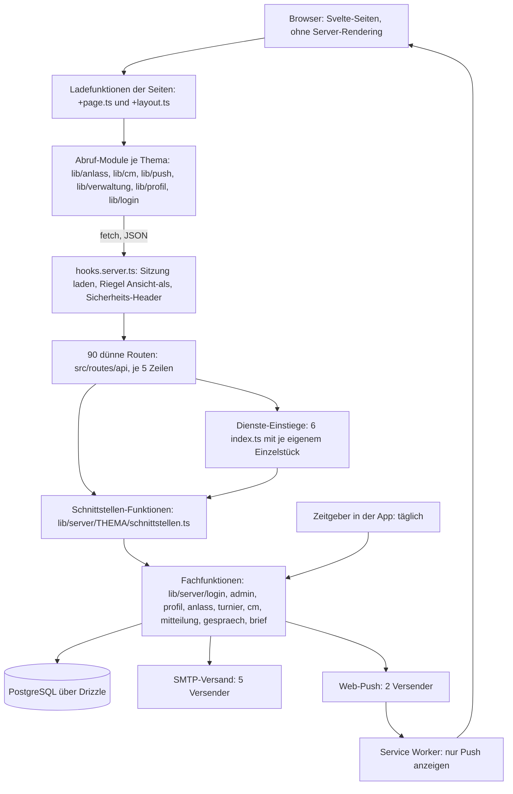

[← Übersicht](index.md)

# Refactoring-Analyse MyTCO

Stand der Analyse: 11.11.2026, Version 0.20.5, Branch `docs/refactoring-analyse` (gleich `origin/dev`
und `main`). Sammel-Issue: [#80](https://github.com/konstantinniedermann/tco-app/issues/80).

**Nachtrag vom 11.11.2026 (zweiter Durchgang):** Testqualität und Oberfläche wurden nachgelesen.
Neu sind die Befunde B-28 bis B-36 (Abschnitte 3.6 und 3.7) und die Fragen F-13 und F-14.
Geändert sind B-07, B-20 bis B-23, das Zielbild (6.1 Punkt 6) und die Schritte 03, 04, 12 und
15 bis 19. Jede geänderte Stelle trägt den Vermerk «Nachtrag».

Dieses Dokument ist das Gedächtnis des Refactorings. Wer nur dieses Dokument liest, soll
weiterarbeiten können: Es enthält den Ist-Zustand, die Befunde, das Zielbild, den Plan mit Status
je Schritt, die Entscheide und die offenen Fragen. Geändert wurde bei der Analyse nichts ausser
dieser Datei.

**Kennzeichnung der Belege**

- **[G]** selbst gelesen oder gemessen (Datei, Git, GitHub)
- **[E]** aus Erkundung: Stichprobe, Textsuche oder Auszug, nicht die ganze Datei gelesen
- **[V]** Vermutung, nicht belegt

**Begriffe, die oft vorkommen**

- *Schnittstelle*: eine Adresse unter `/api/…`, über die die Oberfläche Daten holt oder speichert.
- *Worktree*: eine zweite Arbeitskopie desselben Repos in einem eigenen Ordner, damit mehrere
  Sessions gleichzeitig arbeiten können.
- *E2E-Test* (Ende-zu-Ende): Ein Test bedient die laufende App im Browser wie ein Mensch.
- *Charakterisierungstest*: Ein Test, der das heutige Verhalten festhält, bevor umgebaut wird.
- *Hotspot*: Datei, die auffallend oft geändert wurde.
- *Flake*: Test, der ohne Code-Änderung manchmal rot und manchmal grün ist.

---

## 1 Kurzfazit

1. **Der Anwendungscode ist in gutem Zustand.** Er ist einheitlich aufgebaut, sorgfältig
   kommentiert, gut getestet (rund 1550 Einheits- und Datenbanktests, 162 E2E-Tests auf drei
   Geräten) und enthält fast keine Notlösungen (kein einziges `TODO`, vier Lint-Ausnahmen). Ein
   «grundlegendes Refactoring» des Codes ist die falsche Grösse. Richtig ist **gezieltes
   Aufräumen** an wenigen, klar benennbaren Stellen. [G]
2. **Die Wachstumsspuren im Code sind Duplikate und fehlende gemeinsame Bausteine**, nicht
   falsche Architektur: dieselben Hilfsfunktionen in sechs Server-Modulen, fünfmal derselbe
   Mail-Versender, sechs eigene Varianten des Abrufs von Schnittstellen in der Oberfläche, der
   Anmelde-Wächter in jeder Seite kopiert, eine Seite mit über 1000 Zeilen, ein Stylesheet mit
   2287 Zeilen. [G]
3. **Der grösste Befund liegt nicht im Code, sondern im Verhältnis von Prozess und Doku zum
   Code.** 58 % aller Commits ändern nur Doku. Die Doku ist in Bytes grösser als der
   Anwendungscode. Die 17 meistgeänderten Dateien sind bis auf eine Doku- oder Prozessdateien.
   Es gibt 38 Versionsabschnitte und 27 Merges nach `main`, aber keinen Server, kein Release,
   keinen Tag und keinen einzigen Nutzer. [G]
4. **Eine ganze Auslieferungskette ist gebaut, aber nie in echt gelaufen** (rund 2900 Zeilen
   Betriebsskripte, 2000 Zeilen Tests dazu, fünf CI-Jobs). Sie ist nicht Teil des Refactorings
   und soll nicht angefasst werden; sie ist aber ein Risiko, das benannt gehört. [G]
5. **Das Sicherheitsnetz ist stark, hat aber eine schwache Stelle:** Die E2E-Tests sind auf dem
   iPhone-Profil unter Last wacklig (drei offene Beobachtungen, acht Fallen-Notizen). Weil E2E
   das Hauptnetz für den Umbau der Oberfläche ist, kommt das zuerst. [G]
   **Nachtrag:** Die gelesene Stichprobe (9 Testdateien neben dem Code, 5 E2E-Dateien, die
   Hilfen) prüft durchwegs Verhalten, nicht Wortlaut des Quelltexts. Das Netz trägt die Etappen
   0 und 1 fast ohne Zusatz. Es hat zwei Löcher (Verdrahtung der Routen, Vertrag zwischen Server
   und Oberfläche: B-28, B-29) und einige Tests, die bei Etappe 2 ohne Verhaltensänderung rot
   würden (B-31). [G]
6. **Jetzt ist der günstigste Zeitpunkt für Aufräumarbeiten, die später teuer werden:**
   Solange es kein Live gibt, lassen sich interne Schnittstellen und (falls gewünscht) die
   19 Migrationen ohne Rücksicht auf Altdaten ändern. [G]
7. **Die Anweisungsdateien sind knapp und wirksam, erzeugen aber Nebenwirkungen:** Regeln wie
   «keine neue Abhängigkeit», «erst Leitbild, dann Code» und «jeder Merge eine Version» sind
   sinnvoll, haben aber Eigenbau-Prüfskripte, Doku-Hotspots und eine garantierte Kollisionsstelle
   für parallele Sessions hervorgebracht. [G]

**Empfehlung in einem Satz:** 27 kleine Schritte in fünf Etappen (einer davon kann nach dem
Nachtrag entfallen), davon nur rund die Hälfte am Code; die grösste Wirkung haben die Entscheide des Projektleiters zu Arbeitsweise und
Doku-Umfang (Fragen F-01, F-09, F-11).

---

## 2 Ist-Architektur

### 2.1 Zahlen [G]

| Bereich | Dateien | Zeilen | Bemerkung |
|---------|--------:|-------:|-----------|
| Anwendungscode `src/` ohne Tests | 311 | 30 445 | davon 10 612 in 65 Svelte-Dateien, 2492 CSS |
| Tests neben dem Code (`src/**/*.test.ts`) | 115 | 26 118 | Einheit und Datenbank |
| `tests/` (E2E, Betrieb, Hilfen) | 47 | 10 640 | 25 E2E-Dateien |
| `scripts/` (Prüfskripte, Seed, CI) | 50 | 4 521 | davon 14 Prüfskripte mit eigenen Tests |
| `betrieb/` (Auslieferung, Sicherung) | 20 | 2 860 | Shell, Compose, Caddy |
| Doku `docs/**/*.md` | 86 | 18 509 | 1,55 MB; Anwendungscode ohne Tests: 1,05 MB |
| Migrationen `drizzle/*.sql` | 19 | 282 | dazu 20 000 Zeilen erzeugte Schnappschüsse |

- 18 Tabellen, 90 Schnittstellen-Dateien (`+server.ts`), 35 Seiten.
- 9 Laufzeit-Abhängigkeiten, 21 Entwicklungs-Abhängigkeiten; jede wird benutzt.
- Repo: erster Commit 29.10.2026, 1073 Commits an 12 Arbeitstagen, davon 195 Merges.
  Nicht-Merge-Commits nach Präfix: 396 `docs`, 212 `fix`, 186 `feat`, 63 `test`, 13 `refactor`,
  7 `chore`.
- GitHub: 21 offene, 27 geschlossene Issues; keine Repo-Variablen gesetzt (Auslieferung aus),
  kein Release, kein Tag.
- CI: letzte 100 Läufe (5. bis 9.11.): 91 grün, 8 rot, 1 abgebrochen; auf `dev` 76 grün, 3 rot;
  Median 4,7 Minuten, längster 25 Minuten.

### 2.2 Bausteine und Flüsse

**Was das Bild sagt:** Die App ist eine reine Browser-App (kein Server-Rendering, `ssr = false`)
vor einer JSON-Schnittstelle. Der Server von SvelteKit dient nur als Träger der Schnittstellen.
Das ist eine bewusste Bauregel (ADR-002), damit dieselbe Oberfläche später in eine Store-App
verpackt werden kann. Die Regel ist durchgehend eingehalten. [G]

### 2.3 Tatsächliche Hauptabläufe

**A — Eine Anfrage an die Schnittstelle** [G]
(`src/hooks.server.ts` → `handle`; `src/lib/server/login/schnittstellen.ts` → `ladeSitzungSicher`;
`src/lib/server/admin/ansicht.ts` → `riegel`)

1. Für jede Adresse unter `/api/` liest der Hook das Sitzungs-Cookie, sucht die Sitzung in der
   Datenbank (ein Join über Sitzung, Konto, Mitglied) und legt das Konto in `locals.konto`.
   Alle 24 Stunden wird die Sitzung verlängert. Ein Fehler dabei gilt als «nicht angemeldet».
2. Läuft eine «Ansicht als …», weist der Hook jede schreibende Anfrage ab (ausser vier
   erlaubten Adressen).
3. Die Route (5 Zeilen) holt den Dienst-Einstieg ihres Themas und ruft genau eine
   Schnittstellen-Funktion auf.
4. Die Schnittstellen-Funktion prüft in dieser Reihenfolge: JSON-Format bei Schreibzugriffen
   (sonst 415, das ist der Schutz gegen fremde Formulare), Sitzung (401), bei der Verwaltung
   Rolle, Bereich und frische Code-Bestätigung (403 mit vier verschiedenen Gründen), dann die
   Eingabe (400), dann ruft sie die Fachfunktion.
5. Die Fachfunktion arbeitet in einer Datenbank-Transaktion mit ausdrücklichen Sperren und gibt
   ein Ergebnis als Wort zurück (`'ok'`, `'voll'`, `'veraltet'` …). Die Schnittstelle übersetzt
   es in Statuscode und `{ fehler: '…' }`.
6. Die Antwort bekommt immer `cache-control: no-store` und drei Sicherheits-Header.

**B — Eine Seite der Mitglieder-App** [G]
(`src/routes/+layout.ts`, `src/routes/+page.ts`, `src/routes/clubmeisterschaft/[id]/+page.ts`)

1. Das Wurzel-Layout fragt `/api/sitzung` (für das Band «Ansicht als …»).
2. Die Seite fragt in ihrer Ladefunktion selbst noch einmal `/api/sitzung` oder ihre eigene
   Schnittstelle. Bei 401 prüft sie, ob im Browser-Speicher ein Mail-Code wartet, und leitet
   nach `/login/mail` oder `/login` um. Dieser Block steht in jeder Seite einzeln.
3. Nach dem Speichern übernimmt die Seite die Antwort des Servers als neuen Stand, ohne neu zu
   laden.

**C — Verwaltung** [G]
(`src/routes/verwaltung/+layout.ts`, `src/lib/verwaltung/umleiten.ts`,
`src/lib/server/admin/schnittstellen.ts` → `mitRolle`, `liest`, `schreibt`)

1. Das Layout der Verwaltung holt den Zugang (`/api/admin/zugang`): angemeldet, Rollen,
   bestätigt per Mail-Code.
2. Es leitet um: ohne Sitzung zur Anmeldung, ohne Rolle zur Startseite, ohne Bestätigung zur
   Seite «Verwaltung öffnen», ausserhalb des eigenen Bereichs zur ersten erlaubten Seite.
3. Jede Unterseite wiederholt die Kette «abgemeldet / kein Admin / unbestätigt» für ihren
   eigenen Abruf.
4. Auf dem Server setzt allein `mitRolle` die Rechte durch; die Oberfläche blendet nur aus.

**D — Login** [G] (`src/lib/server/login/dienst.ts`, `sitzung.ts`, `index.ts`)

- Brief-Code oder Mail-Code werden mit bedingten `UPDATE`-Anweisungen atomar eingelöst; danach
  entsteht eine Sitzung (zufällige Kennung, in der Datenbank nur als Hash).
- Begrenzungen gegen Durchprobieren («Bremsen») und die offenen Passkey-Anfragen liegen im
  Arbeitsspeicher des einen Prozesses; nach einem Neustart sind sie leer.

**E — Anmeldung zur Clubmeisterschaft** [G]
(`src/lib/server/cm/schnittstellen.ts` → `postCmAnmeldung`, `antwortMitMail`;
`src/lib/server/cm/anmeldungen.ts` → `trageEin`, `meldeAb`)

1. Transaktion: Mitglied sperren, dann Kategorie und Turnier, dann prüfen (offen, Angaben
   vollständig, passt, nicht schon angemeldet, höchstens drei), dann eintragen.
2. Danach liest die Schnittstelle die ganze CM-Ansicht neu und **wartet auf die
   Bestätigungsmail**, bevor sie antwortet.
3. Meldungen an Dritte (Partner, CM-Admins) laufen ohne Warten nebenher und schlucken Fehler.

**F — Mitteilung an viele** [E] (`src/lib/server/mitteilung/`, `src/lib/verwaltung/mitteilung-api.ts`)

- Vorschau und Senden sind getrennte Schnittstellen. Beim Senden kommt die Antwort erst, wenn
  alle Pushes und Mails durch sind (eigener Mail-Versender mit offenen Verbindungen).

**G — Löschfristen** [G] (`src/lib/server/zeitgeber.ts`, `src/hooks.server.ts` → `init`)

- Beim Start und danach täglich ruft der Prozess den Löschlauf auf. `ZEITGEBER=aus` schaltet
  ihn für E2E ab.

**H — Vom Code bis «live» (geplant, nie gelaufen)** [G]
(`.github/workflows/check.yml`, `betrieb/bin/`, `scripts/ci/`)

- Push auf `dev`: Prüfen, E2E auf drei Geräten, Malware-Prüfung, Image mit Rauchtest. Wäre die
  Repo-Variable `AUSLIEFERUNG_TEST` gesetzt, folgten Bauen, Ausliefern per SSH und Freigeben.
- Push auf `main`: dasselbe, dann «Finden» des auf Test gelaufenen Images, Ausliefern auf Live,
  Release mit Tag.
- Heute enden beide Wege nach den Prüfungen. Die Variablen sind nicht gesetzt.

**I — Arbeitsablauf einer Session** [G]
(`.claude/skills/tco-branching/SKILL.md`, `.githooks/pre-commit`, `.githooks/pre-push`)

1. Worktree ab `origin/dev`, Label `in-arbeit`.
2. Jeder Commit: Secret-Scan, dann `make docs` (nur Doku) oder `make check-schnell` (Code).
3. Jeder Push mit Code: `make check` vollständig (inklusive E2E und Image), ausser der Stand ist
   schon als «grün» gemerkt.
4. Merge im Hauptordner mit Merge-Commit; bei Code: Version erhöhen, Abschnitt in
   `docs/versionen.md`, Push; der Hook prüft die Versionsregel.
5. Worktree und Branch sofort entfernen.
6. «Release»: Doku-Abgleich in eigenem Branch, `make release-check`, PR `dev` → `main`, danach
   `main` zurück nach `dev` mergen.

---

## 3 Befunde nach Thema

Schweregrad: **hoch** = bremst oder gefährdet das Projekt spürbar; **mittel** = kostet laufend
Aufwand oder birgt ein benennbares Risiko; **niedrig** = Schönheitsfehler oder kleine Altlast.

### 3.1 Verhältnis von Prozess und Doku zum Code

#### B-01 — Prozess und Doku wiegen schwerer als der Code · hoch · [G]

- **Fundstelle:** Git-Historie; `docs/` gesamt; `docs/beobachtungen.md`, `docs/versionen.md`.
- **Messung:** 507 von 878 Nicht-Merge-Commits ändern nur Doku (58 %). `docs/**/*.md` hat
  1,55 MB, der Anwendungscode ohne Tests 1,05 MB. Meistgeänderte Dateien:
  `docs/beobachtungen.md` (141 Commits), `docs/versionen.md` (105), `docs/ui-leitbild.md` (82),
  `docs/datenschutz.md` (71), `docs/fachmodell.md` (70), `docs/ci-cd-und-release.md` (64). Die
  erste Code-Datei folgt auf Platz 9 (`src/lib/design/basis.css`, 56). In acht Tagen gab es
  sieben Beobachtungs-Auswertungen mit zusammen 214 Einträgen.
- **Auswirkung:** Ein grosser Teil der Arbeitszeit und des Kontexts jeder Session fliesst in
  das Nachführen von Texten. Jede Code-Änderung zieht mehrere Doku-Dateien nach (Fachmodell,
  Datenschutz, Rollen, Testkonzept, Versionen, README, Context-Scopes). Für ein Projekt ohne
  Nutzer ist das viel.
- **Einordnung:** Die Doku ist inhaltlich gut und für Datenschutz und Übergabe gewollt. Der
  Befund ist die **Dichte**, nicht die Existenz. Was davon bleibt, ist ein Entscheid des
  Projektleiters (F-09, F-11).

#### B-02 — Auslieferungskette ist gebaut, aber nie in echt gelaufen · mittel · [G]

- **Fundstelle:** `betrieb/` (2860 Zeilen, darunter `betrieb/nachweis/nachweis.sh` mit 1300),
  `tests/betrieb/` (1993 Zeilen), `.github/workflows/check.yml` Jobs `bauen`, `finden`,
  `ausliefern`, `freigeben`, `release`; `scripts/ci/`, `scripts/pruefungen/release.ts`,
  `workflow-rechte.ts`.
- **Messung:** Keine Repo-Variable gesetzt, kein Tag, kein GitHub-Release; der Server ist laut
  `docs/arc42.md` Kapitel 7 nicht in Betrieb (Issue #39 offen).
- **Auswirkung:** Rund 5000 Zeilen Betriebscode und -tests sind nur gegen Attrappen und einen
  lokalen Nachbau geprüft. Die ersten echten Läufe werden Überraschungen bringen. Für das
  Refactoring heisst das: **nicht anfassen**, denn es gibt kein Netz, das einen Fehler dort
  zeigen würde.

#### B-03 — Version pro Merge erzeugt eine feste Kollisionsstelle · mittel · [G]

- **Fundstelle:** [ADR-007](adr/adr-007-version-pro-merge.md), `docs/versionen.md`,
  `scripts/pruefungen/version-merge.ts`, `scripts/pruefungen/gruener-stand.ts`,
  `.githooks/pre-push`, Skill `tco-branching` Schritt 4.
- **Messung:** Version 0.20.5 nach 13 Tagen; 38 Versionsabschnitte; jeder Merge mit Code
  ändert `package.json`, `package-lock.json` und `docs/versionen.md`.
- **Auswirkung:** Drei Dateien, die jede parallele Session anfassen muss. Der Skill beschreibt
  eigens, was zu tun ist, wenn der Push deshalb abgewiesen wird. Um die Folge (doppelte volle
  Prüfung) zu mildern, kam ein zweiter Mechanismus dazu («grüner Stand»,
  [ADR-009](adr/adr-009-gruener-stand.md)). Das ist ein Mechanismus, der einen Mechanismus
  repariert.
- **Einordnung:** Für das Refactoring gilt die Regel weiter (E-01). Ob sie danach bleibt, ist
  Frage F-01.

#### B-04 — Doku verspricht Verhalten, das der Code nicht hat · mittel · [G]

- **Fundstelle:** `docs/ci-cd-und-release.md`, Abschnitt «Alte Versionen auf dem Handy»;
  `src/service-worker/index.ts`; `src/lib/server/version.ts` → `MINDESTVERSION`,
  `istVersionVertraeglich`; `src/lib/server/status.ts`.
- **Beobachtung:** Die Doku sagt: Die App speichert sich über den Service Worker zwischen, der
  Server nennt bei jeder Antwort die Mindestversion, eine ältere offene App lädt neu. Im Code
  hat der Service Worker ausdrücklich keinen Zwischenspeicher, die Mindestversion steht nur in
  der Antwort von `/api/status`, und `istVersionVertraeglich` wird nur von Tests aufgerufen.
- **Auswirkung:** Nach einer Auslieferung arbeitet eine offene App mit altem Code gegen neue
  Schnittstellen, ohne dass etwas sie zum Neuladen bringt. Heute folgenlos (kein Live), ab dem
  ersten Release ein echter Fehlerfall. Siehe F-03.
- **Weitere veraltete Stellen:** `docs/index.md` («Die Doku entsteht vor dem Code», «was fehlt,
  ist ein Issue im Milestone Fundament»); `README.md` Abschnitt «Stand» nennt die Phase
  «Fundament», obwohl Funktionen bis zur Etappe CM-Anmeldung gebaut sind.

#### B-05 — Context-Scopes zählen einzelne Dateien auf · niedrig · [G]

- **Fundstelle:** `docs/context-scopes.md` (48 Commits; einzelne Tabellenzeilen über 1500 Zeichen).
- **Auswirkung:** Die Tabelle muss bei jeder neuen oder verschobenen Datei nachgeführt werden
  und wird beim Refactoring mit jedem Schritt falsch. Sie verweist zudem auf Pläne und Specs
  als Lesestoff, die den Code von damals beschreiben (B-06).

#### B-06 — Pläne und Specs als lebende Doku geführt · niedrig · [G]

- **Fundstelle:** `docs/superpowers/` (46 Dateien, 12 302 Zeilen).
- **Auswirkung:** Die Dateien sind Geschichte (die Prüfung `annahmen.ts` behandelt sie so),
  werden aber in `docs/context-scopes.md` als «relevante Pfade» genannt. Wer sie lädt, liest
  überholte Code-Auszüge. Siehe F-09.

### 3.2 Prüfskripte, Tests und CI

#### B-07 — Eigenbau-Prüfer statt vorhandener Werkzeuge · mittel · [G]

- **Fundstelle:** `scripts/pruefungen/bauregel.ts` (257 Zeilen, erkennt Importe und Exporte mit
  regulären Ausdrücken, kennt feste Dateinamen wie `SCHNITTSTELLEN_DATEI`, `AUS_INDEX`);
  `scripts/pruefungen/workflow-rechte.ts` (182 Zeilen, liest YAML von Hand, Kommentar «ohne
  YAML-Paket»).
- **Auswirkung:** Die Bauregel ist an die heutige Ordnerstruktur genagelt: Jeder Umbau der
  Server-Module muss das Prüfskript mitändern, und ein Fehler darin fällt nicht auf. Ein Teil
  liesse sich mit ESLint ausdrücken, das schon Abhängigkeit ist (`no-restricted-imports`,
  `no-restricted-syntax`). Der Eigenbau ist eine Folge der Regel «keine neuen Abhängigkeiten»
  (A-06).
- **Nachtrag (nach Lektüre von `bauregel.test.ts`, 302 Zeilen):** Der Teil «Admin-Routen» ist
  mehr als eine Stilregel. Er stellt sicher, dass jede Route unter `api/admin/` nur Funktionen
  aus den drei Listen (`ADMIN_SCHNITTSTELLEN`, `TURNIER_SCHNITTSTELLEN`,
  `MITTEILUNG_ADMIN_SCHNITTSTELLEN`) benutzt und die Dienste nur als erstes Argument weiterreicht.
  Genau über diese Listen laufen die Rechte-Tests (B-28). Die Bauregel ist damit das Bindeglied
  zwischen Verdrahtung und Rechteprüfung und **bleibt**. Das kann ESLint nicht ersetzen. Der
  Befund reduziert sich auf: feste Pfade im Skript, und die Tests des Skripts nageln Meldungen
  samt Pfad fest (sie werden bei den Schritten 07, 09 und 11 rot und müssen mitgeändert werden;
  das ist gewollt). Schritt 12 ist entsprechend geändert.

#### B-08 — Der Nachweis «Anforderung hat einen Test» prüft Text · mittel · [G]

- **Fundstelle:** `scripts/pruefungen/test-ids.ts` → `fehlendeTests`.
- **Beobachtung:** Eine als «umgesetzt» markierte Regel (`FR-NN`, `RR-NN`, `A-…`) gilt als
  getestet, wenn ihre ID als Wort in irgendeiner ausgeführten Testdatei vorkommt, auch nur in
  einem Kommentar.
- **Auswirkung:** Die Prüfung ist grün, auch wenn kein Test die Regel wirklich prüft. Sie ist
  nützlich als Erinnerung, aber kein Beleg. Beim Refactoring darf «test-ids: ok» nicht als
  Nachweis für erhaltenes Verhalten gelten.

#### B-09 — Lücken im Netz der CI · mittel · [G]

- **Fundstelle:** `.github/workflows/check.yml`, `Makefile` → `check`, `vitest.config.ts`.
- **Beobachtungen:**
  1. Integriert wird lokal: Die CI sieht einen Stand erst nach dem Push auf `dev`. Davor
     schützt nur der lokale Hook, der sich über den «grünen Stand» selbst abkürzen kann. Drei
     von 79 Läufen auf `dev` waren rot.
  2. `make betrieb-nachweis`, der einzige Ende-zu-Ende-Beleg der Auslieferung, läuft weder in
     der CI noch in `make check`.
  3. `make release-check` läuft nur lokal.
  4. Die Abdeckungsschwelle von 90 % gilt nur für `src/lib/server`, `src/lib/turnier` und zwei
     Dateien. Die 65 Svelte-Dateien (10 612 Zeilen) haben keine eigenen Tests; sie sind nur
     über E2E gedeckt.
  5. Kein Werkzeug meldet toten Code, ungenutzte Exporte oder Zyklen zwischen Modulen.
  6. Der Pre-Commit-Hook lässt Datenbanktests und E2E aus; ein Folgefehler in einem anderen
     Ordner fällt erst im vollen `make check` auf (so auch in den gemeinsamen Beobachtungen
     vom 08.11. festgehalten).

#### B-10 — E2E-Tests auf dem iPhone-Profil unter Last wacklig · hoch · [G]

- **Fundstelle:** `docs/beobachtungen.md` (drei offene Einträge zu `tests/e2e/verwaltung.test.ts`
  und `tests/e2e/benachrichtigungen.test.ts`); 14 Stellen mit `test.setTimeout` zwischen 90 und
  180 Sekunden; `waitForTimeout` in `tests/e2e/hilfe.test.ts` und
  `tests/e2e/mitgliedschaft.test.ts`; acht Fallen-Notizen im Session-Gedächtnis zu E2E und CI.
- **Auswirkung:** E2E ist das einzige Netz für die Oberfläche. Wenn es ohne Grund rot wird,
  kostet jeder Refactoring-Schritt zusätzliche Läufe, und ein echter Fehler wird leichter als
  «wieder ein Flake» abgetan. Darum Schritt 02 vor allem anderen.

#### B-11 — E2E-Hilfen rufen Fachfunktionen des Servers direkt · niedrig · [G]

- **Fundstelle:** `tests/e2e/hilfen/login.ts` (466 Zeilen, importiert rund 15 Module aus
  `src/lib/server/`); `legeTurnierAn(festesJahr)` und `legeOffenesTurnierAn(festesJahr, …)` als
  Rest (offene Beobachtung vom 09.11.).
- **Auswirkung:** Ein Umbau der Server-Module bricht die E2E-Hilfen. Gut daran: Es ist eine
  einzige Fassade, die Tests selbst bleiben unberührt.

### 3.3 Server

#### B-12 — Gemeinsame Bausteine der Schnittstellen fehlen oder liegen am falschen Ort · mittel · [G]

- **Fundstelle:** `src/lib/server/login/schnittstellen.ts` → `antwort`, `istJson`,
  `leseKoerper`, `formatFehler`, `Ereignis` (von acht anderen Modulen importiert);
  `nichtGefunden` sechsmal definiert (`admin`, `anlass`, `cm`, `gespraech`, `mitteilung`,
  `turnier`), `jetzt(d)` sechsmal, `mitSitzung` dreimal (`anlass`, `cm`, `mitteilung`),
  `mitKonto` zweimal (`admin`, `profil`), `eingabeFehler` zweimal.
- **Auswirkung:** Wer das Verhalten einer Grundprüfung ändert (z. B. die Antwort bei fehlender
  Sitzung), muss sechs Stellen finden. Das Login-Modul ist dadurch von allen abhängig gemacht,
  obwohl es fachlich nichts mit ihnen zu tun hat.

#### B-13 — Der Zusammenbau der Dienste ist über sechs Dateien verteilt · mittel · [G]

- **Fundstelle:** `src/lib/server/{login,admin,profil,cm,mitteilung,anlass}/index.ts`.
- **Beobachtung:** Jede Datei hält ihr eigenes Einzelstück in einer Modulvariablen. Der
  SMTP-Versender wird fünfmal erzeugt (`erstelleSmtpMailer` in `login`, `admin`, `profil`, `cm`,
  `mitteilung`), der Web-Push-Versender zweimal (`cm`, `mitteilung`).
  `holeMitteilungAdminDienste` baut auf `holeAdminDienste` auf; die Turnier-Routen und der
  Austritt holen ihre Dienste aus `mitteilung/index.ts`.
- **Auswirkung:** Fünf offene SMTP-Zugänge statt einem, und es ist nirgends auf einen Blick zu
  sehen, was der Server beim Start braucht. Die Tests sind davon nicht betroffen: Sie reichen
  ihre Dienste selbst hinein (das ist gut gelöst und bleibt).

#### B-14 — Modulgrenzen sind verwischt, es gibt gegenseitige Abhängigkeiten · mittel · [G]

- **Fundstelle und Messung** (Importe zwischen den Ordnern unter `src/lib/server/`, ohne Tests):
  `admin` ↔ `cm` (4 und 5), `admin` ↔ `mitteilung` (2 und 2), `cm` ↔ `gespraech`,
  `gespraech` ↔ `turnier`, `mitteilung` ↔ `turnier`, `login` → `admin` und `login` → `gespraech`
  (`getSitzung` berechnet Rollen und offene Gespräche), `profil` → `admin` (6).
- **Beispiele für falschen Ort:**
  - Die Verwaltung der Anlässe (`getAdminAnlaesse` … `postAdminAnlassLoeschen`) steht in
    `src/lib/server/admin/schnittstellen.ts`, die Fachlogik in `anlass/`.
  - Die Verwaltung der CM-Anmeldungen liegt fachlich in `cm/verwaltung.ts` und
    `cm/verwaltung-doppel.ts`, ihre Schnittstellen aber in `turnier/schnittstellen.ts`,
    zusammen mit denen des Gesprächs.
  - `admin/` ist zugleich Mitgliederverwaltung, Rollen, Zugang zur Verwaltung, Löschlauf,
    Einlesen, Briefe und Auskunft (27 Dateien).
- **Auswirkung:** Die Ordnernamen sagen nicht verlässlich, wo etwas liegt. Das erklärt, warum
  `docs/context-scopes.md` einzelne Dateien aufzählen muss (B-05).
- **Einordnung:** Keine der Abhängigkeiten ist ein Fehler zur Laufzeit. Der Befund betrifft
  Auffindbarkeit und Änderbarkeit. Wie weit neu geschnitten wird, ist Frage F-06.

#### B-15 — Fehlerform der Schnittstellen ist uneinheitlich · niedrig · [G]

- **Fundstelle:** `src/lib/server/*/schnittstellen.ts`; `src/lib/verwaltung/mitteilung-api.ts` →
  `mitMeldungen`; `src/lib/server/cm/schnittstellen.ts` → `FEHLER`; `src/lib/cm/api.ts` →
  `ABGELEHNT`.
- **Beobachtung:** Eingabefehler kommen in drei Formen: `felder` als Objekt (meist), `feld` als
  einzelner Name (Anlass, «vergeben»), `felder` als Liste (Mitteilungen; die Oberfläche hat
  dafür einen Übersetzer). Die 23 Fehlerwörter sind lose Zeichenketten; die Liste der
  Ablehnungsgründe der CM wird auf dem Server und in der Oberfläche getrennt gepflegt.

#### B-16 — Zustand im Arbeitsspeicher des Prozesses · niedrig · [G] (Absicht: [V])

- **Fundstelle:** `src/lib/server/login/bremse.ts`, `login/challenge.ts` → `ChallengeSpeicher`,
  `profil/email-wechsel.ts` → `WechselSpeicher`.
- **Auswirkung:** Begrenzungen, offene Passkey-Anfragen und laufende E-Mail-Wechsel gehen bei
  jedem Neustart und jeder Auslieferung verloren und gelten nur für einen Prozess. Für einen
  Verein mit einem Server ist das vertretbar. Es soll **bleiben**, aber als Randbedingung
  dokumentiert sein.

#### B-17 — Bestätigungsmail liegt im Antwortweg · niedrig · [G]

- **Fundstelle:** `src/lib/server/cm/schnittstellen.ts` → `antwortMitMail` (wartet auf
  `d.bestaetigung`), im Gegensatz zu `meldeMitgliedern` (läuft nebenher);
  `src/lib/verwaltung/mitteilung-api.ts` → Kommentar zu `sendeMitteilung`.
- **Auswirkung:** Die Antwort auf «Anmelden» dauert so lange wie der SMTP-Versand. Beim
  Senden einer Mitteilung an alle wartet der Browser auf Hunderte Mails; ob das an eine
  Zeitgrenze stösst, ist nicht geprüft [V].

#### B-18 — Halbfertiges und Ungenutztes · niedrig · [G] / [E]

- `MINDESTVERSION` und `istVersionVertraeglich` (siehe B-04). [G]
- `npm run build:spa` mit `@sveltejs/adapter-static`: wird in jedem `make check` und jedem
  CI-Lauf gebaut, das Ergebnis wird nirgends verwendet. Es hält die Bauregel für eine spätere
  Store-App wach (ADR-001, ADR-002). Siehe F-04. [G]
- Rund 60 exportierte Namen in `src/lib/` werden in keiner anderen Datei verwendet, weitere 35
  nur von Tests. Das meiste sind Typen und Konstanten, also harmlos; gefunden mit einer groben
  Textsuche, nicht mit einem Werkzeug. [E]
- `legeTurnierAn(festesJahr)` in den E2E-Hilfen (B-11). [G]

#### B-19 — Migrationen tragen Altlasten für Daten, die es nie gab · niedrig · [G]

- **Fundstelle:** `drizzle/0000` bis `0018`; `drizzle/0009_rollen_schaerfen.sql`,
  `0013_mitgliedschaft.sql`, `0016_steep_spiral.sql` (mit `DELETE` und `UPDATE` für Bestandsdaten);
  `src/lib/server/db/migration-0009.db.test.ts`, `migration-0013.db.test.ts`.
- **Beobachtung:** 19 Migrationen in zehn Tagen; drei bereinigen Daten, die nur in lokalen
  Testdatenbanken existierten. Die ersten 16 haben sprechende Namen, die letzten drei
  Zufallsnamen. Parallele Branches haben dieselbe Nummer vergeben (Fallen-Notiz).
- **Auswirkung:** Gering. Solange kein Live existiert, liesse sich alles auf eine Basis
  zusammenlegen; danach nie mehr. Siehe F-02.

### 3.4 Oberfläche

#### B-20 — Sechs eigene Abruf-Module mit je eigener Deutung der Antworten · mittel · [G]

- **Fundstelle:** `src/lib/anlass/api.ts` → `rufe`, `src/lib/cm/api.ts` → `rufe`,
  `src/lib/push/api.ts` → `rufe`, `src/lib/verwaltung/api.ts` → `rufe`, `deute` (501 Zeilen, ein
  Ergebnis-Typ mit 31 Varianten, lange Kette von `if`), `src/lib/profil/angaben.ts` → `deute`,
  `schicke`, `src/lib/login/passkey.ts` → `leseJson`.
- **Auswirkung:** Ein neues Fehlerwort heisst: Server, Deutung im passenden Modul, Ergebnis-Typ
  und Seite anfassen. Die Regeln «401 heisst abgemeldet, 404 heisst nicht gefunden, alles
  andere Störung» stehen sechsmal da. `verwaltung/api.ts` ist ein Hotspot (19 Commits).
- **Nachtrag (bestätigt, [G]):** Dazu kommen zwei Schreibweisen für dasselbe: Fünf Module
  melden das Ergebnis als `art` (`anlass`, `cm`, `push`, `verwaltung`, `mitteilung-api`), zwei
  als `ergebnis` (`src/lib/login/anmelden.ts`, `src/lib/profil/angaben.ts`). Die Profil-Seite
  benutzt beide nebeneinander. Gut und zu erhalten: Jedes Modul nimmt den Abruf als Argument
  (`holen`), darum sind die Tests (`api.test.ts`) ohne Browser möglich und überstehen Schritt 13
  unverändert.

#### B-21 — Der Anmelde-Wächter ist in jede Seite kopiert · mittel · [G]

- **Fundstelle:** `src/routes/+page.ts`, `src/routes/anlass/[id]/+page.ts`,
  `src/routes/clubmeisterschaft/[id]/+page.ts`, `src/routes/profil/+page.ts` und weitere: Block
  «abgemeldet → wartet ein Mail-Code? → `/login/mail` oder `/login`»; in der Verwaltung
  `src/lib/verwaltung/umleiten.ts` → `leiteUm` und zusätzlich in jeder `+page.ts` die Kette
  abgemeldet / kein Admin / unbestätigt. 47 Stellen im Code nennen `/login`.
- **Nebenbefund (im Nachtrag korrigiert):** `/api/sitzung` wird nur beim ersten Laden und
  während einer «Ansicht als …» doppelt geholt (Wurzel-Layout und Seite). Sonst lädt das
  Wurzel-Layout einmal, und jede Seite prüft bei jedem Wechsel selbst. Diese Prüfung je
  Seitenwechsel ist gewollt: So merkt die App sofort, wenn die Sitzung inzwischen beendet wurde
  (Kommentar in `src/routes/+layout.ts`; `tests/e2e/verwaltung.test.ts` «SI-07»). Sie darf beim
  Aufräumen nicht verloren gehen (siehe Schritt 15).
- **Nachtrag, zweiter Ladeort:** 24 von 35 Seiten laden ihre Daten in `+page.ts`. Zwei Seiten
  der Verwaltung laden stattdessen erst im Baustein (`$effect` mit `lade()`):
  `src/routes/verwaltung/turniere/+page.svelte` und `src/routes/verwaltung/anlaesse/+page.svelte`. [G]
- **Auswirkung:** Eine Änderung am Einstieg (z. B. ein dritter Login-Weg) muss an vielen
  Stellen nachgezogen werden; eine vergessene Stelle zeigt dann eine Fehlerseite statt der
  Anmeldung.

#### B-22 — Einzelne Seiten und Bausteine sind sehr gross · mittel · [G]

- **Fundstelle:** `src/routes/clubmeisterschaft/[id]/+page.svelte` (1038 Zeilen, davon 478
  Skript, drei Dialoge, neun verschiedene Schreib-Aufrufe; 19 Commits, 10 davon `fix`),
  `src/lib/verwaltung/DoppelListe.svelte` (740), `src/routes/profil/+page.svelte` (644),
  `src/lib/verwaltung/Anmeldungsliste.svelte` (508),
  `src/routes/verwaltung/mitglieder/[id]/+page.svelte` (447).
- **Auswirkung:** Abläufe und Zustand (welcher Dialog offen, wohin der Fokus geht, welche
  Meldung steht) liegen in der Seite und sind nur über E2E prüfbar. Die Fix-Häufung zeigt, dass
  Änderungen dort Nebenwirkungen haben.
- **Nachtrag (alle vier Dateien ganz gelesen, [G]) — der Befund wird enger gefasst:** Die
  Länge allein ist nicht das Problem.
  - *CM-Seite:* Das Markup ist schon sauber in neun benannte Abschnitte (Svelte-«Snippets»)
    gegliedert. Lang ist das Skript: Acht Handler (`anmelden`, `abmelden`, `annehmen`,
    `ablehnen`, `zurueckziehen`, `wildcardSenden`, `suchtextSenden`, `angabenSenden`) wiederholen
    dasselbe Gerüst (Sperre setzen, Meldung leeren, aufrufen, je Antwort verzweigen, bei
    «abgemeldet» zum Login, sonst neu laden) auf rund 330 Zeilen. Die Dialoge «Wildcard» und
    «Kommentar ändern» sind bis auf Texte gleich. Das ist der eigentliche Befund (B-34).
  - *`DoppelListe.svelte`:* gut gebaut. Acht Dialoge sind über den Baustein `Aktionsdialog`
    nur beschrieben, nicht ausprogrammiert. Die 740 Zeilen sind Inhalt, kein Durcheinander.
    **Bleibt, wie sie ist.**
  - *`Anmeldungsliste.svelte`:* die ältere Fassung desselben Musters, mit fünf Dialogen von Hand
    und einer eigenen Funktion `fuehreAus` (B-34).
  - *Profil-Seite:* drei voneinander unabhängige Teile in einer Datei (eigene Angaben, Passkeys,
    Abmelden). Sie teilen nur `nurAnsehen` und die geladenen Daten. Leicht zu trennen, aber der
    Nutzen ist klein.

#### B-23 — Ein einziges globales Stylesheet · mittel · [G]

- **Fundstelle:** `src/lib/design/basis.css` (2287 Zeilen; im Nachtrag nachgezählt: 123
  Klassen in 304 Selektoren); keine der 65 Svelte-Dateien hat einen eigenen `<style>`-Block. Meistgeänderte Code-Datei (56 Commits, 25
  davon `fix`); `docs/ui-leitbild.md` als zweite Quelle (82 Commits, 26 davon `fix`).
- **Auswirkung:** Jede Arbeit an der Oberfläche trifft dieselbe Datei (Reibung beim Mergen), und
  eine Regel kann Seiten verändern, die niemand im Blick hat. Die Prüfung `design-tokens.ts`
  gleicht nur die Farb- und Massangaben mit dem Leitbild ab, nicht die Bausteine.
- **Einordnung:** Die Bündelung ist Folge der Dauerregel «Oberfläche nur aus Tokens und
  Bausteinen des Leitbilds». Ob das eine Datei bleiben muss, ist Frage F-07.
- **Nachtrag (ganze Datei per Skript ausgewertet, [G]):**
  - **Keine tote Klasse:** Jede der 123 Klassen kommt in `src/` vor. Das Stylesheet ist
    gepflegt; hier gibt es nichts wegzuräumen.
  - **Kaum doppelte Regeln:** 21 Selektoren stehen mehr als einmal da, fast alle gewollt
    (Grundregel und Abweichung für PC, Druck oder reduzierte Bewegung).
  - **Abhängigkeit von der Reihenfolge: ja, aber gebündelt.** Es gibt keine Ebenen (`@layer`).
    Das PC-Layout steht als ein Block am Schluss (`@container app (min-width: 60rem)`, Zeilen
    1851 bis rund 2095) und übersteuert die Grundregeln davor allein dadurch, dass es später
    kommt. Dazu 6 `!important`, 5 Blöcke für reduzierte Bewegung, 24 Regeln für Seitenübergänge.
  - **Folge für Schritt 19:** Aufteilen nach Bausteinen würde die PC-Regeln zu ihren Bausteinen
    ziehen und damit die Reihenfolge ändern. Sicher ist nur ein Schnitt **in der bestehenden
    Reihenfolge**. Dann ist das gebaute Stylesheet vor und nach dem Schritt Zeichen für Zeichen
    gleich, und genau das ist der Beweis (Schritt 04 neu).

#### B-24 — Eigenbau von Browser-Verhalten im Wurzel-Layout · niedrig · [G]

- **Fundstelle:** `src/routes/+layout.svelte` (231 Zeilen, 27 Commits), `src/lib/ui/navigation.ts`,
  `kopftitel.ts`, `klappe.ts`, `tastatur.ts` (zusammen rund 540 Zeilen), `tests/e2e/bewegung.test.ts`.
- **Beobachtung:** Weil nur ein innerer Bereich scrollt (App-Gefühl mit fester Kopfleiste und
  Reitern), führt die App Scroll-Position, Seitenübergänge und Tastatur-Verhalten selbst.
- **Einordnung:** Bewusste Gestaltung, gut in testbare Module ausgelagert. **Bleibt.** Es ist
  aber die empfindlichste Stelle der Oberfläche; Schritte an Layout und Navigation brauchen den
  vollen E2E-Lauf auf allen drei Geräten.

#### B-25 — Kein gemeinsamer Ort für Code, den Server und Browser teilen · niedrig · [G]

- **Fundstelle:** `src/lib/verwaltung/api.ts` importiert Typen aus rund 20 Dateien unter
  `src/lib/server/`; `src/lib/verwaltung/bereiche.ts` (die Rechte-Matrix) liegt bei der
  Oberfläche und wird vom Server importiert (`admin/schnittstellen.ts`); `src/lib/turnier/`,
  `src/lib/anlass/zeit.ts`, `src/lib/name.ts` werden von beiden Seiten benutzt.
- **Auswirkung:** Die Richtung der Abhängigkeiten ist nicht aus dem Ordner ablesbar. Geteilt
  werden heute nur Typen und reine Funktionen, darum ohne Schaden.

### 3.5 Arbeitsumgebung

#### B-26 — Der Ablauf erzeugt wiederkehrende Fallen · mittel · [G]

- **Fundstelle:** Session-Gedächtnis des Projekts: 50 Einträge in 13 Tagen, davon 28 als «Falle»
  benannt. Verteilung nach dem Index: 8 zu E2E und CI, 5 zu lokaler Datenbank und Migrationen,
  4 zu Worktree und Schutz-Hooks, der Rest zu einzelnen Werkzeugen.
- **Auswirkung:** Jede Falle ist eine Stelle, an der eine Session Zeit verloren hat. Die Lösung
  war jeweils eine Notiz für die nächste Session, nicht eine Vereinfachung des Ablaufs. Das
  Gedächtnis wächst so zur zweiten, unversionierten Anweisungsdatei (siehe A-02).

#### B-27 — Reste im Repo · niedrig · [G]

- Worktree `.claude/worktrees/doppel-anfragen-verfallen` mit Branch
  `feat/doppel-anfragen-verfallen`: kein eigener Commit, 15 Commits hinter `dev`, keine
  uncommitteten Änderungen. Die zugehörige Aufgabe steht in `docs/beobachtungen.md`
  (Entscheid vom 09.11.: «mitlöschen», Umsetzung offen).
- Offener Dependabot-Branch `dependabot/npm_and_yarn/dev/typescript-7.0.2` (Hauptversion;
  `package.json` nagelt TypeScript auf 6.0.3 fest).
- Siehe F-08.

### 3.6 Testqualität (Nachtrag)

**Gelesen (ganz):** `admin/rechte-matrix.db.test.ts`, `anlass/schnittstellen.db.test.ts`,
`login/schnittstellen.db.test.ts`, `cm/anmeldungen.db.test.ts`, `ansicht-riegel.test.ts`,
`src/lib/verwaltung/api.test.ts`, `src/lib/ui/navigation.test.ts`,
`scripts/pruefungen/bauregel.test.ts`, `scripts/pruefungen/test-ids.test.ts`; E2E:
`cm-anmeldung.test.ts`, `navigation.test.ts`, `bewegung.test.ts`, `mockups.test.ts`,
`verwaltung.test.ts` (rund zwei Drittel), die Hilfen `tests/e2e/hilfen/seite.ts` und
`tests/hilfen/anfrage.ts`. Dazu die allgemeinen Schleifen in `admin/schnittstellen.db.test.ts`,
`turnier/schnittstellen.db.test.ts` und `mitteilung/admin-schnittstellen.db.test.ts` und
Zählungen über alle Tests.

**Urteil:** Die Tests prüfen Verhalten. Keiner der gelesenen Tests liest Quelltext der App, keiner
vergleicht Schnappschüsse (`toMatchSnapshot` und `toHaveScreenshot` kommen im Repo nicht vor),
keiner baut die Implementierung nach.

- Die Datenbanktests laufen gegen echtes PostgreSQL und rufen die echten Fachfunktionen. Sie
  prüfen Ergebnis **und** Zustand der Tabellen, auch den Wettlauf zweier gleichzeitiger
  Anmeldungen (`cm/anmeldungen.db.test.ts`, «FR-06: zwei gleichzeitige Anmeldungen …» hält dafür
  absichtlich Sperren fest) und dass nichts Vertrauliches herausgeht (derselbe Test sucht im
  ganzen Antwort-JSON nach Telefonnummern und Klassierungen).
- Attrappen gibt es nur an den Rändern: Mail-Versand, Push, Uhr, im Browser-Code der Abruf.
- Die E2E-Tests sind Abläufe aus Sicht eines Menschen. Sie suchen Elemente überwiegend über
  Rolle und Beschriftung (947 `getByRole`, 185 `getByLabel` gegen 146 Stellen mit CSS-Selektor),
  prüfen auf jedem Bildschirm die Barrierefreiheit mit axe und sammeln Konsolenfehler.
- Die Prüfskript-Tests prüfen ihre Skripte gründlich, auch Umgehungsversuche.

Die folgenden Befunde sind die Stellen, an denen dieses gute Netz für den Plan nicht reicht oder
ihm im Weg steht.

#### B-28 — Die Verdrahtung der Routen prüft kein Test · mittel · [G]

- **Fundstelle:** `tests/hilfen/anfrage.ts` → `ereignis`; alle `*/schnittstellen.db.test.ts`
  (rufen z. B. `postAnmeldung(d, ereignis(…))` direkt, mit einem selbst gebauten Dienste-Objekt);
  die 90 `+server.ts` und die sechs `index.ts`. Nur zwei Routen haben einen eigenen Test
  (`src/routes/api/kontakt/kontakt.test.ts`, `src/routes/api/status/status.db.test.ts`); von den
  Dienste-Einstiegen prüft ein Test nur «liefert dieselbe Instanz» (`holeLoginDienst`).
- **Beobachtung:** Welche Route welche Funktion unter welcher Methode mit welchen Diensten
  aufruft, steht nur in den Routen selbst. Geprüft wird das für die Admin-Routen als Text durch
  die Bauregel (B-07), sonst nur mittelbar durch E2E.
- **Auswirkung (falsches Grün):** Schritt 07 (ein Zusammenbau der Dienste) und die Schritte 09
  bis 11 (Routen umhängen) ändern genau diese Verdrahtung. Ein vertauschter Import, eine Route
  mit dem falschen Dienste-Einstieg oder ein zweiter Satz Bremsen bliebe in allen Einheits- und
  Datenbanktests grün. Darum bekommt Schritt 03 einen Routen-Test.

#### B-29 — Server und Oberfläche prüfen ihren Vertrag getrennt, jede Seite gegen eigene Annahmen · mittel · [G]

- **Fundstelle:** `src/lib/verwaltung/api.test.ts` (543 Zeilen: füttert erfundene Antworten wie
  `{ fehler: 'eingabe', felder }` und prüft Pfad, Methode und Körper als feste Werte);
  die `schnittstellen.db.test.ts` (prüfen dieselben Formen von der anderen Seite, z. B.
  `{ fehler: 'eingabe', feld: 'bemerkung' }` in `anlass/schnittstellen.db.test.ts`);
  12 Stellen in den E2E-Tests, an denen die Antwort des Servers gestellt ist (`page.route`,
  z. B. «letzter MyTCO-Admin» und «503» in `tests/e2e/verwaltung.test.ts`).
- **Beobachtung:** Die Typen der Daten teilen sich beide Seiten (gut). Adressen, Methoden und
  Fehlerwörter teilen sie nicht: Sie stehen als Zeichenketten je einmal im Server, in der
  Oberfläche und in zwei Testsätzen.
- **Auswirkung (falsches Grün):** Ändert Schritt 08 die Fehlerform nur auf einer Seite, bleiben
  beide Testsätze grün, weil jeder seine eigene Annahme prüft. Auffallen würde es nur, wenn ein
  E2E-Test genau diesen Fehlerweg echt durchläuft. Abhilfe in Schritt 08: eine gemeinsame Liste
  der Fehlerwörter, die Server, Oberfläche und beide Testsätze importieren.

#### B-30 — Mitglieder-Schnittstellen haben keine Liste und keine durchgehende Grundprüfung · niedrig · [G]

- **Fundstelle:** `admin/schnittstellen.db.test.ts` («jede Admin-Schnittstelle antwortet ohne
  Sitzung 401, ohne Rolle 403, unbestätigt 403» über alle 26 Einträge),
  `turnier/schnittstellen.db.test.ts` (dasselbe über 26 Einträge, dazu «MyTCO-Admin liest nur»),
  `admin/rechte-matrix.db.test.ts` (jede schreibende Schnittstelle der drei Listen → 403 für den
  MyTCO-Admin, mit Vergleich aller Tabellen vorher und nachher). Dagegen `cm/schnittstellen.ts`
  (12 Funktionen), `anlass` (4), `profil` (6), `gespraech` (7), `login/passkey-schnittstellen.ts`
  (7), `mitteilung` (Mitglieder-Teil): keine Liste; 401 und 415 sind dort je an einzelnen
  Funktionen geprüft (in `cm/schnittstellen.db.test.ts` je zwei Stellen für zwölf Funktionen).
- **Auswirkung:** Für die Verwaltung ist der Vertrag «401/403» lückenlos und wächst von selbst
  mit (eine neue Funktion in der Liste wird automatisch geprüft). Für die Mitglieder-Seite hängt
  es an der Sorgfalt je Funktion. «415 ohne JSON» ist nirgends über alle schreibenden
  Schnittstellen geprüft. Schritt 06 fasst genau diese Grundprüfungen an.

#### B-31 — Einige E2E-Tests hängen an Einzelheiten, die Etappe 2 ändert · mittel · [G]

- **Fundstellen und was bricht (falsches Rot):**
  1. `tests/e2e/bewegung.test.ts`, «Reiter ist beim Antippen sofort aktiv, auch wenn der Server
     langsam antwortet»: Der Test verzögert `/api/sitzung` um zwei Sekunden und erwartet, dass
     der Seitenwechsel so lange wartet. Er setzt also voraus, dass die Profil-Seite beim Wechsel
     `/api/sitzung` holt. Schritt 15 ändert das.
  2. `tests/e2e/navigation.test.ts`, «Anmelden auf der CM-Seite lädt die Seite nicht neu»: zählt
     Anfragen an `/api/cm`. Sinnvoll, aber an die heutige Ladeweise gebunden (Schritte 13, 16).
  3. 34 verschiedene CSS-Klassen dienen als Selektor, am häufigsten `.karte`, `.plakette`,
     `.klappe`, `.kopf`, `.kachel`, `.reiter`, `.kopf-titel`, `.karte-kopf`, `.rollbereich`.
     Beim Zerlegen von Seiten (Schritte 16 bis 18) müssen Klassen und Verschachtelung gleich
     bleiben; Schritt 19 ändert keine Namen.
  4. `tests/e2e/hilfen/seite.ts` → `wartetAufVorladen` greift in das Innere von SvelteKit
     (`app.dictionary`, `app.nodes`) und sucht die Reiter über `nav.reiter a[href]`. Eine
     Routen-Gruppe (Schritt 15) oder ein Update von SvelteKit kann das brechen; fast jeder
     E2E-Test ruft die Funktion beim Anmelden.
  5. `pruefeBildschirm` macht für das Bild `.schale` und `.rollbereich` kurz lang; beide Namen
     sind damit fest.
- **Auswirkung:** Kein Fehler der Tests, aber jeder dieser Punkte kann einen Schritt der Etappe
  2 rot machen, obwohl das Verhalten stimmt. Die betroffenen Schritte nennen die Stelle jetzt.

#### B-32 — E2E prüft viel Wortlaut · niedrig · [G]

- **Fundstelle:** 256 Stellen mit `toHaveText` oder `toContainText`, 173 mit `getByText`, oft
  mit ganzen Sätzen («Mehr als 3 Anmeldungen gehen nicht. Melde dich zuerst irgendwo ab.»). Nur
  drei E2E-Dateien holen Texte aus dem Code (`MELDUNG` aus `src/lib/login/anmelden.ts`); sonst
  steht jeder Satz einmal in der Seite und einmal im Test.
- **Einordnung:** Das ist kein «Text statt Verhalten»: Die Sätze sind das, was das Mitglied
  sieht, und das UI-Leitbild macht Wortlaut zur Anforderung. Für das Refactoring ist es
  unkritisch, weil kein Schritt Texte ändert, und sogar nützlich: Eine versehentlich geänderte
  Meldung fällt auf. **Bleibt.** Der Preis: Jede gewollte Textänderung hat zwei Stellen.

#### B-33 — Die Screenshots sind Nachweise, kein Vergleichsnetz · niedrig · [G]

- **Fundstelle:** `tests/e2e/hilfen/seite.ts` → `pruefeBildschirm` (124 Aufrufe: benanntes Bild
  der ganzen Seite je Gerät nach `test-results/`, vorher axe-Prüfung und am PC «nichts ragt
  seitlich heraus»); `playwright.config.ts` → `screenshot: 'on'` (ein Bild am Ende jedes Tests).
- **Beobachtung:** Die Bilder enthalten Zufallsnamen (`Probe…`), zufällige Turnierjahre zwischen
  3000 und 9999 und laufende Daten. Sie werden nie verglichen, es gibt keine Vorlagenbilder.
- **Auswirkung:** Als Beleg «so sieht es aus» taugen sie, als Basis für einen Bildvergleich
  nicht: Zwei Läufe desselben Codes liefern verschiedene Bilder. Schritt 04 ist darum neu
  geschnitten (siehe dort und F-13).

### 3.7 Oberfläche (Nachtrag)

**Gelesen (ganz):** `src/routes/clubmeisterschaft/[id]/+page.svelte`,
`src/lib/verwaltung/DoppelListe.svelte`, `Anmeldungsliste.svelte`, `Aktionsdialog.svelte`,
`src/routes/profil/+page.svelte`, dazu drei kleinere Seiten (`anlass/[id]`,
`verwaltung/turniere`, `clubmeisterschaft/[id]/kategorie/[kid]`). Gezählt über alle 65
Svelte-Dateien: Wiederverwendung der Bausteine und wiederholtes Markup. `basis.css` per Skript
ausgewertet (Ergebnis bei B-23).

**Vorhandene gemeinsame Bausteine** (Zahl der Dateien, die sie einbinden): `Seitenkopf` 19,
`Name` 11, `Zurueck` 9; je 2: `Spielersuche`, `Zeilenaktionen`, `Zeilentasten`, `Kontakt`,
`CmKachel`, `Anleitung`, `Briefdruck`, `Mitteilungsformular`, `Mitteilungsverlauf` und die vier
Formulare der Verwaltung (`Angabenformular`, `Anlassformular`, `Turnierformular`,
`Kategorieformular`, je für «neu» und «ändern»); je 1: `Aktionsdialog`, `Reiter`, `Pfad`,
`AnsichtWahl`, `Mitgliedschaft`, `Benachrichtigungen`, `PushHinweis`. Die Formulare für «neu»
und «ändern» sind also schon geteilt; das ist gut gelöst.

#### B-34 — Derselbe Ablauf «Aktion mit Rückfrage» in drei Baustufen · mittel · [G]

- **Fundstelle:**
  1. `src/routes/clubmeisterschaft/[id]/+page.svelte`: acht Handler von Hand (rund 330 Zeilen),
     drei rohe Dialoge.
  2. `src/lib/verwaltung/Anmeldungsliste.svelte` → `fuehreAus` (eine Funktion für alle
     Aktionen) und fünf rohe Dialoge mit je eigenen Zeilen für Warnung, Fehler und Tasten.
  3. `src/lib/verwaltung/DoppelListe.svelte` mit `Aktionsdialog.svelte`: Ablauf, Warnung
     («Trotzdem …»), Fehler, Umleitung und Schutz vor veralteten Antworten stecken im Baustein;
     die Liste beschreibt acht Dialoge nur noch.
- **Messung:** 22 rohe `<dialog class="karte">` in 12 Dateien gegen 8 `Aktionsdialog` in einer
  Datei. Die Dialoge «Verschieben», «Klassierung korrigieren» und «Anmeldung löschen?» gibt es
  in beiden Listen fast gleich. Die Sperre gegen Doppelklick (`laeuft = true`) steht 42-mal in
  25 Dateien von Hand.
- **Auswirkung:** Das ist die deutlichste Wachstumsspur der Oberfläche: Der Baustein wurde beim
  dritten Mal gefunden, die beiden älteren Stellen wurden nicht nachgezogen. Der
  `Aktionsdialog` ist die Vorlage für die Schritte 16 und 17.

#### B-35 — Formularfelder sind überall von Hand verdrahtet · niedrig · [G]

- **Fundstelle:** 27 Stellen `class="feld"` in 15 Dateien; 60 von Hand gesetzte
  `aria-describedby` in 23 Dateien (Hilfe-Text, Fehler-Text, Zähler je mit eigener Kennung);
  die Auswahl der Klassierung viermal (CM-Seite, Profil, beide Listen).
- **Einordnung:** Ein Baustein «Feld» läge nahe. Er würde aber jedes Formular anfassen, und die
  Verdrahtung für Screenreader ist heute überall richtig und per axe geprüft. Das Risiko
  übersteigt den Nutzen. **Nicht im Plan**; als Frage F-14 festgehalten.

#### B-36 — Kleine Uneinheitlichkeiten zwischen den Seiten · niedrig · [G]

- Ergebnis als `art` oder als `ergebnis` (siehe B-20).
- Daten laden in `+page.ts` (24 Seiten) oder im Baustein (2 Seiten, siehe B-21).
- Texte für alle Bereiche liegen verstreut: `MELDUNG` in `src/lib/login/anmelden.ts` wird von
  16 Svelte-Dateien für die allgemeine Störungsmeldung benutzt; die Profil-Seite holt
  `feldMeldung` aus `src/lib/verwaltung/anzeige.ts`.
- **Auswirkung:** gering; wird in den Schritten 13 und 14 mit erledigt.

---

## 4 Was gut gelöst ist und bleiben soll

| Was | Wo | Warum es bleibt |
|-----|----|-----------------|
| Dünne Routen, die genau eine Schnittstellen-Funktion aufrufen | `src/routes/api/**/+server.ts` | Die ganze Logik ist ohne Framework testbar [G] |
| Rechte an einer Stelle | `src/lib/server/admin/schnittstellen.ts` → `mitRolle`, `liest`, `schreibt`; `src/lib/verwaltung/bereiche.ts`; `src/lib/server/admin/rechte-matrix.db.test.ts` | Eine Matrix, ein Durchsetzungspunkt, ein Matrix-Test [G] |
| «Ansicht als …» in zwei Schichten | `src/lib/server/admin/ansicht.ts` → `riegel`, dazu die Prüfung in `mitRolle` | Einfach und doppelt gesichert [G] |
| Login, Codes, Sitzung | `src/lib/server/login/dienst.ts`, `sitzung.ts`, `codes.ts` | Atomare Einlösung, nur Hashes gespeichert, keine Details in Logs [G] |
| Fachfunktionen mit Wort-Ergebnissen und ausdrücklicher Sperr-Reihenfolge | `src/lib/server/cm/anmeldungen.ts` → `sperreMitglieder`, `sperreKategorieUndTurnier`, `trageEin` | Gleichzeitige Zugriffe sind durchdacht und getestet [G] |
| Dienste werden hineingereicht, die Zeit auch | `…Dienste`-Typen, `jetzt?: () => Date` | Tests brauchen keine Attrappen des Frameworks [G] |
| Einstellungen mit harter Prüfung beim Start | `src/lib/server/einstellungen.ts` → `leseEinstellungen` | Beispielwerte sind in Produktion verboten [G] |
| Datenbank-Schema mit Prüfregeln in der Datenbank | `src/lib/server/db/schema.ts` | Zustände sind auch ohne App-Code gültig [G] |
| Reine Funktionen für Anzeige und Regeln, mit Tests | `src/lib/turnier/passung.ts`, `src/lib/cm/anzeige.ts`, `src/lib/ui/*.ts` | Verhalten statt Text geprüft [E] |
| E2E auf eigener, frischer Datenbank je Lauf | `scripts/e2e.ts`, `playwright.config.ts` | Parallele Sessions stören sich nicht [G] |
| CI mit festgenagelten Actions, Rechte je Job, Malware-Prüfung, Secret-Scan | `.github/workflows/` | Sorgfältig und für ein öffentliches Repo angemessen [G] |
| Projekt-`CLAUDE.md` | `CLAUDE.md` | Kurz, nur Dauerregeln, hält sich an die eigene Aufnahmeregel [G] |
| Zeitgeber in der App | `src/lib/server/zeitgeber.ts`, ADR-008 | Für einen Server die einfachste Lösung [G] |
| Erfundene Testdaten, per Skript erzwungen | `scripts/pruefungen/testdaten.ts`, `scripts/erfundene-mitglieder.ts` | Schützt vor echten Mitgliederdaten im öffentlichen Repo [G] |
| Deutsche Fachsprache im Code | überall | Durchgehend und passend zum Glossar; nicht «vereinheitlichen» [G] |
| **Nachtrag:** Datenbanktests gegen echtes PostgreSQL, mit Zustand der Tabellen und Wettlauf-Fällen | `src/lib/server/cm/anmeldungen.db.test.ts` und die übrigen `*.db.test.ts` | Prüfen Verhalten, überstehen die Etappen 0 und 1 unverändert [G] |
| **Nachtrag:** Rechte-Tests, die über die Listen der Schnittstellen laufen | `admin/rechte-matrix.db.test.ts`, `admin/schnittstellen.db.test.ts`, `turnier/schnittstellen.db.test.ts` | Eine neue Schnittstelle wird ohne Zutun mitgeprüft; zusammen mit der Bauregel lückenlos für die Verwaltung [G] |
| **Nachtrag:** «Nichts im Log» als Prüfung in jeder Schnittstellen-Testdatei | `afterEach` in den `schnittstellen.db.test.ts` | Datenschutz-Zusage als Test, nicht als Vorsatz [G] |
| **Nachtrag:** E2E über Rolle und Beschriftung, axe und Konsolenfehler auf jedem Bildschirm | `tests/e2e/`, `tests/e2e/hilfen/seite.ts` → `pruefeBildschirm`, `sammleKonsolenfehler` | Barrierefreiheit und Fehlerfreiheit sind bei jedem Lauf mitgeprüft [G] |
| **Nachtrag:** Abruf-Module nehmen den Abruf als Argument | `holen`-Parameter in `src/lib/*/api.ts` | Ohne Browser testbar [G] |
| **Nachtrag:** `Aktionsdialog` und die `DoppelListe` | `src/lib/verwaltung/Aktionsdialog.svelte`, `DoppelListe.svelte` | Der richtige Baustein für «Aktion mit Rückfrage»; Vorlage, nicht Umbauziel [G] |
| **Nachtrag:** Gliederung grosser Seiten in benannte Abschnitte (Snippets) | `src/routes/clubmeisterschaft/[id]/+page.svelte`, `src/routes/profil/+page.svelte` | Das Markup ist lesbar; nicht ohne Not in viele Dateien zerlegen [G] |
| **Nachtrag:** Geteilte Formulare für «neu» und «ändern» | `src/lib/verwaltung/*formular.svelte` | Keine doppelten Formulare [G] |
| **Nachtrag:** Stylesheet ohne tote Klassen | `src/lib/design/basis.css` | Gepflegt; nur der Zuschnitt in Dateien steht zur Wahl [G] |

---

## 5 Befunde zu den Anweisungsdateien

Gelesen: Projekt-`CLAUDE.md`, gemeinsame `CLAUDE.md` der CAS-Projekte, Skill `tco-branching`,
die drei Agent-Definitionen `refactor-*`, `.githooks/`, `.mcp.json`, `.github/`, `Makefile`;
ausserhalb des Repos (nur gelesen): `~/.claude/settings.json`, `~/.claude/hooks/README.md`,
Skills `session-start` und `session-wrap-up`, Agent `cas-reviewer`, `PROVENANCE.md` der Skills,
`refactoring-ablauf.md`, die gemeinsame `beobachtungen.md` (Überschriften und Auszüge) und das
Session-Gedächtnis (Index ganz, zwei Fallen-Dateien ganz).

#### A-01 — Skill sagt «Release am Session-Ende», die Regel sagt «nur mit Freigabe» · mittel · [G]

- **Fundstelle:** `.claude/skills/tco-branching/SKILL.md`, «Arbeitsmodell»: «Merges macht
  Claude … Release `dev` → `main` am Session-Ende, wenn der Stand es wert ist.» Weiter unten
  verlangt derselbe Skill die Freigabe des Projektleiters für genau dieses Release.
- **Auswirkung:** Die erste Stelle liest sich wie eine Erlaubnis. Massgeblich ist E-06. Der
  Satz im Arbeitsmodell sollte die Freigabe nennen.

#### A-02 — Skill und Session-Gedächtnis widersprechen sich beim Arbeiten im Worktree · mittel · [G]

- **Fundstelle:** Skill Schritt 1 («mit dem Tool `EnterWorktree` in den Worktree wechseln»),
  Schritt 4 (`git -C $M …`); Gedächtnis: «EnterWorktree sperrt Subagenten», «im Worktree kein
  `git -C`, keine Schleifen mit git», «Skripte mit verstecktem git laufen im Worktree nicht».
- **Auswirkung:** Der versionierte Ablauf funktioniert nur zusammen mit unversionierten Notizen
  einer Maschine. Für das Refactoring mit Orchestrator und Subagenten (E-05) gilt der Skill
  nicht eins zu eins: Dort bleibt die Hauptsession im Hauptordner und arbeitet mit absoluten
  Pfaden. Dieser Ablauf steht in keiner Anweisungsdatei.

#### A-03 — Skill mischt Ablauf mit Dauerwissen und enthält feste Pfade · niedrig · [G]

- **Fundstelle:** Skill, rund 240 Zeilen; Absätze zu geteilter Datenbank, Migrationen,
  `.env` je Worktree, Dependabot; absolute Pfade `/Users/…` im öffentlichen Repo.
- **Auswirkung:** Wissen wie «eine eingespielte Migration wird nie neu erzeugt» steht nur im
  Ablauf-Skill und wird nur gelesen, wenn jemand gerade mergt.

#### A-04 — Der Projekt-`CLAUDE.md` fehlen die Bauregeln des Servers · mittel · [G]

- **Fundstelle:** `CLAUDE.md`, Abschnitt «Code — Dauerregeln» (drei Regeln).
- **Was fehlt:** das Muster Route → Dienste → Schnittstellen-Funktion → Fachfunktion; wo
  gemeinsame Bausteine liegen; die Fehlerform; «E2E nur über `npm run e2e`»; der Verweis auf
  dieses Dokument als Plan. Heute lernt eine neue Session das Muster durch Nachahmen, und
  genau so sind die Duplikate aus B-12 und B-20 entstanden [V].
- **Hinweis:** Die Regel «was im Leitbild fehlt, kommt erst ins Leitbild, dann in den Code» ist
  die wahrscheinliche Ursache der beiden Hotspots `docs/ui-leitbild.md` und `basis.css` [V].
  Die Regel ist sinnvoll; der Preis sollte bewusst sein.

#### A-05 — Die gemeinsamen Regeln erzeugen den hohen Doku-Anteil · mittel · [G]

- **Fundstelle:** Gemeinsame `CLAUDE.md`, «Umgang mit Befunden» (alles nach
  `docs/beobachtungen.md`); Skill `session-wrap-up` («nach jedem abgeschlossenen Issue» README,
  Doku, Labels, Memories prüfen); Skill `tco-branching` Schritt 4a (Doku-Audit vor jedem
  Release).
- **Auswirkung:** Die Regeln wirken wie gewollt und erklären B-01: 141 Commits an
  `docs/beobachtungen.md`, sieben Auswertungen in acht Tagen. Ob diese Dichte für MyTCO
  richtig ist, entscheidet der Projektleiter (F-11).

#### A-06 — «Keine neue Abhängigkeit» führt zu Eigenbau · niedrig · [G]

- **Fundstelle:** Gemeinsame `CLAUDE.md`, «Dependencies»; Hook `dep-guard`; Folge in
  `scripts/pruefungen/workflow-rechte.ts` («ohne YAML-Paket») und `bauregel.ts`.
- **Auswirkung:** Die Regel schützt vor erfundenen Paketen und bleibt. Es fehlt der Zusatz:
  Bevor ein Parser oder Prüfer selbst gebaut wird, wird dem Projektleiter das passende Paket
  zur Freigabe vorgeschlagen (die Regel sagt das, gelebt wurde der Eigenbau).

#### A-07 — Gemeinsame Skills passen nicht ganz auf tco-app · niedrig · [G]

- **Fundstelle:** `~/.claude/skills/session-wrap-up/SKILL.md` (erlaubt am Session-Ende
  `git push origin main` bei privaten Repos, nennt «Ruff/Lint»; tco-app ist öffentlich und hat
  ein Verbot für `main` — gedeckt nur durch den Ausnahme-Absatz, der Munica als Beispiel
  nennt); beide Skill-Beschreibungen zählen die Projekte auf, tco-app fehlt;
  `session-start` verweist auf eine `TODO.md` mit Stand Mai.

#### A-08 — Herkunftsdatei der Skills ist veraltet · niedrig · [G]

- **Fundstelle:** `~/.claude/skills/PROVENANCE.md`: «liegt in keinem Git-Repository» (es gibt
  dort ein `.git`), `session-start` fehlt in der Liste der eigenen Skills, «für Skills gibt es
  keine entsprechende Regel» (die gemeinsame `CLAUDE.md` hat sie inzwischen).

#### A-09 — Hooks der Benutzerebene: einer wirkungslos, keiner für TypeScript · niedrig · [G]

- **Fundstelle:** `~/.claude/settings.json` → `PostToolUse` `ruff-check.sh` (nur `.py`); die
  gemeinsame `CLAUDE.md` sagt «Linter und Formatter, erzwungen über Hook und CI».
- **Auswirkung:** In tco-app greift das Formatieren erst beim Commit (`.githooks/pre-commit`).
  Das genügt; die Aussage in der `CLAUDE.md` ist für dieses Projekt nur halb wahr. In der
  gemeinsamen `beobachtungen.md` steht dazu schon ein Eintrag.

#### A-10 — Schutz von `main` und Prod hängt an zwei Stellen, die Einstellungen kennen tco-app nicht · niedrig · [G]

- **Fundstelle:** `~/.claude/settings.json`: Auto-Modus als Standard, Sandbox aus,
  `git merge` vorab erlaubt; die Liste «sensible Ziele» nennt fly.io, Munica, Stripe, aber
  weder den Server von MyTCO noch dessen Container-Ablage.
- **Auswirkung:** Heute folgenlos (keine Auslieferung). Sobald Test und Live laufen, sollte
  MyTCO in dieser Liste stehen. Der Schutz von `main` liegt bei `.githooks/pre-push` und der
  Branch-Regel auf GitHub; beides ist vorhanden.

#### A-11 — Agent-Definitionen fürs Refactoring: kleine Lücken · niedrig · [G]

- **Fundstelle:** `.claude/agents/refactor-implementer.md`, `refactor-reviewer.md`.
- **Beobachtungen:**
  - Der Reviewer «liest nur», soll aber `make check` laufen lassen. Das baut, schreibt
    `test-results/` und merkt sich einen «grünen Stand». Das ist gewollt, sollte aber so
    dastehen.
  - Der Implementer hat keine Werkzeug-Einschränkung; «kein Merge, kein Push auf `dev`» steht
    nur als Satz da.
  - Analyst und Implementer schreiben beide in dieses Dokument. Weil die Schritte strikt
    nacheinander laufen (E-05), ist das unkritisch.
  - Es fehlt der Satz, dass nach jedem Schritt der **volle** `make check` Pflicht ist, auch
    wenn nur ein Ordner betroffen scheint (siehe B-09, Punkt 6).

#### A-12 — Commit-Präfixe: Regel und Praxis · niedrig · [G]

- **Fundstelle:** Gemeinsame `CLAUDE.md` (fünf Präfixe); `.github/ISSUE_TEMPLATE/aufgabe.md`
  (acht, darunter `chore`, `perf`, `ops`); `.github/dependabot.yml` (`chore`); 7 Commits mit
  `chore`. In der gemeinsamen `beobachtungen.md` schon notiert.

#### A-13 — Status der Issues sagt nicht, was gebaut ist · niedrig · [G]

- **Fundstelle:** GitHub, offene Issues mit Label `blocked` oder `needs-input`, deren Funktion
  laut `README.md` gebaut ist (z. B. Passkey, Hilfe beim Start, Mitteilungen, Login per Code).
- **Auswirkung:** 21 offene Issues wirken wie 21 offene Aufgaben. Tatsächlich warten viele auf
  Server oder Verein. Für das Refactoring ohne Belang; für die Übersicht des Projektleiters
  lohnt sich später ein Label «gebaut, wartet».

---

## 6 Zielbild

### 6.1 Code

1. **Ein Ort für die Grundbausteine der Schnittstellen** (`src/lib/server/http.ts` als
   Arbeitstitel): Antwort bauen, JSON prüfen, Körper lesen, die Standardantworten (nicht
   gefunden, Eingabe, Format), «mit Sitzung», «ändernd», «jetzt». Kein Themen-Modul definiert
   sie selbst.
2. **Ein Zusammenbau der Dienste** (`src/lib/server/dienste.ts` als Arbeitstitel): Dort
   entstehen genau ein Mail-Versender (plus einer für den Massenversand), ein Push-Versender,
   die Bremsen und die Dienste je Thema. Die Routen holen ihre Dienste nur von dort.
3. **Eine Fehlerform** für alle Schnittstellen: `{ fehler: <Wort>, felder?: { <Feld>: <Text> } }`,
   die Fehlerwörter in einer Liste, die Server und Oberfläche teilen.
4. **Ein Abruf-Baustein in der Oberfläche** mit einem Ergebnis-Typ; die Module je Thema
   enthalten nur noch ihre Adressen und Typen.
5. **Ein Anmelde-Wächter** für die Mitglieder-App und einer für die Verwaltung, jeweils im
   Layout; Seiten prüfen die Anmeldung nicht mehr selbst.
6. **Ein Ablauf «Aktion mit Rückfrage» statt drei** (Nachtrag; ersetzt das frühere Ziel
   «Seiten unter rund 300 Zeilen»). Die Zeilenzahl war ein willkürliches Mass: Die
   `DoppelListe` hat 740 Zeilen und ist gut, weil sie nur beschreibt. Ziel ist, dass keine Seite
   den Ablauf «sperren, aufrufen, Antwort deuten, melden, neu laden» selbst ausprogrammiert,
   sondern den vorhandenen Baustein oder eine gemeinsame, einzeln getestete Funktion nutzt.
7. **Stile in mehreren Dateien**, weiterhin global und nur aus Tokens (falls F-07 so
   entschieden wird); geschnitten in der bestehenden Reihenfolge, nicht neu sortiert (Nachtrag,
   siehe B-23).
8. **Abhängigkeiten zwischen den Server-Modulen in eine Richtung**, per Lint-Regel
   festgehalten: `db` und `http` unten, darüber `login`, darüber die Themen; kein Thema
   importiert die Schnittstellen eines anderen.

### 6.2 Arbeitsweise

1. Ein Schritt, ein Worktree, ein Branch, ein Merge (E-01). Schritte strikt nacheinander.
2. Vor jedem Umbau ist das Verhalten durch einen Test belegt, der **einmal absichtlich rot**
   gemacht wurde.
3. Nach jedem Schritt der volle `make check`, E2E im Hintergrund gestartet.
4. Der Status steht nur in diesem Dokument (E-04).
5. Die Projekt-`CLAUDE.md` beschreibt am Ende das Zielbild in wenigen Sätzen; der Skill
   `tco-branching` enthält nur noch Ablauf.
6. Was das Session-Gedächtnis heute als Falle führt und alle Sessions betrifft, steht im Repo
   (Skill oder `docs/`), nicht nur auf einer Maschine.

### 6.3 Was bewusst NICHT geändert wird

- Die Bauregel aus ADR-002 (Oberfläche nur über Schnittstellen, kein Server-Rendering, keine
  Form Actions).
- Login, Codes, Sitzung, Passkey: kein Umbau der Logik, nur das Verschieben der
  Hilfsfunktionen (Schritt 06).
- Rechteprüfung `mitRolle` und die Matrix `bereiche.ts` (höchstens der Ablageort).
- Das Datenbank-Schema (ausser F-02 wird mit «zusammenlegen» beantwortet; auch dann ohne
  inhaltliche Änderung).
- Die Fachfunktionen der Clubmeisterschaft (`anmeldungen.ts`, `doppel.ts`,
  `verwaltung-doppel.ts`): gross, aber fachlich dicht und gut getestet.
- `betrieb/`, `tests/betrieb/` und die Auslieferungs-Jobs der CI (B-02).
- Das eigene Scroll- und Übergangsverhalten im Wurzel-Layout (B-24).
- Zustand im Arbeitsspeicher (B-16), Zeitgeber in der App.
- Deutsche Namen im Code.
- Inhalte der Fach-Doku (Fachmodell, Datenschutz, Rollen und Rechte, Sicherheitskonzept).
- Dateien ausserhalb des Repos (`~/.claude/`, gemeinsame `CLAUDE.md`): Dazu macht das
  Refactoring nur Vorschläge (Schritt 26).

---

## 7 Migrationsplan

Regeln für alle Schritte: eigener Worktree unter `.claude/worktrees/`, Branch
`refactor/schritt-NN` ab `origin/dev`, Merge-Commit nach `dev`, bei Code eine Patch-Version
(E-01). «Absicherung» nennt, was vor dem Umbau grün und einmal absichtlich rot gewesen sein
muss. Status aller Schritte: **offen**.

### Etappe 0 — Sicherheitsnetz

| Nr. | Ziel | Dateien | Nutzen | Risiko | Absicherung | Voraussetzung | Status |
|----:|------|---------|--------|--------|-------------|---------------|--------|
| 01 | Dieses Dokument liegt auf `dev` und ist verlinkt | `docs/refactoring-analyse.md`, `docs/index.md`, `docs/context-scopes.md` (eine Zeile) | Alle Folgesessions finden den Plan | niedrig | `make docs` | Fragen F-01 bis F-12 beantwortet oder bewusst offen | offen |
| 02 | Die drei bekannten E2E-Flakes sind behoben; feste Wartezeiten ersetzt | `tests/e2e/verwaltung.test.ts`, `tests/e2e/benachrichtigungen.test.ts`, `tests/e2e/hilfe.test.ts`, `tests/e2e/mitgliedschaft.test.ts`, `tests/e2e/hilfen/` | Verlässliches Netz für alle weiteren Schritte (B-10) | niedrig | Drei volle `make e2e` hintereinander grün; Ursache je Flake mit Trace belegt, nicht nur Zeitgrenze erhöht | 01 | offen |
| 03 | **Geändert im Nachtrag (kleiner und anders geschnitten).** Der Bestand deckt für die Verwaltung 401 und 403 schon lückenlos (B-30). Es fehlen drei Dinge: (a) eine Liste je Mitglieder-Modul und eine Schleife «ohne Sitzung 401, schreibend ohne JSON 415» über alle Einträge, dazu 415 über die drei Verwaltungs-Listen; (b) ein Routen-Test: jede `+server.ts` wird geladen, und je Methode ist festgehalten, welche Schnittstellen-Funktion mit welchem Dienste-Einstieg sie aufruft (B-28); (c) ein Test, dass alle Dienste-Einstiege dieselben Bremsen teilen. 400 und 404 je Schnittstelle sind im Bestand ausreichend geprüft und bleiben, wie sie sind | neu: Listen in `cm`, `anlass`, `profil`, `gespraech`, `login/passkey-schnittstellen.ts`, `mitteilung` (Mitglieder-Teil); neuer Test neben `src/lib/server/` (Grundprüfung) und neben `src/routes/api/` (Routen); Vorbild: `admin/schnittstellen.db.test.ts`, `src/routes/api/status/status.db.test.ts` | Schliesst das Loch für die Schritte 06, 07 und 09 bis 11 | niedrig | Je Teil einmal absichtlich brechen: eine Grundprüfung entfernen, eine Route auf die falsche Funktion zeigen lassen | 01 | offen |
| 04 | **Geändert im Nachtrag.** Die vorhandenen Screenshots taugen nicht für einen Bildvergleich (B-33). Stattdessen zwei kleine Hilfsmittel: (a) Vergleich des gebauten Stylesheets vor und nach einem Schritt (muss für Schritt 19 Zeichen für Zeichen gleich sein); (b) eine Liste der CSS-Klassen und SvelteKit-Interna, an denen E2E-Tests hängen (aus B-31), als Prüfliste für die Schritte 15 bis 18. Ein echter Bildvergleich mit festem Datenbestand ist Frage F-13 | neues Skript unter `scripts/` (vergleicht die CSS-Dateien aus zwei Builds), ein Abschnitt in diesem Dokument oder in `docs/testkonzept.md` | Beweis für Schritt 19 ohne Augenmass; keine Überraschungen bei den Schritten 15 bis 18 | niedrig | Eine absichtlich vertauschte Regel muss den Vergleich rot machen | 02 | offen |
| 05 | Lint-Regeln für die Richtung der Importe zwischen den Server-Modulen, zuerst nur als Bestandsaufnahme (heutige Ausnahmen aufgelistet) | `eslint.config.js` | Jeder spätere Schritt kann eine Ausnahme streichen; neue Zyklen fallen auf (B-09, B-14) | niedrig | Eine absichtlich falsche Import-Zeile muss rot werden | 01; F-05 | offen |

### Etappe 1 — Server: gemeinsame Grundlage

| Nr. | Ziel | Dateien | Nutzen | Risiko | Absicherung | Voraussetzung | Status |
|----:|------|---------|--------|--------|-------------|---------------|--------|
| 06 | Grundbausteine der Schnittstellen an einem Ort; Duplikate entfernt (B-12) | neu `src/lib/server/http.ts`; `src/lib/server/*/schnittstellen.ts`, `admin/ansicht.ts`, `src/hooks.server.ts`, fünf Routen unter `src/routes/api/`, `scripts/pruefungen/bauregel.ts` (falls betroffen) | Eine Stelle statt sechs; `login` ist nicht mehr Unterbau aller Module | niedrig | Schritt 03 grün vor und nach; reines Verschieben, kein geändertes Verhalten | 03 | offen |
| 07 | Ein Zusammenbau der Dienste: ein Mail-Versender, ein Push-Versender, Bremsen einmal (B-13) | neu `src/lib/server/dienste.ts`; die sechs `index.ts`; alle `+server.ts` (Import-Zeile); `scripts/pruefungen/bauregel.ts` und `bauregel.test.ts` | Überblick, was der Server braucht; ein SMTP-Zugang statt fünf | mittel (Lebensdauer der Einzelstücke, Bremsen müssen geteilt bleiben) | E2E Login, Profil, Mitteilungen, CM; DB-Tests der Schnittstellen; `tests/e2e/cookie.test.ts` | 06 | offen |
| 08 | Eine Fehlerform und eine Liste der Fehlerwörter; Oberfläche im selben Schritt angepasst (B-15) | `src/lib/server/*/schnittstellen.ts`, neue geteilte Datei für die Fehlerwörter, `src/lib/anlass/api.ts`, `src/lib/verwaltung/mitteilung-api.ts`, `src/lib/cm/api.ts`, betroffene Tests | Voraussetzung für Schritt 13; ein Übersetzer entfällt | mittel (Verhaltensänderung an internen Schnittstellen) | Schritt 03 wird bewusst an genau diesen Stellen angepasst; E2E Anlass und Mitteilungen | 06; F-12 | offen |
| 09 | Verwaltung der Anlässe liegt beim Thema Anlass (B-14) | `src/lib/server/admin/schnittstellen.ts`, `src/lib/server/anlass/`, Routen `src/routes/api/admin/anlaesse/`, `bauregel.ts`, `rechte-matrix.db.test.ts` | `admin/schnittstellen.ts` wird kleiner; Thema an einem Ort | niedrig | Rechte-Matrix-Test, `tests/e2e/anlass.test.ts` | 06 | offen |
| 10 | `login` hängt nicht mehr von `admin` und `gespraech` ab: Die Antwort von `/api/sitzung` wird ausserhalb von `login` gebaut (B-14) | `src/lib/server/login/schnittstellen.ts` → `getSitzung`, Route `src/routes/api/sitzung/+server.ts`, Tests | Ein Zyklus weniger; Login ist wieder unterste Schicht | niedrig | `login/schnittstellen.db.test.ts`, E2E Startseite und Navigation | 06 | offen |
| 11 | Schnitt zwischen `turnier`, `cm` und `gespraech` nach Entscheid F-06 (im kleinsten Fall: die Schnittstellen der CM-Anmeldungsverwaltung ziehen zu `cm`, die des Gesprächs zu `gespraech`) | `src/lib/server/turnier/schnittstellen.ts`, `cm/`, `gespraech/`, Routen unter `src/routes/api/admin/`, `bauregel.ts` | Ordnername sagt, wo etwas liegt | mittel (viele Routen, Prüfskript) | Rechte-Matrix-Test, alle `cm-*`-E2E, `turnier.test.ts` | 06, 09; F-06 | offen |
| 12 | **Geändert im Nachtrag.** Importregeln für die Richtung zwischen den Modulen scharf stellen (die Ausnahmen aus Schritt 05 sind bis hier abgebaut). `bauregel.ts` **bleibt** in vollem Umfang, weil ihr Teil «Admin-Routen» das Bindeglied zu den Rechte-Tests ist (B-07); angepasst werden nur ihre festen Pfade, soweit die Schritte 07, 09 und 11 das nicht schon getan haben | `eslint.config.js`; `scripts/pruefungen/bauregel.ts` und `bauregel.test.ts` nur wo nötig | Neue Zyklen fallen auf; die Sicherheitsregel bleibt unangetastet | niedrig | Jede Lint-Regel einmal absichtlich verletzen; `bauregel.test.ts` grün | 05, 09, 10, 11 | offen |

### Etappe 2 — Oberfläche

| Nr. | Ziel | Dateien | Nutzen | Risiko | Absicherung | Voraussetzung | Status |
|----:|------|---------|--------|--------|-------------|---------------|--------|
| 13 | Ein Abruf-Baustein mit einem Ergebnis-Typ; die sechs Module nutzen ihn (B-20) | neu `src/lib/api/` (Arbeitstitel); `src/lib/anlass/api.ts`, `cm/api.ts`, `push/api.ts`, `verwaltung/api.ts`, `profil/angaben.ts`, `login/passkey.ts`, `login/anmelden.ts` und ihre Tests | Statuscodes werden an einer Stelle gedeutet | mittel | Bestehende Einheitstests der Module (`api.test.ts` u. a.) bleiben unverändert grün; E2E voll | 08 | offen |
| 14 | `verwaltung/api.ts` nach Bereichen geteilt (Mitglieder, Turnier, Gespräch, Anlass, Zugang) | `src/lib/verwaltung/api.ts`, alle Importe in `src/routes/verwaltung/` und `src/lib/verwaltung/` | Hotspot entschärft, weniger Merge-Reibung | niedrig | `svelte-check`, Einheitstests, E2E Verwaltung | 13 | offen |
| 15 | **Geändert im Nachtrag.** Der kopierte Block «abgemeldet → wartet ein Mail-Code? → Login» wird eine gemeinsame Funktion, die jede Ladefunktion aufruft; in der Verwaltung ebenso für «abgemeldet / kein Admin / unbestätigt». Die beiden Seiten, die im Baustein laden, ziehen in eine `+page.ts` (B-21). **Die Prüfung der Sitzung bei jedem Seitenwechsel bleibt** (gewollt, B-21); darum kein einmaliges Laden im Layout und vorerst keine Routen-Gruppe | neu z. B. `src/lib/login/waechter.ts` mit Einheitstest; alle `+page.ts` der Mitglieder-App und der Verwaltung; `src/lib/verwaltung/umleiten.ts`; `src/routes/verwaltung/turniere/+page.svelte`, `anlaesse/+page.svelte` | Ein Ort für den Einstieg; kein geändertes Verhalten | niedrig (vorher mittel) | Einheitstest der Funktion zuerst; `tests/e2e/navigation.test.ts`, `login.test.ts`, `startseite.test.ts`, `verwaltung.test.ts` («SI-07»), `bewegung.test.ts` («Reiter … sofort aktiv» hängt an `/api/sitzung`, B-31) auf allen drei Geräten | 13 | offen |
| 16 | **Geändert im Nachtrag.** CM-Seite: zuerst das gemeinsame Gerüst der acht Handler als eine Funktion mit Einheitstests (Antwort → Meldung, Fehlertext, neu laden oder Login), dann die beiden gleichen Text-Dialoge («Wildcard», «Kommentar ändern») als ein Baustein. Die neun Abschnitte des Markups bleiben in der Seite; es gibt kein Ziel für die Zeilenzahl (B-22, B-34) | `src/routes/clubmeisterschaft/[id]/+page.svelte`; neu unter `src/lib/cm/` (Ablauf-Funktion mit Test, ein Dialog-Baustein) | Der Fix-Hotspot verliert rund 250 Zeilen wiederholten Ablauf; der Ablauf ist erstmals ohne Browser prüfbar | mittel (Fokus nach jeder Aktion, WCAG 2.4.3) | Neue Einheitstests zuerst; alle `cm-*`-E2E und `navigation.test.ts` («lädt nicht neu»); Klassen und Verschachtelung unverändert (Prüfliste aus Schritt 04) | 04, 13 | offen |
| 17 | **Geändert im Nachtrag.** `Anmeldungsliste.svelte` nutzt den vorhandenen `Aktionsdialog` statt `fuehreAus` und fünf roher Dialoge. `DoppelListe.svelte` bleibt unverändert. Der Dialog «Wildcard-Antrag» hat zwei Entscheid-Tasten; ob der Baustein dafür erweitert wird oder dieser eine Dialog von Hand bleibt, entscheidet der Schritt und begründet es | `src/lib/verwaltung/Anmeldungsliste.svelte`, allenfalls `Aktionsdialog.svelte` | Zwei statt drei Baustufen desselben Ablaufs; rund 150 Zeilen weniger | mittel (die Warnung steht heute als Satz, im Baustein als Liste: sichtbare Abweichung, vorab dem Projektleiter zeigen) | `cm-verwaltung.test.ts`, `turnier.test.ts`, `cm-anmeldung.test.ts` (zweiter Test) | 04, 14 | offen |
| 18 | **Geändert im Nachtrag: kann entfallen.** Profil-Seite in zwei Bausteine trennen («Meine Angaben», «Passkeys»), wie `Benachrichtigungen` es schon ist. Sauber möglich, aber der Nutzen ist klein; nur umsetzen, wenn Schritt 16 zeigt, dass sich die Ablauf-Funktion hier wiederverwenden lässt | `src/routes/profil/+page.svelte`, neu unter `src/lib/profil/` und `src/lib/login/` | Drei unabhängige Teile je in ihrer Datei | niedrig | `profil.test.ts`, `passkey.test.ts`, `benachrichtigungen.test.ts`, `bewegung.test.ts` (Aufklappbereiche im Profil) | 13, 16 | offen |
| 19 | **Geändert im Nachtrag.** `basis.css` in mehrere Dateien schneiden, **in der bestehenden Reihenfolge** (z. B. Grundlagen, Rahmen und Kopfleiste, Bedienelemente, Karten und Listen, Verwaltung, Anleitung, Übergänge, PC-Layout, Druck). Keine Regel wird verschoben, umbenannt oder gelöscht; es gibt keine tote Klasse zu entfernen (B-23) | `src/lib/design/`, `src/routes/+layout.svelte` (Importe in derselben Reihenfolge), `scripts/pruefungen/design-festwerte.ts` (Pfade) | Weniger Merge-Reibung an der meistgeänderten Code-Datei | niedrig (vorher mittel), solange der Beweis hält | Gebautes Stylesheet vor und nach Zeichen für Zeichen gleich (Hilfsmittel aus Schritt 04); `make check` | 04; F-07 | offen |

### Etappe 3 — Altlasten

| Nr. | Ziel | Dateien | Nutzen | Risiko | Absicherung | Voraussetzung | Status |
|----:|------|---------|--------|--------|-------------|---------------|--------|
| 20 | Alte App-Versionen: nach Entscheid F-03 fertigbauen oder entfernen; Doku stimmt danach | `src/lib/server/version.ts`, `status.ts`, ggf. Oberfläche, `docs/ci-cd-und-release.md` | Doku und Code sagen dasselbe (B-04) | niedrig bis mittel | Je nach Entscheid: neuer E2E-Test «alte App lädt neu» oder Entfernen mit grünem `make check` | F-03 | offen |
| 21 | SPA-Build nach Entscheid F-04 (behalten, seltener bauen oder entfernen) | `package.json`, `Makefile`, `.github/workflows/check.yml`, `vite.config.ts` | Klarheit; je nach Entscheid kürzere Prüfung | niedrig | `make check`; CI-Lauf | F-04 | offen |
| 22 | Migrationen nach Entscheid F-02 (unverändert lassen oder auf eine Basis zusammenlegen) | `drizzle/`, `src/lib/server/db/migration-*.db.test.ts`, `scripts/migrate.ts` | Je nach Entscheid: ein sauberer Anfang vor dem ersten Live | hoch, falls zusammengelegt (lokale Datenbanken müssen neu aufgebaut werden; nach dem ersten Live nicht mehr möglich) | Schema vor und nach als Abzug vergleichen (muss gleich sein); `schema.db.test.ts`; Rauchtest des Images | F-02 | offen |
| 23 | E2E-Hilfen aufgeräumt (festes Turnierjahr weg, Datei nach Themen geteilt); ungenutzte Exporte entfernt | `tests/e2e/hilfen/login.ts`, einzelne Dateien unter `src/lib/` | Kleinere Hilfen, weniger tote Namen (B-11, B-18) | niedrig | E2E voll; `svelte-check` | 11 | offen |

### Etappe 4 — Doku und Arbeitsweise

| Nr. | Ziel | Dateien | Nutzen | Risiko | Absicherung | Voraussetzung | Status |
|----:|------|---------|--------|--------|-------------|---------------|--------|
| 24 | Doku an den Code angeglichen: Bausteinsicht, Einstiegstexte, Stand | `docs/arc42.md`, `docs/index.md`, `README.md`, `docs/testkonzept.md` | Keine veralteten Aussagen (B-04) | niedrig | `make docs` | Etappen 1 und 2 | offen |
| 25 | Context-Scopes auf Ordner gekürzt; Pläne und Specs als Geschichte gekennzeichnet | `docs/context-scopes.md`, ggf. `docs/superpowers/` (eine Hinweiszeile) | Tabelle veraltet nicht mehr mit jeder Datei (B-05, B-06) | niedrig | `make docs` | 11; F-09 | offen |
| 26 | Projekt-`CLAUDE.md` beschreibt das Zielbild; Skill `tco-branching` nur noch Ablauf; Vorschläge für die Dateien ausserhalb des Repos als Einträge in der gemeinsamen `beobachtungen.md` | `CLAUDE.md`, `.claude/skills/tco-branching/SKILL.md`, `.claude/agents/` | Neue Sessions bauen im Zielstil weiter (A-01 bis A-04, A-11) | niedrig | Entwurf dem Projektleiter zeigen, bevor die Datei ersetzt wird; `make docs` | Etappen 1 bis 3; F-01, F-11 | offen |
| 27 | Abschluss: Bleibendes steht in arc42 und ADRs, dieses Dokument ist als abgeschlossen markiert, #80 geschlossen, Feature-Stopp aufgehoben | `docs/arc42.md`, `docs/adr/`, dieses Dokument | Sauberes Ende | niedrig | `make check`, `make docs` | alle | offen |

**Reihenfolge und Abbruch:** Die Etappen 0 und 1 lohnen sich in jedem Fall. Etappe 2 bringt den
grössten Nutzen im Code, trägt aber das meiste Risiko; nach jedem ihrer Schritte kann
angehalten werden. Die Schritte 20 bis 22 hängen ganz an den Antworten und können entfallen.

**Nachtrag zur Etappe 2:** Nach der Lektüre ist sie kleiner und risikoärmer als zuerst geplant.
Den grössten Nutzen haben die Schritte 13 (ein Abruf-Baustein), 16 und 17 (ein Ablauf statt
drei). Schritt 15 ist auf eine gemeinsame Funktion zurückgenommen, Schritt 19 auf einen Schnitt
ohne Umsortieren, Schritt 18 kann entfallen. Die Reihenfolge 13 → 14 → 15 → 16 → 17 → 19 bleibt
richtig: 16 liefert die Ablauf-Funktion, die 17 und allenfalls 18 nutzen.

---

## 8 Entscheide

| Nr. | Entscheid |
|-----|-----------|
| **E-01** | Integrationsbranch ist `dev`. `main` ist Prod und wird nur per PR aus `dev` mit Freigabe des Projektleiters erreicht. Jeder Plan-Schritt läuft in einem eigenen Worktree unter `.claude/worktrees/` ab `origin/dev`, Branch `refactor/schritt-NN`, und kommt per lokalem Merge-Commit (nie Squash) nach `dev`. Bei Code vergibt der Merge eine Patch-Version (Skill `tco-branching`, Hook `version-merge`). |
| **E-02** | Prüfung: `make check` (wie die CI), `make check-schnell`, `make e2e`. |
| **E-03** | Feature-Stopp: Bis das Refactoring durch ist, entstehen keine neuen Funktionen. Grössere Umbauten am Stück sind darum möglich. |
| **E-04** | Tracking: Sammel-Issue #80 auf GitHub; der Status je Schritt steht nur in diesem Dokument. |
| **E-05** | Rollen: Die Orchestrator-Session plant und delegiert. `refactor-analyst` analysiert und misst nach, `refactor-implementer` setzt genau einen Schritt pro Lauf um (Schritte strikt nacheinander), `refactor-reviewer` prüft unabhängig. Definitionen unter `.claude/agents/`. |
| **E-06** | Nie ohne ausdrückliches Ok des Projektleiters: Push auf `main`, Release, Prod-Deploy, Secrets, Kosten, Kontakt nach aussen, neue Abhängigkeiten. Endgültig gelöscht wird nur, was der Plan vorsieht und freigegeben ist. |

---

## 9 Fragen an den Projektleiter

Jede Frage nennt Optionen und eine Empfehlung. Die Antwort bitte direkt unter die Frage
schreiben.

**F-01 — Gilt «jeder Merge mit Code bekommt eine Version» auch nach dem Refactoring?**
(B-03; Schritt 26)

- A: Ja, unverändert.
- B: Während des Refactorings ja (E-01), danach: Version nur noch, wenn ein Stand auf Test
  ausgeliefert wird.
- C: Sofort lockern: Refactoring-Schritte einer Etappe teilen sich eine Version.
- **Empfehlung: B.** Die Regel wurde für Zwischenstände auf Test gebaut, die es noch nicht
  gibt. Mitten im Refactoring die Regel zu ändern, wäre aber ein Umbau am Sicherheitsnetz.

**F-02 — Sollen die 19 Migrationen zusammengelegt werden, solange es kein Live gibt?**
(B-19; Schritt 22)

- A: Nein, so lassen.
- B: Ja, als Schritt 22 am Ende des Refactorings.
- C: Ja, aber erst unmittelbar vor der ersten Auslieferung auf Live, als eigener Vorgang.
- **Empfehlung: C.** Bis dahin kommen weitere Migrationen dazu, und die lokalen Datenbanken
  (mit den Handy-Logins) müssten nur einmal neu aufgebaut werden. Ist das Zusammenlegen nicht
  gewünscht, entfällt Schritt 22.

**F-03 — Was soll mit alten, noch offenen App-Versionen nach einer Auslieferung passieren?**
(B-04; Schritt 20)

- A: Wie in der Doku beschrieben fertigbauen (Server nennt die Mindestversion bei jeder
  Antwort, App lädt neu).
- B: Mit Bordmitteln von SvelteKit lösen (die App merkt, dass eine neue Version da ist, und
  lädt beim nächsten Seitenwechsel neu); eigene Mindestversion entfernen. Ob das die
  Anforderung ganz deckt, ist vor dem Schritt zu prüfen [V].
- C: Code entfernen, Doku auf «gibt es noch nicht» korrigieren, später entscheiden.
- **Empfehlung: B**, sonst C. Wichtig ist nur, dass Doku und Code dasselbe sagen, bevor Live
  startet.

**F-04 — Soll der zweite Build als statische App (für eine spätere Store-App) weiter bei jeder
Prüfung laufen?** (B-18; Schritt 21)

- A: Ja, unverändert (hält die Bauregel wach).
- B: Nur noch in der CI auf `dev`, nicht mehr lokal in `make check`.
- C: Entfernen, bis die Store-App konkret wird.
- **Empfehlung: A.** Der Build ist billig und schützt eine Architekturentscheidung. Dann
  entfällt Schritt 21.

**F-05 — Darf für die Struktur-Prüfung eine neue Entwicklungs-Abhängigkeit dazukommen?**
(B-07, B-09; Schritte 05, 12)

- A: Nein, nur ESLint mit Bordmitteln (reicht für die Richtung der Importe, nicht für toten
  Code).
- B: Ja, ein Werkzeug für toten Code und Zyklen (Vorschlag mit Begründung folgt vor dem
  Schritt).
- **Empfehlung: A.** B nur, wenn sich in Schritt 23 zeigt, dass die Handarbeit nicht reicht.

**F-06 — Wie weit sollen die Server-Module neu geschnitten werden?** (B-14; Schritte 09 bis 11)

- A: Nur die klaren Fälle: Anlass-Verwaltung zu `anlass` (09), Sitzungs-Antwort aus `login`
  (10), Schnittstellen der CM-Anmeldungsverwaltung zu `cm` und des Gesprächs zu `gespraech` (11).
- B: Zusätzlich `admin/` aufteilen in Mitglieder, Rollen und Zugang, Löschung.
- C: Gar nicht, nur die gemeinsamen Bausteine (Schritte 06 bis 08).
- **Empfehlung: A.** B ist viel Bewegung ohne Verhaltensgewinn; sinnvoll erst, wenn `admin/`
  weiter wächst.

**F-07 — Ist das eine globale Stylesheet Absicht?** (B-23; Schritt 19)

- A: Ja, eine Datei bleibt.
- B: Global bleibt, aber aufgeteilt in Dateien je Baustein des Leitbilds.
- C: Stile wandern in die einzelnen Bausteine (jeder Baustein bringt seine Stile mit).
- **Empfehlung: B.** C widerspräche der Leitbild-Regel und wäre ein grosser Umbau mit
  Risiko fürs Aussehen.

**F-08 — Was geschieht mit den Resten: leerer Worktree `doppel-anfragen-verfallen` und offener
Dependabot-Branch für TypeScript 7?** (B-27)

- A: Worktree und Branch entfernen (kein eigener Commit, sauber; die Aufgabe steht in
  `docs/beobachtungen.md`); Dependabot-Branch bis nach dem Refactoring liegen lassen.
- B: Beides stehen lassen bis zum Abschluss.
- C: Worktree entfernen und das TypeScript-Update vor Etappe 1 einspielen.
- **Empfehlung: A**, sofern keine Session mehr in dem Worktree arbeitet. Ein Sprung der
  Hauptversion von TypeScript mitten im Umbau würde Fehlerquellen vermischen.

**F-09 — Wie sollen die Pläne und Specs unter `docs/superpowers/` geführt werden?**
(B-06; Schritt 25)

- A: Unverändert.
- B: Im Repo lassen, aber als Geschichte kennzeichnen und aus den Context-Scopes nehmen.
- C: Aus dem Repo entfernen (bleiben in der Git-Historie).
- **Empfehlung: B.**

**F-10 — Soll die Auslieferungskette (`betrieb/`, CI-Jobs) während des Refactorings unberührt
bleiben?** (B-02, B-09)

- A: Ja, nichts anfassen.
- B: Nichts umbauen, aber `make betrieb-nachweis` als von Hand startbaren CI-Lauf aufnehmen,
  damit es vor dem ersten echten Einsatz ein Netz gibt.
- C: Mit aufräumen.
- **Empfehlung: A** für das Refactoring; B als eigener Vorgang, wenn der Server kommt.

**F-11 — Soll die Dichte der Doku- und Beobachtungs-Pflichten nach dem Refactoring so
bleiben?** (B-01, A-05; Schritt 26)

- A: Ja, unverändert.
- B: Pflichten bündeln: README, Versionen und Doku-Abgleich nicht mehr nach jedem Issue,
  sondern vor einer Auslieferung; Beobachtungen bleiben.
- C: Zusätzlich Fach-Doku nur noch dort nachführen, wo sie Zusagen an Mitglieder enthält
  (Datenschutz, Rollen und Rechte).
- **Empfehlung: B.** Das betrifft auch die gemeinsamen Regeln aller CAS-Projekte und ist
  darum ein Entscheid des Projektleiters, kein Refactoring-Schritt.

**F-12 — Dürfen interne Schnittstellen ihr Format ändern, wenn Server und Oberfläche im selben
Schritt angepasst werden?** (B-15; Schritt 08)

- A: Ja (es gibt weder Live noch fremde Nutzer der Schnittstellen).
- B: Nein, das Format bleibt, nur die Oberfläche bekommt einen gemeinsamen Baustein.
- **Empfehlung: A.** Mit B bleibt der Übersetzer in der Oberfläche und Schritt 08 entfällt.

**F-13 (Nachtrag) — Soll es einen echten Bildvergleich für die Oberfläche geben?**
(B-33; Schritte 04, 16 bis 19)

- A: Nein. Für Schritt 19 genügt der Vergleich des gebauten Stylesheets, für die Schritte 16
  bis 18 genügen E2E, axe und unveränderte Klassen.
- B: Ja, ein kleiner Satz von rund zehn Bildschirmen mit festem Datenbestand (der Bestand aus
  `make seed`) und fester Uhr, nur lokal, als Hilfsbefehl. Das braucht einen eigenen Schritt
  und eine Lösung für die Uhrzeit in der App.
- **Empfehlung: A.** B lohnt sich erst, wenn das Aussehen wieder häufig geändert wird.

**F-14 (Nachtrag) — Soll es einen Baustein «Feld» für Formularfelder geben?** (B-35)

- A: Nein, die Felder bleiben von Hand verdrahtet.
- B: Ja, als eigener Schritt nach Schritt 17, Formular für Formular.
- **Empfehlung: A** für das Refactoring. Die heutige Verdrahtung ist richtig und geprüft; ein
  Umbau fasst jedes Formular an und kann die Bedienung mit Screenreader verschlechtern.

---

## 10 Grenzen dieser Analyse

- **Nicht ausgeführt:** keine Tests, kein `make check`, keine Datenbank, kein Build (im
  Worktree gibt es kein `node_modules`). Aussagen über «grün» stammen aus der CI-Historie.
- **Ganz gelesen:** Konfiguration, Hooks, Workflows, `Makefile`, `hooks.server.ts`, Datenbank-
  Schema, Login (Dienst, Sitzung, Schnittstellen), `admin/schnittstellen.ts`, `admin/rollen.ts`,
  `admin/ansicht.ts`, alle Dienste-Einstiege, `cm/anmeldungen.ts`, `cm/schnittstellen.ts`,
  `anlass/schnittstellen.ts`, die Abruf-Module der Oberfläche (teils in Auszügen), mehrere
  Ladefunktionen, `docs/arc42.md`, `docs/context-scopes.md`, `docs/roadmap.md`,
  `docs/beobachtungen.md`, ADR-007 bis ADR-009, Skill `tco-branching`, Agent-Definitionen.
- **Im Nachtrag ganz gelesen (damit [G]):** die Tests und Hilfen, die Abschnitt 3.6 nennt
  (`tests/e2e/verwaltung.test.ts` zu rund zwei Dritteln); die Svelte-Dateien, die Abschnitt 3.7
  nennt; `basis.css` vollständig per Skript ausgewertet (Klassen, Selektoren, Blöcke), nicht
  Zeile für Zeile gelesen.
- **Nur in Auszügen oder gemessen [E]:** `cm/doppel.ts`, `cm/verwaltung*.ts`,
  `turnier/turniere.ts`, `gespraech/`, `mitteilung/`, `profil/`, die übrigen rund 55
  Svelte-Dateien (nur gezählt), die übrigen rund 150 Testdateien (gezählt und durchsucht; das
  Urteil in 3.6 ist eine Stichprobe von 14 Dateien), `betrieb/` (nur Kopfzeilen und README),
  Fachmodell, Datenschutz, Sicherheitskonzept, UI-Leitbild, Testkonzept und CI/CD-Doku (nur
  Gliederung und einzelne Abschnitte), `docs/superpowers/` (nicht gelesen), die Hooks unter
  `~/.claude/hooks/` (nur README), das Session-Gedächtnis (Index und zwei Dateien).
- **Dünn belegt:** die Liste ungenutzter Exporte (B-18, Textsuche), die Ursachen-Vermutungen
  in A-04 und B-17, die Zuordnung der Fallen in B-26 (nach den Titeln im Index).
- **Dünn belegt im Nachtrag:** dass Schritt 19 ein Zeichen für Zeichen gleiches Stylesheet
  ergibt, ist aus dem Aufbau geschlossen, nicht gebaut [V]; die Einsparungen in Zeilen bei den
  Schritten 16 und 17 sind geschätzt [V]; ob die übrigen Tests der Stichprobe gleichen, ist
  nicht geprüft [E].
- **Nicht gelesen:** der Ordner `intern/`.
