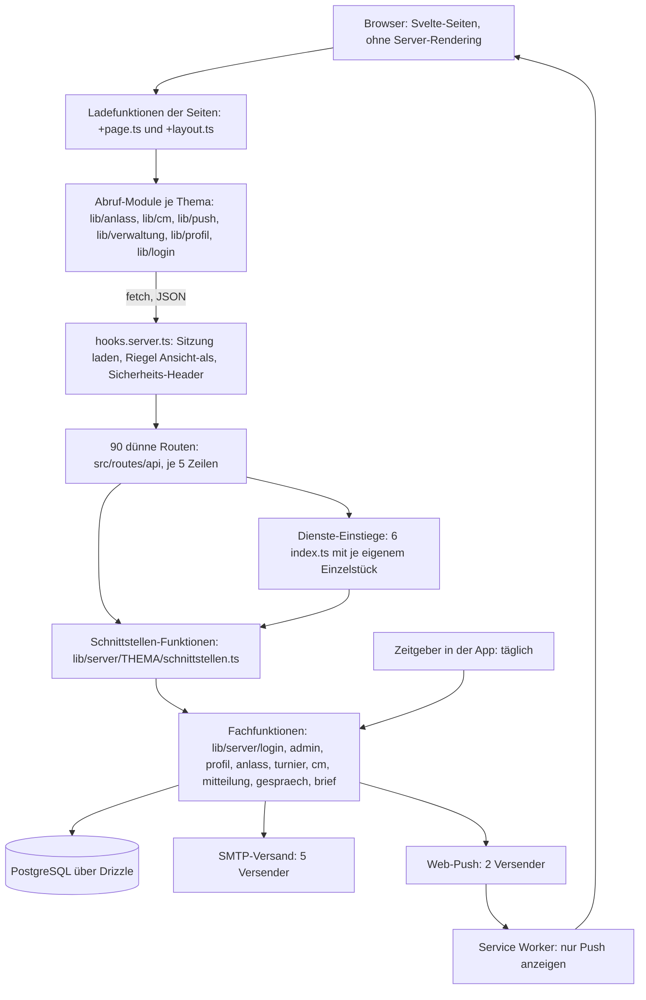

[← Übersicht](index.md)

# Refactoring-Analyse MyTCO

Dieses Dokument ist das Gedächtnis des Refactorings. Wer nur dieses Dokument liest, soll
weiterarbeiten können: Es enthält den Ist-Zustand, die Befunde, das Zielbild, den Plan mit Status
je Schritt, die Entscheide und die offenen Fragen. Sammel-Issue:
[#80](https://github.com/konstantinniedermann/tco-app/issues/80).

- **Stand des Dokuments:** 11.11.2026, nach dem Checkpoint am Ende der Etappe 0 (`dev` auf
  `bad624f`, Version 0.20.9). Etappe 0 ist erledigt, Etappe 1 freigegeben.
- **Stand der Analyse (Abschnitte 1 bis 5 und 10):** 11.11.2026, Version 0.20.5, vor Schritt 01.
  Zahlen und Fundstellen dort gelten für diesen Stand; was die Etappe 0 berichtigt hat, steht
  beim Befund. Der Vermerk «Nachtrag» ohne Schrittnummer meint den zweiten Durchgang der Analyse
  vom selben Tag (Testqualität und Oberfläche: B-28 bis B-36, F-13, F-14).
- **Markierungen:** **[geändert]** und **[neu]** kennzeichnen nur noch, was die Zwischenrevision
  am Ende der Etappe 0 und die Entscheide des Projektleiters vom 11.11.2026 (E-28 bis E-32)
  geändert haben. Die Markierungen früherer Durchgänge sind entfernt; was davor wie lautete,
  zeigt der Git-Verlauf dieser Datei.
- **Aufbau:** Abschnitte 1 bis 5 Befunde, 6 Zielbild, 7 Plan, 8 Entscheide, 9 Fragen, 10 Grenzen;
  Anhang A und B Anweisungsdateien, Anhang C das Protokoll der Etappe 0, Anhang D das der Etappe 1.

## Stand und nächster Schritt

*Diesen Abschnitt führt jeder Lauf nach.*

| | |
|---|---|
| **Phase** | 4 Umsetzung. **Etappe 0 abgeschlossen** (Checkpoint 11.11.2026, Abschnitt 1b), **Etappe 1 freigegeben** (E-30) |
| **Erledigte Schritte** | 01 Startpaket, 02 E2E-Flakes, 03 Vertragstests, 04 Hilfsmittel für Etappe 2, 05 Lint-Regeln für die Richtung der Importe (Kurzfassung in 7.2, Protokoll in Anhang C); 06 Grundbausteine in `http.ts` (Review «ok», Version 0.20.10; Ergebnis in 7.3, Protokoll in Anhang D.1) |
| **Nächster offener Schritt** | **06a** Rechteprüfung und Dienst-Typen aus den Schnittstellen-Dateien (Zeile und «Hinweise zu Schritt 06a» in 7.3; Subagent `refactor-implementer`, Opus), **nach dem «ok» des Projektleiters zum Checkpoint von Schritt 06**. Danach 07 bis 12 in dieser Reihenfolge |
| **Wartet auf Freigabe des Projektleiters** | «ok» zum Checkpoint nach Schritt 06 (E-30), dann startet 06a |
| **Offene Fragen** | **F-17** (Ablage der Verwaltungs-Schnittstellen ausserhalb von `admin/`): stellt der Orchestrator nach dem Nachmessen vor Schritt 09. **F-15** (Version, solange es Test nicht gibt): vor Schritt 23. Beide in Abschnitt 9 |
| **Checkpoint Etappe 0, Nachweis** | E2E dreimal voll grün auf `bad624f` (Version 0.20.9): je 414 bestanden, 57 übersprungen, 3,8 / 5,3 / 4,1 Minuten (gemessen vom Orchestrator); CI auf `dev` zum Merge von Schritt 05 grün (Lauf 43046410032, alle Prüf-Jobs und E2E auf drei Geräten) |
| **Vorab nachzumessen** | vor Schritt 07, 08, 09, 10, 11, 13, 19, 20, 23 (was, steht je in der Spalte «Nachmessen vorab»; Übersicht in 7.7). Schritte 06 und 06a brauchen keines |
| **Nächster Checkpoint** | nach Schritt 06: Kurzbericht, weiter auf «ok» (E-30); so nach jedem Schritt der Etappen 1 und 2 |
| **Erledigt ausserhalb des Plans** | Worktree und Branch `doppel-anfragen-verfallen` entfernt (E-14). Die Vorschläge B.3a bis B.3c, B.4a, B.5 und B.6 stehen als Eintrag vom 11.11.2026 in der gemeinsamen `beobachtungen.md` der CAS-Projekte (E-25). Die Änderungen an der Projekt-`CLAUDE.md` aus der Zwischenrevision sind eingespielt (E-29); der Agent `refactor-analyst` hat das Werkzeug Edit (E-32) |
| **Hinweis für den Orchestrator** | Die Agent-Typen `refactor-*` kennt eine Session erst, wenn sie nach dem Merge von Schritt 01 gestartet wurde. Sonst denselben Text als allgemeinen Agenten mit dem genannten Modell starten |

**Kennzeichnung der Belege**

- **[G]** selbst gelesen oder gemessen (Datei, Git, GitHub)
- **[E]** aus Erkundung: Stichprobe, Textsuche oder Auszug, nicht die ganze Datei gelesen
- **[V]** Vermutung, nicht belegt

**Begriffe, die oft vorkommen**

- *Schnittstelle*: eine Adresse unter `/api/…`, über die die Oberfläche Daten holt oder speichert.
- *Worktree*: eine zweite Arbeitskopie desselben Repos in einem eigenen Ordner, damit mehrere
  Sessions gleichzeitig arbeiten können.
- *E2E-Test* (Ende-zu-Ende): Ein Test bedient die laufende App im Browser wie ein Mensch.
- *Charakterisierungstest*: Ein Test, der das heutige Verhalten festhält, bevor umgebaut wird.
- *Hotspot*: Datei, die auffallend oft geändert wurde.
- *Flake*: Test, der ohne Code-Änderung manchmal rot und manchmal grün ist.

---

## 1 Kurzfazit

1. **Der Anwendungscode ist in gutem Zustand.** Er ist einheitlich aufgebaut, sorgfältig
   kommentiert, gut getestet (rund 1550 Einheits- und Datenbanktests, 162 E2E-Tests auf drei
   Geräten) und enthält fast keine Notlösungen (kein einziges `TODO`, vier Lint-Ausnahmen). Ein
   «grundlegendes Refactoring» des Codes ist die falsche Grösse. Richtig ist **gezieltes
   Aufräumen** an wenigen, klar benennbaren Stellen. [G]
2. **Die Wachstumsspuren im Code sind Duplikate und fehlende gemeinsame Bausteine**, nicht
   falsche Architektur: dieselben Hilfsfunktionen in sechs Server-Modulen, fünfmal derselbe
   Mail-Versender, sechs eigene Varianten des Abrufs von Schnittstellen in der Oberfläche, der
   Anmelde-Wächter in jeder Seite kopiert, eine Seite mit über 1000 Zeilen, ein Stylesheet mit
   2287 Zeilen. [G]
3. **Der grösste Befund liegt nicht im Code, sondern im Verhältnis von Prozess und Doku zum
   Code.** 58 % aller Commits ändern nur Doku. Die Doku ist in Bytes grösser als der
   Anwendungscode. Die 17 meistgeänderten Dateien sind bis auf eine Doku- oder Prozessdateien.
   Es gibt 38 Versionsabschnitte und 27 Merges nach `main`, aber keinen Server, kein Release,
   keinen Tag und keinen einzigen Nutzer. [G]
4. **Eine ganze Auslieferungskette ist gebaut, aber nie in echt gelaufen** (rund 2900 Zeilen
   Betriebsskripte, 2000 Zeilen Tests dazu, fünf CI-Jobs). Sie ist nicht Teil des Refactorings
   und soll nicht angefasst werden; sie ist aber ein Risiko, das benannt gehört. [G]
5. **Das Sicherheitsnetz ist stark, hat aber eine schwache Stelle:** Die E2E-Tests sind auf dem
   iPhone-Profil unter Last wacklig (drei offene Beobachtungen, acht Fallen-Notizen). Weil E2E
   das Hauptnetz für den Umbau der Oberfläche ist, kommt das zuerst. [G]
   **Nachtrag:** Die gelesene Stichprobe (9 Testdateien neben dem Code, 5 E2E-Dateien, die
   Hilfen) prüft durchwegs Verhalten, nicht Wortlaut des Quelltexts. Das Netz trägt die Etappen
   0 und 1 fast ohne Zusatz. Es hat zwei Löcher (Verdrahtung der Routen, Vertrag zwischen Server
   und Oberfläche: B-28, B-29) und einige Tests, die bei Etappe 2 ohne Verhaltensänderung rot
   würden (B-31). [G]
6. **Jetzt ist der günstigste Zeitpunkt für Aufräumarbeiten, die später teuer werden:**
   Solange es kein Live gibt, lassen sich interne Schnittstellen und (falls gewünscht) die
   19 Migrationen ohne Rücksicht auf Altdaten ändern. [G]
7. **Die Anweisungsdateien sind knapp und wirksam, erzeugen aber Nebenwirkungen:** Regeln wie
   «keine neue Abhängigkeit», «erst Leitbild, dann Code» und «jeder Merge eine Version» sind
   sinnvoll, haben aber Eigenbau-Prüfskripte, Doku-Hotspots und eine garantierte Kollisionsstelle
   für parallele Sessions hervorgebracht. [G]

**Empfehlung in einem Satz [geändert]:** 26 kleine Schritte in fünf Etappen (Abschnitt 7),
davon nur rund die Hälfte am Code; die grösste Wirkung haben die Entscheide des Projektleiters zu Arbeitsweise und
Doku-Umfang (Fragen F-01, F-09, F-11).

---

## 1a Was sich in Phase 3 geändert hat (11.11.2026)

Gegenüber der ersten Fassung (Commit `7e4b68a`): Die Fragen F-01 bis F-14 sind beantwortet, jede
wie empfohlen (E-07 bis E-22, Abschnitt 9). Der Plan wurde von 27 auf 25 Schritte neu geschnitten
und nummeriert (7.1); mit Schritt 06a sind es heute 26. Schritt 01 wurde ein Startpaket (die neue
`CLAUDE.md` und die Änderungen an Skill und Agenten gelten von Anfang an). Jeder Schritt nennt
Modell, Weg und Nachmessen; kein Schritt hat das Risiko «hoch». Checkpoints und feste Freigaben
stehen in 7.7. Die Lockerungen (Versionsregel E-07, Doku-Rhythmus E-17) gelten erst nach dem
Refactoring.

---

## 1b Zwischenrevision Etappe 0 (11.11.2026) [neu]

Stand: `origin/dev` nach dem Merge von Schritt 05 (Commit `bad624f`, Version 0.20.9). Gelesen:
dieses Dokument (Abschnitte 1 bis 2.3, B-12 bis B-15, 5 bis 10, Anhang B), `CLAUDE.md`, der Diff
`3593dde..HEAD`, die neuen Tests und Werkzeuge ganz (`grundpruefung.db.test.ts`, `routen.test.ts`,
`importrichtung.test.ts`, `eslint.config.js`, Diffs von `scripts/e2e.ts`, `vite.config.ts`,
`playwright.config.ts`, `Makefile`), `bauregel.ts` ganz, alle sieben `index.ts`, die Köpfe und
Hilfsfunktionen aller `schnittstellen.ts`, `hooks.server.ts`, `.githooks/pre-commit`. Nichts gebaut,
nichts getestet. Was nicht geprüft ist, steht in Abschnitt 10.

**Urteil**

1. **Das Zielbild (Abschnitt 6) trägt.** Zwei Sätze sind in 6.1 Punkt 8 ergänzt.
2. **Der Plan der Etappe 1 ging auf, aber nicht so, wie er dastand.** Die zwei Fristen von F-16
   widersprachen sich; dafür gibt es den neuen kleinen Schritt 06a vor Schritt 07. Schritt 09
   ist grösser als «niedrig» und braucht ein Nachmessen, Schritt 10 hatte kein Ziel für
   `getSitzung`, Schritt 11 ist beim Gespräch kleiner als geplant. Kein Schritt entfällt.
3. **Das Netz trägt die Schritte 06, 06a, 07 und 10.** Für 08, 09 und 11 hat es je eine Stelle mit
   falschem Grün (Fehlerwörter; eine neue Verwaltungs-Liste fällt aus den Rechte-Schleifen). Drei
   kleine Charakterisierungstests fehlten im Plan (jetzt bei 06, 07 und 09 unter «Absicherung»).
4. **Die Reihenfolge 06 → 06a → 07 → 08 → 09 → 10 → 11 → 12 stimmt** (Begründung in 7.7).
5. **Checkpoint-Nachweis liegt vor** (Tabelle «Stand und nächster Schritt»).

**Entschieden am Checkpoint (11.11.2026)**

| Thema | Entscheid | Steht jetzt |
|-------|-----------|-------------|
| F-16, Rechteprüfung und Dienst-Typen | A1: neuer Schritt 06a vor Schritt 07 (E-28) | Zeile 06a und «Hinweise zu Schritt 06a» in 7.3 |
| F-18, Vorschlag zur `CLAUDE.md` | gilt ganz, ist eingespielt (E-29) | geltende `CLAUDE.md`; Befund A-17 |
| F-19, Ok für Etappe 1 | ja, mit den Änderungen der Revision; Checkpoint nach jedem Schritt (E-30) | 7.3 bis 7.7 |
| Dokument straffen | ja (E-31) | diese Fassung; Protokoll der Etappe 0 in Anhang C |
| Werkzeug des Analysten | `refactor-analyst` hat Edit, nur für dieses Dokument (E-32) | `.claude/agents/refactor-analyst.md`, Anhang B.2c |
| F-17, F-15 | bleiben offen | Abschnitt 9 |

**Wo die Inhalte der Revision jetzt stehen**

| Inhalt | Ort |
|--------|-----|
| Änderungen am Plan (06 bis 12, 18 bis 21, Zählung) | Zeilen und «Hinweise zu Schritt NN» in 7.3 bis 7.6, markiert mit [geändert] oder [neu] |
| «Trägt das Netz die Etappe 1?» | 7.3, Unterabschnitt «Was das Netz für die Etappe 1 deckt» |
| Reihenfolge, Kosten in Versionen | 7.7 |
| Befunde B-37 bis B-41 | 3.2 (B-39, B-40, B-41), 3.3 (B-38 bei B-12), 3.6 (B-37); Nachtrag bei B-03 |
| Befunde A-14 bis A-18 | Abschnitt 5 |
| Zielbild, zwei Sätze | 6.1 Punkt 8 |
| Fragen F-15 bis F-19 | Abschnitt 9 |
| Nicht geprüft, dünn belegt | Abschnitt 10 |

**Unverändert geprüft, stimmt:** die Schritte 13 bis 17, 22 bis 25 (keine veraltete Angabe gefunden;
nur die Zeilen gelesen, nicht die Dateien dahinter). Abschnitt 6.3 passt zu 06a («Rechteprüfung …
höchstens der Ablageort»).

**Vorschläge zum Dokument, umgesetzt (E-31):** Protokoll der Etappe 0 in Anhang C; die Prüfliste (b)
bei Etappe 2 (7.4); Nachträge aus den Tabellenzellen in «Hinweise zu Schritt NN»; Status der
erledigten Schritte kurz; Abschnitt 9 als Tabelle; Kopf mit «Stand der Analyse»; alte Markierungen
entfernt; Anhang A als Verweis. Tabelle 7.1 (alte und neue Nummern) bleibt vorn, weil ältere
Commits und Berichte die alten Nummern nennen.

---

## 2 Ist-Architektur

### 2.1 Zahlen [G]

| Bereich | Dateien | Zeilen | Bemerkung |
|---------|--------:|-------:|-----------|
| Anwendungscode `src/` ohne Tests | 311 | 30 445 | davon 10 612 in 65 Svelte-Dateien, 2492 CSS |
| Tests neben dem Code (`src/**/*.test.ts`) | 115 | 26 118 | Einheit und Datenbank |
| `tests/` (E2E, Betrieb, Hilfen) | 47 | 10 640 | 25 E2E-Dateien |
| `scripts/` (Prüfskripte, Seed, CI) | 50 | 4 521 | davon 14 Prüfskripte mit eigenen Tests |
| `betrieb/` (Auslieferung, Sicherung) | 20 | 2 860 | Shell, Compose, Caddy |
| Doku `docs/**/*.md` | 86 | 18 509 | 1,55 MB; Anwendungscode ohne Tests: 1,05 MB |
| Migrationen `drizzle/*.sql` | 19 | 282 | dazu 20 000 Zeilen erzeugte Schnappschüsse |

- 18 Tabellen, 90 Schnittstellen-Dateien (`+server.ts`), 35 Seiten.
- 9 Laufzeit-Abhängigkeiten, 21 Entwicklungs-Abhängigkeiten; jede wird benutzt.
- Repo: erster Commit 29.10.2026, 1073 Commits an 12 Arbeitstagen, davon 195 Merges.
  Nicht-Merge-Commits nach Präfix: 396 `docs`, 212 `fix`, 186 `feat`, 63 `test`, 13 `refactor`,
  7 `chore`.
- GitHub: 21 offene, 27 geschlossene Issues; keine Repo-Variablen gesetzt (Auslieferung aus),
  kein Release, kein Tag.
- CI: letzte 100 Läufe (5. bis 9.11.): 91 grün, 8 rot, 1 abgebrochen; auf `dev` 76 grün, 3 rot;
  Median 4,7 Minuten, längster 25 Minuten.

### 2.2 Bausteine und Flüsse



**Was das Bild sagt:** Die App ist eine reine Browser-App (kein Server-Rendering, `ssr = false`)
vor einer JSON-Schnittstelle. Der Server von SvelteKit dient nur als Träger der Schnittstellen.
Das ist eine bewusste Bauregel (ADR-002), damit dieselbe Oberfläche später in eine Store-App
verpackt werden kann. Die Regel ist durchgehend eingehalten. [G]

### 2.3 Tatsächliche Hauptabläufe

**A — Eine Anfrage an die Schnittstelle** [G]
(`src/hooks.server.ts` → `handle`; `src/lib/server/login/schnittstellen.ts` → `ladeSitzungSicher`;
`src/lib/server/admin/ansicht.ts` → `riegel`)

1. Für jede Adresse unter `/api/` liest der Hook das Sitzungs-Cookie, sucht die Sitzung in der
   Datenbank (ein Join über Sitzung, Konto, Mitglied) und legt das Konto in `locals.konto`.
   Alle 24 Stunden wird die Sitzung verlängert. Ein Fehler dabei gilt als «nicht angemeldet».
2. Läuft eine «Ansicht als …», weist der Hook jede schreibende Anfrage ab (ausser vier
   erlaubten Adressen).
3. Die Route (5 Zeilen) holt den Dienst-Einstieg ihres Themas und ruft genau eine
   Schnittstellen-Funktion auf.
4. Die Schnittstellen-Funktion prüft in dieser Reihenfolge: JSON-Format bei Schreibzugriffen
   (sonst 415, das ist der Schutz gegen fremde Formulare), Sitzung (401), bei der Verwaltung
   Rolle, Bereich und frische Code-Bestätigung (403 mit vier verschiedenen Gründen), dann die
   Eingabe (400), dann ruft sie die Fachfunktion.
5. Die Fachfunktion arbeitet in einer Datenbank-Transaktion mit ausdrücklichen Sperren und gibt
   ein Ergebnis als Wort zurück (`'ok'`, `'voll'`, `'veraltet'` …). Die Schnittstelle übersetzt
   es in Statuscode und `{ fehler: '…' }`.
6. Die Antwort bekommt immer `cache-control: no-store` und drei Sicherheits-Header.

**B — Eine Seite der Mitglieder-App** [G]
(`src/routes/+layout.ts`, `src/routes/+page.ts`, `src/routes/clubmeisterschaft/[id]/+page.ts`)

1. Das Wurzel-Layout fragt `/api/sitzung` (für das Band «Ansicht als …»).
2. Die Seite fragt in ihrer Ladefunktion selbst noch einmal `/api/sitzung` oder ihre eigene
   Schnittstelle. Bei 401 prüft sie, ob im Browser-Speicher ein Mail-Code wartet, und leitet
   nach `/login/mail` oder `/login` um. Dieser Block steht in jeder Seite einzeln.
3. Nach dem Speichern übernimmt die Seite die Antwort des Servers als neuen Stand, ohne neu zu
   laden.

**C — Verwaltung** [G]
(`src/routes/verwaltung/+layout.ts`, `src/lib/verwaltung/umleiten.ts`,
`src/lib/server/admin/schnittstellen.ts` → `mitRolle`, `liest`, `schreibt`)

1. Das Layout der Verwaltung holt den Zugang (`/api/admin/zugang`): angemeldet, Rollen,
   bestätigt per Mail-Code.
2. Es leitet um: ohne Sitzung zur Anmeldung, ohne Rolle zur Startseite, ohne Bestätigung zur
   Seite «Verwaltung öffnen», ausserhalb des eigenen Bereichs zur ersten erlaubten Seite.
3. Jede Unterseite wiederholt die Kette «abgemeldet / kein Admin / unbestätigt» für ihren
   eigenen Abruf.
4. Auf dem Server setzt allein `mitRolle` die Rechte durch; die Oberfläche blendet nur aus.

**D — Login** [G] (`src/lib/server/login/dienst.ts`, `sitzung.ts`, `index.ts`)

- Brief-Code oder Mail-Code werden mit bedingten `UPDATE`-Anweisungen atomar eingelöst; danach
  entsteht eine Sitzung (zufällige Kennung, in der Datenbank nur als Hash).
- Begrenzungen gegen Durchprobieren («Bremsen») und die offenen Passkey-Anfragen liegen im
  Arbeitsspeicher des einen Prozesses; nach einem Neustart sind sie leer.

**E — Anmeldung zur Clubmeisterschaft** [G]
(`src/lib/server/cm/schnittstellen.ts` → `postCmAnmeldung`, `antwortMitMail`;
`src/lib/server/cm/anmeldungen.ts` → `trageEin`, `meldeAb`)

1. Transaktion: Mitglied sperren, dann Kategorie und Turnier, dann prüfen (offen, Angaben
   vollständig, passt, nicht schon angemeldet, höchstens drei), dann eintragen.
2. Danach liest die Schnittstelle die ganze CM-Ansicht neu und **wartet auf die
   Bestätigungsmail**, bevor sie antwortet.
3. Meldungen an Dritte (Partner, CM-Admins) laufen ohne Warten nebenher und schlucken Fehler.

**F — Mitteilung an viele** [E] (`src/lib/server/mitteilung/`, `src/lib/verwaltung/mitteilung-api.ts`)

- Vorschau und Senden sind getrennte Schnittstellen. Beim Senden kommt die Antwort erst, wenn
  alle Pushes und Mails durch sind (eigener Mail-Versender mit offenen Verbindungen).

**G — Löschfristen** [G] (`src/lib/server/zeitgeber.ts`, `src/hooks.server.ts` → `init`)

- Beim Start und danach täglich ruft der Prozess den Löschlauf auf. `ZEITGEBER=aus` schaltet
  ihn für E2E ab.

**H — Vom Code bis «live» (geplant, nie gelaufen)** [G]
(`.github/workflows/check.yml`, `betrieb/bin/`, `scripts/ci/`)

- Push auf `dev`: Prüfen, E2E auf drei Geräten, Malware-Prüfung, Image mit Rauchtest. Wäre die
  Repo-Variable `AUSLIEFERUNG_TEST` gesetzt, folgten Bauen, Ausliefern per SSH und Freigeben.
- Push auf `main`: dasselbe, dann «Finden» des auf Test gelaufenen Images, Ausliefern auf Live,
  Release mit Tag.
- Heute enden beide Wege nach den Prüfungen. Die Variablen sind nicht gesetzt.

**I — Arbeitsablauf einer Session** [G]
(`.claude/skills/tco-branching/SKILL.md`, `.githooks/pre-commit`, `.githooks/pre-push`)

1. Worktree ab `origin/dev`, Label `in-arbeit`.
2. Jeder Commit: Secret-Scan, dann `make docs` (nur Doku) oder `make check-schnell` (Code).
3. Jeder Push mit Code: `make check` vollständig (inklusive E2E und Image), ausser der Stand ist
   schon als «grün» gemerkt.
4. Merge im Hauptordner mit Merge-Commit; bei Code: Version erhöhen, Abschnitt in
   `docs/versionen.md`, Push; der Hook prüft die Versionsregel.
5. Worktree und Branch sofort entfernen.
6. «Release»: Doku-Abgleich in eigenem Branch, `make release-check`, PR `dev` → `main`, danach
   `main` zurück nach `dev` mergen.

---

## 3 Befunde nach Thema

Schweregrad: **hoch** = bremst oder gefährdet das Projekt spürbar; **mittel** = kostet laufend
Aufwand oder birgt ein benennbares Risiko; **niedrig** = Schönheitsfehler oder kleine Altlast.

### 3.1 Verhältnis von Prozess und Doku zum Code

#### B-01 — Prozess und Doku wiegen schwerer als der Code · hoch · [G]

- **Fundstelle:** Git-Historie; `docs/` gesamt; `docs/beobachtungen.md`, `docs/versionen.md`.
- **Messung:** 507 von 878 Nicht-Merge-Commits ändern nur Doku (58 %). `docs/**/*.md` hat
  1,55 MB, der Anwendungscode ohne Tests 1,05 MB. Meistgeänderte Dateien:
  `docs/beobachtungen.md` (141 Commits), `docs/versionen.md` (105), `docs/ui-leitbild.md` (82),
  `docs/datenschutz.md` (71), `docs/fachmodell.md` (70), `docs/ci-cd-und-release.md` (64). Die
  erste Code-Datei folgt auf Platz 9 (`src/lib/design/basis.css`, 56). In acht Tagen gab es
  sieben Beobachtungs-Auswertungen mit zusammen 214 Einträgen.
- **Auswirkung:** Ein grosser Teil der Arbeitszeit und des Kontexts jeder Session fliesst in
  das Nachführen von Texten. Jede Code-Änderung zieht mehrere Doku-Dateien nach (Fachmodell,
  Datenschutz, Rollen, Testkonzept, Versionen, README, Context-Scopes). Für ein Projekt ohne
  Nutzer ist das viel.
- **Einordnung:** Die Doku ist inhaltlich gut und für Datenschutz und Übergabe gewollt. Der
  Befund ist die **Dichte**, nicht die Existenz. Was davon bleibt, ist ein Entscheid des
  Projektleiters (F-09, F-11).
- **Entschieden (E-15, E-17):** Pläne und Specs gelten als Geschichte; die
  Doku-Pflichten werden nach dem Refactoring auf «vor einer Auslieferung» gebündelt (Schritt 24).

#### B-02 — Auslieferungskette ist gebaut, aber nie in echt gelaufen · mittel · [G]

- **Fundstelle:** `betrieb/` (2860 Zeilen, darunter `betrieb/nachweis/nachweis.sh` mit 1300),
  `tests/betrieb/` (1993 Zeilen), `.github/workflows/check.yml` Jobs `bauen`, `finden`,
  `ausliefern`, `freigeben`, `release`; `scripts/ci/`, `scripts/pruefungen/release.ts`,
  `workflow-rechte.ts`.
- **Messung:** Keine Repo-Variable gesetzt, kein Tag, kein GitHub-Release; der Server ist laut
  `docs/arc42.md` Kapitel 7 nicht in Betrieb (Issue #39 offen).
- **Auswirkung:** Rund 5000 Zeilen Betriebscode und -tests sind nur gegen Attrappen und einen
  lokalen Nachbau geprüft. Die ersten echten Läufe werden Überraschungen bringen. Für das
  Refactoring heisst das: **nicht anfassen**, denn es gibt kein Netz, das einen Fehler dort
  zeigen würde.

#### B-03 — Version pro Merge erzeugt eine feste Kollisionsstelle · mittel · [G]

- **Fundstelle:** [ADR-007](adr/adr-007-version-pro-merge.md), `docs/versionen.md`,
  `scripts/pruefungen/version-merge.ts`, `scripts/pruefungen/gruener-stand.ts`,
  `.githooks/pre-push`, Skill `tco-branching` Schritt 4.
- **Messung:** Version 0.20.5 nach 13 Tagen; 38 Versionsabschnitte; jeder Merge mit Code
  ändert `package.json`, `package-lock.json` und `docs/versionen.md`.
- **Auswirkung:** Drei Dateien, die jede parallele Session anfassen muss. Der Skill beschreibt
  eigens, was zu tun ist, wenn der Push deshalb abgewiesen wird. Um die Folge (doppelte volle
  Prüfung) zu mildern, kam ein zweiter Mechanismus dazu («grüner Stand»,
  [ADR-009](adr/adr-009-gruener-stand.md)). Das ist ein Mechanismus, der einen Mechanismus
  repariert.
- **Einordnung:** Für das Refactoring gilt die Regel weiter (E-01). Ob sie danach bleibt, ist
  Frage F-01.
- **Entschieden (E-07):** Die Regel fällt nach dem Refactoring; Umsetzung in Schritt 23.
- **[neu] Nachtrag aus der Zwischenrevision Etappe 0 [G]:** Die Etappe 0 hat vier Versionen erzeugt
  (0.20.6 bis 0.20.9, `docs/versionen.md`), alle für Tests und Werkzeug «ohne Wirkung auf die
  App». Die Etappe 1 erzeugt acht weitere (7.7).

#### B-04 — Doku verspricht Verhalten, das der Code nicht hat · mittel · [G]

- **Fundstelle:** `docs/ci-cd-und-release.md`, Abschnitt «Alte Versionen auf dem Handy»;
  `src/service-worker/index.ts`; `src/lib/server/version.ts` → `MINDESTVERSION`,
  `istVersionVertraeglich`; `src/lib/server/status.ts`.
- **Beobachtung:** Die Doku sagt: Die App speichert sich über den Service Worker zwischen, der
  Server nennt bei jeder Antwort die Mindestversion, eine ältere offene App lädt neu. Im Code
  hat der Service Worker ausdrücklich keinen Zwischenspeicher, die Mindestversion steht nur in
  der Antwort von `/api/status`, und `istVersionVertraeglich` wird nur von Tests aufgerufen.
- **Auswirkung:** Nach einer Auslieferung arbeitet eine offene App mit altem Code gegen neue
  Schnittstellen, ohne dass etwas sie zum Neuladen bringt. Heute folgenlos (kein Live), ab dem
  ersten Release ein echter Fehlerfall. Siehe F-03.
- **Entschieden (E-09):** Bordmittel von SvelteKit, Eigenbau entfernen (Schritt 19).
- **Weitere veraltete Stellen:** `docs/index.md` («Die Doku entsteht vor dem Code», «was fehlt,
  ist ein Issue im Milestone Fundament»); `README.md` Abschnitt «Stand» nennt die Phase
  «Fundament», obwohl Funktionen bis zur Etappe CM-Anmeldung gebaut sind.

#### B-05 — Context-Scopes zählen einzelne Dateien auf · niedrig · [G]

- **Fundstelle:** `docs/context-scopes.md` (48 Commits; einzelne Tabellenzeilen über 1500 Zeichen).
- **Auswirkung:** Die Tabelle muss bei jeder neuen oder verschobenen Datei nachgeführt werden
  und wird beim Refactoring mit jedem Schritt falsch. Sie verweist zudem auf Pläne und Specs
  als Lesestoff, die den Code von damals beschreiben (B-06).

#### B-06 — Pläne und Specs als lebende Doku geführt · niedrig · [G]

- **Fundstelle:** `docs/superpowers/` (46 Dateien, 12 302 Zeilen).
- **Auswirkung:** Die Dateien sind Geschichte (die Prüfung `annahmen.ts` behandelt sie so),
  werden aber in `docs/context-scopes.md` als «relevante Pfade» genannt. Wer sie lädt, liest
  überholte Code-Auszüge. Siehe F-09.
- **Entschieden (E-15):** als Geschichte kennzeichnen, aus den Context-Scopes nehmen
  (Schritt 22).

### 3.2 Prüfskripte, Tests und CI

#### B-07 — Eigenbau-Prüfer statt vorhandener Werkzeuge · mittel · [G]

- **Fundstelle:** `scripts/pruefungen/bauregel.ts` (257 Zeilen, erkennt Importe und Exporte mit
  regulären Ausdrücken, kennt feste Dateinamen wie `SCHNITTSTELLEN_DATEI`, `AUS_INDEX`);
  `scripts/pruefungen/workflow-rechte.ts` (182 Zeilen, liest YAML von Hand, Kommentar «ohne
  YAML-Paket»).
- **Auswirkung:** Die Bauregel ist an die heutige Ordnerstruktur genagelt: Jeder Umbau der
  Server-Module muss das Prüfskript mitändern, und ein Fehler darin fällt nicht auf. Ein Teil
  liesse sich mit ESLint ausdrücken, das schon Abhängigkeit ist (`no-restricted-imports`,
  `no-restricted-syntax`). Der Eigenbau ist eine Folge der Regel «keine neuen Abhängigkeiten»
  (A-06).
- **Nachtrag (nach Lektüre von `bauregel.test.ts`, 302 Zeilen):** Der Teil «Admin-Routen» ist
  mehr als eine Stilregel. Er stellt sicher, dass jede Route unter `api/admin/` nur Funktionen
  aus den drei Listen (`ADMIN_SCHNITTSTELLEN`, `TURNIER_SCHNITTSTELLEN`,
  `MITTEILUNG_ADMIN_SCHNITTSTELLEN`) benutzt und die Dienste nur als erstes Argument weiterreicht.
  Genau über diese Listen laufen die Rechte-Tests (B-28). Die Bauregel ist damit das Bindeglied
  zwischen Verdrahtung und Rechteprüfung und **bleibt**. Das kann ESLint nicht ersetzen. Der
  Befund reduziert sich auf: feste Pfade im Skript, und die Tests des Skripts nageln Meldungen
  samt Pfad fest (sie werden bei den Schritten 07, 09 und 11 rot und müssen mitgeändert werden;
  das ist gewollt). Schritt 12 ist entsprechend geändert.

#### B-08 — Der Nachweis «Anforderung hat einen Test» prüft Text · mittel · [G]

- **Fundstelle:** `scripts/pruefungen/test-ids.ts` → `fehlendeTests`.
- **Beobachtung:** Eine als «umgesetzt» markierte Regel (`FR-NN`, `RR-NN`, `A-…`) gilt als
  getestet, wenn ihre ID als Wort in irgendeiner ausgeführten Testdatei vorkommt, auch nur in
  einem Kommentar.
- **Auswirkung:** Die Prüfung ist grün, auch wenn kein Test die Regel wirklich prüft. Sie ist
  nützlich als Erinnerung, aber kein Beleg. Beim Refactoring darf «test-ids: ok» nicht als
  Nachweis für erhaltenes Verhalten gelten.

#### B-09 — Lücken im Netz der CI · mittel · [G]

- **Fundstelle:** `.github/workflows/check.yml`, `Makefile` → `check`, `vitest.config.ts`.
- **Beobachtungen:**
  1. Integriert wird lokal: Die CI sieht einen Stand erst nach dem Push auf `dev`. Davor
     schützt nur der lokale Hook, der sich über den «grünen Stand» selbst abkürzen kann. Drei
     von 79 Läufen auf `dev` waren rot.
  2. `make betrieb-nachweis`, der einzige Ende-zu-Ende-Beleg der Auslieferung, läuft weder in
     der CI noch in `make check`.
  3. `make release-check` läuft nur lokal.
  4. Die Abdeckungsschwelle von 90 % gilt nur für `src/lib/server`, `src/lib/turnier` und zwei
     Dateien. Die 65 Svelte-Dateien (10 612 Zeilen) haben keine eigenen Tests; sie sind nur
     über E2E gedeckt.
  5. Kein Werkzeug meldet toten Code, ungenutzte Exporte oder Zyklen zwischen Modulen.
  6. Der Pre-Commit-Hook lässt Datenbanktests und E2E aus; ein Folgefehler in einem anderen
     Ordner fällt erst im vollen `make check` auf (so auch in den gemeinsamen Beobachtungen
     vom 08.11. festgehalten).

#### B-10 — E2E-Tests auf dem iPhone-Profil unter Last wacklig · hoch · [G]

- **Fundstelle:** `docs/beobachtungen.md` (drei offene Einträge zu `tests/e2e/verwaltung.test.ts`
  und `tests/e2e/benachrichtigungen.test.ts`); 30 Aufrufe von `test.setTimeout` in 10 Dateien
  (29 zwischen 90 und 180 Sekunden; berichtigt in Schritt 02, vorher «14»); `waitForTimeout` in
  `tests/e2e/hilfe.test.ts`, `mitgliedschaft.test.ts`, `profil.test.ts` und `verwaltung.test.ts`
  (berichtigt in Schritt 02, vorher nur die ersten zwei); acht Fallen-Notizen im Session-Gedächtnis zu E2E und CI.
- **Auswirkung:** E2E ist das einzige Netz für die Oberfläche. Wenn es ohne Grund rot wird,
  kostet jeder Refactoring-Schritt zusätzliche Läufe, und ein echter Fehler wird leichter als
  «wieder ein Flake» abgetan. Darum Schritt 02 vor allem anderen.

#### B-11 — E2E-Hilfen rufen Fachfunktionen des Servers direkt · niedrig · [G]

- **Fundstelle:** `tests/e2e/hilfen/login.ts` (466 Zeilen, importiert rund 15 Module aus
  `src/lib/server/`); `legeTurnierAn(festesJahr)` und `legeOffenesTurnierAn(festesJahr, …)` als
  Rest (offene Beobachtung vom 09.11.).
- **Auswirkung:** Ein Umbau der Server-Module bricht die E2E-Hilfen. Gut daran: Es ist eine
  einzige Fassade, die Tests selbst bleiben unberührt.

#### B-39 — Die Bauregel gilt für jede Datei unter `src/routes/`, auch für Tests · niedrig · [G] [neu]

- **Fundstelle:** `scripts/pruefungen/bauregel.ts` → `pruefeBauregel` (`inRoutes`, `ADMIN_MODUL`);
  Folge: `src/lib/server/routen.test.ts` liegt nicht neben den Routen (Kopf der Datei). Unter
  `src/routes/api/` liegen heute drei Tests (`bremsen.db.test.ts`, `kontakt/kontakt.test.ts`,
  `status/status.db.test.ts`); keiner importiert `lib/server/admin`.
- **Auswirkung:** Ein Test neben einer Route kann die Verwaltung nicht direkt prüfen. Das ist
  hinnehmbar; eine Ausnahme für Tests wäre eine Änderung am Schutz. Empfehlung: so lassen.

#### B-40 — Über `make` geht der Exit-Code eines Skripts verloren · niedrig · [E] [neu]

- **Fundstelle:** `Makefile` → `css-vergleich`; `scripts/css-vergleich.ts` (Exit 1 für «anders»,
  2 für falschen Aufruf); belegt von Hand in Schritt 04 (Anhang C.4), in der Zwischenrevision nicht
  nachgestellt.
- **Auswirkung:** `make` meldet für jeden Fehlschlag denselben Wert. Wer «anders» von «falsch
  aufgerufen» unterscheiden muss (Schritt 18), ruft das Skript direkt auf. Kein Umbau nötig.

#### B-41 — Der Test der Importrichtung liest Quelltext der App · niedrig · [G] [neu]

- **Fundstelle:** `scripts/importrichtung.test.ts` → «Ausnahme … ist noch nötig» (`lintFiles` über
  die echten Dateien) und die zwei Ordner-Wächter (`readdirSync`); `CLAUDE.md`, «Tests»: «Kein
  Test liest Quelltext der App».
- **Auswirkung:** Gewollt und nützlich, aber quer zum Wortlaut der Regel.
- **Erledigt (E-29):** Die `CLAUDE.md` sagt jetzt: «Die Struktur prüfen nur ESLint und die
  Prüfskripte unter `scripts/`.»

### 3.3 Server

#### B-12 — Gemeinsame Bausteine der Schnittstellen fehlen oder liegen am falschen Ort · mittel · [G]

- **Fundstelle:** `src/lib/server/login/schnittstellen.ts` → `antwort`, `istJson`,
  `leseKoerper`, `formatFehler`, `Ereignis` (von acht anderen Modulen importiert);
  `nichtGefunden` sechsmal definiert (`admin`, `anlass`, `cm`, `gespraech`, `mitteilung`,
  `turnier`), `jetzt(d)` sechsmal, `mitSitzung` dreimal (`anlass`, `cm`, `mitteilung`),
  `mitKonto` zweimal (`admin`, `profil`), `eingabeFehler` zweimal.
- **Auswirkung:** Wer das Verhalten einer Grundprüfung ändert (z. B. die Antwort bei fehlender
  Sitzung), muss sechs Stellen finden. Das Login-Modul ist dadurch von allen abhängig gemacht,
  obwohl es fachlich nichts mit ihnen zu tun hat.
- **[neu] Berichtigt durch B-38:** «`mitKonto` zweimal» stimmt nur dem Namen nach, und `aendernd`
  gibt es in zwei Formen.

#### B-38 — Berichtigung zu B-12: zwei der «Duplikate» sind keine · niedrig · [G] [neu]

- **Fundstelle:** `admin/schnittstellen.ts` → `mitKonto` (prüft Rolle, kann 403 antworten) gegen
  `profil/schnittstellen.ts` → `mitKonto` (nur Sitzung); `cm/schnittstellen.ts` → `aendernd` (ohne
  Körper) gegen `profil/schnittstellen.ts` → `aendernd` (mit Körper).
- **Auswirkung:** «`mitKonto` zweimal» in B-12 verleitet dazu, zwei verschiedene Prüfungen
  zusammenzulegen. Schritt 06 ist an diesen Stellen ein Entwurf, kein Verschieben (Hinweise zu
  Schritt 06 in 7.3).

#### B-13 — Der Zusammenbau der Dienste ist über sechs Dateien verteilt · mittel · [G]

- **Fundstelle:** `src/lib/server/{login,admin,profil,cm,mitteilung,anlass}/index.ts`.
- **Beobachtung:** Jede Datei hält ihr eigenes Einzelstück in einer Modulvariablen. Der
  SMTP-Versender wird fünfmal erzeugt (`erstelleSmtpMailer` in `login`, `admin`, `profil`, `cm`,
  `mitteilung`), der Web-Push-Versender zweimal (`cm`, `mitteilung`).
  `holeMitteilungAdminDienste` baut auf `holeAdminDienste` auf; die Turnier-Routen und der
  Austritt holen ihre Dienste aus `mitteilung/index.ts`.
- **Auswirkung:** Fünf offene SMTP-Zugänge statt einem, und es ist nirgends auf einen Blick zu
  sehen, was der Server beim Start braucht. Die Tests sind davon nicht betroffen: Sie reichen
  ihre Dienste selbst hinein (das ist gut gelöst und bleibt).

#### B-14 — Modulgrenzen sind verwischt, es gibt gegenseitige Abhängigkeiten · mittel · [G]

- **Fundstelle und Messung** (Importe zwischen den Ordnern unter `src/lib/server/`, ohne Tests):
  `admin` ↔ `cm` (4 und 5), `admin` ↔ `mitteilung` (2 und 2), `cm` ↔ `gespraech`,
  `gespraech` ↔ `turnier`, `mitteilung` ↔ `turnier`, `login` → `admin` und `login` → `gespraech`
  (`getSitzung` berechnet Rollen und offene Gespräche), `profil` → `admin` (6).
- **Beispiele für falschen Ort:**
  - Die Verwaltung der Anlässe (`getAdminAnlaesse` … `postAdminAnlassLoeschen`) steht in
    `src/lib/server/admin/schnittstellen.ts`, die Fachlogik in `anlass/`.
  - Die Verwaltung der CM-Anmeldungen liegt fachlich in `cm/verwaltung.ts` und
    `cm/verwaltung-doppel.ts`, ihre Schnittstellen aber in `turnier/schnittstellen.ts`,
    zusammen mit denen des Gesprächs.
  - `admin/` ist zugleich Mitgliederverwaltung, Rollen, Zugang zur Verwaltung, Löschlauf,
    Einlesen, Briefe und Auskunft (27 Dateien).
- **Auswirkung:** Die Ordnernamen sagen nicht verlässlich, wo etwas liegt. Das erklärt, warum
  `docs/context-scopes.md` einzelne Dateien aufzählen muss (B-05).
- **Einordnung:** Keine der Abhängigkeiten ist ein Fehler zur Laufzeit. Der Befund betrifft
  Auffindbarkeit und Änderbarkeit. Wie weit neu geschnitten wird, ist Frage F-06.
- **Entschieden (E-12):** nur die klaren Fälle (Schritte 09 bis 11); `admin/` bleibt ein Modul.
- **Nachmessen (Schritt 05, 11.11.2026):** Die Zahlen stimmen unverändert. Als Verletzung der Zielrichtung zählen davon nur Importe von Schnittstellen-Dateien und die von `login` aus (19 Stellen, alle in `AUSNAHMEN`, `eslint.config.js`); die Fachlogik-Importe zwischen Themen (z. B. `cm` → `admin/mitglieder.ts`) sind nach Zielbild erlaubt und nicht erfasst.

#### B-15 — Fehlerform der Schnittstellen ist uneinheitlich · niedrig · [G]

- **Fundstelle:** `src/lib/server/*/schnittstellen.ts`; `src/lib/verwaltung/mitteilung-api.ts` →
  `mitMeldungen`; `src/lib/server/cm/schnittstellen.ts` → `FEHLER`; `src/lib/cm/api.ts` →
  `ABGELEHNT`.
- **Beobachtung:** Eingabefehler kommen in drei Formen: `felder` als Objekt (meist), `feld` als
  einzelner Name (Anlass, «vergeben»), `felder` als Liste (Mitteilungen; die Oberfläche hat
  dafür einen Übersetzer). Die 23 Fehlerwörter sind lose Zeichenketten; die Liste der
  Ablehnungsgründe der CM wird auf dem Server und in der Oberfläche getrennt gepflegt.

#### B-16 — Zustand im Arbeitsspeicher des Prozesses · niedrig · [G] (Absicht: [V])

- **Fundstelle:** `src/lib/server/login/bremse.ts`, `login/challenge.ts` → `ChallengeSpeicher`,
  `profil/email-wechsel.ts` → `WechselSpeicher`.
- **Auswirkung:** Begrenzungen, offene Passkey-Anfragen und laufende E-Mail-Wechsel gehen bei
  jedem Neustart und jeder Auslieferung verloren und gelten nur für einen Prozess. Für einen
  Verein mit einem Server ist das vertretbar. Es soll **bleiben**, aber als Randbedingung
  dokumentiert sein.

#### B-17 — Bestätigungsmail liegt im Antwortweg · niedrig · [G]

- **Fundstelle:** `src/lib/server/cm/schnittstellen.ts` → `antwortMitMail` (wartet auf
  `d.bestaetigung`), im Gegensatz zu `meldeMitgliedern` (läuft nebenher);
  `src/lib/verwaltung/mitteilung-api.ts` → Kommentar zu `sendeMitteilung`.
- **Auswirkung:** Die Antwort auf «Anmelden» dauert so lange wie der SMTP-Versand. Beim
  Senden einer Mitteilung an alle wartet der Browser auf Hunderte Mails; ob das an eine
  Zeitgrenze stösst, ist nicht geprüft [V].

#### B-18 — Halbfertiges und Ungenutztes · niedrig · [G] / [E]

- `MINDESTVERSION` und `istVersionVertraeglich` (siehe B-04). [G]
- `npm run build:spa` mit `@sveltejs/adapter-static`: wird in jedem `make check` und jedem
  CI-Lauf gebaut, das Ergebnis wird nirgends verwendet. Es hält die Bauregel für eine spätere
  Store-App wach (ADR-001, ADR-002). Siehe F-04. [G] **Entschieden (E-10): bleibt.**
- Rund 60 exportierte Namen in `src/lib/` werden in keiner anderen Datei verwendet, weitere 35
  nur von Tests. Das meiste sind Typen und Konstanten, also harmlos; gefunden mit einer groben
  Textsuche, nicht mit einem Werkzeug. [E]
- `legeTurnierAn(festesJahr)` in den E2E-Hilfen (B-11). [G]

#### B-19 — Migrationen tragen Altlasten für Daten, die es nie gab · niedrig · [G]

- **Fundstelle:** `drizzle/0000` bis `0018`; `drizzle/0009_rollen_schaerfen.sql`,
  `0013_mitgliedschaft.sql`, `0016_steep_spiral.sql` (mit `DELETE` und `UPDATE` für Bestandsdaten);
  `src/lib/server/db/migration-0009.db.test.ts`, `migration-0013.db.test.ts`.
- **Beobachtung:** 19 Migrationen in zehn Tagen; drei bereinigen Daten, die nur in lokalen
  Testdatenbanken existierten. Die ersten 16 haben sprechende Namen, die letzten drei
  Zufallsnamen. Parallele Branches haben dieselbe Nummer vergeben (Fallen-Notiz).
- **Auswirkung:** Gering. Solange kein Live existiert, liesse sich alles auf eine Basis
  zusammenlegen; danach nie mehr. Siehe F-02.
- **Entschieden (E-08):** nicht im Refactoring; eigener Vorgang unmittelbar vor dem
  ersten Live.

### 3.4 Oberfläche

#### B-20 — Sechs eigene Abruf-Module mit je eigener Deutung der Antworten · mittel · [G]

- **Fundstelle:** `src/lib/anlass/api.ts` → `rufe`, `src/lib/cm/api.ts` → `rufe`,
  `src/lib/push/api.ts` → `rufe`, `src/lib/verwaltung/api.ts` → `rufe`, `deute` (501 Zeilen, ein
  Ergebnis-Typ mit 31 Varianten, lange Kette von `if`), `src/lib/profil/angaben.ts` → `deute`,
  `schicke`, `src/lib/login/passkey.ts` → `leseJson`.
- **Auswirkung:** Ein neues Fehlerwort heisst: Server, Deutung im passenden Modul, Ergebnis-Typ
  und Seite anfassen. Die Regeln «401 heisst abgemeldet, 404 heisst nicht gefunden, alles
  andere Störung» stehen sechsmal da. `verwaltung/api.ts` ist ein Hotspot (19 Commits).
- **Nachtrag (bestätigt, [G]):** Dazu kommen zwei Schreibweisen für dasselbe: Fünf Module
  melden das Ergebnis als `art` (`anlass`, `cm`, `push`, `verwaltung`, `mitteilung-api`), zwei
  als `ergebnis` (`src/lib/login/anmelden.ts`, `src/lib/profil/angaben.ts`). Die Profil-Seite
  benutzt beide nebeneinander. Gut und zu erhalten: Jedes Modul nimmt den Abruf als Argument
  (`holen`), darum sind die Tests (`api.test.ts`) ohne Browser möglich und überstehen Schritt 13
  unverändert.

#### B-21 — Der Anmelde-Wächter ist in jede Seite kopiert · mittel · [G]

- **Fundstelle:** `src/routes/+page.ts`, `src/routes/anlass/[id]/+page.ts`,
  `src/routes/clubmeisterschaft/[id]/+page.ts`, `src/routes/profil/+page.ts` und weitere: Block
  «abgemeldet → wartet ein Mail-Code? → `/login/mail` oder `/login`»; in der Verwaltung
  `src/lib/verwaltung/umleiten.ts` → `leiteUm` und zusätzlich in jeder `+page.ts` die Kette
  abgemeldet / kein Admin / unbestätigt. 47 Stellen im Code nennen `/login`.
- **Nebenbefund (im Nachtrag korrigiert):** `/api/sitzung` wird nur beim ersten Laden und
  während einer «Ansicht als …» doppelt geholt (Wurzel-Layout und Seite). Sonst lädt das
  Wurzel-Layout einmal, und jede Seite prüft bei jedem Wechsel selbst. Diese Prüfung je
  Seitenwechsel ist gewollt: So merkt die App sofort, wenn die Sitzung inzwischen beendet wurde
  (Kommentar in `src/routes/+layout.ts`; `tests/e2e/verwaltung.test.ts` «SI-07»). Sie darf beim
  Aufräumen nicht verloren gehen (siehe Schritt 15).
- **Nachtrag, zweiter Ladeort:** 24 von 35 Seiten laden ihre Daten in `+page.ts`. Zwei Seiten
  der Verwaltung laden stattdessen erst im Baustein (`$effect` mit `lade()`):
  `src/routes/verwaltung/turniere/+page.svelte` und `src/routes/verwaltung/anlaesse/+page.svelte`. [G]
- **Auswirkung:** Eine Änderung am Einstieg (z. B. ein dritter Login-Weg) muss an vielen
  Stellen nachgezogen werden; eine vergessene Stelle zeigt dann eine Fehlerseite statt der
  Anmeldung.

#### B-22 — Einzelne Seiten und Bausteine sind sehr gross · mittel · [G]

- **Fundstelle:** `src/routes/clubmeisterschaft/[id]/+page.svelte` (1038 Zeilen, davon 478
  Skript, drei Dialoge, neun verschiedene Schreib-Aufrufe; 19 Commits, 10 davon `fix`),
  `src/lib/verwaltung/DoppelListe.svelte` (740), `src/routes/profil/+page.svelte` (644),
  `src/lib/verwaltung/Anmeldungsliste.svelte` (508),
  `src/routes/verwaltung/mitglieder/[id]/+page.svelte` (447).
- **Auswirkung:** Abläufe und Zustand (welcher Dialog offen, wohin der Fokus geht, welche
  Meldung steht) liegen in der Seite und sind nur über E2E prüfbar. Die Fix-Häufung zeigt, dass
  Änderungen dort Nebenwirkungen haben.
- **Nachtrag (alle vier Dateien ganz gelesen, [G]) — der Befund wird enger gefasst:** Die
  Länge allein ist nicht das Problem.
  - *CM-Seite:* Das Markup ist schon sauber in neun benannte Abschnitte (Svelte-«Snippets»)
    gegliedert. Lang ist das Skript: Acht Handler (`anmelden`, `abmelden`, `annehmen`,
    `ablehnen`, `zurueckziehen`, `wildcardSenden`, `suchtextSenden`, `angabenSenden`) wiederholen
    dasselbe Gerüst (Sperre setzen, Meldung leeren, aufrufen, je Antwort verzweigen, bei
    «abgemeldet» zum Login, sonst neu laden) auf rund 330 Zeilen. Die Dialoge «Wildcard» und
    «Kommentar ändern» sind bis auf Texte gleich. Das ist der eigentliche Befund (B-34).
  - *`DoppelListe.svelte`:* gut gebaut. Acht Dialoge sind über den Baustein `Aktionsdialog`
    nur beschrieben, nicht ausprogrammiert. Die 740 Zeilen sind Inhalt, kein Durcheinander.
    **Bleibt, wie sie ist.**
  - *`Anmeldungsliste.svelte`:* die ältere Fassung desselben Musters, mit fünf Dialogen von Hand
    und einer eigenen Funktion `fuehreAus` (B-34).
  - *Profil-Seite:* drei voneinander unabhängige Teile in einer Datei (eigene Angaben, Passkeys,
    Abmelden). Sie teilen nur `nurAnsehen` und die geladenen Daten. Leicht zu trennen, aber der
    Nutzen ist klein.

#### B-23 — Ein einziges globales Stylesheet · mittel · [G]

- **Fundstelle:** `src/lib/design/basis.css` (2287 Zeilen; im Nachtrag nachgezählt: 123
  Klassen in 304 Selektoren); keine der 65 Svelte-Dateien hat einen eigenen `<style>`-Block. Meistgeänderte Code-Datei (56 Commits, 25
  davon `fix`); `docs/ui-leitbild.md` als zweite Quelle (82 Commits, 26 davon `fix`).
- **Auswirkung:** Jede Arbeit an der Oberfläche trifft dieselbe Datei (Reibung beim Mergen), und
  eine Regel kann Seiten verändern, die niemand im Blick hat. Die Prüfung `design-tokens.ts`
  gleicht nur die Farb- und Massangaben mit dem Leitbild ab, nicht die Bausteine.
- **Einordnung:** Die Bündelung ist Folge der Dauerregel «Oberfläche nur aus Tokens und
  Bausteinen des Leitbilds». Ob das eine Datei bleiben muss, ist Frage F-07.
- **Nachtrag (ganze Datei per Skript ausgewertet, [G]):**
  - **Keine tote Klasse:** Jede der 123 Klassen kommt in `src/` vor. Das Stylesheet ist
    gepflegt; hier gibt es nichts wegzuräumen.
  - **Kaum doppelte Regeln:** 21 Selektoren stehen mehr als einmal da, fast alle gewollt
    (Grundregel und Abweichung für PC, Druck oder reduzierte Bewegung).
  - **Abhängigkeit von der Reihenfolge: ja, aber gebündelt.** Es gibt keine Ebenen (`@layer`).
    Das PC-Layout steht als ein Block am Schluss (`@container app (min-width: 60rem)`, Zeilen
    1851 bis rund 2095) und übersteuert die Grundregeln davor allein dadurch, dass es später
    kommt. Dazu 6 `!important`, 5 Blöcke für reduzierte Bewegung, 24 Regeln für Seitenübergänge.
  - **Folge für Schritt 18:** Aufteilen nach Bausteinen würde die PC-Regeln zu ihren Bausteinen
    ziehen und damit die Reihenfolge ändern. Sicher ist nur ein Schnitt **in der bestehenden
    Reihenfolge**. Dann ist das gebaute Stylesheet vor und nach dem Schritt Zeichen für Zeichen
    gleich, und genau das ist der Beweis (Schritt 04 neu).

#### B-24 — Eigenbau von Browser-Verhalten im Wurzel-Layout · niedrig · [G]

- **Fundstelle:** `src/routes/+layout.svelte` (231 Zeilen, 27 Commits), `src/lib/ui/navigation.ts`,
  `kopftitel.ts`, `klappe.ts`, `tastatur.ts` (zusammen rund 540 Zeilen), `tests/e2e/bewegung.test.ts`.
- **Beobachtung:** Weil nur ein innerer Bereich scrollt (App-Gefühl mit fester Kopfleiste und
  Reitern), führt die App Scroll-Position, Seitenübergänge und Tastatur-Verhalten selbst.
- **Einordnung:** Bewusste Gestaltung, gut in testbare Module ausgelagert. **Bleibt.** Es ist
  aber die empfindlichste Stelle der Oberfläche; Schritte an Layout und Navigation brauchen den
  vollen E2E-Lauf auf allen drei Geräten.

#### B-25 — Kein gemeinsamer Ort für Code, den Server und Browser teilen · niedrig · [G]

- **Fundstelle:** `src/lib/verwaltung/api.ts` importiert Typen aus rund 20 Dateien unter
  `src/lib/server/`; `src/lib/verwaltung/bereiche.ts` (die Rechte-Matrix) liegt bei der
  Oberfläche und wird vom Server importiert (`admin/schnittstellen.ts`); `src/lib/turnier/`,
  `src/lib/anlass/zeit.ts`, `src/lib/name.ts` werden von beiden Seiten benutzt.
- **Auswirkung:** Die Richtung der Abhängigkeiten ist nicht aus dem Ordner ablesbar. Geteilt
  werden heute nur Typen und reine Funktionen, darum ohne Schaden.

### 3.5 Arbeitsumgebung

#### B-26 — Der Ablauf erzeugt wiederkehrende Fallen · mittel · [G]

- **Fundstelle:** Session-Gedächtnis des Projekts: 50 Einträge in 13 Tagen, davon 28 als «Falle»
  benannt. Verteilung nach dem Index: 8 zu E2E und CI, 5 zu lokaler Datenbank und Migrationen,
  4 zu Worktree und Schutz-Hooks, der Rest zu einzelnen Werkzeugen.
- **Auswirkung:** Jede Falle ist eine Stelle, an der eine Session Zeit verloren hat. Die Lösung
  war jeweils eine Notiz für die nächste Session, nicht eine Vereinfachung des Ablaufs. Das
  Gedächtnis wächst so zur zweiten, unversionierten Anweisungsdatei (siehe A-02).

#### B-27 — Reste im Repo · niedrig · [G]

- Worktree `.claude/worktrees/doppel-anfragen-verfallen` mit Branch
  `feat/doppel-anfragen-verfallen`: kein eigener Commit, 15 Commits hinter `dev`, keine
  uncommitteten Änderungen. Die zugehörige Aufgabe steht in `docs/beobachtungen.md`
  (Entscheid vom 09.11.: «mitlöschen», Umsetzung offen).
- Offener Dependabot-Branch `dependabot/npm_and_yarn/dev/typescript-7.0.2` (Hauptversion;
  `package.json` nagelt TypeScript auf 6.0.3 fest).
- Siehe F-08.
- **Entschieden (E-14):** Worktree und Branch werden entfernt, das Update bleibt liegen.

### 3.6 Testqualität (Nachtrag)

**Gelesen (ganz):** `admin/rechte-matrix.db.test.ts`, `anlass/schnittstellen.db.test.ts`,
`login/schnittstellen.db.test.ts`, `cm/anmeldungen.db.test.ts`, `ansicht-riegel.test.ts`,
`src/lib/verwaltung/api.test.ts`, `src/lib/ui/navigation.test.ts`,
`scripts/pruefungen/bauregel.test.ts`, `scripts/pruefungen/test-ids.test.ts`; E2E:
`cm-anmeldung.test.ts`, `navigation.test.ts`, `bewegung.test.ts`, `mockups.test.ts`,
`verwaltung.test.ts` (rund zwei Drittel), die Hilfen `tests/e2e/hilfen/seite.ts` und
`tests/hilfen/anfrage.ts`. Dazu die allgemeinen Schleifen in `admin/schnittstellen.db.test.ts`,
`turnier/schnittstellen.db.test.ts` und `mitteilung/admin-schnittstellen.db.test.ts` und
Zählungen über alle Tests.

**Urteil:** Die Tests prüfen Verhalten. Keiner der gelesenen Tests liest Quelltext der App, keiner
vergleicht Schnappschüsse (`toMatchSnapshot` und `toHaveScreenshot` kommen im Repo nicht vor),
keiner baut die Implementierung nach.

- Die Datenbanktests laufen gegen echtes PostgreSQL und rufen die echten Fachfunktionen. Sie
  prüfen Ergebnis **und** Zustand der Tabellen, auch den Wettlauf zweier gleichzeitiger
  Anmeldungen (`cm/anmeldungen.db.test.ts`, «FR-06: zwei gleichzeitige Anmeldungen …» hält dafür
  absichtlich Sperren fest) und dass nichts Vertrauliches herausgeht (derselbe Test sucht im
  ganzen Antwort-JSON nach Telefonnummern und Klassierungen).
- Attrappen gibt es nur an den Rändern: Mail-Versand, Push, Uhr, im Browser-Code der Abruf.
- Die E2E-Tests sind Abläufe aus Sicht eines Menschen. Sie suchen Elemente überwiegend über
  Rolle und Beschriftung (947 `getByRole`, 185 `getByLabel` gegen 146 Stellen mit CSS-Selektor),
  prüfen auf jedem Bildschirm die Barrierefreiheit mit axe und sammeln Konsolenfehler.
- Die Prüfskript-Tests prüfen ihre Skripte gründlich, auch Umgehungsversuche.

Die folgenden Befunde sind die Stellen, an denen dieses gute Netz für den Plan nicht reicht oder
ihm im Weg steht.

#### B-28 — Die Verdrahtung der Routen prüft kein Test · mittel · [G]

- **Fundstelle:** `tests/hilfen/anfrage.ts` → `ereignis`; alle `*/schnittstellen.db.test.ts`
  (rufen z. B. `postAnmeldung(d, ereignis(…))` direkt, mit einem selbst gebauten Dienste-Objekt);
  die 90 `+server.ts` und die sechs `index.ts`. Nur zwei Routen haben einen eigenen Test
  (`src/routes/api/kontakt/kontakt.test.ts`, `src/routes/api/status/status.db.test.ts`); von den
  Dienste-Einstiegen prüft ein Test nur «liefert dieselbe Instanz» (`holeLoginDienst`).
- **Beobachtung:** Welche Route welche Funktion unter welcher Methode mit welchen Diensten
  aufruft, steht nur in den Routen selbst. Geprüft wird das für die Admin-Routen als Text durch
  die Bauregel (B-07), sonst nur mittelbar durch E2E.
- **Auswirkung (falsches Grün):** Schritt 07 (ein Zusammenbau der Dienste) und die Schritte 09
  bis 11 (Routen umhängen) ändern genau diese Verdrahtung. Ein vertauschter Import, eine Route
  mit dem falschen Dienste-Einstieg oder ein zweiter Satz Bremsen bliebe in allen Einheits- und
  Datenbanktests grün. Darum bekommt Schritt 03 einen Routen-Test.

#### B-29 — Server und Oberfläche prüfen ihren Vertrag getrennt, jede Seite gegen eigene Annahmen · mittel · [G]

- **Fundstelle:** `src/lib/verwaltung/api.test.ts` (543 Zeilen: füttert erfundene Antworten wie
  `{ fehler: 'eingabe', felder }` und prüft Pfad, Methode und Körper als feste Werte);
  die `schnittstellen.db.test.ts` (prüfen dieselben Formen von der anderen Seite, z. B.
  `{ fehler: 'eingabe', feld: 'bemerkung' }` in `anlass/schnittstellen.db.test.ts`);
  12 Stellen in den E2E-Tests, an denen die Antwort des Servers gestellt ist (`page.route`,
  z. B. «letzter MyTCO-Admin» und «503» in `tests/e2e/verwaltung.test.ts`).
- **Beobachtung:** Die Typen der Daten teilen sich beide Seiten (gut). Adressen, Methoden und
  Fehlerwörter teilen sie nicht: Sie stehen als Zeichenketten je einmal im Server, in der
  Oberfläche und in zwei Testsätzen.
- **Auswirkung (falsches Grün):** Ändert Schritt 08 die Fehlerform nur auf einer Seite, bleiben
  beide Testsätze grün, weil jeder seine eigene Annahme prüft. Auffallen würde es nur, wenn ein
  E2E-Test genau diesen Fehlerweg echt durchläuft. Abhilfe in Schritt 08: eine gemeinsame Liste
  der Fehlerwörter, die Server, Oberfläche und beide Testsätze importieren.

#### B-30 — Mitglieder-Schnittstellen haben keine Liste und keine durchgehende Grundprüfung · niedrig · [G]

- **Fundstelle:** `admin/schnittstellen.db.test.ts` («jede Admin-Schnittstelle antwortet ohne
  Sitzung 401, ohne Rolle 403, unbestätigt 403» über alle 26 Einträge),
  `turnier/schnittstellen.db.test.ts` (dasselbe über 26 Einträge, dazu «MyTCO-Admin liest nur»),
  `admin/rechte-matrix.db.test.ts` (jede schreibende Schnittstelle der drei Listen → 403 für den
  MyTCO-Admin, mit Vergleich aller Tabellen vorher und nachher). Dagegen `cm/schnittstellen.ts`
  (12 Funktionen), `anlass` (4), `profil` (6), `gespraech` (7), `login/passkey-schnittstellen.ts`
  (7), `mitteilung` (Mitglieder-Teil): keine Liste; 401 und 415 sind dort je an einzelnen
  Funktionen geprüft (in `cm/schnittstellen.db.test.ts` je zwei Stellen für zwölf Funktionen).
- **Auswirkung:** Für die Verwaltung ist der Vertrag «401/403» lückenlos und wächst von selbst
  mit (eine neue Funktion in der Liste wird automatisch geprüft). Für die Mitglieder-Seite hängt
  es an der Sorgfalt je Funktion. «415 ohne JSON» ist nirgends über alle schreibenden
  Schnittstellen geprüft. Schritt 06 fasst genau diese Grundprüfungen an.

#### B-37 — Die Menge der Verwaltungs-Listen führen fünf Stellen von Hand · mittel · [G] [neu]

- **Fundstelle:** `src/lib/server/admin/rechte-matrix.db.test.ts` (zweimal die drei Listen
  zusammengefügt); `admin/schnittstellen.db.test.ts`, `turnier/schnittstellen.db.test.ts`,
  `mitteilung/admin-schnittstellen.db.test.ts` (je eine Schleife über die eigene Liste, feste Zahl);
  `grundpruefung.db.test.ts` → `verwaltungsDienste`; `routen.test.ts` → `VERWALTUNG`;
  `scripts/pruefungen/bauregel.ts` → `adminSchnittstellen`.
- **Auswirkung:** Nichts zwingt eine neue Liste in alle fünf. Der Routen-Test fängt nur, dass eine
  Admin-Route eine ungelistete Funktion ruft, nicht, dass eine Liste ungeprüft bleibt. Die Schritte
  09 und 11 legen neue Listen an: darum der Charakterisierungstest in Schritt 09 («Absicherung»)
  und die Regel in der `CLAUDE.md`, «Tests» (E-29).

#### B-31 — Einige E2E-Tests hängen an Einzelheiten, die Etappe 2 ändert · mittel · [G]

- **Fundstellen und was bricht (falsches Rot):**
  1. `tests/e2e/bewegung.test.ts`, «Reiter ist beim Antippen sofort aktiv, auch wenn der Server
     langsam antwortet»: Der Test verzögert `/api/sitzung` um zwei Sekunden und erwartet, dass
     der Seitenwechsel so lange wartet. Er setzt also voraus, dass die Profil-Seite beim Wechsel
     `/api/sitzung` holt. Die erste Fassung von Schritt 15 hätte das geändert; die heutige Fassung
     lässt es stehen, der Test bleibt aber die Probe darauf.
  2. `tests/e2e/navigation.test.ts`, «Anmelden auf der CM-Seite lädt die Seite nicht neu»: zählt
     Anfragen an `/api/cm`. Sinnvoll, aber an die heutige Ladeweise gebunden (Schritte 13, 16).
  3. 34 verschiedene CSS-Klassen dienen als Selektor, am häufigsten `.karte`, `.plakette`,
     `.klappe`, `.kopf`, `.kachel`, `.reiter`, `.kopf-titel`, `.karte-kopf`, `.rollbereich`.
     Beim Zerlegen von Seiten (Schritte 16 und 17) müssen Klassen und Verschachtelung gleich
     bleiben; Schritt 18 ändert keine Namen.
  4. `tests/e2e/hilfen/seite.ts` → `wartetAufVorladen` greift in das Innere von SvelteKit
     (`app.dictionary`, `app.nodes`) und sucht die Reiter über `nav.reiter a[href]`. Eine
     Routen-Gruppe (im Plan nicht mehr vorgesehen) oder ein Update von SvelteKit kann das brechen; fast jeder
     E2E-Test ruft die Funktion beim Anmelden.
  5. `pruefeBildschirm` macht für das Bild `.schale` und `.rollbereich` kurz lang; beide Namen
     sind damit fest.
- **Auswirkung:** Kein Fehler der Tests, aber jeder dieser Punkte kann einen Schritt der Etappe
  2 rot machen, obwohl das Verhalten stimmt. Die betroffenen Schritte nennen die Stelle jetzt.

#### B-32 — E2E prüft viel Wortlaut · niedrig · [G]

- **Fundstelle:** 256 Stellen mit `toHaveText` oder `toContainText`, 173 mit `getByText`, oft
  mit ganzen Sätzen («Mehr als 3 Anmeldungen gehen nicht. Melde dich zuerst irgendwo ab.»). Nur
  drei E2E-Dateien holen Texte aus dem Code (`MELDUNG` aus `src/lib/login/anmelden.ts`); sonst
  steht jeder Satz einmal in der Seite und einmal im Test.
- **Einordnung:** Das ist kein «Text statt Verhalten»: Die Sätze sind das, was das Mitglied
  sieht, und das UI-Leitbild macht Wortlaut zur Anforderung. Für das Refactoring ist es
  unkritisch, weil kein Schritt Texte ändert, und sogar nützlich: Eine versehentlich geänderte
  Meldung fällt auf. **Bleibt.** Der Preis: Jede gewollte Textänderung hat zwei Stellen.

#### B-33 — Die Screenshots sind Nachweise, kein Vergleichsnetz · niedrig · [G]

- **Fundstelle:** `tests/e2e/hilfen/seite.ts` → `pruefeBildschirm` (124 Aufrufe: benanntes Bild
  der ganzen Seite je Gerät nach `test-results/`, vorher axe-Prüfung und am PC «nichts ragt
  seitlich heraus»); `playwright.config.ts` → `screenshot: 'on'` (ein Bild am Ende jedes Tests).
- **Beobachtung:** Die Bilder enthalten Zufallsnamen (`Probe…`), zufällige Turnierjahre zwischen
  3000 und 9999 und laufende Daten. Sie werden nie verglichen, es gibt keine Vorlagenbilder.
- **Auswirkung:** Als Beleg «so sieht es aus» taugen sie, als Basis für einen Bildvergleich
  nicht: Zwei Läufe desselben Codes liefern verschiedene Bilder. Schritt 04 ist darum neu
  geschnitten (siehe dort und F-13).

### 3.7 Oberfläche (Nachtrag)

**Gelesen (ganz):** `src/routes/clubmeisterschaft/[id]/+page.svelte`,
`src/lib/verwaltung/DoppelListe.svelte`, `Anmeldungsliste.svelte`, `Aktionsdialog.svelte`,
`src/routes/profil/+page.svelte`, dazu drei kleinere Seiten (`anlass/[id]`,
`verwaltung/turniere`, `clubmeisterschaft/[id]/kategorie/[kid]`). Gezählt über alle 65
Svelte-Dateien: Wiederverwendung der Bausteine und wiederholtes Markup. `basis.css` per Skript
ausgewertet (Ergebnis bei B-23).

**Vorhandene gemeinsame Bausteine** (Zahl der Dateien, die sie einbinden): `Seitenkopf` 19,
`Name` 11, `Zurueck` 9; je 2: `Spielersuche`, `Zeilenaktionen`, `Zeilentasten`, `Kontakt`,
`CmKachel`, `Anleitung`, `Briefdruck`, `Mitteilungsformular`, `Mitteilungsverlauf` und die vier
Formulare der Verwaltung (`Angabenformular`, `Anlassformular`, `Turnierformular`,
`Kategorieformular`, je für «neu» und «ändern»); je 1: `Aktionsdialog`, `Reiter`, `Pfad`,
`AnsichtWahl`, `Mitgliedschaft`, `Benachrichtigungen`, `PushHinweis`. Die Formulare für «neu»
und «ändern» sind also schon geteilt; das ist gut gelöst.

#### B-34 — Derselbe Ablauf «Aktion mit Rückfrage» in drei Baustufen · mittel · [G]

- **Fundstelle:**
  1. `src/routes/clubmeisterschaft/[id]/+page.svelte`: acht Handler von Hand (rund 330 Zeilen),
     drei rohe Dialoge.
  2. `src/lib/verwaltung/Anmeldungsliste.svelte` → `fuehreAus` (eine Funktion für alle
     Aktionen) und fünf rohe Dialoge mit je eigenen Zeilen für Warnung, Fehler und Tasten.
  3. `src/lib/verwaltung/DoppelListe.svelte` mit `Aktionsdialog.svelte`: Ablauf, Warnung
     («Trotzdem …»), Fehler, Umleitung und Schutz vor veralteten Antworten stecken im Baustein;
     die Liste beschreibt acht Dialoge nur noch.
- **Messung:** 22 rohe `<dialog class="karte">` in 12 Dateien gegen 8 `Aktionsdialog` in einer
  Datei. Die Dialoge «Verschieben», «Klassierung korrigieren» und «Anmeldung löschen?» gibt es
  in beiden Listen fast gleich. Die Sperre gegen Doppelklick (`laeuft = true`) steht 42-mal in
  25 Dateien von Hand.
- **Auswirkung:** Das ist die deutlichste Wachstumsspur der Oberfläche: Der Baustein wurde beim
  dritten Mal gefunden, die beiden älteren Stellen wurden nicht nachgezogen. Der
  `Aktionsdialog` ist die Vorlage für die Schritte 16 und 17.

#### B-35 — Formularfelder sind überall von Hand verdrahtet · niedrig · [G]

- **Fundstelle:** 27 Stellen `class="feld"` in 15 Dateien; 60 von Hand gesetzte
  `aria-describedby` in 23 Dateien (Hilfe-Text, Fehler-Text, Zähler je mit eigener Kennung);
  die Auswahl der Klassierung viermal (CM-Seite, Profil, beide Listen).
- **Einordnung:** Ein Baustein «Feld» läge nahe. Er würde aber jedes Formular anfassen, und die
  Verdrahtung für Screenreader ist heute überall richtig und per axe geprüft. Das Risiko
  übersteigt den Nutzen. **Nicht im Plan**; als Frage F-14 festgehalten.
  **Entschieden (E-20): kein Baustein «Feld».**

#### B-36 — Kleine Uneinheitlichkeiten zwischen den Seiten · niedrig · [G]

- Ergebnis als `art` oder als `ergebnis` (siehe B-20).
- Daten laden in `+page.ts` (24 Seiten) oder im Baustein (2 Seiten, siehe B-21).
- Texte für alle Bereiche liegen verstreut: `MELDUNG` in `src/lib/login/anmelden.ts` wird von
  16 Svelte-Dateien für die allgemeine Störungsmeldung benutzt; die Profil-Seite holt
  `feldMeldung` aus `src/lib/verwaltung/anzeige.ts`.
- **Auswirkung:** gering; wird in den Schritten 13 und 14 mit erledigt.

---

## 4 Was gut gelöst ist und bleiben soll

| Was | Wo | Warum es bleibt |
|-----|----|-----------------|
| Dünne Routen, die genau eine Schnittstellen-Funktion aufrufen | `src/routes/api/**/+server.ts` | Die ganze Logik ist ohne Framework testbar [G] |
| Rechte an einer Stelle | `src/lib/server/admin/schnittstellen.ts` → `mitRolle`, `liest`, `schreibt`; `src/lib/verwaltung/bereiche.ts`; `src/lib/server/admin/rechte-matrix.db.test.ts` | Eine Matrix, ein Durchsetzungspunkt, ein Matrix-Test [G] |
| «Ansicht als …» in zwei Schichten | `src/lib/server/admin/ansicht.ts` → `riegel`, dazu die Prüfung in `mitRolle` | Einfach und doppelt gesichert [G] |
| Login, Codes, Sitzung | `src/lib/server/login/dienst.ts`, `sitzung.ts`, `codes.ts` | Atomare Einlösung, nur Hashes gespeichert, keine Details in Logs [G] |
| Fachfunktionen mit Wort-Ergebnissen und ausdrücklicher Sperr-Reihenfolge | `src/lib/server/cm/anmeldungen.ts` → `sperreMitglieder`, `sperreKategorieUndTurnier`, `trageEin` | Gleichzeitige Zugriffe sind durchdacht und getestet [G] |
| Dienste werden hineingereicht, die Zeit auch | `…Dienste`-Typen, `jetzt?: () => Date` | Tests brauchen keine Attrappen des Frameworks [G] |
| Einstellungen mit harter Prüfung beim Start | `src/lib/server/einstellungen.ts` → `leseEinstellungen` | Beispielwerte sind in Produktion verboten [G] |
| Datenbank-Schema mit Prüfregeln in der Datenbank | `src/lib/server/db/schema.ts` | Zustände sind auch ohne App-Code gültig [G] |
| Reine Funktionen für Anzeige und Regeln, mit Tests | `src/lib/turnier/passung.ts`, `src/lib/cm/anzeige.ts`, `src/lib/ui/*.ts` | Verhalten statt Text geprüft [E] |
| E2E auf eigener, frischer Datenbank je Lauf | `scripts/e2e.ts`, `playwright.config.ts` | Parallele Sessions stören sich nicht [G] |
| CI mit festgenagelten Actions, Rechte je Job, Malware-Prüfung, Secret-Scan | `.github/workflows/` | Sorgfältig und für ein öffentliches Repo angemessen [G] |
| Projekt-`CLAUDE.md` | `CLAUDE.md` | Kurz, nur Dauerregeln, hält sich an die eigene Aufnahmeregel [G] |
| Zeitgeber in der App | `src/lib/server/zeitgeber.ts`, ADR-008 | Für einen Server die einfachste Lösung [G] |
| Erfundene Testdaten, per Skript erzwungen | `scripts/pruefungen/testdaten.ts`, `scripts/erfundene-mitglieder.ts` | Schützt vor echten Mitgliederdaten im öffentlichen Repo [G] |
| Deutsche Fachsprache im Code | überall | Durchgehend und passend zum Glossar; nicht «vereinheitlichen» [G] |
| **Nachtrag:** Datenbanktests gegen echtes PostgreSQL, mit Zustand der Tabellen und Wettlauf-Fällen | `src/lib/server/cm/anmeldungen.db.test.ts` und die übrigen `*.db.test.ts` | Prüfen Verhalten, überstehen die Etappen 0 und 1 unverändert [G] |
| **Nachtrag:** Rechte-Tests, die über die Listen der Schnittstellen laufen | `admin/rechte-matrix.db.test.ts`, `admin/schnittstellen.db.test.ts`, `turnier/schnittstellen.db.test.ts` | Eine neue Schnittstelle wird ohne Zutun mitgeprüft; zusammen mit der Bauregel lückenlos für die Verwaltung [G] |
| **Nachtrag:** «Nichts im Log» als Prüfung in jeder Schnittstellen-Testdatei | `afterEach` in den `schnittstellen.db.test.ts` | Datenschutz-Zusage als Test, nicht als Vorsatz [G] |
| **Nachtrag:** E2E über Rolle und Beschriftung, axe und Konsolenfehler auf jedem Bildschirm | `tests/e2e/`, `tests/e2e/hilfen/seite.ts` → `pruefeBildschirm`, `sammleKonsolenfehler` | Barrierefreiheit und Fehlerfreiheit sind bei jedem Lauf mitgeprüft [G] |
| **Nachtrag:** Abruf-Module nehmen den Abruf als Argument | `holen`-Parameter in `src/lib/*/api.ts` | Ohne Browser testbar [G] |
| **Nachtrag:** `Aktionsdialog` und die `DoppelListe` | `src/lib/verwaltung/Aktionsdialog.svelte`, `DoppelListe.svelte` | Der richtige Baustein für «Aktion mit Rückfrage»; Vorlage, nicht Umbauziel [G] |
| **Nachtrag:** Gliederung grosser Seiten in benannte Abschnitte (Snippets) | `src/routes/clubmeisterschaft/[id]/+page.svelte`, `src/routes/profil/+page.svelte` | Das Markup ist lesbar; nicht ohne Not in viele Dateien zerlegen [G] |
| **Nachtrag:** Geteilte Formulare für «neu» und «ändern» | `src/lib/verwaltung/*formular.svelte` | Keine doppelten Formulare [G] |
| **Nachtrag:** Stylesheet ohne tote Klassen | `src/lib/design/basis.css` | Gepflegt; nur der Zuschnitt in Dateien steht zur Wahl [G] |

---

## 5 Befunde zu den Anweisungsdateien

Gelesen: Projekt-`CLAUDE.md`, gemeinsame `CLAUDE.md` der CAS-Projekte, Skill `tco-branching`,
die drei Agent-Definitionen `refactor-*`, `.githooks/`, `.mcp.json`, `.github/`, `Makefile`;
ausserhalb des Repos (nur gelesen): `~/.claude/settings.json`, `~/.claude/hooks/README.md`,
Skills `session-start` und `session-wrap-up`, Agent `cas-reviewer`, `PROVENANCE.md` der Skills,
`refactoring-ablauf.md`, die gemeinsame `beobachtungen.md` (Überschriften und Auszüge) und das
Session-Gedächtnis (Index ganz, zwei Fallen-Dateien ganz).

#### A-01 — Skill sagt «Release am Session-Ende», die Regel sagt «nur mit Freigabe» · mittel · [G]

- **Fundstelle:** `.claude/skills/tco-branching/SKILL.md`, «Arbeitsmodell»: «Merges macht
  Claude … Release `dev` → `main` am Session-Ende, wenn der Stand es wert ist.» Weiter unten
  verlangt derselbe Skill die Freigabe des Projektleiters für genau dieses Release.
- **Auswirkung:** Die erste Stelle liest sich wie eine Erlaubnis. Massgeblich ist E-06. Der
  Satz im Arbeitsmodell sollte die Freigabe nennen.

#### A-02 — Skill und Session-Gedächtnis widersprechen sich beim Arbeiten im Worktree · mittel · [G]

- **Fundstelle:** Skill Schritt 1 («mit dem Tool `EnterWorktree` in den Worktree wechseln»),
  Schritt 4 (`git -C $M …`); Gedächtnis: «EnterWorktree sperrt Subagenten», «im Worktree kein
  `git -C`, keine Schleifen mit git», «Skripte mit verstecktem git laufen im Worktree nicht».
- **Auswirkung:** Der versionierte Ablauf funktioniert nur zusammen mit unversionierten Notizen
  einer Maschine. Für das Refactoring mit Orchestrator und Subagenten (E-05) gilt der Skill
  nicht eins zu eins: Dort bleibt die Hauptsession im Hauptordner und arbeitet mit absoluten
  Pfaden. Dieser Ablauf steht in keiner Anweisungsdatei.

#### A-03 — Skill mischt Ablauf mit Dauerwissen und enthält feste Pfade · niedrig · [G]

- **Fundstelle:** Skill, rund 240 Zeilen; Absätze zu geteilter Datenbank, Migrationen,
  `.env` je Worktree, Dependabot; absolute Pfade `/Users/…` im öffentlichen Repo.
- **Auswirkung:** Wissen wie «eine eingespielte Migration wird nie neu erzeugt» steht nur im
  Ablauf-Skill und wird nur gelesen, wenn jemand gerade mergt.

#### A-04 — Der Projekt-`CLAUDE.md` fehlen die Bauregeln des Servers · mittel · [G]

- **Fundstelle:** `CLAUDE.md`, Abschnitt «Code — Dauerregeln» (drei Regeln).
- **Was fehlt:** das Muster Route → Dienste → Schnittstellen-Funktion → Fachfunktion; wo
  gemeinsame Bausteine liegen; die Fehlerform; «E2E nur über `npm run e2e`»; der Verweis auf
  dieses Dokument als Plan. Heute lernt eine neue Session das Muster durch Nachahmen, und
  genau so sind die Duplikate aus B-12 und B-20 entstanden [V].
- **Hinweis:** Die Regel «was im Leitbild fehlt, kommt erst ins Leitbild, dann in den Code» ist
  die wahrscheinliche Ursache der beiden Hotspots `docs/ui-leitbild.md` und `basis.css` [V].
  Die Regel ist sinnvoll; der Preis sollte bewusst sein.

#### A-05 — Die gemeinsamen Regeln erzeugen den hohen Doku-Anteil · mittel · [G]

- **Fundstelle:** Gemeinsame `CLAUDE.md`, «Umgang mit Befunden» (alles nach
  `docs/beobachtungen.md`); Skill `session-wrap-up` («nach jedem abgeschlossenen Issue» README,
  Doku, Labels, Memories prüfen); Skill `tco-branching` Schritt 4a (Doku-Audit vor jedem
  Release).
- **Auswirkung:** Die Regeln wirken wie gewollt und erklären B-01: 141 Commits an
  `docs/beobachtungen.md`, sieben Auswertungen in acht Tagen. Ob diese Dichte für MyTCO
  richtig ist, entscheidet der Projektleiter (F-11).

#### A-06 — «Keine neue Abhängigkeit» führt zu Eigenbau · niedrig · [G]

- **Fundstelle:** Gemeinsame `CLAUDE.md`, «Dependencies»; Hook `dep-guard`; Folge in
  `scripts/pruefungen/workflow-rechte.ts` («ohne YAML-Paket») und `bauregel.ts`.
- **Auswirkung:** Die Regel schützt vor erfundenen Paketen und bleibt. Es fehlt der Zusatz:
  Bevor ein Parser oder Prüfer selbst gebaut wird, wird dem Projektleiter das passende Paket
  zur Freigabe vorgeschlagen (die Regel sagt das, gelebt wurde der Eigenbau).

#### A-07 — Gemeinsame Skills passen nicht ganz auf tco-app · niedrig · [G]

- **Fundstelle:** `~/.claude/skills/session-wrap-up/SKILL.md` (erlaubt am Session-Ende
  `git push origin main` bei privaten Repos, nennt «Ruff/Lint»; tco-app ist öffentlich und hat
  ein Verbot für `main` — gedeckt nur durch den Ausnahme-Absatz, der Munica als Beispiel
  nennt); beide Skill-Beschreibungen zählen die Projekte auf, tco-app fehlt;
  `session-start` verweist auf eine `TODO.md` mit Stand Mai.

#### A-08 — Herkunftsdatei der Skills ist veraltet · niedrig · [G]

- **Fundstelle:** `~/.claude/skills/PROVENANCE.md`: «liegt in keinem Git-Repository» (es gibt
  dort ein `.git`), `session-start` fehlt in der Liste der eigenen Skills, «für Skills gibt es
  keine entsprechende Regel» (die gemeinsame `CLAUDE.md` hat sie inzwischen).

#### A-09 — Hooks der Benutzerebene: einer wirkungslos, keiner für TypeScript · niedrig · [G]

- **Fundstelle:** `~/.claude/settings.json` → `PostToolUse` `ruff-check.sh` (nur `.py`); die
  gemeinsame `CLAUDE.md` sagt «Linter und Formatter, erzwungen über Hook und CI».
- **Auswirkung:** In tco-app greift das Formatieren erst beim Commit (`.githooks/pre-commit`).
  Das genügt; die Aussage in der `CLAUDE.md` ist für dieses Projekt nur halb wahr. In der
  gemeinsamen `beobachtungen.md` steht dazu schon ein Eintrag.

#### A-10 — Schutz von `main` und Prod hängt an zwei Stellen, die Einstellungen kennen tco-app nicht · niedrig · [G]

- **Fundstelle:** `~/.claude/settings.json`: Auto-Modus als Standard, Sandbox aus,
  `git merge` vorab erlaubt; die Liste «sensible Ziele» nennt fly.io, Munica, Stripe, aber
  weder den Server von MyTCO noch dessen Container-Ablage.
- **Auswirkung:** Heute folgenlos (keine Auslieferung). Sobald Test und Live laufen, sollte
  MyTCO in dieser Liste stehen. Der Schutz von `main` liegt bei `.githooks/pre-push` und der
  Branch-Regel auf GitHub; beides ist vorhanden.

#### A-11 — Agent-Definitionen fürs Refactoring: kleine Lücken · niedrig · [G]

- **Fundstelle:** `.claude/agents/refactor-implementer.md`, `refactor-reviewer.md`.
- **Beobachtungen:**
  - Der Reviewer «liest nur», soll aber `make check` laufen lassen. Das baut, schreibt
    `test-results/` und merkt sich einen «grünen Stand». Das ist gewollt, sollte aber so
    dastehen.
  - Der Implementer hat keine Werkzeug-Einschränkung; «kein Merge, kein Push auf `dev`» steht
    nur als Satz da.
  - Analyst und Implementer schreiben beide in dieses Dokument. Weil die Schritte strikt
    nacheinander laufen (E-05), ist das unkritisch.
  - Es fehlt der Satz, dass nach jedem Schritt der **volle** `make check` Pflicht ist, auch
    wenn nur ein Ordner betroffen scheint (siehe B-09, Punkt 6).

#### A-12 — Commit-Präfixe: Regel und Praxis · niedrig · [G]

- **Fundstelle:** Gemeinsame `CLAUDE.md` (fünf Präfixe); `.github/ISSUE_TEMPLATE/aufgabe.md`
  (acht, darunter `chore`, `perf`, `ops`); `.github/dependabot.yml` (`chore`); 7 Commits mit
  `chore`. In der gemeinsamen `beobachtungen.md` schon notiert.

#### A-13 — Status der Issues sagt nicht, was gebaut ist · niedrig · [G]

- **Fundstelle:** GitHub, offene Issues mit Label `blocked` oder `needs-input`, deren Funktion
  laut `README.md` gebaut ist (z. B. Passkey, Hilfe beim Start, Mitteilungen, Login per Code).
- **Auswirkung:** 21 offene Issues wirken wie 21 offene Aufgaben. Tatsächlich warten viele auf
  Server oder Verein. Für das Refactoring ohne Belang; für die Übersicht des Projektleiters
  lohnt sich später ein Label «gebaut, wartet».

**Aus der Zwischenrevision Etappe 0 (11.11.2026) [neu]**

#### A-14 — Für Prüfwerkzeuge gibt es kein Commit-Präfix; die Etappe hat drei benutzt · niedrig · [G]

- **Fundstelle:** `e1f23be` `feat:` (Hilfsskript, mitten im Feature-Stopp), `d536f0b` `test:`
  (ändert `eslint.config.js`, keinen Test), `edf8d27` `fix:` (Werkzeug für E2E);
  `.claude/agents/refactor-implementer.md` nennt fünf Präfixe ohne `chore`.
- **Auswirkung:** Keine technische: Die Versionsregel hängt an den Dateien, nicht am Präfix [E,
  Textsuche in `version-merge.ts` und `nur-doku.ts`]. Die Historie liest sich aber falsch (ein
  `feat:` im Feature-Stopp). Gehört zum Vorschlag B.3a (`chore:`), nicht in die Projekt-`CLAUDE.md`.

#### A-15 — «Test zuerst rot» lässt sich nicht als Commit belegen · niedrig · [G]

- **Fundstelle:** `.githooks/pre-commit` → `make check-schnell` → `npm run test:einheit`: Ein Commit
  mit rotem Einheitstest wird abgewiesen (ein roter Datenbanktest nicht, er läuft dort nicht mit).
- **Auswirkung:** Das Rot steht nur im Bericht (so in den Schritten 03 bis 05 gemacht). Das ist
  in Ordnung und in `refactor-implementer.md` so verlangt; die `CLAUDE.md` braucht es nicht.

#### A-16 — «Nie zwei Builds oder Prüfläufe gleichzeitig» stand nur bei zwei Agenten · mittel · [G]

- **Fundstelle:** `.claude/agents/refactor-implementer.md` und `refactor-reviewer.md`; Auslöser der
  Fehlerseiten-Flakes war laut Protokoll von Schritt 02 (Anhang C.1) ein anderer Agent
  (`cas-reviewer`) [E].
- **Auswirkung:** Der eigene Build-Ordner (E-27) schützt den E2E-Lauf. Zwei `make check` oder
  `npm run build` im selben Ordner mischen weiterhin `build/` und `.svelte-kit/`. Die Regel
  band nur, wer eine der zwei Definitionen las.
- **Erledigt (E-29):** Die Regel steht in der `CLAUDE.md`, «Tests».

#### A-17 — Drei Stellen der `CLAUDE.md` passten nicht mehr zum Plan · niedrig · [G]

- «Ab Schritt 12: Die Importrichtung … setzt ESLint durch; keine neue Ausnahme»: ESLint setzt sie
  seit Schritt 05 durch; offen ist nur die Liste der Ausnahmen.
- «Ab Schritt 07: … kein zweiter Mail- oder Push-Versender»: Das Zielbild (6.1 Punkt 2) sieht
  einen zweiten Mail-Versender für den Massenversand vor.
- «Eine neue Schnittstelle der Verwaltung kommt in ihre Liste»: Seit Schritt 03 haben auch die
  Mitglieder Listen, und eine neue **Liste** nannte die Regel nicht (B-37).
- **Erledigt (E-29):** Alle drei Stellen sind in der geltenden `CLAUDE.md` berichtigt, dazu die
  Zeile «Ab Schritt 06a». Geprüft gegen die Aufnahmeregel (weist an, gilt immer, Schaden ohne die
  Regel).
- **Bewusst nicht in die `CLAUDE.md` aufgenommen:** «Test und Korrektur dürfen im selben Commit
  stehen, das Rot belegt der Bericht» (steht in `refactor-implementer.md`; ohne die Zeile entsteht
  kein Schaden, A-15); ein Commit-Präfix für Prüfwerkzeuge (kein Schaden, und die Präfixe regelt die
  gemeinsame `CLAUDE.md`, A-14, Vorschlag B.3a).
- **Kleine Ungenauigkeit, bleibt:** «Jede Schnittstelle der Verwaltung läuft über `liest` oder
  `schreibt`» stimmt für vier nicht (`getZugang`, `postZugang`, `postZugangCode`,
  `postAnsichtBeenden`: Sie öffnen den Zugang erst). Die Tests führen sie als benannte Ausnahmen.

#### A-18 — Die Schritte 07, 09 und 11 ändern die Bauregel, laufen aber als gewöhnliche Schritte · niedrig · [G]

- **Fundstelle:** Abschnitt 7.1 («Fable, wo eine Regel oder ein Schutz verändert wird»); Zeile 12
  («die Sicherheitsregel bleibt unangetastet»); `bauregel.ts` → `ERLAUBTER_IMPORT`, `AUS_INDEX`,
  `pruefeMitteilungImporte`.
- **Auswirkung:** Der Plan behandelte die Änderungen an der Bauregel als «feste Pfade». In den
  Schritten 09 und 11 sind es neue erlaubte Module und ein neuer Wächter. Empfehlung: Modell
  lassen, aber den Diff an `bauregel.ts` im Review ganz lesen und je Muster einen roten Fall
  verlangen. So steht es jetzt in den Zeilen 07, 09 und 11 («Absicherung»); das Muster für 09 und
  11 entscheidet der Projektleiter (F-17).

---

## 6 Zielbild

### 6.1 Code

1. **Ein Ort für die Grundbausteine der Schnittstellen** (`src/lib/server/http.ts` als
   Arbeitstitel): Antwort bauen, JSON prüfen, Körper lesen, die Standardantworten (nicht
   gefunden, Eingabe, Format), «mit Sitzung», «ändernd», «jetzt». Kein Themen-Modul definiert
   sie selbst.
2. **Ein Zusammenbau der Dienste** (`src/lib/server/dienste.ts` als Arbeitstitel): Dort
   entstehen genau ein Mail-Versender (plus einer für den Massenversand), ein Push-Versender,
   die Bremsen und die Dienste je Thema. Die Routen holen ihre Dienste nur von dort.
3. **Eine Fehlerform** für alle Schnittstellen: `{ fehler: <Wort>, felder?: { <Feld>: <Text> } }`,
   die Fehlerwörter in einer Liste, die Server und Oberfläche teilen.
4. **Ein Abruf-Baustein in der Oberfläche** mit einem Ergebnis-Typ; die Module je Thema
   enthalten nur noch ihre Adressen und Typen.
5. **Eine Wächter-Funktion** für die Mitglieder-App und eine für die Verwaltung, die
   jede Ladefunktion aufruft; keine Seite schreibt die Umleitung zum Login selbst. Die Prüfung der
   Sitzung bei jedem Seitenwechsel bleibt (Schritt 15).
6. **Ein Ablauf «Aktion mit Rückfrage» statt drei** (Nachtrag; ersetzt das frühere Ziel
   «Seiten unter rund 300 Zeilen»). Die Zeilenzahl war ein willkürliches Mass: Die
   `DoppelListe` hat 740 Zeilen und ist gut, weil sie nur beschreibt. Ziel ist, dass keine Seite
   den Ablauf «sperren, aufrufen, Antwort deuten, melden, neu laden» selbst ausprogrammiert,
   sondern den vorhandenen Baustein oder eine gemeinsame, einzeln getestete Funktion nutzt.
7. **Stile in mehreren Dateien**, weiterhin global und nur aus Tokens (E-13); geschnitten in der bestehenden Reihenfolge, nicht neu sortiert (Nachtrag,
   siehe B-23).
8. **Abhängigkeiten zwischen den Server-Modulen in eine Richtung**, per Lint-Regel
   festgehalten: `db` und `http` unten, darüber `login`, darüber die Themen; kein Thema
   importiert die Schnittstellen eines anderen. [geändert] Der Zusammenbau (`dienste.ts`) ist die
   oberste Schicht; kein Server-Modul importiert ihn. Die Rechteprüfung der Verwaltung liegt in
   `admin/`, nicht in einer Schnittstellen-Datei (E-28, Schritte 06a und 07).

### 6.2 Arbeitsweise

1. Ein Schritt, ein Worktree, ein Branch, ein Merge (E-01). Schritte strikt nacheinander.
2. Vor jedem Umbau ist das Verhalten durch einen Test belegt, der **einmal absichtlich rot**
   gemacht wurde.
3. Nach jedem Schritt der volle `make check`, E2E im Hintergrund gestartet.
4. Der Status steht nur in diesem Dokument (E-04).
5. Die Projekt-`CLAUDE.md` beschreibt das Zielbild schon ab Schritt 01 (Anhang A),
   mit einem Block «Übergangsregeln», der in Schritt 24 aufgelöst wird; der Skill `tco-branching`
   enthält am Ende nur noch Ablauf.
6. Was das Session-Gedächtnis heute als Falle führt und alle Sessions betrifft, steht im Repo
   (Skill oder `docs/`), nicht nur auf einer Maschine.
7. Nach dem Refactoring: Version nur noch bei Auslieferung auf Test (E-07, Schritt 23);
   README, Versionen und Doku-Abgleich vor einer Auslieferung statt nach jedem Issue (E-17,
   Schritt 24). Bis dahin gelten die heutigen Regeln unverändert.

### 6.3 Was bewusst NICHT geändert wird

- Die Bauregel aus ADR-002 (Oberfläche nur über Schnittstellen, kein Server-Rendering, keine
  Form Actions).
- Login, Codes, Sitzung, Passkey: kein Umbau der Logik, nur das Verschieben der
  Hilfsfunktionen (Schritt 06).
- Rechteprüfung `mitRolle` und die Matrix `bereiche.ts` (höchstens der Ablageort).
- Das Datenbank-Schema und die Migrationen: bleiben im Refactoring unverändert (E-08).
- Der zweite Build als statische App (E-10), die von Hand verdrahteten Formularfelder
  (E-20), die Profil-Seite als eine Datei (alt Schritt 18 gestrichen), `admin/` als ein Modul
  (E-12). Es gibt keinen Bildvergleich (E-19).
- Die Fachfunktionen der Clubmeisterschaft (`anmeldungen.ts`, `doppel.ts`,
  `verwaltung-doppel.ts`): gross, aber fachlich dicht und gut getestet.
- `betrieb/`, `tests/betrieb/` und die Auslieferungs-Jobs der CI (B-02).
- Das eigene Scroll- und Übergangsverhalten im Wurzel-Layout (B-24).
- Zustand im Arbeitsspeicher (B-16), Zeitgeber in der App.
- Deutsche Namen im Code.
- Inhalte der Fach-Doku (Fachmodell, Datenschutz, Rollen und Rechte, Sicherheitskonzept).
- Dateien ausserhalb des Repos (`~/.claude/`, gemeinsame `CLAUDE.md`): Dazu macht das
  Refactoring nur Vorschläge (Anhang B, Schritt 24).

---

## 7 Migrationsplan

Der Plan ist nach den Antworten des Projektleiters geschnitten: [geändert] **26 Schritte in fünf
Etappen** (01 bis 25 und der am Checkpoint der Etappe 0 eingefügte Schritt 06a, E-28; die Nummern
07 bis 25 bleiben, weil `CLAUDE.md` und `eslint.config.js` sie nennen). Regeln für alle Schritte: eigener
Worktree unter `.claude/worktrees/`, Branch `refactor/schritt-NN` (NN = neue Nummer) ab
`origin/dev`, voller `make check`, unabhängige Prüfung durch `refactor-reviewer`, dann
Merge-Commit und Push nach `dev` durch den Orchestrator (E-22), bei Code eine Patch-Version
(E-01, E-07). «Absicherung» nennt, was vor dem Umbau grün und einmal absichtlich rot gewesen sein
muss. Der Status steht je Schritt in der letzten Spalte. Was nicht in eine Zelle passt, steht als
Absatz «Hinweise zu Schritt NN» direkt unter der Tabelle der Etappe; die Hinweise gehören zum
Schritt und sind für den Umsetzer verbindlich wie die Zeile.

### 7.1 Alte und neue Nummern

Die Tabelle übersetzt die Nummern der ersten Fassung (27 Schritte, Commit `7e4b68a`) in die
Zählung seit Phase 3. Schritt 06a kam später dazu und hat keine alte Nummer.

| Alt | Neu | | Alt | Neu | | Alt | Neu |
|----:|----:|-|----:|----:|-|----:|----:|
| 01 | 01 | | 10 | 10 | | 19 | 18 |
| 02 | 02 | | 11 | 11 | | 20 | 19 |
| 03 | 03 | | 12 | 12 | | 21 | entfällt |
| 04 | 04 | | 13 | 13 | | 22 | entfällt |
| 05 | 05 | | 14 | 14 | | 23 | 20 |
| 06 | 06 | | 15 | 15 | | 24 | 21 |
| 07 | 07 | | 16 | 16 | | 25 | 22 |
| 08 | 08 | | 17 | 17 | | 26 | 23 und 24 |
| 09 | 09 | | 18 | entfällt | | 27 | 25 |

**Entfallen:**

- **Alt 18 (Profil-Seite trennen):** gestrichen. Die Seite besteht aus drei unabhängigen Teilen,
  die sich nicht stören; das Trennen brächte keine gemeinsame Logik zum Vorschein und nur
  Bewegung im Diff. Wieder aufnehmen, wenn die Seite weiter wächst oder ein vierter Teil dazukommt.
- **Alt 21 (SPA-Build):** entfällt, der zweite Build bleibt unverändert (E-10).
- **Alt 22 (Migrationen zusammenlegen):** entfällt im Refactoring; eigener Vorgang unmittelbar
  vor dem ersten Live (E-08).

**Geteilt:** Alt 26 ist jetzt Schritt 23 (Versionsregel, mit Eingriff in die Prüfskripte) und
Schritt 24 (Anweisungsdateien). Die Sofort-Änderungen an Skill und Agenten sind nach vorn in
Schritt 01 gezogen.

**Spalten «Modell» und «Weg»:** Sonnet für mechanische Aufräumschritte, Opus als Normalfall,
Fable, wo eine Regel oder ein Schutz verändert wird. «Subagent» heisst `refactor-implementer`
im vorbereiteten Worktree; «manuelle Session» heisst: Der Schritt braucht Dialog mit dem
Projektleiter oder einen Entwurf zur Freigabe. Kein Schritt hat das Risiko «hoch».
«Nachmessen vorab» heisst: Vor dem Start des Schritts misst der `refactor-analyst` das Genannte
nach und trägt das Ergebnis beim Schritt ein.

### 7.2 Etappe 0 — Sicherheitsnetz

| Nr. | Ziel | Dateien | Nutzen | Risiko | Absicherung | Voraussetzung | Modell | Weg | Nachmessen vorab | Status |
|----:|------|---------|--------|--------|-------------|---------------|--------|-----|------------------|--------|
| 01 | **Startpaket.** Dieses Dokument ist in `docs/index.md` und `docs/context-scopes.md` verlinkt. Die neue Projekt-`CLAUDE.md` (Anhang A) ist nach Freigabe des Entwurfs durch den Projektleiter in Kraft. Die Sofort-Änderungen aus Anhang B an Skill und Agenten sind eingespielt (B.1, B.2). Reste sind entfernt (E-14, macht der Orchestrator) | `docs/index.md`, `docs/context-scopes.md` (eine Zeile), `CLAUDE.md`, `.claude/skills/tco-branching/SKILL.md`, `.claude/agents/refactor-*.md` | Alle Folgesessions finden Plan und Regeln; der Ablauf mit Subagenten ist beschrieben (A-01, A-02, A-04, A-11) | niedrig | `make docs`; nur Doku, darum keine Versionsnummer | Freigabe des Entwurfs der `CLAUDE.md` (Anhang A) | Fable | manuelle Session (Orchestrator, mit Projektleiter) | nein | **erledigt** 11.11.2026, Merge `8e90073`, nur Doku, keine Version |
| 02 | Die drei bekannten E2E-Flakes sind behoben; feste Wartezeiten ersetzt | `tests/e2e/verwaltung.test.ts`, `tests/e2e/benachrichtigungen.test.ts`, `tests/e2e/hilfe.test.ts`, `tests/e2e/mitgliedschaft.test.ts`, `tests/e2e/hilfen/`; erweitert nach Entscheid E-27: `scripts/e2e.ts` und `scripts/e2e.test.ts`, `vite.config.ts`, `playwright.config.ts`, `.gitignore`, `.prettierignore`, `.dockerignore`, `eslint.config.js` (eigener Build-Ordner je Lauf) | Verlässliches Netz für alle weiteren Schritte (B-10) | niedrig | Drei volle `make e2e` hintereinander grün; Ursache je Flake mit Trace belegt, nicht nur Zeitgrenze erhöht | 01 | Opus | Subagent | nein | **erledigt** 11.11.2026, Merge `056b915`, Version 0.20.6 |
| 03 | Der Bestand deckt für die Verwaltung 401 und 403 schon lückenlos (B-30). Es fehlen drei Dinge: (a) eine Liste je Mitglieder-Modul und eine Schleife «ohne Sitzung 401, schreibend ohne JSON 415» über alle Einträge, dazu 415 über die drei Verwaltungs-Listen; (b) ein Routen-Test: jede `+server.ts` wird geladen, und je Methode ist festgehalten, welche Schnittstellen-Funktion mit welchem Dienste-Einstieg sie aufruft (B-28); (c) ein Test, dass alle Dienste-Einstiege dieselben Bremsen teilen. 400 und 404 je Schnittstelle sind im Bestand ausreichend geprüft und bleiben, wie sie sind | neu: Listen in `cm`, `anlass`, `profil`, `gespraech`, `login/passkey-schnittstellen.ts`, `mitteilung` (Mitglieder-Teil); neuer Test neben `src/lib/server/` (Grundprüfung) und neben `src/routes/api/` (Routen); Vorbild: `admin/schnittstellen.db.test.ts`, `src/routes/api/status/status.db.test.ts` | Schliesst das Loch für die Schritte 06, 07 und 09 bis 11 | niedrig | Je Teil einmal absichtlich brechen: eine Grundprüfung entfernen, eine Route auf die falsche Funktion zeigen lassen | 01 | Opus | Subagent | nein | **erledigt** 11.11.2026, Merge `4f4f565`, Version 0.20.7 |
| 04 | Die vorhandenen Screenshots taugen nicht für einen Bildvergleich (B-33). Stattdessen zwei kleine Hilfsmittel: (a) Vergleich des gebauten Stylesheets vor und nach einem Schritt (muss für Schritt 18 Zeichen für Zeichen gleich sein); (b) eine Liste der CSS-Klassen und SvelteKit-Interna, an denen E2E-Tests hängen (aus B-31), als Prüfliste für die Schritte 15 bis 17; [Nachtrag Schritt 02] dazu die Hilfe `wartetAufMitgliederliste` (`tests/e2e/hilfen/seite.ts`), die an `role="status"` und am Wortlaut «N Mitglied(er)» der Mitgliederliste hängt. Einen Bildvergleich gibt es nicht (E-19) | neues Skript unter `scripts/` (vergleicht die CSS-Dateien aus zwei Builds), ein Abschnitt in diesem Dokument oder in `docs/testkonzept.md`; [Nachtrag Nachmessen] `scripts/css-vergleich.ts` mit `scripts/css-vergleich.test.ts`, ein Ziel im `Makefile`; verglichen wird je Datei (Name und Inhalt) unter `.svelte-kit/output/client/_app/immutable/assets/`, nicht `build/` | Beweis für Schritt 18 ohne Augenmass; keine Überraschungen bei den Schritten 15 bis 18 | niedrig | Eine absichtlich vertauschte Regel muss den Vergleich rot machen (mit zwei echten Builds); [Nachtrag Nachmessen] dazu ein Einheitstest des Skripts, und zwei Builds desselben Stands müssen gleich sein (beim Nachmessen nicht gebaut) | 02 | Sonnet | Subagent | erledigt (Anhang C.3) | **erledigt** 11.11.2026, Merge `c605a09`, Version 0.20.8 |
| 05 | Lint-Regeln für die Richtung der Importe zwischen den Server-Modulen, zuerst nur als Bestandsaufnahme (heutige Ausnahmen aufgelistet) | `eslint.config.js` | Jeder spätere Schritt kann eine Ausnahme streichen; neue Zyklen über Schnittstellen, `login` und die unterste Schicht fallen auf, Zyklen über Fachlogik zwischen Themen nicht (Anhang C.5, «Bewusst nicht erfasst»); eine Ausnahme gilt je Datei und Zieldatei, nicht je Name (B-09, B-14) | niedrig | Eine absichtlich falsche Import-Zeile muss rot werden | 01 (E-11: nur ESLint) | Sonnet | Subagent | nein | **erledigt** 11.11.2026, Merge `bad624f`, Version 0.20.9 |

Je Schritt das Ergebnis und was daraus für spätere Schritte folgt. Das ausführliche Protokoll
(Erkenntnisse, Nachmessen, Belege, Commits) steht wörtlich in Anhang C.

**Schritt 01** (Merge `8e90073`, nur Doku, keine Version): Plan verlinkt, neue Projekt-`CLAUDE.md`
mit Block «Übergangsregeln» in Kraft (E-23), Skill und Agenten angepasst (E-24), Reste entfernt
(E-14). Folgt daraus: Die Übergangsregeln nennen Schrittnummern; wer den Plan umnummeriert, muss
die `CLAUDE.md` mitziehen.

**Schritt 02** (Merge `056b915`, Version 0.20.6): Vier E2E-Flakes behoben, feste Wartezeiten
ersetzt; jeder E2E-Lauf baut in einen eigenen Ordner `.e2e-build/` (E-27). Folgt daraus: Nie zwei
Builds oder Prüfläufe gleichzeitig im selben Ordner (steht in der `CLAUDE.md`); die Reihenfolge
im `finally` von `scripts/e2e.ts` ist ein Kandidat für Schritt 20; das Bordmittel für neue
Versionen ist schon aktiv (Ausgangspunkt für Schritt 19). Protokoll: Anhang C.1.

**Schritt 03** (Merge `4f4f565`, Version 0.20.7): Sechs Listen der Mitglieder-Schnittstellen,
Grundprüfung (`grundpruefung.db.test.ts`), Routen-Test (`src/lib/server/routen.test.ts`),
Bremsen-Test (`src/routes/api/bremsen.db.test.ts`). Folgt daraus: Was die Schritte 06 bis 11 an
diesen Tests anpassen müssen, steht in Anhang C.2 («Für die Folgeschritte») und ist in die
Hinweise in 7.3 übernommen; Passkey und `getSitzung` antworten 401 mit `{}` (Schritt 08).

**Schritt 04** (Merge `c605a09`, Version 0.20.8): `scripts/css-vergleich.ts` mit Test und
`make css-vergleich`; zwei Builds desselben Stands sind Zeichen für Zeichen gleich, eine vertauschte
Regel macht den Vergleich rot. Die Prüfliste (b) steht in 7.4. Folgt daraus: Bedingungen für den
Schnitt in Schritt 18 (Hinweise zu Schritt 18); der SPA-Build ist nicht verglichen.
Protokoll: Anhang C.3 (Nachmessen) und C.4.

**Schritt 05** (Merge `bad624f`, Version 0.20.9): Vier Schichten-Regeln in `eslint.config.js`,
19 Ausnahmen in `AUSNAHMEN` (je mit abbauendem Schritt), `scripts/importrichtung.test.ts`.
Folgt daraus: 06 streicht acht Ausnahmen, 06a sieben, 10 drei, 11 eine, 12 leert die Liste;
`http.ts` darf nur `db/` importieren; Zyklen über Fachlogik zwischen Themen erfasst die Regel
bewusst nicht. Protokoll: Anhang C.5.

### 7.3 Etappe 1 — Server: gemeinsame Grundlage (Kern der Anwendung)

| Nr. | Ziel | Dateien | Nutzen | Risiko | Absicherung | Voraussetzung | Modell | Weg | Nachmessen vorab | Status |
|----:|------|---------|--------|--------|-------------|---------------|--------|-----|------------------|--------|
| 06 | [geändert] Grundbausteine der Schnittstellen an einem Ort (`http.ts`); Duplikate entfernt (B-12, B-38). Streicht acht Ausnahmen in `AUSNAHMEN`. An drei Stellen (`mitKonto`, `aendernd`, `jetzt`) ist es kein reines Verschieben: Der Schritt legt die Form fest und begründet sie. `http.ts` importiert nur `db/`. Einzelheiten: Hinweise zu Schritt 06 | neu `src/lib/server/http.ts`; `src/lib/server/*/schnittstellen.ts`, `login/passkey-schnittstellen.ts`, `admin/ansicht.ts`; die Tests, die `antwort` oder `Ereignis` aus `login/schnittstellen.ts` holen; `eslint.config.js` (`AUSNAHMEN`). Nicht betroffen: Routen, `src/hooks.server.ts`, `bauregel.ts` | Eine Stelle statt sechs; `login` ist nicht mehr Unterbau aller Module | niedrig | Schritt 03 (Grundprüfung, Routen-Test) grün vor und nach; kein geändertes Verhalten; Lint grün ohne Regeländerung. **[neu] Charakterisierungstest vorab:** «ohne Sitzung und ohne JSON antwortet 415» für eine schreibende Schnittstelle der Mitglieder | 03, 05 (erledigt) | Opus | Subagent | nein | **erledigt** 11.11.2026 (Test-Commit `17d71cf`, sieben `refactor:`-Commits; Review «ok»; Merge `81745c1`, Version 0.20.10). Ergebnis unten, Protokoll Anhang D.1 |
| 06a | [neu] **Rechteprüfung und Dienst-Typen stehen nicht mehr in Schnittstellen-Dateien (E-28).** `mitRolle`, `liest`, `schreibt` und die Typen `AdminDienste`, `AdminEreignis`, `AdminUrheber` ziehen nach `admin/rechte.ts` (Arbeitstitel); `MitteilungAdminDienste`, `CmDienste`, `CmEreignis` in eine Nicht-Schnittstellen-Datei ihres Moduls. Reines Verschieben: Die Rechteprüfung bleibt an einer Stelle und unverändert. Streicht die sieben Ausnahmen «ohne Schritt». Branch `refactor/schritt-06a`. Einzelheiten: Hinweise zu Schritt 06a | `src/lib/server/admin/`, `mitteilung/`, `cm/`, `gespraech/`, `turnier/` (Importe), ihre Tests, `eslint.config.js` (`AUSNAHMEN`) | Die Schritte 07, 09 und 11 brauchen keine neue Ausnahme; Schritt 12 kann die Liste leeren | niedrig (Verschieben innerhalb der Module) | Unverändert grün: Rechte-Matrix, `admin/schnittstellen.db.test.ts`, `turnier/schnittstellen.db.test.ts`, `mitteilung/admin-schnittstellen.db.test.ts`, Grundprüfung, Routen-Test; die Lint-Probe «Ausnahme ist noch nötig». Der Reviewer prüft, dass `mitRolle` bis auf den Ort gleich ist | 06 | Opus | Subagent | nein | offen |
| 07 | [geändert] Ein Zusammenbau der Dienste (`dienste.ts`): Mail- und Push-Versender entstehen nur dort, Bremsen einmal (B-13). Die Einstiege bleiben träge. `dienste.ts` wird in der Lint-Regel die oberste Schicht, in beide Richtungen. Einzelheiten: Hinweise zu Schritt 07 | neu `src/lib/server/dienste.ts`; die sechs `index.ts`; alle `+server.ts` (Import-Zeile); `src/hooks.server.ts` (`holeDb`, `holeLoginDienst`); `login/schnittstellen.db.test.ts`, `routen.test.ts` (`EINSTIEGE`); `scripts/pruefungen/bauregel.ts` und `bauregel.test.ts`; `eslint.config.js` und `scripts/importrichtung.test.ts` | Überblick, was der Server braucht; ein SMTP-Zugang statt fünf | mittel (Lebensdauer der Einzelstücke, Bremsen müssen geteilt bleiben) | E2E Login, Profil, Mitteilungen, CM; DB-Tests der Schnittstellen; `tests/e2e/cookie.test.ts`; Routen-Test und Bremsen-Test. **[neu] Charakterisierungstest vorab:** Mit gesetztem `MAIL_NUR_AN` geht jede Mail über jeden Einstieg nur an diese Adresse. **[geändert] Bauregel:** je geändertes Muster ein Fall in `bauregel.test.ts`, einmal rot; der Reviewer liest den Diff an `bauregel.ts` ganz | 06, 06a | Opus | Subagent | ja: `mitteilung/`, `profil/`, `gespraech/` sind nur in Auszügen gelesen; vorab klären, welche Einzelstücke Zustand tragen (Bremsen, Passkey-Anfragen, E-Mail-Wechsel, SMTP-Pool) | offen |
| 08 | [geändert] Eine Fehlerform und eine Liste der Fehlerwörter; Oberfläche im selben Schritt angepasst (B-15, B-29). Dazu gehört das 401 mit `{}` von Passkey und `getSitzung`. Einzelheiten: Hinweise zu Schritt 08 | `src/lib/server/*/schnittstellen.ts`, `login/passkey-schnittstellen.ts` und `login/schnittstellen.ts` (401 `{}`) mit ihren Gegenstücken in der Oberfläche; neue geteilte Datei für die Fehlerwörter; `src/lib/anlass/api.ts`, `src/lib/verwaltung/mitteilung-api.ts`, `src/lib/cm/api.ts`; `grundpruefung.db.test.ts` (`OHNE_SITZUNG_ANDERS`); betroffene Tests | Voraussetzung für Schritt 13; ein Übersetzer entfällt | mittel (Verhaltensänderung an internen Schnittstellen) | Schritt 03 wird bewusst an genau diesen Stellen angepasst; E2E Anlass und Mitteilungen. **[geändert]** Server und Abruf-Module sind beide gegen die gemeinsame Liste getippt (ein fehlendes Wort macht `svelte-check` rot); Einheitstests der Abruf-Module und die `page.route`-Stellen der Prüfliste (b) nehmen ihre Wörter aus der Liste, nicht als Text | 06 (E-18: Format darf sich ändern, Server und Oberfläche im selben Schritt) | Opus | Subagent | ja: vollständige Liste aller Abweichungen von der Fehlerform über alle `schnittstellen.ts` und alle Abruf-Module; die Stellen mit `page.route` aus der Prüfliste (b) in 7.4 (Pfade und Fehlerwort); welche Dateien der Oberfläche das 401 `{}` deuten | offen |
| 09 | [geändert] Verwaltung der Anlässe liegt beim Thema Anlass (B-14), nach dem Muster aus F-17. Streicht keine Ausnahme und braucht keine neue (`liest` und `schreibt` kommen seit 06a aus `admin/rechte.ts`). Der Schritt ändert den Schutz der Bauregel, nicht nur feste Pfade. Einzelheiten: Hinweise zu Schritt 09 | `src/lib/server/admin/schnittstellen.ts`, `src/lib/server/anlass/`, Routen `src/routes/api/admin/anlaesse/`, `scripts/pruefungen/bauregel.ts` und `bauregel.test.ts`, `rechte-matrix.db.test.ts`, `grundpruefung.db.test.ts`, `routen.test.ts` | `admin/schnittstellen.ts` wird kleiner; Thema an einem Ort | **mittel** (vorher niedrig: neue Verwaltungs-Liste, Bauregel) | **[neu] Charakterisierungstest vorab (erster Commit):** eine Schleife «ohne Sitzung 401, ohne Rolle 403 `kein-admin`, unbestätigt 403 `unbestaetigt`» über **alle** Verwaltungs-Listen an einer Stelle (Grundprüfung, `verwaltungsDienste()`), mit den vier benannten Ausnahmen. Dazu Rechte-Matrix-Test, `tests/e2e/anlass.test.ts`, Routen-Test und Grundprüfung; je geändertes Muster der Bauregel ein Fall in `bauregel.test.ts`, einmal rot; der Reviewer liest den Diff an `bauregel.ts` ganz | 06a, 07; **F-17 beantwortet** | Opus | Subagent | **ja:** die zwei Muster für Verwaltungs-Schnittstellen ausserhalb von `admin/` am Code gegenüberstellen (eigene Datei je Modul mit eigener Liste, oder gemischte Datei mit Namens-Wächter) und was jedes an `bauregel.ts` ändert; Ergebnis ist die Grundlage für F-17 | offen |
| 10 | [geändert] `login` hängt nicht mehr von `admin` und `gespraech` ab: Die Antwort von `/api/sitzung` wird ausserhalb von `login` gebaut (B-14); der Typ `AnsichtRolle` zieht nach unten (`login/` oder `db/`). Streicht drei Ausnahmen. Einzelheiten: Hinweise zu Schritt 10 | `src/lib/server/login/schnittstellen.ts` → `getSitzung` (neuer Ort nach dem Nachmessen), `login/sitzung.ts`, `admin/rollen.ts`, Route `src/routes/api/sitzung/+server.ts`, `scripts/importrichtung.test.ts`, `eslint.config.js` (`AUSNAHMEN`), Tests | Ein Zyklus weniger; Login ist wieder unterste Schicht | niedrig | `login/schnittstellen.db.test.ts` (zieht mit), Routen-Test (`OHNE_LISTE`), E2E Startseite und Navigation | 06 | **Opus** (vorher Sonnet), solange das Ziel für `getSitzung` nicht feststeht | Subagent | **ja (kurz):** den Ort für `getSitzung` festlegen (Bedingungen in den Hinweisen); kein Entscheid des Projektleiters nötig | offen |
| 11 | [geändert] Schnitt nach E-12, nur die klaren Fälle: Die Schnittstellen der CM-Anmeldungsverwaltung ziehen von `turnier/schnittstellen.ts` zu `cm`, die des Gesprächs bekommen in `gespraech` ihre eigene Liste (sie liegen schon dort). `admin/` wird nicht aufgeteilt. Muster wie Schritt 09 (F-17). Streicht die Ausnahme `turnier/schnittstellen.ts` → `gespraech/schnittstellen.ts`. Einzelheiten: Hinweise zu Schritt 11 | `src/lib/server/turnier/schnittstellen.ts`, `cm/`, `gespraech/`, Routen unter `src/routes/api/admin/`, `scripts/pruefungen/bauregel.ts` und `bauregel.test.ts`, `rechte-matrix.db.test.ts`, `grundpruefung.db.test.ts`, `routen.test.ts`, `eslint.config.js` (`AUSNAHMEN`) | Ordnername sagt, wo etwas liegt | mittel (viele Routen, Prüfskript) | Rechte-Matrix-Test, alle `cm-*`-E2E, `turnier.test.ts`; Routen-Test und Grundprüfung mit der Schleife aus Schritt 09 über die neuen Listen; je geändertes Muster der Bauregel ein Fall in `bauregel.test.ts`, einmal rot | 06a, 07, 09 (E-12; Muster nach F-17) | Opus | Subagent | ja: `turnier/schnittstellen.ts` (ab Zeile 110), `gespraech/schnittstellen.ts` und `cm/verwaltung*.ts` sind nur in Auszügen gelesen; vorab die genaue Zuordnung der 26 Einträge von `TURNIER_SCHNITTSTELLEN` festhalten | offen |
| 12 | [geändert] Importregeln für die Richtung zwischen den Modulen scharf stellen: `AUSNAHMEN` in `eslint.config.js` ist leer (Liste und Erzeugung der Blöcke bleiben, kein Umbau). `bauregel.ts` **bleibt** in vollem Umfang, weil ihr Teil «Admin-Routen» das Bindeglied zu den Rechte-Tests ist (B-07); angepasst werden nur feste Pfade, soweit die Schritte 07, 09 und 11 das nicht schon getan haben. Einzelheiten: Hinweise zu Schritt 12 | `eslint.config.js`, `scripts/importrichtung.test.ts`; `scripts/pruefungen/bauregel.ts` und `bauregel.test.ts` nur wo nötig | Neue Zyklen über Schnittstellen, `login` und die unterste Schicht fallen auf (nicht über Fachlogik zwischen Themen, siehe Schritt 05); die Sicherheitsregel bleibt unangetastet | niedrig | Jede Lint-Regel einmal absichtlich verletzen, auch die für `dienste.ts` aus Schritt 07; `bauregel.test.ts` grün; vorab prüfen, ob der Fall-Test `it.each(AUSNAHMEN …)` mit leerer Liste grün bleibt | 05, 06, 06a, 07, 09, 10, 11 | Sonnet | Subagent | nein | offen |

Belege je Hinweis; Dateien unter `src/lib/server/`, wenn nichts anderes steht. Was die Schritte an
Routen-Test, Grundprüfung und Bremsen-Test anpassen müssen, steht ausführlich in Anhang C.2 («Für
die Folgeschritte»); das Wichtigste ist hier je Schritt wiederholt.

**Hinweise zu Schritt 06** [geändert]

- **Ausnahmen:** Der Schritt streicht acht Einträge in `AUSNAHMEN` (`eslint.config.js`): alle
  Importe von `login/schnittstellen.ts` aus den Schnittstellen-Dateien der Themen und aus
  `admin/ansicht.ts`. `gespraech/schnittstellen.ts` → `cm/schnittstellen.ts` bleibt bis 06a wegen
  der Typen `CmDienste` und `CmEreignis` (`aendernd` und `mitSitzung` zieht Schritt 06 weg).
- **[neu] `schritt`-Texte nachführen:** Sieben Einträge in `AUSNAHMEN` tragen noch den Text «ohne
  Schritt, offen (F-16) … Entscheid vor Schritt 07» bzw. «… vor Schritt 09» [G, `eslint.config.js`
  am 11.11.2026 gelesen]. Seit E-28 baut Schritt 06a sie ab. Schritt 06 fasst die Liste ohnehin an
  und setzt diese sieben Texte auf «06a: …»; bleibt das liegen, holt es Schritt 06a im ersten
  Commit nach.
- **`http.ts` importiert nur `db/`** (Schicht 2 der Lint-Regel). Den Typ des angemeldeten Kontos
  darum über `App.Locals['konto']` beziehen (wie `mitKonto` in `admin/schnittstellen.ts`), nicht
  `AngemeldetesKonto` aus `login/sitzung.ts`; der Typ `Ereignis` ist nur ein `Pick` von
  `RequestEvent`. So bleibt der Lint ohne Regeländerung grün (Anhang C.5).
- **Nicht Teil von 06:** `liest`, `schreibt` und die `Admin*`-Typen gehören nicht zu den
  Grundbausteinen und können nicht nach `http.ts` (sie brauchen Typen aus `admin/`): Schritt 06a.
  `nichtAngemeldet` (Passkey, 401 `{}`) und das 401 `{}` von `getSitzung` bleiben bis Schritt 08.
- **Dateien berichtigt:** Die «fünf Routen», `src/hooks.server.ts` und `bauregel.ts` sind nach
  heutigem Stand nicht betroffen: Die fünf Routen importieren nur `postBrief`, `postMailCode`,
  `postMail`, `postLogout`, `getSitzung`; der Hook nur `behandleFehler` und `ladeSitzungSicher`, die
  in `login` bleiben; `bauregel.ts` kennt keinen Pfad nach `login/schnittstellen.ts` [G].
- **Kein reines Verschieben an drei Stellen (B-38):** (1) `mitKonto` in `admin` und in `profil` sind
  zwei verschiedene Funktionen mit gleichem Namen; nur die von `profil` ist ein `mitSitzung`
  (`admin/schnittstellen.ts` → `mitKonto` ruft `zugang.pruefe` und antwortet auch 403). (2)
  `aendernd` gibt es in zwei Formen (`cm`: ohne Körper, `profil`: mit gelesenem Körper). (3)
  `jetzt(d)` ist je Dienst-Typ getippt und wird eine Funktion über `{ jetzt?: () => Date }`. Der
  Schritt legt die Form fest und begründet sie im Bericht [G].
- **Charakterisierungstest «415 vor 401»:** Die Reihenfolge «erst Format, dann Sitzung» in
  `aendernd` hält kein Test fest: Die Grundprüfung prüft beides mit Absicht getrennt, die
  Modul-Tests schicken `text/plain` immer mit Konto [E, Textsuche nach `text/plain`]. Für die
  Sicherheit ohne Belang, für «kein geändertes Verhalten» schon. Der Fall kommt vor dem
  Verschieben dazu und wird einmal rot gemacht.
- **Risiko bleibt niedrig:** Routen-Test und Grundprüfung sind vom Ort der Bausteine unabhängig
  (der Routen-Test ersetzt nur Funktionen in Modulen `*schnittstellen.ts`); die Lint-Regel ist
  vorbereitet (`eslint.config.js`, Kommentar zu Ebene 1) [G].

**Ergebnis Schritt 06** (11.11.2026; Review «ok», nach `dev` gemergt als Version 0.20.10)

- **Aus dem Review (Hinweise, kein Befund):** (1) Die von Hand ausgeschriebenen Standardantworten
  (`antwort(400, { fehler: 'eingabe' })` u. ä., Liste in D.1) widersprechen dem Wortlaut der
  Übergangsregel «Ab Schritt 06» nicht, weil nichts mehr doppelt definiert ist; Schritt 08 ersetzt
  sie durch die Bausteine aus `http.ts`. (2) Der Kommentar in `eslint.config.js` («dazu kommt mit
  Schritt 06 `http.ts`») ist veraltet; Schritt 06a nimmt ihn mit. (3) `http.ts` importiert nichts
  aus dem Server, strenger als «nur `db/`». (4) Kein Test sieht: die vier Login-Schnittstellen
  ausserhalb der Listen, dass `aenderndMitKoerper` den Körper erst nach der Sitzung liest (nur am
  Code belegt), und schreibende Schnittstellen, deren Name nicht mit `post` beginnt.

- **In `http.ts`:** `Ereignis`, `Konto` (über `App.Locals`), `antwort`, `istJson`, `leseKoerper`, `formatFehler`, `nichtGefunden`, `eingabeFehler`, `jetzt` (über `{ jetzt?: () => Date }`), `mitSitzung`, `aendernd` (ohne Körper) und `aenderndMitKoerper` (liest den Körper nach der Sitzung, die Form von `profil`). Kein Themen-Modul definiert sie mehr; `login/schnittstellen.ts` holt sie selbst von dort. Acht Ausnahmen gestrichen (19 → 11), die sieben «ohne Schritt» heissen jetzt «06a: …».
- **Bewusst im Modul:** `mitKonto` der Verwaltung (prüft den Zugang, antwortet auch 403; das von `profil` war ein `mitSitzung` und ist es jetzt), `nichtAngemeldet` des Passkeys (401 `{}`, Schritt 08), die Antwort-Helfer einzelner Module (`antwortOderWeg`, `nurLesen`, `textFehler`, `falsch`).
- **Zwei Formen von «ändernd»:** Eine einzige Form, die den Körper immer liest, änderte Verhalten (die CM-Schnittstellen lesen ihn selbst; ein zweites Lesen ergäbe `{}`).
- **Charakterisierung:** Alle 68 schreibenden Schnittstellen der Listen antworten ohne Sitzung und ohne JSON 415; keine Ausnahme.
- **Folgt daraus:** 06a baut `schreibt` und `liest` auf den Bausteinen aus `http.ts` (Import aus einem Thema erlaubt); für 07 nichts (`http.ts` hat keinen Zustand); für 08 stehen die Standardantworten an einer Stelle, einige Antworten sind aber noch von Hand geschrieben (Liste in D.1).

**Hinweise zu Schritt 06a** [neu]

- **Warum ein eigener Schritt:** F-16 setzte zwei Fristen (Dienst-Typen vor 07, `liest`/`schreibt`
  vor 09). Das geht nicht auf: `MitteilungAdminDienste` ist `AdminDienste & { … }`
  (`mitteilung/schnittstellen.ts`, Typ `MitteilungAdminDienste`) [G]. Zöge der Typ in Schritt 07 in
  eine neue Datei und `AdminDienste` erst in Schritt 09, importierte die neue Datei bis dahin
  `admin/schnittstellen.ts`: eine neue Ausnahme. Beides zusammen vor 07 braucht keine.
- **Warum nach 06 und nicht davor:** `liest` und `schreibt` benutzen `antwort`, `istJson`,
  `formatFehler`, `leseKoerper`, die Schritt 06 gerade verlegt.
- **Warum `admin/` und nicht `http.ts`:** `mitRolle`, `liest` und `schreibt` brauchen `ZugangDienst`
  (`admin/zugang.ts`), `BriefAbh` (`admin/briefe.ts`) und `Urheber` (`admin/verlauf.ts`); eine Datei
  direkt unter `src/lib/server/` darf nach Schicht 2 nur `db/` importieren (am Code geprüft).
- **Die sieben Ausnahmen, die wegfallen:** dreimal `admin/schnittstellen.ts` (aus `gespraech`,
  `mitteilung`, `turnier`: `liest`, `schreibt`, `AdminDienste`, `AdminEreignis`, `AdminUrheber`),
  dreimal `mitteilung/schnittstellen.ts` (aus `admin`, `gespraech`, `turnier`: der Typ
  `MitteilungAdminDienste`), einmal `cm/schnittstellen.ts` (aus `gespraech/schnittstellen.ts`:
  `CmDienste`, `CmEreignis`).
- **`mitKonto` der Verwaltung** (privat, von `postZugangCode` und `postZugang` benutzt [G]): Die
  ursprüngliche Option A von F-16 nannte es mit, die Zeile 06a der Zwischenrevision und der
  Entscheid E-28 nennen es nicht. Es prüft den Zugang ohne Bereich; ob es mit nach
  `admin/rechte.ts` zieht oder bei den zwei Schnittstellen bleibt, legt der Schritt fest und
  begründet es. Keine Ausnahme hängt daran.
- **Neue Dateien heissen nicht `…schnittstellen.ts`:** Sonst ersetzt der Routen-Test ihre Funktionen
  (Muster `*schnittstellen.ts`), und die Lint-Regel behandelt sie als Schnittstellen-Datei.
- **Modell und Weg (Vorschlag des Analysten):** **Opus, Subagent.** Die Arbeit ist mechanisch, aber
  sie verlegt den einen Durchsetzungspunkt der Rechte und löst eine Typ-Abhängigkeit über drei
  Module; ein Fehlgriff (zum Beispiel eine zweite, leicht andere Prüfung) wäre teuer, darum nicht
  Sonnet. Fable ist nicht nötig: Keine Regel und kein Schutz ändert sich, nur der Ort (6.3). Es
  braucht keinen Dialog und keinen Entwurf, darum Subagent; der Checkpoint nach dem Schritt bleibt
  (E-30).
- **Netz:** Rechte-Matrix und die Schleifen je Liste decken die Prüfung selbst, die Lint-Probe
  «Ausnahme ist noch nötig» das Wegfallen der Ausnahmen. Kein zusätzlicher Test nötig.

**Hinweise zu Schritt 07** [geändert]

- **Lint, bewusst geändert:** `dienste.ts` importiert `login` und alle Themen und verstösst damit
  gegen Schicht 2 (Dateien direkt unter `src/lib/server/` importieren nur `db/`). Der Schritt passt
  die Regel in `eslint.config.js` an, ohne Eintrag in `AUSNAHMEN`, und `scripts/importrichtung.test.ts`
  mit. Die neue Regel gilt in beide Richtungen: `dienste.ts` darf alles importieren, und kein Modul
  unter `src/lib/server/` importiert `dienste.ts`.
- **Einstiege bleiben träge:** nichts beim Laden der Datei bauen. `init` läuft beim Bauen mit,
  `leseEinstellungen` gäbe es dort nicht (`hooks.server.ts` → `init`) [G].
- **Wer ausser den Routen die Einstiege holt:** der Hook (`holeDb`, `holeLoginDienst`), zwei Tests,
  `bauregel.ts` [G, Textsuche].
- **Mail-Versender:** Das Zielbild (6.1 Punkt 2) sieht einen Versender vor, dazu einen für den
  Massenversand; beide entstehen in `dienste.ts`.
- **Charakterisierungstest `MAIL_NUR_AN`:** über die echten Einstiege, Attrappe `nodemailer` wie im
  Bremsen-Test. Die Umleitung (`leiteUm`) hängt heute fünfmal von Hand am Versender (`login`,
  `admin`, `profil`, `cm`, `mitteilung/index.ts`) [G]; geprüft ist sie nur als Einzelfunktion
  (`login/mail.test.ts`) [E]. Fehlt sie nach dem Zusammenlegen an einem Weg, bleibt alles grün, und
  Test-Mails gingen an echte Adressen.
- **Bauregel (A-18):** Der Schritt ändert in `bauregel.ts` die Muster `AUS_INDEX`,
  `ERLAUBTER_IMPORT`, `MITTEILUNG_INDEX` und die Prüfung «Dienste nur direkt als erstes Argument»;
  die Muster hängen an `admin/index.ts` und `mitteilung/index.ts` [G]. Das ist mehr als eine
  Import-Zeile: Es ist der Schutz, den Schritt 12 «unangetastet» nennt.
- **Routen-Test:** nur `EINSTIEGE` (eine Stelle). Zeilen in `ROUTEN` nur, wenn zwei Einstiege zu
  einem werden: Der Test verlangt, dass die Dienste von genau einem Eintrag der `EINSTIEGE` stammen.
  Heute mischt `/api/admin/kategorien/[id]` die Einstiege (GET `admin`, POST `mitteilungAdmin`).
  Dass ein Einstieg ein Einzelstück bleibt, deckt der Routen-Test schon (zweiter Test: ruft den
  Einstieg zweimal und vergleicht das Objekt) [G]. Der Bremsen-Test braucht keine Anpassung.
- **Nebenbei erledigt:** Der Kommentar über `holeBremsen` in `login/index.ts` ist unvollständig
  (Anhang C.2); er fällt mit dem Zusammenbau weg oder wird richtig.

**Hinweise zu Schritt 08** [geändert]

- **Falsches Grün nach B-29:** Die Tests der Oberfläche und die zwölf `page.route`-Stellen tragen
  von Hand geschriebene Antworten. Ein auf dem Server umbenanntes Wort bleibt in allen dreien grün
  [G für die Stellen, V für die Folge]. Darum die Typisierung gegen die gemeinsame Liste und Wörter
  aus der Liste statt als Text (Spalte «Absicherung»).
- **401 mit `{}`:** `postEinrichtenOptionen`, `postEinrichten`, `getPasskeys`, `postEntfernen`,
  `postHinweis` und `getSitzung` antworten ohne Sitzung 401 mit leerem Körper statt
  `{ fehler: 'abgemeldet' }` (Anhang C.2). In der Grundprüfung `OHNE_SITZUNG_ANDERS` an die neue
  Fehlerform anpassen. Welche Dateien der Oberfläche das leere 401 heute deuten, ist nicht
  gemessen (Nachmessen).
- **Stellen mit `page.route`:** Prüfliste (b) in 7.4, Eintrag «B-31 Nr. 2».
- **Zu Schritt 07 gibt es keine Abhängigkeit;** 08 ändert Antworten, 09 bis 11 verschieben
  Funktionen, nacheinander stören sie sich nicht.

**Hinweise zu Schritt 09** [geändert]

- **Warum Risiko mittel und Nachmessen:** (1) Die Menge der Verwaltungs-Listen führen fünf Stellen
  von Hand (B-37). (2) `bauregel.ts` → `ERLAUBTER_IMPORT` kennt für Admin-Routen nur `admin`,
  `mitteilung`, `turnier`; den Wächter «Routen ausserhalb von `api/admin/` dürfen die
  Verwaltungs-Namen nicht importieren» gibt es nur für `mitteilung` (`pruefeMitteilungImporte`). Der
  Schritt ändert also den Schutz, nicht nur «feste Pfade» [G] (A-18).
- **Muster (F-17, offen):** eigene Datei je Modul mit eigener Liste, oder gemischte Datei wie
  `mitteilung/schnittstellen.ts` mit Namens-Wächter in der Bauregel. Das Muster gilt auch für
  Schritt 11. Der Orchestrator stellt die Frage nach dem Nachmessen; ohne Antwort startet der
  Schritt nicht.
- **Charakterisierungstest (erster Commit):** Die Schleife «401, 403 `kein-admin`, 403
  `unbestaetigt`» gibt es heute nur je Liste in der Testdatei des Moduls, mit fester Zahl (26 in
  `admin/schnittstellen.db.test.ts`, 26 in `turnier/schnittstellen.db.test.ts`) [G]. Zieht ein
  Schritt fünf Einträge in eine neue Liste und senkt die Zahl, prüft sie niemand mehr auf 401 und
  403, und alles bleibt grün. Die vier benannten Ausnahmen: `getZugang`, `postZugang`,
  `postZugangCode`, `postAnsichtBeenden` (sie öffnen den Zugang erst).
- **Eine neue Liste der Verwaltung gehört in fünf Stellen:** `VERWALTUNG` (Routen-Test),
  `verwaltungsDienste()` (Grundprüfung), Rechte-Matrix, die Schleife ihres Moduls, `bauregel.ts` →
  `adminSchnittstellen` (B-37; so auch in der `CLAUDE.md`, «Tests»). Die Zählungen 36, 26 und 42
  bleiben, solange nur umverteilt wird.
- **Dateiname:** Das neue Modul muss auf `schnittstellen.ts` enden, sonst ersetzt der Routen-Test
  seine Funktionen nicht und meldet «0 Aufrufe»; sonst das Muster in `schnittstellenModule`
  erweitern (Anhang C.2).
- **Ausnahmen:** streicht keine; seit 06a entsteht auch keine neue (`anlass/` holt `liest` und
  `schreibt` aus `admin/rechte.ts`, das ist keine Schnittstellen-Datei).

**Hinweise zu Schritt 10** [geändert]

- **Ort für `getSitzung` (klärt das Nachmessen):** Der Plan nannte keinen. Bedingungen: Die Datei
  muss auf `schnittstellen.ts` enden (Routen-Test); nicht `admin/` (die Bauregel verbietet
  `/api/sitzung` den Import aus `admin`); nicht direkt unter `src/lib/server/` (Schicht 2 erlaubt nur
  `db/`); ein neuer Ordner braucht einen Eintrag in `THEMEN`. Bleibt ein bestehendes Thema oder ein
  neues Modul (`bauregel.ts` → `ADMIN_MODUL`; `eslint.config.js` → `gruppe('.')`, `MODULE`;
  `importrichtung.test.ts`, «genau die Ordner») [G].
- **`AnsichtRolle` zieht nach unten, nicht mit:** `getSitzung` zieht nach oben, der Typ muss nach
  unten. Er ist aus der Konstante `ANSICHT_ROLLEN` in `admin/rollen.ts` abgeleitet; Konstante oder
  Typ ziehen nach `login/` (oder `db/`), `admin/rollen.ts` holt sie von dort (`admin/rollen.ts` →
  `AnsichtRolle`; `login/sitzung.ts` → `AngemeldetesKonto.ansicht`) [G].
- **Drei Ausnahmen fallen weg:** `login/schnittstellen.ts` → `admin/rollen.ts` und →
  `gespraech/gespraech.ts`, `login/sitzung.ts` → `admin/rollen.ts`.
- **`scripts/importrichtung.test.ts`:** Der Test «eine Ausnahme gibt nur ihre Datei und ihr Ziel
  frei» benutzt genau die Ausnahme `login/sitzung.ts` → `admin/rollen.ts`; fällt sie weg, wird er rot
  und braucht eine gestellte Ausnahme [G].
- **Routen-Test:** `getSitzung` bleibt in `OHNE_LISTE`; ihr Einstieg `db` ändert sich nur, wenn die
  Route andere Dienste bekommt. Sie steht in keiner Liste; ihr 401 prüft nur ihr eigener Test.

**Hinweise zu Schritt 11** [geändert]

- **Beim Gespräch kleiner als geplant:** Die vier Schnittstellen der Verwaltung liegen schon in
  `gespraech/schnittstellen.ts`; `turnier/schnittstellen.ts` reicht sie nur weiter und führt sie in
  `TURNIER_SCHNITTSTELLEN` (`turnier/schnittstellen.ts` → Import aus `gespraech/schnittstellen.ts`,
  `export { getAdminGespraech, … }`) [G]. Zu tun bleibt: eigene Liste, Rechte-Schleife, Bauregel.
- **Bei der CM grösser:** Muster aus Schritt 09 (F-17); `cm/schnittstellen.ts` hat schon 430 Zeilen.
- **Ausnahmen:** streicht `turnier/schnittstellen.ts` → `gespraech/schnittstellen.ts`. Seit 06a
  entstehen keine neuen (`cm/` und `gespraech/` holen `liest`, `schreibt` und die `Admin*`-Typen aus
  `admin/rechte.ts`).
- **Neue Listen:** wie bei Schritt 09 in alle fünf Stellen; die Schleife aus Schritt 09 fängt eine
  vergessene Liste nur, wenn sie in `verwaltungsDienste()` steht.

**Hinweise zu Schritt 12** [geändert]

- **Voraussetzung:** Alle 19 Ausnahmen sind abgebaut: acht in 06, sieben in 06a, drei in 10, eine
  in 11 (Schritt 09 streicht keine). Schritt 07 steht in der Voraussetzung, weil seine Regel für
  `dienste.ts` zu «jede Regel einmal verletzen» gehört.
- **Vorab prüfen:** ob der Fall-Test `it.each(AUSNAHMEN …)` in `scripts/importrichtung.test.ts`
  («Ausnahme … ist noch nötig») mit leerer Liste grün bleibt; «bleibt dann grün» ist nicht belegt
  [V]. Wird er rot oder meldet «keine Tests», passt der Schritt den Test an.
- **`scripts/importrichtung.test.ts`** prüft bis dahin, dass keine Ausnahme veraltet ist (ESLint
  ohne die Ausnahme muss die Datei melden).
- **Nicht Teil des Schritts:** B-25 und Fachlogik-Importe zwischen Themen (Anhang C.5, «Bewusst
  nicht erfasst»); eine Ausnahme der Bauregel für Tests unter `src/routes/` (B-39).

#### Was das Netz für die Etappe 1 deckt [neu]

Ergebnis der Zwischenrevision, aus dem Code gelesen, nichts ausgeführt.

| Schritt | Deckt | Deckt nicht |
|---------|-------|-------------|
| 06 | Grundprüfung (401 über 36, 415 über 26 und 42, je mit Körper und `no-store`), Tests der Module, `ansicht.db.test.ts` für den Riegel | Reihenfolge «415 vor 401» ohne Sitzung (darum der Test in Schritt 06); der Hook selbst hat keinen eigenen Test, er läuft nur in E2E mit [E] |
| 06a | Rechte-Matrix und die Schleifen je Liste; die Lint-Probe «Ausnahme ist noch nötig» | nichts Benennbares |
| 07 | Routen-Test (Funktion, Einstieg, Einzelstück), Bremsen-Test (Wirkung über vier Wege), E2E | Umleitung `MAIL_NUR_AN` je Weg (darum der Test in Schritt 07); welcher Versender (einzeln oder Pool) einen Weg bedient; die Fehlergrenzen für Passkey, Brief und Mail-Code und die Mitteilungs-Verwaltung (Anhang C.2) |
| 08 | Grundprüfung (Körper je Antwort), Tests der Module | Wort auf dem Server geändert, in der Oberfläche nicht (B-29; Absicherung von Schritt 08) |
| 09, 11 | Routen-Test: Admin-Routen rufen nur Einträge der Verwaltungs-Listen, andere Routen nie (das Gegenstück zur Bauregel als Verhalten); Rechte-Matrix für die bekannten Listen | Eine **neue** Liste steht in keiner 401/403-Schleife und nicht in der Rechte-Matrix, bis jemand sie einträgt (darum der Test in Schritt 09); eine zu weit gefasste Bauregel fällt nur an `bauregel.test.ts` auf |
| 10 | `login/schnittstellen.db.test.ts` (zieht mit), Routen-Test (`OHNE_LISTE`), E2E Startseite | `getSitzung` steht in keiner Liste; ihr 401 prüft nur ihr eigener Test |

**Bleibt (gut gelöst):** Wirkung statt Identität im Bremsen-Test; die eine Tabelle `ROUTEN`;
benannte Ausnahmen mit der heutigen Antwort statt stiller Lücken; die Probe, dass jede
Lint-Ausnahme noch gebraucht wird; der eigene Build-Ordner je E2E-Lauf.

**Drei zusätzliche Charakterisierungstests** stehen bei ihrem Schritt unter «Absicherung» (06:
Reihenfolge; 07: `MAIL_NUR_AN` über alle Wege; 09: Rechte-Schleife über alle Verwaltungs-Listen).
Der wichtigste ist der dritte.

### 7.4 Etappe 2 — Oberfläche (Kern der Anwendung)

| Nr. | Ziel | Dateien | Nutzen | Risiko | Absicherung | Voraussetzung | Modell | Weg | Nachmessen vorab | Status |
|----:|------|---------|--------|--------|-------------|---------------|--------|-----|------------------|--------|
| 13 | Ein Abruf-Baustein mit einem Ergebnis-Typ; die sechs Module nutzen ihn (B-20) | neu `src/lib/api/` (Arbeitstitel); `src/lib/anlass/api.ts`, `cm/api.ts`, `push/api.ts`, `verwaltung/api.ts`, `profil/angaben.ts`, `login/passkey.ts`, `login/anmelden.ts` und ihre Tests | Statuscodes werden an einer Stelle gedeutet | mittel | Bestehende Einheitstests der Module (`api.test.ts` u. a.) bleiben unverändert grün; E2E voll | 08 | Opus | Subagent | ja: `src/lib/profil/angaben.ts`, `src/lib/login/passkey.ts` und `src/lib/login/anmelden.ts` sind nur in Auszügen gelesen; vorab klären, welche Sonderfälle der Baustein tragen muss (z. B. 204 ohne Körper, `ergebnis` statt `art`); die Stellen mit `page.route` aus der Prüfliste (b) unten (Pfade und Fehlerwort) | offen |
| 14 | `verwaltung/api.ts` nach Bereichen geteilt (Mitglieder, Turnier, Gespräch, Anlass, Zugang) | `src/lib/verwaltung/api.ts`, alle Importe in `src/routes/verwaltung/` und `src/lib/verwaltung/` | Hotspot entschärft, weniger Merge-Reibung | niedrig | `svelte-check`, Einheitstests, E2E Verwaltung | 13 | Sonnet | Subagent | nein | offen |
| 15 | Der kopierte Block «abgemeldet → wartet ein Mail-Code? → Login» wird eine gemeinsame Funktion, die jede Ladefunktion aufruft; in der Verwaltung ebenso für «abgemeldet / kein Admin / unbestätigt». Die beiden Seiten, die im Baustein laden, ziehen in eine `+page.ts` (B-21). **Die Prüfung der Sitzung bei jedem Seitenwechsel bleibt** (gewollt, B-21); darum kein einmaliges Laden im Layout und vorerst keine Routen-Gruppe | neu z. B. `src/lib/login/waechter.ts` mit Einheitstest; alle `+page.ts` der Mitglieder-App und der Verwaltung; `src/lib/verwaltung/umleiten.ts`; `src/routes/verwaltung/turniere/+page.svelte`, `anlaesse/+page.svelte` | Ein Ort für den Einstieg; kein geändertes Verhalten | niedrig (vorher mittel) | Einheitstest der Funktion zuerst; `tests/e2e/navigation.test.ts`, `login.test.ts`, `startseite.test.ts`, `verwaltung.test.ts` («SI-07»), `bewegung.test.ts` («Reiter … sofort aktiv» hängt an `/api/sitzung`, B-31) auf allen drei Geräten; Prüfliste (b) unten | 13 | Opus | Subagent | nein | offen |
| 16 | CM-Seite: zuerst das gemeinsame Gerüst der acht Handler als eine Funktion mit Einheitstests (Antwort → Meldung, Fehlertext, neu laden oder Login), dann die beiden gleichen Text-Dialoge («Wildcard», «Kommentar ändern») als ein Baustein. Die neun Abschnitte des Markups bleiben in der Seite; es gibt kein Ziel für die Zeilenzahl (B-22, B-34) | `src/routes/clubmeisterschaft/[id]/+page.svelte`; neu unter `src/lib/cm/` (Ablauf-Funktion mit Test, ein Dialog-Baustein) | Der Fix-Hotspot verliert rund 250 Zeilen wiederholten Ablauf; der Ablauf ist erstmals ohne Browser prüfbar | mittel (Fokus nach jeder Aktion, WCAG 2.4.3) | Neue Einheitstests zuerst; alle `cm-*`-E2E und `navigation.test.ts` («lädt nicht neu»); Klassen und Verschachtelung unverändert (Prüfliste (b) unten) | 04, 13 | Opus | Subagent | nein | offen |
| 17 | `Anmeldungsliste.svelte` nutzt den vorhandenen `Aktionsdialog` statt `fuehreAus` und fünf roher Dialoge. `DoppelListe.svelte` bleibt unverändert. Der Dialog «Wildcard-Antrag» hat zwei Entscheid-Tasten; ob der Baustein dafür erweitert wird oder dieser eine Dialog von Hand bleibt, entscheidet der Schritt und begründet es. **Checkpoint (E-21):** Vor dem Merge sieht der Projektleiter ein Vorher-Nachher-Bild der Warnung (heute ein Satz, im Baustein eine Liste) und entscheidet, ob es so bleibt | `src/lib/verwaltung/Anmeldungsliste.svelte`, allenfalls `Aktionsdialog.svelte` | Zwei statt drei Baustufen desselben Ablaufs; rund 150 Zeilen weniger | mittel (die Warnung steht heute als Satz, im Baustein als Liste: sichtbare Abweichung, vorab dem Projektleiter zeigen) | `cm-verwaltung.test.ts`, `turnier.test.ts`, `cm-anmeldung.test.ts` (zweiter Test); Prüfliste (b) unten | 04, 14 | Opus | Subagent, vor dem Merge Checkpoint mit dem Projektleiter | nein | offen |
| 18 | [geändert] `basis.css` in mehrere Dateien schneiden, **in der bestehenden Reihenfolge** (E-13; z. B. Grundlagen, Rahmen und Kopfleiste, Bedienelemente, Karten und Listen, Verwaltung, Anleitung, Übergänge, PC-Layout, Druck). Keine Regel wird verschoben, umbenannt oder gelöscht; es gibt keine tote Klasse zu entfernen (B-23). Bedingungen für den Schnitt: Hinweise zu Schritt 18 | `src/lib/design/`, `src/routes/+layout.svelte` (Importe in derselben Reihenfolge), `scripts/pruefungen/design-festwerte.ts` (Pfade), die vier Mockups unter `docs/ui-mockups/*.html`, `docs/ui-leitbild.md` | Weniger Merge-Reibung an der meistgeänderten Code-Datei | niedrig (vorher mittel), solange der Beweis hält | Gebautes Stylesheet vor und nach Zeichen für Zeichen gleich (`make css-vergleich`, Schritt 04); **[geändert]** dazu den Vergleich einmal für den SPA-Build ziehen oder begründen, warum nicht; `make check` | 04 (E-13) | Sonnet | Subagent | nein | offen |

**Hinweise zu Schritt 18** [geändert]

- **Bedingungen für «Zeichen für Zeichen gleich»** (Nachmessen Schritt 04, Anhang C.3): (1) Die
  Teildateien stehen in `+layout.svelte` in der heutigen Reihenfolge direkt nach `tokens.css`. (2)
  Keine Sammeldatei mit `@import`. (3) Geschnitten wird nur zwischen Regeln der obersten Ebene; der
  PC-Block `@container app (min-width: 60rem)` und der Druck-Block bleiben je ein Stück. (4) Keine
  Kommentare der Form `/*! … */`. Beide Builds mit demselben `node_modules`, nacheinander im selben
  Ordner.
- **Mockups und Leitbild** (Nachtrag aus dem Nachmessen): Die vier Mockups unter
  `docs/ui-mockups/*.html` binden `basis.css` direkt ein, ohne Vite; `docs/ui-leitbild.md` nennt
  `basis.css` als Ort der Bausteine. Beide zieht der Schritt nach; der CSS-Vergleich deckt sie
  nicht.
- **SPA-Build:** In Schritt 04 wurde nur der Node-Build verglichen (Anhang C.4, «Nicht belegt»).
  Gebündelt wird vor dem Adapter, das CSS sollte gleich sein [V]; der Schritt belegt es einmal oder
  begründet, warum es nicht nötig ist.
- **Exit-Code:** Über `make` geht der Unterschied zwischen «anders» (1) und «falsch aufgerufen» (2)
  verloren (B-40); wer ihn braucht, ruft `scripts/css-vergleich.ts` direkt auf.

#### Prüfliste (b) für die Schritte 15 bis 17 (mit Stellen für 08 und 13)

Entstanden im Nachmessen von Schritt 04, in Schritt 04 bestätigt; hier wörtlich. Die Schritte 08
und 13 brauchen daraus die Stellen mit `page.route` (Eintrag «B-31 Nr. 2»). «Hier» im ersten
Eintrag meint dieses Dokument.

- **Prüfliste (b) für die Schritte 15 bis 17, Stand heute [G]** (Pfade unter `tests/e2e/`)
  - **Ort und Gebrauch (Schritt 04):** Die Liste bleibt hier und wird nicht nach
    `docs/testkonzept.md` kopiert: Sie gehört zum Umbau (Zeilennummern veralten mit jeder Änderung
    an den Tests, und mit Schritt 17 ist sie erledigt), das Testkonzept beschreibt dauerhafte
    Regeln. Vor Schritt 15, 16 und 17 ruft der Umsetzer die Einträge auf, die sein Schritt berührt
    (Markup, Klassen, Sitzungsprüfung, Anfragen), und prüft dort, ob die Stelle noch trägt; die
    Zeilen vorher per Textsuche neu bestimmen, wenn frühere Schritte Tests geändert haben. Wer einen
    Eintrag ändert, trägt es im Bericht seines Schritts ein. Am 11.11.2026 stichprobenweise
    geprüft (fünf Einträge plus sieben weitere, alle Datei und Zeile richtig): `bewegung:84`,
    `navigation:297`, `hilfen/seite.ts:71–73`, `:103–104`, `:186`, `mitgliedschaft:145`,
    `cm-anmeldung:252`, `mockups:20`, `wappen:72`, `briefe:129`, `einlesen:91`.
  - **B-31 Nr. 1, hängt an `/api/sitzung`:** `bewegung.test.ts:84` («Reiter ist beim Antippen
    sofort aktiv, auch wenn der Server langsam antwortet»), Verzögerung in `:88–91`. Einzige Stelle
    in E2E, die `/api/sitzung` nennt.
  - **B-31 Nr. 2, zählt Anfragen:** `navigation.test.ts:297` («#69: Anmelden auf der CM-Seite lädt
    die Seite nicht neu»), sammelt in `:312–316` Anfragen an `/api/cm` und `/api/cm/<id>`, erwartet
    in `:326` keine. Dazu `navigation.test.ts:60` (`laufendeCms` ersetzt die Antwort von `/api/cm`).
    Weitere Stellen an Anfragen oder Antworten: `mitteilungen.test.ts:205–226` (FR-42, genau eine
    Anfrage an `…/mitteilungen/senden`), `cm-anmeldung.test.ts:252` (FR-36/FR-35, wartet auf die
    vorgeladene Antwort `/turniere/<id>`), `benachrichtigungen.test.ts:46`, `passkey.test.ts:88`
    (warten auf die Antwort des Speicherns). Dazu zehn Stellen, die mit `page.route` Antworten
    ersetzen oder abbrechen und darum an Pfaden der Schnittstellen und am Fehlerwort hängen
    (betrifft vor allem die Schritte 08 und 13): `mitteilungen.test.ts:257`, `:305`, `:327`,
    `navigation.test.ts:441` (`/api/profil/email`), `login.test.ts:105` (`/api/logout`, 503),
    `anlass.test.ts:147` (`…/anmeldung`), `hilfe.test.ts:51` (`/api/kontakt`, abgebrochen),
    `verwaltung.test.ts:208`, `:587` (`…/rollen`), `:387` (`/api/admin/zugang`, 503). Am 11.11.2026
    gegen die Dateien geprüft; mit `bewegung:88` und `navigation:60` sind es alle `page.route` unter
    `tests/e2e/`.
  - **B-31 Nr. 3, CSS-Klassen als Selektor — berichtigt: 39 statt 34** (per Skript: Klassen aus
    `basis.css` und `brief.css`, die unter `tests/e2e/` als `.name` in einem Text stehen):
    `.karte` cm-anmeldung:70, cm-doppel:106, cm-gespraech:61, :283, cm-verwaltung:88, hilfe:34, :53,
    :180, :200, navigation:318 · `.klappe` bewegung:166, :350, :396, briefe:322, hilfe:19, :185,
    hilfen/seite.ts:57, verwaltung:458 · `.plakette` cm-anmeldung:74, cm-doppel:266, :317,
    cm-gespraech:210, :212, :344, cm-verwaltung:232, verwaltung:660 · `.kachel` bewegung:213, :302,
    navigation:244, profil:46, verwaltung:336, wappen:72, :166 · `.reiter` bewegung:301,
    hilfen/seite.ts:73, navigation:348, :349, :352, :410, :427 · `.kopf` navigation:353, :409,
    verwaltung:661, :692, :742, :773 · `.kopf-titel` bewegung:304, navigation:375, verwaltung:662,
    :721, :743, :789 · `.rollbereich` bewegung:69, hilfen/seite.ts:186, navigation:380, :472,
    startseite:98, verwaltung:795 · `.brief` briefe:129, :222, :288, :356, :410 · `.brief-code`
    briefe:136, :172, :193, :359, :369 · `.karte-kopf` cm-anmeldung:74, cm-doppel:266, :317,
    cm-gespraech:344, cm-verwaltung:232 · `.anleitung` hilfe:62, :73, :95, :180 · `.kennzahl`
    cm-gespraech:296, :351, :352, einlesen:91 · `.kopf-wappen` navigation:413, :418, verwaltung:745,
    :752 · `.kopf-zusatz` bewegung:305, verwaltung:663, :722, :750 · `.seitenleiste` briefe:213,
    mitgliedschaft:172, mockups:21, :27 · `.blase-kopf` cm-gespraech:101, :209, :366 · `.hinweis`
    benachrichtigungen:107, :118, cm-verwaltung:306 · `.symbol` bewegung:301, navigation:348, :349 ·
    `.aktiv` hilfe:65, :74 · `.klappe-titel` bewegung:303, :309 · `.leise` cm-anmeldung:239,
    profil:161 · `.plakette-offen` cm-gespraech:287, :303 · `.seitenkopf` cm-verwaltung:309, :373 ·
    `.zelle-kurz` anlass:180, cm-verwaltung:477 · je einmal: `.anleitung-fertig` hilfe:168,
    `.anleitung-schritte` hilfe:166, `.app` statusleiste:19, `.brief-fenster` briefe:223,
    `.druckseite` mitgliedschaft:176, `.inhalt` hilfen/geraet.ts:31, `.karte-teil`
    cm-doppel-verwaltung:101, `.kopf-marke` navigation:366, `.nur-lesen` verwaltung:563,
    `.reiter-balken` bewegung:300, `.schale` hilfen/seite.ts:186, `.statusleiste` statusleiste:11,
    `.tabelle` cm-verwaltung:458, `.zurueck` navigation:223.
    Dazu fünf Klassen, die nur als Name geprüft werden: `klappe-bewegt` (bewegung:357, :365, :368,
    :406), `blase-eigen` (cm-gespraech:102), `blase-leitung` (cm-gespraech:208), `anleitung-ruhig`
    (hilfe:63), `aktiv` an `li` (hilfe:96); `bewegung.test.ts:295–297` setzt `kachel` und
    `kopf-zusatz` selbst an Probe-Elemente. `mockups:21`, `:27` trifft die Mockups, nicht die App.
  - **B-31 Nr. 4, Inneres von SvelteKit:** `hilfen/seite.ts:71–94` (`wartetAufVorladen`): Reiter
    über `nav.reiter a[href]` (`:73`), App-Modul über das Muster
    `/_app/immutable/entry/app.<Hash>.js` (`:79`), `app.dictionary` (`:87`), `app.nodes` (`:92`).
    Aufgerufen je einmal in 16 Testdateien (alle ausser `benachrichtigungen`, `cookie`,
    `datenschutz`, `hilfe`, `mockups`, `passkey`, `profil`, `startseite`, `statusleiste`). Dazu
    `mitgliedschaft.test.ts:145` (prüft das Attribut `data-sveltekit-preload-data`).
  - **B-31 Nr. 5, feste Namen für das Bild:** `hilfen/seite.ts:186` (`rolleAus`: `.schale`,
    `.rollbereich`), aufgerufen aus `pruefeBildschirm` (`:155`); 129 Aufrufe von `pruefeBildschirm`
    (B-33 nannte 124).
  - **Nachtrag Schritt 02, `wartetAufMitgliederliste`:** `hilfen/seite.ts:102–105`, hängt an der
    Überschrift «Mitglieder» (`:103`) und an `role="status"` mit dem Wortlaut `N Mitglied(er)`
    (`:104`). Aufrufe: `briefe:73`, `cm-gespraech:394`, `cm-verwaltung:299`, `mitgliedschaft:58`,
    `verwaltung:52`, `:557`, `:614`, `wappen:223`.

### 7.5 Etappe 3 — Altlasten

| Nr. | Ziel | Dateien | Nutzen | Risiko | Absicherung | Voraussetzung | Modell | Weg | Nachmessen vorab | Status |
|----:|------|---------|--------|--------|-------------|---------------|--------|-----|------------------|--------|
| 19 | [geändert] Alte offene App-Versionen (E-09): Die App erkennt mit den Bordmitteln von SvelteKit, dass eine neue Version ausgeliefert ist, und lädt beim nächsten Seitenwechsel neu. Der Eigenbau (`MINDESTVERSION`, `istVersionVertraeglich`) wird entfernt, `/api/status` nennt nur noch Status und Version. Die Doku sagt danach genau das. **Deckt das Bordmittel die Anforderung nicht, nur entfernen und die Doku auf «gibt es noch nicht» korrigieren** | `vite.config.ts`, `src/routes/+layout.svelte`, `src/lib/server/version.ts`, `status.ts` und ihre Tests, `Dockerfile` (Healthcheck liest nur `status`), `docs/ci-cd-und-release.md` | Doku und Code sagen dasselbe (B-04) | mittel | Neuer Test «nach neuer Version lädt der nächste Seitenwechsel neu» (E2E oder Einheit, je nach Bordmittel); `status.db.test.ts` angepasst; Rauchtest des Images | [geändert] das Nachmessen muss vorliegen (es ist **offen**), danach Checkpoint | Opus | Subagent | **ja, zwingend (E-09):** über den Svelte-MCP-Server prüfen, was SvelteKit in der eingesetzten Version bietet (Versionskennung des Builds, Abfrage-Abstand, Verhalten bei `ssr = false`) und ob es die Zusage «alte App lädt neu» deckt [V]. Ausgangspunkt: Hinweise zu Schritt 19 | offen |
| 20 | [geändert] E2E-Hilfen aufgeräumt (festes Turnierjahr weg, Datei nach Themen geteilt); ungenutzte Exporte entfernt. Zwei Hinweise aus der Etappe 0 aufnehmen oder ausdrücklich verwerfen (Hinweise zu Schritt 20) | `tests/e2e/hilfen/login.ts`, einzelne Dateien unter `src/lib/`; allenfalls `scripts/e2e.ts`, `grundpruefung.db.test.ts`, `routen.test.ts` | Kleinere Hilfen, weniger tote Namen (B-11, B-18) | niedrig | E2E voll; `svelte-check` | 11 (E-11: reicht Handarbeit nicht, Paketvorschlag zur Freigabe) | Sonnet | Subagent | ja: Die Liste ungenutzter Exporte stammt aus einer Textsuche [E]; vorab je Name bestätigen | offen |

**Hinweise zu Schritt 19** [geändert]

- **Voraussetzung berichtigt:** In der Spalte stand «Nachmessen erledigt». Gemeint war die
  Bedingung, nicht der Stand: Das Nachmessen ist offen.
- **Ausgangspunkt für das Nachmessen** (aus dem Review von Schritt 02, nachzuprüfen): Das Bordmittel
  ist schon aktiv: Version ist der Zeitstempel des Builds, weil `kit.version` nicht gesetzt ist;
  abgefragt wird stündlich und wenn der Tab wieder in den Vordergrund kommt; neu geladen wird nur
  bei Seitenstatus ab 400 und wenn das Nachladen von Code scheitert, nicht beim normalen
  Seitenwechsel. `kit.version.name` ist bewusst festzulegen.
- **Betriebsrisiko für den Checkpoint:** die Endlosschleife bei dauerhaft abweichender
  `version.json` (Anhang C.1).
- **Test:** Ein Test kann `version.json` per `page.route` unterschieben.

**Hinweise zu Schritt 20** [geändert]

Beide Punkte standen nur in den Erkenntnissen der Etappe 0, in keiner Zeile [G]. Der Schritt nimmt
sie auf oder verwirft sie ausdrücklich im Bericht:

- **(a) Reihenfolge im `finally` von `scripts/e2e.ts`:** Das Entfernen des Build-Ordners steht vor
  dem Löschen der Datenbank; scheitert es, bleiben `svelte-kit sync` und das Löschen der Datenbank
  aus (heilt sich nach einem Tag selbst). Review von Schritt 02, Anhang C.1.
- **(b) «Schreibend» erkennen:** Grundprüfung und Routen-Test erkennen es am Präfix `post` des
  Namens, die Rechte-Matrix an «nicht `get`». Review von Schritt 03, Anhang C.2.

### 7.6 Etappe 4 — Doku und Arbeitsweise

| Nr. | Ziel | Dateien | Nutzen | Risiko | Absicherung | Voraussetzung | Modell | Weg | Nachmessen vorab | Status |
|----:|------|---------|--------|--------|-------------|---------------|--------|-----|------------------|--------|
| 21 | [geändert] Doku an den Code angeglichen: Bausteinsicht, Einstiegstexte, Stand. `docs/testkonzept.md` nennt die Vertragstests aus Schritt 03 (Grundprüfung, Routen-Test, Bremsen-Test, Anhang C.2); die Liste der Prüfungen nennt die Prüfung der Importrichtung und `make css-vergleich` (der Diff der Etappe 0 trägt dort nur den Build-Ordner nach [G]) | `docs/arc42.md`, `docs/index.md`, `README.md`, `docs/testkonzept.md`, `docs/ci-cd-und-release.md` | Keine veralteten Aussagen (B-04) | niedrig | `make docs` | Etappen 1 und 2 | Sonnet | Subagent | nein | offen |
| 22 | Context-Scopes auf Ordner gekürzt. `docs/superpowers/` ist als Geschichte gekennzeichnet (eine `README.md` im Ordner, ein Satz in `docs/index.md`) und steht nicht mehr in den Context-Scopes (E-15) | `docs/context-scopes.md`, `docs/index.md`, neu `docs/superpowers/README.md` | Tabelle veraltet nicht mehr mit jeder Datei (B-05, B-06) | niedrig | `make docs` | 11 | Sonnet | Subagent | nein | offen |
| 23 | **Versionsregel nach dem Refactoring (E-07).** Eine Version entsteht nicht mehr bei jedem Merge mit Code, sondern wenn ein Stand auf Test ausgeliefert wird. Neue ADR, die ADR-007 ablöst; `version-merge.ts`, Pre-Push-Hook, «grüner Stand» und Skill entsprechend; `docs/versionen.md` sammelt dazwischen unter «Unveröffentlicht» | `docs/adr/` (neue ADR, Index, arc42 Kapitel 4), `scripts/pruefungen/version-merge.ts`, `gruener-stand.ts`, `release.ts` und ihre Tests, `.githooks/pre-push`, `.claude/skills/tco-branching/SKILL.md`, `docs/ci-cd-und-release.md` | Die feste Kollisionsstelle paralleler Sessions fällt weg (B-03) | mittel (Umbau an den Prüfungen, die jeden Push bewachen) | Tests der Prüfskripte zuerst anpassen und einmal absichtlich brechen; ein Probe-Merge mit Code ohne Versionsnummer muss durchgehen, ein Push auf `main` weiterhin nicht | Etappen 0 bis 3 erledigt; **F-15 beantwortet** | Fable | manuelle Session (Regel wird mit dem Projektleiter festgelegt) | ja: `release.ts`, `gruener-stand.ts` und der Abschnitt «Versionen» in `docs/ci-cd-und-release.md` sind nur in Auszügen gelesen | offen |
| 24 | **Dauerbetrieb.** In der Projekt-`CLAUDE.md` wird der Block «Übergangsregeln» aufgelöst: Was bleibt, wird Dauerregel, der Rest und der Verweis auf dieses Dokument entfallen. Der Skill `tco-branching` enthält nur noch Ablauf, mit dem Rhythmus aus E-17 (README, Versionen und Doku-Abgleich vor einer Auslieferung, nicht nach jedem Issue; Beobachtungen bleiben). Die Vorschläge «nach dem Refactoring» aus Anhang B für Dateien ausserhalb des Repos stehen als Einträge in der gemeinsamen `beobachtungen.md` | `CLAUDE.md`, `.claude/skills/tco-branching/SKILL.md`, `.claude/agents/` (die drei `refactor-*`-Agenten entfernen oder behalten: entscheidet der Projektleiter) | Neue Sessions bauen im Zielstil weiter; die Doku-Pflichten sind gebündelt (B-01, A-03, A-05) | niedrig | Entwurf dem Projektleiter zeigen, bevor die Datei ersetzt wird; `make docs` | 23 | Fable | manuelle Session (Entwurf zeigen, bevor die Datei ersetzt wird) | nein | offen |
| 25 | Abschluss: Bleibendes steht in arc42 und ADRs, dieses Dokument ist als abgeschlossen markiert, #80 geschlossen, Feature-Stopp aufgehoben | `docs/arc42.md`, `docs/adr/`, dieses Dokument | Sauberes Ende | niedrig | `make check`, `make docs` | alle | Sonnet | manuelle Session (Orchestrator) | nein | offen |

### 7.7 Reihenfolge, Checkpoints, Abbruch [geändert]

**Reihenfolge geprüft:** Die Voraussetzungen stimmen. Schritte laufen strikt nacheinander (E-05).

- **Etappe 1 [geändert]: 06 → 06a → 07 → 08 → 09 → 10 → 11 → 12.**
  - *06a nach 06, vor 07:* Vor Schritt 06 ist das Verlegen der Rechteprüfung nicht nötig und
    ungünstig (`liest` und `schreibt` benutzen `antwort`, `istJson`, `formatFehler`, `leseKoerper`,
    die Schritt 06 gerade verlegt); erst vor 09 wäre zu spät (Hinweise zu Schritt 06a).
  - *07 vor 09 und 11:* Alle drei fassen die Import-Zeilen der Routen und die Muster der Bauregel
    an; sie werden in 07 einmal umgestellt, 09 und 11 bauen darauf. Zu 08 gibt es keine
    Abhängigkeit.
  - *08 vor 09 bis 11:* bleibt. 08 ändert Antworten, 09 bis 11 verschieben Funktionen.
- **Etappe 2:** 13 → 14 → 15 → 16 → 17 → 18; Schritt 17 hängt nicht an 16 (er nutzt den schon
  vorhandenen `Aktionsdialog`), Schritt 18 hängt nur an 04.
- **Kosten nach E-07 [neu]:** Die Etappe 0 hat vier Versionen erzeugt (0.20.6 bis 0.20.9), die
  Etappe 1 erzeugt acht weitere (06, 06a, 07 bis 12).

**Vorab nachzumessen [geändert]** (durch `refactor-analyst`, Ergebnis beim Schritt eintragen):

| Schritt | Was | Folge |
|--------:|-----|-------|
| 07 | welche Einzelstücke Zustand tragen | Schnitt von `dienste.ts` |
| 08 | alle Abweichungen von der Fehlerform; `page.route`-Stellen; Deutung des 401 `{}` in der Oberfläche | Umfang des Schritts |
| 09 [neu] | die zwei Muster für Verwaltungs-Schnittstellen ausserhalb von `admin/` | danach stellt der Orchestrator **F-17** |
| 10 [neu] | Ort für `getSitzung` (kurz) | kein Entscheid des Projektleiters nötig |
| 11 | Zuordnung der 26 Einträge von `TURNIER_SCHNITTSTELLEN` | Umfang des Schritts |
| 13 | Sonderfälle des Abruf-Bausteins | Form des Bausteins |
| 19 | was das Bordmittel von SvelteKit deckt | Checkpoint: Bordmittel oder nur entfernen |
| 20 | ungenutzte Exporte je Name bestätigen | Liste des Schritts |
| 23 | `release.ts`, `gruener-stand.ts`, Abschnitt «Versionen» | davor **F-15** |

Erledigt: Nachmessen für Schritt 04 (Anhang C.3). Kein Nachmessen: 06, 06a, 12, 14 bis 18, 21, 22,
24, 25.

**Checkpoints [geändert]** (für die Etappen 1 und 2 entschieden mit E-26 und E-30):

| Etappe | Art | Checkpoint |
|--------|-----|------------|
| 0 Sicherheitsnetz | kein Kern | **erledigt am 11.11.2026:** Freigabe der `CLAUDE.md` in Schritt 01 (E-23); Checkpoint am Etappenende mit Zwischenrevision (Abschnitt 1b), Nachweis E2E dreimal voll grün auf `bad624f` und CI grün, Entscheide E-28 bis E-32 |
| 1 Server | **Kern der Anwendung** | **Nach jedem Schritt** (06, 06a, 07 bis 12) ein kurzer Bericht (was geändert, Prüfergebnis, Abweichung vom Plan) und weiter auf «ok» (E-30). Besonders 07, 08, 09 und 11 (Risiko mittel). Zusätzlich vor Schritt 09: Antwort auf F-17 |
| 2 Oberfläche | **Kern der Anwendung** | **Nach jedem Schritt.** Zusätzlich in Schritt 17 der Checkpoint **vor** dem Merge (Vorher-Nachher-Bild, E-21) |
| 3 Altlasten | kein Kern | Schritt 19 berührt Verhalten nach einer Auslieferung: Checkpoint nach dem Nachmessen (Bordmittel oder nur entfernen) und nach dem Schritt. Schritt 20: Etappenende |
| 4 Doku und Arbeitsweise | kein Kern, aber Regeln | Schritte 21 und 22: Etappenende. Schritte 23 und 24 sind selbst Dialog: Entwurf zeigen, Freigabe, dann umsetzen. Schritt 25: Abschluss durch den Projektleiter |

**Abbruch:** Die Etappen 0 und 1 lohnen sich in jedem Fall. Nach jedem Schritt der Etappe 2
kann angehalten werden. Etappe 4 ist auch dann nötig, wenn Etappe 2 oder 3 gekürzt wird, denn
sie hebt die Übergangsregeln auf.

---

## 8 Entscheide

| Nr. | Entscheid |
|-----|-----------|
| **E-01** | Integrationsbranch ist `dev`. `main` ist Prod und wird nur per PR aus `dev` mit Freigabe des Projektleiters erreicht. Jeder Plan-Schritt läuft in einem eigenen Worktree unter `.claude/worktrees/` ab `origin/dev`, Branch `refactor/schritt-NN`, und kommt per lokalem Merge-Commit (nie Squash) nach `dev`. Bei Code vergibt der Merge eine Patch-Version (Skill `tco-branching`, Hook `version-merge`). |
| **E-02** | Prüfung: `make check` (wie die CI), `make check-schnell`, `make e2e`. |
| **E-03** | Feature-Stopp: Bis das Refactoring durch ist, entstehen keine neuen Funktionen. Grössere Umbauten am Stück sind darum möglich. |
| **E-04** | Tracking: Sammel-Issue #80 auf GitHub; der Status je Schritt steht nur in diesem Dokument. |
| **E-05** | Rollen: Die Orchestrator-Session plant und delegiert. `refactor-analyst` analysiert und misst nach, `refactor-implementer` setzt genau einen Schritt pro Lauf um (Schritte strikt nacheinander), `refactor-reviewer` prüft unabhängig. Definitionen unter `.claude/agents/`. |
| **E-06** | Nie ohne ausdrückliches Ok des Projektleiters: Push auf `main`, Release, Prod-Deploy, Secrets, Kosten, Kontakt nach aussen, neue Abhängigkeiten. Endgültig gelöscht wird nur, was der Plan vorsieht und freigegeben ist. |
| **E-07** | (F-01, 11.11.2026) Während des Refactorings bleibt «jeder Merge mit Code bekommt eine Version» unverändert. Danach entsteht eine Version nur noch, wenn ein Stand auf Test ausgeliefert wird (Schritt 23). |
| **E-08** | (F-02, 11.11.2026) Die Migrationen werden erst unmittelbar vor dem ersten Live zusammengelegt, als eigener Vorgang ausserhalb des Refactorings. Im Refactoring bleibt `drizzle/` unverändert. |
| **E-09** | (F-03, 11.11.2026) Alte offene App-Versionen: Lösung mit den Bordmitteln von SvelteKit, der Eigenbau «Mindestversion» wird entfernt. Vor dem Schritt wird geprüft, ob das die Anforderung deckt; sonst nur entfernen und die Doku korrigieren (Schritt 19). |
| **E-10** | (F-04, 11.11.2026) Der zweite Build als statische App bleibt bei jeder Prüfung. |
| **E-11** | (F-05, 11.11.2026) Keine neue Abhängigkeit für die Struktur-Prüfung, nur ESLint. Reicht die Handarbeit in Schritt 20 nicht, folgt ein Paketvorschlag zur Freigabe. |
| **E-12** | (F-06, 11.11.2026) Die Server-Module werden nur in den klaren Fällen neu geschnitten (Schritte 09 bis 11). `admin/` wird nicht aufgeteilt. |
| **E-13** | (F-07, 11.11.2026) Das Stylesheet bleibt global und wird in mehrere Dateien aufgeteilt. Beweis ist das Zeichen für Zeichen gleiche gebaute Stylesheet (Schritt 18). |
| **E-14** | (F-08, 11.11.2026) Worktree und Branch `doppel-anfragen-verfallen` werden entfernt (Orchestrator). Das Dependabot-Update auf TypeScript 7 bleibt bis nach dem Refactoring liegen. |
| **E-15** | (F-09, 11.11.2026) `docs/superpowers/` bleibt im Repo, wird als Geschichte gekennzeichnet und aus den Context-Scopes genommen (Schritt 22). |
| **E-16** | (F-10, 11.11.2026) Die Auslieferungskette (`betrieb/`, `tests/betrieb/`, Auslieferungs-Jobs der CI) bleibt im Refactoring unberührt. Ein Nachweis-Lauf in der CI ist ein eigener Vorgang, wenn der Server da ist. |
| **E-17** | (F-11, 11.11.2026) Nach dem Refactoring werden die Doku-Pflichten gebündelt: README, Versionen und Doku-Abgleich nicht mehr nach jedem Issue, sondern vor einer Auslieferung. Die Beobachtungen bleiben (Schritt 24). Während des Refactorings gilt die heutige Regel. |
| **E-18** | (F-12, 11.11.2026) Interne Schnittstellen dürfen ihr Format ändern, wenn Server und Oberfläche im selben Schritt mitziehen. |
| **E-19** | (F-13, 11.11.2026) Es gibt keinen Bildvergleich. |
| **E-20** | (F-14, 11.11.2026) Es gibt keinen Baustein «Feld». |
| **E-21** | (Zusatz zu Schritt 17, 11.11.2026) Der Schritt bleibt im Plan. Die sichtbare Abweichung (Warnung als Liste statt als Satz) sieht der Projektleiter vor dem Merge als Vorher-Nachher-Bild und entscheidet. |
| **E-22** | (11.11.2026) Merge und Push nach `dev` macht der Orchestrator nach dem Ok des Reviewers selbst. `main` nur mit Freigabe des Projektleiters. Feature-Stopp und Sammel-Issue #80 bleiben. |
| **E-23** | (11.11.2026) Der Entwurf der Projekt-`CLAUDE.md` (Anhang A) ist freigegeben und mit Schritt 01 in Kraft, samt Block «Übergangsregeln». |
| **E-24** | (11.11.2026) Die Sofort-Änderungen B.1a, B.1b und B.2a bis B.2c (Skill `tco-branching`, Agenten `refactor-*`) sind freigegeben und mit Schritt 01 eingespielt. |
| **E-25** | (11.11.2026) Die Vorschläge für Dateien ausserhalb des Repos werden nicht eingespielt, sondern als Beobachtung in der gemeinsamen `beobachtungen.md` notiert; der Projektleiter entscheidet sie bei der nächsten Auswertung. Die Vorschläge «nach dem Refactoring» (B.1c, B.1d, B.3d, B.4b, B.7) bleiben den Schritten 23 und 24 zugeordnet. |
| **E-26** | (11.11.2026) Etappe 0 läuft nach Schritt 01 ohne Halt durch (Schritte 02 bis 05), Checkpoint am Etappenende. In den Etappen 1 und 2 Checkpoint nach jedem Schritt (7.7). |
| **E-27** | (11.11.2026, Schritt 02) Die Fehlerseiten-Flakes werden mit einem eigenen Build-Ordner je E2E-Lauf behoben (Option b): Eine Sperre nur in `scripts/e2e.ts` deckte einen zweiten `make check` oder `make build` im selben Ordner nicht. Der normale Build, `make image`, Rauchtest und Image bleiben unverändert. |
| **E-28** [neu] | (F-16, 11.11.2026, Checkpoint Etappe 0) Antwort A1: neuer Schritt **06a** vor Schritt 07. `mitRolle`, `liest`, `schreibt` und die `Admin*`-Typen ziehen nach `admin/rechte.ts` (Arbeitstitel), die Dienst-Typen aus den Schnittstellen-Dateien in Nicht-Schnittstellen-Dateien ihres Moduls. Reines Verschieben; die Rechteprüfung bleibt an einer Stelle. Die sieben Ausnahmen «ohne Schritt» fallen damit weg. Der Plan hat 26 Schritte; die Nummern 07 bis 25 bleiben. |
| **E-29** [neu] | (F-18, 11.11.2026) Der Vorschlag der Zwischenrevision zur Projekt-`CLAUDE.md` gilt ganz und ist eingespielt (Orchestrator), samt Zeile «Ab Schritt 06a»: drei Zeilen unter «Tests» (Struktur prüfen nur ESLint und Prüfskripte; neue Schnittstelle und neue Verwaltungs-Liste; nie zwei Builds oder Prüfläufe gleichzeitig im selben Ordner) und die Übergangsregeln zu 06a, 07 und zur Importrichtung. |
| **E-30** [neu] | (F-19, 11.11.2026) Ok für Etappe 1 mit den Änderungen der Zwischenrevision. Checkpoint nach jedem Schritt: Kurzbericht, weiter auf «ok». |
| **E-31** [neu] | (11.11.2026) Dieses Dokument wird gestrafft, ohne Wissen zu verlieren: Protokoll der Etappe 0 in Anhang C, Hinweise unter den Tabellen statt in den Zellen, Abschnitt 9 als Tabelle, Anhang A als Verweis. |
| **E-32** [neu] | (11.11.2026) Der Agent `refactor-analyst` hat das Werkzeug Edit, weiterhin nur für dieses Dokument. |

---

## 9 Fragen [geändert]

Neunzehn Fragen an den Projektleiter. **Offen sind zwei: F-15 und F-17.** Beantwortet sind F-01
bis F-14 (11.11.2026, Phase 3, jede wie empfohlen) und F-16, F-18, F-19 (11.11.2026, Checkpoint am
Ende der Etappe 0). Der Entscheid steht je in Abschnitt 8.

### 9.1 Offene Fragen

**F-17 [neu, OFFEN] — Wie liegen Verwaltungs-Schnittstellen ausserhalb von `admin/` (Schritte 09,
11)?** (B-14, B-37, A-18)

**Frist: vor Schritt 09.** Der Orchestrator stellt die Frage, sobald das Nachmessen vor Schritt 09
vorliegt (Zeile 09 in 7.3). Beide Wege ändern die Bauregel, also einen Schutz; darum eine Frage und
kein Detail des Schritts.

- A: Eigene Datei je Modul (Arbeitstitel `verwaltung-schnittstellen.ts`) mit eigener Liste. Die
  Bauregel bleibt eine Regel über Dateien: Admin-Routen dürfen nur diese Dateien, andere Routen
  nie.
- B: Gemischte Datei wie heute `mitteilung/schnittstellen.ts`; die Bauregel bekommt den
  Namens-Wächter für jedes gemischte Modul.
- C: Schritte 09 und 11 streichen; `admin/schnittstellen.ts` und `turnier/schnittstellen.ts`
  bleiben, wie sie sind (dann bleibt die Ausnahme `turnier` → `gespraech`, und Schritt 12 wird
  nicht ganz scharf).
- **Empfehlung: A [V],** bestätigt oder verworfen durch das Nachmessen vor Schritt 09 (kein Entwurf
  gebaut).

**F-15 [OFFEN] — Wann steigt die Version, solange es die Test-Umgebung noch nicht gibt?**
(E-07; Schritt 23)

**Frist: vor Schritt 23.** Die Antwort auf F-01 bindet die Version an eine Auslieferung auf Test.
Heute wird nirgends ausgeliefert. Ohne Zusatz gäbe es nach dem Refactoring gar keinen Anlass mehr
für eine neue Nummer, und die Fusszeile der App zeigte über Wochen dieselbe Version.

- A: Bis Test läuft, steigt die Version beim PR `dev` → `main` (wie vor ADR-007).
- B: Bis Test läuft, steigt sie gar nicht; die Einträge sammeln sich unter «Unveröffentlicht».
- C: Die neue Regel tritt erst in Kraft, wenn Test läuft; bis dahin bleibt «Version pro Merge».
- **Empfehlung: A.** Eine Nummer je Stand auf `main` genügt, um Stände zu unterscheiden, und
  braucht keinen Hook auf `dev`.
- **Stand am Checkpoint der Etappe 0:** unverändert offen. Kein neuer Entscheid nötig: E-07 gilt,
  die Kosten sind benannt (vier Versionen in Etappe 0, acht in Etappe 1).

### 9.2 Beantwortete Fragen

Die ausführlichen Optionstexte der ersten Fassung stehen im Git-Verlauf dieser Datei (zuletzt in
Commit `ca6d53f`). Die Spalte «Verworfen» hält fest, was zur Wahl stand und warum es nicht gewählt
wurde.

| Frage | Antwort | Verworfen | Entscheid |
|-------|---------|-----------|-----------|
| **F-01** Gilt «jeder Merge mit Code bekommt eine Version» auch nach dem Refactoring? (B-03; Schritt 23) | B: Während des Refactorings ja, danach nur noch, wenn ein Stand auf Test ausgeliefert wird. Die Regel wurde für Zwischenstände auf Test gebaut, die es noch nicht gibt | A: unverändert. C: sofort lockern (wäre ein Umbau am Sicherheitsnetz mitten im Refactoring) | E-07 |
| **F-02** Sollen die 19 Migrationen zusammengelegt werden, solange es kein Live gibt? (B-19; alt Schritt 22, entfallen) | C: erst unmittelbar vor der ersten Auslieferung auf Live, als eigener Vorgang. Bis dahin kommen weitere Migrationen dazu, und die lokalen Datenbanken (mit den Handy-Logins) müssen nur einmal neu aufgebaut werden | A: so lassen. B: als Schritt am Ende des Refactorings | E-08 |
| **F-03** Was soll mit alten, noch offenen App-Versionen nach einer Auslieferung passieren? (B-04; Schritt 19) | B: Bordmittel von SvelteKit, eigene Mindestversion entfernen; mit Rückfall auf C (Code entfernen, Doku auf «gibt es noch nicht»), wenn das Bordmittel die Anforderung nicht deckt. Wichtig ist, dass Doku und Code dasselbe sagen, bevor Live startet | A: wie in der Doku beschrieben fertigbauen (Server nennt die Mindestversion bei jeder Antwort) | E-09 |
| **F-04** Soll der zweite Build als statische App weiter bei jeder Prüfung laufen? (B-18; alt Schritt 21, entfallen) | A: ja, unverändert. Der Build ist billig und hält die Bauregel für eine spätere Store-App wach | B: nur noch in der CI auf `dev`. C: entfernen, bis die Store-App konkret wird | E-10 |
| **F-05** Darf für die Struktur-Prüfung eine neue Entwicklungs-Abhängigkeit dazukommen? (B-07, B-09; Schritte 05, 12) | A: nein, nur ESLint mit Bordmitteln (reicht für die Richtung der Importe, nicht für toten Code) | B: ein Werkzeug für toten Code und Zyklen; nur, wenn sich in Schritt 20 zeigt, dass die Handarbeit nicht reicht | E-11 |
| **F-06** Wie weit sollen die Server-Module neu geschnitten werden? (B-14; Schritte 09 bis 11) | A: nur die klaren Fälle: Anlass-Verwaltung zu `anlass` (09), Sitzungs-Antwort aus `login` (10), Schnittstellen der CM-Anmeldungsverwaltung zu `cm` und des Gesprächs zu `gespraech` (11) | B: zusätzlich `admin/` aufteilen in Mitglieder, Rollen und Zugang, Löschung (viel Bewegung ohne Verhaltensgewinn; sinnvoll erst, wenn `admin/` weiter wächst). C: gar nicht, nur die Schritte 06 bis 08 | E-12 |
| **F-07** Ist das eine globale Stylesheet Absicht? (B-23; Schritt 18) | B: global bleibt, aber aufgeteilt in mehrere Dateien | A: eine Datei bleibt. C: Stile wandern in die einzelnen Bausteine (widerspräche der Leitbild-Regel, grosser Umbau mit Risiko fürs Aussehen) | E-13 |
| **F-08** Was geschieht mit den Resten: leerer Worktree `doppel-anfragen-verfallen` und offener Dependabot-Branch für TypeScript 7? (B-27) | A: Worktree und Branch entfernen (macht der Orchestrator), Dependabot-Branch bis nach dem Refactoring liegen lassen. Ein Sprung der Hauptversion von TypeScript mitten im Umbau würde Fehlerquellen vermischen | B: beides stehen lassen. C: Worktree entfernen und das Update vor Etappe 1 einspielen | E-14 |
| **F-09** Wie sollen die Pläne und Specs unter `docs/superpowers/` geführt werden? (B-06; Schritt 22) | B: im Repo lassen, als Geschichte kennzeichnen, aus den Context-Scopes nehmen | A: unverändert. C: aus dem Repo entfernen | E-15 |
| **F-10** Soll die Auslieferungskette (`betrieb/`, CI-Jobs) während des Refactorings unberührt bleiben? (B-02, B-09) | A: ja, nichts anfassen | B: `make betrieb-nachweis` als von Hand startbaren CI-Lauf aufnehmen (als eigener Vorgang, wenn der Server kommt). C: mit aufräumen | E-16 |
| **F-11** Soll die Dichte der Doku- und Beobachtungs-Pflichten nach dem Refactoring so bleiben? (B-01, A-05; Schritt 24) | B: Pflichten bündeln: README, Versionen und Doku-Abgleich nicht mehr nach jedem Issue, sondern vor einer Auslieferung; Beobachtungen bleiben. Betrifft auch die gemeinsamen Regeln aller CAS-Projekte | A: unverändert. C: zusätzlich Fach-Doku nur noch dort nachführen, wo sie Zusagen an Mitglieder enthält | E-17 |
| **F-12** Dürfen interne Schnittstellen ihr Format ändern, wenn Server und Oberfläche im selben Schritt angepasst werden? (B-15; Schritt 08) | A: ja (es gibt weder Live noch fremde Nutzer der Schnittstellen) | B: das Format bleibt, nur die Oberfläche bekommt einen gemeinsamen Baustein (dann bliebe der Übersetzer, und Schritt 08 entfiele) | E-18 |
| **F-13** Soll es einen echten Bildvergleich für die Oberfläche geben? (B-33; Schritte 04, 16 bis 18) | A: nein. Für Schritt 18 genügt der Vergleich des gebauten Stylesheets, für die Schritte 16 und 17 genügen E2E, axe und unveränderte Klassen | B: rund zehn Bildschirme mit festem Datenbestand (`make seed`) und fester Uhr, nur lokal; bräuchte einen eigenen Schritt und eine Lösung für die Uhrzeit in der App; lohnt sich erst, wenn das Aussehen wieder häufig geändert wird | E-19 |
| **F-14** Soll es einen Baustein «Feld» für Formularfelder geben? (B-35) | A: nein, die Felder bleiben von Hand verdrahtet. Die heutige Verdrahtung ist richtig und geprüft | B: eigener Schritt nach Schritt 17, Formular für Formular (fasst jedes Formular an, kann die Bedienung mit Screenreader verschlechtern) | E-20 |
| **F-16** [geändert] Wohin gehören `liest`/`schreibt` und die Dienst-Typen der Schnittstellen? (B-14; Schritte 05, 06a, 07, 09, 11, 12) | **A1 (11.11.2026, Checkpoint Etappe 0):** alles in einem eigenen Schritt 06a vor Schritt 07; die sieben Ausnahmen fallen auf einmal weg. Begründung und Einzelheiten: Hinweise zu Schritt 06a in 7.3 | A2: Dienst-Typen in Schritt 07, Rechteprüfung als erster Commit von Schritt 09 (kostet eine neue Ausnahme zwischen 07 und 09). B: alle sieben als «bleibt» führen (Schritt 12 würde nie ganz scharf, 09 und 11 vermehrten die Ausnahmen). C: Typ-Importe generell ausnehmen (löst `liest`/`schreibt` nicht, weicht die Regel auf) | E-28 |
| **F-18** [neu] Gilt der Vorschlag der Zwischenrevision zur `CLAUDE.md`? (A-16, A-17, B-41) | **A (11.11.2026):** ja, ganz, eingespielt vor Schritt 06, samt Zeile «Ab Schritt 06a». Die Regel «nie zwei Builds gleichzeitig» hatte in Etappe 0 gefehlt | B: nur die Übergangsregeln, die drei Zeilen unter «Tests» erst mit Schritt 24. C: die Datei bleibt bis Schritt 24 | E-29 |
| **F-19** [neu] Ok für Etappe 1? | **A (11.11.2026):** ja, mit den Änderungen der Zwischenrevision; Checkpoint nach jedem Schritt | B: nach dem Plan, wie er dastand (ohne 06a, ohne die drei Tests). C: erst das Dokument aufräumen, dann Etappe 1 | E-30 |

**Kein Entscheid des Projektleiters, klärt das Nachmessen:** der Ort von `getSitzung` (Schritt 10).

---

## 10 Grenzen dieser Analyse

- **Nicht ausgeführt:** keine Tests, kein `make check`, keine Datenbank, kein Build (im
  Worktree gibt es kein `node_modules`). Aussagen über «grün» stammen aus der CI-Historie.
- **Ganz gelesen:** Konfiguration, Hooks, Workflows, `Makefile`, `hooks.server.ts`, Datenbank-
  Schema, Login (Dienst, Sitzung, Schnittstellen), `admin/schnittstellen.ts`, `admin/rollen.ts`,
  `admin/ansicht.ts`, alle Dienste-Einstiege, `cm/anmeldungen.ts`, `cm/schnittstellen.ts`,
  `anlass/schnittstellen.ts`, die Abruf-Module der Oberfläche (teils in Auszügen), mehrere
  Ladefunktionen, `docs/arc42.md`, `docs/context-scopes.md`, `docs/roadmap.md`,
  `docs/beobachtungen.md`, ADR-007 bis ADR-009, Skill `tco-branching`, Agent-Definitionen.
- **Im Nachtrag ganz gelesen (damit [G]):** die Tests und Hilfen, die Abschnitt 3.6 nennt
  (`tests/e2e/verwaltung.test.ts` zu rund zwei Dritteln); die Svelte-Dateien, die Abschnitt 3.7
  nennt; `basis.css` vollständig per Skript ausgewertet (Klassen, Selektoren, Blöcke), nicht
  Zeile für Zeile gelesen.
- **Nur in Auszügen oder gemessen [E]:** `cm/doppel.ts`, `cm/verwaltung*.ts`,
  `turnier/turniere.ts`, `gespraech/`, `mitteilung/`, `profil/`, die übrigen rund 55
  Svelte-Dateien (nur gezählt), die übrigen rund 150 Testdateien (gezählt und durchsucht; das
  Urteil in 3.6 ist eine Stichprobe von 14 Dateien), `betrieb/` (nur Kopfzeilen und README),
  Fachmodell, Datenschutz, Sicherheitskonzept, UI-Leitbild, Testkonzept und CI/CD-Doku (nur
  Gliederung und einzelne Abschnitte), `docs/superpowers/` (nicht gelesen), die Hooks unter
  `~/.claude/hooks/` (nur README), das Session-Gedächtnis (Index und zwei Dateien).
- **Dünn belegt:** die Liste ungenutzter Exporte (B-18, Textsuche), die Ursachen-Vermutungen
  in A-04 und B-17, die Zuordnung der Fallen in B-26 (nach den Titeln im Index).
- **Dünn belegt im Nachtrag:** dass Schritt 18 (früher 19) ein Zeichen für Zeichen gleiches Stylesheet
  ergibt, ist aus dem Aufbau geschlossen, nicht gebaut [V]; die Einsparungen in Zeilen bei den
  Schritten 16 und 17 sind geschätzt [V]; ob die übrigen Tests der Stichprobe gleichen, ist
  nicht geprüft [E].
- **Nicht gelesen:** der Ordner `intern/`.

**Grenzen der Zwischenrevision Etappe 0 (11.11.2026) [neu]**

- **Nicht ausgeführt:** kein Test, kein Build, kein Lint, kein E2E. Jede Aussage «wird rot» oder
  «bleibt grün» ist aus dem Code gelesen.
- **Nicht gelesen:** die Abschnitte 3.1, 3.2, 3.4 bis 3.7 und 4 dieses Dokuments, der damalige
  Anhang A; die Fachlogik hinter den Schnittstellen; `mitteilung/`, `profil/`, `gespraech/` über die
  Köpfe hinaus; `bremsen.db.test.ts` und `css-vergleich.ts` nur im Kopf, `css-vergleich.test.ts` und
  `scripts/e2e.test.ts` gar nicht; die Dateien der Etappen 2 bis 4; der Agent `cas-reviewer`.
- **Dünn belegt:** dass kein Test «ohne Sitzung und ohne JSON» schickt und dass `leiteUm` nur als
  Einzelfunktion geprüft ist (beides Textsuche); die Empfehlung zu F-17 (kein Entwurf gebaut); ob
  `it.each` mit leerer Liste grün bleibt; welche Dateien der Oberfläche Schritt 08 für das 401 `{}`
  anfassen muss.
- **Nicht aufgenommen, weil nicht belegbar:** eine «falsche Angabe im Auftrag zum Datum der
  Testdaten». Der Auftrag an den Umsetzer liegt nicht im Repo; belegt ist nur die Begründung im
  Test selbst (`grundpruefung.db.test.ts`, Kommentar über `start`).
- **Ohne Befundnummer, nur im Protokoll:** `svelte-check` prüft `eslint.config.js` mit (Anhang C.5,
  in der Revision nicht nachgeprüft); der Kommentar über `holeBremsen` ist unvollständig
  (Anhang C.2; erledigt sich mit Schritt 07).
- **Beim Straffen (E-31) nicht neu geprüft:** Der Inhalt der Befunde, Hinweise und Protokolle ist
  übernommen, nicht nachgemessen. Die Merge-Commits der Etappe 0 stammen aus dem Auftrag des
  Orchestrators. Gelesen und verglichen wurden dabei die geltende `CLAUDE.md` und `AUSNAHMEN` in
  `eslint.config.js` [G].

---

## Anhang A — Projekt-`CLAUDE.md` [geändert]

Der Entwurf, der hier stand, ist seit Schritt 01 in Kraft (E-23) und am Checkpoint der Etappe 0
ergänzt worden (E-29). **Es gilt die Datei `CLAUDE.md` im Repo;** hier steht keine zweite Fassung
mehr. Wie sie entstanden ist, zeigt der Git-Verlauf der `CLAUDE.md` und dieser Datei (der Entwurf
zuletzt in Commit `ca6d53f`).

**Was der Entwurf gegenüber der Fassung vor dem Refactoring änderte**

- **Neu:** die Abschnitte «Server — Bauregeln», «Oberfläche — Bauregeln», «Tests» und
  «Übergangsregeln während des Refactorings» (A-04, A-02, B-09 Punkt 6). Die Regel zu
  Migrationen stand bisher nur im Skill (A-03).
- **Geändert:** in «Branches» ein Halbsatz beim Verbot für `main` («nur mit ausdrücklicher
  Freigabe … für genau dieses Release»); er verschärft nichts, sondern sagt, was E-06 und der
  Skill schon verlangen (A-01).
- **Unverändert übernommen (wörtlich):** «Code — Dauerregeln», «Mitgliederdaten —
  Dauerverbote», die übrigen Punkte von «Branches», «Issue-Konventionen», «Context-Scopes».
- **Entfernt:** nichts.
- **Bewusst nicht aufgenommen:** die Lockerungen aus E-07 und E-17 (gelten erst nach dem
  Refactoring, Schritte 23 und 24); Begründungen (stehen in ADRs und in diesem Dokument);
  Abläufe (stehen im Skill).
- **Zur Aufnahmeregel:** Jeder Satz weist an und gilt immer. Der Übergangsblock gilt nicht
  «immer», sondern bis zum Abschluss; er ist darum abgegrenzt und trägt sein Ende in sich.
  Schrittnummern stehen nur dort.

**Seit dem Entwurf geändert (E-29, 11.11.2026):** unter «Tests» der Zusatz «Die Struktur prüfen nur
ESLint und die Prüfskripte unter `scripts/`», die Regel für neue Schnittstellen und neue Listen der
Verwaltung und «Nie zwei Builds oder Prüfläufe gleichzeitig im selben Ordner»; in den
Übergangsregeln die Zeile «Ab Schritt 06a», die neue Fassung von «Ab Schritt 07» und die Regel zur
Importrichtung ohne «Ab Schritt 12» (Befunde A-16, A-17, B-41).

**Schrittnummern in den Übergangsregeln** (am 11.11.2026 gegen den Plan geprüft [G]): 06, 06a, 07,
08, 12, 13, 15, 17, 18. Wer einen dieser Schritte umnummeriert oder umschneidet, zieht die
`CLAUDE.md` mit. Der Block wird in Schritt 24 aufgelöst.

---

## Anhang B — Vorschläge für Skill, Agenten und Dateien ausserhalb des Repos

Der Analyst ändert keine dieser Dateien. Jeder Vorschlag nennt, **wann** er gelten soll und
worauf er zurückgeht. «Sofort» heisst: mit Schritt 01, damit das Refactoring sauber läuft.
«Nach dem Refactoring» heisst: mit Schritt 23 oder 24. Vorschläge für Dateien ausserhalb des
Repos spielt der Projektleiter selbst ein oder gibt sie ausdrücklich frei; die gemeinsame
`CLAUDE.md` gilt für alle CAS-Projekte, darum steht dort nur, was überall stimmt.

### Übersicht

| Nr. | Datei | Vorschlag | Wann | Geht zurück auf |
|-----|-------|-----------|------|-----------------|
| B.1a | `.claude/skills/tco-branching/SKILL.md` | Satz zum Release im Arbeitsmodell nennt die Freigabe | sofort | A-01, E-06 |
| B.1b | `.claude/skills/tco-branching/SKILL.md` | neuer Abschnitt «Betrieb mit Subagenten» | sofort | A-02, E-05, E-22 |
| B.1c | `.claude/skills/tco-branching/SKILL.md` | Versionsregel auf «bei Auslieferung auf Test» | nach dem Refactoring (Schritt 23) | E-07, B-03 |
| B.1d | `.claude/skills/tco-branching/SKILL.md` | Doku-Rhythmus «vor einer Auslieferung»; Dauerwissen heraus, feste Pfade ersetzen | nach dem Refactoring (Schritt 24) | E-17, A-03 |
| B.2a | `.claude/agents/refactor-implementer.md` | voller `make check` Pflicht; Abbruchregel für Nachmessen | sofort | A-11, B-09 |
| B.2b | `.claude/agents/refactor-reviewer.md` | sagt, dass `make check` baut und den grünen Stand merkt; prüft falsches Grün | sofort | A-11, B-28, B-29 |
| B.2c | `.claude/agents/refactor-analyst.md` | Nachmessen vor einem Schritt als Aufgabe genannt | sofort | A-11 |
| B.3a | gemeinsame `CLAUDE.md` | Commit-Präfix `chore:` aufnehmen | sofort möglich, nicht nötig | A-12 |
| B.3b | gemeinsame `CLAUDE.md` | bei Eigenbau von Parsern und Prüfern zuerst ein Paket vorschlagen | sofort möglich, nicht nötig | A-06 |
| B.3c | gemeinsame `CLAUDE.md` | «Hook» genauer: Git-Hook des Projekts | sofort möglich, nicht nötig | A-09 |
| B.3d | gemeinsame `CLAUDE.md` | Projekt darf den Rhythmus der Doku-Pflichten festlegen | nach dem Refactoring (Schritt 24) | E-17, A-05 |
| B.4a | `~/.claude/skills/session-wrap-up/SKILL.md` | Beschreibung ohne Projektliste; Push-Regel ohne «Ruff» | sofort möglich, nicht nötig | A-07 |
| B.4b | `~/.claude/skills/session-wrap-up/SKILL.md` | Pflichten nach jedem Issue weichen dem Rhythmus des Projekts | nach dem Refactoring (Schritt 24) | E-17, A-05 |
| B.5 | `~/.claude/skills/session-start/SKILL.md` | Beschreibung ohne Projektliste; `TODO.md` nur, wenn vorhanden | sofort möglich, nicht nötig | A-07 |
| B.6 | `~/.claude/skills/PROVENANCE.md` | drei veraltete Aussagen berichtigen | sofort möglich, nicht nötig | A-08 |
| B.7 | `~/.claude/settings.json` | MyTCO unter den sensiblen Zielen nennen | wenn der Server in Betrieb geht | A-10 |

**Stand [geändert]:** Umgesetzt mit Schritt 01 sind B.1a, B.1b und B.2a bis B.2c (E-24); ihr
Wortlaut steht in den Dateien selbst und im Git-Verlauf. Als Beobachtung in der gemeinsamen
`beobachtungen.md` notiert und dort zu entscheiden sind B.3a bis B.3c, B.4a, B.5 und B.6 (E-25).
Offen und einem Schritt zugeordnet sind B.1c (23), B.1d, B.3d, B.4b (24) und B.7 (wenn der Server
in Betrieb geht).

### B.1 Skill `tco-branching` (im Repo)

**B.1a — umgesetzt mit Schritt 01 (A-01).** Der Satz zum Release im Arbeitsmodell nennt die Freigabe des Projektleiters.

**B.1b — umgesetzt mit Schritt 01 (A-02, E-05, E-22).** Abschnitt «Betrieb mit Subagenten (Orchestrator)» im Skill.

**B.1c — nach dem Refactoring, Schritt 23 (E-07).** Schritt 4 des Skills («Versionsnummer»)
und der Absatz zum abgewiesenen Push werden ersetzt. Der genaue Wortlaut hängt an F-15; die
Richtung:

```diff
-**Versionsnummer** (`docs/ci-cd-und-release.md#versionen`): Bei `nur-doku` bleibt sie, weiter
-mit dem Commit. Bei `code` vergibt sie jetzt, wer mergt — nie der Feature-Branch:
+**Versionsnummer** (`docs/ci-cd-und-release.md#versionen`): Ein Merge nach `dev` vergibt
+keine Nummer. Der Branch schreibt seinen Eintrag unter «Unveröffentlicht» in
+`docs/versionen.md`. Die Nummer entsteht, wenn ein Stand auf Test ausgeliefert wird.
```

**B.1d — nach dem Refactoring, Schritt 24 (E-17, A-03).** Drei Dinge: (1) Der Doku-Abgleich
(Schritt 4a) bleibt «vor einer Auslieferung» und wird als einziger Ort genannt, an dem README
und Versionen nachgeführt werden. (2) Die Absätze mit Dauerwissen (geteilte Datenbank, `.env` je
Worktree, Migrationen) wandern nach `docs/` bzw. in die `CLAUDE.md` (die Migrationsregel steht
dort schon, Anhang A). (3) Der feste Pfad des Hauptordners wird berechnet statt
ausgeschrieben:

```diff
-M=/Users/KN/CAS/projekte/tco-app
+M=$(git worktree list --porcelain | sed -n '1s/^worktree //p')
```

### B.2 Agenten fürs Refactoring (im Repo)

**B.2a — umgesetzt mit Schritt 01 (A-11, B-09 Punkt 6).** `refactor-implementer.md`: voller `make check` Pflicht, Abbruch bei fehlendem Nachmessen, neue Tests einmal rot.

**B.2b — umgesetzt mit Schritt 01 (A-11, B-28, B-29).** `refactor-reviewer.md`: `make check` baut und merkt den grünen Stand; prüft falsches Grün und Checkpoints.

**B.2c — umgesetzt mit Schritt 01 (A-11).** `refactor-analyst.md`: Nachmessen vor einem Schritt als Aufgabe. [neu] Seit dem Checkpoint der Etappe 0 hat der Agent zusätzlich das Werkzeug Edit, nur für dieses Dokument (E-32).

### B.3 Gemeinsame `CLAUDE.md` (`/Users/KN/CAS/projekte/CLAUDE.md`, alle CAS-Projekte)

**B.3a — sofort möglich (A-12).** In mehreren Projekten wird `chore:` benutzt; Dependabot
schreibt es ebenfalls.

```diff
-Präfixe: `feat:`, `fix:`, `docs:`, `refactor:`, `test:`
+Präfixe: `feat:`, `fix:`, `docs:`, `refactor:`, `test:`, `chore:`
```

**B.3b — sofort möglich (A-06).**

```diff
 Keine neuen Dependencies ohne explizite Freigabe. Bei fehlendem Import: Paket vorschlagen und begründen, nicht installieren. Nur verwenden, was in `pyproject.toml` / `package.json` steht.
+Bevor ein Parser, Prüfer oder Formatumsetzer selbst gebaut wird: das passende Paket zur Freigabe vorschlagen.
```

**B.3c — sofort möglich (A-09).**

```diff
-Pro Stack der etablierte Linter und Formatter, erzwungen über Hook und CI — immer kompatiblen Stil schreiben.
+Pro Stack der etablierte Linter und Formatter, erzwungen über den Git-Hook des Projekts und die CI — immer kompatiblen Stil schreiben.
```

**B.3d — nach dem Refactoring, Schritt 24 (E-17, A-05).** Gilt für alle Projekte, weil es nur
einen Vorrang festhält und nichts vorschreibt:

```diff
 **Am Session-/Vorgangsende:** Skill `session-wrap-up` (Checkliste nach abgeschlossenem Issue, Bündeln von Befunden, Push-Regeln inkl. Ausnahme für Projekte mit Dev/Prod-Branch-Trennung).
+Legt ein Projekt fest, wann README, Versionen und Doku nachgeführt werden, gilt dieser Rhythmus.
```

### B.4 Skill `session-wrap-up` (`~/.claude/skills/session-wrap-up/SKILL.md`)

**B.4a — sofort möglich (A-07).** In der Beschreibung und im Abschnitt zum Pushen:

```diff
-… Project-agnostic — applies across all CAS projects (Munica, project-costs, etf-overlap, olivalle, webangebote), not tied to any single repo.
+… Project-agnostic — applies across all CAS projects, not tied to any single repo.
```

```diff
-- Alle Tests grün, Ruff/Lint sauber
+- Alle Tests grün, Linter des Projekts sauber
```

```diff
-**Ausnahme — Projekte mit Dev/Prod-Branch-Trennung** (z. B. Munica): Dort gibt es **keinen direkten `main`-Push**
+**Ausnahme — Projekte mit Dev/Prod-Branch-Trennung** (z. B. Munica, tco-app): Dort gibt es **keinen direkten `main`-Push**
```

**B.4b — nach dem Refactoring, Schritt 24 (E-17).**

```diff
 Das Ende eines Issues = Pausieren. Immer folgendes prüfen und aktualisieren (ohne explizite Aufforderung):
+Legt das Projekt einen eigenen Rhythmus fest (Projekt-`CLAUDE.md` oder Branching-Skill, z. B. «vor einer Auslieferung»), gelten README und Dokumentation erst dann; Issues, Repository, Labels und Memories bleiben nach jedem Issue.
```

### B.5 Skill `session-start` (`~/.claude/skills/session-start/SKILL.md`)

**Sofort möglich (A-07).**

```diff
-… Project-agnostic — applies across all CAS projects (Munica, project-costs, etf-overlap, olivalle, webangebote), not tied to any single repo.
+… Project-agnostic — applies across all CAS projects, not tied to any single repo.
```

```diff
-1. **TODOs:** `../TODO.md` (bzw. `~/CAS/projekte/TODO.md`) lesen. Relevante offene Punkte kurz erwähnen, **nicht darauf bestehen** — der Nutzer entscheidet. Hintergrund: `CAS_Erkenntnisse_PV2.md`.
+1. **TODOs:** `../TODO.md` (bzw. `~/CAS/projekte/TODO.md`) lesen, falls vorhanden. Nur Punkte erwähnen, die das aktuelle Projekt betreffen, **nicht darauf bestehen** — der Nutzer entscheidet.
```

### B.6 `~/.claude/skills/PROVENANCE.md`

**Sofort möglich (A-08).**

```diff
-Dieses Verzeichnis liegt in **keinem Git-Repository**. Ohne diese Datei ist
-nach einiger Zeit nicht mehr erkennbar, welche Skills selbst geschrieben und
-welche übernommen sind — und unter welcher Lizenz.
+Dieses Verzeichnis ist ein eigenes Git-Repository ohne Remote. Diese Datei hält
+fest, welche Skills selbst geschrieben und welche übernommen sind — und unter
+welcher Lizenz.
```

```diff
 `beobachtungen-auswerten` · `doku-audit` · `knowledge-query` · `knowledge-save` ·
-`md-to-pdf` · `repo-refactoring` · `session-wrap-up`
+`md-to-pdf` · `repo-refactoring` · `session-start` · `session-wrap-up`
```

```diff
-`CLAUDE.md` verlangt für MCP-Server ausdrücklich eine Herkunfts- und
-Reputationsprüfung; für Skills gibt es keine entsprechende Regel. Ob eine
-daraus wird, ist offen (siehe `docs/beobachtungen.md` im Munica-Repo).
+`CLAUDE.md` verlangt für MCP-Server, Skills und Plugins gleichermassen eine
+Herkunfts- und Reputationsprüfung (Abschnitt «Fremder ausführbarer Kontext»).
```

Ob das Verzeichnis einen Remote hat, ist nicht geprüft [V]; der erste Satz ist vor dem
Einspielen zu bestätigen.

### B.7 `~/.claude/settings.json` (nur beschreibend)

**Wenn der Server in Betrieb geht (A-10).** In der Liste der sensiblen Ziele des Auto-Modus
(`autoMode.environment`, Eintrag «Sensitive remote targets») fehlt MyTCO. Vorschlag: den Server
von MyTCO, seine Container-Ablage und die beiden Adressen der App dort nennen, sobald es sie
gibt. Heute ist nichts zu ändern. Nicht vorgeschlagen wird, den Auto-Modus, die Sandbox oder die
vorab erlaubten Befehle zu ändern: Das betrifft alle Projekte und ist kein Befund dieses Plans.
Der Hook `ruff-check.sh` ist für tco-app wirkungslos, aber unschädlich (A-09); dazu steht schon
ein Eintrag in der gemeinsamen `beobachtungen.md`.

---

## Anhang C — Protokoll Etappe 0 [neu]

Die Erkenntnisse und das Nachmessen der Schritte 02 bis 05, **wörtlich** wie sie bis zum Checkpoint
vom 11.11.2026 unter der Tabelle der Etappe 0 standen (am 11.11.2026 hierher verschoben, E-31). Die
Kurzfassung je Schritt steht in 7.2. Beim Lesen zu beachten:

- Die Texte geben den Stand ihres Schritts wieder. «Unten» und «oben» meinen Stellen in diesem
  Anhang.
- Die **Prüfliste (b)** stand im Nachmessen von Schritt 04; sie steht jetzt in 7.4. Wo es
  «Prüfliste in 7.2» oder «Liste oben» heisst, ist sie gemeint.
- **F-16** ist seither beantwortet (E-28, Schritt 06a); «offen, Frage F-16» in C.5 ist der Stand
  vor dem Entscheid.
- Schritt 01 war reine Doku und hat kein Protokoll.

### C.1 Erkenntnisse Schritt 02

**Erkenntnisse Schritt 02** (11.11.2026)

- **Fehlerseiten-Flakes (A-MITGLIED-02 bei `/verwaltung/mitglieder/2147483000`, UI-06 bei
  `/verwaltung/mitglieder`) — Ursache belegt, behoben nach Entscheid (b).** Wird `build/` neu
  gebaut, während ein E2E-Lauf im selben Ordner läuft, liefert der laufende Server eine neue
  `version.json` zur alten App. SvelteKit lädt jede Seite mit Status ab 400 dann neu
  (`updated.check()` in `navigate`), und weil der alte Server weiter die alte App ausliefert,
  endlos: Playwright meldet «waiting for navigation to finish». Nachgestellt: `npm run build`
  mitten in einem Lauf macht genau diese zwei Tests rot (15 der 24 Läufe, alle nach dem Build; der
  Kontrolltest RR-07 blieb in 12 von 12 grün); eine untergeschobene `version.json` ergibt 154
  Neuladungen in 5 s. Auslöser im beobachteten Lauf (K-42, 09.11.): Der Agent `cas-reviewer`
  startete während des `make check` im selben Worktree einen eigenen E2E-Lauf (Session-Protokoll,
  17:50). Kein Fehler der App: Nach einer echten Auslieferung startet der Server neu.
  - **Optionen:** (a) `scripts/e2e.ts` verweigert per Sperrdatei einen zweiten Lauf im selben
    Ordner. Das deckt den Fall «zweiter `make check` oder `make build`» nicht: `check` baut vor
    `e2e` selbst nach `build/`. (b) Jeder Lauf baut in einen eigenen Ordner. (c) Nur eine Regel für
    Sessions und Agenten.
  - **Entscheid des Projektleiters (11.11.2026): (b)** (E-27). Der Schritt ist dafür um Werkzeug
    ausserhalb von `tests/e2e/` erweitert.
  - **Umsetzung:** `scripts/e2e.ts` legt je Lauf `.e2e-build/<Name der Datenbank>/` fest und gibt
    ihn als `MYTCO_E2E_BUILD` an Playwright. `vite.config.ts` baut dann nach
    `<Ordner>/svelte-kit` (SvelteKits `outDir`) und `<Ordner>/build` (Ausgabe von `adapter-node`);
    `playwright.config.ts` startet den Server von dort und bricht ohne Ordner ab. Beides braucht es:
    Ein Build leert zu Beginn `.svelte-kit/output`, ein zweiter Build gleichzeitig mischte sonst
    die Zwischenstände. Der fertige Server liest nur aus seinem Ordner (`adapter-node` legt `dir`
    neben `index.js`, Hinweise auf `.svelte-kit` im Bündel sind nur Kommentare). Nach dem Lauf, auch
    nach Ctrl-C, löscht das Skript den Ordner und stellt mit `svelte-kit sync` die Typ-Einstellungen
    (`node_modules/$app/tsconfig.json`, die jeder Build auf seinen Ordner umschreibt) wieder auf
    `.svelte-kit/`. Ordner abgebrochener Läufe, die älter als ein Tag sind, räumt der nächste Lauf
    weg, wie die Datenbanken. `.e2e-build/` steht in `.gitignore`, `.prettierignore`,
    `.dockerignore` und den ESLint-Ausnahmen. `npm run build`, `build:spa`, `make build`,
    `make image`, Rauchtest und CI sind unverändert (ohne Variable gelten `build/` und
    `.svelte-kit/`).
  - **Nachstellen (vorher rot, nachher grün):** Im selben Worktree
    `npm run e2e -- tests/e2e/verwaltung.test.ts:252 tests/e2e/verwaltung.test.ts:380
    tests/e2e/verwaltung.test.ts:186 --project=iphone --repeat-each=12 --workers=3` starten
    (A-MITGLIED-02, UI-06, Kontrolle RR-07). Sind etwa zwölf Tests gelaufen, `npm run build` und
    danach einen zweiten `npm run e2e` mit einem Test starten. Vor der Umsetzung 15 Läufe rot wie
    oben; danach 36 von 36 grün, obwohl `build/` eine neue `version.json` bekam. Zwei Läufe und
    ein `npm run build` gleichzeitig gestartet: beide Läufe 12 von 12 grün. Die Logik des Ordners
    (Name, Löschen, Aufräumen alter Ordner) prüft `scripts/e2e.test.ts`, zuerst rot (4 Tests,
    Funktionen fehlten).
  - **Bleibt als Regel:** Nie zwei Builds oder Prüfläufe gleichzeitig im selben Ordner;
    `test-results/` und Mailpit teilen sich die Läufe weiterhin (Agent-Definitionen
    `refactor-implementer`, `refactor-reviewer`).
- **Vierter Flake, behoben:** Die Mitgliederliste fragt 200 ms nach dem Anzeigen an; die Hilfen
  warteten nur auf die Überschrift, ein folgendes `page.goto` brach die Anfrage ab (WebKit meldet
  das als Seitenfehler). Unter Last 5 von 30 Läufen von A-MITGLIED-02 rot, mit der neuen Hilfe
  `wartetAufMitgliederliste` 0 von 30. Umgestellt sind die Dateien, in denen nach der Liste ein
  `page.goto` folgt: `verwaltung`, `mitgliedschaft`, `briefe`, `wappen` (zweite Stelle),
  `cm-gespraech` und `cm-verwaltung` (die beiden letzten hatten die Prüfung schon von Hand).
  `anlass.test.ts:43`, `einlesen.test.ts:56` und die erste Stelle in `wappen.test.ts` warten weiter
  nur auf die Überschrift; harmlos, weil dort ein Klick folgt (Seitenwechsel ohne neues Dokument).
- **FR-41 — Ursache hergeleitet, nicht im Trace gesehen.** In 230 Läufen unter Last nicht
  wieder aufgetreten. Belegt ist: Ein Neuladen während einer laufenden Anfrage an
  `/api/benachrichtigungen` ergibt genau die beobachtete Meldung. Die einzige Anfrage, die beim
  Neuladen noch laufen kann, ist das Speichern; der Test wartete nur auf die Antwort, nicht darauf,
  dass die Seite sie verarbeitet hat. Er wartet jetzt, bis die Schalter wieder frei sind.
- **Meldung von WebKit:** Eine abgebrochene Anfrage erscheint als Seitenfehler mit dem Text
  «/localhost:…/api/… due to access control checks.» (Playwright trennt «Fetch API cannot load
  http» als Namen ab). Wer das sieht, sucht ein `page.goto` oder `page.reload` mitten in eine
  Anfrage.
- **Feste Wartezeiten:** Es waren vier (B-10 nannte zwei): `hilfe.test.ts` (jetzt `page.clock`),
  `verwaltung.test.ts` und `profil.test.ts` (jetzt `expect.poll`), `mitgliedschaft.test.ts`. Dort
  bleibt bewusst eine Frist von 1,5 s: «keine Mail» hat kein Ende-Signal (SI-04), die Prüfung bricht
  aber beim ersten Treffer ab; ohne Frist belegt es `login/mailcode.db.test.ts`. Unverändert, weil
  kein Warten auf die Seite: die gestellte Verzögerung in `bewegung.test.ts` und die Abfrage-Abstände
  in `hilfen/login.ts` und `mitteilungen.test.ts`. Die 30 Aufrufe von `test.setTimeout` in 10
  Dateien (29 zwischen 90 und 180 s, einer mit 60 s) hat der Schritt nicht angefasst.
- **Mail-Budget und drei Läufe:** Die Bremsen leben im Arbeitsspeicher des Servers (B-16), und jeder
  `make e2e` startet einen eigenen Server. Drei Läufe hintereinander teilen das Budget darum nicht.
- **Nachweis:** drei volle `make e2e` hintereinander auf cd86bdd grün (je 414 bestanden, 57
  übersprungen, je 3,4 min); jede neue Wartestelle einmal absichtlich rot gemacht.

**Nach dem zweiten Review (ok) und dem Merge, 11.11.2026:** CI auf dem Branch grün (Lauf
43027240861, alle Prüf-Jobs und E2E auf drei Geräten), nach `dev` gemergt als Version 0.20.6.
Zwei Hinweise des Reviewers ohne Blocker, nicht umgesetzt: (1) In `scripts/e2e.ts` steht im
`finally` das Entfernen des Build-Ordners vor dem Löschen der Datenbank; scheitert es, bleiben
`svelte-kit sync` und das Löschen der Datenbank aus (heilt sich nach einem Tag selbst). Kandidat
für Schritt 20. (2) Die drei vollen E2E-Läufe stammen vom Zwischenstand `cd86bdd`; für den
Checkpoint am Ende der Etappe 0 misst der Orchestrator «dreimal grün» auf dem dann aktuellen
Stand neu.

### C.2 Erkenntnisse Schritt 03

**Erkenntnisse Schritt 03** (11.11.2026)

- **Entstanden.** Sechs Listen in den Modulen, reine Aufzählungen wie die der Verwaltung:
  `CM_SCHNITTSTELLEN` (12), `ANLASS_SCHNITTSTELLEN` (4), `PROFIL_SCHNITTSTELLEN` (6),
  `GESPRAECH_SCHNITTSTELLEN` (3, nur die der Mitglieder; die vier der Verwaltung stehen weiter in
  `TURNIER_SCHNITTSTELLEN`), `PASSKEY_SCHNITTSTELLEN` (7), `MITTEILUNG_SCHNITTSTELLEN` (4). Dazu drei
  Tests:
  - (a) `src/lib/server/grundpruefung.db.test.ts`: ohne Sitzung 401 über alle 36 Einträge der
    Mitglieder; mit gültiger Sitzung, aber ohne JSON 415 über alle 26 schreibenden der Mitglieder und
    alle 42 schreibenden der drei Verwaltungs-Listen (bestätigte Sitzung mit allen drei Rollen). Je
    Antwort Status, Körper und `cache-control: no-store`. Die beiden Bedingungen werden getrennt
    geprüft (401 mit JSON, 415 mit Sitzung), damit der Test nicht an der Reihenfolge der Prüfungen
    hängt.
  - (b) `src/lib/server/routen.test.ts` (Einheitstest): lädt jede der 90 `+server.ts` unter `src/routes/` (alle unter `/api/`) per
    `import.meta.glob`, vergleicht die exportierten Methoden mit der Tabelle `ROUTEN` und ruft jede
    Methode auf. Die Funktionen aller Module `src/lib/server/**/*schnittstellen.ts` sind per
    `vi.doMock` durch Aufzeichner ersetzt; geprüft wird: genau ein Aufruf, dieselbe Funktion wie in
    der Tabelle, Dienste vom Einstieg der Tabelle (Identität mit dem echten Einstieg), die Anfrage
    unverändert, die Antwort unverändert zurück. Zweiter Test: Routen unter `/api/admin/` rufen nur
    Einträge der drei Verwaltungs-Listen, alle übrigen nur Listen der Mitglieder oder die fünf
    Login-Funktionen (`OHNE_LISTE`). `/api/status` und `/api/kontakt` rufen keine
    Schnittstellen-Funktion (`EIGEN`), ihr Verhalten prüfen ihre eigenen Tests.
    **Ablage abweichend vom Plan** (dort «neben `src/routes/api/`»): Die Bauregel prüft jede Datei
    unter `src/routes/`, auch Tests, und dort darf nur eine Admin-Route die Verwaltung importieren.
  - (c) `src/routes/api/bremsen.db.test.ts`: über die echten Routen und Einstiege, Attrappe nur
    `nodemailer`. Drei Mails über Login-Code, Verwaltungs-Code oder Adresswechsel schöpfen die
    Grenze der Adresse auch für den jeweils anderen Einstieg aus (vier Paare); zehn Login-Codes aus
    einer IP sperren den Adresswechsel aus derselben IP; ein Hinweis an die alte Adresse (Admin ändert
    die Adresse) plus zwei Login-Codes unterdrücken den Code an diese Adresse beim Adresswechsel.
- **Wahl für (c): Wirkung statt Identität.** Die Bremsen stecken in Closures der Dienste; an die
  Instanz käme ein Test nur über einen Mock von `erstelleBremsen` (zählt Aufrufe, übersieht ein
  `new Bremse` und hängt an Datei und Name der Fabrik) oder über neue Zugriffe im Anwendungscode.
  Die Wirkung ist genau das, was geschützt werden soll (SI-04, SI-09: Adress-Grenzen zählen über
  Login, Verwaltung, Profil und Hinweis zusammen), und über die Routen bleibt der Test unabhängig
  davon, wie Schritt 07 den Zusammenbau schneidet. **Nicht abgedeckt, weil heute ohne Wirkung:** die
  Fehlergrenzen für Passkey, Brief und Mail-Code (nutzt je nur ein Dienst) und die Dienste der
  Mitteilungs-Verwaltung (sie erreichen die Bremsen über keine Route; `zugang` und `hinweis` sind dort
  dieselben Objekte wie in `holeAdminDienste`). Bekäme einer davon eigene Bremsen, änderte sich kein
  Verhalten.
- **Ausnahmen vom Vertrag** (im Test `OHNE_SITZUNG_ANDERS`, je mit heutiger Antwort):
  - gewollt öffentlich: `getKalender` (SI-19, Kennung statt Sitzung; unbekannte Kennung 404),
    `postAnmeldenOptionen` (200) und `postAnmelden` (400 `falsch`), beide vor dem Login.
  - **Befund, keine Lücke:** `postEinrichtenOptionen`, `postEinrichten`, `getPasskeys`,
    `postEntfernen`, `postHinweis` antworten ohne Sitzung 401 mit leerem Körper `{}` statt
    `{ fehler: 'abgemeldet' }`; ebenso `getSitzung` (nicht in einer Liste). Alle prüfen die Sitzung,
    nur die Fehlerform weicht ab (B-15). Kandidat für Schritt 08.
  - 415: keine Ausnahme. Jede schreibende Schnittstelle der Listen weist eine Anfrage ohne JSON ab.
  - Die Login-Funktionen (`postBrief`, `postMailCode`, `postMail`, `postLogout`) prüfen JSON laut
    Code ebenfalls zuerst; sie stehen nach Plan in keiner Liste und laufen darum nicht durch die
    Schleife (geprüft in `login/schnittstellen.db.test.ts`).
- **Einmal rot, danach zurückgesetzt** (jede Änderung auf committetem Stand, zurück per
  `git checkout`):
  - (a) JSON-Prüfung in `aendernd` von `profil` entfernt: `['profil.postProfil', 400, …]` statt 415;
    `mitSitzung` der Mitteilungen auf 403: `mitteilung.getBenachrichtigungen` 403 statt 401; JSON-Prüfung
    in `schreibt` entfernt: `['admin.postMitglieder', 400, …]` statt 415.
  - (b) `/api/cm/kategorien/[id]/anmeldung` ruft `postCmAbmeldung`: «"postCmAnmeldung" erwartet,
    "postCmAbmeldung" erhalten»; GET `/api/admin/kategorien/[id]` mit `holeMitteilungAdminDienste`:
    Einstieg `mitteilungAdmin` statt `admin`; eine neue Route `/api/neu` ohne Eintrag: erster Test rot.
  - (c) Profil mit eigenen Bremsen: 5 von 6 rot (alle Paare mit Profil, IP-Grenze, Hinweis); Verwaltung
    mit eigenen Bremsen: 4 von 6 rot; nur der Hinweis mit eigenen Bremsen: genau der Hinweis-Test rot
    (zwei statt einer Mail an die alte Adresse).
- **Für die Folgeschritte** (der Kopf von `routen.test.ts` nennt die Stellen kurz):
  - **06:** nichts anzupassen, solange nur verschoben wird. Der Routen-Test ersetzt nur Funktionen in
    Modulen `*schnittstellen.ts`; dass `http.ts` dazukommt, stört ihn nicht.
  - **07:** im Routen-Test nur `EINSTIEGE` (eine Stelle). Zeilen in `ROUTEN` nur, wenn zwei
    Einstiege zu einem werden: Der Test verlangt, dass die Dienste von genau einem Eintrag der
    `EINSTIEGE` stammen; liefern zwei dasselbe Objekt, die Schlüssel zusammenlegen. Heute mischt
    `/api/admin/kategorien/[id]` die Einstiege (GET `admin`, POST `mitteilungAdmin`). Der
    Bremsen-Test braucht keine Anpassung; er ist das Netz für «Bremsen einmal». Die Grundprüfung baut
    ihre Dienste selbst; sie ändert sich nur, wenn sich die Dienste-Typen ändern.
  - **08:** in der Grundprüfung `OHNE_SITZUNG_ANDERS` (Passkey 401 `{}`) an die neue Fehlerform
    anpassen.
  - **09, 10, 11:** Ziehen Funktionen in ein anderes Modul, ändern sich nur die Importe oben im
    Routen-Test (und in der Grundprüfung, falls eine Liste umzieht). Drei Fallen: (1) Das neue Modul
    muss auf `schnittstellen.ts` enden, sonst ersetzt der Routen-Test seine Funktionen nicht und
    meldet «0 Aufrufe»; dann das Muster in `schnittstellenModule` erweitern. (2) Eine neue Liste der
    Verwaltung (z. B. für die CM-Verwaltung in Schritt 11) gehört in `VERWALTUNG` (Routen-Test) und in
    `verwaltungsDienste()` (Grundprüfung), eine neue Liste der Mitglieder in `MITGLIEDER` und
    `mitgliederDienste()`; die Zählungen 36, 26 und 42 bleiben, solange nur umverteilt wird. (3) Zieht
    `getSitzung` aus `login` (Schritt 10), bleibt sie in `OHNE_LISTE`, und ihr Einstieg `db` ändert
    sich nur, wenn die Route andere Dienste bekommt.
- **Review «ok» am 11.11.2026**, vier Hinweise im selben Branch nachgezogen: Der Routen-Test lädt
  jede `+server.ts` unter `src/routes/`, nicht nur unter `/api/` (eine Probe-Route `/probe` machte den
  ersten Test rot); der Zähltest der Grundprüfung heisst, was er prüft (Zählung und Ausnahmen; die
  Vollständigkeit sichert der dritte Test in `routen.test.ts`), und an beiden Orten steht, dass eine
  neue Liste in beide Tests gehört; der Bremsen-Test wartet bis 5 s auf Mails; die Begründung des
  Testdatums der Sitzungen steht im Test selbst. Offen als Hinweise: (a) «schreibend» erkennen beide
  Tests am Präfix `post` des Namens; (b) `docs/testkonzept.md` nennt Grundprüfung, Routen-Test und
  Bremsen-Test noch nicht (Schritt 21).
- **Ausserhalb des Schritts aufgefallen, nicht behoben:**
  - Der Kommentar über `holeBremsen` in `src/lib/server/login/index.ts` nennt nur Login, Passkey und
    Admin-Zugang; die Instanz teilen auch Hinweis-Mail und Adresswechsel des Profils.
  - Die Bauregel gilt für jede Datei unter `src/routes/`, auch für Tests (siehe Ablage oben). Wer dort
    einen Test der Verwaltung ablegen will, scheitert am Hook; eine Ausnahme für Tests wäre eine
    Änderung an einer Schutzregel (Schritt 12 oder später, mit Freigabe).

### C.3 Nachmessen Schritt 04

**Nachmessen Schritt 04** (11.11.2026)

Gemessen am vorhandenen Build im Hauptordner (`build/` und `.svelte-kit/output/` vom 09.11.2026,
18:12, also nach der letzten Änderung an `src/lib/design/` vom 09.11., 17:59; die drei CSS-Quellen
sind im Hauptordner und im Worktree gleich) und an den Quellen von Vite 8.3.6, SvelteKit 3.1.1 und
lightningcss 1.33.0 unter `node_modules/`. **Gebaut wurde beim Nachmessen nichts** (nur lesend);
was nur ein zweiter Build zeigen kann, steht als [V].

- **Wie das Stylesheet gebündelt wird**
  - **Importe [G]:** `src/routes/+layout.svelte:2–3` (`tokens.css`, dann `basis.css`) und
    `src/lib/verwaltung/Briefdruck.svelte:4` (`brief.css`). Sonst importiert nichts CSS; es gibt
    keinen `<style>`-Block, kein `@import`, kein `url()` und keine PostCSS-Einstellung.
  - **Zwei Dateien [G]:** `0.DrKJQ_Q0.css` (33 225 Bytes: Tokens und Basis in dieser Reihenfolge,
    beginnt mit `:root{--farbe-marke`, endet mit `.blase-eigen{…}`) und `Briefdruck.D8J5PXgb.css`
    (2 359 Bytes), beide unter `…/client/_app/immutable/assets/`. Im Node-Build liegen daneben je
    eine `.br` und `.gz` (`adapter-node`, `precompress`). Der Server-Teil trägt dieselbe Datei als
    `_layout.DrKJQ_Q0.css`, Byte für Byte gleich.
  - **Wer was lädt [G]:** `build/server/nodes/0.js` (Wurzel-Layout) nennt `0.….css`, also jede
    Seite. `Briefdruck.….css` nennen nur die Knoten 21 (`/verwaltung/briefe`) und 25
    (`/verwaltung/mitglieder/[id]`). Eingebettet wird nichts (`inlineStyleThreshold` 0,
    `@sveltejs/kit/src/core/config/options.js:149`).
  - **Name [G]:** Name des Bündels plus Hash. Client (`0.`) und Server (`_layout.`) entstehen in
    zwei getrennten Durchgängen, heissen verschieden und tragen denselben Hash: Er hängt am Inhalt,
    nicht am Namen.
  - **Minifiziert [G]:** je eine Zeile, mit lightningcss (`vite/dist/node/chunks/node.js:34577`
    Vorgabe, `minifyCSS` ab `:30775`). Der Minifizierer baut um, er kürzt nicht nur: `#ffffff` wird
    `#fff`, `(min-width: 60rem)` wird `(width>=60rem)`, Deklarationen stehen in anderer Folge
    (`.blase p`: in der Quelle `margin` zuerst, im Build zuletzt), aus 6 `!important` der Quelle
    werden 8. Quelle und Build lassen sich darum nicht zeilenweise nebeneinanderlegen.
  - **Ablauf in Vite [G, Quelle gelesen]:** Der Text jeder CSS-Datei bleibt unverändert
    (`compilePostCSS` kehrt ohne PostCSS-Einstellung, `@import` und `url()` sofort zurück,
    `node.js:30472`; abgelegt in `styles`, `:30041`). Je Bündel werden die Texte in der Reihenfolge
    der Module ohne Trennzeichen aneinandergehängt (`:30062–30068`) und **einmal als Ganzes**
    minifiziert (`finalizeCss`, `:30640–30645`, Aufruf `:30150`). Der Minifizierer sieht nach einem
    Schnitt in mehrere Dateien also denselben Text wie heute, bis auf Kommentare und Leerzeilen an
    den Nahtstellen.
  - **Gleich von Build zu Build:** innerhalb eines Builds ja [G] (zwei Durchgänge, gleiche Bytes,
    gleicher Hash). Über zwei Builds hinweg **nicht gemessen [V]**; dafür spricht, dass in den Weg
    des CSS weder Zeit noch Zufall eingeht (die Versionsmarke in `_app/version.json` ist ein
    Zeitstempel, steht aber nicht im CSS). Es gilt nur bei gleichem `node_modules` (Vite,
    lightningcss, Zielbrowser): Beide Builds gehören auf dieselbe Maschine mit demselben Lockfile.
  - **Node-Build und SPA-Build:** Sie unterscheiden sich nur im Adapter (`vite.config.ts:25–27`)
    [G]; gebündelt wird davor, das CSS sollte gleich sein [V, SPA-Ausgabe nicht gesehen]. Der Ort
    ist verschieden: Node `build/client/_app/…` mit `.br`/`.gz`, SPA `build/_app/…`
    (`adapter-static`, Vorgabe `pages = 'build'`, `index.js:67`). `make check` und die CI bauen
    beide nacheinander (`Makefile:15–16`, `.github/workflows/check.yml:139–140`), beide nach
    `build/`; was danach dort liegt, ist nicht gemessen [V]. Für beide gleich ist der Zwischenstand
    `.svelte-kit/output/client/_app/immutable/assets/`.
  - **E2E-Ordner:** `MYTCO_E2E_BUILD` verlegt nur die Ordner (`vite.config.ts:16`, `:24`, `:27`),
    und `scripts/e2e.ts` löscht sie nach dem Lauf (Erkenntnisse Schritt 02). Als Quelle für den
    Vergleich taugt er darum nicht. Von Belang ist zweierlei: Ein E2E-Lauf überschreibt
    `.svelte-kit/output/` nicht mehr, ein `make check` davor aber zweimal; und die Regel «nie zwei
    Builds gleichzeitig im selben Ordner» gilt auch für die Builds des Vergleichs.

- **Was daraus für das Hilfsmittel (a) folgt**
  - **Verglichen wird je Datei:** alle `*.css` unter
    `.svelte-kit/output/client/_app/immutable/assets/` zweier Builds, je Name und Inhalt; die Menge
    der Dateien muss gleich sein. Nicht `build/` (je Adapter anders, mit `.br`/`.gz`), nicht nur
    die Namen und nicht alles zu einem Text zusammengefügt: Sonst bliebe unbemerkt, wenn eine Regel
    vom immer geladenen Stylesheet in das der Brief-Seiten wandert. Wer ganz sicher gehen will,
    vergleicht dazu die Zeile `stylesheets` je Knoten in `output/server/nodes/*.js` [V: bei
    gleichen Dateien kaum anders möglich].
  - **Gültig als Beweis für Schritt 18,** wenn beide Builds mit demselben `node_modules`
    entstanden sind. Gleiche Bytes heissen dann: Der Browser bekommt dieselben Regeln in derselben
    Reihenfolge.
  - **Erwartung für Schritt 18: gleich [V, bis gebaut].** Bedingungen: (1) Die Teildateien stehen
    in `+layout.svelte` in der heutigen Reihenfolge direkt nach `tokens.css`; ein Import an anderer
    Stelle legt die Regeln in ein anderes Bündel, der Vergleich wird rot (zu Recht). (2) Keine
    Sammeldatei mit `@import`: Sie liefe über einen anderen Weg (`postcss-import`,
    `node.js:30469–30475`), das Ergebnis ist nicht gemessen. (3) Geschnitten wird nur zwischen
    Regeln der obersten Ebene; der PC-Block `@container app (min-width: 60rem)` (ab Zeile 1851) und
    der Druck-Block (ab Zeile 2170) bleiben je ein Stück. (4) Kopfkommentare der neuen Dateien
    fallen beim Minifizieren weg; Kommentare der Form `/*! … */` vermeiden [V]. Dass der
    Minifizierer Regeln über die alten Nahtstellen hinweg anders zusammenfasst, ist ausgeschlossen:
    Er sieht den zusammengehängten Text, nicht die Dateien.
  - **Gleiches CSS, anderes Aussehen (deckt der Vergleich nicht):** geändertes Markup oder
    geänderte Klassen (Schritte 16, 17; dafür die Prüfliste); Stile, die Code setzt
    (`src/lib/ui/klappe.ts:58–103`, `src/lib/ui/tastatur.ts:101`, `:148`); `src/app.html` und
    `static/`. Und **die vier Mockups** `docs/ui-mockups/index.html`, `hilfe.html`, `passkey.html`
    und `grosse-schrift.html` (je Zeile 8): Sie binden `basis.css` direkt ein, ohne Vite, und
    `tests/e2e/mockups.test.ts:20` öffnet `index.html` als Datei. Schritt 18 muss sie nachziehen,
    ebenso `docs/ui-leitbild.md:17` und `:166` (nennen `basis.css` als Ort der Bausteine); beides
    fehlte in der Zeile von Schritt 18 und ist dort nachgetragen.
  - **Anderes CSS, gleiches Aussehen (falsches Rot):** ein Update von Vite oder lightningcss
    zwischen den zwei Builds; zwei vertauschte Regeln, die sich nicht berühren; ein nur anderer
    Dateiname. Das ist hinzunehmen; das Skript soll sagen, welcher Fall vorliegt (Datei fehlt, nur
    Name anders, Inhalt anders mit der ersten abweichenden Stelle).

- **Prüfliste (b) für die Schritte 15 bis 17:** steht in 7.4 (hier herausgenommen, damit sie
  vorn bleibt).

- **Empfehlung**
  - **Ort und Aufruf:** `scripts/css-vergleich.ts` auf oberster Ebene von `scripts/` wie
    `musterbrief.ts` (Hilfsbefehl auf Abruf, keine Prüfung: nicht unter `scripts/pruefungen/`, nicht
    in `npm run pruefungen`, nicht in `make check`). Aufruf mit zwei Ordnern, etwa
    `node scripts/css-vergleich.ts <vorher> <nachher>`, dazu ein Ziel im `Makefile`, weil
    `make help` der Einstieg ist. Aufbau wie die bestehenden Skripte: reine Funktionen, Start über
    `import.meta.main` (z. B. `scripts/pruefungen/design-tokens.ts:57`). Nur `node:fs`, keine neue
    Abhängigkeit.
  - **Ablauf beim Benutzen:** Stand vorher bauen, den Ordner `…/immutable/assets/` wegkopieren (der
    nächste Build leert `.svelte-kit/output/`), Stand nachher bauen, vergleichen. Der Schritt legt
    fest, wohin die Kopie geht (ausserhalb des Repos oder in einen schon ignorierten Ordner wie
    `test-results/`); ein neuer ignorierter Ordner hiesse vier Dateien anfassen, wie bei
    `.e2e-build/`.
  - **Eigener Test: ja,** `scripts/css-vergleich.test.ts` (läuft als Einheitstest,
    `scripts/pruefungen/testmuster.ts:5`): gleich, Inhalt anders, Datei fehlt oder ist neu, nur
    Name anders, `.br`/`.gz` zählen nicht. Die Absicherung des Plans («eine absichtlich vertauschte
    Regel macht den Vergleich rot») braucht zusätzlich einmal zwei echte Builds; dabei fällt auch
    die hier offene Messung an, ob zwei Builds desselben Stands gleich sind.
  - **Schnitt des Schritts:** stimmt, bleibt klein. Geändert ist nur, was verglichen wird (Ort und
    «je Datei»), und dass ein Test und ein Makefile-Ziel dazugehören. Teil (b) ist mit der Liste
    oben weitgehend vorbereitet; der Schritt bringt sie als Prüfliste an ihren Ort. Kein Entscheid
    des Projektleiters nötig.

### C.4 Erkenntnisse Schritt 04

**Erkenntnisse Schritt 04** (11.11.2026)

- **Entstanden.** `scripts/css-vergleich.ts` (`vergleicheOrdner`, Start über `import.meta.main`, nur
  `node:fs` und `node:path`), `scripts/css-vergleich.test.ts` (10 Fälle auf echten Temp-Ordnern: gleich,
  Inhalt anders mit erster Abweichung, vertauschte Regeln, nur Dateiname anders, anderer Name und
  anderer Inhalt, Datei fehlt, Datei neu, `.br`/`.gz` zählen nicht, Ordner fehlt, keine CSS-Datei) und
  das Makefile-Ziel `css-vergleich` (`make css-vergleich VORHER=<Ordner> NACHHER=<Ordner>`). Nicht
  unter `scripts/pruefungen/`, nicht in `make check`. Exit 0 nur bei «gleich»; jede Abweichung Exit 1
  (über `make` als Fehler), falscher Aufruf oder fehlender Ordner Exit 2. Dateien mit anderem Hash
  werden über den Namen ohne Hash einander zugeordnet, damit «nur Name anders» von «fehlt/neu»
  unterscheidbar ist.
- **Ablauf beim Benutzen** (steht auch im Kopf des Skripts): vorher bauen (`npm run build`), den Inhalt
  von `.svelte-kit/output/client/_app/immutable/assets/*.css` ausserhalb des Repos wegkopieren
  (z. B. nach `/tmp/mytco-css/vorher`; der nächste Build leert den Ordner), Änderung machen, nachher
  bauen, ebenso kopieren, `make css-vergleich` aufrufen. Gleiches `node_modules`, ein Build nach dem
  anderen im selben Ordner. Ein neuer ignorierter Ordner im Repo wurde vermieden (vier Dateien).
- **Messung «zwei Builds desselben Stands»: gleich.** Zwei Durchgänge von `npm run build` im Worktree
  hintereinander ergaben `0.DrKJQ_Q0.css` (33 225 Bytes) und `Briefdruck.D8J5PXgb.css` (2 359 Bytes) mit
  gleichen Namen und Bytes (`gleich: 2 CSS-Datei(en), Namen und Inhalt`, Exit 0). Auch der Hash stimmt
  mit dem des Hauptordner-Builds vom 09.11. beim Nachmessen überein. Damit ist die Voraussetzung für
  Schritt 18 erfüllt (Erwartung «gleich» bestätigt).
- **Probe «vertauschte Regel»: rot.** Die Regeln `h2` und `p` in `src/lib/design/basis.css` vertauscht
  (nicht committet, danach Datei zurückgesetzt, `git status` und `git diff HEAD -- src` leer): `Inhalt
  anders: 0.DrKJQ_Q0.css → 0.BxGIxuNw.css: erste Abweichung bei Zeichen 1837 (Länge 33219 → 33219)`,
  Exit 1. Die Länge bleibt gleich: Ein reiner Grössenvergleich hätte die Vertauschung übersehen.
- **Prüfliste (b):** bleibt in 7.2 («Prüfliste (b) für die Schritte 15 bis 17»), nicht in
  `docs/testkonzept.md` (Begründung dort). Zwölf Einträge stichprobenweise gegen die Dateien geprüft,
  alle stimmen. Keine Änderung an Tests.
- **Review ok (11.11.2026), Hinweise nachgezogen** (Commit `test:` nach e1f23be): Inhalte werden als
  Bytes verglichen (ungültige Bytes `0xff` gegen `0xfe` ergeben «Inhalt anders»); eine CSS-Datei in
  einem Unterordner bricht mit Exit 2 ab; zwei Argumente auf denselben Ordner brechen ab; der Ablauf im
  Skriptkopf löscht den Zielordner vor dem Kopieren; der Zweig «mehrere Kandidaten mit gleichem
  Stamm» ist getestet. Die zehn `page.route`-Stellen stehen in der Prüfliste.
- **Nicht belegt:** Der SPA-Build wurde nicht verglichen; für Schritt 18 den Vergleich dort einmal
  ziehen oder begründen, warum er nicht nötig ist. Die Exit-Codes über `make` sind nur von Hand
  belegt (kein Test).
- **Ausserhalb des Schritts aufgefallen, nicht behoben:** Bei der Probe geben `make` und das Skript
  verschiedene Exit-Codes (make meldet 2 für jedes Fehlschlagen); wer den Wert braucht, ruft das Skript
  direkt auf.

### C.5 Erkenntnisse Schritt 05

**Erkenntnisse Schritt 05** (11.11.2026)

- **Die Regel** (`eslint.config.js`, nur Bordmittel: `no-restricted-imports` mit `regex`-Mustern, keine neue
  Abhängigkeit, E-11 reicht). Vier Schichten für Dateien unter `src/lib/server/`, ohne `*.test.ts`:
  (1) `db/` importiert aus dem Server nichts; (2) die Dateien direkt unter `src/lib/server/`
  (`datum.ts`, `namen.ts`, `zeitgeber.ts` …) importieren nur `db/`; (3) `login/` importiert kein
  Thema; (4) ein Thema (`admin`, `anlass`, `brief`, `cm`, `gespraech`, `mitteilung`, `profil`,
  `turnier`) importiert nicht die Schnittstellen-Dateien (`schnittstellen.ts`,
  `passkey-schnittstellen.ts`) eines anderen Moduls, `login` eingeschlossen. Die Muster hängen am
  Importpfad (`../modul/…` oder `$lib/server/modul/…`), darum werden Pfade nach `src/lib/` ausserhalb des
  Servers (z. B. `../anlass/zeit.ts` aus `datum.ts`) nicht mit einem Modul verwechselt. Erfasst sind
  auch `import type` und `export … from`. `import()` im Code gibt es nicht, ESLint meldet es nicht.
  Ein späteres `http.ts` (Schritt 06) liegt direkt unter `src/lib/server/` und fällt in Schicht (2),
  darf also nur `db/` importieren. Die Regel braucht für Schritt 06 nur dann keine Änderung, wenn
  `http.ts` den Typ des angemeldeten Kontos nicht aus `./login/sitzung.ts` (`AngemeldetesKonto`, so
  heute `mitSitzung` in `anlass`, `cm`, `mitteilung`, `profil`) holt, sondern über
  `App.Locals['konto']` bezieht, wie `mitKonto` in `admin/schnittstellen.ts` es schon tut
  (`NonNullable<AdminEreignis['locals']['konto']>`). Auch der Typ `Ereignis` ist nur ein `Pick` von
  `RequestEvent` und braucht nichts aus dem Server. Das geplante `dienste.ts` (Schritt 07) importiert
  `login` und alle Themen und verstösst damit gegen Schicht (2): Schritt 07 passt die Regel bewusst
  an (der Zusammenbau als oberste Schicht, ohne Eintrag in `AUSNAHMEN`).
- **Ausnahmen: 19, alle in `AUSNAHMEN` in `eslint.config.js`** (je `von`, `nach`, `schritt`; hier nicht
  doppelt geführt). Eine Ausnahme gilt je Datei und Zieldatei, nicht je importiertem Namen: Wer eine
  Datei einmal freigibt, gibt sie für alle Namen darin frei. Nach abbauendem Schritt: **06** acht
  (`login/schnittstellen.ts` aus `admin/ansicht.ts` und den Schnittstellen-Dateien von `admin`,
  `anlass`, `cm`, `gespraech`, `mitteilung`, `profil`, `turnier`); **10** drei
  (`login/schnittstellen.ts` → `admin/rollen.ts` und `gespraech/gespraech.ts`, `login/sitzung.ts` →
  `admin/rollen.ts`); **11** eine (`turnier/schnittstellen.ts` → `gespraech/schnittstellen.ts`);
  **09** keine; **sieben brauchen den Entscheid F-16** (8 + 3 + 1 + 7 = 19).
- **Sieben Ausnahmen ohne abbauenden Schritt: offen, Frage F-16 (Abschnitt 9).** (a) Drei Mal `liest`,
  `schreibt` und die Typen `AdminDienste`, `AdminEreignis`, `AdminUrheber` aus
  `admin/schnittstellen.ts` (aus `gespraech`, `mitteilung`, `turnier`); (b) drei Mal der Typ
  `MitteilungAdminDienste` aus `mitteilung/schnittstellen.ts` (aus `admin`, `gespraech`, `turnier`);
  (c) einmal die Typen `CmDienste` und `CmEreignis` aus `cm/schnittstellen.ts` (aus
  `gespraech/schnittstellen.ts`; `aendernd` und `mitSitzung` zieht Schritt 06 weg, die Typen bleiben).
  Weder 06 noch 09 bis 11 zieht sie weg. Schritt 09 und 11 verschieben Schnittstellen nach `anlass`,
  `cm` und `gespraech`; diese brauchen voraussichtlich `liest` und `schreibt` genauso (wie `turnier`
  heute), es entstünden bis zu drei weitere Ausnahmen derselben Art. Entschieden ist nichts, es
  steht kein Workaround im Code.
- **Zwei Hinweise für Schritt 10:** `login/sitzung.ts` importiert nur den Typ `AnsichtRolle` aus
  `admin/rollen.ts` (nicht im Plan genannt); der Typ muss mit. Und Schritt 10 betrifft drei, nicht zwei
  Ausnahmen.
- **Bestand nachgemessen** (Importe zwischen den Ordnern unter `src/lib/server/`, ohne Tests): die
  Zahlen aus B-14 stimmen alle noch (`admin` ↔ `cm` 4 und 5, `admin` ↔ `mitteilung` 2 und 2,
  `login` → `admin` 2 und → `gespraech` 1, `profil` → `admin` 6); die Listen aus Schritt 03 ändern keine Zahl. Tests sind ausgenommen (44 Paare «Modul → anderes
  Modul» kommen nur in `*.test.ts` vor, von Berufs wegen: Rechte-Matrix, Routen-Test).
- **Absicherung** (`scripts/importrichtung.test.ts`, 44 Fälle, läuft in `make test:einheit`): jede
  Schicht meldet einen falschen Import in einer Datei ohne Ausnahme (auch `$lib/server/…`,
  `export … from`, Import eines Ordners ohne Datei wie `'../admin'` oder `'..'` aus `db/`, Endung
  `.js`); erlaubte Importe bleiben still; Tests sind ausgenommen; eine Ausnahme gibt nur ihre Datei
  und ihr Ziel frei. **Jede Ausnahme muss noch gebraucht werden:** Der Test lässt ESLint ohne genau
  diese Ausnahme laufen und verlangt, dass die Datei dann wegen des Ziels gemeldet wird; ein
  auskommentierter Import zählt nicht. Dazu zwei Wächter: Die Ordner unter `src/lib/server/` sind
  genau `db`, `login` und die Themen (ein neuer Ordner in keiner Schicht macht den Test rot), und es
  gibt keine Unterordner in den Modulen (die Muster erfassen nur Dateien direkt im Modulordner;
  Muster für beliebige Tiefe wären unverhältnismässig, solange es keinen Unterordner gibt). Rot
  belegt: neuer Ordner `src/lib/server/neu`, Unterordner `cm/sub`, auskommentierter Import in
  `login/sitzung.ts` je ein Fall rot; vor der Regeländerung waren die Ordner-, `.js`- und
  `'..'`-Fälle rot; alles zurückgesetzt, danach 44 grün. Von Hand zusätzlich: ein falscher Import je
  Schicht macht `eslint .` rot (Exit 1); die 19 Ausnahmen lassen es grün; wird die Ausnahme
  `login/sitzung.ts` → `admin/rollen.ts` gestrichen, ist genau diese Zeile rot (Schritt 12
  funktioniert so). Alle Proben nicht committet.
- **Lint-Dauer** (`npx eslint .`, Mac, nach `npm ci`): vorher 7,8 / 6,5 / 5,9 s, nachher 6,4 / 6,4 /
  6,4 s; nach dem Nachbessern 6,1 s; nicht spürbar langsamer.
- **Bewusst nicht erfasst:**
  - *B-25* (Oberfläche → Typen aus `src/lib/server/`, Server → `src/lib/verwaltung/bereiche.ts`,
    `…/einlesen.ts`, `…/turnier-anzeige.ts`, `src/lib/name.ts`): Das Zielbild 6.1 Punkt 8 verbietet es
    nicht, und kein Schritt baut es ab; eine Regel hätte nur Ausnahmen ohne Schritt. Wer es später
    will, setzt es auf Schritt 12 oder nimmt eine eigene Regel.
  - *Fachlogik-Importe zwischen Themen* (z. B. `cm` → `admin/mitglieder.ts`, `turnier` →
    `cm/anmeldungen.ts`): Das Zielbild verbietet nur die Schnittstellen. Die gegenseitigen
    Abhängigkeiten aus B-14 (`admin` ↔ `cm`, `cm` ↔ `gespraech`, `gespraech` ↔ `turnier`,
    `mitteilung` ↔ `turnier`, `admin` ↔ `profil`) bleiben auch nach den Schritten 06 bis 11 zum Teil
    bestehen. Zyklen über Fachlogik zwischen Themen fallen deshalb **nicht** auf; die Regel fängt nur
    Schnittstellen, `login` und die unterste Schicht. Eine vollständige Zyklenprüfung bräuchte ein Plugin (`import/no-cycle`), also einen
    Entscheid des Projektleiters (E-11); nicht vorgeschlagen.
  - Die `index.ts` der Module (Zusammenbau; `mitteilung/index.ts` → `admin/index.ts`): Schritt 07.
  - Nicht normalisierte Pfade wie `'./../cm/schnittstellen.ts'` und dynamisches `import()`: bewusst
    offen, beides kommt im Server-Code nicht vor.
- **Ausserhalb des Schritts aufgefallen, nicht behoben:** `svelte-check` prüft `eslint.config.js` mit
  (Typfehler in der Konfiguration brechen `make check-schnell`); Hilfsfunktionen dort brauchen JSDoc-Typen.

### C.6 Status-Einträge der Tabelle der Etappe 0

Die Spalte «Status» in 7.2 nennt nur noch Datum, Merge-Commit und Version. Bis zum Checkpoint
stand dort (wörtlich):

- **01:** **erledigt** 11.11.2026 (Branch `docs/refactoring-analyse`, nur Doku, keine Version)
- **02:** **erledigt** 11.11.2026 (Branch `refactor/schritt-02`; Commits cd86bdd, 92c6d99 Tests, edf8d27 eigener Build-Ordner je Lauf, dazu Doku): alle drei bekannten Flakes und ein vierter behoben, feste Wartezeiten ersetzt; die Fehlerseiten-Flakes nach Entscheid (b) des Projektleiters (Erkenntnisse unten)
- **03:** **erledigt** 11.11.2026 (Branch `refactor/schritt-03`; Commit ecf13e2 Listen, 45e84df, 4efda00, 2f584e0, 7a9ff08 und 3757da0 Tests, 3cdb352 Hinweise des Reviews, dazu Doku): (a) `src/lib/server/grundpruefung.db.test.ts`, (b) `src/lib/server/routen.test.ts` (nicht unter `src/routes/`, wegen der Bauregel), (c) `src/routes/api/bremsen.db.test.ts`; je Teil einmal rot; eine Ausnahme vom Vertrag (Passkey: 401 ohne Fehlerwort), keine Sicherheitslücke (Erkenntnisse unten)
- **04:** **erledigt** 11.11.2026 (Branch `refactor/schritt-04`; Commit e1f23be, dazu Doku): (a) `scripts/css-vergleich.ts` mit `scripts/css-vergleich.test.ts` und Makefile-Ziel `css-vergleich`; zwei echte Builds desselben Stands sind gleich, eine vertauschte Regel macht den Vergleich rot; (b) Prüfliste in 7.2 («Prüfliste (b)»); Erkenntnisse unten
- **05:** **erledigt** 11.11.2026 (Branch `refactor/schritt-05`; Commits d536f0b Regeln, 3800c5b Test, dazu Doku): vier Schichten-Regeln in `eslint.config.js`, 19 Ausnahmen einzeln benannt; `scripts/importrichtung.test.ts`; Erkenntnisse unten

Merge-Commits nach `dev`: 01 `8e90073` (nur Doku), 02 `056b915` (0.20.6), 03 `4f4f565` (0.20.7),
04 `c605a09` (0.20.8), 05 `bad624f` (0.20.9).

---

## Anhang D — Protokoll Etappe 1 [neu]

Erkenntnisse, Belege und Commits je Schritt der Etappe 1. Die Kurzfassung steht je Schritt in 7.3
(«Ergebnis Schritt NN»).

### D.1 Schritt 06

**Erkenntnisse Schritt 06** (11.11.2026, Branch `refactor/schritt-06`)

- **Bestand am Code nachgelesen, Befunde B-12 und B-38 bestätigt.** `antwort`, `istJson`,
  `leseKoerper`, `formatFehler`, `Ereignis` standen in `login/schnittstellen.ts` und wurden aus acht
  Dateien importiert (sieben Schnittstellen-Dateien der Themen und `admin/ansicht.ts`), dazu aus
  `login/passkey-schnittstellen.ts` und `tests/hilfen/anfrage.ts`. `nichtGefunden` sechsmal
  (`admin`, `anlass`, `cm`, `gespraech`, `mitteilung`, `turnier`), `eingabeFehler` zweimal (`admin`,
  `turnier`), `jetzt` neunmal (sechs Module, dazu `jetztAdmin` in `mitteilung` und `gespraech`,
  `jetztMitglied` in `gespraech`), `mitSitzung` dreimal (`anlass`, `cm` exportiert, `mitteilung`),
  `mitKonto` zweimal, `aendernd` zweimal (`cm` exportiert, von `gespraech` benutzt; `profil`). Alle
  gleichnamigen Definitionen waren bis auf den Parametertyp Zeichen für Zeichen gleich, ausser
  `mitKonto` und `aendernd` (B-38).
- **Charakterisierungstest (erster Commit `17d71cf`):** In `grundpruefung.db.test.ts` ein fünfter Test
  über **alle** schreibenden Einträge der Listen (26 Mitglieder, 42 Verwaltung): ohne Sitzung und
  ohne JSON antwortet jede 415 `{ fehler: 'format' }` mit `no-store`. Benannte Ausnahmen
  (`OHNE_BEIDES_ANDERS`): keine. Die Verwaltung gehört dazu, weil `schreibt` dieselbe Reihenfolge hat.
  **Einmal rot** (je auf committetem Stand, per Edit zurückgenommen): `aendernd` in `cm` prüft die
  Sitzung zuerst → `cm.postCmAngaben` 401 `abgemeldet` statt 415; `schreibt` prüft das Format nur mit
  Konto → `admin.postMitglieder` 401 statt 415. Beide Male blieben die vier bisherigen Tests grün:
  Die Lücke aus «Was das Netz deckt» war echt.
- **Unterschiede zwischen «gleichen» Bausteinen und ihr Netz:** `mitSitzung` (`anlass`, `cm`,
  `mitteilung`) und `mitKonto` von `profil` sind im Verhalten gleich (401 `abgemeldet`); das deckt
  die 401-Schleife über alle 36 Einträge. `aendernd` von `cm` und von `profil` unterscheiden sich nur
  darin, wann der Körper gelesen wird; beide Formen bleiben (unten), darum kein neuer Test.
- **Formen festgelegt:**
  1. **`mitKonto`:** Das von `profil` ist `mitSitzung` (nur Sitzung) und heisst jetzt so. Das der
     Verwaltung bleibt in `admin/schnittstellen.ts`: Es ruft `zugang.pruefe` und antwortet auch 403
     `kein-admin`, gehört also zur Rechteprüfung. Ob es mit nach `admin/rechte.ts` zieht, entscheidet
     Schritt 06a (Hinweise zu 06a).
  2. **`aendernd`:** zwei Funktionen in `http.ts`. `aendernd(e, fn)` ohne Körper (Form von `cm`),
     `aenderndMitKoerper(e, fn)` liest den Körper nach der Sitzung und reicht ihn mit (Form von
     `profil`, gebaut als `aendernd(e, async (konto) => fn(konto, await leseKoerper(e)))`; gleiche
     Reihenfolge: Format, Sitzung, Körper, `fn`). Eine einzige Form, die immer liest, änderte
     Verhalten: Die CM-Schnittstellen lesen den Körper selbst, ein zweites `request.json()` wirft, und
     `leseKoerper` gäbe dann `{}`. Eine Form ohne Lesen hätte die fünf Profil-Schnittstellen
     umgeschrieben statt verschoben.
  3. **`jetzt`:** eine Funktion über `{ jetzt?: () => Date }` (wie im Plan). Die Typen weichen kaum
     auf: Der Parameter ist ein «schwacher» Typ (nur optionale Felder); TypeScript weist ein Objekt
     ohne gemeinsames Feld ab, `jetzt(e)` mit einem Ereignis kompiliert also nicht. Möglich ist
     `jetzt({})`; das schreibt niemand aus Versehen. In `gespraech` hiessen lokale Variablen `jetzt`;
     sie heissen jetzt `t` (wie in `cm`).
  4. **Typ des Kontos:** `Konto = NonNullable<App.Locals['konto']>` in `http.ts`, gleich
     `AngemeldetesKonto`, ohne Import aus `login/`. `cm` und `mitteilung` nutzen `AngemeldetesKonto`
     weiter für eigene Hilfsfunktionen (erlaubt, unverändert).
- **Umgebaut, ohne Verhalten zu ändern:** sieben `refactor:`-Commits, jeder einzeln grün (Hook
  `check-schnell`, dazu von Hand Lint, `svelte-check`, `importrichtung.test.ts`, Routen-Test und die
  Datenbanktests der betroffenen Module): `56db45b` `http.ts` und `login`; `1c696d9` `admin`;
  `f0622f2` `anlass`, `mitteilung`, `profil`; `36c7e44` `cm`, `gespraech`; `c2fcb16` `turnier`;
  `ae2ce31` Übergang entfernt (bis dahin reichte `login/schnittstellen.ts` die Bausteine weiter, damit
  jeder Commit grün bleibt); `ec086cf` die sieben `schritt`-Texte auf «06a: …» (E-28). Jeder
  Modul-Commit strich genau seine Ausnahmen, weil `importrichtung.test.ts` eine nicht mehr gebrauchte
  Ausnahme rot meldet.
- **Ausnahmen:** vorher 19, nachher 11 (acht nach `login/schnittstellen.ts` gestrichen; die
  Konstante `S06_HTTP` entfällt). Die Lint-Regel ist unverändert. `gespraech/schnittstellen.ts` →
  `cm/schnittstellen.ts` bleibt für `CmDienste` und `CmEreignis` (06a).
- **Tests geändert:** nur Importpfade: `tests/hilfen/anfrage.ts` (`Ereignis`),
  `admin/schnittstellen.db.test.ts` (`antwort`). Dazu der neue Test oben. Routen-Test, Grundprüfung
  (die vier bisherigen Tests) und Bremsen-Test unverändert. Die Einheitstests sinken von 1160 auf
  1152: Das sind die acht Fälle «Ausnahme ist noch nötig» der gestrichenen Ausnahmen.
- **Nicht betroffen, am Code bestätigt:** Routen (`+server.ts`), `src/hooks.server.ts` (importiert nur
  `behandleFehler` und `ladeSitzungSicher`), `bauregel.ts`. Aus `login/schnittstellen.ts` holen
  ausserhalb von `login` nur noch die fünf Login-Routen, der Hook und Tests (`getSitzung`,
  `postLogout` und die Login-Funktionen).
- **Ausserhalb des Schritts aufgefallen, nicht behoben:**
  - *Von Hand geschriebene Standardantworten* (für Schritt 08, der sie ohnehin anfasst):
    `antwort(400, { fehler: 'eingabe' })` in `gespraech` (dreimal), `mitteilung` (zweimal), `profil`,
    `turnier` (einmal, obwohl die Datei `eingabeFehler` schon hatte); `antwort(404, { fehler:
    'nicht-gefunden' })` in `profil` (viermal) und im Passkey (`postEntfernen`);
    `antwort(401, { fehler: 'abgemeldet' })` in den Zugangsprüfungen der Verwaltung und in
    `postAnsicht`, `postAnsichtBeenden` (dort mit eigenem Konto-Check statt `mitSitzung`).
  - *«ändernd» von Hand:* `anlass.postAnmeldung` und die drei schreibenden Schnittstellen der
    Mitteilungen schreiben `if (!istJson(e)) return formatFehler(); return mitSitzung(…)` aus,
    gleichwertig zu `aendernd`. Nicht umgestellt, um nur zu verschieben.
  - Die Fachdienste (`login/dienst.ts`, `login/passkey.ts`, `admin/zugang.ts`,
    `profil/email-wechsel.ts`) haben je ein eigenes `abh.jetzt ?? (() => new Date())`. Das ist kein
    Baustein der Schnittstellen und gehört nicht nach `http.ts`.
- **Für die Folgeschritte:**
  - **06a:** `schreibt` hat die Form von `aenderndMitKoerper` (Format, Rechte, Körper, `fn`), `liest`
    und `mitRolle` nutzen `antwort`. Eine neue Datei `admin/rechte.ts` darf `../http.ts` importieren
    (Thema → unterste Schicht). Die Reihenfolge «Format vor Rechten» hält der neue Test auch für die
    Verwaltung fest.
  - **07:** nichts; `http.ts` trägt keinen Zustand und baut nichts beim Laden.
  - **08:** Die Fehlerform der Standardantworten (`formatFehler`, `nichtGefunden`, `eingabeFehler`, 401
    in `mitSitzung`) ändert sich an einer Stelle in `http.ts`; die Liste oben nennt die Stellen, die
    noch von Hand schreiben. `nichtAngemeldet` (Passkey) und das 401 `{}` von `getSitzung` bleiben bis
    dahin. Wer die Reihenfolge «Format vor Sitzung» ändern will, ändert Verhalten (Test
    `OHNE_BEIDES_ANDERS`).
