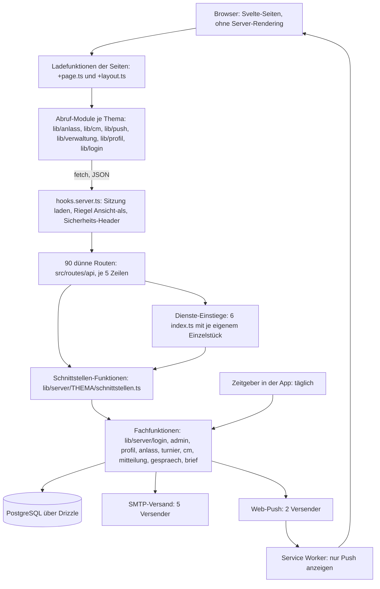

[← Übersicht](index.md)

# Refactoring-Analyse MyTCO

Dieses Dokument ist das Gedächtnis des Refactorings. Wer nur dieses Dokument liest, soll
weiterarbeiten können: Es enthält den Ist-Zustand, die Befunde, das Zielbild, den Plan mit Status
je Schritt, die Entscheide und die offenen Fragen. Sammel-Issue:
[#80](https://github.com/konstantinniedermann/tco-app/issues/80).

- **Stand des Dokuments:** 14.11.2026, nach dem Checkpoint am Ende der Etappe 2. Die Etappen 0, 1
  und 2 sind umgesetzt (zuletzt Schritt 18, Version 0.22.5). Die Zwischenrevision am Ende der
  Etappe 2 (Abschnitt 1d) ist am Checkpoint entschieden und eingearbeitet (E-55 bis E-60); davor
  die der Etappe 1 (Abschnitt 1c, E-41 bis E-44). Als Nächstes der Nachtrag zur Etappe 2 (7.5),
  danach die Etappe 3 ab Schritt 19.
- **Stand der Analyse (Abschnitte 1 bis 5 und 10):** 11.11.2026, Version 0.20.5, vor Schritt 01.
  Zahlen und Fundstellen dort gelten für diesen Stand; was die Etappe 0 berichtigt hat, steht
  beim Befund. Der Vermerk «Nachtrag» ohne Schrittnummer meint den zweiten Durchgang der Analyse
  vom selben Tag (Testqualität und Oberfläche: B-28 bis B-36, F-13, F-14).
- **Markierungen:** **[geändert]** und **[neu]** kennzeichnen nur noch, was die Zwischenrevision
  am Ende der Etappe 0 und die Entscheide des Projektleiters vom 11.11.2026 (E-28 bis E-32)
  geändert haben, dazu die Nachträge der Etappe 1 und was die Zwischenrevision am Ende der
  Etappe 1 mit den Entscheiden vom 12.11.2026 (E-41 bis E-44) geändert hat, und was die
  Zwischenrevision am Ende der Etappe 2 mit den Entscheiden vom 14.11.2026 (E-55 bis E-60)
  geändert hat. Die Markierungen früherer Durchgänge sind entfernt; was davor wie lautete,
  zeigt der Git-Verlauf dieser Datei.
- **Aufbau:** Abschnitte 1 bis 5 Befunde, 6 Zielbild, 7 Plan, 8 Entscheide, 9 Fragen, 10 Grenzen;
  Anhang A und B Anweisungsdateien, Anhang C das Protokoll der Etappe 0, Anhang D das der Etappe 1
  (bis D.15, Schritt 12a), Anhang E das der Etappe 2 (bis E.13, Schritt 18). Beschlossen, aber
  noch nicht ausgeführt: Die Protokolle ziehen je Etappe in eine eigene Datei (E-60); bis dahin
  stehen sie hier.

## Stand und nächster Schritt

*Diesen Abschnitt führt jeder Lauf nach.*

| | |
|---|---|
| **Phase** | 4 Umsetzung. **Etappe 0 abgeschlossen** (Checkpoint 11.11.2026, Abschnitt 1b). **Etappe 1 umgesetzt** (Schritte 06, 06a, 07 bis 12, alle auf `dev`, Versionen 0.20.10 bis 0.20.18); Zwischenrevision und Checkpoint am Etappenende erledigt am 12.11.2026 (Abschnitt 1c, E-41 bis E-44) und in Zielbild und Plan eingearbeitet. Der nachgeschobene Schritt **12a** (E-42) ist umgesetzt und gemergt (0.20.19). **Etappe 2:** Schritt 13 erledigt (zwei Läufe, Review je «ok», Version 0.20.20); Schritt 14 erledigt (Review «ok», Version 0.20.21); **Schritt 15 erledigt** (Läufe 1, 1b mit Interclub und 2; Review je «ok» am 14.11.2026, Version 0.22.1); **Schritt 16 erledigt** (CM-Seite; Review «ok» am 14.11.2026; die Doppel-Seite ist verworfen, F-30: A, E-51; Version 0.22.2); **Schritt 17 erledigt** (Review «ok» am 14.11.2026, Checkpoint E-21 erledigt: E-52, E-53; Version 0.22.4); **Schritt 18 erledigt** (Review «ok» nach einem Doku-Befund am 14.11.2026, Version 0.22.5). **Damit ist die Etappe 2 abgeschlossen**; Zwischenrevision und Checkpoint am Etappenende erledigt am 14.11.2026 (Abschnitt 1d, E-55 bis E-60) und in Zielbild und Plan eingearbeitet. **Etappe 3:** freigegeben (E-58), läuft ohne Halt mit Kurzbericht je Schritt (E-59); davor der Nachtrag zur Etappe 2 (7.5) |
| **Erledigte Schritte** | Etappe 0: 01 bis 05 (Kurzfassung in 7.2, Protokoll in Anhang C). Etappe 1: 06 (0.20.10), 06a (0.20.11), 07 (0.20.12), 08 (0.20.13), 09 (0.20.14), 10 (0.20.16), 11 (0.20.17), 12 (0.20.18), 12a (0.20.19), alle mit Review «ok» auf `dev` und grüner CI (Ergebnisse in 7.3, Protokolle in Anhang D). Etappe 2: 13 (0.20.20), 14 (0.20.21), 15 (0.22.1), 16 ohne die Doppel-Seite (0.22.2, Nachtrag 0.22.3), 17 (0.22.4), 18 (0.22.5), alle mit Review «ok» auf `dev` (Ergebnisse in 7.4, Protokolle in Anhang E); die CI auf `dev` ist zum Merge von Schritt 18 im Job «E2E (iphone)» rot (Fokus-Wackler, siehe «Nächster offener Schritt») |
| **Zuletzt erledigt** | **18** (14.11.2026, Review «ok» nach einem Doku-Befund, gemergt als Version 0.22.5; Ergebnis in 7.4, Protokoll Anhang E.13): `basis.css` in zehn Dateien unter `src/lib/design/` geschnitten (`grundlagen`, `rahmen`, `bedienelemente`, `karten`, `verwaltung`, `anleitung`, `uebergaenge`, `pc-layout`, `druck`, `verlauf`), Importe in `+layout.svelte` in dieser Reihenfolge nach `tokens.css`, Mockups und Leitbild nachgezogen; gebautes CSS vor und nach gleich (Node und SPA), Rot-Probe belegt; voller `make check` grün (2427 Tests, E2E 524/64, 5,6 Minuten). Davor **17** (14.11.2026, Review «ok», Checkpoint E-21 erledigt mit E-52 und E-53, gemergt als Version 0.22.4; davor der Nachtrag zu Schritt 16 als Version 0.22.3, E-54; Ergebnis in 7.4, Protokoll Anhang E.12): Vorab-E2E `tests/e2e/anmeldungsliste-ablauf.test.ts` (vier Fälle je Handy, auf dem alten Stand grün, einmal rot), `Aktionsdialog` um `neben` (zweite Entscheid-Taste) und `ohneHaupttaste` erweitert, die fünf Rückfragen der Einzel-Anmeldungsliste darauf (`fuehreAus`, eigene Sperre und rohe Dialoge weg); der Wildcard-Antrag nutzt den Baustein (nicht von Hand). Sichtbar anders: die Warnung als Liste (Bilder für E-21 im Scratchpad, siehe E.12) und drei Randfälle (E.12); `cm-verwaltung`, `turnier`, `cm-anmeldung`, `cm-doppel-verwaltung` grün; voller `make check` grün (2427 Tests, E2E 524/64, 5,4 Minuten). Davor **16** (14.11.2026, Review «ok», gemergt als Version 0.22.2; Teil 2 mit der Doppel-Seite verworfen, F-30: A, E-51; Ergebnis in 7.4, Protokoll Anhang E.11): Vorab-E2E `tests/e2e/cm-ablauf.test.ts` (drei Fälle je Handy, auf dem alten Stand grün, einmal rot), die Ablauf-Funktion `src/lib/cm/ablauf.ts` mit 15 Einheitsfällen (Abdeckung 100 %), sieben der acht Handler der CM-Seite darauf, `angabenSenden` bleibt von Hand (Abbruchstelle 2), die zwei Text-Dialoge als `src/lib/cm/Textdialog.svelte`; Sätze, Reihenfolge und Fokus unverändert, Markup gleich bis auf die `id`s; für die Nutzerin nichts; voller `make check` grün (2427 Tests, E2E 516/60, 5,3 Minuten). Davor **15, Lauf 2** (14.11.2026, Review «ok», mit Lauf 1 und 1b gemergt als Version 0.22.1; Ergebnis in 7.4, Protokoll Anhang E.9): die vier Listen der Verwaltung (`turniere`, `anlaesse`, `verlauf`, `mitglieder`) laden ihr erstes Laden in einer neuen `+page.ts` über den Wächter (Fall `verwaltung`); eine Störung bleibt eine Meldung in der Seite (`zeilen: null`, keine Fehlerseite); `mitglieder` lädt nach Suche und Filter weiter im Baustein, ohne zweite Abfrage beim Einhängen; Vorab-Tests (E2E 5 Fälle je Gerät, auf dem alten Stand grün, einmal rot) und 13 Einheitsfälle der vier Ladefunktionen; für die Nutzerin nur die zwei Folgen aus E-48; voller `make check` grün (2412 Tests, E2E 510/57, 3,9 Minuten). Davor **15, Lauf 1b (Interclub)** (14.11.2026, Review «ok» am 14.11.2026 zusammen mit Lauf 1; Ergebnis in 7.4, Nachmessen Anhang E.7, Protokoll Anhang E.8): `origin/dev` mit #81 eingemergt (Layout in der Fassung von `dev`, Entscheide des Branches neu E-48 bis E-50), Vorab-Tests für die drei Interclub-Seiten und das Wurzel-Layout (E2E vier Fälle mehr und drei Adressen mehr in der Tabelle, 15 Einheitsfälle, je Gruppe einmal rot), Wurzel-Layout auf `ladeSitzung` (Typ `Sitzung` mit `interclub`), die drei Interclub-Ladefunktionen auf dem Wächter (Fall `mitglied`); keine Zeile mehr in der Wächter-Tabelle, Fälle L und M benannt und unverändert; für die Nutzerin ändert sich nichts; voller `make check` grün (2399 Tests, E2E 495/57, 3,4 Minuten). Davor **15, Lauf 1** (13.11.2026, Branch `refactor/schritt-15`, nicht gemergt; Ergebnis in 7.4, Protokoll Anhang E.6): Vorab-Tests in drei Teilen (E2E 21 Fälle auf drei Geräten, 91 Einheitsfälle der Ladefunktionen, je Teil einmal rot), `ladeSitzung` und die Wächter-Tabelle `src/lib/login/waechter.ts` mit zwei Hüllen und sechs benannten Fällen (neu `verwaltung-zugang`), 22 Ladefunktionen, das Wurzel-Layout, 17 Stellen nach einer Aktion und das Abmelden umgestellt, `hilfe/+page.ts` auf `ladeKontakt`; keine Ladefunktion ruft `fetch`, keine Seite schreibt die Umleitung zum Login; für die Nutzerin ändert sich nichts; voller `make check` grün (2300 Tests, E2E 477/57, 4,1 Minuten); Review «ok» am 14.11.2026 (mit Lauf 1b). Davor **14** (13.11.2026, Review «ok» ohne Befund, Version 0.20.21; Ergebnis in 7.4, Protokoll Anhang E.4): `verwaltung/api.ts` nach Bereichen geteilt, in `zugang-api.ts`, `anlass-api.ts`, `gespraech-api.ts`, `mitglieder-api.ts` und `turnier-api.ts`; `api.ts` bleibt der Kern (`Antwort<T>`, Vertrag, `lese`, `schicke`) und reicht nichts weiter; 42 Dateien wechseln nur Import-Zeilen, 44 Tests auf fünf Dateien verteilt, keiner geändert; voller `make check` grün (2156 Tests, E2E 414/57). Davor **13, Lauf 2** (13.11.2026, Branch `refactor/schritt-13`, nicht gemergt; Ergebnis in 7.4, Protokoll Anhang E.3): Profil, Login, Passkey und `hatSitzung` auf dem Baustein, Umbenennung `ergebnis` → `art`, beide Kleinfragen aufgenommen (`{ art }` beim E-Mail-Wechsel, vier benannte Anfragen der Login-Seiten), N-09 (`src/lib/anlass/antwort.ts`), Wortlisten der Verträge an den Typ gebunden, `abruf.ts` in der Abdeckung; die Lint-Regel zu `fetch` verworfen (98 Meldungen am heutigen Repo, Vorschlag an Schritt 15); voller `make check` grün (2156 Tests, E2E 414/57). Davor **13, Lauf 1** Abruf-Baustein (13.11.2026, Review «ok» ohne Befund; Protokoll Anhang E.2): Vorab-Tests (27 Fälle, E.1 Zeilen 1 bis 34 und 57, alle auf dem alten Stand grün, je Modul einmal rot), Tabelle `STATUS_DES_WORTS` in `src/lib/fehler.ts`, Baustein `src/lib/abruf.ts` (17 Fälle, Abdeckung 100 %), `anlass`, `push`, `cm`, Verwaltung und `mitteilung-api` darauf, N-10 als `src/lib/cm/ablehnung.ts`; Diff der bestehenden Tests leer, keine `.svelte`-Datei; Abbruchstelle von `Antwort<T>` nicht eingetreten; voller `make check` grün (2134 Tests, E2E 414/57). Davor **12a** Reste der Bauregel (12.11.2026, Review «ok» nach einer Korrekturrunde, Version 0.20.19; Ergebnis in 7.3, Protokoll in Anhang D.15): Punkte (1) bis (5) gebaut, (6) begründet verworfen (Schritt 20, Hinweis (e)), `.mts`, `.cts`, `.mjs` und `.cjs` aufgenommen; Korrekturrunde nach dem Review (M-1: das Muster für Texte verschluckte echte Importe; jetzt prüft jede Regel zwei Lesarten ohne Kommentare); `bauregel.test.ts` 122 → 200, je Form vorher rot; Vergleich alt gegen neu: 0 Fälle «alt Befund, neu keiner» über 25 843 536 eigene und 22 526 400 Fälle des Reviewers (Wahrheit vom TypeScript-Parser); voller `make check` grün, kein Diff unter `src/`. Davor **12** Importregeln scharf gestellt (12.11.2026, Review «ok», Nachreview des Nachtrags «ok», Version 0.20.18; Ergebnis in 7.3, Protokoll in Anhang D.14): Test «`AUSNAHMEN` ist leer», Lint-Meldung ohne veraltete Ausnahmen, jede Regel der Importrichtung einmal verletzt (22 Proben), neue Regel der Bauregel: `liest`/`schreibt` nur in den Dateien von `VERWALTUNGS_DATEIEN`. **Damit ist die Etappe 1 umgesetzt.** Davor **11** (Review «ok» für beide Läufe, Version 0.20.17; Anhang D.12, D.13). Davor **10** `getSitzung` in `sitzung/schnittstellen.ts`, `ANSICHT_ROLLEN` und `AnsichtRolle` in `login/sitzung.ts`, `AUSNAHMEN` 4 → 1: Review «ok» ohne Befund, Version 0.20.16 (Ergebnis in 7.3, Protokoll in Anhang D.10). Davor **09** Verwaltung der Anlässe in `anlass/verwaltung-schnittstellen.ts` (Variante A von F-17, E-38), samt der Lücke «Namen in Anführungszeichen» der Bauregel: Review «ok» nach einer Korrekturrunde, Version 0.20.14 (Ergebnis in 7.3, Protokoll in Anhang D.8). Davor **08** eine Fehlerform und eine Liste der Fehlerwörter (`src/lib/fehler.ts`): Review «ok» ohne Befund vor dem Merge, Version 0.20.13, umgesetzt nach Variante A von F-21 (vorläufig) (Ergebnis in 7.3, Nachmessen in Anhang D.5, Protokoll in Anhang D.6). Davor 07 (Version 0.20.12, Anhang D.4) |
| **Nächster offener Schritt** | **1. Der Nachtrag zur Etappe 2** (kein Plan-Schritt; Branch `refactor/nachtrag-etappe-2`, läuft parallel bei einem Implementer; Umfang und Stand in 7.5, «Nachtrag zur Etappe 2»): (a) die Fokus-Prüfung nach «hinfällig» in `tests/e2e/cm-ablauf.test.ts` gelockert auf «nicht im Seitenkörper verloren», kein Eingriff in die App (E-55); (b) `docs/ui-leitbild.md` nachgeführt: zweite Entscheid-Taste, Warnung als Liste, `Textdialog` (E-58). Vor dem Merge einmal die WebKit-CI auf dem Branch (N-23). **Das Ergebnis trägt der Orchestrator nach.** Bis dahin ist `dev` rot: Lauf 43616298374 zum Merge von Schritt 18, Job «E2E (iphone)», derselbe Fokus-Wackler wie nach Schritt 17 [G: am 14.11.2026 abgefragt, nicht neu gestartet] (1d, Unterabschnitt «Fokus-Wackler»). **2. Danach Schritt 19** (alte offene App-Versionen, E-09; Zeile und Hinweise in 7.5). Zuerst das **Nachmessen vorab** durch den `refactor-analyst`, zwingend und offen: was SvelteKit in der eingesetzten Version bietet (Name und Ort der Versionskennung, Abfrage-Abstand, Verhalten bei `ssr = false`); ob der Service Worker eine alte App am Leben hält; was eine feste Kennung für den Build-Ordner je E2E-Lauf (E-27) und für «neu ausgeliefert, gleiche Versionsnummer» bedeutet; ob die Kennung die Paketversion sein soll (hängt an F-15, wird nicht vorweggenommen). Danach **Halt: Checkpoint** «Bordmittel oder nur entfernen». **Dateien, die Schritt 19 anfasst:** `vite.config.ts`, `src/routes/+layout.svelte`, `src/lib/server/version.ts` und `version.test.ts`, `status.ts`, `src/routes/api/status/status.db.test.ts`, `Dockerfile` (Zeile 9), `docs/ci-cd-und-release.md` (Zeilen 415 bis 424 und 466), `docs/testkonzept.md:126`, allenfalls `src/service-worker/index.ts`; je nach Bordmittel ein neuer Test. **3. Danach 20, dann 20a** (7.5). Übergangsregel «Ab Schritt 15»: Der Satz der benannten Ausnahmen ist entschieden (E-57), das Einspielen in die `CLAUDE.md` durch den Orchestrator steht aus [G: `CLAUDE.md` im Worktree am 14.11.2026 gelesen, der Satz fehlt] |
| **Wartet auf Freigabe des Projektleiters** | nichts. Checkpoint am Ende der Etappe 2 erledigt am 14.11.2026 (E-55 bis E-60). Checkpoint E-21 zu Schritt 17 erledigt am 14.11.2026 (E-52, E-53). Checkpoint am Ende der Etappe 1 erledigt am 12.11.2026 (E-41 bis E-44); die Berichtigungen der `CLAUDE.md` sind eingespielt (E-43). **Wartet auf den Orchestrator** (entschieden, nicht ausgeführt): der Satz C-11 in der `CLAUDE.md` (E-57); das Auslagern der Anhänge C, D und E in eigene Dateien (E-60); das Ergebnis des Nachtrags (7.5) |
| **Offene Fragen** | **F-15** (Version, solange es Test nicht gibt): vor Schritt 23, Abschnitt 9.1. Alle anderen Fragen sind beantwortet, zuletzt F-31 bis F-34 am Checkpoint der Etappe 2 (jede mit A: E-55 bis E-58; Abschnitt 9.2). Eine Lesart dieses Laufs steht zur Bestätigung in 7.7 («Checkpoints», Etappe 3): Der Halt nach dem Nachmessen zu Schritt 19 bleibt trotz «ohne Halt» |
| **Checkpoint Etappe 0, Nachweis** | E2E dreimal voll grün auf `bad624f` (Version 0.20.9): je 414 bestanden, 57 übersprungen, 3,8 / 5,3 / 4,1 Minuten (gemessen vom Orchestrator); CI auf `dev` zum Merge von Schritt 05 grün (Lauf 43046410032, alle Prüf-Jobs und E2E auf drei Geräten) |
| **Vorab nachzumessen** | vor Schritt 19, 20, 23 (was, steht je in der Spalte «Nachmessen vorab»; Übersicht in 7.7); 20a braucht keines. **Für Schritt 16 erledigt am 14.11.2026 (Anhang E.10):** kein Entscheid des Projektleiters nötig, keine neue Frage; die Doppel-Seite wird **aufgenommen** (drei Handler, als zweiter Teil mit eigener Abbruchstelle; `suchen` und `neuLaden` bleiben von Hand); die Funktion passt für sieben der acht Handler der CM-Seite, `angabenSenden` nur mit eigener Angabe; den Fokus nach einer Aktion hält heute eine einzige E2E-Stelle, vier Handler haben keinen E2E-Fall, darum vier Vorab-E2E (`tests/e2e/cm-ablauf.test.ts`, ohne Mail-Code) zusätzlich zu den Einheitstests; «rund 250 Zeilen» eher 170 bis 210; keine gemeinsame Datei mit Schritt 17. **Für Schritt 15, Lauf 1b (Interclub) erledigt am 14.11.2026 (Anhang E.7):** mit #81 39 Adressen, 30 Ladefunktionen, 25 «nur der Wächter wechselt»; kein neuer Fall in der Wächter-Tabelle, zwei neue benannte Fälle L und M ausserhalb der Tabelle; zwei Ränder des Layouts; ein Vorab-Test aus Lauf 1 muss mit dem Merge mit. **Für Schritt 15 erledigt am 13.11.2026 (Anhang E.5):** Tabelle aller 36 Adressen mit Ziel; 17 statt 14 Stellen «nach einer Aktion»; acht benannte Fälle mehr (D bis K); Vorab-Test als E2E-Tabelle ohne Konto und Mail-Code plus Einheitstests der Ladefunktionen der Verwaltung; Wächter als Tabelle in `src/lib/login/waechter.ts` mit zwei Hüllen, `ladeSitzung` in `sitzung.ts`; zwei Läufe, ein Merge; Lauf 1 ändert für die Nutzerin nichts, Lauf 2 (vier Listen) freigegeben mit F-28 (E-48). **Für Schritt 13 erledigt am 12.11.2026 (Anhang E.1):** kein Entscheid des Projektleiters nötig, der Baustein erhält jeden heutigen Rand; «ein Wort gilt nur mit seinem Status» bleibt, dazu «für 401, 404 und 429 genügt der Status»; 57 Zeilen Vorab-Tests; Baustein `src/lib/abruf.ts`; drei Seiten statt vier (`willkommen` liest kein Ergebnis); N-09 aufnehmen, N-10 als geteilte Liste unter `src/lib/cm/`. Für Schritt 07 erledigt am 12.11.2026 (Anhang D.3), für Schritt 08 am 12.11.2026 (Anhang D.5), für Schritt 09 am 12.11.2026 (Anhang D.7), für Schritt 10 am 12.11.2026 (Anhang D.9: Ort ist ein neues Modul `sitzung/`, kein Entscheid nötig), für Schritt 11 am 12.11.2026 (Anhang D.11: Zuordnung 9 Turnier, 13 CM, 4 Gespräch bestätigt; mit den Mitteilungen 23 Funktionen und 20 Routen; `AUSNAHMEN` ist schon nach Schritt 11 leer; Empfehlung zwei Teile 11a und 11b, F-22). Schritte 06 und 06a brauchen keines |
| **Nächster Checkpoint** | **Am Ende der Etappe 3** (nach dem Merge von 20a; 7.7). Bis dahin läuft die Etappe 3 ohne Halt mit Kurzbericht je Schritt (E-59; E-45 gilt weiter). **Halt davor** nur bei den Anlässen aus E-45: alles aus E-06, eine sichtbare Verhaltensänderung, Abbruch eines Subagenten, zweimal Befunde im Review, rote CI, eine Frage, die das Dokument dem Projektleiter vorbehält. Eine solche Frage steht schon fest: **nach dem Nachmessen zu Schritt 19** («Bordmittel oder nur entfernen», E-09). Der Checkpoint am Ende der Etappe 2 ist erledigt (14.11.2026) |
| **Erledigt ausserhalb des Plans** | Worktree und Branch `doppel-anfragen-verfallen` entfernt (E-14). Die Vorschläge B.3a bis B.3c, B.4a, B.5 und B.6 stehen als Eintrag vom 11.11.2026 in der gemeinsamen `beobachtungen.md` der CAS-Projekte (E-25). Die Änderungen an der Projekt-`CLAUDE.md` aus der Zwischenrevision sind eingespielt (E-29); der Agent `refactor-analyst` hat das Werkzeug Edit (E-32) |
| **Hinweis für den Orchestrator** | Die Agent-Typen `refactor-*` kennt eine Session erst, wenn sie nach dem Merge von Schritt 01 gestartet wurde. Sonst denselben Text als allgemeinen Agenten mit dem genannten Modell starten |

**Kennzeichnung der Belege**

- **[G]** selbst gelesen oder gemessen (Datei, Git, GitHub)
- **[E]** aus Erkundung: Stichprobe, Textsuche oder Auszug, nicht die ganze Datei gelesen
- **[V]** Vermutung, nicht belegt

**Begriffe, die oft vorkommen**

- *Schnittstelle*: eine Adresse unter `/api/…`, über die die Oberfläche Daten holt oder speichert.
- *Worktree*: eine zweite Arbeitskopie desselben Repos in einem eigenen Ordner, damit mehrere
  Sessions gleichzeitig arbeiten können.
- *E2E-Test* (Ende-zu-Ende): Ein Test bedient die laufende App im Browser wie ein Mensch.
- *Charakterisierungstest*: Ein Test, der das heutige Verhalten festhält, bevor umgebaut wird.
- *Hotspot*: Datei, die auffallend oft geändert wurde.
- *Flake*: Test, der ohne Code-Änderung manchmal rot und manchmal grün ist.

---

## 1 Kurzfazit

1. **Der Anwendungscode ist in gutem Zustand.** Er ist einheitlich aufgebaut, sorgfältig
   kommentiert, gut getestet (rund 1550 Einheits- und Datenbanktests, 162 E2E-Tests auf drei
   Geräten) und enthält fast keine Notlösungen (kein einziges `TODO`, vier Lint-Ausnahmen). Ein
   «grundlegendes Refactoring» des Codes ist die falsche Grösse. Richtig ist **gezieltes
   Aufräumen** an wenigen, klar benennbaren Stellen. [G]
2. **Die Wachstumsspuren im Code sind Duplikate und fehlende gemeinsame Bausteine**, nicht
   falsche Architektur: dieselben Hilfsfunktionen in sechs Server-Modulen, fünfmal derselbe
   Mail-Versender, sechs eigene Varianten des Abrufs von Schnittstellen in der Oberfläche, der
   Anmelde-Wächter in jeder Seite kopiert, eine Seite mit über 1000 Zeilen, ein Stylesheet mit
   2287 Zeilen. [G]
3. **Der grösste Befund liegt nicht im Code, sondern im Verhältnis von Prozess und Doku zum
   Code.** 58 % aller Commits ändern nur Doku. Die Doku ist in Bytes grösser als der
   Anwendungscode. Die 17 meistgeänderten Dateien sind bis auf eine Doku- oder Prozessdateien.
   Es gibt 38 Versionsabschnitte und 27 Merges nach `main`, aber keinen Server, kein Release,
   keinen Tag und keinen einzigen Nutzer. [G]
4. **Eine ganze Auslieferungskette ist gebaut, aber nie in echt gelaufen** (rund 2900 Zeilen
   Betriebsskripte, 2000 Zeilen Tests dazu, fünf CI-Jobs). Sie ist nicht Teil des Refactorings
   und soll nicht angefasst werden; sie ist aber ein Risiko, das benannt gehört. [G]
5. **Das Sicherheitsnetz ist stark, hat aber eine schwache Stelle:** Die E2E-Tests sind auf dem
   iPhone-Profil unter Last wacklig (drei offene Beobachtungen, acht Fallen-Notizen). Weil E2E
   das Hauptnetz für den Umbau der Oberfläche ist, kommt das zuerst. [G]
   **Nachtrag:** Die gelesene Stichprobe (9 Testdateien neben dem Code, 5 E2E-Dateien, die
   Hilfen) prüft durchwegs Verhalten, nicht Wortlaut des Quelltexts. Das Netz trägt die Etappen
   0 und 1 fast ohne Zusatz. Es hat zwei Löcher (Verdrahtung der Routen, Vertrag zwischen Server
   und Oberfläche: B-28, B-29) und einige Tests, die bei Etappe 2 ohne Verhaltensänderung rot
   würden (B-31). [G]
6. **Jetzt ist der günstigste Zeitpunkt für Aufräumarbeiten, die später teuer werden:**
   Solange es kein Live gibt, lassen sich interne Schnittstellen und (falls gewünscht) die
   19 Migrationen ohne Rücksicht auf Altdaten ändern. [G]
7. **Die Anweisungsdateien sind knapp und wirksam, erzeugen aber Nebenwirkungen:** Regeln wie
   «keine neue Abhängigkeit», «erst Leitbild, dann Code» und «jeder Merge eine Version» sind
   sinnvoll, haben aber Eigenbau-Prüfskripte, Doku-Hotspots und eine garantierte Kollisionsstelle
   für parallele Sessions hervorgebracht. [G]

**Empfehlung in einem Satz [geändert]:** 28 kleine Schritte in fünf Etappen (Abschnitt 7),
davon nur rund die Hälfte am Code; die grösste Wirkung haben die Entscheide des Projektleiters zu Arbeitsweise und
Doku-Umfang (Fragen F-01, F-09, F-11).

---

## 1a Was sich in Phase 3 geändert hat (11.11.2026)

Gegenüber der ersten Fassung (Commit `7e4b68a`): Die Fragen F-01 bis F-14 sind beantwortet, jede
wie empfohlen (E-07 bis E-22, Abschnitt 9). Der Plan wurde von 27 auf 25 Schritte neu geschnitten
und nummeriert (7.1); mit den Schritten 06a (E-28), 12a (E-42) und 20a (E-56) sind es heute 28. Schritt 01 wurde ein Startpaket (die neue
`CLAUDE.md` und die Änderungen an Skill und Agenten gelten von Anfang an). Jeder Schritt nennt
Modell, Weg und Nachmessen; kein Schritt hat das Risiko «hoch». Checkpoints und feste Freigaben
stehen in 7.7. Die Lockerungen (Versionsregel E-07, Doku-Rhythmus E-17) gelten erst nach dem
Refactoring.

---

## 1b Zwischenrevision Etappe 0 (11.11.2026) [neu]

Stand: `origin/dev` nach dem Merge von Schritt 05 (Commit `bad624f`, Version 0.20.9). Gelesen:
dieses Dokument (Abschnitte 1 bis 2.3, B-12 bis B-15, 5 bis 10, Anhang B), `CLAUDE.md`, der Diff
`3593dde..HEAD`, die neuen Tests und Werkzeuge ganz (`grundpruefung.db.test.ts`, `routen.test.ts`,
`importrichtung.test.ts`, `eslint.config.js`, Diffs von `scripts/e2e.ts`, `vite.config.ts`,
`playwright.config.ts`, `Makefile`), `bauregel.ts` ganz, alle sieben `index.ts`, die Köpfe und
Hilfsfunktionen aller `schnittstellen.ts`, `hooks.server.ts`, `.githooks/pre-commit`. Nichts gebaut,
nichts getestet. Was nicht geprüft ist, steht in Abschnitt 10.

**Urteil**

1. **Das Zielbild (Abschnitt 6) trägt.** Zwei Sätze sind in 6.1 Punkt 8 ergänzt.
2. **Der Plan der Etappe 1 ging auf, aber nicht so, wie er dastand.** Die zwei Fristen von F-16
   widersprachen sich; dafür gibt es den neuen kleinen Schritt 06a vor Schritt 07. Schritt 09
   ist grösser als «niedrig» und braucht ein Nachmessen, Schritt 10 hatte kein Ziel für
   `getSitzung`, Schritt 11 ist beim Gespräch kleiner als geplant. Kein Schritt entfällt.
3. **Das Netz trägt die Schritte 06, 06a, 07 und 10.** Für 08, 09 und 11 hat es je eine Stelle mit
   falschem Grün (Fehlerwörter; eine neue Verwaltungs-Liste fällt aus den Rechte-Schleifen). Drei
   kleine Charakterisierungstests fehlten im Plan (jetzt bei 06, 07 und 09 unter «Absicherung»).
4. **Die Reihenfolge 06 → 06a → 07 → 08 → 09 → 10 → 11 → 12 stimmt** (Begründung in 7.7).
5. **Checkpoint-Nachweis liegt vor** (Tabelle «Stand und nächster Schritt»).

**Entschieden am Checkpoint (11.11.2026)**

| Thema | Entscheid | Steht jetzt |
|-------|-----------|-------------|
| F-16, Rechteprüfung und Dienst-Typen | A1: neuer Schritt 06a vor Schritt 07 (E-28) | Zeile 06a und «Hinweise zu Schritt 06a» in 7.3 |
| F-18, Vorschlag zur `CLAUDE.md` | gilt ganz, ist eingespielt (E-29) | geltende `CLAUDE.md`; Befund A-17 |
| F-19, Ok für Etappe 1 | ja, mit den Änderungen der Revision; Checkpoint nach jedem Schritt (E-30) | 7.3 bis 7.7 |
| Dokument straffen | ja (E-31) | diese Fassung; Protokoll der Etappe 0 in Anhang C |
| Werkzeug des Analysten | `refactor-analyst` hat Edit, nur für dieses Dokument (E-32) | `.claude/agents/refactor-analyst.md`, Anhang B.2c |
| F-17, F-15 | bleiben offen | Abschnitt 9 |

**Wo die Inhalte der Revision jetzt stehen**

| Inhalt | Ort |
|--------|-----|
| Änderungen am Plan (06 bis 12, 18 bis 21, Zählung) | Zeilen und «Hinweise zu Schritt NN» in 7.3 bis 7.6, markiert mit [geändert] oder [neu] |
| «Trägt das Netz die Etappe 1?» | 7.3, Unterabschnitt «Was das Netz für die Etappe 1 deckt» |
| Reihenfolge, Kosten in Versionen | 7.7 |
| Befunde B-37 bis B-41 | 3.2 (B-39, B-40, B-41), 3.3 (B-38 bei B-12), 3.6 (B-37); Nachtrag bei B-03 |
| Befunde A-14 bis A-18 | Abschnitt 5 |
| Zielbild, zwei Sätze | 6.1 Punkt 8 |
| Fragen F-15 bis F-19 | Abschnitt 9 |
| Nicht geprüft, dünn belegt | Abschnitt 10 |

**Unverändert geprüft, stimmt:** die Schritte 13 bis 17, 22 bis 25 (keine veraltete Angabe gefunden;
nur die Zeilen gelesen, nicht die Dateien dahinter). Abschnitt 6.3 passt zu 06a («Rechteprüfung …
höchstens der Ablageort»).

**Vorschläge zum Dokument, umgesetzt (E-31):** Protokoll der Etappe 0 in Anhang C; die Prüfliste (b)
bei Etappe 2 (7.4); Nachträge aus den Tabellenzellen in «Hinweise zu Schritt NN»; Status der
erledigten Schritte kurz; Abschnitt 9 als Tabelle; Kopf mit «Stand der Analyse»; alte Markierungen
entfernt; Anhang A als Verweis. Tabelle 7.1 (alte und neue Nummern) bleibt vorn, weil ältere
Commits und Berichte die alten Nummern nennen.

---

## 1c Zwischenrevision Etappe 1 (12.11.2026) [neu]

Stand: `origin/dev` nach dem Merge von Schritt 12 (Commit `c77a9f8`, Version 0.20.18). Gelesen:
dieses Dokument (Kopf, 1 bis 1b, 6, 7.2 bis 7.7 ohne die «Hinweise» zu 06 bis 11, 8 bis 10,
Anhang A; aus Anhang D ganz D.14, sonst je «Was kein Test sieht», «Ausserhalb des Schritts», «Für
die Folgeschritte», Reviews und «Zum Ablauf», dazu «Die Gegenseite» aus D.5), `CLAUDE.md`,
`docs/beobachtungen.md`, `git diff bad624f..HEAD --stat`. Am Code ganz: `http.ts`, `fehler.ts`,
`dienste.ts`, `admin/rechte.ts`, `sitzung/schnittstellen.ts`, `gespraech/antworten.ts`,
`cm/verwaltung-meldung.ts`, `tests/hilfen/verwaltungs-listen.ts`, `turnierjahre.ts`, die Routen
`sitzung`, `status`, `kontakt`; für die Etappe 2 `anlass/api.ts`, `push/api.ts`, `login/anmelden.ts`,
`login/sitzung.ts`, `verwaltung/umleiten.ts`, elf Ladefunktionen, `cm/api.ts` und `verwaltung/api.ts`
bis und mit der Deutung. Alles Übrige per Textsuche [E]. Nichts gebaut, nichts getestet. Was nicht
geprüft ist, steht in Abschnitt 10.

**[geändert] Stand nach dem Checkpoint (12.11.2026):** Der Abschnitt war als Vorschlag geschrieben.
Die Vorschläge der Tabellen Z und P, die Plan-Zeile 12a, die Zuordnung der Befunde N und Teil 1
der Tabelle C sind entschieden und **eingearbeitet (E-41 bis E-44)**; wo, zeigt die Tabelle
«Entschieden am Checkpoint». Die Tabellen unten bleiben als Herleitung im Wortlaut der Revision
stehen; es gelten Zielbild (6.1) und Plan (7.3 bis 7.7). **«Vorschlag, nicht eingespielt» gilt nur
noch für C-7 bis C-10 und für die Punkte zur Arbeitsweise.**

**Urteil**

1. **Die Etappe 1 hat das Zielbild für den Server erreicht** (6.1 Punkte 1, 2, 3 und 8). Vier
   Sätze des Zielbilds sagen mehr, als gebaut ist, und gehören berichtigt (Tabelle Z). Keine
   Abweichung ist ein Mangel am Code; es sind benannte Ausnahmen, die im Zielbild fehlen.
2. **Der Rest des Plans trägt, aber die Schritte 13 und 15 stehen zu knapp da.** Schritt 13
   widerspricht sich (Tests «unverändert grün» und zugleich «das Ergebnis heisst `art`»: zwei der
   sieben Module heissen heute `ergebnis`). Schritt 15 nennt «niedrig» und «kein Nachmessen», hat
   aber fünf verschiedene Wächter und keinen Test, der sie festhält. Kein Schritt entfällt.
3. **Das Netz trägt die Schritte 14, 16, 17 und 18.** Für 13 und 15 gibt es falsches Grün
   (Tabelle «Netz»). Zwei Charakterisierungstests fehlen im Plan: die Sonderfälle der Abruf-Module
   vor 13, die Umleitungen ohne Sitzung vor 15.
4. **Die Reihenfolge 13 → 14 → 15 → 16 → 17 → 18 stimmt**, mit einer neuen Abhängigkeit: 16 braucht
   15 (die neun Stellen «abgemeldet → Login» der CM-Seite).
5. **Die Reste der Bauregel sind klein, aber sie sind Schutz-Code ohne Schritt.** Vorschlag: ein
   eigener kleiner Schritt 12a (Plan-Zeile unten, Frage F-25).
6. **Die `CLAUDE.md` stimmt in der Wirkung, an fünf Sätzen nicht mehr im Wortlaut** (Tabelle C,
   Frage F-26).
7. **Bleibt (gut gelöst):** `fehler.ts` als eine Liste, gegen die Server, Oberfläche und Tests
   getippt sind; `dienste.ts` als oberste Schicht mit privaten Versendern und Erlaubt-Liste in der
   Bauregel; die Tabelle `VERWALTUNGS_DATEIEN` (Schutz am Pfad statt am Namen);
   `tests/hilfen/verwaltungs-listen.ts`; der Test «`AUSNAHMEN` ist leer»; der Vergleich alter gegen
   neuer Bauregel über gestellte Fälle im Review; die Abruf-Module nehmen `holen` als Parameter und
   sind darum ohne Browser prüfbar. [G]

**Entschieden am Checkpoint (12.11.2026) [neu]**

| Thema | Entscheid | Steht jetzt |
|-------|-----------|-------------|
| F-24, Ok für die Etappe 2 | ja, mit den Änderungen der Revision (E-41) | Zeilen 13, 15, 16 und «Hinweise zu Schritt 13» bis «16» in 7.4; Nachtrag zur Prüfliste (b); 7.7 |
| F-25, Reste der Bauregel | eigener Schritt 12a vor Schritt 13 (E-42) | Zeile 12a, «Hinweise zu Schritt 12a» und die Zeile 12a in «Was das Netz für die Etappe 1 deckt» in 7.3; 7.7 |
| F-26 und F-23, `CLAUDE.md` | C-1, C-2, C-3 und C-5 gelten und sind eingespielt; C-4 bleibt unverändert, weil Schritt 13 umbenennt; C-7 bis C-10 bleiben Entwurf für Schritt 24 (E-43) | geltende `CLAUDE.md` [G: am 12.11.2026 im Stand `4fcdbd4` gelesen]; Tabelle C unten |
| F-27, Umleitungen in Schritt 15 | nicht vereinheitlichen; das heutige Verhalten bleibt genau, Abweichungen als benannte Fälle (E-44) | Zeile 15 und «Hinweise zu Schritt 15» in 7.4; 6.1 Punkt 5 |
| Tabelle Z, Zielbild | eingearbeitet (E-41 bis E-44): Z-1 bis Z-5 und Z-8 | 6.1 Punkte 1, 2, 3, 4, 5 und 8 |
| Tabelle P, Rest des Plans | eingearbeitet (E-41 bis E-44): P-13a bis P-13e, P-15a bis P-15f, P-16, P-20, P-21, P-77; der Hinweis zu Schritt 14 | 7.4 (Zeilen und Hinweise 13 bis 16), 7.5 (Schritt 20), 7.6 (Schritt 21), 7.7 |
| Befunde N-01 bis N-18 | Zuordnung entschieden (E-41, E-42) | Spalte «Entschieden» der Tabelle N unten; die Befunde selbst bleiben hier stehen |
| Vorschläge zum Dokument | nachgeführt | Kopf von Abschnitt 9, Überschriften «Ergebnis Schritt 07» bis «09», 7.7, «Stand und nächster Schritt» |
| Arbeitsweise (sieben Punkte) | **nicht entschieden**, bleibt Vorschlag | Liste «Arbeitsweise» unten; Protokolle sind nicht ausgelagert |
| F-15 | bleibt offen | Abschnitt 9.1, vor Schritt 23 |

**Offen geblieben, als Kleinfragen im Plan vermerkt [neu]** (kein Entscheid des Projektleiters
nötig, solange das Nachmessen nichts anderes zeigt): die Doppel-Seite in Schritt 16 (1c gab keine
Empfehlung; «Hinweise zu Schritt 16»); «ein Wort gilt nur mit seinem Status» und die doppelten
Sätze des Anlasses in Schritt 13 («Hinweise zu Schritt 13»); `.mts`/`.cts` und die zwei
Hilfsdateien in Schritt 12a («Hinweise zu Schritt 12a»); ob der Umfang von Hinweis (d) zu Schritt
20 passt («Hinweise zu Schritt 20»).

**Z: Zielbild 6.1 nach der Etappe 1** (eingearbeitet (E-41 bis E-44) in 6.1; hier der Wortlaut der Revision)

| Punkt | Stand | Abweichung mit Beleg | Vorschlag zum Wortlaut |
|-------|-------|----------------------|------------------------|
| 1 Grundbausteine | erreicht [G: `http.ts`] | (a) Antworten bauen auch Dateien, die keine Schnittstellen-Dateien sind: `admin/rechte.ts` (401, 403), `admin/ansicht.ts` (403 `nur-ansehen`), `gespraech/antworten.ts`; alle mit `antwort` aus `http.ts`. (b) `/api/status` und `/api/kontakt` bauen ihre Antwort in der Route mit `json()` und eigenem Kopf `no-store` [G]. (c) «ändernd» steht an 18 Stellen weiter von Hand (`if (!istJson(e)) return formatFehler()`; Login und Passkey ohne Sitzung zu Recht) [G, Textsuche] | Z-1: «Arbeitstitel» streichen. Satz dazu: «Antworten entstehen nur mit diesen Bausteinen: in Schnittstellen-Dateien, ihren Antwort-Hilfen, der Rechteprüfung und dem Riegel der Ansicht. Ausnahme: Status und Kontakt antworten in der Route.» |
| 2 Zusammenbau | erreicht: zwei Mail-Versender, ein Push-Versender, eine Instanz der Bremsen, acht Einstiege [G: `dienste.ts`] | «Die Routen holen ihre Dienste nur von dort» stimmt für drei Routen nicht: `/api/sitzung` und `/api/status` holen `holeDb`, `/api/kontakt` `leseEinstellungen` [G]; für `getSitzung` bewusst so (D.9). Die Zeit von `getSitzung` kommt aus der Vorgabe `() => new Date()` in der Signatur, nicht aus Diensten | Z-2: «Arbeitstitel» streichen. «… Die Routen holen ihre Dienste nur von dort; drei Routen ohne Dienste (Sitzung, Status, Kontakt) holen nur die Datenbank oder die Einstellungen.» |
| 3 Fehlerform | erreicht nach E-36 [G: `fehler.ts`, `antwort`] | Der Satz nennt die Zusatzangaben nicht (neun Wörter tragen eine). Nicht erreicht und nicht versprochen: Feldnamen in `felder` sind frei, ein Wort ist nicht an seinen Status gebunden (D.6) | Z-3: «`{ fehler, felder? }`, dazu Zusatzangaben nur, wo `src/lib/fehler.ts` sie für ein Wort nennt; …» |
| 4 Abruf-Baustein | offen (Schritt 13) | «die Module enthalten nur noch ihre Adressen und Typen» ist nicht erreichbar: Sie enthalten heute Meldungstexte (`MELDUNG`, `MELDUNG_PROFIL`), Anzeige-Hilfen (`doppelZurWahl`, `vorschauZeilen`) und je die Liste der Wörter, die sie kennen [G] | Z-4: «… die Module je Thema deuten keinen Statuscode mehr; sie nennen ihre Adressen, Typen und die Fehlerwörter, die sie kennen.» |
| 5 Wächter | offen (Schritt 15) | Es gibt zwei Orte, nicht einen: die Ladefunktion (`redirect`) und die laufende Aktion im Baustein (`goto`; `leiteUm` in der Verwaltung, in der Mitglieder-App von Hand) [G] | Z-5: «… die jede Ladefunktion aufruft und die auch nach einer Aktion gilt; keine Seite und kein Baustein schreibt die Umleitung zum Login selbst.» |
| 6, 7 | offen (16, 17, 18) | von der Etappe 1 nicht berührt; kein Diff unter `src/lib/design/` [G] | keiner |
| 8 Importrichtung | erreicht: `AUSNAHMEN` ist `[]`, durch Test gehalten [G] | Im Satz fehlen: das Thema `sitzung/` (setzt drei Themen zusammen), die Form «Verwaltungs-Schnittstellen je Thema in eigener Datei» (E-38). Der Dienst-Typ `MitteilungAdminDienste` (`mitteilung/typen.ts`) ist der Typ von fünf Themen (`admin`, `turnier`, `cm`, `gespraech`, `mitteilung`); vier Themen holen ihn bei den Mitteilungen [G, Textsuche] | Z-8: Satz dazu: «Schnittstellen der Verwaltung liegen je Thema in einer eigenen Datei mit eigener Liste; der Schutz hängt am Dateipfad (E-38).» Der Name des Typs: Befund N-12 |

**P: Rest des Plans** (eingearbeitet (E-41 bis E-44) in 7.4 bis 7.7; hier der Wortlaut der Revision.
Was nicht genannt ist, stimmt: Ziel, Dateien, Modell, Weg. P-15f ist mit E-44 entschieden: Die
Abweichungen bleiben)

| Schritt | Urteil | Vorschlag |
|--------:|--------|-----------|
| 13 | **Zu ändern.** (1) Die Dateiliste ist unvollständig: `verwaltung/mitteilung-api.ts` (baut auf `lese`/`schicke`), `login/sitzung.ts`; `Holen` und `Json` holen `anlass`, `cm`, `push` und `push/geraet.ts` heute aus `verwaltung/api.ts` [G]. (2) Widerspruch: `profil/angaben.ts`, `login/anmelden.ts` und über sie `passkey.ts` heissen `ergebnis`, vier Seiten lesen es (`login`, `login/mail`, `profil`, `willkommen`) [G, Textsuche] **[berichtigt, E.1: drei; `willkommen` liest kein Ergebnis eines Abruf-Moduls]**; «Tests unverändert grün» und «heisst `art`» gehen nicht zusammen. (3) Jedes Modul lässt ein Wort nur mit seinem Status gelten (`409 && fehler === …`); ein Baustein, der nur das Wort liest, ändert die Ränder. (4) Die Module weichen bei Sonderfällen voneinander ab: 204 ohne Körper ist nur in `cm` ein Erfolg, in `verwaltung`, `anlass`, `push` eine Störung (der Server sendet 204 nur für Gespräch, Logout und Passkey [G]); `anmelden` deutet 429 ohne den Körper zu lesen, `verwaltung` nur mit lesbarem JSON; `eingabe` ohne `felder` ist im Profil gültig, sonst Störung (D.5); 401 wird in Profil und Login zur Störung | **P-13a:** Dateiliste ergänzen; `Holen` und `Json` ziehen in den Baustein (Ort z. B. `src/lib/abruf.ts` neben `fehler.ts` und `json-post.ts`; `src/lib/api/` verwechselt sich mit `src/routes/api/`). **P-13b:** ein Schritt, zwei Läufe mit je eigenem Review (wie Schritt 11): Lauf 1 Baustein und die Module mit `art` (`anlass`, `cm`, `push`, `verwaltung`, `mitteilung-api`), Tests unverändert; Lauf 2 `profil`, `anmelden`, `passkey` mit Umbenennung `ergebnis` → `art`, Tests und vier Seiten ändern nur den Namen (der Reviewer prüft das am Diff). **P-13c:** «Nachmessen vorab» erweitern: je Modul eine Tabelle der Sonderfälle oben, und der Entscheid «Wort gilt nur mit seinem Status» (dann eine Tabelle Wort → Status in `fehler.ts`, die auch N-08 schliesst). **P-13d:** Absicherung: vorab je Sonderfall ein Fall in den Einheitstests der Module (Charakterisierung), darunter die zwei entfallenen «Status allein genügt» mit `ungeprueft(…, {})`. **P-13e:** nimmt N-09 und N-10 auf. Die Zeilennummern der `page.route`-Stellen in der Prüfliste (b) neu bestimmen: fünf sind seit Schritt 08 um eine Zeile verschoben (`anlass:148`, `mitteilungen:206`, `verwaltung:209`, `:388`, `:588`) [G] |
| 14 | stimmt | Hinweis: `Antwort<T>`, `lese`, `schicke` bleiben an einer Stelle (61 Dateien importieren `verwaltung/api.ts` [G, gezählt per Textsuche]); `api.test.ts` (550 Zeilen) wird mitgeteilt, Fälle verschoben, nicht geändert; keine Sammeldatei, die alles weiterreicht (sonst bleibt der Hotspot) |
| 15 | **Zu ändern.** Fünf Wächter statt einem [G]: Startseite (drei Ziele: `/login/mail`, `/willkommen`, `/login`); `profil`, fünf CM-Ladefunktionen, `anlass/[id]` (Mail-Code, sonst `/login`); `profil/email` (nur `/login`, kein Mail-Code); Verwaltung (Layout und elf `+page.ts` mit dem dreizeiligen Block, `kein-admin` → `/`); `verwaltung/rollen` (derselbe Block, aber `kein-admin` → `/verwaltung`). Dazu die laufende Aktion: `leiteUm` in der Verwaltung, in der Mitglieder-App `goto('/login')` von Hand ohne Mail-Code (CM-Seite neun Stellen, Doppel-Seite fünf). Vier Ladefunktionen rufen `fetch('/api/sitzung')` selbst und deuten 401 am Status. Im Baustein laden vier Seiten, nicht zwei: `turniere`, `anlaesse`, `mitglieder`, `verlauf`; die letzten zwei laden nach Suche und Filter erneut | **P-15a:** «Nachmessen vorab: ja»: Tabelle aller Einstiege mit heutigem Ziel, mit und ohne wartende Mail-Anfrage. **P-15b:** Risiko «mittel» (27 Ladefunktionen, kein Test ruft eine [G: keine Testdatei unter `src/routes/` ausserhalb `api/`]). **P-15c:** Absicherung vorab: ein Test «ohne Sitzung auf jeder geschützten Seite → heutiges Ziel» (E2E-Schleife oder Einheitstests der Ladefunktionen mit gestelltem `fetch`), einmal rot. **P-15d:** Dateien: ein typisierter Abruf der Sitzung in `src/lib/login/sitzung.ts` auf dem Baustein aus 13; die vier `fetch('/api/sitzung')` und `/api/kontakt` in `hilfe/+page.ts` verschwinden. **P-15e:** «die beiden Seiten» → das erste Laden von vier Seiten; erneutes Laden nach Suche bleibt im Baustein. **P-15f:** Ob die Abweichungen (`profil/email`, `rollen`, Aktionen ohne Mail-Code) bleiben, entscheidet F-27 |
| 16 | stimmt, eine Abhängigkeit fehlt | **P-16:** Voraussetzung «04, 13, 15»: Die Ablauf-Funktion nimmt «abgemeldet → Login» aus 15 statt neun eigener Stellen. Die Doppel-Seite (`doppel/[kid]/+page.svelte`, 425 Zeilen, fünf Stellen) steht in keinem Schritt: aufnehmen oder im Bericht ausdrücklich verwerfen |
| 17, 18 | stimmen | keiner. Schritt 18 hängt weiter nur an 04; `basis.css` hat unverändert 2287 Zeilen [G] **[Nachtrag Schritt 18: mit #81 inzwischen 2533 Zeilen, E.13]** |
| 19 | stimmt | keiner (Nachmessen offen, wie vermerkt) |
| 20 | stimmt, drei Hinweise dazu | **P-20:** «Hinweise zu Schritt 20» um (c) bis (e) ergänzen, je «aufnehmen oder ausdrücklich verwerfen»: (c) N-11, (d) N-12, (e) N-06 |
| 21 | stimmt, Liste ergänzen | **P-21:** Die Doku nennt aus der Etappe 1: `dienste.ts`, `src/lib/fehler.ts`, `verwaltung-schnittstellen.ts` je Thema, `sitzung/`, `tests/hilfen/verwaltungs-listen.ts`, den Test `mail-nur-an.db.test.ts`, `tests/hilfen/turnierjahre.ts`. `docs/arc42.md` hat in der Etappe 1 sechs Zeilen geändert [G], die Bausteinsicht ist nicht nachgezogen [E] |
| 22, 23, 25 | stimmen | keiner; F-15 bleibt vor 23 |
| 24 | stimmt | Entwurf für die Dauerregeln: Tabelle C, Teil 2 |
| 7.7 | zwei Angaben veraltet | **P-77:** «12 wartet auf Review und Merge» streichen; Kosten: die Etappe 1 hat neun Versionen gebraucht (0.20.10 bis 0.20.18: acht Schritte, 0.20.15 stammt aus einer parallelen Session [G: `docs/versionen.md`]); die Etappe 2 kostet mindestens sechs. Nachmessen: 15 kommt dazu |

**Netz: Was die Etappe 2 trägt** (aus dem Code gelesen, nichts ausgeführt)

| Schritt | Trägt | Falsches Grün, Lücke |
|--------:|-------|----------------------|
| 13 | Acht Testdateien der Abruf-Module (1693 Zeilen) halten die Ergebnisse je Status und Wort fest; `svelte-check` jedes Fehlerwort (seit Schritt 08) | Die Tests füttern von Hand gebaute Antworten: Ein Sonderfall, den kein Fall stellt, bleibt grün (darum P-13d). E2E läuft fast nur Erfolgswege; Fehlerwege im Browser nur an 13 `page.route`-Stellen, drei davon mit Fehlerwort (D.5). Was eine Seite aus `art` macht, prüft kein Einheitstest; in Lauf 2 hält es nur der Typprüfer |
| 14 | `svelte-check` vollständig (nur Exporte wandern), Einheitstests, E2E Verwaltung | nichts Benennbares |
| 15 | E2E: Startseite ohne Sitzung (drei Ziele), «SI-07» (Login und Verwaltung), `bewegung` für `/api/sitzung`; Einheitstests für `umleiten.ts`, `mailanfrage.ts`, `sitzung.ts` | Kein Test hält fest, wohin `/profil`, `/profil/email`, die CM-Seiten, `/anlass/[id]` und die einzelnen Verwaltungsseiten ohne Sitzung führen [E, Textsuche in `tests/e2e/`]. Ein vereinheitlichter Wächter ändert `profil/email` und `rollen` unbemerkt (darum P-15c) |
| 16 | alle `cm-*`-E2E, `navigation` («lädt nicht neu»), neue Einheitstests der Ablauf-Funktion | Fokus nach einer Aktion nur dort, wo ein E2E ihn prüft [V] |
| 17 | `cm-verwaltung`, `turnier`, `cm-anmeldung`; Checkpoint mit Bild (E-21) | die sichtbare Abweichung ist gewollt und geht an den Projektleiter |
| 18 | `make css-vergleich` (Beweis Zeichen für Zeichen) | SPA-Build nicht verglichen (steht beim Schritt) |

Die Vertragstests der Etappe 0 (Grundprüfung, Routen-Test, Rechte-Matrix) berühren die Etappe 2
nicht. Sie geben dem Reviewer eine billige Probe: In den Schritten 13 bis 18 ist der Diff unter
`src/lib/server/` und `src/routes/api/` leer, ausser in 13 für N-10.

**Vorschlag für eine neue Plan-Zeile: Schritt 12a** (eingearbeitet (E-42) als Zeile 12a in 7.3, dort mit der Spalte «Status»; hier der Wortlaut der Revision)

| Nr. | Ziel | Dateien | Nutzen | Risiko | Absicherung | Voraussetzung | Modell | Weg | Nachmessen vorab |
|----:|------|---------|--------|--------|-------------|---------------|--------|-----|------------------|
| 12a | Reste der Bauregel: (1) Importpfade werden vor jeder Regel normalisiert, auch in den Routen-Regeln (`zielVon` für alle, `ADMIN_MODUL` gegen den aufgelösten Pfad); (2) Kommentare werden nicht innerhalb von Texten entfernt (`//` im Pfad, Zeilenkommentar hinter einem Anführungszeichen); (3) `export { x as 'actions' }` gilt als Form Action; (4) `import.meta.glob`, `require` und ein berechnetes `import()` in einer geprüften Datei sind ein Befund; (5) keine Datei reicht `liest`, `schreibt` oder `mitKonto` weiter; (6) die zwei Hilfsdateien `gespraech/antworten.ts` und `cm/verwaltung-meldung.ts`: Regel aufnehmen oder im Bericht begründet verwerfen. Kein App-Code, kein Verhalten | `scripts/pruefungen/bauregel.ts`, `bauregel.test.ts`, `docs/ci-cd-und-release.md` (Zeile zur Bauregel), der Eintrag in `docs/beobachtungen.md` | Der Schutz hängt nicht mehr an der Schreibweise; die offene Beobachtung «Sicherheit» ist zu (N-01 bis N-05) | niedrig für die App, mittel für das Werkzeug (zwei Reviews der Etappe 1 brauchten an dieser Datei eine zweite Runde) | Je Form ein Fall, vorher rot; Vergleich alter gegen neuer Bauregel über gestellte Fälle schon durch den Umsetzer: nirgends lockerer, strenger nur bei den genannten Formen; am echten Repo `bauregel: ok` | 12 | Opus | Subagent | nein (die Formen stehen in D.4, D.8, D.13, D.14) |

**N: Neue Befunde aus der Etappe 1 ohne Schritt** (Einzelheiten in Anhang D; Schweregrad für den
heutigen Stand, in dem kein Code die Lücke nutzt). **[geändert]** Die Spalte «Entschieden» nennt
die Zuordnung, die seit dem Checkpoint gilt (E-41, E-42). «Beobachtung» heisst: Der Befund bleibt
hier stehen und hat keinen Schritt; ein Eintrag in `docs/beobachtungen.md` ist damit nicht
angelegt (dieser Lauf durfte nur dieses Dokument ändern).

| Nr. | Befund, Fundstelle | Schwere | Zuordnung (Vorschlag) | Entschieden [neu] |
|-----|--------------------|---------|-----------------------|-------------------|
| N-01 | `//` im Importpfad verschwindet als Kommentar (`bauregel.ts` → `ohneKommentare`; D.14, Beobachtung «Sicherheit») [G] | mittel (Schutz), heute ungenutzt | 12a | **12a**, Punkt (2); **erledigt** in 12a (D.15) |
| N-02 | Nicht normalisierte Pfade (`..`, `./`) in den Routen-Regeln (`ADMIN_MODUL`); die Regel für `liest`/`schreibt` normalisiert schon (D.14) [G] | mittel, heute ungenutzt | 12a | **12a**, Punkt (1); **erledigt** in 12a (D.15) |
| N-03 | `import.meta.glob`, `require`, berechnetes `import()` ausserhalb der Routen, `.mts`/`.cts` (D.14) | niedrig | 12a (als Befund melden) | **12a**, Punkt (4); `.mts`/`.cts` nennt die Zeile nicht: Kleinfrage in den Hinweisen zu 12a. **Erledigt** in 12a, `.mts`, `.cts`, `.mjs` und `.cjs` aufgenommen (D.15) |
| N-04 | Weiterreichen: `export { liest } from` in einer Datei der Tabelle (D.14); über eine Datei unter `src/lib/` ausserhalb von `server/` (D.4) | niedrig | 12a für `liest`/`schreibt`/`mitKonto`; der Rest bleibt als benannte Grenze («jede Datei für sich») | **12a**, Punkt (5) für `liest`/`schreibt`/`mitKonto`; der Rest **Beobachtung** (benannte Grenze). Punkt (5) **erledigt** in 12a (D.15) |
| N-05 | `export { x as 'actions' }` erkennt `exportiertActions` nicht (D.8) [G] | niedrig | 12a | **12a**, Punkt (3); **erledigt** in 12a (D.15) |
| N-06 | Die Hilfsdateien `gespraech/antworten.ts` und `cm/verwaltung-meldung.ts` kennt die Bauregel nicht; eine Mitglieder-Route dürfte sie importieren (D.12, D.13) | niedrig | 12a, sonst Hinweis (e) zu Schritt 20 | **12a**, Punkt (6); verwirft 12a die Regel, dann **Schritt 20**, Hinweis (e). **Verworfen** in 12a (Begründung D.15), damit **Schritt 20**, Hinweis (e) |
| N-07 | Admin-Routen prüfen den Namen gegen die Vereinigung der Listen, nicht gegen die Liste ihrer Datei (D.8, D.13) | niedrig: `alleVerwaltung()` bricht bei doppeltem Namen ab [G] | bleibt als Beobachtung | **Beobachtung** |
| N-08 | Der Typ bindet kein Fehlerwort an seinen Status (`antwort(404, { fehler: 'veraltet' })` geht durch); Feldnamen in `felder` frei; Zusatzangaben liest die Oberfläche mit `as` (D.6) | niedrig bis mittel | Schritt 13 (P-13c); der Rest bleibt | **Schritt 13** (Nachmessen: Wort nur mit seinem Status); Feldnamen und Zusatzangaben **Beobachtung** |
| N-09 | Die Sätze des Anlasses stehen doppelt: `ANTWORT_MELDUNG` (`anlass/angaben.ts`) sendet der Server, die Seite zeigt ihren eigenen, heute wortgleichen Satz mit fester «500» [G] | niedrig | Schritt 13: aufnehmen oder ausdrücklich verwerfen | **Schritt 13** (aufnehmen oder ausdrücklich verwerfen) |
| N-10 | `FEHLER` (`cm/schnittstellen.ts`) und `ABGELEHNT` (`src/lib/cm/api.ts`) doppelt, nicht gegeneinander geprüft; ein neuer Grund des Servers fällt in der Oberfläche als Störung an (D.6) [G] | mittel | Schritt 13: eine geteilte Liste | **Schritt 13** (eine geteilte Liste) |
| N-11 | Die Listen der Mitglieder stehen an zwei Stellen von Hand (`mitgliederDienste()` in der Grundprüfung, `MITGLIEDER` im Routen-Test); fehlt eine neue Liste in der ersten, läuft sie durch keine 401/415-Schleife (D.8) [G] | niedrig bis mittel | Schritt 20, Hinweis (c): eine Datei wie `verwaltungs-listen.ts` | **Schritt 20**, Hinweis (c) |
| N-12 | `MitteilungAdminDienste` heisst nach den Mitteilungen, ist aber der Dienst-Typ von fünf Themen (D.12) [G] | niedrig (Name) | Schritt 20, Hinweis (d); Umbenennen berührt die Erlaubt-Liste der Bauregel und rund 30 Dateien | **Schritt 20**, Hinweis (d) |
| N-13 | `getSitzung` nimmt die Zeit als Vorgabe `() => new Date()`; die Route reicht keine Dienste (D.9). Dieselbe Vorgabe steht in vier Fachdiensten und im Hook [G] | niedrig | bleibt (bewusst, D.9); Wortlaut in Z-2 und C-9 | **Beobachtung** (bleibt bewusst so) |
| N-14 | `/api/status` und `/api/kontakt` bauen ihre Antwort in der Route [G]; vor dem Refactoring so | niedrig | bleibt als benannte Ausnahme (Z-1) | **Beobachtung**; als Ausnahme benannt in 6.1 Punkte 1 und 2 |
| N-15 | Zwei entfallene Fälle «Status allein genügt» (`push/api.test.ts` 401, `verwaltung/api.test.ts` 404; D.6) | niedrig | Schritt 13, vorab (P-13d) | **Schritt 13**, Vorab-Tests |
| N-16 | Turnierjahre: Der Zähler lebt im Modul, die Datenbank im Lauf. Läuft eine Testdatei im Watch-Modus ein zweites Mal gegen dieselbe Datenbank, vergibt sie dieselben Jahre [V, aus `tests/hilfen/turnierjahre.ts` gelesen, nicht ausgeführt] | niedrig (nur lokal) | bleibt als Beobachtung | **Beobachtung** |
| N-17 | Kein Test baut einen Push-Versender; der Zweig mit VAPID-Paar in `holePush` läuft nie (D.4) | niedrig bis mittel | bleibt als Beobachtung (kein Refactoring) | **Beobachtung** |
| N-18 | Dass `src/lib/fehler.ts` nichts importiert, setzt kein Werkzeug durch (D.6) | niedrig | bleibt | **Beobachtung** |

Die vier offenen Einträge in `docs/beobachtungen.md` ohne Bezug zur Etappe 1 (Kostenseite, Anfragen
im Doppel, Spielersuche, Grenze im Gespräch) sind Fachthemen und bleiben dort (Feature-Stopp). Der
Eintrag «festes Turnierjahr in den E2E-Hilfen» ist Schritt 20.

**C: Vorschlag zur Projekt-`CLAUDE.md`** (Diff-Text. **[geändert]** Teil 1: C-1, C-2, C-3 und C-5 sind eingespielt, C-4 und C-6 bleiben unverändert (E-43). Teil 2: Vorschlag, nicht eingespielt)

*Teil 1: Berichtigungen, weil der Satz nicht mehr stimmt oder den Plan nicht trifft.*

| Nr. | Alter Satz | Neuer Satz | Begründung |
|-----|-----------|------------|------------|
| C-1 | «Eine neue Liste der Verwaltung kommt in Grundprüfung, Routen-Test, Rechte-Matrix und Bauregel.» | «Eine neue Liste der Verwaltung kommt in `tests/hilfen/verwaltungs-listen.ts` und in die Tabelle der Bauregel; eine neue Liste der Mitglieder in Grundprüfung und Routen-Test.» | Seit Schritt 09 sind es zwei Stellen (F-23); zu den Listen der Mitglieder schwieg die Regel (N-11) |
| C-2 | «Die Importrichtung zwischen den Server-Modulen setzt ESLint durch. Keine neue Ausnahme in `AUSNAHMEN` (`eslint.config.js`) ohne Entscheid des Projektleiters; ab Schritt 12 ist die Liste leer.» | «Die Importrichtung zwischen den Server-Modulen setzt ESLint ohne Ausnahme durch; eine Ausnahme in `AUSNAHMEN` (`eslint.config.js`) nur mit Entscheid des Projektleiters.» | «ab Schritt 12» ist Stand und Historie, den Stand hält ein Test (D.14) |
| C-3 | «Statuscode und Antwort baut nur die Schnittstellen-Funktion.» | «Statuscode und Antwort bauen nur Schnittstellen-Dateien, ihre Antwort-Hilfen, die Rechteprüfung und der Riegel der Ansicht, immer mit den Bausteinen aus `src/lib/server/http.ts`; nie eine Fachfunktion.» | Der Satz ist bei `admin/rechte.ts`, `admin/ansicht.ts` und `gespraech/antworten.ts` gedehnt (D.13); gemeint ist die Schicht, nicht die einzelne Funktion |
| C-4 | «Ab Schritt 13: Abruf-Module nutzen den gemeinsamen Abruf-Baustein; keine eigene Deutung von Statuscodes, das Ergebnis heisst `art`.» | unverändert, **wenn** P-13b gilt (Umbenennung in Lauf 2). Sonst: «…; keine eigene Deutung von Statuscodes.» | Zwei Module heissen heute `ergebnis`; die Regel stimmt nur mit dem Plan überein, wenn der Schritt umbenennt |
| C-5 | «Ab Schritt 15: Die Anmeldung prüft nur die gemeinsame Wächter-Funktion in der Ladefunktion; Seiten laden ihre Daten in `+page.ts`, nicht im Baustein.» | «Ab Schritt 15: Fehlende Sitzung, Rolle oder Bestätigung behandelt nur die gemeinsame Wächter-Funktion, in der Ladefunktion und nach einer Aktion; keine Seite schreibt die Umleitung zum Login selbst, keine Ladefunktion ruft `fetch` direkt. Das erste Laden einer Seite steht in `+page.ts`; im Baustein nur erneutes Laden nach Eingabe oder Aktion.» | Der alte Satz deckt die Aktion im Baustein nicht und verbietet wörtlich die Suche der Mitgliederliste (P-15) |
| C-6 | «Ab Schritt 17 …», «Ab Schritt 18 …» | unverändert | stimmen mit den Zeilen 16 bis 18 überein [G] |

*Teil 2: Übergangsregeln der Etappe 1 als Dauerregeln unter «Server — Bauregeln» (ohne «Ab Schritt
NN», das nach der Aufnahmeregel Historie ist). Entwurf für Schritt 24; früher nur mit F-26, Antwort A.
**[geändert]** Entschieden ist Antwort B (E-43): C-7 bis C-10 bleiben Vorschlag bis Schritt 24.*

| Nr. | Alter Satz (Übergangsblock) | Neuer Satz (Dauerregel) | Begründung |
|-----|------------------------------|-------------------------|------------|
| C-7 | «Ab Schritt 06: Antwort, JSON-Prüfung, Körper lesen und die Standardantworten kommen nur aus `src/lib/server/http.ts`; kein Themen-Modul definiert sie selbst.» | derselbe Satz ohne «Ab Schritt 06:»; geht in C-3 auf | gilt seit 0.20.10 immer |
| C-8 | «Ab Schritt 06a: `liest` und `schreibt` kommen nur aus `src/lib/server/admin/rechte.ts`; keine neue Schnittstelle prüft Rollen selbst (`zugang.pruefe`). Typen, die ein anderes Modul braucht, stehen nicht in einer `schnittstellen.ts`.» zusammen mit «Jede Schnittstelle der Verwaltung läuft über `liest` oder `schreibt` und steht in einer der Schnittstellen-Listen; unter `api/admin/` gibt es keine Schnittstelle ausserhalb der Listen.» | «Rechte prüft nur der Server. Jede Schnittstelle der Verwaltung läuft über `liest` oder `schreibt` aus `src/lib/server/admin/rechte.ts`, liegt in der Verwaltungs-Datei ihres Themas und steht in deren Liste; keine Schnittstelle prüft Rollen selbst. Typen, die ein anderes Modul braucht, stehen nicht in einer Schnittstellen-Datei.» | zwei Sätze zum selben Gegenstand werden einer; die Bauregel setzt den ersten Teil durch (D.14) |
| C-9 | «Ab Schritt 07: Im Server (unter `src/`, ohne Tests) entstehen Dienste, Mail- und Push-Versender nur in `src/lib/server/dienste.ts`; Skripte und Tests bauen ihre eigenen. Kein Modul unter `src/lib/server/` importiert diese Datei.» | derselbe Satz ohne «Ab Schritt 07:»; der zweite Satz entfällt | den zweiten Satz setzt ESLint durch (C-2); dass Versender nur dort entstehen, prüft kein Werkzeug (D.4), darum bleibt der erste |
| C-10 | «Ab Schritt 08: eine Fehlerform `{ fehler, felder? }`; Zusatzangaben nur, wo `src/lib/fehler.ts` sie für ein Wort nennt. Fehlerwörter nur aus dieser Liste, die Server und Oberfläche teilen.» | derselbe Satz ohne «Ab Schritt 08:» | gilt seit 0.20.13 immer |

Nicht vorgeschlagen: eine Regel zu 12a (Prüfwerkzeug, kein Verhalten der Sessions) und eine
Änderung an «Die Zeit kommt über die Dienste (`jetzt`), nie direkt aus `new Date()`»: Die Vorgaben
in `http.ts`, vier Fachdiensten, `getSitzung` und im Hook sind die Uhr selbst [G]; der Satz meint
Fachlogik. Wer ihn schärfen will, tut es in Schritt 24. Anhang A («Schrittnummern in den
Übergangsregeln») zieht mit, sobald Teil 2 gilt.

**Arbeitsweise: Reibung der Etappe 1 und Vorschläge** (Vorschlag, nicht eingespielt; am Checkpoint nicht entschieden)

- **Analyst ohne Edit (E-32):** in jedem Lauf der Etappe 1 und in diesem [G]. Das Frontmatter nennt
  Edit, der Lauf bekommt es nicht [V: die Werkzeugliste des Aufrufs schneidet sie]. Vorschlag: den
  Schreibweg per Skript (Kopie, jede Fundstelle genau einmal) in `refactor-analyst.md` als Normalfall
  beschreiben, statt ihn in jedem Auftrag zu wiederholen.
- **Zwei Reviews mit zweiter Runde (07, 09), beide an der Bauregel:** Bei jedem Schritt, der
  `bauregel.ts` ändert, gehört der Vergleich alter gegen neuer Fassung über gestellte Fälle in die
  «Absicherung» des Umsetzers, nicht erst ins Review; und das Modell ist von Anfang an Opus
  (Schritt 12 stand mit Sonnet im Plan und lief mit Opus).
- **Rote Läufe ohne Bezug zum Schritt** (Flake der Turnierjahre in der CI; drei E2E-Tests rot,
  während eine andere Session E2E fuhr, D.10): Vor dem vollen `make check` Last und fremde
  Prüfläufe ansehen (so in Schritt 12 gemacht) und das in `refactor-implementer.md` festhalten; ein
  roter Lauf unter fremder Last wird einmal wiederholt und protokolliert.
- **Unterbruch durch eine Nutzungsgrenze (11):** Grosse Schritte von vornherein in Läufen mit je
  committetem Zwischenstand und eigenem Review planen (13 und 15); F-22 hat sich so von selbst
  erledigt.
- **Parallele Session mergte dazwischen:** hat nichts gebrochen, kostet aber eine Version (0.20.15).
  Kein Vorschlag ausser der Zahl in 7.7 (P-77).
- **Dieses Dokument ist für einen Lauf zu gross** (5965 Zeilen; ein Lesezugriff fasst rund 300):
  Die Revision konnte Anhang D nicht ganz lesen. Vorschlag: die Protokolle (Anhang C und D) in eine
  eigene Datei je Etappe auslagern; der Stand bleibt hier.
- **Nachführen nach dem Merge:** Vier Stellen sind veraltet stehen geblieben (Liste unten). Der
  Orchestrator führt nach jedem Merge eine feste Liste nach: Statuszeile, Überschrift «Ergebnis
  Schritt NN», 7.7, Kopf von Abschnitt 9.

**Vorschläge zum Dokument** ([geändert] alle vier nachgeführt am 12.11.2026)

- «Erledigte Schritte» in «Stand und nächster Schritt» nannte nur 01 bis 06: nachgeführt.
- Die Überschriften «Ergebnis Schritt 07», «08» und «09» in 7.3 sagten noch «Review und Merge
  offen»: nachgeführt. Stehen geblieben ist dieselbe Angabe in der Spalte «Status» der Zeile 09
  (die Zeilen der erledigten Schritte durfte dieser Lauf nicht ändern); es gilt die Überschrift.
- 7.7 sagte «12 wartet auf Review und Merge» und «acht weitere» Versionen (P-77): nachgeführt.
- Der Kopf von Abschnitt 9 nannte «drei offene Fragen: F-15, F-22 und F-23»: nachgeführt, offen
  ist nur F-15.

**Zum Checkpoint:** Die vier Fragen F-24 bis F-27 in 9.1 sind beantwortet, jede wie empfohlen
(E-41 bis E-44).

---

## 1d Zwischenrevision Etappe 2 (14.11.2026) [neu]

Stand: `origin/dev` nach dem Merge von Schritt 18 (Commit `40a0a54`, Version 0.22.5). Gelesen:
dieses Dokument (Kopf, 1b, 1c, 6, 7.5 bis 7.7, 8, Kopf von 9, Anhang A; aus 7.4 die Überschriften
und die Hinweise zu 17 und 18; aus Anhang E ganz E.11 bis E.13, aus E.1 bis E.10 nur die Stellen
«Hinweis», «Merkpunkt», «Kandidat», «nicht behoben», «Was kein Test sieht» per Textsuche [E]),
`CLAUDE.md`, die Überschriften von `docs/beobachtungen.md`. Am Code ganz: `src/lib/cm/ablauf.ts`,
die Skript-Hälfte von `clubmeisterschaft/[id]/+page.svelte` (Zeilen 76 bis 406) und das Snippet
`anfrageKarte`, `vite.config.ts`, `src/lib/server/version.ts`, `status.ts`, die Route
`api/status`, der Ablauf `ausfuehren` in `Aktionsdialog.svelte`. Alles Übrige per Textsuche [E].
Für Teil B: die Läufe 43610003599 und 43614983453 (`gh run view`, `--log-failed` des ersten
Versuchs, je das Artefakt `test-results-iphone` des ersten Versuchs mit `error-context.md` und
Bild). Nichts gebaut, nichts getestet, kein Browser. Was nicht geprüft ist, steht am Schluss
dieses Abschnitts.

**[geändert] Stand nach dem Checkpoint (14.11.2026):** Der Abschnitt war als Vorschlag geschrieben.
Die Vorschläge der Tabellen Z2 und P2, die Plan-Zeile 20a, die Zuordnung der Tabellen H und N,
der Weg beim Fokus-Wackler und C-11 sind entschieden und **eingearbeitet (E-55 bis E-60)**; wo,
zeigt die Tabelle «Entschieden am Checkpoint». Die Tabellen unten bleiben als Herleitung im
Wortlaut der Revision stehen; es gelten Zielbild (6.1) und Plan (7.5 bis 7.7). Wo ein Entscheid
vom Vorschlag abweicht, steht es in der Zeile als **[entschieden: …]**. **«Vorschlag, nicht
eingespielt» gilt nur noch für C-12 bis C-15** (Entwurf für Schritt 24). Die Nummern dieses
Abschnitts: Z2 (Zielbild), P2 (Plan), H (Hinweise aus den Protokollen), C2 (`CLAUDE.md`), N-19
bis N-26 (neue Befunde), F-31 bis F-34 (Fragen; beantwortet, Abschnitt 9.2).

**Urteil**

1. **Die Etappe 2 hat das Zielbild für die Oberfläche in den Punkten 4, 5 und 7 erreicht**, in
   Punkt 6 nur zum Teil. «Ein Ablauf statt drei» stimmt nicht: Es gibt zwei gemeinsame Abläufe
   (`Aktionsdialog` in der Verwaltung, `ablauf.ts` auf der CM-Seite) und daneben weiter
   Abläufe von Hand, benannt (Doppel-Seite, `angabenSenden`) und unbenannt (N-19). Das ist
   kein Mangel am Gebauten, aber Punkt 6 sagt mehr, als gebaut ist (Tabelle Z2).
2. **Der Rest des Plans trägt. Kein Schritt entfällt.** Schritt 19 stimmt im Ziel, seine
   Dateiliste und sein Nachmessen sind zu ergänzen. Schritt 20 hat aus der Etappe 2 so viele
   Zuweisungen bekommen, dass «niedrig, Sonnet» nur noch stimmt, wenn die zwei Prüfungen
   (Lint-Regel zu `fetch`, Reihenfolge der Design-Dateien) einen eigenen kleinen Schritt 20a
   bekommen (F-32). Schritt 21 bekommt das UI-Leitbild dazu, Schritt 25 die Übergabe der
   Beobachtungen (Tabelle P2).
3. **#81 (Interclub, E-47) hat keinen Befund überholt und keinen offenen Schritt gebrochen.**
   Berührt waren nur 15 und 18, beide haben es aufgenommen (Lauf 1b, E.13). Von den Dateien der
   Schritte 19 und 20 hat #81 nur `grundpruefung.db.test.ts` und `routen.test.ts` angefasst: Die
   neue Liste der Mitglieder ist an beiden Stellen von Hand eingetragen [G: `git diff --stat
   baae295..e0d14a7` auf diesen Pfaden]; N-11 (Hinweis (c) zu Schritt 20) gilt unverändert. Der
   Interclub-Code hält die Regeln 06 bis 08 [G, Textsuche in `src/lib/server/interclub/`: kein
   `new Response`, kein `zugang.pruefe`, kein `new Date()`, kein Log].
4. **Die `CLAUDE.md` wird eingehalten.** Der Wortlaut stimmt bei 13, 17 und 18. Die Regel «Ab
   Schritt 15» ist als einzige ohne «neu» formuliert und hat drei Stellen, die ihr wörtlich
   widersprechen (E-49 zweimal, Fall K). Verletzt ist seit Schritt 17 eine **Dauerregel**: «was
   im Leitbild fehlt, kommt erst ins Leitbild, dann in den Code» (N-21). Vorschlag in Tabelle C2.
5. **Der Fokus-Wackler ist kein reiner Testfehler.** Wohin der Fokus nach einer abgelehnten
   Aktion geht, hängt in der App davon ab, ob der Browser der gesperrten Taste den Fokus schon
   genommen hat. Der Test hält eine der zwei Lesarten fest. Einzelheiten und Wege im
   Unterabschnitt «Fokus-Wackler auf der iPhone-CI» (F-31).
6. **Das Netz der Etappe 2 hatte eine Lücke, die zweimal zugeschlagen hat:** Die WebKit-CI läuft
   erst nach dem Merge auf `dev`. Beide Reviews (16, 17) nennen «WebKit-CI nicht gelaufen» unter
   «nicht geprüft», beide Merges waren im ersten Versuch rot, der Merge von Schritt 18 danach
   ebenfalls (N-23, Unterabschnitt «Fokus-Wackler»).
7. **Bleibt (gut gelöst):** der Abruf-Baustein mit einem Vertrag je Modul und der Tabelle
   `STATUS_DES_WORTS`; der Wächter als Tabelle mit benannten Fällen und Einheitstests der
   Ladefunktionen (`tests/oberflaeche/`); `ablauf.ts` ohne `$app` und ohne Markup, darum ohne
   Browser prüfbar; die Doppel-Seite zu verwerfen, statt die Funktion für eine Seite zu verbiegen
   (E-51); den `Aktionsdialog` zu erweitern statt eine dritte Baustufe stehen zu lassen; der
   Schnitt des Stylesheets mit Beweis Zeichen für Zeichen, Rot-Probe und belegtem SPA-Build;
   Vorab-E2E «gemessen statt vermutet» mit Rot-Probe je Schritt; die Differenztests des
   Reviewers alt gegen neu. In der Oberfläche steht kein Aufruf `fetch(` mehr und genau eine
   Umleitung zum Login ausserhalb des Wächters [G, Textsuche über `src/lib` und `src/routes` ohne
   `server/`, `api/` und Tests].

**Entschieden am Checkpoint (14.11.2026) [neu]**

| Thema | Entscheid | Steht jetzt |
|-------|-----------|-------------|
| F-31, Fokus-Wackler | A: Prüfung lockern auf «nicht im Seitenkörper verloren» (Weg A2), kein Eingriff in die App; das zeitabhängige Verhalten als Beobachtung hinter den Feature-Stopp (E-55) | «Nachtrag zur Etappe 2» in 7.5; Unterabschnitt «Fokus-Wackler» unten; H-27, N-20 |
| F-32, die zwei Prüfungen | A: eigener Schritt 20a nach Schritt 20, Opus (E-56) | Zeile 20a und «Hinweise zu Schritt 20a» in 7.5; 7.7 (Reihenfolge, Zählung); Kopf von Abschnitt 7 |
| F-33, Wortlaut «Ab Schritt 15» | A: Der Satz der benannten Ausnahmen (C-11) kommt jetzt; der Orchestrator spielt ihn ein. Ändert E-49 in diesem Punkt (E-57) | Tabelle C2, Teil 1, unten; Zeile E-57 in Abschnitt 8 mit dem ganzen Wortlaut; die `CLAUDE.md` selbst erst nach dem Einspielen |
| F-34, Ok für die Etappen 3 und 4 | A: ja, mit den Änderungen der Revision; das UI-Leitbild sofort, im Nachtrag, nicht erst in Schritt 21. Ändert E-52 in diesem Punkt (E-58) | 7.5 («Nachtrag zur Etappe 2», Zeilen 19, 20, 20a, Hinweise), 7.6 (Zeilen 21, 25), 7.7 |
| Ablauf der Etappe 3 | ohne Halt mit Kurzbericht je Schritt, E-45 gilt weiter; Halt bei den dort genannten Anlässen (E-59) | 7.7, «Checkpoints»; «Stand und nächster Schritt» |
| Protokolle (Zusatz zu F-34, N-24) | Die Anhänge C, D und E ziehen je Etappe in eine eigene Datei; der Orchestrator führt es mechanisch aus (E-60) | **beschlossen, nicht ausgeführt**: In diesem Lauf ist nichts verschoben; Kopf des Dokuments («Aufbau») |
| Tabelle Z2, Zielbild | eingearbeitet (E-58): Z2-4 bis Z2-7 | 6.1 Punkte 4, 5, 6 und 7 |
| Tabelle P2, Rest des Plans | eingearbeitet (E-56, E-58): P2-19a bis P2-19c, P2-20a bis P2-20c, P2-21a, P2-21b (in der Fassung von E-58), P2-25, P2-77 | 7.5 (Zeilen 19, 20, 20a und Hinweise), 7.6 (Zeilen 21, 25), 7.7 |
| Tabellen H und N | Zuordnung entschieden wie vorgeschlagen (E-58), mit den Abweichungen aus E-55 bis E-58 bei H-01, H-08, H-27, N-20, N-21, N-24 | die Tabellen bleiben hier; die Plan-Zeilen 20, 20a, 21 und 25 verweisen darauf |
| Befund N-22, Kopf des Dokuments | nachgeführt mit diesem Einarbeiten | Kopf, «Stand und nächster Schritt», 7.7, Kopf von Abschnitt 9 |
| C-12 bis C-15 | **nicht entschieden**, bleiben Entwurf für Schritt 24 (mit C-7 bis C-10 aus 1c); C-13 enthält C-11 | Tabelle C2, Teil 2, unten |
| F-15 | bleibt offen | Abschnitt 9.1, vor Schritt 23 |

**Offen geblieben, im Plan vermerkt [neu]** (kein Entscheid des Projektleiters nötig, solange
nichts anderes auftaucht): ob der Kommentar in `grundlagen.css:4` in Schritt 21 eine Version
kostet («Hinweise zu Schritt 21» in 7.6); die Lesart zum Halt nach dem Nachmessen von Schritt 19
(7.7, «Checkpoints»); wo die Beobachtung zum Fokus (B2) bis Schritt 25 steht (H-27).

**Z2: Zielbild 6.1 nach der Etappe 2** (eingearbeitet (E-58) in 6.1; hier der Wortlaut der
Revision. Die Punkte 1 bis 3 und 8 sind von der Etappe 2 nicht berührt)

| Punkt | Stand | Abweichung mit Beleg | Vorschlag zum Wortlaut |
|-------|-------|----------------------|------------------------|
| 4 Abruf-Baustein | erreicht [G: `r.status` liest ausserhalb von `server/` nur `src/lib/abruf.ts`, Zeilen 96 bis 109; Textsuche] | Der Satz nennt die Formen nicht, die bewusst kein `{ art }` sind (E-50) | Z2-4: Satz dazu: «Ein einzelner Abruf gibt `{ art }` zurück; Abläufe aus mehreren Anfragen (Passkey, Push auf dem Gerät) und Lade-Hilfen dürfen eine andere Form haben (E-50; erreicht mit Schritt 13).» |
| 5 Wächter | erreicht [G: `src/lib/login/waechter.ts` mit `leiteUmBeimLaden` und `leiteUmNachAktion`; kein `goto` oder `redirect` zum Login ausser `willkommen/+page.ts:13`] | «Eine für die Mitglieder-App und eine für die Verwaltung» ist nicht, was gebaut ist: Es ist eine Tabelle mit sechs benannten Fällen und zwei Hüllen (beim Laden, nach einer Aktion). Zwei benannte Ausnahmen fehlen: Fall K (`willkommen` leitet nach dem Gerät zum Login) und E-49 (zwei Push-Bausteine laden beim Einhängen selbst: `PushHinweis.svelte:31`, `Benachrichtigungen.svelte:36` [G]) | Z2-5: «**Eine Wächter-Tabelle** (`src/lib/login/waechter.ts`) mit benannten Fällen und zwei Hüllen, eine für die Ladefunktion und eine nach einer Aktion; … Benannte Ausnahmen: die Seite `willkommen` (Fall K) und die zwei Push-Bausteine (E-49). (Erreicht mit Schritt 15.)» |
| 6 Ablauf mit Rückfrage | **zum Teil** | Zwei gemeinsame Abläufe, nicht einer: `Aktionsdialog` (Verwaltung: Einzel- und Doppel-Liste) und `fuehreAblauf` (CM-Seite, sieben von acht Handlern). Von Hand bleiben: die Doppel-Seite (E-51), `angabenSenden` (E.11, Abbruchstelle 2) und alles, was kein Schritt genannt hat (N-19) | Z2-6: «**Zwei gemeinsame Abläufe statt Handarbeit an den zwei grössten Stellen:** der `Aktionsdialog` für die Rückfragen der Turnier-Verwaltung und die Ablauf-Funktion `src/lib/cm/ablauf.ts` für die CM-Seite der Mitglieder. Neue Aktionen mit Rückfrage nutzen einen der beiden. Der Bestand ausserhalb (Doppel-Seite, E-51; Formulare und Rückfragen der übrigen Verwaltung) bleibt, wie er ist. (Erreicht mit den Schritten 16 und 17.)» |
| 7 Stile | erreicht [G: zehn Importe in `+layout.svelte:3–12` nach `tokens.css`] | Die Reihenfolge hält kein Werkzeug (E.13). `brief.css` liegt im selben Ordner, gehört aber nicht zur Reihenfolge (Import in `Briefdruck.svelte:4` [G]) | Z2-7: «… in zehn Dateien, importiert nur im Wurzel-Layout in fester Reihenfolge; `brief.css` gehört zum Briefdruck. (Erreicht mit Schritt 18.)» |

**P2: Rest des Plans** (eingearbeitet (E-56, E-58) in 7.5 bis 7.7; hier der Wortlaut der Revision.
Was nicht genannt ist, stimmt: Ziel, Nutzen, Weg)

| Schritt | Urteil | Vorschlag |
|--------:|--------|-----------|
| 19 | **Ziel stimmt, Dateien und Nachmessen zu ergänzen.** (1) Den Eigenbau liest keine Oberfläche: `istVersionVertraeglich` ruft nur sein eigener Test auf, `mindestversion` steht nur in der Antwort von `/api/status` [G, Textsuche über das Repo ohne `node_modules`]. Entfernen ändert für die Nutzerin nichts; die Zusage in `docs/ci-cd-und-release.md` («Alte Versionen auf dem Handy», Zeilen 415 bis 424) ist heute schon nicht gebaut. (2) Es gibt keine `svelte.config.js`: SvelteKit 3.1 liest die Einstellungen aus dem Plugin in `vite.config.ts` [G]; wie die Versionskennung dort heisst, ist nachzumessen [V]. (3) Es gibt einen Service Worker (`src/service-worker/index.ts`), den die Zeile nicht nennt [G: Datei vorhanden, nicht gelesen]. (4) Der eigene Build-Ordner je E2E-Lauf (E-27) hängt an `version.json`; eine feste Versionskennung ändert diesen Zusammenhang [V] | **P2-19a Dateien ergänzen:** `src/lib/server/version.test.ts`, `src/routes/api/status/status.db.test.ts` (vier Stellen mit `mindestversion`), `docs/ci-cd-und-release.md` auch Zeile 466 (Satz zur Store-App), `docs/testkonzept.md:126` und `Dockerfile:9` (nennen `version.json`), allenfalls `src/service-worker/index.ts`. Unberührt bleiben: der Healthcheck (`Dockerfile:31` liest nur `status`), `betrieb/nachweis/nachweis.sh` (liest nur den Statuscode, `betrieb/` bleibt nach E-16), `routen.test.ts:303`, `tests/e2e/startseite.test.ts:120` (nur Header) [G]. **P2-19b Nachmessen erweitern:** (a) Name und Ort der Versionskennung in SvelteKit 3.1; (b) ob der Service Worker etwas zwischenspeichert, das eine alte App am Leben hält; (c) Folge einer festen Kennung für E-27 und für den Fall «neu ausgeliefert, gleiche Versionsnummer»; (d) ob die Kennung die Paketversion sein soll: Das hängt an **F-15** (was nach Schritt 23 eine Version ist); 19 darf F-15 nicht vorwegnehmen. **P2-19c Absicherung:** Bringt der Schritt einen neuen E2E, läuft er vor dem Merge einmal auf der WebKit-CI (N-23). Risiko «mittel», Opus, Checkpoint nach dem Nachmessen: bleiben |
| 20 | **Zu ändern: Der Schritt wächst.** Aus der Etappe 2 kommen neun Zuweisungen dazu (Tabellen H und N). Zwei davon sind Prüfwerkzeug und passen nicht zu «niedrig, Sonnet» (Vorschlag der Etappe 1: Prüfwerkzeug von Anfang an mit Opus). «Festes Turnierjahr weg» ist zur Hälfte erledigt: Die Hilfen vergeben seit dem 09.11.2026 freie Jahre (`FREIE_JAHRE` in `tests/e2e/hilfen/login.ts`, Commit `9f49e0b` [G]); offen ist nur noch der alte Weg mit festem Jahr (Eintrag vom 09.11.2026 in `docs/beobachtungen.md`) | **P2-20a:** «Hinweise zu Schritt 20» um (f) bis (k) ergänzen, je «aufnehmen oder ausdrücklich verwerfen»: (f) `warnungText` entfernen, `doppelWarnungen` allenfalls umbenennen (H-03, H-04); (g) `cm-ablauf.test.ts:70` sucht über `div.karte` (H-05); (h) sieben Testdateien kopieren `holer`, `json`, `Aufruf` (H-18); (i) `bestaetigeVerwaltungDirekt` statt Mail-Code, wo ein Test die Bestätigung nicht selbst prüft (H-19); (j) zwei veraltete Kommentare (H-23); (k) Spur bei rotem E2E in der CI aufzeichnen (N-23). **P2-20b:** Die zwei Prüfungen (H-07, H-13) nicht hier, sondern als Schritt 20a (Zeile unten, F-32). **P2-20c Nachmessen:** zusätzlich zählen, welche E2E-Tests der Verwaltung die Bestätigung per Mail-Code selbst prüfen (für (i)), und die Stellen für Hinweis (d) (heute 44 Dateien mit `MitteilungAdminDienste` unter `src`, `scripts`, `tests` [G, Textsuche]; die Zeile schätzte «rund 30») |
| 21 | **Zu ändern: Liste ergänzen, eine Datei dazu.** Die Zeile sagt nur «was die Etappe 2 neu bringt (Abruf-Baustein, Wächter)». `docs/arc42.md`, `docs/testkonzept.md` und `docs/context-scopes.md` nennen heute weder `abruf.ts` noch `waechter.ts` noch `ablauf.ts` noch `tests/oberflaeche/` [G, Textsuche] | **P2-21a:** Aus der Etappe 2 nennt die Doku: `src/lib/abruf.ts` mit `STATUS_DES_WORTS`, `src/lib/login/waechter.ts` und `ladeSitzung`, `src/lib/cm/ablauf.ts` und `Textdialog.svelte`, die zehn Design-Dateien und ihre Reihenfolge, `tests/oberflaeche/`, die drei Vorab-E2E (`waechter`, `cm-ablauf`, `anmeldungsliste-ablauf`). **P2-21b:** Datei `docs/ui-leitbild.md` dazu: zweite Entscheid-Taste und Warnung als Liste in der Rückfrage, `Textdialog.svelte` in der Tabelle «Code-Stelle» (H-01); dazu der Kommentar in `grundlagen.css:4` (H-06). Nicht erst in Schritt 24 (N-21). **[entschieden: das Leitbild sofort im Nachtrag zur Etappe 2 (E-58, 7.5); in Schritt 21 bleibt der Kommentar und vom Leitbild nur, was der Nachtrag offen lässt]** |
| 22, 23 | stimmen | keiner; F-15 bleibt vor 23 |
| 24 | stimmt, Entwurf ergänzt | Entwurf der Dauerregeln für die Oberfläche: Tabelle C2, Teil 2 (C-12 bis C-15), zusammen mit C-7 bis C-10 aus 1c |
| 25 | **Zu ändern: eine Übergabe fehlt.** Was 1c und dieser Abschnitt als «Beobachtung» führen, steht nur in diesem Dokument (1c: «ein Eintrag in `docs/beobachtungen.md` ist damit nicht angelegt»). Wird das Dokument als abgeschlossen markiert, liest es niemand mehr (N-25) | **P2-25:** Ziel dazu: «Die Punkte mit der Zuordnung „Beobachtung“ aus 1c (Tabelle N) und 1d (Tabelle H) stehen als Einträge in `docs/beobachtungen.md`, gebündelt nach Thema.» Datei `docs/beobachtungen.md` dazu |
| 7.7 | drei Angaben veraltet | **P2-77:** Etappe 2: «umgesetzt, 13 bis 18 gemergt, Schritt 16 ohne die Doppel-Seite (E-51)». Kosten: Die Etappe 2 hat sieben Versionen gebraucht (0.20.20, 0.20.21, 0.22.1 bis 0.22.5; 0.22.3 ist der Nachtrag E-54), dazwischen zwei von #81 (0.21.0, 0.22.0) [G: `docs/versionen.md`]. Erledigtes Nachmessen: 15 (Lauf 1b, E.7) fehlt in der Liste. Etappe 3 mit 20a: Reihenfolge 19 → 20 → 20a |

**Vorschlag für eine neue Plan-Zeile: Schritt 20a** (eingearbeitet (E-56) als Zeile 20a in 7.5, dort mit der Spalte «Status»; hier der Wortlaut der Revision)

| Nr. | Ziel | Dateien | Nutzen | Risiko | Absicherung | Voraussetzung | Modell | Weg | Nachmessen vorab |
|----:|------|---------|--------|--------|-------------|---------------|--------|-----|------------------|
| 20a | Zwei kleine Struktur-Prüfungen, damit die Regeln der Etappe 2 nicht nur im Review gehalten werden: (1) ESLint: kein Aufruf `fetch(` unter `src/` (heute 0 Meldungen, E.6; die Regel fängt weder `window.fetch` noch ein weitergereichtes `holen`, das nennt der Bericht); (2) eine Prüfung «Die Design-Dateien werden nur im Wurzel-Layout importiert, vollständig und in der Reihenfolge der Liste; `brief.css` nur im Briefdruck». Kein App-Code, kein Verhalten | `eslint.config.js`, ein Test unter `scripts/` (Vorbild `importrichtung.test.ts`), `docs/ci-cd-und-release.md` (Liste der Prüfungen) | Die Regeln «Ab Schritt 15» und «Ab Schritt 18» haben ein Werkzeug, bevor sie in Schritt 24 Dauerregeln werden (H-07, H-13) | niedrig für die App, mittel für das Werkzeug | Je Regel eine Probe, vorher rot (ein `fetch(` in einem Baustein; eine vertauschte und eine fehlende Import-Zeile); am echten Repo grün ohne Ausnahme | 18, 20 | Opus | Subagent | nein (E.6 und E.13 haben gemessen) |

**H: Offene Hinweise und Merkpunkte aus E.1 bis E.13** (jeder einmal; «Beobachtung» heisst:
kein Schritt, Übergabe nach `docs/beobachtungen.md` mit P2-25, also in Schritt 25. **[geändert]**
Die Zuordnung gilt seit dem Checkpoint wie vorgeschlagen (E-58); abweichend entschieden sind
H-01, H-08 und H-27, dort vermerkt. Die Plan-Zeilen 20, 20a, 21 und 25 verweisen auf diese
Tabelle und führen die Punkte nicht noch einmal aus)

| Nr. | Hinweis, Fundstelle | Quelle | Zuordnung (Vorschlag) |
|-----|---------------------|--------|-----------------------|
| H-01 | UI-Leitbild beschreibt die Rückfrage als «Abbrechen · Bestätigen»; zweite Entscheid-Taste (`neben`) und Warnung als Liste fehlen; `Textdialog.svelte` fehlt in der Tabelle «Code-Stelle» [G: Textsuche in `docs/ui-leitbild.md`, nur `Aktionsdialog` genannt] | E.11 Review (3), E.12 Beobachtung 4 und Review (1), E-52 | **Schritt 21** (P2-21b), nicht 24; früher möglich als reiner Doku-Commit am Checkpoint (F-34). **[entschieden: sofort, im Nachtrag zur Etappe 2 (E-58)]** |
| H-02 | Getter `Seite.meldung` wird von `ablauf.ts` nie gelesen (Zeile 49 setzt nur) [G] | E.11 Review (4) | **bleibt so:** Der Typ ist eine gewöhnliche Eigenschaft, die Einheitstests lesen sie (`ablauf.test.ts:34, 61`); ein Typ «nur schreibbar» wäre mehr Aufwand als die drei Zeilen |
| H-03 | `warnungText` (`turnier-anzeige.ts:94`) nutzt nur noch sein Test [G, Textsuche] | E.12 Beobachtung 1 | **Schritt 20**, Hinweis (f); der Test geht mit |
| H-04 | `doppelWarnungen` liefert auch die Einzel-Warnungen (`Aktionsdialog.svelte:123`) [G] | E.12 Beobachtung 2 | **Schritt 20**, Hinweis (f): umbenennen oder verwerfen (zwei Dateien und der Test) |
| H-05 | `tests/e2e/cm-ablauf.test.ts:70` sucht die Karte über `div.karte`; die Dauerregel verlangt Rolle und Beschriftung [G]. Die Prüfliste (b) ist mit Schritt 18 abgeschlossen, dort gehört es nicht mehr hin | E.11 Review (2) | **Schritt 20**, Hinweis (g) |
| H-06 | `grundlagen.css:4` sagt «Neue Bausteine erst ins Leitbild, dann hierher»; «hierher» ist seit dem Schnitt die Datei des Bausteins [G] | E.13 Review (2) | **Schritt 21** (P2-21b); ein Kommentar, das gebaute CSS bleibt gleich [V: der Build entfernt Kommentare; `make css-vergleich` belegt es] |
| H-07 | Keine Prüfung hält die Reihenfolge der zehn Design-Dateien; ein neues Teilstück muss an drei Orten von Hand eingetragen werden (Layout, vier Mockups, Leitbild) | E.13, Review (3) | **Schritt 20a** (2); die Mockups bleiben Handarbeit |
| H-08 | E-49: `PushHinweis` und `Benachrichtigungen` laden beim Einhängen selbst | E.9, E-49 | **Schritt 24** (C-13); allenfalls jetzt (C-11, F-33). **[entschieden: jetzt mit C-11 (E-57); C-13 bleibt für Schritt 24]** |
| H-09 | E-51: Doppel-Seite, drei Handler von Hand | E.11, E-51 | **Schritt 24** (C-14); die Regel «Ab Schritt 17» verbietet nur Neues, der Bestand braucht keine Nennung |
| H-10 | Wettlauf im `Aktionsdialog`: Nach einer neuen Wahl oder «Abbrechen» während der Anfrage bleibt der Dialog bei Erfolg offen, die Seite lädt neu (`ausfuehren`: Zweig `nr !== stand oder nicht offen` [G]). Dazu: Löst `neben` einmal eine Warnung aus, schickt der nächste Klick auf die Haupttaste `trotzdem` | E.12 Abweichungen 3 bis 6, Review (2), E-53 | **bleibt so** (entschieden, E-53; kein Test sieht die Wettläufe). **Beobachtung** für nach dem Feature-Stopp: «bei Erfolg immer schliessen» wäre eine Änderung am Baustein |
| H-11 | «Abmelden im Profil» ruft `leiteUmNachAktion({ art: 'abgemeldet' })` mit erfundenem Ergebnis | Review 15 (2), Hinweise zu 17, E.12 Beobachtung 5 | **bleibt so:** Der Aufruf nutzt den einen Ort der Umleitung; ein eigener Weg «Ziel ohne Ergebnis» wäre ein zweiter Einstieg in den Wächter für eine Stelle. Kein Schritt [V: die Stelle im Profil nicht neu gelesen] |
| H-12 | `verwaltung/verlauf/+page.svelte`: «letzter Stand bleibt» als `$derived.by` mit Seiteneffekt; kein Test hält es | E.9 Review (3), E.10 | **Beobachtung:** Umbau ohne Netz, kein Gewinn im Verhalten |
| H-13 | Lint-Regel «kein Aufruf `fetch(`» fehlt; heute ohne Ausnahme grün | E.3, E.5, E.6 | **Schritt 20a** (1) |
| H-14 | 401 ohne lesbaren Körper: Verwaltung deutet Störung, Mitglieder-App «abgemeldet»; der Server sendet immer einen Körper | E.6 | **Beobachtung** (unsichtbar; Verträge angleichen wäre Verhalten) |
| H-15 | `Object.hasOwn` in `waechter.ts` läuft bei jedem Laden; Safari vor 15.4 kennt es nicht | E.9 Review (1) | **Beobachtung:** Was die App älteren Geräten verspricht, ist eine Fachfrage, kein Refactoring [V: kein Build-Ziel gefunden, nicht gesucht] |
| H-16 | `role="status"` auf `turniere` und `anlaesse` ändert sich nach dem Laden nie; beim Öffnen sagt ein Vorleser die Zahl wohl nicht mehr an | E.9 Review (2) | **Beobachtung** (hörbare Folge von E-48, nicht mit Vorleser geprüft) |
| H-17 | Rohe Dialoge ohne Textfeld (`kontaktHinweis` auf CM- und Doppel-Seite, «… anfragen?») nennt kein Schritt | E.10 | **bleibt so**, deckt Z2-6 («Bestand bleibt») |
| H-18 | Sieben Testdateien kopieren `holer`, `json`, `Aufruf`; `tests/hilfen/verwaltung-abruf.ts` könnte sie ablösen | E.4 | **Schritt 20**, Hinweis (h) |
| H-19 | `bestaetigeVerwaltungDirekt` könnte in den E2E der Verwaltung den Mail-Code ersetzen (weniger Mails, entlastet das Code-Budget je IP) | E.9 | **Schritt 20**, Hinweis (i), mit Nachmessen (P2-20c) |
| H-20 | Gegenrichtung von N-10: Ein neuer Grund der CM-Fachfunktion, der nicht in `ABLEHNUNGEN` steht, wird still zu `geschlossen` | E.2, E.3 | **Beobachtung** |
| H-21 | `STATUS_DES_WORTS` ist nicht an `antwort` im Server gebunden (Rest von N-08); `woerterAus` bindet nur mit Typangabe; zehn Funktionen der Verwaltung ohne Aufruf im Einheitstest | E.1, E.3 Review | **Beobachtung** (N-08 führt den ersten Punkt schon) |
| H-22 | `GespraechVerlauf` steht im Kern `verwaltung/api.ts` | E.4 | **bleibt so** (die Antwort `inzwischen` trägt den Typ) |
| H-23 | Zwei veraltete Kommentare: `CmFelder` «bei 400» (`src/lib/cm/api.ts:59` [G]); im Wurzel-Layout «lädt erst nach `refreshAll()` wieder» gilt seit #81 nur mit Sitzung | E.2, E.8 | **Schritt 20**, Hinweis (j) |
| H-24 | Node meldet `localStorage` als nicht verfügbar in der Testausgabe | E.8 | **Beobachtung** |
| H-25 | Der Pre-Commit-Hook prüft auch nicht versionierte Dateien unter `tests/e2e/` mit Prettier | E.12 Beobachtung 6 | **Beobachtung** (Arbeitsumgebung) |
| H-26 | «Verschieben» ohne anderes Ziel: Doppel-Liste zeigt eine gesperrte Haupttaste, Einzel-Liste nur «Abbrechen» | E.12 Beobachtung 3 | **Beobachtung** (angleichen ist Verhalten, braucht einen Entscheid) |
| H-27 | WCAG 2.4.3: Nach einem Fehler mit Neuladen oder einer Störung fällt der Fokus auf der CM-Seite meist in den Seitenkörper; nach «hinfällig» auf den ersten statt den angetippten Titel | E.11 Beobachtungen 1 und 2 | **Unterabschnitt Fokus-Wackler**, F-31. **[entschieden: der Test wird gelockert, die App bleibt (E-55); das zeitabhängige Verhalten und die Lösung B2 sind Beobachtung für nach dem Feature-Stopp. Ob der Nachtrag dafür schon einen Eintrag in `docs/beobachtungen.md` anlegt, steht im Bericht des Nachtrags; sonst geht der Punkt mit P2-25 in Schritt 25 hinüber]** |
| H-28 | `import { type X }` statt `import type`; versetzte Zeilenbereiche in E.13; `wartetAufMitgliederliste` fast überflüssig; `$effect` mit Zeitgeber in `mitglieder` | E.4, E.13, E.9 | **bleibt so** (ohne Wirkung oder eigener Umbau ohne Bezug) |

Schon zugeordnet und darum hier nicht geführt: `tests/oberflaeche/` in Testkonzept und
Context-Scopes (Zeile 21), der wacklige Datenbanktest «Liste mit Suche» und der E2E «Reiter
sofort aktiv» (beide in `docs/beobachtungen.md`), die Hinweise (a) bis (e) zu Schritt 20.

**C2: Projekt-`CLAUDE.md`** (am Code von `40a0a54` geprüft. **[geändert]** Teil 1: C-11 ist entschieden (E-57), das Einspielen durch den Orchestrator steht aus. Teil 2: Vorschlag, nicht eingespielt)

*Prüfung je Regel*

| Regel | Eingehalten? | Wortlaut |
|-------|--------------|----------|
| Ab Schritt 06 | ja [G, Textsuche: `new Response` nur in `getKalender`; `json(` nur in den Routen `status` und `kontakt`] | stimmt (mit der Ausnahme für Datei-Antworten, E-46); Status und Kontakt bleiben benannte Ausnahme im Zielbild (N-14) |
| Ab Schritt 06a | ja [G: `zugang.pruefe` nur in `admin/rechte.ts` und zweimal im Bestand von `admin/schnittstellen.ts`] | stimmt |
| Ab Schritt 07 | ja [G: kein Modul unter `src/lib/server/` importiert `dienste.ts`; `createTransport` nur in `login/mail.ts`] | stimmt |
| Ab Schritt 08 | nicht neu geprüft [E: Stand 1c, seither kein Diff der Refactoring-Schritte unter `src/lib/server/`; #81 nur per Stichprobe] | stimmt |
| Importrichtung | ja [G: `AUSNAHMEN = []`, `eslint.config.js:55`; `interclub` steht in der Liste der Themen] | stimmt |
| Ab Schritt 13 | ja [G: siehe Z2-4] | stimmt (E-50) |
| Ab Schritt 15 | ja, mit drei Stellen gegen den Wortlaut: `willkommen/+page.ts:13` schreibt `redirect(307, '/login')` (Fall K); `PushHinweis.svelte:31` und `Benachrichtigungen.svelte:36` laden beim Einhängen (E-49) [G]. Kein `fetch(` in der Oberfläche [G] | **als einzige Regel absolut** («keine Seite», «im Baustein nur»); die Ausnahmen stehen nur in diesem Dokument. Vorschlag C-11 (F-33) |
| Ab Schritt 17 | ja für Neues. Im Bestand von Hand: Doppel-Seite (E-51), `angabenSenden`, dazu N-19 | stimmt: «keine **neue** Sperre» lässt den Bestand zu; keine Nennung nötig |
| Ab Schritt 18 | ja [G: Importe in `+layout.svelte:2–12`; kein `<style>` in einer `.svelte`-Datei] | stimmt; «in ihrer festen Reihenfolge» sagt nicht, wo sie steht, und `brief.css` liegt im selben Ordner ausserhalb der Reihenfolge. Schärfen in Schritt 24 (C-15) |
| Feature-Stopp, Ausnahme #81 | #81 ist offen [G: `gh issue view 81`] | stimmt; die Zeile entfällt, wenn #81 schliesst |
| Dauerregel «erst Leitbild, dann Code» | **nein** seit Schritt 17 (H-01, N-21) | Regel stimmt; das Leitbild ist nachzuziehen, nicht die Regel |
| Dauerregel «Elemente über Rolle und Beschriftung» | eine neue Stelle dagegen (H-05) | Regel stimmt |

*Teil 1: Vorschlag für jetzt (nur mit F-33, Antwort A). **[geändert]** Entschieden ist Antwort A
(E-57). Die Zeile kürzt den unveränderten Anfang der Regel mit «…»; der ganze alte und neue
Wortlaut steht in der Zeile E-57 in Abschnitt 8.*

| Nr. | Alter Satz | Neuer Satz | Begründung |
|-----|-----------|------------|------------|
| C-11 | «… Das erste Laden einer Seite steht in `+page.ts`; im Baustein nur erneutes Laden nach Eingabe oder Aktion.» | «… Das erste Laden einer Seite steht in `+page.ts`; im Baustein nur erneutes Laden nach Eingabe oder Aktion. Benannte Ausnahmen, die bleiben: die Seite `willkommen` leitet nach dem Gerät zum Login, die zwei Push-Bausteine laden ihren Stand selbst.» | Drei Stellen widersprechen dem Wortlaut; eine Session, die nur die `CLAUDE.md` kennt, «repariert» sie sonst (Schritt 20 räumt in der Oberfläche auf, #81 baut weiter). Die Nennung trägt keine Entscheid-Nummer (Aufnahmeregel) |

*Teil 2: Übergangsregeln der Etappe 2 als Dauerregeln unter «Oberfläche — Bauregeln». Entwurf für
Schritt 24, zusammen mit C-7 bis C-10 aus 1c; ohne «Ab Schritt NN».*

| Nr. | Alter Satz (Übergangsblock) | Neuer Satz (Dauerregel) | Begründung |
|-----|------------------------------|-------------------------|------------|
| C-12 | «Ab Schritt 13: Statuscodes deutet nur der Abruf-Baustein (`src/lib/abruf.ts`); ein einzelner Abruf gibt `{ art }` zurück. Abläufe aus mehreren Anfragen … dürfen eine andere Form haben.» | derselbe Satz ohne «Ab Schritt 13:»; geht mit «Seiten sprechen mit dem Server nur über die Abruf-Module ihres Themas …» in einem Punkt auf | zwei Sätze zum selben Gegenstand |
| C-13 | «Ab Schritt 15: Fehlende Sitzung, Rolle oder Bestätigung behandelt nur die gemeinsame Wächter-Funktion … im Baustein nur erneutes Laden nach Eingabe oder Aktion.» | «Fehlende Sitzung, Rolle oder Bestätigung behandelt nur der Wächter (`src/lib/login/waechter.ts`), in der Ladefunktion und nach einer Aktion; keine Seite schreibt die Umleitung zum Login selbst, kein Aufruf `fetch(` ausserhalb der Abruf-Module. Das erste Laden einer Seite steht in `+page.ts`; im Baustein nur erneutes Laden nach Eingabe oder Aktion. Ausnahmen: die Seite `willkommen`, die zwei Push-Bausteine.» | nennt den Ort und die Ausnahmen; «kein Aufruf `fetch(`» ist mit 20a durch ESLint gehalten |
| C-14 | «Ab Schritt 17: Eine Aktion mit Rückfrage nutzt `Aktionsdialog` oder die gemeinsame Ablauf-Funktion; keine neue Sperre und Antwort-Verzweigung von Hand.» | «Eine neue Aktion mit Rückfrage nutzt den `Aktionsdialog` (Verwaltung) oder die Ablauf-Funktion `src/lib/cm/ablauf.ts` (CM-Seite der Mitglieder); keine neue Sperre und Antwort-Verzweigung von Hand. Der Bestand von Hand bleibt, bis eine Seite ohnehin umgebaut wird.» | sagt, welcher Baustein wo gilt, und dass der Bestand kein Verstoss ist (E-51, N-19) |
| C-15 | «Ab Schritt 18: Stile in den Dateien unter `src/lib/design/` in ihrer festen Reihenfolge; neue Regeln kommen in die Datei ihres Bausteins.» | geht in «Stile stehen nur unter `src/lib/design/`; kein `<style>` in Bausteinen.» auf: «…; die Dateien der App werden nur im Wurzel-Layout importiert, in fester Reihenfolge. Neue Regeln kommen in die Datei ihres Bausteins.» | ein Satz statt zwei; die Reihenfolge hält mit 20a ein Test |

Anhang A («Schrittnummern in den Übergangsregeln») nennt 13, 15, 17, 18 richtig [G]; mit einem
Schritt 20a ändert sich dort nichts.

**N: Neue Befunde aus der Etappe 2** (**[geändert]** Die Zuordnung gilt seit dem Checkpoint wie
vorgeschlagen (E-58); wo ein Entscheid sie festlegt oder ändert, steht es in der Zeile)

| Nr. | Befund, Fundstelle | Schwere | Zuordnung (Vorschlag) |
|-----|--------------------|---------|-----------------------|
| N-19 | Der Ablauf «sperren, abrufen, verzweigen» steht weiter von Hand in 25 Dateien (38 Stellen `laeuft = true` oder `speichert = true` [G, Textsuche]). Acht Dateien haben dazu einen rohen `<dialog`: `verwaltung/mitglieder/[id]` (4), `Mitgliedschaft.svelte` (3), `kategorien/[kid]` (2), Doppel-Seite (2), `anlaesse/[id]`, `einlesen`, `briefe`, `Mitteilungsformular.svelte` (je 1) [E: nicht gelesen, ob jeder eine Rückfrage mit Abruf ist]. Die meisten Stellen sind Formulare ohne Rückfrage; B-22 nannte nur die CM-Seite und die Anmeldungsliste | niedrig (kein Fehler; der Plan hat es nie versprochen, Punkt 6 des Zielbilds aber schon) | **kein Schritt**; Zielbild berichtigen (Z2-6), Dauerregel C-14 |
| N-20 | Wohin der Fokus nach einer abgelehnten Aktion geht, hängt vom Zeitpunkt ab (`fokusNachAnfrage`, `clubmeisterschaft/[id]/+page.svelte:306–317`) | niedrig für die Nutzerin, mittel für das Netz (zwei rote CI-Läufe) | Unterabschnitt unten, F-31. **[entschieden: Weg A2 im Nachtrag zur Etappe 2 (E-55)]** |
| N-21 | Die Dauerregel «was im Leitbild fehlt, kommt erst ins Leitbild, dann in den Code» ist seit Schritt 17 verletzt; E-52 erlaubt den Nachtrag «spätestens in Schritt 24», dazwischen liegen sechs Schritte | niedrig (Doku), aber eine Dauerregel | Schritt 21 (P2-21b) oder sofort am Checkpoint (F-34). **[entschieden: sofort, im Nachtrag zur Etappe 2 (E-58)]** |
| N-22 | Der Kopf dieses Dokuments ist stehen geblieben: «Stand des Dokuments: … nach Schritt 16, Teil 1 (… nicht gemergt)», «Anhang E … bis E.11», die Zeile «Nächster Checkpoint: Jetzt: Schritt 17 vor dem Merge», 7.7 (Etappe 2, Kosten), Kopf von 9 («Neunundzwanzig Fragen», mit F-30 sind es dreissig) [G] | niedrig | Orchestrator, mit dem Einarbeiten dieser Revision (wie in 1c, «Nachführen nach dem Merge»). **[nachgeführt am 14.11.2026 mit dem Einarbeiten: alle genannten Stellen; mit F-31 bis F-34 sind es vierunddreissig Fragen]** |
| N-23 | Die WebKit-CI sieht einen Schritt erst nach dem Merge; Playwright wiederholt nicht und zeichnet keine Spur auf [G: `playwright.config.ts` ohne `retries` und ohne `trace`, nur `screenshot: 'on'`]. Ein Wackler lässt sich aus den Artefakten nicht aufklären (Teil B). Der iPhone-Job dauerte 7,9 Minuten (Lauf zu Schritt 16) und 10,8 Minuten (Lauf zu Schritt 17) [G: Log] | mittel für die Arbeitsweise | (1) Ein Schritt mit neuem E2E zu Fokus oder Zeit läuft vor dem Merge einmal auf der CI (`gh workflow run check.yml --ref <branch>`): in `refactor-implementer.md` oder beim Schritt (P2-19c). (2) Spur bei Fehlschlag in der CI: Schritt 20, Hinweis (k) |
| N-24 | Dieses Dokument hat 9934 Zeilen; die Revision konnte Anhang E wieder nicht ganz lesen. Der Vorschlag aus 1c (Protokolle je Etappe in eine eigene Datei) ist nicht entschieden | mittel für die Arbeitsweise | F-34, Zusatz. **[entschieden: ja, je Etappe eine eigene Datei (E-60); ausgeführt vom Orchestrator, in diesem Lauf nichts verschoben]** |
| N-25 | Beobachtungen aus 1c und 1d haben keinen Weg nach `docs/beobachtungen.md` | niedrig | Schritt 25 (P2-25) |
| N-26 | `docs/beobachtungen.md` führt «E2E-Hilfen nehmen noch ein festes Turnierjahr an» (09.11.2026) weiter offen; die Zeile 20 liest sich, als sei noch alles zu tun | niedrig | Schritt 20, Nachmessen (P2-20) |

### Fokus-Wackler auf der iPhone-CI (WebKit unter Linux)

**Die Belege [G]**

| Lauf | Versuch | Ergebnis iPhone | Gerissen |
|------|---------|-----------------|----------|
| 43610003599 (Merge Schritt 16, `7dcb889`) | 1 | 1 rot, 178 grün, 13 übersprungen | `cm-ablauf.test.ts:186` (alte Zeile): `document.activeElement === document.body` blieb 5 s lang falsch, nach «Anmelden» mit gestellter 409 `geschlossen` |
| 43610003599 | 2 | grün | |
| 43614292421 (Nachtrag E-54, `f9b21f1`) | 1 | grün | (die Prüfung an Zeile 293 lief mit) |
| 43614983453 (Merge Schritt 17, `c7dafc3`) | 1 | 1 rot, 182 grün, 13 übersprungen | `cm-ablauf.test.ts:293`: `h2#anfrage-2` (`tabindex="-1"`) 14-mal geprüft, jedes Mal «inactive», nach «Annehmen» mit gestellter 409 `hinfaellig` |
| 43614983453 | 2 | **grün** (abgefragt am 14.11.2026, nach dem Neustart durch den Orchestrator) | |
| 43616298374 (Merge Schritt 18, `40a0a54`) | 1 | **1 rot**, 182 grün, 13 übersprungen (während dieser Revision fertig geworden; **`dev` ist damit rot**, nicht neu gestartet) | wieder `cm-ablauf.test.ts:293`, dieselbe Meldung (nur das Log gelesen, das Artefakt nicht geladen) |

Die Prüfung an Zeile 293 war auf der WebKit-CI also viermal grün und zweimal rot, bei gleichem Code
der Seite (Schritt 18 hat nur das Stylesheet geschnitten). Der Wackler ist damit kein Einzelfall:
Der Weg aus F-31 gehört vor Schritt 19. Die Artefakte enthalten je `error-context.md` und ein Bild, **keine Spur** (N-23);
`error-context.md` zeigt nur das gesuchte Element, nicht, welches den Fokus hatte.

**Der Ablauf am Code [G]** (`src/lib/cm/ablauf.ts` → `fuehreAblauf`; Seite →
`annehmen`, `neuLadenNachAnfrage`, `fokusNachAnfrage`)

1. Klick auf «Annehmen»: `seite.laeuft = true`. Die Taste hat `disabled={laeuft}`; Svelte setzt
   das Attribut im nächsten Durchlauf.
2. `await aktion.abruf()`. Im Test antwortet `page.route` ohne Server.
3. `seite.laeuft = false`, **vor** jeder Folge. Die Taste ist wieder frei.
4. Wort `hinfaellig`: `seite.fehler = satz`, dann `danach` = `neuLadenNachAnfrage`: erst
   `neuLaden()` (echte Anfrage `GET /api/cm/<id>`), dann `fokusNachAnfrage()`.
5. `fokusNachAnfrage()` wartet `tick()` und liest `document.activeElement`. **Liegt der Fokus auf
   einem Element, das noch im Dokument steht, tut die Funktion nichts** (Kommentar im Code: «Steht
   die Taste noch (die Anfrage ist geblieben), bleibt der Fokus dort»). Nur wenn er im Seitenkörper
   liegt, setzt sie ihn: Taste der Kategorie, sonst der erste Anfrage-Titel, sonst «Deine Angaben»,
   sonst der Seitentitel.

Die App nimmt der Taste den Fokus nirgends selbst. Ob der Fokus in Schritt 5 im Körper liegt,
entscheidet allein, ob der **Browser** ihn der gesperrten Taste zwischen 1 und 3 genommen hat. Das
Fenster dafür ist genau so lang wie die eine Schreib-Anfrage.

**Wo lag der Fokus wirklich?**

- Lauf zu Schritt 17: Der Titel hatte ihn 5 s lang nicht [G]. Im Bild steht die Seite so, wie
  Playwright sie zum Klicken gerollt hat: «Ablehnen» und «Annehmen» der ersten Karte in der Mitte,
  ihr Titel oberhalb des Bilds; kein sichtbarer Fokusrahmen [G]. Hätte die Seite `focus()` auf den
  Titel gerufen, stünde er im Bild [V]. Also hat `fokusNachAnfrage()` vorzeitig aufgehört; dafür
  gibt es im Code nur einen Grund: Der Fokus lag auf einem Element im Dokument. Kein anderer Code
  setzt zwischen Klick und Prüfung einen Fokus; es bleibt die Taste «Annehmen» selbst **[V, aus dem
  Code geschlossen, nicht gemessen]**.
- Lauf zu Schritt 16: Der Fokus lag 5 s lang **nicht** im Körper [G]. `anmelden` setzt nach einem
  Wort keinen Fokus. In Frage kommt nur die Taste «Anmelden» der Karte, auf die der schliessende
  Hinweis-Dialog den Fokus zurückgibt und die dann gesperrt wird [V, gleicher Schluss].

Beide Läufe sagen dasselbe: **Die gesperrte Taste hat den Fokus behalten.** Die Vermutung des
Reviewers trifft den Mechanismus. Auf dem Mac (lokal, E.11 «gemessen») und in vier von sechs
Läufen der CI hat sie ihn verloren.

**Warum einmal so, einmal anders [V]:** Der Browser nimmt einem Element, das gesperrt wird, den
Fokus nicht sofort, sondern beim nächsten Darstellungsschritt (so beschreibt es der HTML-Standard,
aus dem Gedächtnis, nicht nachgeschlagen). Kommt die Antwort vorher zurück, ist die Taste beim
Darstellen schon wieder frei und behält den Fokus. Dazu passt, dass beide roten Fälle **gestellte**
Antworten sind (wenige Millisekunden) und beide auf dem langsameren Linux-Runner fielen. Belegen
würde es ein Messlauf auf der WebKit-CI, der nach der Aktion `document.activeElement` ausgibt,
einmal mit sofortiger und einmal mit verzögerter gestellter Antwort; das ist ein E2E-Lauf und war
nicht Teil dieses Auftrags.

**Test oder App?** Beides.

- *App:* Das Verhalten ist echt zeitabhängig. Antwortet der Server schneller als ein
  Darstellungsschritt, bleibt der Fokus auf der Taste; sonst verliert sie ihn. Im Feld dauert eine
  Anfrage fast immer länger, die Nutzerin sieht also die zweite Lesart: nach «hinfällig» den
  ersten Anfrage-Titel (bei mehreren Anfragen nicht den angetippten, E.11 Beobachtung 2), nach
  einem Fehler bei «Anmelden», «Abmelden», «Zurückziehen» und im Wildcard-Dialog den Seitenkörper
  (E.11 Beobachtung 1, WCAG 2.4.3). Die seltene Lesart («Fokus bleibt auf der Taste») ist die
  bessere und die, die der Kommentar im Code beabsichtigt.
- *Test:* Zeile 293 hält die häufige Lesart als Vertrag fest und stellt die Antwort so, dass das
  Fenster am kleinsten ist. Der Test macht den Wettlauf also wahrscheinlicher als die Wirklichkeit.
  Kein Schritt der Etappe 2 hat das Verhalten geändert (Review 16: am alten Code bestätigt).

**Trifft derselbe Mechanismus weitere Stellen?**

- *App:* `fokusNachAnfrage` ist die einzige Stelle, die den Fokus nur bedingt setzt [G: einziges
  `document.activeElement` ausserhalb von `src/lib/ui/tastatur.ts`]. Sie läuft in vier Fällen:
  `annehmen` und `ablehnen`, je bei `ok` und nach einem Wort. Bei `ok` verschwindet die Karte samt
  Taste; ein entferntes Element verliert den Fokus sicher, das ist nicht zeitabhängig [V: Verhalten
  des Browsers]. Zeitabhängig sind nur die Wort-Fälle, in denen die Anfrage stehen bleibt
  (`hinfaellig`, `geschlossen`, `voll`, `passt-nicht`, `schon-angemeldet`).
- *Ohne Fokus-Setzen* (Fehlerzweige von `anmelden`, `abmelden`, `zurueckziehen`, jede Störung; auf
  der Doppel-Seite alle Zweige ausser `knoepfe[…]?.focus()` in Zeile 201 und dem Feld in Zeile 245
  [E]) gilt derselbe Wettlauf zwischen «Taste» und «Körper». Kein Test prüft ihn mehr (E-54).
- *Alle anderen Fokus-Setzer sind unbedingt:* `fokusBei` auf der CM-Seite, die Dialoge
  (`fokussiere`), `rueckmeldungFeld?.focus()` in `Anmeldungsliste.svelte:121` und
  `DoppelListe.svelte:191`. Nicht betroffen [G].
- *Tests:* Von den 42 Fokus-Prüfungen unter `tests/e2e/` steht nur `cm-ablauf.test.ts:293` hinter
  dem bedingten Setzer mit einer Taste, die stehen bleibt. `:301` und `:312` (nach `ok`, Karte
  weg), `cm-doppel.test.ts:384` («nicht im Körper» nach Ablehnen), `cm-doppel-verwaltung.test.ts:112`
  und die sieben Prüfungen in `anmeldungsliste-ablauf.test.ts` (unbedingter Fokus auf den Satz)
  sind nicht betroffen [G]. Die Prüfungen in `briefe`, `login`, `profil`, `mitteilungen`,
  `passkey`, `wappen`, `bewegung` und zwei in `cm-verwaltung` sind nicht gelesen [E].

**Wege**

| Weg | Was | Aufwand | Risiko | Verhaltensänderung |
|-----|-----|---------|--------|--------------------|
| A1 | Prüfung an Zeile 291 bis 293 streichen, wie E-54 | Minuten; eigener Nachtrag-Branch, eine Version | keines für die App; der Fokus nach «hinfällig» ist dann gar nicht mehr gehalten | nein |
| A2 | Prüfung lockern auf «der Fokus liegt nicht im Seitenkörper» (Muster von `cm-doppel.test.ts:384`). Beide Lesarten bestehen: Taste oder Titel | Minuten; wie A1 | klein: Nimmt WebKit den Fokus erst **nach** Schritt 5, fiele er doch in den Körper [V; der Lauf zu Schritt 16 spricht dagegen: dort blieb er 5 s auf der Taste] | nein |
| B1 | `fokusNachAnfrage()` setzt den Fokus unbedingt (die Abfrage in Zeile 309 und 310 weg): nach einem Wort immer der erste Anfrage-Titel | klein: zwei Zeilen, der Test bleibt wie er ist, Rot-Probe | klein; schreibt die schlechtere Lesart fest (bei mehreren Anfragen springt der Fokus von der angetippten Karte weg) | **ja**, im seltenen schnellen Fall; Feature-Stopp, braucht den Entscheid |
| B2 | Nach einem Wort geht der Fokus unbedingt auf den Titel **derselben** Anfrage, wenn sie noch steht, sonst die Kette wie heute. Zugleich die Fehlerzweige ohne Fokus (H-27) auf die Taste der Kategorie | mittel: Seite, Vorab-E2E angepasst, WebKit-CI vor dem Merge | klein bis mittel (Fokus ist das, was in Schritt 16 am schwersten zu halten war) | **ja**, sichtbar für Tastatur und Vorleser; eine Verbesserung nach WCAG 2.4.3, aber ausserhalb des Plans |
| C | Die Taste nicht mit `disabled` sperren, sondern mit `aria-disabled` und einer Sperre im Handler; dann verliert sie den Fokus nie | gross: alle Tasten mit `disabled={laeuft}` (CM-Seite allein elf Tasten und zwei Dialoge [G, Textsuche]), Stile, Leitbild | mittel | **ja**, überall; kein Refactoring |
| D | Die gestellte Antwort im Test verzögern | Minuten | verdeckt den Wettlauf nur; eine feste Wartezeit verbietet die `CLAUDE.md` | nein |

**[geändert] Entschieden am 14.11.2026 (F-31: A, E-55): Weg A2, wie empfohlen.** Kein Eingriff in
die App; B2 und das zeitabhängige Verhalten bleiben Beobachtung für nach dem Feature-Stopp. Der
Umfang steht in 7.5 («Nachtrag zur Etappe 2»), das Ergebnis trägt der Orchestrator dort nach.
Darunter die Empfehlung im Wortlaut der Revision.

**Empfehlung: A2 jetzt, B2 als Beobachtung für nach dem Feature-Stopp.** A2 hält fest, was die
Nutzerin braucht (der Fokus geht nicht verloren), ohne eine der zwei Lesarten zum Vertrag zu
machen; der Kommentar im Test wird berichtigt («gesperrte Taste verliert den Fokus» stimmt nicht
immer). A1 gibt mehr auf als nötig. B1 beseitigt den Wackler auch, macht aber aus einem Zufall die
schlechtere Regel. B2 ist die richtige Lösung für die Nutzerin, ändert aber Verhalten an der
Stelle, die in der Etappe 2 am empfindlichsten war, und gehört mit H-27 in einen eigenen Vorgang
mit eigenem Entscheid. Vor dem Merge von A2 der Lauf auf der WebKit-CI (N-23). Beleggrad: Ablauf am
Code [G]; «die Taste behielt den Fokus» [V, aus Code und zwei Läufen geschlossen]; Ursache «vor
dem nächsten Darstellungsschritt» [V].

**Fragen an den Projektleiter** (**[geändert]** alle vier beantwortet am 14.11.2026, jede mit A,
wie empfohlen: F-31 mit E-55, F-32 mit E-56, F-33 mit E-57, F-34 mit E-58, der Zusatz zu den
Protokollen mit E-60. Bei F-34 geht der Entscheid über Antwort A hinaus: Das Leitbild kommt in
den Nachtrag zur Etappe 2 (ein Branch mit F-31), nicht als eigener Doku-Commit des
Orchestrators. Kurzfassung mit den verworfenen Antworten in 9.2; hier der Wortlaut der Revision.
F-15 bleibt offen und ist vor Schritt 23 fällig)

- **F-31 — Fokus-Wackler: welcher Weg?** A: Prüfung lockern auf «nicht im Seitenkörper» (A2),
  eigener Nachtrag wie E-54, B2 als Beobachtung. B: Prüfung streichen (A1). C: Die App setzt den
  Fokus unbedingt auf den ersten Titel (B1), als Ausnahme vom Feature-Stopp. D: Jetzt richtig
  lösen (B2), als eigener Schritt mit Ausnahme vom Feature-Stopp. **Empfehlung: A.**
- **F-32 — Die zwei Prüfungen (Lint-Regel zu `fetch`, Reihenfolge der Design-Dateien):** A:
  eigener kleiner Schritt 20a nach 20, Opus. B: in Schritt 20 aufnehmen, dann 20 mit Opus und
  Risiko «niedrig für die App, mittel für das Werkzeug». C: verwerfen, bleibt Beobachtung; die
  Regeln hält dann nur das Review. **Empfehlung: A** (20 bleibt klein, Prüfwerkzeug hat in der
  Etappe 1 zweimal eine zweite Runde gebraucht).
- **F-33 — Die drei Stellen gegen den Wortlaut von «Ab Schritt 15» (E-49, Fall K):** A: jetzt mit
  einem Satz benennen (C-11), eingespielt vom Orchestrator. B: wie mit E-49 entschieden erst in
  Schritt 24 (C-13). **Empfehlung: A**, knapp: Die Regel ist als einzige absolut formuliert, bis
  Schritt 24 liegen sechs Schritte und #81 dazwischen. B ist vertretbar; die Regel «Ab Schritt 17»
  braucht in keinem Fall eine Nennung.
- **F-34 — Ok für die Etappen 3 und 4 mit den Änderungen dieser Revision?** A: ja, mit Z2, P2
  (19, 20, 21, 25, 7.7), der Zuordnung der Tabellen H und N; das Leitbild (H-01) zieht der
  Orchestrator sofort als reinen Doku-Commit nach. B: ja, aber das Leitbild erst in Schritt 21.
  C: erst einzelne Punkte besprechen. **Empfehlung: A.** Zusatz, eigens zu entscheiden: die
  Protokolle (Anhänge C bis E) je Etappe in eine eigene Datei auslagern (N-24, schon in 1c
  vorgeschlagen): ja oder nein; Empfehlung ja, vor Schritt 19.

**Nicht geprüft, dünne Belege**

- Anhang E.1 bis E.10 nur per Textsuche nach Stichwörtern; ein Hinweis ohne diese Wörter fehlt in
  Tabelle H.
- Die Oberfläche nur per Textsuche, ausser den oben genannten Dateien. N-19 zählt Zeilen, nicht
  Abläufe; welche der acht Dateien eine Rückfrage mit Abruf enthält, ist nicht gelesen.
- Schritt 19: Was SvelteKit 3.1 bietet, ist nicht nachgeschlagen (der Svelte-MCP-Server stand
  diesem Lauf nicht zur Verfügung); der Service Worker ist nicht gelesen. Das bleibt das
  Nachmessen vor dem Schritt.
- «Ab Schritt 08» und die Dauerregeln zu Logs und Migrationen sind für #81 nur per Stichprobe
  geprüft.
- Teil B: kein Browser, kein Messlauf. Wo der Fokus lag, ist aus dem Code und aus dem, was die
  zwei Läufe ausschliessen, geschlossen. Der Satz zum HTML-Standard ist aus dem Gedächtnis. Vom
  Lauf zum Merge von Schritt 18 ist nur das Log gelesen.
- `docs/beobachtungen.md` nur in den Überschriften und im Eintrag zum Turnierjahr gelesen;
  `intern/` nicht gelesen.

---

## 2 Ist-Architektur

### 2.1 Zahlen [G]

| Bereich | Dateien | Zeilen | Bemerkung |
|---------|--------:|-------:|-----------|
| Anwendungscode `src/` ohne Tests | 311 | 30 445 | davon 10 612 in 65 Svelte-Dateien, 2492 CSS |
| Tests neben dem Code (`src/**/*.test.ts`) | 115 | 26 118 | Einheit und Datenbank |
| `tests/` (E2E, Betrieb, Hilfen) | 47 | 10 640 | 25 E2E-Dateien |
| `scripts/` (Prüfskripte, Seed, CI) | 50 | 4 521 | davon 14 Prüfskripte mit eigenen Tests |
| `betrieb/` (Auslieferung, Sicherung) | 20 | 2 860 | Shell, Compose, Caddy |
| Doku `docs/**/*.md` | 86 | 18 509 | 1,55 MB; Anwendungscode ohne Tests: 1,05 MB |
| Migrationen `drizzle/*.sql` | 19 | 282 | dazu 20 000 Zeilen erzeugte Schnappschüsse |

- 18 Tabellen, 90 Schnittstellen-Dateien (`+server.ts`), 35 Seiten.
- 9 Laufzeit-Abhängigkeiten, 21 Entwicklungs-Abhängigkeiten; jede wird benutzt.
- Repo: erster Commit 29.10.2026, 1073 Commits an 12 Arbeitstagen, davon 195 Merges.
  Nicht-Merge-Commits nach Präfix: 396 `docs`, 212 `fix`, 186 `feat`, 63 `test`, 13 `refactor`,
  7 `chore`.
- GitHub: 21 offene, 27 geschlossene Issues; keine Repo-Variablen gesetzt (Auslieferung aus),
  kein Release, kein Tag.
- CI: letzte 100 Läufe (5. bis 9.11.): 91 grün, 8 rot, 1 abgebrochen; auf `dev` 76 grün, 3 rot;
  Median 4,7 Minuten, längster 25 Minuten.

### 2.2 Bausteine und Flüsse



**Was das Bild sagt:** Die App ist eine reine Browser-App (kein Server-Rendering, `ssr = false`)
vor einer JSON-Schnittstelle. Der Server von SvelteKit dient nur als Träger der Schnittstellen.
Das ist eine bewusste Bauregel (ADR-002), damit dieselbe Oberfläche später in eine Store-App
verpackt werden kann. Die Regel ist durchgehend eingehalten. [G]

### 2.3 Tatsächliche Hauptabläufe

**A — Eine Anfrage an die Schnittstelle** [G]
(`src/hooks.server.ts` → `handle`; `src/lib/server/login/schnittstellen.ts` → `ladeSitzungSicher`;
`src/lib/server/admin/ansicht.ts` → `riegel`)

1. Für jede Adresse unter `/api/` liest der Hook das Sitzungs-Cookie, sucht die Sitzung in der
   Datenbank (ein Join über Sitzung, Konto, Mitglied) und legt das Konto in `locals.konto`.
   Alle 24 Stunden wird die Sitzung verlängert. Ein Fehler dabei gilt als «nicht angemeldet».
2. Läuft eine «Ansicht als …», weist der Hook jede schreibende Anfrage ab (ausser vier
   erlaubten Adressen).
3. Die Route (5 Zeilen) holt den Dienst-Einstieg ihres Themas und ruft genau eine
   Schnittstellen-Funktion auf.
4. Die Schnittstellen-Funktion prüft in dieser Reihenfolge: JSON-Format bei Schreibzugriffen
   (sonst 415, das ist der Schutz gegen fremde Formulare), Sitzung (401), bei der Verwaltung
   Rolle, Bereich und frische Code-Bestätigung (403 mit vier verschiedenen Gründen), dann die
   Eingabe (400), dann ruft sie die Fachfunktion.
5. Die Fachfunktion arbeitet in einer Datenbank-Transaktion mit ausdrücklichen Sperren und gibt
   ein Ergebnis als Wort zurück (`'ok'`, `'voll'`, `'veraltet'` …). Die Schnittstelle übersetzt
   es in Statuscode und `{ fehler: '…' }`.
6. Die Antwort bekommt immer `cache-control: no-store` und drei Sicherheits-Header.

**B — Eine Seite der Mitglieder-App** [G]
(`src/routes/+layout.ts`, `src/routes/+page.ts`, `src/routes/clubmeisterschaft/[id]/+page.ts`)

1. Das Wurzel-Layout fragt `/api/sitzung` (für das Band «Ansicht als …»).
2. Die Seite fragt in ihrer Ladefunktion selbst noch einmal `/api/sitzung` oder ihre eigene
   Schnittstelle. Bei 401 prüft sie, ob im Browser-Speicher ein Mail-Code wartet, und leitet
   nach `/login/mail` oder `/login` um. Dieser Block steht in jeder Seite einzeln.
3. Nach dem Speichern übernimmt die Seite die Antwort des Servers als neuen Stand, ohne neu zu
   laden.

**C — Verwaltung** [G]
(`src/routes/verwaltung/+layout.ts`, `src/lib/verwaltung/umleiten.ts`,
`src/lib/server/admin/schnittstellen.ts` → `mitRolle`, `liest`, `schreibt`)

1. Das Layout der Verwaltung holt den Zugang (`/api/admin/zugang`): angemeldet, Rollen,
   bestätigt per Mail-Code.
2. Es leitet um: ohne Sitzung zur Anmeldung, ohne Rolle zur Startseite, ohne Bestätigung zur
   Seite «Verwaltung öffnen», ausserhalb des eigenen Bereichs zur ersten erlaubten Seite.
3. Jede Unterseite wiederholt die Kette «abgemeldet / kein Admin / unbestätigt» für ihren
   eigenen Abruf.
4. Auf dem Server setzt allein `mitRolle` die Rechte durch; die Oberfläche blendet nur aus.

**D — Login** [G] (`src/lib/server/login/dienst.ts`, `sitzung.ts`, `index.ts`)

- Brief-Code oder Mail-Code werden mit bedingten `UPDATE`-Anweisungen atomar eingelöst; danach
  entsteht eine Sitzung (zufällige Kennung, in der Datenbank nur als Hash).
- Begrenzungen gegen Durchprobieren («Bremsen») und die offenen Passkey-Anfragen liegen im
  Arbeitsspeicher des einen Prozesses; nach einem Neustart sind sie leer.

**E — Anmeldung zur Clubmeisterschaft** [G]
(`src/lib/server/cm/schnittstellen.ts` → `postCmAnmeldung`, `antwortMitMail`;
`src/lib/server/cm/anmeldungen.ts` → `trageEin`, `meldeAb`)

1. Transaktion: Mitglied sperren, dann Kategorie und Turnier, dann prüfen (offen, Angaben
   vollständig, passt, nicht schon angemeldet, höchstens drei), dann eintragen.
2. Danach liest die Schnittstelle die ganze CM-Ansicht neu und **wartet auf die
   Bestätigungsmail**, bevor sie antwortet.
3. Meldungen an Dritte (Partner, CM-Admins) laufen ohne Warten nebenher und schlucken Fehler.

**F — Mitteilung an viele** [E] (`src/lib/server/mitteilung/`, `src/lib/verwaltung/mitteilung-api.ts`)

- Vorschau und Senden sind getrennte Schnittstellen. Beim Senden kommt die Antwort erst, wenn
  alle Pushes und Mails durch sind (eigener Mail-Versender mit offenen Verbindungen).

**G — Löschfristen** [G] (`src/lib/server/zeitgeber.ts`, `src/hooks.server.ts` → `init`)

- Beim Start und danach täglich ruft der Prozess den Löschlauf auf. `ZEITGEBER=aus` schaltet
  ihn für E2E ab.

**H — Vom Code bis «live» (geplant, nie gelaufen)** [G]
(`.github/workflows/check.yml`, `betrieb/bin/`, `scripts/ci/`)

- Push auf `dev`: Prüfen, E2E auf drei Geräten, Malware-Prüfung, Image mit Rauchtest. Wäre die
  Repo-Variable `AUSLIEFERUNG_TEST` gesetzt, folgten Bauen, Ausliefern per SSH und Freigeben.
- Push auf `main`: dasselbe, dann «Finden» des auf Test gelaufenen Images, Ausliefern auf Live,
  Release mit Tag.
- Heute enden beide Wege nach den Prüfungen. Die Variablen sind nicht gesetzt.

**I — Arbeitsablauf einer Session** [G]
(`.claude/skills/tco-branching/SKILL.md`, `.githooks/pre-commit`, `.githooks/pre-push`)

1. Worktree ab `origin/dev`, Label `in-arbeit`.
2. Jeder Commit: Secret-Scan, dann `make docs` (nur Doku) oder `make check-schnell` (Code).
3. Jeder Push mit Code: `make check` vollständig (inklusive E2E und Image), ausser der Stand ist
   schon als «grün» gemerkt.
4. Merge im Hauptordner mit Merge-Commit; bei Code: Version erhöhen, Abschnitt in
   `docs/versionen.md`, Push; der Hook prüft die Versionsregel.
5. Worktree und Branch sofort entfernen.
6. «Release»: Doku-Abgleich in eigenem Branch, `make release-check`, PR `dev` → `main`, danach
   `main` zurück nach `dev` mergen.

---

## 3 Befunde nach Thema

Schweregrad: **hoch** = bremst oder gefährdet das Projekt spürbar; **mittel** = kostet laufend
Aufwand oder birgt ein benennbares Risiko; **niedrig** = Schönheitsfehler oder kleine Altlast.

### 3.1 Verhältnis von Prozess und Doku zum Code

#### B-01 — Prozess und Doku wiegen schwerer als der Code · hoch · [G]

- **Fundstelle:** Git-Historie; `docs/` gesamt; `docs/beobachtungen.md`, `docs/versionen.md`.
- **Messung:** 507 von 878 Nicht-Merge-Commits ändern nur Doku (58 %). `docs/**/*.md` hat
  1,55 MB, der Anwendungscode ohne Tests 1,05 MB. Meistgeänderte Dateien:
  `docs/beobachtungen.md` (141 Commits), `docs/versionen.md` (105), `docs/ui-leitbild.md` (82),
  `docs/datenschutz.md` (71), `docs/fachmodell.md` (70), `docs/ci-cd-und-release.md` (64). Die
  erste Code-Datei folgt auf Platz 9 (`src/lib/design/basis.css`, 56). In acht Tagen gab es
  sieben Beobachtungs-Auswertungen mit zusammen 214 Einträgen.
- **Auswirkung:** Ein grosser Teil der Arbeitszeit und des Kontexts jeder Session fliesst in
  das Nachführen von Texten. Jede Code-Änderung zieht mehrere Doku-Dateien nach (Fachmodell,
  Datenschutz, Rollen, Testkonzept, Versionen, README, Context-Scopes). Für ein Projekt ohne
  Nutzer ist das viel.
- **Einordnung:** Die Doku ist inhaltlich gut und für Datenschutz und Übergabe gewollt. Der
  Befund ist die **Dichte**, nicht die Existenz. Was davon bleibt, ist ein Entscheid des
  Projektleiters (F-09, F-11).
- **Entschieden (E-15, E-17):** Pläne und Specs gelten als Geschichte; die
  Doku-Pflichten werden nach dem Refactoring auf «vor einer Auslieferung» gebündelt (Schritt 24).

#### B-02 — Auslieferungskette ist gebaut, aber nie in echt gelaufen · mittel · [G]

- **Fundstelle:** `betrieb/` (2860 Zeilen, darunter `betrieb/nachweis/nachweis.sh` mit 1300),
  `tests/betrieb/` (1993 Zeilen), `.github/workflows/check.yml` Jobs `bauen`, `finden`,
  `ausliefern`, `freigeben`, `release`; `scripts/ci/`, `scripts/pruefungen/release.ts`,
  `workflow-rechte.ts`.
- **Messung:** Keine Repo-Variable gesetzt, kein Tag, kein GitHub-Release; der Server ist laut
  `docs/arc42.md` Kapitel 7 nicht in Betrieb (Issue #39 offen).
- **Auswirkung:** Rund 5000 Zeilen Betriebscode und -tests sind nur gegen Attrappen und einen
  lokalen Nachbau geprüft. Die ersten echten Läufe werden Überraschungen bringen. Für das
  Refactoring heisst das: **nicht anfassen**, denn es gibt kein Netz, das einen Fehler dort
  zeigen würde.

#### B-03 — Version pro Merge erzeugt eine feste Kollisionsstelle · mittel · [G]

- **Fundstelle:** [ADR-007](adr/adr-007-version-pro-merge.md), `docs/versionen.md`,
  `scripts/pruefungen/version-merge.ts`, `scripts/pruefungen/gruener-stand.ts`,
  `.githooks/pre-push`, Skill `tco-branching` Schritt 4.
- **Messung:** Version 0.20.5 nach 13 Tagen; 38 Versionsabschnitte; jeder Merge mit Code
  ändert `package.json`, `package-lock.json` und `docs/versionen.md`.
- **Auswirkung:** Drei Dateien, die jede parallele Session anfassen muss. Der Skill beschreibt
  eigens, was zu tun ist, wenn der Push deshalb abgewiesen wird. Um die Folge (doppelte volle
  Prüfung) zu mildern, kam ein zweiter Mechanismus dazu («grüner Stand»,
  [ADR-009](adr/adr-009-gruener-stand.md)). Das ist ein Mechanismus, der einen Mechanismus
  repariert.
- **Einordnung:** Für das Refactoring gilt die Regel weiter (E-01). Ob sie danach bleibt, ist
  Frage F-01.
- **Entschieden (E-07):** Die Regel fällt nach dem Refactoring; Umsetzung in Schritt 23.
- **[neu] Nachtrag aus der Zwischenrevision Etappe 0 [G]:** Die Etappe 0 hat vier Versionen erzeugt
  (0.20.6 bis 0.20.9, `docs/versionen.md`), alle für Tests und Werkzeug «ohne Wirkung auf die
  App». Die Etappe 1 erzeugt acht weitere (7.7).

#### B-04 — Doku verspricht Verhalten, das der Code nicht hat · mittel · [G]

- **Fundstelle:** `docs/ci-cd-und-release.md`, Abschnitt «Alte Versionen auf dem Handy»;
  `src/service-worker/index.ts`; `src/lib/server/version.ts` → `MINDESTVERSION`,
  `istVersionVertraeglich`; `src/lib/server/status.ts`.
- **Beobachtung:** Die Doku sagt: Die App speichert sich über den Service Worker zwischen, der
  Server nennt bei jeder Antwort die Mindestversion, eine ältere offene App lädt neu. Im Code
  hat der Service Worker ausdrücklich keinen Zwischenspeicher, die Mindestversion steht nur in
  der Antwort von `/api/status`, und `istVersionVertraeglich` wird nur von Tests aufgerufen.
- **Auswirkung:** Nach einer Auslieferung arbeitet eine offene App mit altem Code gegen neue
  Schnittstellen, ohne dass etwas sie zum Neuladen bringt. Heute folgenlos (kein Live), ab dem
  ersten Release ein echter Fehlerfall. Siehe F-03.
- **Entschieden (E-09):** Bordmittel von SvelteKit, Eigenbau entfernen (Schritt 19).
- **Weitere veraltete Stellen:** `docs/index.md` («Die Doku entsteht vor dem Code», «was fehlt,
  ist ein Issue im Milestone Fundament»); `README.md` Abschnitt «Stand» nennt die Phase
  «Fundament», obwohl Funktionen bis zur Etappe CM-Anmeldung gebaut sind.

#### B-05 — Context-Scopes zählen einzelne Dateien auf · niedrig · [G]

- **Fundstelle:** `docs/context-scopes.md` (48 Commits; einzelne Tabellenzeilen über 1500 Zeichen).
- **Auswirkung:** Die Tabelle muss bei jeder neuen oder verschobenen Datei nachgeführt werden
  und wird beim Refactoring mit jedem Schritt falsch. Sie verweist zudem auf Pläne und Specs
  als Lesestoff, die den Code von damals beschreiben (B-06).

#### B-06 — Pläne und Specs als lebende Doku geführt · niedrig · [G]

- **Fundstelle:** `docs/superpowers/` (46 Dateien, 12 302 Zeilen).
- **Auswirkung:** Die Dateien sind Geschichte (die Prüfung `annahmen.ts` behandelt sie so),
  werden aber in `docs/context-scopes.md` als «relevante Pfade» genannt. Wer sie lädt, liest
  überholte Code-Auszüge. Siehe F-09.
- **Entschieden (E-15):** als Geschichte kennzeichnen, aus den Context-Scopes nehmen
  (Schritt 22).

### 3.2 Prüfskripte, Tests und CI

#### B-07 — Eigenbau-Prüfer statt vorhandener Werkzeuge · mittel · [G]

- **Fundstelle:** `scripts/pruefungen/bauregel.ts` (257 Zeilen, erkennt Importe und Exporte mit
  regulären Ausdrücken, kennt feste Dateinamen wie `SCHNITTSTELLEN_DATEI`, `AUS_INDEX`);
  `scripts/pruefungen/workflow-rechte.ts` (182 Zeilen, liest YAML von Hand, Kommentar «ohne
  YAML-Paket»).
- **Auswirkung:** Die Bauregel ist an die heutige Ordnerstruktur genagelt: Jeder Umbau der
  Server-Module muss das Prüfskript mitändern, und ein Fehler darin fällt nicht auf. Ein Teil
  liesse sich mit ESLint ausdrücken, das schon Abhängigkeit ist (`no-restricted-imports`,
  `no-restricted-syntax`). Der Eigenbau ist eine Folge der Regel «keine neuen Abhängigkeiten»
  (A-06).
- **Nachtrag (nach Lektüre von `bauregel.test.ts`, 302 Zeilen):** Der Teil «Admin-Routen» ist
  mehr als eine Stilregel. Er stellt sicher, dass jede Route unter `api/admin/` nur Funktionen
  aus den drei Listen (`ADMIN_SCHNITTSTELLEN`, `TURNIER_SCHNITTSTELLEN`,
  `MITTEILUNG_ADMIN_SCHNITTSTELLEN`) benutzt und die Dienste nur als erstes Argument weiterreicht.
  Genau über diese Listen laufen die Rechte-Tests (B-28). Die Bauregel ist damit das Bindeglied
  zwischen Verdrahtung und Rechteprüfung und **bleibt**. Das kann ESLint nicht ersetzen. Der
  Befund reduziert sich auf: feste Pfade im Skript, und die Tests des Skripts nageln Meldungen
  samt Pfad fest (sie werden bei den Schritten 07, 09 und 11 rot und müssen mitgeändert werden;
  das ist gewollt). Schritt 12 ist entsprechend geändert.
- **Stand nach Schritt 12 (12.11.2026):** Die Bauregel bleibt ganz. Feste Dateinamen stehen nur
  noch in der Tabelle `VERWALTUNGS_DATEIEN` (sechs Zeilen) und in `ADMIN_MODUL`; die Sperrliste
  nach Namen ist seit Schritt 11 weg. Schritt 12 hat ihr eine Regel hinzugefügt, die aus derselben
  Tabelle gespeist wird (`liest`/`schreibt` nur dort). Die Richtung zwischen den Server-Modulen
  prüft ESLint (Bordmittel, ohne Ausnahme); was ESLint ohne Verdopplung der Tabelle nicht kann,
  bleibt in der Bauregel (D.14). Eigenbau bleibt das Lesen der Importe mit regulären Ausdrücken.

#### B-08 — Der Nachweis «Anforderung hat einen Test» prüft Text · mittel · [G]

- **Fundstelle:** `scripts/pruefungen/test-ids.ts` → `fehlendeTests`.
- **Beobachtung:** Eine als «umgesetzt» markierte Regel (`FR-NN`, `RR-NN`, `A-…`) gilt als
  getestet, wenn ihre ID als Wort in irgendeiner ausgeführten Testdatei vorkommt, auch nur in
  einem Kommentar.
- **Auswirkung:** Die Prüfung ist grün, auch wenn kein Test die Regel wirklich prüft. Sie ist
  nützlich als Erinnerung, aber kein Beleg. Beim Refactoring darf «test-ids: ok» nicht als
  Nachweis für erhaltenes Verhalten gelten.

#### B-09 — Lücken im Netz der CI · mittel · [G]

- **Fundstelle:** `.github/workflows/check.yml`, `Makefile` → `check`, `vitest.config.ts`.
- **Beobachtungen:**
  1. Integriert wird lokal: Die CI sieht einen Stand erst nach dem Push auf `dev`. Davor
     schützt nur der lokale Hook, der sich über den «grünen Stand» selbst abkürzen kann. Drei
     von 79 Läufen auf `dev` waren rot.
  2. `make betrieb-nachweis`, der einzige Ende-zu-Ende-Beleg der Auslieferung, läuft weder in
     der CI noch in `make check`.
  3. `make release-check` läuft nur lokal.
  4. Die Abdeckungsschwelle von 90 % gilt nur für `src/lib/server`, `src/lib/turnier` und zwei
     Dateien. Die 65 Svelte-Dateien (10 612 Zeilen) haben keine eigenen Tests; sie sind nur
     über E2E gedeckt.
  5. Kein Werkzeug meldet toten Code, ungenutzte Exporte oder Zyklen zwischen Modulen.
  6. Der Pre-Commit-Hook lässt Datenbanktests und E2E aus; ein Folgefehler in einem anderen
     Ordner fällt erst im vollen `make check` auf (so auch in den gemeinsamen Beobachtungen
     vom 08.11. festgehalten).

#### B-10 — E2E-Tests auf dem iPhone-Profil unter Last wacklig · hoch · [G]

- **Fundstelle:** `docs/beobachtungen.md` (drei offene Einträge zu `tests/e2e/verwaltung.test.ts`
  und `tests/e2e/benachrichtigungen.test.ts`); 30 Aufrufe von `test.setTimeout` in 10 Dateien
  (29 zwischen 90 und 180 Sekunden; berichtigt in Schritt 02, vorher «14»); `waitForTimeout` in
  `tests/e2e/hilfe.test.ts`, `mitgliedschaft.test.ts`, `profil.test.ts` und `verwaltung.test.ts`
  (berichtigt in Schritt 02, vorher nur die ersten zwei); acht Fallen-Notizen im Session-Gedächtnis zu E2E und CI.
- **Auswirkung:** E2E ist das einzige Netz für die Oberfläche. Wenn es ohne Grund rot wird,
  kostet jeder Refactoring-Schritt zusätzliche Läufe, und ein echter Fehler wird leichter als
  «wieder ein Flake» abgetan. Darum Schritt 02 vor allem anderen.

#### B-11 — E2E-Hilfen rufen Fachfunktionen des Servers direkt · niedrig · [G]

- **Fundstelle:** `tests/e2e/hilfen/login.ts` (466 Zeilen, importiert rund 15 Module aus
  `src/lib/server/`); `legeTurnierAn(festesJahr)` und `legeOffenesTurnierAn(festesJahr, …)` als
  Rest (offene Beobachtung vom 09.11.).
- **Auswirkung:** Ein Umbau der Server-Module bricht die E2E-Hilfen. Gut daran: Es ist eine
  einzige Fassade, die Tests selbst bleiben unberührt.

#### B-39 — Die Bauregel gilt für jede Datei unter `src/routes/`, auch für Tests · niedrig · [G] [neu]

- **Fundstelle:** `scripts/pruefungen/bauregel.ts` → `pruefeBauregel` (`inRoutes`, `ADMIN_MODUL`);
  Folge: `src/lib/server/routen.test.ts` liegt nicht neben den Routen (Kopf der Datei). Unter
  `src/routes/api/` liegen heute drei Tests (`bremsen.db.test.ts`, `kontakt/kontakt.test.ts`,
  `status/status.db.test.ts`); keiner importiert `lib/server/admin`.
- **Auswirkung:** Ein Test neben einer Route kann die Verwaltung nicht direkt prüfen. Das ist
  hinnehmbar; eine Ausnahme für Tests wäre eine Änderung am Schutz. Empfehlung: so lassen.

#### B-40 — Über `make` geht der Exit-Code eines Skripts verloren · niedrig · [E] [neu]

- **Fundstelle:** `Makefile` → `css-vergleich`; `scripts/css-vergleich.ts` (Exit 1 für «anders»,
  2 für falschen Aufruf); belegt von Hand in Schritt 04 (Anhang C.4), in der Zwischenrevision nicht
  nachgestellt.
- **Auswirkung:** `make` meldet für jeden Fehlschlag denselben Wert. Wer «anders» von «falsch
  aufgerufen» unterscheiden muss (Schritt 18), ruft das Skript direkt auf. Kein Umbau nötig.

#### B-41 — Der Test der Importrichtung liest Quelltext der App · niedrig · [G] [neu]

- **Fundstelle:** `scripts/importrichtung.test.ts` → «Ausnahme … ist noch nötig» (`lintFiles` über
  die echten Dateien) und die zwei Ordner-Wächter (`readdirSync`); `CLAUDE.md`, «Tests»: «Kein
  Test liest Quelltext der App».
- **Auswirkung:** Gewollt und nützlich, aber quer zum Wortlaut der Regel.
- **Erledigt (E-29):** Die `CLAUDE.md` sagt jetzt: «Die Struktur prüfen nur ESLint und die
  Prüfskripte unter `scripts/`.»

### 3.3 Server

#### B-12 — Gemeinsame Bausteine der Schnittstellen fehlen oder liegen am falschen Ort · mittel · [G]

- **Fundstelle:** `src/lib/server/login/schnittstellen.ts` → `antwort`, `istJson`,
  `leseKoerper`, `formatFehler`, `Ereignis` (von acht anderen Modulen importiert);
  `nichtGefunden` sechsmal definiert (`admin`, `anlass`, `cm`, `gespraech`, `mitteilung`,
  `turnier`), `jetzt(d)` sechsmal, `mitSitzung` dreimal (`anlass`, `cm`, `mitteilung`),
  `mitKonto` zweimal (`admin`, `profil`), `eingabeFehler` zweimal.
- **Auswirkung:** Wer das Verhalten einer Grundprüfung ändert (z. B. die Antwort bei fehlender
  Sitzung), muss sechs Stellen finden. Das Login-Modul ist dadurch von allen abhängig gemacht,
  obwohl es fachlich nichts mit ihnen zu tun hat.
- **[neu] Berichtigt durch B-38:** «`mitKonto` zweimal» stimmt nur dem Namen nach, und `aendernd`
  gibt es in zwei Formen.

#### B-38 — Berichtigung zu B-12: zwei der «Duplikate» sind keine · niedrig · [G] [neu]

- **Fundstelle:** `admin/schnittstellen.ts` → `mitKonto` (prüft Rolle, kann 403 antworten) gegen
  `profil/schnittstellen.ts` → `mitKonto` (nur Sitzung); `cm/schnittstellen.ts` → `aendernd` (ohne
  Körper) gegen `profil/schnittstellen.ts` → `aendernd` (mit Körper).
- **Auswirkung:** «`mitKonto` zweimal» in B-12 verleitet dazu, zwei verschiedene Prüfungen
  zusammenzulegen. Schritt 06 ist an diesen Stellen ein Entwurf, kein Verschieben (Hinweise zu
  Schritt 06 in 7.3).

#### B-13 — Der Zusammenbau der Dienste ist über sechs Dateien verteilt · mittel · [G]

- **Fundstelle:** `src/lib/server/{login,admin,profil,cm,mitteilung,anlass}/index.ts`.
- **Beobachtung:** Jede Datei hält ihr eigenes Einzelstück in einer Modulvariablen. Der
  SMTP-Versender wird fünfmal erzeugt (`erstelleSmtpMailer` in `login`, `admin`, `profil`, `cm`,
  `mitteilung`), der Web-Push-Versender zweimal (`cm`, `mitteilung`).
  `holeMitteilungAdminDienste` baut auf `holeAdminDienste` auf; die Turnier-Routen und der
  Austritt holen ihre Dienste aus `mitteilung/index.ts`.
- **Auswirkung:** Fünf offene SMTP-Zugänge statt einem, und es ist nirgends auf einen Blick zu
  sehen, was der Server beim Start braucht. Die Tests sind davon nicht betroffen: Sie reichen
  ihre Dienste selbst hinein (das ist gut gelöst und bleibt).

#### B-14 — Modulgrenzen sind verwischt, es gibt gegenseitige Abhängigkeiten · mittel · [G]

- **Fundstelle und Messung** (Importe zwischen den Ordnern unter `src/lib/server/`, ohne Tests):
  `admin` ↔ `cm` (4 und 5), `admin` ↔ `mitteilung` (2 und 2), `cm` ↔ `gespraech`,
  `gespraech` ↔ `turnier`, `mitteilung` ↔ `turnier`, `login` → `admin` und `login` → `gespraech`
  (`getSitzung` berechnet Rollen und offene Gespräche), `profil` → `admin` (6).
- **Beispiele für falschen Ort:**
  - Die Verwaltung der Anlässe (`getAdminAnlaesse` … `postAdminAnlassLoeschen`) steht in
    `src/lib/server/admin/schnittstellen.ts`, die Fachlogik in `anlass/`.
  - Die Verwaltung der CM-Anmeldungen liegt fachlich in `cm/verwaltung.ts` und
    `cm/verwaltung-doppel.ts`, ihre Schnittstellen aber in `turnier/schnittstellen.ts`,
    zusammen mit denen des Gesprächs.
  - `admin/` ist zugleich Mitgliederverwaltung, Rollen, Zugang zur Verwaltung, Löschlauf,
    Einlesen, Briefe und Auskunft (27 Dateien).
- **Auswirkung:** Die Ordnernamen sagen nicht verlässlich, wo etwas liegt. Das erklärt, warum
  `docs/context-scopes.md` einzelne Dateien aufzählen muss (B-05).
- **Einordnung:** Keine der Abhängigkeiten ist ein Fehler zur Laufzeit. Der Befund betrifft
  Auffindbarkeit und Änderbarkeit. Wie weit neu geschnitten wird, ist Frage F-06.
- **Entschieden (E-12):** nur die klaren Fälle (Schritte 09 bis 11); `admin/` bleibt ein Modul.
- **Stand nach Schritt 12 (12.11.2026), Endstand der Etappe 1:** Die Regel der Importrichtung gilt ohne Ausnahme (`AUSNAHMEN` leer, ein Test hält das fest; jede Regel einmal verletzt, D.14). Dazu prüft die Bauregel, dass `liest`/`schreibt` nur in den Schnittstellen-Dateien der Verwaltung stehen. Offen wie geplant: Fachlogik-Importe zwischen Themen in beide Richtungen (Anhang C.5, «Bewusst nicht erfasst»); `admin/` bleibt ein Modul (E-12).
- **Stand nach Schritt 11 (12.11.2026):** Die Schnittstellen der CM-Anmeldungsverwaltung stehen in `cm/verwaltung-schnittstellen.ts`, die der Verwaltung des Gesprächs in `gespraech/verwaltung-schnittstellen.ts`, die der Mitteilungs-Verwaltung in `mitteilung/verwaltung-schnittstellen.ts`; `turnier/schnittstellen.ts` hat nur noch Turnier und Kategorien. Keine Datei importiert mehr die Schnittstellen eines anderen Moduls (`AUSNAHMEN` leer). Fachlogik-Importe zwischen Themen gibt es weiter in beide Richtungen (z. B. `cm` → `turnier/turniere.ts` und `turnier` → `cm/anmeldungen.ts`, `turnier` → `cm/verwaltung-meldung.ts`); sie sind nach Zielbild erlaubt, der Schritt hat sie nicht verringert (D.11).
- **Stand nach Schritt 10 (12.11.2026):** `login` → `admin` zählte zwei Dateien (`login/schnittstellen.ts` für `getSitzung`, `login/sitzung.ts` für den Typ `AnsichtRolle`). Beide sind weg: `getSitzung` steht im Thema `sitzung/`, der Typ in `login/sitzung.ts`; `login` importiert kein Thema mehr (D.9, D.10).
- **Nachmessen (Schritt 05, 11.11.2026):** Die Zahlen stimmen unverändert. Als Verletzung der Zielrichtung zählen davon nur Importe von Schnittstellen-Dateien und die von `login` aus (19 Stellen, alle in `AUSNAHMEN`, `eslint.config.js`); die Fachlogik-Importe zwischen Themen (z. B. `cm` → `admin/mitglieder.ts`) sind nach Zielbild erlaubt und nicht erfasst.

#### B-15 — Fehlerform der Schnittstellen ist uneinheitlich · niedrig · [G]

- **Fundstelle:** `src/lib/server/*/schnittstellen.ts`; `src/lib/verwaltung/mitteilung-api.ts` →
  `mitMeldungen`; `src/lib/server/cm/schnittstellen.ts` → `FEHLER`; `src/lib/cm/api.ts` →
  `ABGELEHNT`.
- **Beobachtung:** Eingabefehler kommen in drei Formen: `felder` als Objekt (meist), `feld` als
  einzelner Name (Anlass, «vergeben»), `felder` als Liste (Mitteilungen; die Oberfläche hat
  dafür einen Übersetzer). Die 23 Fehlerwörter sind lose Zeichenketten; die Liste der
  Ablehnungsgründe der CM wird auf dem Server und in der Oberfläche getrennt gepflegt.
- **Berichtigt (Nachmessen Schritt 08, Anhang D.5; Tabelle «Vorab nachzumessen» in 7.7):** Es sind
  **41 Fehlerwörter**, nicht 23 (18 sendet der Server über eine Variable aus der Fachfunktion).
  `vergeben` ist kein Eingabefehler (409), und dazu kommen Zusatzangaben zu einem Wort (F-21).
  **Erledigt in Schritt 08 (Anhang D.6):** eine Liste in `src/lib/fehler.ts`, `felder` immer
  «Feldname → Satz», 401 immer mit `abgemeldet`; Zusatzangaben bleiben, je Wort benannt.

#### B-16 — Zustand im Arbeitsspeicher des Prozesses · niedrig · [G] (Absicht: [V])

- **Fundstelle:** `src/lib/server/login/bremse.ts`, `login/challenge.ts` → `ChallengeSpeicher`,
  `profil/email-wechsel.ts` → `WechselSpeicher`.
- **Auswirkung:** Begrenzungen, offene Passkey-Anfragen und laufende E-Mail-Wechsel gehen bei
  jedem Neustart und jeder Auslieferung verloren und gelten nur für einen Prozess. Für einen
  Verein mit einem Server ist das vertretbar. Es soll **bleiben**, aber als Randbedingung
  dokumentiert sein.

#### B-17 — Bestätigungsmail liegt im Antwortweg · niedrig · [G]

- **Fundstelle:** `src/lib/server/cm/schnittstellen.ts` → `antwortMitMail` (wartet auf
  `d.bestaetigung`), im Gegensatz zu `meldeMitgliedern` (läuft nebenher);
  `src/lib/verwaltung/mitteilung-api.ts` → Kommentar zu `sendeMitteilung`.
- **Auswirkung:** Die Antwort auf «Anmelden» dauert so lange wie der SMTP-Versand. Beim
  Senden einer Mitteilung an alle wartet der Browser auf Hunderte Mails; ob das an eine
  Zeitgrenze stösst, ist nicht geprüft [V].

#### B-18 — Halbfertiges und Ungenutztes · niedrig · [G] / [E]

- `MINDESTVERSION` und `istVersionVertraeglich` (siehe B-04). [G]
- `npm run build:spa` mit `@sveltejs/adapter-static`: wird in jedem `make check` und jedem
  CI-Lauf gebaut, das Ergebnis wird nirgends verwendet. Es hält die Bauregel für eine spätere
  Store-App wach (ADR-001, ADR-002). Siehe F-04. [G] **Entschieden (E-10): bleibt.**
- Rund 60 exportierte Namen in `src/lib/` werden in keiner anderen Datei verwendet, weitere 35
  nur von Tests. Das meiste sind Typen und Konstanten, also harmlos; gefunden mit einer groben
  Textsuche, nicht mit einem Werkzeug. [E]
- `legeTurnierAn(festesJahr)` in den E2E-Hilfen (B-11). [G]

#### B-19 — Migrationen tragen Altlasten für Daten, die es nie gab · niedrig · [G]

- **Fundstelle:** `drizzle/0000` bis `0018`; `drizzle/0009_rollen_schaerfen.sql`,
  `0013_mitgliedschaft.sql`, `0016_steep_spiral.sql` (mit `DELETE` und `UPDATE` für Bestandsdaten);
  `src/lib/server/db/migration-0009.db.test.ts`, `migration-0013.db.test.ts`.
- **Beobachtung:** 19 Migrationen in zehn Tagen; drei bereinigen Daten, die nur in lokalen
  Testdatenbanken existierten. Die ersten 16 haben sprechende Namen, die letzten drei
  Zufallsnamen. Parallele Branches haben dieselbe Nummer vergeben (Fallen-Notiz).
- **Auswirkung:** Gering. Solange kein Live existiert, liesse sich alles auf eine Basis
  zusammenlegen; danach nie mehr. Siehe F-02.
- **Entschieden (E-08):** nicht im Refactoring; eigener Vorgang unmittelbar vor dem
  ersten Live.

### 3.4 Oberfläche

#### B-20 — Sechs eigene Abruf-Module mit je eigener Deutung der Antworten · mittel · [G]

- **Fundstelle:** `src/lib/anlass/api.ts` → `rufe`, `src/lib/cm/api.ts` → `rufe`,
  `src/lib/push/api.ts` → `rufe`, `src/lib/verwaltung/api.ts` → `rufe`, `deute` (501 Zeilen, ein
  Ergebnis-Typ mit 31 Varianten, lange Kette von `if`), `src/lib/profil/angaben.ts` → `deute`,
  `schicke`, `src/lib/login/passkey.ts` → `leseJson`.
- **Auswirkung:** Ein neues Fehlerwort heisst: Server, Deutung im passenden Modul, Ergebnis-Typ
  und Seite anfassen. Die Regeln «401 heisst abgemeldet, 404 heisst nicht gefunden, alles
  andere Störung» stehen sechsmal da. `verwaltung/api.ts` ist ein Hotspot (19 Commits).
- **Nachtrag (bestätigt, [G]):** Dazu kommen zwei Schreibweisen für dasselbe: Fünf Module
  melden das Ergebnis als `art` (`anlass`, `cm`, `push`, `verwaltung`, `mitteilung-api`), zwei
  als `ergebnis` (`src/lib/login/anmelden.ts`, `src/lib/profil/angaben.ts`). Die Profil-Seite
  benutzt beide nebeneinander. Gut und zu erhalten: Jedes Modul nimmt den Abruf als Argument
  (`holen`), darum sind die Tests (`api.test.ts`) ohne Browser möglich und überstehen Schritt 13
  unverändert **[berichtigt: in Lauf 1 unverändert; in Lauf 2 ändern Profil- und Login-Tests den
  Namen `ergebnis` → `art` und beim E-Mail-Wechsel die Form `{ art }`, E.3]**.
- **Erledigt in Schritt 13 (Anhang E.2, E.3):** Ein Baustein `src/lib/abruf.ts` deutet die
  Statuscodes; die neun Abruf-Module nennen keinen Statuscode mehr, sondern ihren Vertrag (Wörter
  und drei Angaben zum Körper) und bilden nur Zusatzangaben ab. Ein neues Fehlerwort heisst jetzt:
  Server, Liste in `fehler.ts` mit Status, Ergebnis-Typ des Moduls (die Wortliste folgt ihm als
  Typ) und Seite. Alle einzelnen Abrufe heissen `art`; die Ausnahmen der Form stehen in E.3.

#### B-21 — Der Anmelde-Wächter ist in jede Seite kopiert · mittel · [G]

- **Fundstelle:** `src/routes/+page.ts`, `src/routes/anlass/[id]/+page.ts`,
  `src/routes/clubmeisterschaft/[id]/+page.ts`, `src/routes/profil/+page.ts` und weitere: Block
  «abgemeldet → wartet ein Mail-Code? → `/login/mail` oder `/login`»; in der Verwaltung
  `src/lib/verwaltung/umleiten.ts` → `leiteUm` und zusätzlich in jeder `+page.ts` die Kette
  abgemeldet / kein Admin / unbestätigt. 47 Stellen im Code nennen `/login`.
- **Nebenbefund (im Nachtrag korrigiert):** `/api/sitzung` wird nur beim ersten Laden und
  während einer «Ansicht als …» doppelt geholt (Wurzel-Layout und Seite). Sonst lädt das
  Wurzel-Layout einmal, und jede Seite prüft bei jedem Wechsel selbst. Diese Prüfung je
  Seitenwechsel ist gewollt: So merkt die App sofort, wenn die Sitzung inzwischen beendet wurde
  (Kommentar in `src/routes/+layout.ts`; `tests/e2e/verwaltung.test.ts` «SI-07»). Sie darf beim
  Aufräumen nicht verloren gehen (siehe Schritt 15).
- **Nachtrag, zweiter Ladeort:** 24 von 35 Seiten laden ihre Daten in `+page.ts`. Zwei Seiten
  der Verwaltung laden stattdessen erst im Baustein (`$effect` mit `lade()`):
  `src/routes/verwaltung/turniere/+page.svelte` und `src/routes/verwaltung/anlaesse/+page.svelte`. [G]
- **Auswirkung:** Eine Änderung am Einstieg (z. B. ein dritter Login-Weg) muss an vielen
  Stellen nachgezogen werden; eine vergessene Stelle zeigt dann eine Fehlerseite statt der
  Anmeldung.

#### B-22 — Einzelne Seiten und Bausteine sind sehr gross · mittel · [G]

- **Fundstelle:** `src/routes/clubmeisterschaft/[id]/+page.svelte` (1038 Zeilen, davon 478
  Skript, drei Dialoge, neun verschiedene Schreib-Aufrufe; 19 Commits, 10 davon `fix`),
  `src/lib/verwaltung/DoppelListe.svelte` (740), `src/routes/profil/+page.svelte` (644),
  `src/lib/verwaltung/Anmeldungsliste.svelte` (508),
  `src/routes/verwaltung/mitglieder/[id]/+page.svelte` (447).
- **Auswirkung:** Abläufe und Zustand (welcher Dialog offen, wohin der Fokus geht, welche
  Meldung steht) liegen in der Seite und sind nur über E2E prüfbar. Die Fix-Häufung zeigt, dass
  Änderungen dort Nebenwirkungen haben.
- **Nachtrag (alle vier Dateien ganz gelesen, [G]) — der Befund wird enger gefasst:** Die
  Länge allein ist nicht das Problem.
  - *CM-Seite:* Das Markup ist schon sauber in neun benannte Abschnitte (Svelte-«Snippets»)
    gegliedert. Lang ist das Skript: Acht Handler (`anmelden`, `abmelden`, `annehmen`,
    `ablehnen`, `zurueckziehen`, `wildcardSenden`, `suchtextSenden`, `angabenSenden`) wiederholen
    dasselbe Gerüst (Sperre setzen, Meldung leeren, aufrufen, je Antwort verzweigen, bei
    «abgemeldet» zum Login, sonst neu laden) auf rund 330 Zeilen. Die Dialoge «Wildcard» und
    «Kommentar ändern» sind bis auf Texte gleich. Das ist der eigentliche Befund (B-34).
  - *`DoppelListe.svelte`:* gut gebaut. Acht Dialoge sind über den Baustein `Aktionsdialog`
    nur beschrieben, nicht ausprogrammiert. Die 740 Zeilen sind Inhalt, kein Durcheinander.
    **Bleibt, wie sie ist.**
  - *`Anmeldungsliste.svelte`:* die ältere Fassung desselben Musters, mit fünf Dialogen von Hand
    und einer eigenen Funktion `fuehreAus` (B-34).
  - *Profil-Seite:* drei voneinander unabhängige Teile in einer Datei (eigene Angaben, Passkeys,
    Abmelden). Sie teilen nur `nurAnsehen` und die geladenen Daten. Leicht zu trennen, aber der
    Nutzen ist klein.

#### B-23 — Ein einziges globales Stylesheet · mittel · [G]

- **Fundstelle:** `src/lib/design/basis.css` (2287 Zeilen; im Nachtrag nachgezählt: 123
  Klassen in 304 Selektoren); keine der 65 Svelte-Dateien hat einen eigenen `<style>`-Block. Meistgeänderte Code-Datei (56 Commits, 25
  davon `fix`); `docs/ui-leitbild.md` als zweite Quelle (82 Commits, 26 davon `fix`).
- **Auswirkung:** Jede Arbeit an der Oberfläche trifft dieselbe Datei (Reibung beim Mergen), und
  eine Regel kann Seiten verändern, die niemand im Blick hat. Die Prüfung `design-tokens.ts`
  gleicht nur die Farb- und Massangaben mit dem Leitbild ab, nicht die Bausteine.
- **Einordnung:** Die Bündelung ist Folge der Dauerregel «Oberfläche nur aus Tokens und
  Bausteinen des Leitbilds». Ob das eine Datei bleiben muss, ist Frage F-07.
- **Nachtrag (ganze Datei per Skript ausgewertet, [G]):**
  - **Keine tote Klasse:** Jede der 123 Klassen kommt in `src/` vor. Das Stylesheet ist
    gepflegt; hier gibt es nichts wegzuräumen.
  - **Kaum doppelte Regeln:** 21 Selektoren stehen mehr als einmal da, fast alle gewollt
    (Grundregel und Abweichung für PC, Druck oder reduzierte Bewegung).
  - **Abhängigkeit von der Reihenfolge: ja, aber gebündelt.** Es gibt keine Ebenen (`@layer`).
    Das PC-Layout steht als ein Block am Schluss (`@container app (min-width: 60rem)`, Zeilen
    1851 bis rund 2095) und übersteuert die Grundregeln davor allein dadurch, dass es später
    kommt. Dazu 6 `!important`, 5 Blöcke für reduzierte Bewegung, 24 Regeln für Seitenübergänge.
  - **Folge für Schritt 18:** Aufteilen nach Bausteinen würde die PC-Regeln zu ihren Bausteinen
    ziehen und damit die Reihenfolge ändern. Sicher ist nur ein Schnitt **in der bestehenden
    Reihenfolge**. Dann ist das gebaute Stylesheet vor und nach dem Schritt Zeichen für Zeichen
    gleich, und genau das ist der Beweis (Schritt 04 neu).

#### B-24 — Eigenbau von Browser-Verhalten im Wurzel-Layout · niedrig · [G]

- **Fundstelle:** `src/routes/+layout.svelte` (231 Zeilen, 27 Commits), `src/lib/ui/navigation.ts`,
  `kopftitel.ts`, `klappe.ts`, `tastatur.ts` (zusammen rund 540 Zeilen), `tests/e2e/bewegung.test.ts`.
- **Beobachtung:** Weil nur ein innerer Bereich scrollt (App-Gefühl mit fester Kopfleiste und
  Reitern), führt die App Scroll-Position, Seitenübergänge und Tastatur-Verhalten selbst.
- **Einordnung:** Bewusste Gestaltung, gut in testbare Module ausgelagert. **Bleibt.** Es ist
  aber die empfindlichste Stelle der Oberfläche; Schritte an Layout und Navigation brauchen den
  vollen E2E-Lauf auf allen drei Geräten.

#### B-25 — Kein gemeinsamer Ort für Code, den Server und Browser teilen · niedrig · [G]

- **Fundstelle:** `src/lib/verwaltung/api.ts` importiert Typen aus rund 20 Dateien unter
  `src/lib/server/`; `src/lib/verwaltung/bereiche.ts` (die Rechte-Matrix) liegt bei der
  Oberfläche und wird vom Server importiert (`admin/schnittstellen.ts`); `src/lib/turnier/`,
  `src/lib/anlass/zeit.ts`, `src/lib/name.ts` werden von beiden Seiten benutzt.
- **Auswirkung:** Die Richtung der Abhängigkeiten ist nicht aus dem Ordner ablesbar. Geteilt
  werden heute nur Typen und reine Funktionen, darum ohne Schaden.

### 3.5 Arbeitsumgebung

#### B-26 — Der Ablauf erzeugt wiederkehrende Fallen · mittel · [G]

- **Fundstelle:** Session-Gedächtnis des Projekts: 50 Einträge in 13 Tagen, davon 28 als «Falle»
  benannt. Verteilung nach dem Index: 8 zu E2E und CI, 5 zu lokaler Datenbank und Migrationen,
  4 zu Worktree und Schutz-Hooks, der Rest zu einzelnen Werkzeugen.
- **Auswirkung:** Jede Falle ist eine Stelle, an der eine Session Zeit verloren hat. Die Lösung
  war jeweils eine Notiz für die nächste Session, nicht eine Vereinfachung des Ablaufs. Das
  Gedächtnis wächst so zur zweiten, unversionierten Anweisungsdatei (siehe A-02).

#### B-27 — Reste im Repo · niedrig · [G]

- Worktree `.claude/worktrees/doppel-anfragen-verfallen` mit Branch
  `feat/doppel-anfragen-verfallen`: kein eigener Commit, 15 Commits hinter `dev`, keine
  uncommitteten Änderungen. Die zugehörige Aufgabe steht in `docs/beobachtungen.md`
  (Entscheid vom 09.11.: «mitlöschen», Umsetzung offen).
- Offener Dependabot-Branch `dependabot/npm_and_yarn/dev/typescript-7.0.2` (Hauptversion;
  `package.json` nagelt TypeScript auf 6.0.3 fest).
- Siehe F-08.
- **Entschieden (E-14):** Worktree und Branch werden entfernt, das Update bleibt liegen.

### 3.6 Testqualität (Nachtrag)

**Gelesen (ganz):** `admin/rechte-matrix.db.test.ts`, `anlass/schnittstellen.db.test.ts`,
`login/schnittstellen.db.test.ts`, `cm/anmeldungen.db.test.ts`, `ansicht-riegel.test.ts`,
`src/lib/verwaltung/api.test.ts`, `src/lib/ui/navigation.test.ts`,
`scripts/pruefungen/bauregel.test.ts`, `scripts/pruefungen/test-ids.test.ts`; E2E:
`cm-anmeldung.test.ts`, `navigation.test.ts`, `bewegung.test.ts`, `mockups.test.ts`,
`verwaltung.test.ts` (rund zwei Drittel), die Hilfen `tests/e2e/hilfen/seite.ts` und
`tests/hilfen/anfrage.ts`. Dazu die allgemeinen Schleifen in `admin/schnittstellen.db.test.ts`,
`turnier/schnittstellen.db.test.ts` und `mitteilung/admin-schnittstellen.db.test.ts` und
Zählungen über alle Tests.

**Urteil:** Die Tests prüfen Verhalten. Keiner der gelesenen Tests liest Quelltext der App, keiner
vergleicht Schnappschüsse (`toMatchSnapshot` und `toHaveScreenshot` kommen im Repo nicht vor),
keiner baut die Implementierung nach.

- Die Datenbanktests laufen gegen echtes PostgreSQL und rufen die echten Fachfunktionen. Sie
  prüfen Ergebnis **und** Zustand der Tabellen, auch den Wettlauf zweier gleichzeitiger
  Anmeldungen (`cm/anmeldungen.db.test.ts`, «FR-06: zwei gleichzeitige Anmeldungen …» hält dafür
  absichtlich Sperren fest) und dass nichts Vertrauliches herausgeht (derselbe Test sucht im
  ganzen Antwort-JSON nach Telefonnummern und Klassierungen).
- Attrappen gibt es nur an den Rändern: Mail-Versand, Push, Uhr, im Browser-Code der Abruf.
- Die E2E-Tests sind Abläufe aus Sicht eines Menschen. Sie suchen Elemente überwiegend über
  Rolle und Beschriftung (947 `getByRole`, 185 `getByLabel` gegen 146 Stellen mit CSS-Selektor),
  prüfen auf jedem Bildschirm die Barrierefreiheit mit axe und sammeln Konsolenfehler.
- Die Prüfskript-Tests prüfen ihre Skripte gründlich, auch Umgehungsversuche.

Die folgenden Befunde sind die Stellen, an denen dieses gute Netz für den Plan nicht reicht oder
ihm im Weg steht.

#### B-28 — Die Verdrahtung der Routen prüft kein Test · mittel · [G]

- **Fundstelle:** `tests/hilfen/anfrage.ts` → `ereignis`; alle `*/schnittstellen.db.test.ts`
  (rufen z. B. `postAnmeldung(d, ereignis(…))` direkt, mit einem selbst gebauten Dienste-Objekt);
  die 90 `+server.ts` und die sechs `index.ts`. Nur zwei Routen haben einen eigenen Test
  (`src/routes/api/kontakt/kontakt.test.ts`, `src/routes/api/status/status.db.test.ts`); von den
  Dienste-Einstiegen prüft ein Test nur «liefert dieselbe Instanz» (`holeLoginDienst`).
- **Beobachtung:** Welche Route welche Funktion unter welcher Methode mit welchen Diensten
  aufruft, steht nur in den Routen selbst. Geprüft wird das für die Admin-Routen als Text durch
  die Bauregel (B-07), sonst nur mittelbar durch E2E.
- **Auswirkung (falsches Grün):** Schritt 07 (ein Zusammenbau der Dienste) und die Schritte 09
  bis 11 (Routen umhängen) ändern genau diese Verdrahtung. Ein vertauschter Import, eine Route
  mit dem falschen Dienste-Einstieg oder ein zweiter Satz Bremsen bliebe in allen Einheits- und
  Datenbanktests grün. Darum bekommt Schritt 03 einen Routen-Test.

#### B-29 — Server und Oberfläche prüfen ihren Vertrag getrennt, jede Seite gegen eigene Annahmen · mittel · [G]

- **Fundstelle:** `src/lib/verwaltung/api.test.ts` (543 Zeilen: füttert erfundene Antworten wie
  `{ fehler: 'eingabe', felder }` und prüft Pfad, Methode und Körper als feste Werte);
  die `schnittstellen.db.test.ts` (prüfen dieselben Formen von der anderen Seite, z. B.
  `{ fehler: 'eingabe', feld: 'bemerkung' }` in `anlass/schnittstellen.db.test.ts`);
  12 Stellen in den E2E-Tests, an denen die Antwort des Servers gestellt ist (`page.route`,
  z. B. «letzter MyTCO-Admin» und «503» in `tests/e2e/verwaltung.test.ts`). **Berichtigt
  (Anhang D.5; Tabelle «Vorab nachzumessen» in 7.7):** 13 Stellen, davon tragen drei ein
  Fehlerwort.
- **Beobachtung:** Die Typen der Daten teilen sich beide Seiten (gut). Adressen, Methoden und
  Fehlerwörter teilen sie nicht: Sie stehen als Zeichenketten je einmal im Server, in der
  Oberfläche und in zwei Testsätzen.
- **Auswirkung (falsches Grün):** Ändert Schritt 08 die Fehlerform nur auf einer Seite, bleiben
  beide Testsätze grün, weil jeder seine eigene Annahme prüft. Auffallen würde es nur, wenn ein
  E2E-Test genau diesen Fehlerweg echt durchläuft. Abhilfe in Schritt 08: eine gemeinsame Liste
  der Fehlerwörter, die Server, Oberfläche und beide Testsätze importieren.
- **Für die Fehlerwörter erledigt in Schritt 08 (Anhang D.6):** Server (`antwort`), Abruf-Module
  und die gestellten Antworten der Einheitstests und der drei `page.route`-Stellen sind gegen
  `src/lib/fehler.ts` getippt; ein Wort oder eine Form, die nur eine Seite kennt, macht
  `svelte-check` rot. Adressen und Methoden teilen die Seiten weiter nicht.
- **Schritt 13 (Anhang E.2, E.3):** Wort und Status sind jetzt an einer Stelle gebunden
  (`STATUS_DES_WORTS`, im Baustein durchgesetzt; der Server ist nicht daran gebunden, N-08). Server
  und Oberfläche teilen dazu die Ablehnungsgründe der CM (`src/lib/cm/ablehnung.ts`) und die Sätze
  der Antwort auf einen Anlass (`src/lib/anlass/antwort.ts`); ein Grund oder Satz, den nur eine
  Seite kennt, ist ein Typfehler bzw. fällt im Datenbanktest auf. Adressen stehen weiter je einmal
  im Server und im Abruf-Modul; die Seiten nennen keine mehr.

#### B-30 — Mitglieder-Schnittstellen haben keine Liste und keine durchgehende Grundprüfung · niedrig · [G]

- **Fundstelle:** `admin/schnittstellen.db.test.ts` («jede Admin-Schnittstelle antwortet ohne
  Sitzung 401, ohne Rolle 403, unbestätigt 403» über alle 26 Einträge),
  `turnier/schnittstellen.db.test.ts` (dasselbe über 26 Einträge, dazu «MyTCO-Admin liest nur»),
  `admin/rechte-matrix.db.test.ts` (jede schreibende Schnittstelle der drei Listen → 403 für den
  MyTCO-Admin, mit Vergleich aller Tabellen vorher und nachher). Dagegen `cm/schnittstellen.ts`
  (12 Funktionen), `anlass` (4), `profil` (6), `gespraech` (7), `login/passkey-schnittstellen.ts`
  (7), `mitteilung` (Mitglieder-Teil): keine Liste; 401 und 415 sind dort je an einzelnen
  Funktionen geprüft (in `cm/schnittstellen.db.test.ts` je zwei Stellen für zwölf Funktionen).
- **Auswirkung:** Für die Verwaltung ist der Vertrag «401/403» lückenlos und wächst von selbst
  mit (eine neue Funktion in der Liste wird automatisch geprüft). Für die Mitglieder-Seite hängt
  es an der Sorgfalt je Funktion. «415 ohne JSON» ist nirgends über alle schreibenden
  Schnittstellen geprüft. Schritt 06 fasst genau diese Grundprüfungen an.

#### B-37 — Die Menge der Verwaltungs-Listen führen fünf Stellen von Hand · mittel · [G] [neu]

- **Fundstelle:** `src/lib/server/admin/rechte-matrix.db.test.ts` (zweimal die drei Listen
  zusammengefügt); `admin/schnittstellen.db.test.ts`, `turnier/schnittstellen.db.test.ts`,
  `mitteilung/admin-schnittstellen.db.test.ts` (je eine Schleife über die eigene Liste, feste Zahl);
  `grundpruefung.db.test.ts` → `verwaltungsDienste`; `routen.test.ts` → `VERWALTUNG`;
  `scripts/pruefungen/bauregel.ts` → `adminSchnittstellen`.
- **Auswirkung:** Nichts zwingt eine neue Liste in alle fünf. Der Routen-Test fängt nur, dass eine
  Admin-Route eine ungelistete Funktion ruft, nicht, dass eine Liste ungeprüft bleibt. Die Schritte
  09 und 11 legen neue Listen an: darum der Charakterisierungstest in Schritt 09 («Absicherung»)
  und die Regel in der `CLAUDE.md`, «Tests» (E-29).
- **Berichtigt (Nachmessen D.7):** Die Zählung «fünf Stellen» stimmt, genauer sind es in
  `bauregel.ts` acht Stellen und in der Rechte-Matrix zwei; die Schleife der Mitteilungen prüft
  nur «CM-Admin 403», weder 401 noch `unbestaetigt` über alle Einträge.
- **Stand nach Schritt 09 (D.8):** zwei Stellen. Grundprüfung, Routen-Test und Rechte-Matrix nehmen
  die Listen aus `tests/hilfen/verwaltungs-listen.ts`, die Bauregel aus ihrer Tabelle
  `VERWALTUNGS_DATEIEN`. Eine Liste, die in der Datei der Tests fehlt, macht den Routen-Test rot; eine,
  die in der Tabelle fehlt, macht die Bauregel am echten Repo rot (beides belegt, D.8). Die Schleifen
  je Modul (`admin` 21, `turnier` 26, `mitteilung` 6, `anlass` 5) bleiben zusätzlich, mit fester Zahl.
- **Stand nach Schritt 11 (D.12, D.13):** weiter zwei Stellen, jetzt mit sechs Listen; je Modul eine
  Rechte-Schleife mit fester Zahl (`admin` 21, `turnier` 9, `cm` 13, `gespraech` 4, `mitteilung` 6,
  `anlass` 5). Die Fundstelle `mitteilung/admin-schnittstellen.db.test.ts` heisst jetzt
  `mitteilung/verwaltung-schnittstellen.db.test.ts`.

#### B-31 — Einige E2E-Tests hängen an Einzelheiten, die Etappe 2 ändert · mittel · [G]

- **Fundstellen und was bricht (falsches Rot):**
  1. `tests/e2e/bewegung.test.ts`, «Reiter ist beim Antippen sofort aktiv, auch wenn der Server
     langsam antwortet»: Der Test verzögert `/api/sitzung` um zwei Sekunden und erwartet, dass
     der Seitenwechsel so lange wartet. Er setzt also voraus, dass die Profil-Seite beim Wechsel
     `/api/sitzung` holt. Die erste Fassung von Schritt 15 hätte das geändert; die heutige Fassung
     lässt es stehen, der Test bleibt aber die Probe darauf.
  2. `tests/e2e/navigation.test.ts`, «Anmelden auf der CM-Seite lädt die Seite nicht neu»: zählt
     Anfragen an `/api/cm`. Sinnvoll, aber an die heutige Ladeweise gebunden (Schritte 13, 16).
  3. 34 verschiedene CSS-Klassen dienen als Selektor, am häufigsten `.karte`, `.plakette`,
     `.klappe`, `.kopf`, `.kachel`, `.reiter`, `.kopf-titel`, `.karte-kopf`, `.rollbereich`.
     Beim Zerlegen von Seiten (Schritte 16 und 17) müssen Klassen und Verschachtelung gleich
     bleiben; Schritt 18 ändert keine Namen.
  4. `tests/e2e/hilfen/seite.ts` → `wartetAufVorladen` greift in das Innere von SvelteKit
     (`app.dictionary`, `app.nodes`) und sucht die Reiter über `nav.reiter a[href]`. Eine
     Routen-Gruppe (im Plan nicht mehr vorgesehen) oder ein Update von SvelteKit kann das brechen; fast jeder
     E2E-Test ruft die Funktion beim Anmelden.
  5. `pruefeBildschirm` macht für das Bild `.schale` und `.rollbereich` kurz lang; beide Namen
     sind damit fest.
- **Auswirkung:** Kein Fehler der Tests, aber jeder dieser Punkte kann einen Schritt der Etappe
  2 rot machen, obwohl das Verhalten stimmt. Die betroffenen Schritte nennen die Stelle jetzt.

#### B-32 — E2E prüft viel Wortlaut · niedrig · [G]

- **Fundstelle:** 256 Stellen mit `toHaveText` oder `toContainText`, 173 mit `getByText`, oft
  mit ganzen Sätzen («Mehr als 3 Anmeldungen gehen nicht. Melde dich zuerst irgendwo ab.»). Nur
  drei E2E-Dateien holen Texte aus dem Code (`MELDUNG` aus `src/lib/login/anmelden.ts`); sonst
  steht jeder Satz einmal in der Seite und einmal im Test.
- **Einordnung:** Das ist kein «Text statt Verhalten»: Die Sätze sind das, was das Mitglied
  sieht, und das UI-Leitbild macht Wortlaut zur Anforderung. Für das Refactoring ist es
  unkritisch, weil kein Schritt Texte ändert, und sogar nützlich: Eine versehentlich geänderte
  Meldung fällt auf. **Bleibt.** Der Preis: Jede gewollte Textänderung hat zwei Stellen.

#### B-33 — Die Screenshots sind Nachweise, kein Vergleichsnetz · niedrig · [G]

- **Fundstelle:** `tests/e2e/hilfen/seite.ts` → `pruefeBildschirm` (124 Aufrufe: benanntes Bild
  der ganzen Seite je Gerät nach `test-results/`, vorher axe-Prüfung und am PC «nichts ragt
  seitlich heraus»); `playwright.config.ts` → `screenshot: 'on'` (ein Bild am Ende jedes Tests).
- **Beobachtung:** Die Bilder enthalten Zufallsnamen (`Probe…`), zufällige Turnierjahre zwischen
  3000 und 9999 und laufende Daten. Sie werden nie verglichen, es gibt keine Vorlagenbilder.
- **Auswirkung:** Als Beleg «so sieht es aus» taugen sie, als Basis für einen Bildvergleich
  nicht: Zwei Läufe desselben Codes liefern verschiedene Bilder. Schritt 04 ist darum neu
  geschnitten (siehe dort und F-13).

### 3.7 Oberfläche (Nachtrag)

**Gelesen (ganz):** `src/routes/clubmeisterschaft/[id]/+page.svelte`,
`src/lib/verwaltung/DoppelListe.svelte`, `Anmeldungsliste.svelte`, `Aktionsdialog.svelte`,
`src/routes/profil/+page.svelte`, dazu drei kleinere Seiten (`anlass/[id]`,
`verwaltung/turniere`, `clubmeisterschaft/[id]/kategorie/[kid]`). Gezählt über alle 65
Svelte-Dateien: Wiederverwendung der Bausteine und wiederholtes Markup. `basis.css` per Skript
ausgewertet (Ergebnis bei B-23).

**Vorhandene gemeinsame Bausteine** (Zahl der Dateien, die sie einbinden): `Seitenkopf` 19,
`Name` 11, `Zurueck` 9; je 2: `Spielersuche`, `Zeilenaktionen`, `Zeilentasten`, `Kontakt`,
`CmKachel`, `Anleitung`, `Briefdruck`, `Mitteilungsformular`, `Mitteilungsverlauf` und die vier
Formulare der Verwaltung (`Angabenformular`, `Anlassformular`, `Turnierformular`,
`Kategorieformular`, je für «neu» und «ändern»); je 1: `Aktionsdialog`, `Reiter`, `Pfad`,
`AnsichtWahl`, `Mitgliedschaft`, `Benachrichtigungen`, `PushHinweis`. Die Formulare für «neu»
und «ändern» sind also schon geteilt; das ist gut gelöst.

#### B-34 — Derselbe Ablauf «Aktion mit Rückfrage» in drei Baustufen · mittel · [G]

- **Fundstelle:**
  1. `src/routes/clubmeisterschaft/[id]/+page.svelte`: acht Handler von Hand (rund 330 Zeilen),
     drei rohe Dialoge.
  2. `src/lib/verwaltung/Anmeldungsliste.svelte` → `fuehreAus` (eine Funktion für alle
     Aktionen) und fünf rohe Dialoge mit je eigenen Zeilen für Warnung, Fehler und Tasten.
  3. `src/lib/verwaltung/DoppelListe.svelte` mit `Aktionsdialog.svelte`: Ablauf, Warnung
     («Trotzdem …»), Fehler, Umleitung und Schutz vor veralteten Antworten stecken im Baustein;
     die Liste beschreibt acht Dialoge nur noch.
- **Messung:** 22 rohe `<dialog class="karte">` in 12 Dateien gegen 8 `Aktionsdialog` in einer
  Datei. Die Dialoge «Verschieben», «Klassierung korrigieren» und «Anmeldung löschen?» gibt es
  in beiden Listen fast gleich. Die Sperre gegen Doppelklick (`laeuft = true`) steht 42-mal in
  25 Dateien von Hand.
- **Auswirkung:** Das ist die deutlichste Wachstumsspur der Oberfläche: Der Baustein wurde beim
  dritten Mal gefunden, die beiden älteren Stellen wurden nicht nachgezogen. Der
  `Aktionsdialog` ist die Vorlage für die Schritte 16 und 17.

#### B-35 — Formularfelder sind überall von Hand verdrahtet · niedrig · [G]

- **Fundstelle:** 27 Stellen `class="feld"` in 15 Dateien; 60 von Hand gesetzte
  `aria-describedby` in 23 Dateien (Hilfe-Text, Fehler-Text, Zähler je mit eigener Kennung);
  die Auswahl der Klassierung viermal (CM-Seite, Profil, beide Listen).
- **Einordnung:** Ein Baustein «Feld» läge nahe. Er würde aber jedes Formular anfassen, und die
  Verdrahtung für Screenreader ist heute überall richtig und per axe geprüft. Das Risiko
  übersteigt den Nutzen. **Nicht im Plan**; als Frage F-14 festgehalten.
  **Entschieden (E-20): kein Baustein «Feld».**

#### B-36 — Kleine Uneinheitlichkeiten zwischen den Seiten · niedrig · [G]

- Ergebnis als `art` oder als `ergebnis` (siehe B-20).
- Daten laden in `+page.ts` (24 Seiten) oder im Baustein (2 Seiten, siehe B-21).
- Texte für alle Bereiche liegen verstreut: `MELDUNG` in `src/lib/login/anmelden.ts` wird von
  16 Svelte-Dateien für die allgemeine Störungsmeldung benutzt; die Profil-Seite holt
  `feldMeldung` aus `src/lib/verwaltung/anzeige.ts`.
- **Auswirkung:** gering; wird in den Schritten 13 und 14 mit erledigt.

---

## 4 Was gut gelöst ist und bleiben soll

| Was | Wo | Warum es bleibt |
|-----|----|-----------------|
| Dünne Routen, die genau eine Schnittstellen-Funktion aufrufen | `src/routes/api/**/+server.ts` | Die ganze Logik ist ohne Framework testbar [G] |
| Rechte an einer Stelle | `src/lib/server/admin/schnittstellen.ts` → `mitRolle`, `liest`, `schreibt`; `src/lib/verwaltung/bereiche.ts`; `src/lib/server/admin/rechte-matrix.db.test.ts` | Eine Matrix, ein Durchsetzungspunkt, ein Matrix-Test [G] |
| «Ansicht als …» in zwei Schichten | `src/lib/server/admin/ansicht.ts` → `riegel`, dazu die Prüfung in `mitRolle` | Einfach und doppelt gesichert [G] |
| Login, Codes, Sitzung | `src/lib/server/login/dienst.ts`, `sitzung.ts`, `codes.ts` | Atomare Einlösung, nur Hashes gespeichert, keine Details in Logs [G] |
| Fachfunktionen mit Wort-Ergebnissen und ausdrücklicher Sperr-Reihenfolge | `src/lib/server/cm/anmeldungen.ts` → `sperreMitglieder`, `sperreKategorieUndTurnier`, `trageEin` | Gleichzeitige Zugriffe sind durchdacht und getestet [G] |
| Dienste werden hineingereicht, die Zeit auch | `…Dienste`-Typen, `jetzt?: () => Date` | Tests brauchen keine Attrappen des Frameworks [G] |
| Einstellungen mit harter Prüfung beim Start | `src/lib/server/einstellungen.ts` → `leseEinstellungen` | Beispielwerte sind in Produktion verboten [G] |
| Datenbank-Schema mit Prüfregeln in der Datenbank | `src/lib/server/db/schema.ts` | Zustände sind auch ohne App-Code gültig [G] |
| Reine Funktionen für Anzeige und Regeln, mit Tests | `src/lib/turnier/passung.ts`, `src/lib/cm/anzeige.ts`, `src/lib/ui/*.ts` | Verhalten statt Text geprüft [E] |
| E2E auf eigener, frischer Datenbank je Lauf | `scripts/e2e.ts`, `playwright.config.ts` | Parallele Sessions stören sich nicht [G] |
| CI mit festgenagelten Actions, Rechte je Job, Malware-Prüfung, Secret-Scan | `.github/workflows/` | Sorgfältig und für ein öffentliches Repo angemessen [G] |
| Projekt-`CLAUDE.md` | `CLAUDE.md` | Kurz, nur Dauerregeln, hält sich an die eigene Aufnahmeregel [G] |
| Zeitgeber in der App | `src/lib/server/zeitgeber.ts`, ADR-008 | Für einen Server die einfachste Lösung [G] |
| Erfundene Testdaten, per Skript erzwungen | `scripts/pruefungen/testdaten.ts`, `scripts/erfundene-mitglieder.ts` | Schützt vor echten Mitgliederdaten im öffentlichen Repo [G] |
| Deutsche Fachsprache im Code | überall | Durchgehend und passend zum Glossar; nicht «vereinheitlichen» [G] |
| **Nachtrag:** Datenbanktests gegen echtes PostgreSQL, mit Zustand der Tabellen und Wettlauf-Fällen | `src/lib/server/cm/anmeldungen.db.test.ts` und die übrigen `*.db.test.ts` | Prüfen Verhalten, überstehen die Etappen 0 und 1 unverändert [G] |
| **Nachtrag:** Rechte-Tests, die über die Listen der Schnittstellen laufen | `admin/rechte-matrix.db.test.ts`, `admin/schnittstellen.db.test.ts`, `turnier/schnittstellen.db.test.ts` | Eine neue Schnittstelle wird ohne Zutun mitgeprüft; zusammen mit der Bauregel lückenlos für die Verwaltung [G] |
| **Nachtrag:** «Nichts im Log» als Prüfung in jeder Schnittstellen-Testdatei | `afterEach` in den `schnittstellen.db.test.ts` | Datenschutz-Zusage als Test, nicht als Vorsatz [G] |
| **Nachtrag:** E2E über Rolle und Beschriftung, axe und Konsolenfehler auf jedem Bildschirm | `tests/e2e/`, `tests/e2e/hilfen/seite.ts` → `pruefeBildschirm`, `sammleKonsolenfehler` | Barrierefreiheit und Fehlerfreiheit sind bei jedem Lauf mitgeprüft [G] |
| **Nachtrag:** Abruf-Module nehmen den Abruf als Argument | `holen`-Parameter in `src/lib/*/api.ts` | Ohne Browser testbar [G] |
| **Nachtrag:** `Aktionsdialog` und die `DoppelListe` | `src/lib/verwaltung/Aktionsdialog.svelte`, `DoppelListe.svelte` | Der richtige Baustein für «Aktion mit Rückfrage»; Vorlage, nicht Umbauziel [G] |
| **Nachtrag:** Gliederung grosser Seiten in benannte Abschnitte (Snippets) | `src/routes/clubmeisterschaft/[id]/+page.svelte`, `src/routes/profil/+page.svelte` | Das Markup ist lesbar; nicht ohne Not in viele Dateien zerlegen [G] |
| **Nachtrag:** Geteilte Formulare für «neu» und «ändern» | `src/lib/verwaltung/*formular.svelte` | Keine doppelten Formulare [G] |
| **Nachtrag:** Stylesheet ohne tote Klassen | `src/lib/design/basis.css` | Gepflegt; nur der Zuschnitt in Dateien steht zur Wahl [G] |

---

## 5 Befunde zu den Anweisungsdateien

Gelesen: Projekt-`CLAUDE.md`, gemeinsame `CLAUDE.md` der CAS-Projekte, Skill `tco-branching`,
die drei Agent-Definitionen `refactor-*`, `.githooks/`, `.mcp.json`, `.github/`, `Makefile`;
ausserhalb des Repos (nur gelesen): `~/.claude/settings.json`, `~/.claude/hooks/README.md`,
Skills `session-start` und `session-wrap-up`, Agent `cas-reviewer`, `PROVENANCE.md` der Skills,
`refactoring-ablauf.md`, die gemeinsame `beobachtungen.md` (Überschriften und Auszüge) und das
Session-Gedächtnis (Index ganz, zwei Fallen-Dateien ganz).

#### A-01 — Skill sagt «Release am Session-Ende», die Regel sagt «nur mit Freigabe» · mittel · [G]

- **Fundstelle:** `.claude/skills/tco-branching/SKILL.md`, «Arbeitsmodell»: «Merges macht
  Claude … Release `dev` → `main` am Session-Ende, wenn der Stand es wert ist.» Weiter unten
  verlangt derselbe Skill die Freigabe des Projektleiters für genau dieses Release.
- **Auswirkung:** Die erste Stelle liest sich wie eine Erlaubnis. Massgeblich ist E-06. Der
  Satz im Arbeitsmodell sollte die Freigabe nennen.

#### A-02 — Skill und Session-Gedächtnis widersprechen sich beim Arbeiten im Worktree · mittel · [G]

- **Fundstelle:** Skill Schritt 1 («mit dem Tool `EnterWorktree` in den Worktree wechseln»),
  Schritt 4 (`git -C $M …`); Gedächtnis: «EnterWorktree sperrt Subagenten», «im Worktree kein
  `git -C`, keine Schleifen mit git», «Skripte mit verstecktem git laufen im Worktree nicht».
- **Auswirkung:** Der versionierte Ablauf funktioniert nur zusammen mit unversionierten Notizen
  einer Maschine. Für das Refactoring mit Orchestrator und Subagenten (E-05) gilt der Skill
  nicht eins zu eins: Dort bleibt die Hauptsession im Hauptordner und arbeitet mit absoluten
  Pfaden. Dieser Ablauf steht in keiner Anweisungsdatei.

#### A-03 — Skill mischt Ablauf mit Dauerwissen und enthält feste Pfade · niedrig · [G]

- **Fundstelle:** Skill, rund 240 Zeilen; Absätze zu geteilter Datenbank, Migrationen,
  `.env` je Worktree, Dependabot; absolute Pfade `/Users/…` im öffentlichen Repo.
- **Auswirkung:** Wissen wie «eine eingespielte Migration wird nie neu erzeugt» steht nur im
  Ablauf-Skill und wird nur gelesen, wenn jemand gerade mergt.

#### A-04 — Der Projekt-`CLAUDE.md` fehlen die Bauregeln des Servers · mittel · [G]

- **Fundstelle:** `CLAUDE.md`, Abschnitt «Code — Dauerregeln» (drei Regeln).
- **Was fehlt:** das Muster Route → Dienste → Schnittstellen-Funktion → Fachfunktion; wo
  gemeinsame Bausteine liegen; die Fehlerform; «E2E nur über `npm run e2e`»; der Verweis auf
  dieses Dokument als Plan. Heute lernt eine neue Session das Muster durch Nachahmen, und
  genau so sind die Duplikate aus B-12 und B-20 entstanden [V].
- **Hinweis:** Die Regel «was im Leitbild fehlt, kommt erst ins Leitbild, dann in den Code» ist
  die wahrscheinliche Ursache der beiden Hotspots `docs/ui-leitbild.md` und `basis.css` [V].
  Die Regel ist sinnvoll; der Preis sollte bewusst sein.

#### A-05 — Die gemeinsamen Regeln erzeugen den hohen Doku-Anteil · mittel · [G]

- **Fundstelle:** Gemeinsame `CLAUDE.md`, «Umgang mit Befunden» (alles nach
  `docs/beobachtungen.md`); Skill `session-wrap-up` («nach jedem abgeschlossenen Issue» README,
  Doku, Labels, Memories prüfen); Skill `tco-branching` Schritt 4a (Doku-Audit vor jedem
  Release).
- **Auswirkung:** Die Regeln wirken wie gewollt und erklären B-01: 141 Commits an
  `docs/beobachtungen.md`, sieben Auswertungen in acht Tagen. Ob diese Dichte für MyTCO
  richtig ist, entscheidet der Projektleiter (F-11).

#### A-06 — «Keine neue Abhängigkeit» führt zu Eigenbau · niedrig · [G]

- **Fundstelle:** Gemeinsame `CLAUDE.md`, «Dependencies»; Hook `dep-guard`; Folge in
  `scripts/pruefungen/workflow-rechte.ts` («ohne YAML-Paket») und `bauregel.ts`.
- **Auswirkung:** Die Regel schützt vor erfundenen Paketen und bleibt. Es fehlt der Zusatz:
  Bevor ein Parser oder Prüfer selbst gebaut wird, wird dem Projektleiter das passende Paket
  zur Freigabe vorgeschlagen (die Regel sagt das, gelebt wurde der Eigenbau).

#### A-07 — Gemeinsame Skills passen nicht ganz auf tco-app · niedrig · [G]

- **Fundstelle:** `~/.claude/skills/session-wrap-up/SKILL.md` (erlaubt am Session-Ende
  `git push origin main` bei privaten Repos, nennt «Ruff/Lint»; tco-app ist öffentlich und hat
  ein Verbot für `main` — gedeckt nur durch den Ausnahme-Absatz, der Munica als Beispiel
  nennt); beide Skill-Beschreibungen zählen die Projekte auf, tco-app fehlt;
  `session-start` verweist auf eine `TODO.md` mit Stand Mai.

#### A-08 — Herkunftsdatei der Skills ist veraltet · niedrig · [G]

- **Fundstelle:** `~/.claude/skills/PROVENANCE.md`: «liegt in keinem Git-Repository» (es gibt
  dort ein `.git`), `session-start` fehlt in der Liste der eigenen Skills, «für Skills gibt es
  keine entsprechende Regel» (die gemeinsame `CLAUDE.md` hat sie inzwischen).

#### A-09 — Hooks der Benutzerebene: einer wirkungslos, keiner für TypeScript · niedrig · [G]

- **Fundstelle:** `~/.claude/settings.json` → `PostToolUse` `ruff-check.sh` (nur `.py`); die
  gemeinsame `CLAUDE.md` sagt «Linter und Formatter, erzwungen über Hook und CI».
- **Auswirkung:** In tco-app greift das Formatieren erst beim Commit (`.githooks/pre-commit`).
  Das genügt; die Aussage in der `CLAUDE.md` ist für dieses Projekt nur halb wahr. In der
  gemeinsamen `beobachtungen.md` steht dazu schon ein Eintrag.

#### A-10 — Schutz von `main` und Prod hängt an zwei Stellen, die Einstellungen kennen tco-app nicht · niedrig · [G]

- **Fundstelle:** `~/.claude/settings.json`: Auto-Modus als Standard, Sandbox aus,
  `git merge` vorab erlaubt; die Liste «sensible Ziele» nennt fly.io, Munica, Stripe, aber
  weder den Server von MyTCO noch dessen Container-Ablage.
- **Auswirkung:** Heute folgenlos (keine Auslieferung). Sobald Test und Live laufen, sollte
  MyTCO in dieser Liste stehen. Der Schutz von `main` liegt bei `.githooks/pre-push` und der
  Branch-Regel auf GitHub; beides ist vorhanden.

#### A-11 — Agent-Definitionen fürs Refactoring: kleine Lücken · niedrig · [G]

- **Fundstelle:** `.claude/agents/refactor-implementer.md`, `refactor-reviewer.md`.
- **Beobachtungen:**
  - Der Reviewer «liest nur», soll aber `make check` laufen lassen. Das baut, schreibt
    `test-results/` und merkt sich einen «grünen Stand». Das ist gewollt, sollte aber so
    dastehen.
  - Der Implementer hat keine Werkzeug-Einschränkung; «kein Merge, kein Push auf `dev`» steht
    nur als Satz da.
  - Analyst und Implementer schreiben beide in dieses Dokument. Weil die Schritte strikt
    nacheinander laufen (E-05), ist das unkritisch.
  - Es fehlt der Satz, dass nach jedem Schritt der **volle** `make check` Pflicht ist, auch
    wenn nur ein Ordner betroffen scheint (siehe B-09, Punkt 6).

#### A-12 — Commit-Präfixe: Regel und Praxis · niedrig · [G]

- **Fundstelle:** Gemeinsame `CLAUDE.md` (fünf Präfixe); `.github/ISSUE_TEMPLATE/aufgabe.md`
  (acht, darunter `chore`, `perf`, `ops`); `.github/dependabot.yml` (`chore`); 7 Commits mit
  `chore`. In der gemeinsamen `beobachtungen.md` schon notiert.

#### A-13 — Status der Issues sagt nicht, was gebaut ist · niedrig · [G]

- **Fundstelle:** GitHub, offene Issues mit Label `blocked` oder `needs-input`, deren Funktion
  laut `README.md` gebaut ist (z. B. Passkey, Hilfe beim Start, Mitteilungen, Login per Code).
- **Auswirkung:** 21 offene Issues wirken wie 21 offene Aufgaben. Tatsächlich warten viele auf
  Server oder Verein. Für das Refactoring ohne Belang; für die Übersicht des Projektleiters
  lohnt sich später ein Label «gebaut, wartet».

**Aus der Zwischenrevision Etappe 0 (11.11.2026) [neu]**

#### A-14 — Für Prüfwerkzeuge gibt es kein Commit-Präfix; die Etappe hat drei benutzt · niedrig · [G]

- **Fundstelle:** `e1f23be` `feat:` (Hilfsskript, mitten im Feature-Stopp), `d536f0b` `test:`
  (ändert `eslint.config.js`, keinen Test), `edf8d27` `fix:` (Werkzeug für E2E);
  `.claude/agents/refactor-implementer.md` nennt fünf Präfixe ohne `chore`.
- **Auswirkung:** Keine technische: Die Versionsregel hängt an den Dateien, nicht am Präfix [E,
  Textsuche in `version-merge.ts` und `nur-doku.ts`]. Die Historie liest sich aber falsch (ein
  `feat:` im Feature-Stopp). Gehört zum Vorschlag B.3a (`chore:`), nicht in die Projekt-`CLAUDE.md`.

#### A-15 — «Test zuerst rot» lässt sich nicht als Commit belegen · niedrig · [G]

- **Fundstelle:** `.githooks/pre-commit` → `make check-schnell` → `npm run test:einheit`: Ein Commit
  mit rotem Einheitstest wird abgewiesen (ein roter Datenbanktest nicht, er läuft dort nicht mit).
- **Auswirkung:** Das Rot steht nur im Bericht (so in den Schritten 03 bis 05 gemacht). Das ist
  in Ordnung und in `refactor-implementer.md` so verlangt; die `CLAUDE.md` braucht es nicht.

#### A-16 — «Nie zwei Builds oder Prüfläufe gleichzeitig» stand nur bei zwei Agenten · mittel · [G]

- **Fundstelle:** `.claude/agents/refactor-implementer.md` und `refactor-reviewer.md`; Auslöser der
  Fehlerseiten-Flakes war laut Protokoll von Schritt 02 (Anhang C.1) ein anderer Agent
  (`cas-reviewer`) [E].
- **Auswirkung:** Der eigene Build-Ordner (E-27) schützt den E2E-Lauf. Zwei `make check` oder
  `npm run build` im selben Ordner mischen weiterhin `build/` und `.svelte-kit/`. Die Regel
  band nur, wer eine der zwei Definitionen las.
- **Erledigt (E-29):** Die Regel steht in der `CLAUDE.md`, «Tests».

#### A-17 — Drei Stellen der `CLAUDE.md` passten nicht mehr zum Plan · niedrig · [G]

- «Ab Schritt 12: Die Importrichtung … setzt ESLint durch; keine neue Ausnahme»: ESLint setzt sie
  seit Schritt 05 durch; offen ist nur die Liste der Ausnahmen.
- «Ab Schritt 07: … kein zweiter Mail- oder Push-Versender»: Das Zielbild (6.1 Punkt 2) sieht
  einen zweiten Mail-Versender für den Massenversand vor.
- «Eine neue Schnittstelle der Verwaltung kommt in ihre Liste»: Seit Schritt 03 haben auch die
  Mitglieder Listen, und eine neue **Liste** nannte die Regel nicht (B-37).
- **Erledigt (E-29):** Alle drei Stellen sind in der geltenden `CLAUDE.md` berichtigt, dazu die
  Zeile «Ab Schritt 06a». Geprüft gegen die Aufnahmeregel (weist an, gilt immer, Schaden ohne die
  Regel).
- **Bewusst nicht in die `CLAUDE.md` aufgenommen:** «Test und Korrektur dürfen im selben Commit
  stehen, das Rot belegt der Bericht» (steht in `refactor-implementer.md`; ohne die Zeile entsteht
  kein Schaden, A-15); ein Commit-Präfix für Prüfwerkzeuge (kein Schaden, und die Präfixe regelt die
  gemeinsame `CLAUDE.md`, A-14, Vorschlag B.3a).
- **Kleine Ungenauigkeit, bleibt:** «Jede Schnittstelle der Verwaltung läuft über `liest` oder
  `schreibt`» stimmt für vier nicht (`getZugang`, `postZugang`, `postZugangCode`,
  `postAnsichtBeenden`: Sie öffnen den Zugang erst). Die Tests führen sie als benannte Ausnahmen.

#### A-18 — Die Schritte 07, 09 und 11 ändern die Bauregel, laufen aber als gewöhnliche Schritte · niedrig · [G]

- **Fundstelle:** Abschnitt 7.1 («Fable, wo eine Regel oder ein Schutz verändert wird»); Zeile 12
  («die Sicherheitsregel bleibt unangetastet»); `bauregel.ts` → `ERLAUBTER_IMPORT`, `AUS_INDEX`,
  `pruefeMitteilungImporte`.
- **Auswirkung:** Der Plan behandelte die Änderungen an der Bauregel als «feste Pfade». In den
  Schritten 09 und 11 sind es neue erlaubte Module und ein neuer Wächter. Empfehlung: Modell
  lassen, aber den Diff an `bauregel.ts` im Review ganz lesen und je Muster einen roten Fall
  verlangen. So steht es jetzt in den Zeilen 07, 09 und 11 («Absicherung»); das Muster für 09 und
  11 entscheidet der Projektleiter (F-17).
- **Berichtigt (Nachmessen D.7, Schritt 09):** `AUS_INDEX` heisst seit Schritt 07
  `VERWALTUNGS_EINSTIEGE`, `pruefeMitteilungImporte` heisst `pruefeVerwaltungImporte`. Es gibt drei
  Formen, nicht zwei; für `turnier/` und die vier Funktionen in `gespraech/` gab es ausserhalb von
  `api/admin/` gar keine Regel. F-17 ist mit A entschieden (E-38). Schritt 09 hat die Bauregel auf
  eine Tabelle umgestellt und die neue Datei am Pfad gesperrt; je geändertes Muster ist ein Fall
  rot belegt (D.8).

---

## 6 Zielbild

### 6.1 Code

1. **Ein Ort für die Grundbausteine der Schnittstellen** (`src/lib/server/http.ts`): Antwort
   bauen, JSON prüfen, Körper lesen, die Standardantworten (nicht gefunden, Eingabe, Format),
   «mit Sitzung», «ändernd», «jetzt». Kein Themen-Modul definiert sie selbst. **[geändert]**
   Antworten entstehen nur mit diesen Bausteinen: in Schnittstellen-Dateien, ihren
   Antwort-Hilfen, der Rechteprüfung und dem Riegel der Ansicht. Ausnahme: Status und Kontakt
   antworten in der Route (1c, Z-1; erreicht mit Schritt 06).
2. **Ein Zusammenbau der Dienste** (`src/lib/server/dienste.ts`): Dort entstehen genau ein
   Mail-Versender (plus einer für den Massenversand), ein Push-Versender, die Bremsen und die
   Dienste je Thema. **[geändert]** Die Routen holen ihre Dienste nur von dort; drei Routen ohne
   Dienste (Sitzung, Status, Kontakt) holen nur die Datenbank oder die Einstellungen (1c, Z-2;
   erreicht mit Schritt 07).
3. **Eine Fehlerform** für alle Schnittstellen: `{ fehler: <Wort>, felder?: { <Feld>: <Text> } }`,
   **[geändert]** dazu Zusatzangaben nur, wo `src/lib/fehler.ts` sie für ein Wort nennt (E-36);
   die Fehlerwörter in einer Liste, die Server und Oberfläche teilen (1c, Z-3; erreicht mit
   Schritt 08). Nicht Teil des Ziels: Feldnamen in `felder` sind frei, ein Wort ist nicht an
   seinen Status gebunden (N-08).
4. **Ein Abruf-Baustein in der Oberfläche** mit einem Ergebnis-Typ; **[geändert]** die Module je
   Thema deuten keinen Statuscode mehr; sie nennen ihre Adressen, Typen und die Fehlerwörter, die
   sie kennen (1c, Z-4; Schritt 13). Meldungstexte und Anzeige-Hilfen der Module bleiben, wo sie
   sind. **[geändert]** Ein einzelner Abruf gibt `{ art }` zurück; Abläufe aus mehreren Anfragen
   (Passkey, Push auf dem Gerät) und Lade-Hilfen dürfen eine andere Form haben (E-50; 1d, Z2-4;
   erreicht mit Schritt 13).
5. **[geändert] Eine Wächter-Tabelle** (`src/lib/login/waechter.ts`) mit benannten Fällen und
   zwei Hüllen, eine für die Ladefunktion und eine nach einer Aktion; keine Seite und kein
   Baustein schreibt die Umleitung zum Login selbst (1c, Z-5). Der Wächter bildet das heutige
   Verhalten genau nach; wo Seiten heute voneinander abweichen, sind das benannte Fälle (E-44).
   Die Prüfung der Sitzung bei jedem Seitenwechsel bleibt. Benannte Ausnahmen: die Seite
   `willkommen` (Fall K) und die zwei Push-Bausteine (E-49, E-57). Das frühere Ziel «eine
   Wächter-Funktion für die Mitglieder-App und eine für die Verwaltung» ist damit ersetzt (1d,
   Z2-5; erreicht mit Schritt 15).
6. **[geändert] Zwei gemeinsame Abläufe «Aktion mit Rückfrage» statt Handarbeit an den zwei
   grössten Stellen:** der `Aktionsdialog` für die Rückfragen der Turnier-Verwaltung und die
   Ablauf-Funktion `src/lib/cm/ablauf.ts` für die CM-Seite der Mitglieder. Neue Aktionen mit
   Rückfrage nutzen einen der beiden. Der Bestand ausserhalb (Doppel-Seite, E-51; Formulare und
   Rückfragen der übrigen Verwaltung, N-19) bleibt, wie er ist. Das frühere Ziel «ein Ablauf
   statt drei» und sein Satz «keine Seite programmiert den Ablauf „sperren, aufrufen, Antwort
   deuten, melden, neu laden“ selbst aus» sagten mehr, als gebaut ist, und sind ersetzt (1d,
   Z2-6; erreicht mit den Schritten 16 und 17). Unverändert gilt: Die Zeilenzahl einer Seite
   ist kein Ziel (das noch frühere Ziel «Seiten unter rund 300 Zeilen» war ein willkürliches
   Mass: Die `DoppelListe` hat 740 Zeilen und ist gut, weil sie nur beschreibt).
7. **Stile in mehreren Dateien**, weiterhin global und nur aus Tokens (E-13); geschnitten in der bestehenden Reihenfolge, nicht neu sortiert (Nachtrag,
   siehe B-23). **[geändert]** Es sind zehn Dateien, importiert nur im Wurzel-Layout in fester
   Reihenfolge; `brief.css` gehört zum Briefdruck und nicht zur Reihenfolge (1d, Z2-7; erreicht
   mit Schritt 18). Die Reihenfolge hält ab Schritt 20a eine Prüfung.
8. **Abhängigkeiten zwischen den Server-Modulen in eine Richtung**, per Lint-Regel
   festgehalten: `db` und `http` unten, darüber `login`, darüber die Themen; kein Thema
   importiert die Schnittstellen eines anderen. [geändert] Der Zusammenbau (`dienste.ts`) ist die
   oberste Schicht; kein Server-Modul importiert ihn. Die Rechteprüfung der Verwaltung liegt in
   `admin/`, nicht in einer Schnittstellen-Datei (E-28, Schritte 06a und 07). **[geändert]**
   Schnittstellen der Verwaltung liegen je Thema in einer eigenen Datei mit eigener Liste; der
   Schutz hängt am Dateipfad (E-38). Das Thema `sitzung/` setzt drei Themen zusammen (Schritt 10).
   Die Regel hat keine Ausnahme mehr; das hält ein Test fest (1c, Z-8; Schritt 12).

### 6.2 Arbeitsweise

1. Ein Schritt, ein Worktree, ein Branch, ein Merge (E-01). Schritte strikt nacheinander.
2. Vor jedem Umbau ist das Verhalten durch einen Test belegt, der **einmal absichtlich rot**
   gemacht wurde.
3. Nach jedem Schritt der volle `make check`, E2E im Hintergrund gestartet.
4. Der Status steht nur in diesem Dokument (E-04).
5. Die Projekt-`CLAUDE.md` beschreibt das Zielbild schon ab Schritt 01 (Anhang A),
   mit einem Block «Übergangsregeln», der in Schritt 24 aufgelöst wird; der Skill `tco-branching`
   enthält am Ende nur noch Ablauf.
6. Was das Session-Gedächtnis heute als Falle führt und alle Sessions betrifft, steht im Repo
   (Skill oder `docs/`), nicht nur auf einer Maschine.
7. Nach dem Refactoring: Version nur noch bei Auslieferung auf Test (E-07, Schritt 23);
   README, Versionen und Doku-Abgleich vor einer Auslieferung statt nach jedem Issue (E-17,
   Schritt 24). Bis dahin gelten die heutigen Regeln unverändert.

### 6.3 Was bewusst NICHT geändert wird

- Die Bauregel aus ADR-002 (Oberfläche nur über Schnittstellen, kein Server-Rendering, keine
  Form Actions).
- Login, Codes, Sitzung, Passkey: kein Umbau der Logik, nur das Verschieben der
  Hilfsfunktionen (Schritt 06).
- Rechteprüfung `mitRolle` und die Matrix `bereiche.ts` (höchstens der Ablageort).
- Das Datenbank-Schema und die Migrationen: bleiben im Refactoring unverändert (E-08).
- Der zweite Build als statische App (E-10), die von Hand verdrahteten Formularfelder
  (E-20), die Profil-Seite als eine Datei (alt Schritt 18 gestrichen), `admin/` als ein Modul
  (E-12). Es gibt keinen Bildvergleich (E-19).
- Die Fachfunktionen der Clubmeisterschaft (`anmeldungen.ts`, `doppel.ts`,
  `verwaltung-doppel.ts`): gross, aber fachlich dicht und gut getestet.
- `betrieb/`, `tests/betrieb/` und die Auslieferungs-Jobs der CI (B-02).
- Das eigene Scroll- und Übergangsverhalten im Wurzel-Layout (B-24).
- Zustand im Arbeitsspeicher (B-16), Zeitgeber in der App.
- Deutsche Namen im Code.
- Inhalte der Fach-Doku (Fachmodell, Datenschutz, Rollen und Rechte, Sicherheitskonzept).
- Dateien ausserhalb des Repos (`~/.claude/`, gemeinsame `CLAUDE.md`): Dazu macht das
  Refactoring nur Vorschläge (Anhang B, Schritt 24).

---

## 7 Migrationsplan

Der Plan ist nach den Antworten des Projektleiters geschnitten: [geändert] **28 Schritte in fünf
Etappen** (01 bis 25, dazu der am Checkpoint der Etappe 0 eingefügte Schritt 06a, E-28, der am
Checkpoint der Etappe 1 eingefügte Schritt 12a, E-42, und der am Checkpoint der Etappe 2
eingefügte Schritt 20a, E-56; die Nummern 07 bis 25 bleiben, weil
`CLAUDE.md` und `eslint.config.js` sie nennen). Regeln für alle Schritte: eigener
Worktree unter `.claude/worktrees/`, Branch `refactor/schritt-NN` (NN = neue Nummer) ab
`origin/dev`, voller `make check`, unabhängige Prüfung durch `refactor-reviewer`, dann
Merge-Commit und Push nach `dev` durch den Orchestrator (E-22), bei Code eine Patch-Version
(E-01, E-07). «Absicherung» nennt, was vor dem Umbau grün und einmal absichtlich rot gewesen sein
muss. Der Status steht je Schritt in der letzten Spalte. Was nicht in eine Zelle passt, steht als
Absatz «Hinweise zu Schritt NN» direkt unter der Tabelle der Etappe; die Hinweise gehören zum
Schritt und sind für den Umsetzer verbindlich wie die Zeile.

### 7.1 Alte und neue Nummern

Die Tabelle übersetzt die Nummern der ersten Fassung (27 Schritte, Commit `7e4b68a`) in die
Zählung seit Phase 3. Schritt 06a kam später dazu und hat keine alte Nummer.

| Alt | Neu | | Alt | Neu | | Alt | Neu |
|----:|----:|-|----:|----:|-|----:|----:|
| 01 | 01 | | 10 | 10 | | 19 | 18 |
| 02 | 02 | | 11 | 11 | | 20 | 19 |
| 03 | 03 | | 12 | 12 | | 21 | entfällt |
| 04 | 04 | | 13 | 13 | | 22 | entfällt |
| 05 | 05 | | 14 | 14 | | 23 | 20 |
| 06 | 06 | | 15 | 15 | | 24 | 21 |
| 07 | 07 | | 16 | 16 | | 25 | 22 |
| 08 | 08 | | 17 | 17 | | 26 | 23 und 24 |
| 09 | 09 | | 18 | entfällt | | 27 | 25 |

**Entfallen:**

- **Alt 18 (Profil-Seite trennen):** gestrichen. Die Seite besteht aus drei unabhängigen Teilen,
  die sich nicht stören; das Trennen brächte keine gemeinsame Logik zum Vorschein und nur
  Bewegung im Diff. Wieder aufnehmen, wenn die Seite weiter wächst oder ein vierter Teil dazukommt.
- **Alt 21 (SPA-Build):** entfällt, der zweite Build bleibt unverändert (E-10).
- **Alt 22 (Migrationen zusammenlegen):** entfällt im Refactoring; eigener Vorgang unmittelbar
  vor dem ersten Live (E-08).

**Geteilt:** Alt 26 ist jetzt Schritt 23 (Versionsregel, mit Eingriff in die Prüfskripte) und
Schritt 24 (Anweisungsdateien). Die Sofort-Änderungen an Skill und Agenten sind nach vorn in
Schritt 01 gezogen.

**Spalten «Modell» und «Weg»:** Sonnet für mechanische Aufräumschritte, Opus als Normalfall,
Fable, wo eine Regel oder ein Schutz verändert wird. «Subagent» heisst `refactor-implementer`
im vorbereiteten Worktree; «manuelle Session» heisst: Der Schritt braucht Dialog mit dem
Projektleiter oder einen Entwurf zur Freigabe. Kein Schritt hat das Risiko «hoch».
«Nachmessen vorab» heisst: Vor dem Start des Schritts misst der `refactor-analyst` das Genannte
nach und trägt das Ergebnis beim Schritt ein.

### 7.2 Etappe 0 — Sicherheitsnetz

| Nr. | Ziel | Dateien | Nutzen | Risiko | Absicherung | Voraussetzung | Modell | Weg | Nachmessen vorab | Status |
|----:|------|---------|--------|--------|-------------|---------------|--------|-----|------------------|--------|
| 01 | **Startpaket.** Dieses Dokument ist in `docs/index.md` und `docs/context-scopes.md` verlinkt. Die neue Projekt-`CLAUDE.md` (Anhang A) ist nach Freigabe des Entwurfs durch den Projektleiter in Kraft. Die Sofort-Änderungen aus Anhang B an Skill und Agenten sind eingespielt (B.1, B.2). Reste sind entfernt (E-14, macht der Orchestrator) | `docs/index.md`, `docs/context-scopes.md` (eine Zeile), `CLAUDE.md`, `.claude/skills/tco-branching/SKILL.md`, `.claude/agents/refactor-*.md` | Alle Folgesessions finden Plan und Regeln; der Ablauf mit Subagenten ist beschrieben (A-01, A-02, A-04, A-11) | niedrig | `make docs`; nur Doku, darum keine Versionsnummer | Freigabe des Entwurfs der `CLAUDE.md` (Anhang A) | Fable | manuelle Session (Orchestrator, mit Projektleiter) | nein | **erledigt** 11.11.2026, Merge `8e90073`, nur Doku, keine Version |
| 02 | Die drei bekannten E2E-Flakes sind behoben; feste Wartezeiten ersetzt | `tests/e2e/verwaltung.test.ts`, `tests/e2e/benachrichtigungen.test.ts`, `tests/e2e/hilfe.test.ts`, `tests/e2e/mitgliedschaft.test.ts`, `tests/e2e/hilfen/`; erweitert nach Entscheid E-27: `scripts/e2e.ts` und `scripts/e2e.test.ts`, `vite.config.ts`, `playwright.config.ts`, `.gitignore`, `.prettierignore`, `.dockerignore`, `eslint.config.js` (eigener Build-Ordner je Lauf) | Verlässliches Netz für alle weiteren Schritte (B-10) | niedrig | Drei volle `make e2e` hintereinander grün; Ursache je Flake mit Trace belegt, nicht nur Zeitgrenze erhöht | 01 | Opus | Subagent | nein | **erledigt** 11.11.2026, Merge `056b915`, Version 0.20.6 |
| 03 | Der Bestand deckt für die Verwaltung 401 und 403 schon lückenlos (B-30). Es fehlen drei Dinge: (a) eine Liste je Mitglieder-Modul und eine Schleife «ohne Sitzung 401, schreibend ohne JSON 415» über alle Einträge, dazu 415 über die drei Verwaltungs-Listen; (b) ein Routen-Test: jede `+server.ts` wird geladen, und je Methode ist festgehalten, welche Schnittstellen-Funktion mit welchem Dienste-Einstieg sie aufruft (B-28); (c) ein Test, dass alle Dienste-Einstiege dieselben Bremsen teilen. 400 und 404 je Schnittstelle sind im Bestand ausreichend geprüft und bleiben, wie sie sind | neu: Listen in `cm`, `anlass`, `profil`, `gespraech`, `login/passkey-schnittstellen.ts`, `mitteilung` (Mitglieder-Teil); neuer Test neben `src/lib/server/` (Grundprüfung) und neben `src/routes/api/` (Routen); Vorbild: `admin/schnittstellen.db.test.ts`, `src/routes/api/status/status.db.test.ts` | Schliesst das Loch für die Schritte 06, 07 und 09 bis 11 | niedrig | Je Teil einmal absichtlich brechen: eine Grundprüfung entfernen, eine Route auf die falsche Funktion zeigen lassen | 01 | Opus | Subagent | nein | **erledigt** 11.11.2026, Merge `4f4f565`, Version 0.20.7 |
| 04 | Die vorhandenen Screenshots taugen nicht für einen Bildvergleich (B-33). Stattdessen zwei kleine Hilfsmittel: (a) Vergleich des gebauten Stylesheets vor und nach einem Schritt (muss für Schritt 18 Zeichen für Zeichen gleich sein); (b) eine Liste der CSS-Klassen und SvelteKit-Interna, an denen E2E-Tests hängen (aus B-31), als Prüfliste für die Schritte 15 bis 17; [Nachtrag Schritt 02] dazu die Hilfe `wartetAufMitgliederliste` (`tests/e2e/hilfen/seite.ts`), die an `role="status"` und am Wortlaut «N Mitglied(er)» der Mitgliederliste hängt. Einen Bildvergleich gibt es nicht (E-19) | neues Skript unter `scripts/` (vergleicht die CSS-Dateien aus zwei Builds), ein Abschnitt in diesem Dokument oder in `docs/testkonzept.md`; [Nachtrag Nachmessen] `scripts/css-vergleich.ts` mit `scripts/css-vergleich.test.ts`, ein Ziel im `Makefile`; verglichen wird je Datei (Name und Inhalt) unter `.svelte-kit/output/client/_app/immutable/assets/`, nicht `build/` | Beweis für Schritt 18 ohne Augenmass; keine Überraschungen bei den Schritten 15 bis 18 | niedrig | Eine absichtlich vertauschte Regel muss den Vergleich rot machen (mit zwei echten Builds); [Nachtrag Nachmessen] dazu ein Einheitstest des Skripts, und zwei Builds desselben Stands müssen gleich sein (beim Nachmessen nicht gebaut) | 02 | Sonnet | Subagent | erledigt (Anhang C.3) | **erledigt** 11.11.2026, Merge `c605a09`, Version 0.20.8 |
| 05 | Lint-Regeln für die Richtung der Importe zwischen den Server-Modulen, zuerst nur als Bestandsaufnahme (heutige Ausnahmen aufgelistet) | `eslint.config.js` | Jeder spätere Schritt kann eine Ausnahme streichen; neue Zyklen über Schnittstellen, `login` und die unterste Schicht fallen auf, Zyklen über Fachlogik zwischen Themen nicht (Anhang C.5, «Bewusst nicht erfasst»); eine Ausnahme gilt je Datei und Zieldatei, nicht je Name (B-09, B-14) | niedrig | Eine absichtlich falsche Import-Zeile muss rot werden | 01 (E-11: nur ESLint) | Sonnet | Subagent | nein | **erledigt** 11.11.2026, Merge `bad624f`, Version 0.20.9 |

Je Schritt das Ergebnis und was daraus für spätere Schritte folgt. Das ausführliche Protokoll
(Erkenntnisse, Nachmessen, Belege, Commits) steht wörtlich in Anhang C.

**Schritt 01** (Merge `8e90073`, nur Doku, keine Version): Plan verlinkt, neue Projekt-`CLAUDE.md`
mit Block «Übergangsregeln» in Kraft (E-23), Skill und Agenten angepasst (E-24), Reste entfernt
(E-14). Folgt daraus: Die Übergangsregeln nennen Schrittnummern; wer den Plan umnummeriert, muss
die `CLAUDE.md` mitziehen.

**Schritt 02** (Merge `056b915`, Version 0.20.6): Vier E2E-Flakes behoben, feste Wartezeiten
ersetzt; jeder E2E-Lauf baut in einen eigenen Ordner `.e2e-build/` (E-27). Folgt daraus: Nie zwei
Builds oder Prüfläufe gleichzeitig im selben Ordner (steht in der `CLAUDE.md`); die Reihenfolge
im `finally` von `scripts/e2e.ts` ist ein Kandidat für Schritt 20; das Bordmittel für neue
Versionen ist schon aktiv (Ausgangspunkt für Schritt 19). Protokoll: Anhang C.1.

**Schritt 03** (Merge `4f4f565`, Version 0.20.7): Sechs Listen der Mitglieder-Schnittstellen,
Grundprüfung (`grundpruefung.db.test.ts`), Routen-Test (`src/lib/server/routen.test.ts`),
Bremsen-Test (`src/routes/api/bremsen.db.test.ts`). Folgt daraus: Was die Schritte 06 bis 11 an
diesen Tests anpassen müssen, steht in Anhang C.2 («Für die Folgeschritte») und ist in die
Hinweise in 7.3 übernommen; Passkey und `getSitzung` antworten 401 mit `{}` (Schritt 08).

**Schritt 04** (Merge `c605a09`, Version 0.20.8): `scripts/css-vergleich.ts` mit Test und
`make css-vergleich`; zwei Builds desselben Stands sind Zeichen für Zeichen gleich, eine vertauschte
Regel macht den Vergleich rot. Die Prüfliste (b) steht in 7.4. Folgt daraus: Bedingungen für den
Schnitt in Schritt 18 (Hinweise zu Schritt 18); der SPA-Build ist nicht verglichen.
Protokoll: Anhang C.3 (Nachmessen) und C.4.

**Schritt 05** (Merge `bad624f`, Version 0.20.9): Vier Schichten-Regeln in `eslint.config.js`,
19 Ausnahmen in `AUSNAHMEN` (je mit abbauendem Schritt), `scripts/importrichtung.test.ts`.
Folgt daraus: 06 streicht acht Ausnahmen, 06a sieben, 10 drei, 11 eine, 12 leert die Liste;
`http.ts` darf nur `db/` importieren; Zyklen über Fachlogik zwischen Themen erfasst die Regel
bewusst nicht. Protokoll: Anhang C.5.

### 7.3 Etappe 1 — Server: gemeinsame Grundlage (Kern der Anwendung)

| Nr. | Ziel | Dateien | Nutzen | Risiko | Absicherung | Voraussetzung | Modell | Weg | Nachmessen vorab | Status |
|----:|------|---------|--------|--------|-------------|---------------|--------|-----|------------------|--------|
| 06 | [geändert] Grundbausteine der Schnittstellen an einem Ort (`http.ts`); Duplikate entfernt (B-12, B-38). Streicht acht Ausnahmen in `AUSNAHMEN`. An drei Stellen (`mitKonto`, `aendernd`, `jetzt`) ist es kein reines Verschieben: Der Schritt legt die Form fest und begründet sie. `http.ts` importiert nur `db/`. Einzelheiten: Hinweise zu Schritt 06 | neu `src/lib/server/http.ts`; `src/lib/server/*/schnittstellen.ts`, `login/passkey-schnittstellen.ts`, `admin/ansicht.ts`; die Tests, die `antwort` oder `Ereignis` aus `login/schnittstellen.ts` holen; `eslint.config.js` (`AUSNAHMEN`). Nicht betroffen: Routen, `src/hooks.server.ts`, `bauregel.ts` | Eine Stelle statt sechs; `login` ist nicht mehr Unterbau aller Module | niedrig | Schritt 03 (Grundprüfung, Routen-Test) grün vor und nach; kein geändertes Verhalten; Lint grün ohne Regeländerung. **[neu] Charakterisierungstest vorab:** «ohne Sitzung und ohne JSON antwortet 415» für eine schreibende Schnittstelle der Mitglieder | 03, 05 (erledigt) | Opus | Subagent | nein | **erledigt** 11.11.2026 (Test-Commit `17d71cf`, sieben `refactor:`-Commits; Review «ok»; Merge `81745c1`, Version 0.20.10). Ergebnis unten, Protokoll Anhang D.1 |
| 06a | [neu] **Rechteprüfung und Dienst-Typen stehen nicht mehr in Schnittstellen-Dateien (E-28).** `mitRolle`, `liest`, `schreibt` und die Typen `AdminDienste`, `AdminEreignis`, `AdminUrheber` ziehen nach `admin/rechte.ts` (Arbeitstitel); `MitteilungAdminDienste`, `CmDienste`, `CmEreignis` in eine Nicht-Schnittstellen-Datei ihres Moduls. Reines Verschieben: Die Rechteprüfung bleibt an einer Stelle und unverändert. Streicht die sieben Ausnahmen «ohne Schritt». Branch `refactor/schritt-06a`. Einzelheiten: Hinweise zu Schritt 06a | `src/lib/server/admin/`, `mitteilung/`, `cm/`, `gespraech/`, `turnier/` (Importe), ihre Tests, `eslint.config.js` (`AUSNAHMEN`) | Die Schritte 07, 09 und 11 brauchen keine neue Ausnahme; Schritt 12 kann die Liste leeren | niedrig (Verschieben innerhalb der Module) | Unverändert grün: Rechte-Matrix, `admin/schnittstellen.db.test.ts`, `turnier/schnittstellen.db.test.ts`, `mitteilung/admin-schnittstellen.db.test.ts`, Grundprüfung, Routen-Test; die Lint-Probe «Ausnahme ist noch nötig». Der Reviewer prüft, dass `mitRolle` bis auf den Ort gleich ist | 06 | Opus | Subagent | nein | **erledigt** 11.11.2026, Review «ok», Version 0.20.11 (Branch `refactor/schritt-06a`, vier `refactor:`-Commits `4db07da`, `17100d6`, `fc77d1b`, `2ccbbca`, kein Test-Commit). Ergebnis unten, Protokoll Anhang D.2 |
| 07 | [geändert] Ein Zusammenbau der Dienste (`dienste.ts`): Mail- und Push-Versender entstehen nur dort, Bremsen einmal (B-13). Die Einstiege bleiben träge. `dienste.ts` wird in der Lint-Regel die oberste Schicht, in beide Richtungen. Einzelheiten: Hinweise zu Schritt 07 | [geändert] neu `src/lib/server/dienste.ts`; die sechs `index.ts` (fallen weg; `db/index.ts` bleibt); 87 der 90 `+server.ts` (Import-Zeile; `/api/sitzung`, `/api/status` und `/api/kontakt` nicht); `src/hooks.server.ts` (nur `holeLoginDienst`; `holeDb` bleibt in `db/`); `login/schnittstellen.db.test.ts`, `routen.test.ts` (Import-Zeilen); neu ein Test für `MAIL_NUR_AN` neben `src/routes/api/bremsen.db.test.ts`; `scripts/pruefungen/bauregel.ts` und `bauregel.test.ts`; `eslint.config.js` und `scripts/importrichtung.test.ts`; die drei Dienst-Typen, die noch in einer `schnittstellen.ts` stehen (Anhang D.3) | Überblick, was der Server braucht; [geändert] zwei Mail-Versender (einer mit Pool) statt fünf, ein Push-Versender statt zwei | mittel (Lebensdauer der Einzelstücke, Bremsen müssen geteilt bleiben) | E2E Login, Profil, Mitteilungen, CM; DB-Tests der Schnittstellen; `tests/e2e/cookie.test.ts`; Routen-Test und Bremsen-Test. **[neu] Charakterisierungstest vorab:** Mit gesetztem `MAIL_NUR_AN` geht jede Mail über jeden Einstieg nur an diese Adresse. **[geändert] Bauregel:** je geändertes Muster ein Fall in `bauregel.test.ts`, einmal rot; der Reviewer liest den Diff an `bauregel.ts` ganz. **[geändert]** Dazu der Fall «Route ausserhalb von `api/admin/` holt `holeAdminDienste` aus `dienste.ts`»; der Reviewer prüft die Exportliste von `dienste.ts` (Anhang D.3) | 06, 06a | Opus | Subagent | [geändert] **erledigt 12.11.2026 (Anhang D.3).** War: `mitteilung/`, `profil/`, `gespraech/` sind nur in Auszügen gelesen; vorab klären, welche Einzelstücke Zustand tragen (Bremsen, Passkey-Anfragen, E-Mail-Wechsel, SMTP-Pool) | **erledigt** 12.11.2026, Review «ok» nach einer Korrekturrunde, Version 0.20.12 (Branch `refactor/schritt-07`: `test:` `bc111d6`, `refactor:` `bad5f36` und `a3ab6b5`; Korrekturrunde nach dem Review `1193548`, `06cf0d2`, `51fae98`). Ergebnis unten, Protokoll Anhang D.4 |
| 08 | [geändert] Eine Fehlerform und eine Liste der Fehlerwörter; Oberfläche im selben Schritt angepasst (B-15, B-29). Dazu gehört das 401 mit `{}` von Passkey und `getSitzung`. **[geändert]** Was neben `fehler` und `felder` im Körper stehen darf, ist F-21; die Ergebnisse der Abruf-Module bleiben in diesem Schritt gleich (Anhang D.5). Einzelheiten: Hinweise zu Schritt 08 | `src/lib/server/*/schnittstellen.ts`, `login/passkey-schnittstellen.ts` und `login/schnittstellen.ts` (401 `{}`) mit ihren Gegenstücken in der Oberfläche; neue geteilte Datei für die Fehlerwörter; `src/lib/anlass/api.ts`, `src/lib/verwaltung/mitteilung-api.ts`, `src/lib/cm/api.ts`; `grundpruefung.db.test.ts` (`OHNE_SITZUNG_ANDERS`); betroffene Tests. **[geändert]** Dazu `src/lib/server/http.ts` (dort wird die Form zum Typ), `admin/rechte.ts`, `src/lib/verwaltung/api.ts`, `push/api.ts`, `profil/angaben.ts`, `login/anmelden.ts`, die neun Einheitstests der Abruf-Module, `tests/e2e/anlass.test.ts` und `verwaltung.test.ts` (drei Stellen). Keine Seite, keine Route; für das 401 `{}` ändert sich keine Datei der Oberfläche (Anhang D.5) | Voraussetzung für Schritt 13; ein Übersetzer entfällt | mittel (Verhaltensänderung an internen Schnittstellen) | Schritt 03 wird bewusst an genau diesen Stellen angepasst; E2E Anlass und Mitteilungen. **[geändert]** Server und Abruf-Module sind beide gegen die gemeinsame Liste getippt (ein fehlendes Wort macht `svelte-check` rot); Einheitstests der Abruf-Module und die `page.route`-Stellen der Prüfliste (b) nehmen ihre Wörter aus der Liste, nicht als Text. **[geändert]** «Aus der Liste» heisst: gegen die Liste getippt (Helfer der Tests). Die genannten E2E laufen die geänderten Fehlerwege nicht ab; das Netz sind die Tests der Module beider Seiten, in denen nur die gefütterte Antwort wechselt, nicht das erwartete Ergebnis. Für `getSitzung` zuerst eine Erwartung an den Körper (Anhang D.5) | 06 (E-18: Format darf sich ändern, Server und Oberfläche im selben Schritt) | Opus | Subagent | [geändert] **erledigt 12.11.2026 (Anhang D.5).** War: vollständige Liste aller Abweichungen von der Fehlerform über alle `schnittstellen.ts` und alle Abruf-Module; die Stellen mit `page.route` aus der Prüfliste (b) in 7.4 (Pfade und Fehlerwort); welche Dateien der Oberfläche das 401 `{}` deuten | **erledigt** 12.11.2026, Review «ok», Version 0.20.13 (Branch `refactor/schritt-08`: `refactor:` `ec52ab7`, `eb054ab`, `c8ef953`, `8cf5734`, `ae408d7`, `404eaca`). Ergebnis unten, Protokoll Anhang D.6 |
| 09 | [geändert] Verwaltung der Anlässe liegt beim Thema Anlass (B-14), nach dem Muster aus F-17. Streicht keine Ausnahme und braucht keine neue (`liest` und `schreibt` kommen seit 06a aus `admin/rechte.ts`). Der Schritt ändert den Schutz der Bauregel, nicht nur feste Pfade. **[geändert]** Umfang nach dem Nachmessen: fünf Funktionen (44 von 500 Zeilen), drei Routen; bei Variante A ändert sich dazu das Lint-Muster für Schnittstellen-Dateien, `AUSNAHMEN` bleibt unberührt (Anhang D.7). Einzelheiten: Hinweise zu Schritt 09 | `src/lib/server/admin/schnittstellen.ts`, `src/lib/server/anlass/`, Routen `src/routes/api/admin/anlaesse/`, `scripts/pruefungen/bauregel.ts` und `bauregel.test.ts`, `rechte-matrix.db.test.ts`, `grundpruefung.db.test.ts`, `routen.test.ts`. **[geändert]** Dazu `admin/schnittstellen.db.test.ts` (zwei Schleifen 26 → 21, die 415-Liste, der Test A-ANLASS-01 zieht um), eine neue Testdatei in `anlass/`, `docs/ci-cd-und-release.md` und `docs/arc42.md` (nennen die drei Listen); bei Variante A `eslint.config.js` (Muster `SCHNITTSTELLEN`) und `scripts/importrichtung.test.ts`. Von den sechs Routen unter `api/admin/anlaesse/` ändern sich drei (Anhang D.7) | `admin/schnittstellen.ts` wird kleiner; Thema an einem Ort | **mittel** (vorher niedrig: neue Verwaltungs-Liste, Bauregel) | **[neu] Charakterisierungstest vorab (erster Commit):** eine Schleife «ohne Sitzung 401, ohne Rolle 403 `kein-admin`, unbestätigt 403 `unbestaetigt`» über **alle** Verwaltungs-Listen an einer Stelle (Grundprüfung, `verwaltungsDienste()`), mit den vier benannten Ausnahmen. Dazu Rechte-Matrix-Test, `tests/e2e/anlass.test.ts`, Routen-Test und Grundprüfung; je geändertes Muster der Bauregel ein Fall in `bauregel.test.ts`, einmal rot; der Reviewer liest den Diff an `bauregel.ts` ganz. **[geändert]** Die Ausnahmen gelten je Erwartung, nicht pauschal: 401 ohne Ausnahme, `kein-admin` mit einer, `unbestaetigt` mit vier. Die Menge der Listen nehmen Schleife, Routen-Test und Rechte-Matrix aus einer gemeinsamen Stelle der Tests, sonst bleiben sie getrennt geführt. Bei Variante A ein Lint-Fall für den neuen Dateinamen, einmal rot (Anhang D.7) | 06a, 07; **F-17 beantwortet** | Opus | Subagent | [geändert] **erledigt 12.11.2026 (Anhang D.7).** War: die zwei Muster für Verwaltungs-Schnittstellen ausserhalb von `admin/` am Code gegenüberstellen (eigene Datei je Modul mit eigener Liste, oder gemischte Datei mit Namens-Wächter) und was jedes an `bauregel.ts` ändert; Ergebnis ist die Grundlage für F-17 | **umgesetzt** 12.11.2026, Review und Merge offen (Branch `refactor/schritt-09`: `test:` `c1f0022`, `refactor:` `ca51c35`, `fix:` `061093c`, `refactor:` `4caea15`, `refactor:` `3660bda`, dazu der `docs:`-Commit; Korrekturrunde nach dem Review `fix:` `7a3d1e0`, `test:` `cd1454e`). Ergebnis unten, Protokoll Anhang D.8 |
| 10 | [geändert] `login` hängt nicht mehr von `admin` und `gespraech` ab: Die Antwort von `/api/sitzung` wird ausserhalb von `login` gebaut (B-14); der Typ `AnsichtRolle` zieht nach unten (`login/` oder `db/`). Streicht drei Ausnahmen. **[geändert]** Ort nach dem Nachmessen: neues Modul `sitzung/` mit `sitzung/schnittstellen.ts`, `getSitzung` Zeichen für Zeichen; `ANSICHT_ROLLEN` und `AnsichtRolle` nach `login/sitzung.ts` (Anhang D.9). Einzelheiten: Hinweise zu Schritt 10 | `src/lib/server/login/schnittstellen.ts` → `getSitzung` (neuer Ort nach dem Nachmessen), `login/sitzung.ts`, `admin/rollen.ts`, Route `src/routes/api/sitzung/+server.ts`, `scripts/importrichtung.test.ts`, `eslint.config.js` (`AUSNAHMEN`), Tests. **[geändert]** Dazu neu `src/lib/server/sitzung/schnittstellen.ts`; in `eslint.config.js` auch `THEMEN`; fünf Testdateien und `routen.test.ts` nur an der Import-Zeile (`login/schnittstellen.db.test.ts`, `login/passkey-schnittstellen.db.test.ts`, `admin/schnittstellen.db.test.ts`, `admin/ansicht.db.test.ts`, `gespraech/schnittstellen.db.test.ts`); `docs/context-scopes.md` und `docs/arc42.md` (nennen die Module). Die Route ändert nur ihre Import-Zeile; `bauregel.ts` ist nicht betroffen (Anhang D.9) | Ein Zyklus weniger; Login ist wieder unterste Schicht | niedrig | `login/schnittstellen.db.test.ts` (zieht mit), Routen-Test (`OHNE_LISTE`), E2E Startseite und Navigation. **[geändert]** Die Tests ziehen nicht um: `getSitzung` rufen fünf Testdateien (14 Aufrufe), es ändert sich je nur der Import. Dazu die Lint-Probe «Ausnahme ist noch nötig» (wird rot, solange einer der drei Einträge stehen bleibt) und Lint grün ohne sie; in `importrichtung.test.ts` zwei Fälle auf eine gestellte Ausnahme umstellen (Anhang D.9) | 06 | **Opus** (vorher Sonnet), solange das Ziel für `getSitzung` nicht feststeht. **[geändert]** Das Ziel steht fest (Anhang D.9); nach dem Wortlaut genügt Sonnet | Subagent | [geändert] **erledigt 12.11.2026 (Anhang D.9).** War: den Ort für `getSitzung` festlegen (Bedingungen in den Hinweisen); kein Entscheid des Projektleiters nötig | **erledigt** 12.11.2026, Review «ok», Version 0.20.16 (Branch `refactor/schritt-10`: `test:` `99d6bb2`, `refactor:` `1958575`, `2b4035f`, `docs:` `1878907`). Ergebnis unten, Protokoll Anhang D.10 |
| 11 | [geändert] Schnitt nach E-12, nur die klaren Fälle: Die Schnittstellen der CM-Anmeldungsverwaltung ziehen von `turnier/schnittstellen.ts` zu `cm`, die des Gesprächs bekommen in `gespraech` ihre eigene Liste (sie liegen schon dort). `admin/` wird nicht aufgeteilt. Muster wie Schritt 09 (F-17). Streicht die Ausnahme `turnier/schnittstellen.ts` → `gespraech/schnittstellen.ts`. **[geändert]** Umfang nach dem Nachmessen: Zuordnung 9 Turnier (bleiben), 13 CM, 4 Gespräch bestätigt. Nach Variante A (E-38) drei neue Dateien `cm/`, `gespraech/` und `mitteilung/verwaltung-schnittstellen.ts` mit je eigener Liste; mit den Mitteilungen 23 Funktionen und 20 von 50 Admin-Routen. Die Hilfe `melde` brauchen Turnier und CM, vier Hilfen des Gesprächs beide Seiten: je eine Fachdatei. In der Bauregel fällt die Sperrliste nach Namen ganz weg (keine Zeile `namen`, keine `offen`). `AUSNAHMEN` ist damit schon nach diesem Schritt leer. Empfohlen in zwei Teilen 11a und 11b (F-22; Anhang D.11). Einzelheiten: Hinweise zu Schritt 11 | `src/lib/server/turnier/schnittstellen.ts`, `cm/`, `gespraech/`, Routen unter `src/routes/api/admin/`, `scripts/pruefungen/bauregel.ts` und `bauregel.test.ts`, `rechte-matrix.db.test.ts`, `grundpruefung.db.test.ts`, `routen.test.ts`, `eslint.config.js` (`AUSNAHMEN`). **[geändert]** Dazu `src/lib/server/mitteilung/`, `tests/hilfen/verwaltungs-listen.ts`, `turnier/schnittstellen.db.test.ts` (wird geteilt), eine neue Testdatei in `cm/`, `gespraech/schnittstellen.db.test.ts`, `mitteilung/admin-schnittstellen.db.test.ts`, `scripts/importrichtung.test.ts`, `docs/ci-cd-und-release.md`, `docs/arc42.md`, `docs/context-scopes.md`. `grundpruefung.db.test.ts` braucht keine Änderung, `routen.test.ts` nur Importe (Anhang D.11) | Ordnername sagt, wo etwas liegt | mittel (viele Routen, Prüfskript). **[geändert]** Bei den Mitteilungen liegt das Risiko im Wegfall von Schutz-Code der Bauregel, nicht im Verschieben | Rechte-Matrix-Test, alle `cm-*`-E2E, `turnier.test.ts`; Routen-Test und Grundprüfung mit der Schleife aus Schritt 09 über die neuen Listen; je geändertes Muster der Bauregel ein Fall in `bauregel.test.ts`, einmal rot. **[geändert]** Die Schleife aus Schritt 09 prüft den Bereich nicht: vorab ein Charakterisierungstest «Bereich `cm`» über die 26 Namen (Mitglieder-Admin 403 `kein-admin`, CM-Admin weder 401 noch 403), der durch den Umzug unverändert bleibt; die Schleife je Modul wird 9, 13 und 4. Vorab eine zweite gestellte Ausnahme in `importrichtung.test.ts` (Datei in einem Thema, zwei Ziele) und die Prüfung, ob `it.each` über die leere Liste grün bleibt (stand bei Schritt 12). Für die Mitteilungen dazu `tests/e2e/mitteilungen.test.ts`; rund acht Stellen in `bauregel.test.ts` werden von der Sperrliste auf den Pfad umgestellt, der Reviewer liest den Diff an `bauregel.ts` ganz und vergleicht gegen `dev` mit der einen erwarteten Abweichung (Anhang D.11) | 06a, 07, 09 (E-12; Muster nach F-17) | Opus | Subagent | [geändert] **erledigt 12.11.2026 (Anhang D.11).** War: `turnier/schnittstellen.ts` (ab Zeile 110), `gespraech/schnittstellen.ts` und `cm/verwaltung*.ts` sind nur in Auszügen gelesen; vorab die genaue Zuordnung der 26 Einträge von `TURNIER_SCHNITTSTELLEN` festhalten | **erledigt** 12.11.2026, Review «ok» für beide Läufe, Version 0.20.17 (Branch `refactor/schritt-11`; Lauf 1 Anhang D.12, Lauf 2 Anhang D.13) |
| 12 | [geändert] Importregeln für die Richtung zwischen den Modulen scharf stellen: `AUSNAHMEN` in `eslint.config.js` ist leer (Liste und Erzeugung der Blöcke bleiben, kein Umbau). `bauregel.ts` **bleibt** in vollem Umfang, weil ihr Teil «Admin-Routen» das Bindeglied zu den Rechte-Tests ist (B-07); angepasst werden nur feste Pfade, soweit die Schritte 07, 09 und 11 das nicht schon getan haben. Einzelheiten: Hinweise zu Schritt 12 | `eslint.config.js`, `scripts/importrichtung.test.ts`; `scripts/pruefungen/bauregel.ts` und `bauregel.test.ts` nur wo nötig | Neue Zyklen über Schnittstellen, `login` und die unterste Schicht fallen auf (nicht über Fachlogik zwischen Themen, siehe Schritt 05); die Sicherheitsregel bleibt unangetastet | niedrig | Jede Lint-Regel einmal absichtlich verletzen, auch die für `dienste.ts` aus Schritt 07; `bauregel.test.ts` grün; vorab prüfen, ob der Fall-Test `it.each(AUSNAHMEN …)` mit leerer Liste grün bleibt | 05, 06, 06a, 07, 09, 10, 11 | Sonnet | Subagent | nein | **erledigt** 12.11.2026, Review «ok», Version 0.20.18 (Branch `refactor/schritt-12`; `bdaa17a` `test:`, `6ea55cd` und `787764d` `refactor:`, `b02ea53` und `2f9ad27` `fix:`, `83ccfcc` `docs:`). Ergebnis unten, Protokoll Anhang D.14 |
| 12a | [neu] **Reste der Bauregel (E-42).** (1) Importpfade werden vor jeder Regel normalisiert, auch in den Routen-Regeln (`zielVon` für alle, `ADMIN_MODUL` gegen den aufgelösten Pfad); (2) Kommentare werden nicht innerhalb von Texten entfernt (`//` im Pfad, Zeilenkommentar hinter einem Anführungszeichen); (3) `export { x as 'actions' }` gilt als Form Action; (4) `import.meta.glob`, `require` und ein berechnetes `import()` in einer geprüften Datei sind ein Befund; (5) keine Datei reicht `liest`, `schreibt` oder `mitKonto` weiter; (6) die zwei Hilfsdateien `gespraech/antworten.ts` und `cm/verwaltung-meldung.ts`: Regel aufnehmen oder im Bericht begründet verwerfen. Kein App-Code, kein Verhalten. Branch `refactor/schritt-12a`. Einzelheiten: Hinweise zu Schritt 12a | `scripts/pruefungen/bauregel.ts`, `bauregel.test.ts`, `docs/ci-cd-und-release.md` (Zeile zur Bauregel), der Eintrag «Bauregel übersieht Importpfade …» (Thema Sicherheit) in `docs/beobachtungen.md`. Kein Diff unter `src/` | Der Schutz hängt nicht mehr an der Schreibweise; die offene Beobachtung «Sicherheit» ist zu (N-01 bis N-05, N-06 entschieden) | niedrig für die App, mittel für das Werkzeug (zwei Reviews der Etappe 1 brauchten an dieser Datei eine zweite Runde) | Je Form ein Fall in `bauregel.test.ts`, vorher rot. **Vergleich alter gegen neuer Bauregel über gestellte Fälle schon durch den Umsetzer** (nicht erst im Review): nirgends lockerer als vorher, strenger nur bei den genannten Formen; am echten Repo `bauregel: ok`. Der Reviewer liest den Diff an `bauregel.ts` ganz und wiederholt den Vergleich. Voller `make check` | 12 | Opus | Subagent | nein (die Formen stehen in Anhang D.4, D.8, D.13, D.14) | **erledigt** 12.11.2026, Review «ok» nach einer Korrekturrunde, Version 0.20.19 (Branch `refactor/schritt-12a`: `fix:` `df46080` Punkt 2, `4224178` Punkt 1, `5a6bf32` Punkt 3, `ff4a265` Punkt 4, `26c46fe` Punkt 5, dazu der `docs:`-Commit; Punkt 6 verworfen; Korrekturrunde nach dem Review `fix:` `d85a516` und ein `docs:`-Commit). Ergebnis unten, Protokoll Anhang D.15 |

Belege je Hinweis; Dateien unter `src/lib/server/`, wenn nichts anderes steht. Was die Schritte an
Routen-Test, Grundprüfung und Bremsen-Test anpassen müssen, steht ausführlich in Anhang C.2 («Für
die Folgeschritte»); das Wichtigste ist hier je Schritt wiederholt.

**Hinweise zu Schritt 06** [geändert]

- **Ausnahmen:** Der Schritt streicht acht Einträge in `AUSNAHMEN` (`eslint.config.js`): alle
  Importe von `login/schnittstellen.ts` aus den Schnittstellen-Dateien der Themen und aus
  `admin/ansicht.ts`. `gespraech/schnittstellen.ts` → `cm/schnittstellen.ts` bleibt bis 06a wegen
  der Typen `CmDienste` und `CmEreignis` (`aendernd` und `mitSitzung` zieht Schritt 06 weg).
- **[neu] `schritt`-Texte nachführen:** Sieben Einträge in `AUSNAHMEN` tragen noch den Text «ohne
  Schritt, offen (F-16) … Entscheid vor Schritt 07» bzw. «… vor Schritt 09» [G, `eslint.config.js`
  am 11.11.2026 gelesen]. Seit E-28 baut Schritt 06a sie ab. Schritt 06 fasst die Liste ohnehin an
  und setzt diese sieben Texte auf «06a: …»; bleibt das liegen, holt es Schritt 06a im ersten
  Commit nach.
- **`http.ts` importiert nur `db/`** (Schicht 2 der Lint-Regel). Den Typ des angemeldeten Kontos
  darum über `App.Locals['konto']` beziehen (wie `mitKonto` in `admin/schnittstellen.ts`), nicht
  `AngemeldetesKonto` aus `login/sitzung.ts`; der Typ `Ereignis` ist nur ein `Pick` von
  `RequestEvent`. So bleibt der Lint ohne Regeländerung grün (Anhang C.5).
- **Nicht Teil von 06:** `liest`, `schreibt` und die `Admin*`-Typen gehören nicht zu den
  Grundbausteinen und können nicht nach `http.ts` (sie brauchen Typen aus `admin/`): Schritt 06a.
  `nichtAngemeldet` (Passkey, 401 `{}`) und das 401 `{}` von `getSitzung` bleiben bis Schritt 08.
- **Dateien berichtigt:** Die «fünf Routen», `src/hooks.server.ts` und `bauregel.ts` sind nach
  heutigem Stand nicht betroffen: Die fünf Routen importieren nur `postBrief`, `postMailCode`,
  `postMail`, `postLogout`, `getSitzung`; der Hook nur `behandleFehler` und `ladeSitzungSicher`, die
  in `login` bleiben; `bauregel.ts` kennt keinen Pfad nach `login/schnittstellen.ts` [G].
- **Kein reines Verschieben an drei Stellen (B-38):** (1) `mitKonto` in `admin` und in `profil` sind
  zwei verschiedene Funktionen mit gleichem Namen; nur die von `profil` ist ein `mitSitzung`
  (`admin/schnittstellen.ts` → `mitKonto` ruft `zugang.pruefe` und antwortet auch 403). (2)
  `aendernd` gibt es in zwei Formen (`cm`: ohne Körper, `profil`: mit gelesenem Körper). (3)
  `jetzt(d)` ist je Dienst-Typ getippt und wird eine Funktion über `{ jetzt?: () => Date }`. Der
  Schritt legt die Form fest und begründet sie im Bericht [G].
- **Charakterisierungstest «415 vor 401»:** Die Reihenfolge «erst Format, dann Sitzung» in
  `aendernd` hält kein Test fest: Die Grundprüfung prüft beides mit Absicht getrennt, die
  Modul-Tests schicken `text/plain` immer mit Konto [E, Textsuche nach `text/plain`]. Für die
  Sicherheit ohne Belang, für «kein geändertes Verhalten» schon. Der Fall kommt vor dem
  Verschieben dazu und wird einmal rot gemacht.
- **Risiko bleibt niedrig:** Routen-Test und Grundprüfung sind vom Ort der Bausteine unabhängig
  (der Routen-Test ersetzt nur Funktionen in Modulen `*schnittstellen.ts`); die Lint-Regel ist
  vorbereitet (`eslint.config.js`, Kommentar zu Ebene 1) [G].

**Ergebnis Schritt 06** (11.11.2026; Review «ok», nach `dev` gemergt als Version 0.20.10)

- **Aus dem Review (Hinweise, kein Befund):** (1) Die von Hand ausgeschriebenen Standardantworten
  (`antwort(400, { fehler: 'eingabe' })` u. ä., Liste in D.1) widersprechen dem Wortlaut der
  Übergangsregel «Ab Schritt 06» nicht, weil nichts mehr doppelt definiert ist; Schritt 08 ersetzt
  sie durch die Bausteine aus `http.ts`. (2) Der Kommentar in `eslint.config.js` («dazu kommt mit
  Schritt 06 `http.ts`») ist veraltet; Schritt 06a nimmt ihn mit. (3) `http.ts` importiert nichts
  aus dem Server, strenger als «nur `db/`». (4) Kein Test sieht: die vier Login-Schnittstellen
  ausserhalb der Listen, dass `aenderndMitKoerper` den Körper erst nach der Sitzung liest (nur am
  Code belegt), und schreibende Schnittstellen, deren Name nicht mit `post` beginnt.

- **In `http.ts`:** `Ereignis`, `Konto` (über `App.Locals`), `antwort`, `istJson`, `leseKoerper`, `formatFehler`, `nichtGefunden`, `eingabeFehler`, `jetzt` (über `{ jetzt?: () => Date }`), `mitSitzung`, `aendernd` (ohne Körper) und `aenderndMitKoerper` (liest den Körper nach der Sitzung, die Form von `profil`). Kein Themen-Modul definiert sie mehr; `login/schnittstellen.ts` holt sie selbst von dort. Acht Ausnahmen gestrichen (19 → 11), die sieben «ohne Schritt» heissen jetzt «06a: …».
- **Bewusst im Modul:** `mitKonto` der Verwaltung (prüft den Zugang, antwortet auch 403; das von `profil` war ein `mitSitzung` und ist es jetzt), `nichtAngemeldet` des Passkeys (401 `{}`, Schritt 08), die Antwort-Helfer einzelner Module (`antwortOderWeg`, `nurLesen`, `textFehler`, `falsch`).
- **Zwei Formen von «ändernd»:** Eine einzige Form, die den Körper immer liest, änderte Verhalten (die CM-Schnittstellen lesen ihn selbst; ein zweites Lesen ergäbe `{}`).
- **Charakterisierung:** Alle 68 schreibenden Schnittstellen der Listen antworten ohne Sitzung und ohne JSON 415; keine Ausnahme.
- **Folgt daraus:** 06a baut `schreibt` und `liest` auf den Bausteinen aus `http.ts` (Import aus einem Thema erlaubt); für 07 nichts (`http.ts` hat keinen Zustand); für 08 stehen die Standardantworten an einer Stelle, einige Antworten sind aber noch von Hand geschrieben (Liste in D.1).

**Hinweise zu Schritt 06a** [neu]

- **Warum ein eigener Schritt:** F-16 setzte zwei Fristen (Dienst-Typen vor 07, `liest`/`schreibt`
  vor 09). Das geht nicht auf: `MitteilungAdminDienste` ist `AdminDienste & { … }`
  (`mitteilung/schnittstellen.ts`, Typ `MitteilungAdminDienste`) [G]. Zöge der Typ in Schritt 07 in
  eine neue Datei und `AdminDienste` erst in Schritt 09, importierte die neue Datei bis dahin
  `admin/schnittstellen.ts`: eine neue Ausnahme. Beides zusammen vor 07 braucht keine.
- **Warum nach 06 und nicht davor:** `liest` und `schreibt` benutzen `antwort`, `istJson`,
  `formatFehler`, `leseKoerper`, die Schritt 06 gerade verlegt.
- **Warum `admin/` und nicht `http.ts`:** `mitRolle`, `liest` und `schreibt` brauchen `ZugangDienst`
  (`admin/zugang.ts`), `BriefAbh` (`admin/briefe.ts`) und `Urheber` (`admin/verlauf.ts`); eine Datei
  direkt unter `src/lib/server/` darf nach Schicht 2 nur `db/` importieren (am Code geprüft).
- **Die sieben Ausnahmen, die wegfallen:** dreimal `admin/schnittstellen.ts` (aus `gespraech`,
  `mitteilung`, `turnier`: `liest`, `schreibt`, `AdminDienste`, `AdminEreignis`, `AdminUrheber`),
  dreimal `mitteilung/schnittstellen.ts` (aus `admin`, `gespraech`, `turnier`: der Typ
  `MitteilungAdminDienste`), einmal `cm/schnittstellen.ts` (aus `gespraech/schnittstellen.ts`:
  `CmDienste`, `CmEreignis`).
- **`mitKonto` der Verwaltung** (privat, von `postZugangCode` und `postZugang` benutzt [G]): Die
  ursprüngliche Option A von F-16 nannte es mit, die Zeile 06a der Zwischenrevision und der
  Entscheid E-28 nennen es nicht. Es prüft den Zugang ohne Bereich; ob es mit nach
  `admin/rechte.ts` zieht oder bei den zwei Schnittstellen bleibt, legt der Schritt fest und
  begründet es. Keine Ausnahme hängt daran.
- **Neue Dateien heissen nicht `…schnittstellen.ts`:** Sonst ersetzt der Routen-Test ihre Funktionen
  (Muster `*schnittstellen.ts`), und die Lint-Regel behandelt sie als Schnittstellen-Datei.
- **Modell und Weg (Vorschlag des Analysten):** **Opus, Subagent.** Die Arbeit ist mechanisch, aber
  sie verlegt den einen Durchsetzungspunkt der Rechte und löst eine Typ-Abhängigkeit über drei
  Module; ein Fehlgriff (zum Beispiel eine zweite, leicht andere Prüfung) wäre teuer, darum nicht
  Sonnet. Fable ist nicht nötig: Keine Regel und kein Schutz ändert sich, nur der Ort (6.3). Es
  braucht keinen Dialog und keinen Entwurf, darum Subagent; der Checkpoint nach dem Schritt bleibt
  (E-30).
- **Netz:** Rechte-Matrix und die Schleifen je Liste decken die Prüfung selbst, die Lint-Probe
  «Ausnahme ist noch nötig» das Wegfallen der Ausnahmen. Kein zusätzlicher Test nötig.

**Ergebnis Schritt 06a** (11.11.2026; Review «ok», nach `dev` gemergt als Version 0.20.11)

- **Aus dem Review (Hinweise, kein Befund):** `mitRolle`, `liest`, `schreibt` sind am neuen Ort
  identisch, Aufrufe nach Anzahl und Bereich gleich, `ADMIN_SCHNITTSTELLEN` unverändert. Dünn oder
  gar nicht geprüft (schon vor dem Schritt): die Fehlerwörter von `mitKonto` (nur der Status), die
  Reihenfolge «`nur-ansehen` vor `kein-admin`», `unbestaetigt` in `MITTEILUNG_ADMIN_SCHNITTSTELLEN`
  nur für zwei von sechs Einträgen (die Schleife über alle Verwaltungs-Listen kommt als Vorab-Test
  in Schritt 09), und dass `schreibt` den Körper erst nach der Rechteprüfung liest. Der Export von
  `mitKonto` und der Wortlaut der Übergangsregel «Ab Schritt 06a» liegen beim Projektleiter
  (Checkpoint nach 06a).

- **Wo jetzt was liegt:** `admin/rechte.ts`: `mitRolle` (privat), `liest`, `schreibt`, `mitKonto` und die Typen `AdminDienste`, `AdminEreignis`, `AdminUrheber`. `mitteilung/typen.ts`: `MitteilungAdminDienste`. `cm/typen.ts`: `CmDienste`, `CmEreignis`. Alles Zeichen für Zeichen verschoben; `admin/schnittstellen.ts` enthält nur noch Schnittstellen, ihre Hilfen und die Liste.
- **`mitKonto` zieht mit** und wird dafür exportiert: Es ruft `zugang.pruefe` und antwortet 401 und 403 `kein-admin`, ist also Rechteprüfung; benutzt wird es weiter nur von `postZugangCode` und `postZugang`. Selbst prüfen in `admin/schnittstellen.ts` nur noch `getZugang`, `postAnsicht` und `postAnsichtBeenden` (bewusst nicht Teil des Schritts, D.2).
- **Ausnahmen:** 11 → 4 (drei für Schritt 10, eine für Schritt 11). Lint-Regel, Bauregel und Routen-Test unverändert; Tests nur an Importpfaden geändert.
- **Netz belegt:** Eine abgeschwächte Prüfung in `mitRolle` machte vor und nach dem Verschieben Rechte-Matrix und Schleifen rot (D.2).
- **Folgt daraus:** 07 importiert die Dienst-Typen aus `admin/rechte.ts`, `mitteilung/typen.ts`, `cm/typen.ts` (keine Ausnahme); 09 und 11 holen `liest`/`schreibt` aus `admin/rechte.ts`; 12 hat noch die vier Ausnahmen von 10 und 11. Die Übergangsregel «Ab Schritt 06a» der `CLAUDE.md` stimmt wörtlich nicht ganz (D.2, Entscheid des Projektleiters).

**Hinweise zu Schritt 07** [geändert]

- **[neu] Nachmessen erledigt (12.11.2026, Anhang D.3).** Zustand tragen nur die Bremsen (eine
  Instanz, geteilt von Login, Passkey, Verwaltung und Profil), die offenen Passkey-Anfragen und
  die laufenden E-Mail-Wechsel; alle entstehen träge und leben bis zum Ende des Prozesses. Keine
  Bremse zählt heute je Einstieg getrennt. Vorschlag für den Schnitt: `dienste.ts` behält die
  acht Einstiege mit ihren Namen und baut zwei Mail-Versender (mit Pool nur als `mailer` der
  Mitteilungs-Verwaltung, wie heute) und einen Push-Versender; die sechs `index.ts` fallen weg,
  `holeDb` bleibt in `db/index.ts`. Kein Entscheid zum Verhalten nötig. **Wichtigste
  Abweichung von den Hinweisen unten:** `holeAdminDienste` liegt dann in einer Datei, die jede
  Route importiert; die Bauregel muss ihn ausserhalb von `api/admin/` am Namen sperren (heute
  schützt ihn der Pfad `lib/server/admin`). Alle Abweichungen, der Aufbau des Tests für
  `MAIL_NUR_AN` und die Frage F-20 zum Wortlaut der Übergangsregel stehen in D.3.
- **Lint, bewusst geändert:** `dienste.ts` importiert `login` und alle Themen und verstösst damit
  gegen Schicht 2 (Dateien direkt unter `src/lib/server/` importieren nur `db/`). Der Schritt passt
  die Regel in `eslint.config.js` an, ohne Eintrag in `AUSNAHMEN`, und `scripts/importrichtung.test.ts`
  mit. Die neue Regel gilt in beide Richtungen: `dienste.ts` darf alles importieren, und kein Modul
  unter `src/lib/server/` importiert `dienste.ts`.
- **Einstiege bleiben träge:** nichts beim Laden der Datei bauen. `init` läuft beim Bauen mit,
  `leseEinstellungen` gäbe es dort nicht (`hooks.server.ts` → `init`) [G].
- **Wer ausser den Routen die Einstiege holt:** der Hook (`holeDb`, `holeLoginDienst`), zwei Tests,
  `bauregel.ts` [G, Textsuche].
- **Mail-Versender:** Das Zielbild (6.1 Punkt 2) sieht einen Versender vor, dazu einen für den
  Massenversand; beide entstehen in `dienste.ts`.
- **Charakterisierungstest `MAIL_NUR_AN`:** über die echten Einstiege, Attrappe `nodemailer` wie im
  Bremsen-Test. Die Umleitung (`leiteUm`) hängt heute fünfmal von Hand am Versender (`login`,
  `admin`, `profil`, `cm`, `mitteilung/index.ts`) [G]; geprüft ist sie nur als Einzelfunktion
  (`login/mail.test.ts`) [E]. Fehlt sie nach dem Zusammenlegen an einem Weg, bleibt alles grün, und
  Test-Mails gingen an echte Adressen.
- **Bauregel (A-18):** Der Schritt ändert in `bauregel.ts` die Muster `AUS_INDEX`,
  `ERLAUBTER_IMPORT`, `MITTEILUNG_INDEX` und die Prüfung «Dienste nur direkt als erstes Argument»;
  die Muster hängen an `admin/index.ts` und `mitteilung/index.ts` [G]. Das ist mehr als eine
  Import-Zeile: Es ist der Schutz, den Schritt 12 «unangetastet» nennt.
- **Routen-Test:** nur `EINSTIEGE` (eine Stelle). Zeilen in `ROUTEN` nur, wenn zwei Einstiege zu
  einem werden: Der Test verlangt, dass die Dienste von genau einem Eintrag der `EINSTIEGE` stammen.
  Heute mischt `/api/admin/kategorien/[id]` die Einstiege (GET `admin`, POST `mitteilungAdmin`).
  Dass ein Einstieg ein Einzelstück bleibt, deckt der Routen-Test schon (zweiter Test: ruft den
  Einstieg zweimal und vergleicht das Objekt) [G]. Der Bremsen-Test braucht keine Anpassung.
- **Nebenbei erledigt:** Der Kommentar über `holeBremsen` in `login/index.ts` ist unvollständig
  (Anhang C.2); er fällt mit dem Zusammenbau weg oder wird richtig.

**Ergebnis Schritt 07** (12.11.2026; Review «ok» nach einer Korrekturrunde, Version 0.20.12)

- **Wo jetzt was liegt:** `src/lib/server/dienste.ts` exportiert genau die acht Einstiege mit ihren bisherigen Namen, jeder für sich träge, zugewiesen erst nach gelungenem Bau. Privat: die eine Instanz der Bremsen, der Mail-Versender ohne Pool, der mit Pool (nur `mailer` der Mitteilungs-Verwaltung), ein Push-Versender (`null` ohne VAPID-Paar). `leiteUm` sitzt in `baueMailer`, durch das beide Mail-Versender entstehen. Die sechs `index.ts` sind gelöscht, `db/index.ts` ist unverändert. Fabriken und Typen bleiben in den Modulen; `ProfilDienste`, `AnlassDienste` (beide in neuen `typen.ts`) und `MitteilungDienste` (`mitteilung/typen.ts`) sind Zeichen für Zeichen verschoben.
- **Versender:** zwei Mail-Versender statt fünf, ein Push-Versender statt zwei; die Zuordnung der Wege ist unverändert und jetzt durch einen Test festgehalten.
- **Lint:** `dienste.ts` ist oberste Schicht, in beide Richtungen (in keinem Block; Muster in `gruppe()` mit eigener Meldung). Keine neue Ausnahme, `AUSNAHMEN` unverändert (4).
- **Bauregel:** zwei Erlaubt-Listen. Admin-Routen holen aus `dienste.ts` nur die zwei Namen aus `VERWALTUNGS_EINSTIEGE`; jede andere Route nur die sechs aus `MITGLIEDER_EINSTIEGE`, und `dienste.ts` dort nur statisch und mit Namen. Was die Prüfung nicht genau als einen dieser Namen erkennt (auch ein neuer Export), ist ein Befund. Der Schutz von `holeAdminDienste` hängt damit am Namen statt am Pfad `lib/server/admin` (`ADMIN_MODUL` bleibt). Erst Sperrliste, nach dem Review Erlaubt-Liste (D.4, Korrekturrunde).
- **Netz belegt:** Der neue Test `src/routes/api/mail-nur-an.db.test.ts` (acht Wege, Umleitung und Pool je Weg) war auf dem alten Stand grün und je Einstieg einmal rot, nach dem Umbau an der neuen Stelle ebenso (D.4).
- **Folgt daraus:** 09 und 11 stellen nur noch Import-Zeilen auf `dienste.ts` um, die Muster der Bauregel hängen nicht mehr an `index.ts`. 12 prüft das Muster für `dienste.ts` mit (Absicherung von 12). F-20 bleibt offen.

**Hinweise zu Schritt 08** [geändert]

- **Falsches Grün nach B-29:** Die Tests der Oberfläche und die zwölf `page.route`-Stellen tragen
  von Hand geschriebene Antworten. Ein auf dem Server umbenanntes Wort bleibt in allen dreien grün
  [G für die Stellen, V für die Folge]. Darum die Typisierung gegen die gemeinsame Liste und Wörter
  aus der Liste statt als Text (Spalte «Absicherung»).
- **401 mit `{}`:** `postEinrichtenOptionen`, `postEinrichten`, `getPasskeys`, `postEntfernen`,
  `postHinweis` und `getSitzung` antworten ohne Sitzung 401 mit leerem Körper statt
  `{ fehler: 'abgemeldet' }` (Anhang C.2). In der Grundprüfung `OHNE_SITZUNG_ANDERS` an die neue
  Fehlerform anpassen. Welche Dateien der Oberfläche das leere 401 heute deuten, ist nicht
  gemessen (Nachmessen).
- **Stellen mit `page.route`:** Prüfliste (b) in 7.4, Eintrag «B-31 Nr. 2».
- **Zu Schritt 07 gibt es keine Abhängigkeit;** 08 ändert Antworten, 09 bis 11 verschieben
  Funktionen, nacheinander stören sie sich nicht.
- **Nachmessen (12.11.2026): Anhang D.5.** Kurz: 41 Fehlerwörter (nicht 23); die Form ändert sich
  an vier Stellen des Servers (401 `{}` zweimal, `feld` beim Anlass, `felder` als Liste bei den
  Mitteilungen); sichtbar wird nichts, wenn die Ergebnisse der Abruf-Module in diesem Schritt
  gleich bleiben. Das 401 `{}` liest keine Datei der Oberfläche (sieben Stellen, alle nur über den
  Status). **Berichtigt:** 13 `page.route`-Stellen, davon tragen drei ein Fehlerwort; `getSitzung`
  hält kein Test am Körper fest (neue Erwartung zuerst); beim Passkey bleibt `angemeldet`, es wird
  nicht durch `mitSitzung` ersetzt; `eingabeFehler` bekommt kein leeres `felder`. Ort der Liste,
  Typisierung und Reihenfolge der Commits stehen dort. **Offen: F-21** (was neben `fehler` und
  `felder` im Körper stehen darf).

**Ergebnis Schritt 08** (12.11.2026; umgesetzt nach Variante A von F-21, bestätigt mit E-36;
Review «ok», Version 0.20.13)

- **Wo jetzt was liegt:** `src/lib/fehler.ts` (importiert nichts) hat die 41 Fehlerwörter, `istFehlerwort`, die Fehler-Status und den Typ `Fehlerkoerper` (`{ fehler, felder? }` und die Zusatzangaben von neun Wörtern). `antwort` in `http.ts` nimmt bei einem Fehler-Status nur diesen Typ an; dort neu `abgemeldet`. Die 18 von Hand geschriebenen Standardantworten kommen aus `http.ts`.
- **Form:** 401 trägt überall `abgemeldet` (Passkey prüft weiter mit `angemeldet`); Anlass und Mitteilungen antworten `felder` als «Feldname → Satz» (Sätze in `anlass/angaben.ts` bzw. `src/lib/mitteilung/vorlagen.ts`); `mitMeldungen` entfällt. `vergeben` mit `feld` und die übrigen Zusatzangaben bleiben (Variante A).
- **Oberfläche:** Die Abruf-Module lesen `fehler` über die Liste, ihre Ergebnisse sind gleich; keine Seite und keine Route geändert. Für die Nutzerin ändert sich nichts.
- **Netz belegt:** Ein verschriebenes oder fehlendes Wort und jede abgebaute Form machen `svelte-check` auf Server, Modul, Einheitstest und E2E rot; die neuen Erwartungen der Datenbanktests waren gegen den alten Server rot (D.6). `OHNE_SITZUNG_ANDERS` hat nur noch die drei gewollten Ausnahmen.
- **Folgt daraus:** 13 kann sich darauf verlassen, dass jede Fehlerantwort ein Wort der Liste trägt. Den Wortlaut «Ab Schritt 08» entscheidet der Projektleiter mit F-21 (Vorschlag in D.6).

**Hinweise zu Schritt 09** [geändert]

- **[neu] Nachmessen erledigt (12.11.2026, Anhang D.7).** Heute gibt es drei Formen, nicht zwei:
  reine Verwaltungs-Datei mit Liste (`admin/`, `turnier/`), gemischte Datei mit zwei Listen und
  Namens-Wächter (`mitteilung/`), gemischte Datei ohne eigene Liste (`gespraech/`, über `turnier/`
  weitergereicht). Der Schritt bewegt fünf Funktionen (44 von 500 Zeilen) und drei Routen.
  Empfehlung zu F-17: A, bestätigt. **Abweichungen von den Hinweisen unten:** Der Wächter heisst
  seit Schritt 07 `pruefeVerwaltungImporte`; für `turnier/` und die vier Funktionen in
  `gespraech/` gibt es ausserhalb von `api/admin/` gar keine Regel der Bauregel. In `bauregel.ts`
  steht die Menge der Listen an acht Stellen. Unter A braucht die neue Datei ein erweitertes
  Lint-Muster (`eslint.config.js` → `SCHNITTSTELLEN`), sonst gilt die Importregel für sie nicht.
  Die vier Ausnahmen gelten nicht für alle drei Erwartungen der Schleife. Auf Ordner-Ebene
  entsteht neu `anlass` → `admin`. Schnitt in fünf Commits, die zwei Schwächen der Bauregel und
  die gemeinsame Stelle für die Listen der Tests stehen in D.7.
- **Warum Risiko mittel und Nachmessen:** (1) Die Menge der Verwaltungs-Listen führen fünf Stellen
  von Hand (B-37). (2) `bauregel.ts` → `ERLAUBTER_IMPORT` kennt für Admin-Routen nur `admin`,
  `mitteilung`, `turnier`; den Wächter «Routen ausserhalb von `api/admin/` dürfen die
  Verwaltungs-Namen nicht importieren» gibt es nur für `mitteilung` (`pruefeMitteilungImporte`). Der
  Schritt ändert also den Schutz, nicht nur «feste Pfade» [G] (A-18).
- **Muster (F-17, offen):** eigene Datei je Modul mit eigener Liste, oder gemischte Datei wie
  `mitteilung/schnittstellen.ts` mit Namens-Wächter in der Bauregel. Das Muster gilt auch für
  Schritt 11. Der Orchestrator stellt die Frage nach dem Nachmessen; ohne Antwort startet der
  Schritt nicht.
- **Charakterisierungstest (erster Commit):** Die Schleife «401, 403 `kein-admin`, 403
  `unbestaetigt`» gibt es heute nur je Liste in der Testdatei des Moduls, mit fester Zahl (26 in
  `admin/schnittstellen.db.test.ts`, 26 in `turnier/schnittstellen.db.test.ts`) [G]. Zieht ein
  Schritt fünf Einträge in eine neue Liste und senkt die Zahl, prüft sie niemand mehr auf 401 und
  403, und alles bleibt grün. Die vier benannten Ausnahmen: `getZugang`, `postZugang`,
  `postZugangCode`, `postAnsichtBeenden` (sie öffnen den Zugang erst).
- **Eine neue Liste der Verwaltung gehört in fünf Stellen:** `VERWALTUNG` (Routen-Test),
  `verwaltungsDienste()` (Grundprüfung), Rechte-Matrix, die Schleife ihres Moduls, `bauregel.ts` →
  `adminSchnittstellen` (B-37; so auch in der `CLAUDE.md`, «Tests»). Die Zählungen 36, 26 und 42
  bleiben, solange nur umverteilt wird.
- **Dateiname:** Das neue Modul muss auf `schnittstellen.ts` enden, sonst ersetzt der Routen-Test
  seine Funktionen nicht und meldet «0 Aufrufe»; sonst das Muster in `schnittstellenModule`
  erweitern (Anhang C.2).
- **Ausnahmen:** streicht keine; seit 06a entsteht auch keine neue (`anlass/` holt `liest` und
  `schreibt` aus `admin/rechte.ts`, das ist keine Schnittstellen-Datei).

**Ergebnis Schritt 09** (12.11.2026; umgesetzt nach Variante A von F-17 mit Zusatz 2; Review «ok»
nach einer Korrekturrunde, Version 0.20.14)

- **Wo jetzt was liegt:** `src/lib/server/anlass/verwaltung-schnittstellen.ts` hat die fünf Schnittstellen der Anlass-Verwaltung Zeichen für Zeichen und die Liste `ANLASS_ADMIN_SCHNITTSTELLEN` (5); Rechte weiter über `liest`/`schreibt` aus `admin/rechte.ts`, Bereich `mitglieder`. `ADMIN_SCHNITTSTELLEN` hat 25 Einträge (500 → 441 Zeilen). Drei Routen unter `api/admin/anlaesse/` ändern ihre Import-Zeile; Adressen, Dienste und Antworten bleiben.
- **Bauregel:** eine Tabelle `VERWALTUNGS_DATEIEN` (Datei, Liste, was eine Route ausserhalb von `api/admin/` aus ihr darf) statt der acht Stellen. Die neue Datei ist ausserhalb von `api/admin/` am Pfad gesperrt (der Pfad ohne Endung, danach alles ausser einem weiteren Zeichen des Dateinamens, also `.ts`, `.js`, ohne, `.mjs`, `?…`, `#…`; über `$lib`, auch dynamisch). Jedes `import` und `export` wird für sich geprüft; ein Import mit Namen in Anführungszeichen gilt als Import und wird nach denselben Regeln beurteilt, ein solcher Name mit Escape (`\u…`, `\x…`, `\'`, `\"`) ist in jeder geprüften Quelle ein Befund (Korrekturrunde, D.8). `turnier/schnittstellen.ts` steht mit `aussen: 'offen'` in der Tabelle: ausserhalb weiter ohne Regel (bewusst nicht in diesem Schritt, D.8).
- **Lint:** Das Muster für Schnittstellen-Dateien nimmt jeden Vorsatz mit Bindestrich (`verwaltung-`, `passkey-`); `AUSNAHMEN` unverändert (4). Neu ist die Abhängigkeit `anlass` → `admin/rechte.ts` (erlaubt, D.7).
- **Netz:** Die Rechte-Schleife «401, `kein-admin`, `unbestaetigt`» läuft in der Grundprüfung über alle Listen (62 Einträge), mit den Ausnahmen je Erwartung. Die Menge der Listen nehmen Grundprüfung, Routen-Test und Rechte-Matrix aus `tests/hilfen/verwaltungs-listen.ts`; fehlt dort eine Liste, wird der Routen-Test rot (B-37: von fünf Stellen auf zwei, diese Datei und die Tabelle der Bauregel; die Schleifen je Modul bleiben zusätzlich).
- **Folgt daraus:** Schritt 11 trägt `cm/verwaltung-schnittstellen.ts`, `gespraech/verwaltung-schnittstellen.ts` und `mitteilung/verwaltung-schnittstellen.ts` je als eine Zeile mit `aussen: 'pfad'` in die Tabelle und als einen Eintrag in `VERWALTUNGS_LISTEN` ein; das Lint-Muster kennt die Namen schon. Für Schritt 10 ändert sich nichts.

**Ergebnis Schritt 10** (12.11.2026; umgesetzt nach Anhang D.9, Review «ok», Version 0.20.16)

- **Wo jetzt was liegt:** `getSitzung` steht Zeichen für Zeichen samt Signatur `(e, db, jetzt?)` in `src/lib/server/sitzung/schnittstellen.ts` (neues Thema `sitzung`, eine Datei), mit einem Kopfkommentar, der sie von `login/sitzung.ts` (Sitzung selbst) und `src/lib/login/sitzung.ts` (Oberfläche) abgrenzt. `ANSICHT_ROLLEN` und `AnsichtRolle` stehen in `login/sitzung.ts`; `admin/rollen.ts` reicht beide weiter, sonst ist keine Datei geändert, auch die zwei der Oberfläche nicht (`svelte-check` und beide Builds grün). Die Route `/api/sitzung` ändert nur ihre Import-Zeile und holt weiter `holeDb` aus `db/index.ts`; `getSitzung` bleibt in `OHNE_LISTE`, keine Liste, kein Einstieg in `dienste.ts`.
- **Lint:** `THEMEN` hat `sitzung`. `AUSNAHMEN` 4 → 1 (übrig `turnier/schnittstellen.ts` → `gespraech/schnittstellen.ts`, Schritt 11), keine neue. `login/` importiert kein Thema mehr. `bauregel.ts` und `bauregel.test.ts` unverändert, `bauregel: ok`.
- **Netz:** `importrichtung.test.ts` 47 → 50: Die zwei Fälle, die an der Ausnahme `login/sitzung.ts` → `admin/rollen.ts` hingen, prüfen gegen eine gestellte Ausnahme (`login/gestellt.ts` → `admin/rollen.ts` über `baueImportrichtung`) und halten so auch durch Schritt 12; drei Ausnahme-Proben fallen mit ihren Einträgen weg; sechs neue Fälle für `sitzung`. Die fünf Testdateien und `routen.test.ts` ändern nur den Import, keine Erwartung.
- **Für die Nutzerin:** nichts. Adresse, Methode, Status, Körper und Kopfzeilen bleiben.
- **Folgt daraus:** Schritt 11 streicht die letzte Ausnahme; Schritt 12 leert eine Liste mit einem Eintrag. Die Fälle mit Datei-Ausnahme hängen nicht mehr an `AUSNAHMEN`.

**Ergebnis Schritt 11** (12.11.2026; umgesetzt in zwei Läufen nach Anhang D.11, Review von Lauf 1
«ok», Review von Lauf 2 «ok», Version 0.20.17; Protokoll in D.12 und D.13)

- **Wo jetzt was liegt:** Jede Verwaltungs-Liste ausserhalb von `admin/` steht in einer eigenen Datei ihres Themas (Variante A von F-17, E-38): `turnier/schnittstellen.ts` mit `TURNIER_SCHNITTSTELLEN` (9, Turnier und Kategorien), `cm/verwaltung-schnittstellen.ts` mit `CM_ADMIN_SCHNITTSTELLEN` (13, Anmeldungs-Verwaltung), `gespraech/verwaltung-schnittstellen.ts` mit `GESPRAECH_ADMIN_SCHNITTSTELLEN` (4), `mitteilung/verwaltung-schnittstellen.ts` mit `MITTEILUNG_ADMIN_SCHNITTSTELLEN` (6), `anlass/verwaltung-schnittstellen.ts` (5, seit Schritt 09); dazu `admin/schnittstellen.ts` (25). Summe 62, davon 42 schreibend, unverändert. `mitteilung/schnittstellen.ts` und `gespraech/schnittstellen.ts` enthalten nur noch Schnittstellen der Mitglieder. Zwei Fachdateien für geteilte Hilfen: `cm/verwaltung-meldung.ts` (`melde`, Turnier und CM) und `gespraech/antworten.ts` (Prüfung des Texts und drei Antworten, Mitglieder und Verwaltung). 20 Admin-Routen ändern nur ihre Import-Zeile; Rechte weiter über `liest`/`schreibt`, Bereich `cm` bzw. `mitglieder`.
- **Bauregel:** `VERWALTUNGS_DATEIEN` hat eine Zeile `ordner` (`admin/`) und fünf `pfad`; die Arten `namen` und `offen`, die Sperrliste nach Namen (`GEMISCHT`) und ihre zwei Zweige sind gestrichen. Ausserhalb von `api/admin/` ist jede Verwaltungs-Datei am Pfad gesperrt (damit sind die Lücke «für `turnier/` keine Regel» aus D.7 und die drei Schwächen der Sperrliste zu). Die eine gewollte Lockerung: `mitteilung/schnittstellen.ts` ist ausserhalb von `api/admin/` frei wie jede Datei der Mitglieder; strenger: Admin-Routen dürfen sie nicht mehr importieren. Belegt mit einem Vergleich alter gegen neuer Fassung über gestellte Fälle (D.13).
- **Lint:** `AUSNAHMEN` ist leer (die letzte, `turnier/schnittstellen.ts` → `gespraech/schnittstellen.ts`, fiel in Lauf 1), keine neue.
- **Netz:** Vorab hält die Rechte-Matrix den Bereich `cm` der 26 Schnittstellen beim Namen fest; jede neue Liste hat ihre Rechte-Schleife in der Testdatei ihres Moduls; `importrichtung.test.ts` prüft die Ausnahme-Mechanik an zwei gestellten Ausnahmen (eine davon mit zwei Zielen in einem Thema). Vorab ausserhalb des Plans: eindeutige Turnierjahre in den Datenbanktests (`tests/hilfen/turnierjahre.ts`, Flake aus `docs/beobachtungen.md`).
- **Für die Nutzerin:** nichts. Jede Route behält Adresse, Methode, Einstieg und Funktion.
- **Folgt daraus:** Schritt 12 leert nichts mehr, er weist nur nach (Hinweise zu Schritt 12).

**Ergebnis Schritt 12** (12.11.2026; Review «ok», Version 0.20.18; Protokoll in D.14)

- **Lint:** `AUSNAHMEN` bleibt `[]`, Liste und Erzeugung der Blöcke sind unverändert. Neu hält ein Test fest, dass die Liste leer ist: Eine neue Ausnahme macht ihn rot, auch wenn sie gebraucht wird und ESLint grün bleibt. Die Meldung sagt nicht mehr «Heutige Verletzungen stehen in AUSNAHMEN», sondern «Es gibt keine Ausnahme; eine neue (AUSNAHMEN in eslint.config.js) braucht den Entscheid des Projektleiters»; ein Test hält den Text fest.
- **Nachweis:** Jede Regel der Importrichtung ist einmal absichtlich verletzt, 22 Proben in neuen und in bestehenden Dateien (unterste Schicht, `db`, `login`, Thema → Schnittstellen und `verwaltung-schnittstellen.ts` eines anderen Moduls, `dienste.ts` aus jeder Schicht, `sitzung` in beide Richtungen); jede meldet ihre Ebene, alle zurückgesetzt (Tabelle in D.14).
- **Bauregel:** bleibt in vollem Umfang; ein überlanger Kommentar umgebrochen, feste Pfade gab es keine mehr zu ändern. **Neu** (aus dem Review von Schritt 11): `liest` und `schreibt` aus `admin/rechte.ts` importieren nur die Dateien der Tabelle `VERWALTUNGS_DATEIEN`; Meldung und Ausnahme kommen aus der Tabelle, keine zweite Liste. Geprüft wird jede Datei unter `src/` ausser Routen (eigene, strengere Regeln) und Tests; Typen bleiben frei. Am echten Repo `bauregel: ok`.
- **Netz:** `importrichtung.test.ts` 52 → 54, `bauregel.test.ts` 74 → 122 (115 vor dem Nachtrag nach dem Review, D.14).
- **Für die Nutzerin:** nichts; nur Prüfwerkzeuge, ihre Tests und Doku.
- **Folgt daraus:** Die Etappe 1 ist umgesetzt. Was die Regeln weiter nicht sehen, steht in D.14 («Was kein Test sieht»).

**Ergebnis Schritt 12a** (12.11.2026; Review «ok» nach einer Korrekturrunde, Version 0.20.19; Protokoll in D.15)

- **Bauregel:** Der Schutz hängt nicht mehr an der Schreibweise. (1) Die Sperren der Routen (`lib/server/admin`, die am Pfad gesperrten Verwaltungs-Dateien, `dienste.ts`) prüfen den Pfad, wie er steht, und den aufgelösten Pfad; eine Admin-Route nimmt nur Pfade, die wirklich auf eine erlaubte Datei zeigen. (2) Kommentare werden nur ausserhalb von Texten, Template- und Regex-Literalen entfernt; weil das Muster dafür keine Syntax kennt, prüft jede Regel, die von den Kommentaren abhängt, diese und die bisherige Lesart, ein Befund aus einer von beiden gilt (Korrekturrunde). (3) `export { x as 'actions' }` und Namen mit Escape gelten als Form Action. (4) `import.meta.glob`, `require`, `createRequire` und ein berechnetes `import()` sind in Routen und in den geprüften Dateien unter `src/` ein Befund; `.mts`, `.cts`, `.mjs` und `.cjs` gelten wie `.ts` und `.js`. (5) Die Dateien der Tabelle `VERWALTUNGS_DATEIEN` rufen `liest`, `schreibt` und `mitKonto` nur auf und reichen sie nicht weiter. (6) Für `gespraech/antworten.ts` und `cm/verwaltung-meldung.ts` keine Regel (begründet in D.15); der Punkt geht an Schritt 20, Hinweis (e).
- **Nachweis:** je Form ein Fall in `bauregel.test.ts` (122 → 200), jeder gegen die Fassung davor rot; Vergleich alter gegen neuer Bauregel: 0 Fälle «alt Befund, neu keiner» über 25 843 536 eigene gestellte Fälle und 22 526 400 des Reviewers (Wahrheit vom TypeScript-Parser), strenger nur bei den sechs Formen (D.15). Die erste Fassung hatte eine Klasse, in der echte Importe verschwanden (Review, M-1); alle 441 versionierten Dateien unter `src/` urteilen an ihrem Pfad gleich wie vorher; am echten Repo `bauregel: ok`. Kein Diff unter `src/`.
- **Für die Nutzerin:** nichts; nur Prüfskript, sein Test und Doku.
- **Folgt daraus:** Die Beobachtung «Sicherheit» zur Bauregel ist erledigt (Archiv). Die Etappe 1 ist ohne offenen Eintrag zum Schutz abgeschlossen; weiter mit Schritt 13 (Nachmessen vorab).

**Hinweise zu Schritt 10** [geändert]

- **Nachmessen (12.11.2026, Anhang D.9), kein Entscheid des Projektleiters nötig:** Ort ist ein
  neues Modul `sitzung/` mit der einen Datei `sitzung/schnittstellen.ts`; `getSitzung` zieht Zeichen
  für Zeichen, samt Signatur `(e, db, jetzt?)`. Die Route holt weiter `holeDb` aus `db/index.ts`
  und ändert nur ihre Import-Zeile; `getSitzung` bleibt in `OHNE_LISTE`. `ANSICHT_ROLLEN` und
  `AnsichtRolle` ziehen nach `login/sitzung.ts`, `admin/rollen.ts` reicht beide weiter (dann
  bleibt jede andere Datei, auch die zwei der Oberfläche, unverändert). `AUSNAHMEN` 4 → 1, keine
  neue; `THEMEN` bekommt `sitzung`; `bauregel.ts` unverändert. **Abweichungen von den Hinweisen
  unten:** `getSitzung` rufen fünf Testdateien, nicht eine; in `importrichtung.test.ts` hängen
  zwei Fälle an der Ausnahme `login/sitzung.ts` → `admin/rollen.ts`, nicht einer; das 401 prüfen
  zwei Tests. Für die Nutzerin ändert sich nichts.
- **Ort für `getSitzung` (klärt das Nachmessen):** Der Plan nannte keinen. Bedingungen: Die Datei
  muss auf `schnittstellen.ts` enden (Routen-Test); nicht `admin/` (die Bauregel verbietet
  `/api/sitzung` den Import aus `admin`); nicht direkt unter `src/lib/server/` (Schicht 2 erlaubt nur
  `db/`); ein neuer Ordner braucht einen Eintrag in `THEMEN`. Bleibt ein bestehendes Thema oder ein
  neues Modul (`bauregel.ts` → `ADMIN_MODUL`; `eslint.config.js` → `gruppe('.')`, `MODULE`;
  `importrichtung.test.ts`, «genau die Ordner») [G].
- **`AnsichtRolle` zieht nach unten, nicht mit:** `getSitzung` zieht nach oben, der Typ muss nach
  unten. Er ist aus der Konstante `ANSICHT_ROLLEN` in `admin/rollen.ts` abgeleitet; Konstante oder
  Typ ziehen nach `login/` (oder `db/`), `admin/rollen.ts` holt sie von dort (`admin/rollen.ts` →
  `AnsichtRolle`; `login/sitzung.ts` → `AngemeldetesKonto.ansicht`) [G].
- **Drei Ausnahmen fallen weg:** `login/schnittstellen.ts` → `admin/rollen.ts` und →
  `gespraech/gespraech.ts`, `login/sitzung.ts` → `admin/rollen.ts`.
- **`scripts/importrichtung.test.ts`:** Der Test «eine Ausnahme gibt nur ihre Datei und ihr Ziel
  frei» benutzt genau die Ausnahme `login/sitzung.ts` → `admin/rollen.ts`; fällt sie weg, wird er rot
  und braucht eine gestellte Ausnahme [G]. **Berichtigt (D.9, Schritt 10):** Zwei Fälle hingen an
  ihr, auch «Datei mit Ausnahme importiert `dienste.ts` nicht»; beide prüfen jetzt gegen eine
  gestellte Ausnahme.
- **Routen-Test:** `getSitzung` bleibt in `OHNE_LISTE`; ihr Einstieg `db` ändert sich nur, wenn die
  Route andere Dienste bekommt. Sie steht in keiner Liste; ihr 401 prüft nur ihr eigener Test.
  **Berichtigt (D.9):** Das 401 prüfen zwei Tests (Login mit Körper, Verwaltung nur Status).

**Hinweise zu Schritt 11** [geändert]

- **[neu] Nachmessen erledigt (12.11.2026, Anhang D.11).** Die Zuordnung 9 Turnier, 13 CM,
  4 Gespräch ist an den Rümpfen bestätigt; alle 26 prüfen den Bereich `cm`. Zielzustand: sechs
  Listen (25, 9, 13, 4, 6, 5), Summe 62 und 42 schreibend bleiben; `VERWALTUNGS_DATEIEN` mit
  einer Zeile `ordner` und fünf `pfad`, ohne `namen` und `offen`. Mit den Mitteilungen 23
  Funktionen und 20 Routen. **Abweichungen von den Hinweisen unten:** Das Gespräch bekommt
  nicht nur eine Liste, sondern eine eigene Datei, und teilt vier Hilfen mit den Mitgliedern;
  die Hilfe `melde` brauchen Turnier und CM (je eine Fachdatei, kein Entscheid nötig);
  `cm/schnittstellen.ts` hat 395 Zeilen und wächst nicht; eine neue Liste gehört an zwei
  Stellen, nicht fünf; die Grundprüfung braucht keine Änderung, prüft aber den Bereich nicht
  (Vorab-Test); `AUSNAHMEN` ist schon nach diesem Schritt leer, die Vorab-Prüfung der Zeile 12
  fällt hier an; bei den Mitteilungen wird die Bauregel für die Mitglieder-Datei bewusst
  lockerer und an zwei Stellen strenger. Empfohlen in zwei Teilen 11a und 11b, beide Opus
  (F-22); Commit-Reihenfolge und was einmal rot zu belegen ist, stehen in D.11. Für die
  Nutzerin ändert sich nichts.
- **Beim Gespräch kleiner als geplant:** Die vier Schnittstellen der Verwaltung liegen schon in
  `gespraech/schnittstellen.ts`; `turnier/schnittstellen.ts` reicht sie nur weiter und führt sie in
  `TURNIER_SCHNITTSTELLEN` (`turnier/schnittstellen.ts` → Import aus `gespraech/schnittstellen.ts`,
  `export { getAdminGespraech, … }`) [G]. Zu tun bleibt: eigene Liste, Rechte-Schleife, Bauregel.
- **Bei der CM grösser:** Muster aus Schritt 09 (F-17); `cm/schnittstellen.ts` hat schon 430 Zeilen.
- **Ausnahmen:** streicht `turnier/schnittstellen.ts` → `gespraech/schnittstellen.ts`. Seit 06a
  entstehen keine neuen (`cm/` und `gespraech/` holen `liest`, `schreibt` und die `Admin*`-Typen aus
  `admin/rechte.ts`).
- **Neue Listen:** wie bei Schritt 09 in alle fünf Stellen; die Schleife aus Schritt 09 fängt eine
  vergessene Liste nur, wenn sie in `verwaltungsDienste()` steht.

**Hinweise zu Schritt 12** [geändert]

- **Umgesetzt 12.11.2026 (Anhang D.14):** alle drei Punkte unten und der Vorschlag des Reviews
  (Regel für `liest`/`schreibt` in der Bauregel).
- **Voraussetzung:** Alle 19 Ausnahmen sind abgebaut: acht in 06, sieben in 06a, drei in 10, eine
  in 11 (Schritt 09 streicht keine). Schritt 07 steht in der Voraussetzung, weil seine Regel für
  `dienste.ts` zu «jede Regel einmal verletzen» gehört. **[neu] Erledigt mit Schritt 11:**
  `AUSNAHMEN` ist `[]`; der Schritt leert nichts mehr, er weist nach.
- **Vorab prüfen — erledigt in Schritt 11 (D.12):** Vitest 5.1 nimmt `it.each` über eine leere Liste
  hin, wenn die Datei weitere Tests hat; die Probe «Ausnahme … ist noch nötig» erzeugt dann keinen
  Fall. Die Ausnahme-Mechanik prüfen zwei gestellte Ausnahmen (`login/gestellt.ts` mit einem Ziel,
  `cm/gestellt.ts` mit zwei Zielen in zwei Modulen); der Hinweis des Reviews aus D.10 ist damit
  erledigt.
- **Zu tun (aus dem Review von Lauf 1, D.13):** (1) ein Test `expect(AUSNAHMEN).toEqual([])`, damit
  eine neue Ausnahme ohne Entscheid auffällt; (2) die Meldung der Lint-Regel «Heutige Verletzungen
  stehen in AUSNAHMEN (eslint.config.js)» (`eslint.config.js`, Zeile 109) ist veraltet, ebenso der
  Kopf von `importrichtung.test.ts`; (3) jede Lint-Regel einmal absichtlich verletzen, auch die
  für `dienste.ts`; `bauregel.test.ts` grün.
- **Zur Kenntnis für den Projektleiter (keine Änderung im Schritt):** Der Wortlaut der
  `CLAUDE.md` «Statuscode und Antwort baut nur die Schnittstellen-Funktion» ist bei
  `gespraech/antworten.ts` gedehnt (Antworten in einer Hilfsdatei zweier Schnittstellen-Dateien),
  wie schon bei `admin/rechte.ts` (`liest`/`schreibt` bauen 401 und 403).
- **`bauregel.ts`:** Nach Schritt 11 gibt es dort keine festen Pfade ausser der Tabelle
  `VERWALTUNGS_DATEIEN` und `ADMIN_MODUL`; nichts mehr anzupassen.
- **Nicht Teil des Schritts:** B-25 und Fachlogik-Importe zwischen Themen (Anhang C.5, «Bewusst
  nicht erfasst»); eine Ausnahme der Bauregel für Tests unter `src/routes/` (B-39).

**Hinweise zu Schritt 12a** [neu]

- **Umgesetzt 12.11.2026 (Anhang D.15):** Punkte (1) bis (5) gebaut, (6) begründet verworfen
  (geht an Schritt 20, Hinweis (e)); `.mts`, `.cts`, `.mjs` und `.cjs` aufgenommen. Korrekturrunde
  nach dem Review: zwei Lesarten ohne Kommentare (D.15).
Eingefügt am Checkpoint der Etappe 1 (E-42; Herleitung in Abschnitt 1c, Befunde N-01 bis N-06).
Die Symbole `ohneKommentare`, `zielVon`, `ADMIN_MODUL` und `exportiertActions` gibt es in
`scripts/pruefungen/bauregel.ts` (423 Zeilen; `bauregel.test.ts` 896 Zeilen) [G: Textsuche am
12.11.2026 im Stand `4fcdbd4`, Datei nicht ganz gelesen].

- **Die Befunde, die der Schritt schliesst** (Einzelheiten je in Anhang D):
  - *N-01, Punkt (2):* `//` in einem Importpfad liest `ohneKommentare` als Zeilenkommentar; der
    Import verschwindet vor der Prüfung (D.14; Eintrag vom 12.11.2026 «Bauregel übersieht
    Importpfade mit `//` oder `..` vor `admin`» in `docs/beobachtungen.md`).
  - *N-02, Punkt (1):* Die Routen-Regeln vergleichen den geschriebenen Pfad mit `ADMIN_MODUL`;
    `..` und `./` umgehen sie. Die Regel für `liest`/`schreibt` normalisiert schon (D.14).
  - *N-03, Punkt (4):* `import.meta.glob`, `require` und ein berechnetes `import()` ausserhalb
    der Routen sieht die Bauregel nicht (D.14). Der Schritt meldet sie als Befund, er löst sie
    nicht auf. **Offene Kleinfrage:** 1c nennt bei N-03 auch Dateien mit `.mts`/`.cts`, die
    Zeile nicht; der Schritt nimmt sie auf oder verwirft sie begründet im Bericht.
  - *N-04, Punkt (5):* `export { liest } from …` in einer Datei der Tabelle `VERWALTUNGS_DATEIEN`
    (D.14). Der Schritt sperrt das Weiterreichen von `liest`, `schreibt` und `mitKonto`. Das
    Weiterreichen anderer Namen und über Dateien unter `src/lib/` ausserhalb von `server/` (D.4)
    bleibt eine benannte Grenze («jede Datei für sich») und gehört in den Bericht, nicht in den
    Schritt.
  - *N-05, Punkt (3):* `export { x as 'actions' }` erkennt `exportiertActions` nicht (D.8).
  - *N-06, Punkt (6):* `gespraech/antworten.ts` und `cm/verwaltung-meldung.ts` kennt die Bauregel
    nicht; eine Mitglieder-Route dürfte sie importieren (D.12, D.13). Der Schritt entscheidet:
    Regel aufnehmen oder begründet verwerfen. Verwirft er sie, geht der Punkt als Hinweis (e) an
    Schritt 20.
- **Massstab: nirgends lockerer als vorher.** Die neue Bauregel meldet alles, was die alte meldet,
  und strenger ist sie nur bei den sechs genannten Formen. Den Vergleich alt gegen neu macht
  **schon der Umsetzer** und legt ihn dem Bericht bei: dieselben gestellten Fälle gegen die
  Fassung von `origin/dev` und gegen die neue; jede Abweichung ist einer der sechs Punkte oder ein
  Fehler. Grund: Die Schritte 07 und 09 brauchten genau an dieser Datei eine zweite Review-Runde
  (1c, «Arbeitsweise»).
- **Kein App-Code.** Der Diff unter `src/` ist leer. Meldet die strengere Regel am echten Repo
  einen Befund, wird kein App-Code angepasst: abbrechen und melden (Feature-Stopp). Erwartet ist
  `bauregel: ok`, weil heute kein Code eine der Formen benutzt [E: so in D.14 und im Eintrag der
  Beobachtungen; in diesem Lauf nicht nachgeprüft].
- **Reihenfolge der Commits:** zuerst die Fälle in `bauregel.test.ts` (je Form einer, rot), dann
  die Regel. Ein Fall, der vorher schon grün ist, gehört nicht in den Schritt.
- **Nicht Teil des Schritts:** N-07 (Admin-Routen prüfen gegen die Vereinigung der Listen) bleibt
  Beobachtung; B-39 (die Bauregel gilt auch für Tests unter `src/routes/`) bleibt, wie es ist;
  keine neue Regel in der `CLAUDE.md` (Prüfwerkzeug, kein Verhalten der Sessions).
- **Doku:** `docs/ci-cd-und-release.md` beschreibt die Bauregel in einer Tabellenzeile; sie zieht
  mit. Der Eintrag in `docs/beobachtungen.md` wird als erledigt geführt, soweit der Schritt ihn
  schliesst.
- **Ablauf:** eine Patch-Version (E-07); Kurzbericht nach dem Schritt wie in der Etappe 1 (E-30).
  Modell von Anfang an Opus (Schritt 12 stand mit Sonnet im Plan und lief mit Opus).

#### Was das Netz für die Etappe 1 deckt [neu]

Ergebnis der Zwischenrevision, aus dem Code gelesen, nichts ausgeführt.

| Schritt | Deckt | Deckt nicht |
|---------|-------|-------------|
| 06 | Grundprüfung (401 über 36, 415 über 26 und 42, je mit Körper und `no-store`), Tests der Module, `ansicht.db.test.ts` für den Riegel | Reihenfolge «415 vor 401» ohne Sitzung (darum der Test in Schritt 06); der Hook selbst hat keinen eigenen Test, er läuft nur in E2E mit [E] |
| 06a | Rechte-Matrix und die Schleifen je Liste; die Lint-Probe «Ausnahme ist noch nötig» | nichts Benennbares |
| 07 | Routen-Test (Funktion, Einstieg, Einzelstück), Bremsen-Test (Wirkung über vier Wege), E2E | Umleitung `MAIL_NUR_AN` je Weg (darum der Test in Schritt 07); welcher Versender (einzeln oder Pool) einen Weg bedient; die Fehlergrenzen für Passkey, Brief und Mail-Code und die Mitteilungs-Verwaltung (Anhang C.2) |
| 08 | Grundprüfung (Körper je Antwort), Tests der Module | Wort auf dem Server geändert, in der Oberfläche nicht (B-29; Absicherung von Schritt 08). **Nachtrag Schritt 08:** für Wörter und Formen durch die gemeinsame Liste geschlossen; Feldnamen in `felder` und der innere Aufbau der Zusatzangaben bleiben offen (D.6) |
| 09, 11 | Routen-Test: Admin-Routen rufen nur Einträge der Verwaltungs-Listen, andere Routen nie (das Gegenstück zur Bauregel als Verhalten); Rechte-Matrix für die bekannten Listen | Eine **neue** Liste steht in keiner 401/403-Schleife und nicht in der Rechte-Matrix, bis jemand sie einträgt (darum der Test in Schritt 09); eine zu weit gefasste Bauregel fällt nur an `bauregel.test.ts` auf. **Nachtrag Schritt 11, Lauf 1:** Den Bereich `cm` der 26 hält die Rechte-Matrix beim Namen fest (vorab, D.12); jede neue Liste hat ihre Rechte-Schleife in ihrer Testdatei. **Nachtrag Lauf 2:** Die Sperrliste nach Namen ist weg; jede Verwaltungs-Datei ausserhalb von `admin/` ist am Pfad gesperrt, je mit einem Fall in `bauregel.test.ts` |
| 10 | Fünf Testdateien mit 14 Aufrufen von `getSitzung` (alle sechs Felder, 401 mit Körper und `no-store`), sie ziehen nicht um, nur ihr Import ändert sich; Routen-Test (`OHNE_LISTE`, Einstieg `db`); Lint-Probe «Ausnahme ist noch nötig» und Lint ohne die drei Einträge; E2E Startseite und Navigation. **Nachtrag Schritt 10:** so umgesetzt (D.10) | `getSitzung` steht in keiner Liste (die Grundprüfung sieht sie nicht); ihr 401 prüfen zwei eigene Tests. Dass `admin/rollen.ts` Liste und Typ weiterreicht, hält nur der Typprüfer fest |
| 12 [neu] | `importrichtung.test.ts`: «`AUSNAHMEN` ist leer» und der Meldungstext; `bauregel.test.ts`: 41 Fälle für `liest`/`schreibt` (sechs Dateien frei, Mitglieder-Datei in acht Formen, unlesbare Namen, Importe ohne Namen, Dateien ausserhalb der Themen, Tests frei, Routen nicht doppelt); 22 Lint-Proben von Hand (D.14) | Weiterreichen von `liest` über eine andere Datei; berechnete dynamische Importe ausserhalb der Routen; `//` im Importpfad und nicht normalisierte Pfade in Routen (D.14, Nachtrag). **Nachtrag Review:** `mitKonto` ist mitgeprüft, Pfade über `$lib` und ab `/src/` sind normalisiert |
| 12a [neu] | **Umgesetzt (D.15):** `bauregel.test.ts` 122 → 200, je Form ein Fall, jeder gegen die Fassung davor rot; der Vergleich alter gegen neuer Bauregel über gestellte Fälle durch Umsetzer und Reviewer, nach der Korrekturrunde mit 0 Fällen «alt Befund, neu keiner»; die 441 echten Dateien unter `src/` urteilen gleich; am echten Repo `bauregel: ok`. Die Vertragstests (Grundprüfung, Routen-Test, Rechte-Matrix) bleiben unberührt, weil kein App-Code ändert | Die Bauregel prüft Text, nicht Verhalten: Eine Schreibweise, die kein Fall stellt, bleibt unbemerkt. Weiterreichen anderer Namen als `liest`/`schreibt`/`mitKonto` und über Dateien ausserhalb von `server/` (N-04, benannte Grenze); Namen gegen die Vereinigung der Listen statt gegen die Liste der Datei (N-07). Das zweite Netz dahinter ist der Routen-Test (Verhalten) |

**Bleibt (gut gelöst):** Wirkung statt Identität im Bremsen-Test; die eine Tabelle `ROUTEN`;
benannte Ausnahmen mit der heutigen Antwort statt stiller Lücken; die Probe, dass jede
Lint-Ausnahme noch gebraucht wird; der eigene Build-Ordner je E2E-Lauf.

**Drei zusätzliche Charakterisierungstests** stehen bei ihrem Schritt unter «Absicherung» (06:
Reihenfolge; 07: `MAIL_NUR_AN` über alle Wege; 09: Rechte-Schleife über alle Verwaltungs-Listen).
Der wichtigste ist der dritte.

### 7.4 Etappe 2 — Oberfläche (Kern der Anwendung)

| Nr. | Ziel | Dateien | Nutzen | Risiko | Absicherung | Voraussetzung | Modell | Weg | Nachmessen vorab | Status |
|----:|------|---------|--------|--------|-------------|---------------|--------|-----|------------------|--------|
| 13 | [geändert] Ein Abruf-Baustein mit einem Ergebnis-Typ; die Abruf-Module nutzen ihn und deuten keinen Statuscode mehr (B-20). Die Typen `Holen` und `Json` ziehen in den Baustein. **Ein Schritt, zwei Läufe mit je eigenem Review und committetem Zwischenstand (E-41, wie Schritt 11).** *Lauf 1:* der Baustein und die Module, deren Ergebnis schon `art` heisst (`anlass`, `cm`, `push`, `verwaltung`, `mitteilung-api`), bei unveränderten Tests. *Lauf 2:* `profil`, `anmelden` und `passkey` mit der Umbenennung `ergebnis` → `art`; Tests und drei Seiten ändern nur den Namen **[geändert, Anhang E.1: drei Seiten, nicht vier; `passkey.ts` gibt blanke Wörter zurück und liest nur das Ergebnis von `sende`, drei Zeilen]**. Nimmt N-10 auf (eine geteilte Liste für `FEHLER` und `ABGELEHNT`) und N-09 (die doppelten Sätze des Anlasses: aufnehmen oder ausdrücklich verwerfen). Einzelheiten: Hinweise zu Schritt 13 | [geändert] neu der Baustein (Ort z. B. `src/lib/abruf.ts` neben `fehler.ts` und `json-post.ts`; nicht `src/lib/api/`, das sich mit `src/routes/api/` verwechselt); `src/lib/anlass/api.ts`, `cm/api.ts`, `push/api.ts`, `push/geraet.ts`, `verwaltung/api.ts`, `verwaltung/mitteilung-api.ts`, `profil/angaben.ts`, `login/passkey.ts`, `login/anmelden.ts`, `login/sitzung.ts` und ihre Tests; in Lauf 2 die drei Seiten `login`, `login/mail`, `profil` (nur der Name) **[geändert, Anhang E.1: `willkommen` liest kein Ergebnis eines Abruf-Moduls; dazu `src/lib/fehler.ts` (Tabelle Wort → Status) und `src/lib/abruf.test.ts`; `login/sitzung.ts` ändert sich erst in Schritt 15]**. Für N-10 `src/lib/server/cm/schnittstellen.ts` und der Ort der geteilten Liste; für N-09 allenfalls `src/lib/server/anlass/angaben.ts` und die Seite des Anlasses | Statuscodes werden an einer Stelle gedeutet; ein neuer Ablehnungsgrund des Servers fällt in der Oberfläche nicht mehr still als Störung an (N-10) | mittel | [geändert] **Vorab-Tests (erster Commit, Charakterisierung):** je Sonderfall aus der Tabelle des Nachmessens ein Fall in den Einheitstests der Module, darunter die zwei entfallenen «Status allein genügt» (`push/api.test.ts` 401, `verwaltung/api.test.ts` 404, mit `ungeprueft(…, {})`; N-15); jeder einmal absichtlich rot belegt. *Lauf 1:* Die bestehenden Einheitstests der Module (`api.test.ts` u. a.) bleiben unverändert grün. *Lauf 2:* Tests und Seiten ändern nur den Namen `ergebnis` → `art`; der Reviewer prüft das am Diff, `svelte-check` hält die Seiten. E2E voll nach jedem Lauf. Probe für den Reviewer: Der Diff unter `src/lib/server/` und `src/routes/api/` ist leer, ausser für N-10 | 08 (und 12a, weil Schritte strikt nacheinander laufen; inhaltlich hängt 13 nicht an 12a) | Opus | Subagent, zwei Läufe | [geändert] **ja, erweitert (E-41):** (1) `src/lib/profil/angaben.ts`, `src/lib/login/passkey.ts` und `src/lib/login/anmelden.ts` ganz lesen (bisher nur Auszüge); (2) je Modul eine Tabelle der Sonderfälle: 204 ohne Körper, 429 ohne lesbaren Körper, `eingabe` ohne `felder`, 401 als Störung, unlesbares JSON, `ergebnis` statt `art`; (3) Empfehlung zu «ein Wort gilt nur mit seinem Status» (dann eine Tabelle Wort → Status in `fehler.ts`, die auch N-08 zum Teil schliesst); (4) die 13 Stellen mit `page.route` neu bestimmen (Nachtrag zur Prüfliste (b) unten); (5) Ort des Bausteins; (6) N-09: aufnehmen oder verwerfen. Ändert eine Empfehlung ein Ergebnis an den Rändern, geht sie als Frage an den Projektleiter. **Erledigt** 12.11.2026 (Anhang E.1): kein Entscheid nötig | **erledigt** 13.11.2026, Review «ok» für beide Läufe, Version 0.20.20 (Branch `refactor/schritt-13`. Lauf 1, Review «ok»: `test:` `fcd3250`; `refactor:` `17008e9`, `9cf1969`, `41fde29`, `fb6e07a`, `291e4a8`; Anhang E.2. Lauf 2: `test:` `99b6406`; `refactor:` `5f3ab9d`, `3c47eb7`, `c502044`, `119180c`, `0eee143`, `74752c3`; `test:` `bc41749`; Anhang E.3). Ergebnis unten |
| 14 | `verwaltung/api.ts` nach Bereichen geteilt (Mitglieder, Turnier, Gespräch, Anlass, Zugang) | `src/lib/verwaltung/api.ts`, alle Importe in `src/routes/verwaltung/` und `src/lib/verwaltung/` | Hotspot entschärft, weniger Merge-Reibung | niedrig | `svelte-check`, Einheitstests, E2E Verwaltung | 13 | Sonnet | Subagent | nein | **erledigt** 13.11.2026, Review «ok», Version 0.20.21 (Branch `refactor/schritt-14`; `refactor:` `a7e3a26`, `70c7078`, `a60440c`, `18ec293`; Anhang E.4). Ergebnis unten |
| 15 | [geändert] Die kopierten Wächter werden eine gemeinsame Funktion je App (Mitglieder, Verwaltung), die jede Ladefunktion aufruft und die auch nach einer Aktion im Baustein gilt; keine Seite und kein Baustein schreibt die Umleitung zum Login selbst, keine Ladefunktion ruft `fetch` direkt (B-21). **Das heutige Verhalten bleibt genau (E-44):** Der Schritt vereinheitlicht die Umleitungen nicht; die Abweichungen (`profil/email`, `verwaltung/rollen`, Aktionen ohne Mail-Code) sind benannte Fälle der Funktion. Die vier Seiten, die im Baustein laden (`turniere`, `anlaesse`, `mitglieder`, `verlauf`), bekommen ihr erstes Laden in einer `+page.ts`; erneutes Laden nach Suche, Filter oder Aktion bleibt im Baustein **[geändert, Anhang E.5: ein Schritt, zwei Läufe mit je eigenem Review und einem Merge; Lauf 2 sind die vier Seiten, freigegeben (F-28: A, E-48); `verlauf` hat kein erneutes Laden im Baustein, sein Filter ist die Adresse]**. **Die Prüfung der Sitzung bei jedem Seitenwechsel bleibt** (gewollt, B-21); darum kein einmaliges Laden im Layout und vorerst keine Routen-Gruppe. Einzelheiten: Hinweise zu Schritt 15 | [geändert] neu z. B. `src/lib/login/waechter.ts` mit Einheitstest; `src/lib/login/sitzung.ts` (ein typisierter Abruf der Sitzung auf dem Baustein aus 13; die vier `fetch('/api/sitzung')` in Ladefunktionen und der Abruf von `/api/kontakt` in `hilfe/+page.ts` verschwinden); alle `+page.ts` und `+layout.ts` der Mitglieder-App und der Verwaltung (27 Ladefunktionen; mit #81 30, Anhang E.7); `src/lib/verwaltung/umleiten.ts`; die Bausteine, die nach einer Aktion von Hand zum Login leiten (CM-Seite neun Stellen, Doppel-Seite fünf: nur der Aufruf wechselt) **[geändert, Anhang E.5: dazu je eine Stelle in `anlass/[id]/+page.svelte`, `src/lib/push/Benachrichtigungen.svelte` und `clubmeisterschaft/[id]/kontakt/+page.svelte` (dort `window.location.assign`, bleibt als benannter Fall), zusammen 17 Stellen in fünf Dateien; `leiteUm` behält Namen und Signatur, seine 32 Aufrufe bleiben; `hilfe/+page.ts` nimmt `ladeKontakt` aus `src/lib/profil/angaben.ts`; neu die Vorab-Tests `tests/e2e/waechter.test.ts` und z. B. `tests/oberflaeche/ladefunktionen.test.ts`]**; `src/routes/verwaltung/turniere`, `anlaesse`, `mitglieder`, `verlauf` (je `+page.svelte` und eine neue `+page.ts`) | Ein Ort für den Einstieg; kein geändertes Verhalten | [geändert] **mittel** (vorher niedrig: 27 Ladefunktionen (mit #81 30), fünf verschiedene Wächter, kein Test ruft eine Ladefunktion) | [geändert] **Vorab-Test (erster Commit, einmal rot):** «ohne Sitzung führt jede geschützte Seite an ihr heutiges Ziel», mit und ohne wartende Mail-Anfrage; die Erwartung ist die Tabelle aus dem Nachmessen; der Test bleibt durch den Umbau unverändert. **[geändert, Anhang E.5: drei Teile: eine E2E-Tabelle über 31 Adressen ohne Konto und ohne Mail-Code, zehn E2E-Fälle mit Konto (ohne Rolle, unbestätigt, 401 nach einer Aktion) und Einheitstests der Ladefunktionen der Verwaltung mit gestelltem `fetch`, weil E2E deren Blöcke hinter dem Layout nicht sieht; je Teil einmal rot]** Dann der Einheitstest der Wächter-Funktion zuerst; `tests/e2e/navigation.test.ts`, `login.test.ts`, `startseite.test.ts`, `verwaltung.test.ts` («SI-07»), `bewegung.test.ts` («Reiter … sofort aktiv» hängt an `/api/sitzung`, B-31) auf allen drei Geräten; Prüfliste (b) unten | 13 | Opus | Subagent | [geändert] **ja (E-41):** Tabelle aller Einstiege (Ladefunktionen und Aktionen im Baustein) mit ihrem heutigen Ziel, mit und ohne wartende Mail-Anfrage; die Form des Vorab-Tests (E2E-Schleife oder Einheitstests der Ladefunktionen mit gestelltem `fetch`, siehe Hinweise). **Erledigt** 13.11.2026 (Anhang E.5): beide Wege gehen ohne neue Ausnahme, empfohlen ist die Verbindung; zwei Fragen an den Projektleiter (F-28 vor Lauf 2, F-29), keine hält Lauf 1 auf. **Für Lauf 1b (Interclub) erledigt** 14.11.2026 (Anhang E.7): keine Frage, kein neuer Fall in der Tabelle | **Erledigt: Lauf 1, 1b und 2, Review je «ok» (14.11.2026), ein Merge, Version 0.22.1** (13.11.2026, Branch `refactor/schritt-15`: `test:` `db9997f`; `refactor:` `5af14dc`, `3fac549`, `491e4ed`, `edf6914`, `e04cf6d`; Protokoll Anhang E.6; voller `make check` grün. Lauf 1b (Interclub, 14.11.2026): Merge von `dev` `9ba8a8a`; `test:` `5cfa81b`; `refactor:` `39291a0`, `81a4bed`; Protokoll Anhang E.8; voller `make check` grün. Lauf 2 (E-48, 14.11.2026): `test:` `bff7321`; `refactor:` `034ad8a`, `16a8e70`, `37cac76`, `5c7daaf`; Protokoll Anhang E.9; voller `make check` grün). Ergebnis unten |
| 16 | CM-Seite: zuerst das gemeinsame Gerüst der acht Handler als eine Funktion mit Einheitstests (Antwort → Meldung, Fehlertext, neu laden oder Login), dann die beiden gleichen Text-Dialoge («Wildcard», «Kommentar ändern») als ein Baustein. Die neun Abschnitte des Markups bleiben in der Seite; es gibt kein Ziel für die Zeilenzahl (B-22, B-34). **[geändert]** «Login» nimmt die Ablauf-Funktion vom Wächter aus Schritt 15, nicht aus eigenen Stellen. Die Doppel-Seite ist eine offene Kleinfrage (Hinweise zu Schritt 16) | `src/routes/clubmeisterschaft/[id]/+page.svelte`; neu unter `src/lib/cm/` (Ablauf-Funktion mit Test, ein Dialog-Baustein) | Der Fix-Hotspot verliert rund 250 Zeilen wiederholten Ablauf; der Ablauf ist erstmals ohne Browser prüfbar | mittel (Fokus nach jeder Aktion, WCAG 2.4.3) | Neue Einheitstests zuerst; alle `cm-*`-E2E und `navigation.test.ts` («lädt nicht neu»); Klassen und Verschachtelung unverändert (Prüfliste (b) unten) | [geändert] 04, 13, **15** | Opus | Subagent | [geändert] kurz: nur die Doppel-Seite, aufnehmen oder ausdrücklich verwerfen (Hinweise zu Schritt 16) | **Teil 1 umgesetzt** (14.11.2026, Branch `refactor/schritt-16`, nicht gemergt: `test:` `0f5330b`; `refactor:` `619edd5`, `7c4b823`, `15d20a6`; Protokoll Anhang E.11; voller `make check` grün), Review «ok» am 14.11.2026. **Teil 2** (Doppel-Seite) **verworfen** (F-30: A, E-51). **Erledigt**, Version 0.22.2. Ergebnis unten |
| 17 | `Anmeldungsliste.svelte` nutzt den vorhandenen `Aktionsdialog` statt `fuehreAus` und fünf roher Dialoge. `DoppelListe.svelte` bleibt unverändert. Der Dialog «Wildcard-Antrag» hat zwei Entscheid-Tasten; ob der Baustein dafür erweitert wird oder dieser eine Dialog von Hand bleibt, entscheidet der Schritt und begründet es. **Checkpoint (E-21):** Vor dem Merge sieht der Projektleiter ein Vorher-Nachher-Bild der Warnung (heute ein Satz, im Baustein eine Liste) und entscheidet, ob es so bleibt | `src/lib/verwaltung/Anmeldungsliste.svelte`, allenfalls `Aktionsdialog.svelte` | Zwei statt drei Baustufen desselben Ablaufs; rund 150 Zeilen weniger | mittel (die Warnung steht heute als Satz, im Baustein als Liste: sichtbare Abweichung, vorab dem Projektleiter zeigen) | `cm-verwaltung.test.ts`, `turnier.test.ts`, `cm-anmeldung.test.ts` (zweiter Test); Prüfliste (b) unten | 04, 14 | Opus | Subagent, vor dem Merge Checkpoint mit dem Projektleiter | nein | **umgesetzt** (14.11.2026, Branch `refactor/schritt-17`, nicht gemergt: `test:` `58734bc`; `refactor:` `887be3a`, `50647ae`; Protokoll Anhang E.12; voller `make check` grün auf `8a4d860`: 2427 Tests, E2E 524/64). Der Wildcard-Antrag nutzt den erweiterten Baustein (`neben`). Review «ok» am 14.11.2026; Checkpoint E-21 erledigt: die Liste bleibt (E-52), die Wettlauf-Abweichungen sind angenommen (E-53). **Erledigt**, Version 0.22.4. Ergebnis unten |
| 18 | [geändert] `basis.css` in mehrere Dateien schneiden, **in der bestehenden Reihenfolge** (E-13; z. B. Grundlagen, Rahmen und Kopfleiste, Bedienelemente, Karten und Listen, Verwaltung, Anleitung, Übergänge, PC-Layout, Druck). Keine Regel wird verschoben, umbenannt oder gelöscht; es gibt keine tote Klasse zu entfernen (B-23). Bedingungen für den Schnitt: Hinweise zu Schritt 18 | `src/lib/design/`, `src/routes/+layout.svelte` (Importe in derselben Reihenfolge), `scripts/pruefungen/design-festwerte.ts` (Pfade), die vier Mockups unter `docs/ui-mockups/*.html`, `docs/ui-leitbild.md` | Weniger Merge-Reibung an der meistgeänderten Code-Datei | niedrig (vorher mittel), solange der Beweis hält | Gebautes Stylesheet vor und nach Zeichen für Zeichen gleich (`make css-vergleich`, Schritt 04); **[geändert]** dazu den Vergleich einmal für den SPA-Build ziehen oder begründen, warum nicht; `make check` | 04 (E-13) | Sonnet | Subagent | nein | **umgesetzt** (14.11.2026, Branch `refactor/schritt-18`, nicht gemergt: `refactor:` `932ebb7`; Protokoll Anhang E.13; voller `make check` grün auf `932ebb7`: 2427 Tests, E2E 524/64). Gebautes Stylesheet vor und nach Zeichen für Zeichen gleich, Node- und SPA-Build; Rot-Probe belegt. Review «ok» nach einem Doku-Befund am 14.11.2026. **Erledigt**, Version 0.22.5. Ergebnis unten |

**Ergebnis Schritt 13** (13.11.2026; zwei Läufe, Review je «ok», Version 0.20.20; Protokolle in E.2 und E.3)

- **Baustein:** `src/lib/abruf.ts` (`rufeAb`, `Vertrag`, `Holen`, `Json`, `woerterAus`) deutet alle Statuscodes der Oberfläche; er wirft nie und gibt `ok` mit Daten, ein Wort des Vertrags mit dem Körper oder `stoerung`. Ein Wort gilt nur mit seinem Status (Tabelle `STATUS_DES_WORTS` in `src/lib/fehler.ts`), für 401, 404 und 429 genügt der Status. Der Vertrag je Modul hat vier Angaben (Wörter, Körper Pflicht oder nachsichtig, 204 ohne Körper, JSON `null` als `{}`); damit bleibt jeder Rand der Module genau, wie er war (E.1, Linie von E-44).
- **Module:** `anlass`, `push`, `cm`, `verwaltung`, `mitteilung-api`, `profil/angaben.ts`, `login/anmelden.ts`, `login/passkey.ts` und `login/sitzung.ts` nennen keinen Statuscode mehr; sie bilden nur noch Zusatzangaben ab. Jeder einzelne Abruf gibt `{ art }`; benannte Ausnahmen der Form sind die Abläufe auf dem Gerät (Passkey, `push/geraet.ts`), «Daten oder `null`» und `hatSitzung` (Liste in E.3). Die Login-Seiten nennen keine Adresse mehr (vier benannte Funktionen).
- **Geteilt:** die Ablehnungsgründe der CM (`src/lib/cm/ablehnung.ts`, N-10) und Grenze und Sätze der Antwort auf einen Anlass (`src/lib/anlass/antwort.ts`, N-09).
- **Netz:** 47 Vorab-Fälle (E.1 Zeilen 1 bis 57 und einige mehr), alle auf dem alten Stand grün, je Modul einmal rot; `abruf.test.ts` 18 Fälle, Abdeckung des Bausteins 100 % und neu in der Messung. Die bestehenden Erwartungen sind gleich geblieben, ausser dem Namen `art` und der Form `{ art }` beim E-Mail-Wechsel.
- **Verworfen:** die Lint-Regel «kein `fetch` ausserhalb des Bausteins» (98 Meldungen am heutigen Repo; Vorschlag an Schritt 15 in E.3).
- **Für die Nutzerin:** nichts; kein Satz, keine Anfrage, kein Ergebnis an einem Rand.
- **Folgt daraus:** Schritt 14 teilt `verwaltung/api.ts`; `lese` und `schicke` bleiben dafür exportiert. Schritt 15 baut den typisierten Abruf der Sitzung auf dem Baustein und kann die Lint-Regel zu `fetch` mitnehmen.

**Ergebnis Schritt 14** (13.11.2026; ein Lauf, Review «ok», Version 0.20.21; Protokoll in E.4)

- **Schnitt:** `src/lib/verwaltung/api.ts` (503 Zeilen, 80 Exporte) ist auf fünf Bereichs-Dateien und den Kern verteilt (56 Funktionen): `zugang-api.ts` (6), `anlass-api.ts` (5), `gespraech-api.ts` (4), `mitglieder-api.ts` (19, mit Briefen, Einlesen, Fairgate und Verlauf), `turnier-api.ts` (22, mit Kategorien, Anmeldungen, Spielersuche, Klassierung und Doppel). Ein weiterer Bereich wurde nicht geschnitten: Rollen und Ansicht gehören mit dem Zugang zur Sitzung, Briefe, Einlesen und Fairgate hängen am Mitglied, Kategorien und Doppel am Turnier.
- **Kern:** `api.ts` (137 Zeilen) behält an genau einer Stelle `Antwort<T>`, die Fehlerwörter samt Typangabe `woerterAus<Wort>`, den Vertrag, die Abbildung der Zusatzangaben, `lese`, `schicke` und `ADMIN` (jetzt exportiert). Die Typen, die `Antwort<T>` trägt (`Feld`, `AnlassFeld`, `TurnierFeld`, `KategorieFeld`, `DateiFehler`, `Warnung`, `GespraechVerlauf`), bleiben dort, damit kein Kreis beim Laden entsteht. `api.ts` reicht keine Bereichs-Funktion weiter; jede Seite importiert aus der Datei ihres Bereichs.
- **Verschoben, nicht geändert:** jeder Funktionsrumpf zeichengleich (alle 56 Blöcke von `ADMIN` an, Prüfung in E.4); 42 Dateien ausser Bereichs-Dateien, `api.ts` und Tests ändern nur Import-Zeilen (Prüfung in E.4, 0 Abweichungen). 44 Tests auf fünf Dateien verteilt, Wortlaut unverändert; gemeinsame Helfer in `tests/hilfen/verwaltung-abruf.ts`.
- **Netz:** `svelte-check` 0 Fehler, 0 Warnungen auf 1549 Dateien; ein absichtlich auf die alte Quelle gerichteter Import macht ihn rot (zwei Fehler), eine absichtlich geänderte Adresse in `turnier-api.ts` macht den verschobenen Test rot.
- **Für die Nutzerin:** nichts; keine Anfrage, kein Ergebnis ändert sich.
- **Folgt daraus:** Schritt 15 kann die Bereichs-Dateien einzeln anfassen; die Wächter-Funktion der Verwaltung ruft `ladeZugang` aus `zugang-api.ts`.

**Ergebnis Schritt 15, Lauf 1** (13.11.2026; Review «ok» am 14.11.2026, nicht gemergt; Protokoll in E.6; Lauf 2 freigegeben (F-28: A, E-48))

- **Wächter:** `src/lib/login/waechter.ts` mit der Tabelle `zielOhneZugang` (Ergebnis, Fall, Lage → Ziel) und sechs benannten Fällen: `start`, `mitglied`, `ohne-mailcode`, `verwaltung`, `verwaltung-zugang` (neu gegenüber E.5: das Layout der Verwaltung leitet ein «unbestaetigt» nicht um), `verwaltung-rollen`; dazu die Hüllen `leiteUmBeimLaden` (redirect, als Zusicherung getippt) und `leiteUmNachAktion` (`goto`, im Gespräch ganz neu laden). Eine Tabelle für beide Apps; `leiteUm` ist die Hülle der Verwaltung und behält Namen, Signatur und seine 32 Aufrufe.
- **Sitzung:** `ladeSitzung` in `src/lib/login/sitzung.ts` auf dem Abruf-Baustein; «Netz weg» bleibt auf Startseite und Profil die allgemeine Fehlerseite (Fall G). Die vier `fetch('/api/sitzung')` und der eigene Abruf in `hilfe/+page.ts` sind weg; keine Ladefunktion ruft `fetch` direkt, keine Seite schreibt die Umleitung zum Login selbst (Ausnahme Fall K, `willkommen/+page.ts`).
- **Umgestellt:** 22 Ladefunktionen (9 Mitglieder-App, Layout und 12 Seiten der Verwaltung), das Wurzel-Layout, die 17 Stellen nach einer Aktion und das Abmelden. Benannte Ausnahmen nach F-29 (gilt als A): Benachrichtigungen und Push-Hinweis laden beim Einhängen selbst; die vier Listen der Verwaltung laden weiter im Baustein (Lauf 2).
- **Netz:** Vorab-Tests in drei Teilen, auf dem alten Stand grün, je Teil einmal rot und seither unverändert: `tests/e2e/waechter.test.ts` (21 Fälle, 63 Läufe, rund 30 s), `tests/oberflaeche/ladefunktionen.test.ts` (91 Fälle); dazu `waechter.test.ts` (47) und sechs Fälle für `ladeSitzung`. Der Diff unter `src/lib/server/` und `src/routes/api/` ist leer.
- **Für die Nutzerin:** nichts; jede Adresse der Tabelle aus E.5 führt an dasselbe Ziel, die Fälle A bis K bleiben.
- **Lint-Regel:** «kein Aufruf `fetch(…)` unter `src/`» wäre jetzt ohne Ausnahme grün (0 Meldungen, gemessen in E.6); nicht gebaut, Vorschlag an Schritt 20 oder 24.

**Ergebnis Schritt 15, Lauf 1b (Interclub)** (14.11.2026; Review «ok» am 14.11.2026, nicht gemergt; Nachmessen in E.7, Protokoll in E.8; Anlass: Entscheid des Projektleiters vom 14.11.2026, gestützt auf E-47)

- **Merge:** `origin/dev` (`e0d14a7`, Version 0.22.0, #81) per Merge-Commit eingemergt; genau die zwei Konflikte aus E.7. `+layout.ts` in der Fassung von `dev`; in Abschnitt 8 bleibt E-47 (#81), die Entscheide des Branches heissen E-48 (F-28), E-49 (F-29), E-50 (Regel «Ab Schritt 13»). Die sechs Erwartungen des Layout-Tests aus Lauf 1 bekamen `interclub: false` (Verhalten von `dev` seit #81).
- **Umgestellt:** das Wurzel-Layout auf `ladeSitzung` (angemeldet nur bei Erfolg mit Daten ungleich `undefined` und `null`, `interclub` nur bei genau `true`, Rückgabe weiter `{ ansicht, interclub }`); der Typ `Sitzung` hat das siebte Feld `interclub`. Die drei Interclub-Ladefunktionen rufen `leiteUmBeimLaden(r, 'mitglied')`; die Umleitungen bei ungültiger oder unbekannter Nummer und die Sätze der Fehlerseite bleiben in der Seite. Keine Zeile mehr in der Wächter-Tabelle, `ladeSitzung` unverändert.
- **Zahlen:** 39 Adressen, 30 Ladefunktionen, 25 «nur der Wächter wechselt», 17 Stellen nach einer Aktion; benannte Fälle A bis M (L und M ausserhalb der Tabelle, beide unverändert).
- **Netz:** `tests/e2e/waechter.test.ts` 25 Fälle je Gerät (vorher 21; drei Interclub-Adressen mehr in der Tabelle der Mitglieder-Seiten), `tests/oberflaeche/ladefunktionen.test.ts` 106 Fälle (vorher 91); auf dem Stand von `dev` grün, je Gruppe einmal rot. Der Diff unter `src/lib/server/` und `src/routes/api/` gegen `origin/dev` ist leer; `interclub.test.ts` und `navigation.test.ts` sind gegenüber `dev` unverändert und grün.
- **Für die Nutzerin:** nichts.

**Ergebnis Schritt 15, Lauf 2** (14.11.2026; Review «ok», Version 0.22.1; Protokoll in E.9; freigegeben mit F-28: A, E-48)

- **Umgestellt:** `verwaltung/turniere`, `anlaesse`, `verlauf` und `mitglieder` haben je eine neue `+page.ts`. Sie lädt die Liste vor dem Anzeigen mit dem `fetch` der Ladefunktion, leitet mit `leiteUmBeimLaden(a, 'verwaltung')` um (dieselben Ziele wie vorher `leiteUm` im Baustein) und gibt jede andere Antwort als «nicht geladen» zurück (`zeilen: null`); die Seite zeigt dann die Meldung der Störung, keine Fehlerseite (S6). Der Merker `geladen` und der `$effect` des ersten Ladens sind in allen vier Seiten weg; `leiteUm` hat 29 statt 32 Aufrufe (der in `mitglieder` bleibt für die Suche).
- **`verlauf`:** Der Filter `?mitglied=` ist die Adresse; die ganze Abfrage steht in der `+page.ts` (Ziffern wie vorher, sonst alle). Bei einer Störung bleibt in der Seite der zuletzt geladene Stand stehen, wie vorher.
- **`mitglieder`:** Nach Suche und Filter lädt die Seite weiter im Baustein, mit 200 ms Warten; beim Einhängen schickt der `$effect` keine Abfrage. Die Liste übernimmt nur das erste Laden: Lädt SvelteKit die Seite erneut (`refreshAll`, etwa «Beenden» im Band), bleiben Liste und Suche stehen wie vorher.
- **Netz:** Teil 4 in `tests/e2e/waechter.test.ts` (fünf Fälle je Gerät: je Liste eine gestellte 503, dazu «beim Öffnen genau eine Abfrage, nach einer Suche genau eine mehr»), auf dem alten Stand grün, einmal rot, seither unverändert; `tests/oberflaeche/ladefunktionen.test.ts` 106 → 119 Fälle. Der Diff unter `src/lib/server/` und `src/routes/api/` gegen `origin/dev` ist leer.
- **Für die Nutzerin:** nur die zwei Folgen aus E-48 (Einzelheiten und Grenzfälle in E.9): Die vier Listen erscheinen einen Augenblick später und gleich gefüllt (Titel, Zahl und Zeilen zugleich; beim Wechsel in der App bleibt solange die vorige Seite stehen; beim Verlauf gilt das auch für den Wechsel des Filters); nach dem Vorladen eines Links kann einmal der alte Stand erscheinen.
- **Übergangsregel «Ab Schritt 15»:** stimmt nach Lauf 2 für die vier Listen; ihr Wortlaut nennt die benannten Ausnahmen nicht (E-49: Karte «Benachrichtigungen» und Push-Hinweis; Fall K: `willkommen/+page.ts`). Nicht geändert; E-49 legt die Schärfung auf Schritt 24.

**Ergebnis Schritt 16, Teil 1** (14.11.2026; Review «ok», Version 0.22.2; Teil 2 mit der Doppel-Seite verworfen, F-30: A, E-51; Nachmessen in E.10, Protokoll in E.11)

- **Umgestellt:** Neu `src/lib/cm/ablauf.ts` mit `fuehreAblauf(seite, aktion)`: sperren, Meldung und Fehler leeren, abrufen, **die Sperre lösen, bevor die Folge läuft**, dann nach `art` verzweigen. Die Seite reicht Sperre, Meldung, Fehler, `neuLaden` und den Wächter (`leiteUmNachAktion`) einmal als Objekt `seite` hinein; die Aktion nennt den Abruf, was bei `ok` geschieht, je Wort den Satz oder `null` (still), und wo nötig `vorher` (Feldfehler leeren), `vorWort` (Dialog zu), `danach` (statt Neuladen: Neuladen und Fokus), `eingabe` und den Ort der Störung. Sieben der acht Handler der CM-Seite laufen darüber (`anmelden`, `abmelden`, `annehmen`, `ablehnen`, `zurueckziehen`, `wildcardSenden`, `suchtextSenden`). **`angabenSenden` bleibt von Hand** (Abbruchstelle 2): Er hält die Sperre bis zum Ende und wertet das Neuladen aus.
- **Text-Dialog:** Neu `src/lib/cm/Textdialog.svelte` für «Wildcard beantragen» und «Kommentar ändern» (Formular mit einem Textfeld, `oeffne`, `schliesse`, `fokussiere`, Text über `bind:wert`, Beschriftung als Inhalt). Nicht auf `Aktionsdialog` gebaut. Klassen, Verschachtelung, `required`, `rows`, `maxlength` und die Reihenfolge in `aria-describedby` sind gleich; die `id`s entstehen aus einem Präfix (E.10 erlaubt es).
- **Netz:** Vorab-E2E `tests/e2e/cm-ablauf.test.ts` (T1 bis T3, je auf iPhone und Android) halten Satz, Neuladen und Fokus nach jeder Aktion fest, auch in den Fehlerzweigen; auf dem alten Stand grün, einmal rot, durch den Umbau unverändert. `src/lib/cm/ablauf.test.ts` mit 15 Fällen; `ablauf.ts` zählt zur Abdeckung (100 %). Der Diff unter `src/lib/server`, `src/routes/api`, `src/lib/design`, `src/lib/verwaltung` und `src/lib/login` ist leer; kein bestehender Test geändert.
- **Zahlen:** CM-Seite 1039 → 921 Zeilen (Skript 479 → 406, Markup 560 → 515); dazu `ablauf.ts` 81 und `Textdialog.svelte` 95 Zeilen. E.10 schätzte 170 bis 210 Zeilen weniger in der Seite; die Wortlisten stehen je Handler als Objekt, und `seite` braucht 24 Zeilen. Die Zeile setzt kein Ziel.
- **Für die Nutzerin:** nichts.

**Ergebnis Schritt 17** (14.11.2026; Review «ok», Checkpoint E-21 erledigt mit E-52 und E-53, Version 0.22.4; Protokoll in E.12)

- **Umgestellt:** `src/lib/verwaltung/Anmeldungsliste.svelte` nutzt für «Von Hand anmelden», «Verschieben», «Klassierung korrigieren», «Anmeldung löschen?» und «Wildcard-Antrag» den `Aktionsdialog`, wie `DoppelListe.svelte`. Weg sind `fuehreAus`, die eigene Sperre (`laeuft`), die geteilten `fehler` und `warnungen` und die fünf rohen `<dialog>`; die Seite reicht nur noch `fertig` (neu laden, Satz, Fokus auf den Satz) als `onfertig`. `DoppelListe.svelte` ist unverändert.
- **Wildcard-Antrag: Baustein erweitert, nicht von Hand.** `Aktionsdialog` hat die freiwillige Angabe `neben` (eine zweite Entscheidung vor der Haupttaste, mit eigenem Satz bei Erfolg, gesperrt wie die Haupttaste, dieselben `folgen`). Begründung: Von Hand bliebe genau der Ablauf (Sperre, Umleitung, Verzweigung nach `art`, Neuladen, Fokus) ein drittes Mal stehen, den der Schritt auf zwei Baustufen bringen soll, und die Übergangsregel «Ab Schritt 17» bekäme in derselben Datei eine zweite benannte Ausnahme neben E-51. Die Erweiterung ist klein (der Ablauf nimmt Aktion und Satz als Argument), die Tasten bleiben in Reihenfolge, Klassen und Sperre gleich, und ohne `neben` läuft der Baustein für die Doppel-Liste wie vorher (`cm-doppel-verwaltung` grün).
- **Dazu `ohneHaupttaste`:** Ohne anderes aktives Ziel zeigt «Verschieben» heute nur «Abbrechen»; der Baustein hätte eine gesperrte Haupttaste dazugestellt. Die Angabe hält das heutige Bild. (Die Doppel-Liste zeigt im selben Fall weiter eine gesperrte Taste; nicht angeglichen.)
- **Sichtbar anders:** (1) **gewollt (E-21):** Warnungen stehen als Liste (`<div role="alert"><ul>`) statt als ein Satz (`<p role="alert">`); Wortlaut und Reihenfolge der Sätze gleich (ohne `namen`, also «Hat schon 3 Anmeldungen.» wie bisher). Folge davon: Der Dialog «Von Hand anmelden» wird mit Warnungen etwas höher und auf dem iPhone 11 px schmaler (der lange Satz zog ihn vorher auf volle Breite). (2) **Nicht gewollt, nur nach einer Störung:** Im Dialog «Verschieben» löscht eine neue Zielwahl jetzt auch den Störungs-Satz, nicht nur die Warnungen (wie schon in «Von Hand anmelden» und der Doppel-Liste). (3) und (4) **nur im Wettlauf** (Wahl oder «Abbrechen», während die Anfrage läuft): Einzelheiten in E.12.
- **Netz:** Vorab-E2E `tests/e2e/anmeldungsliste-ablauf.test.ts` (vier Fälle je Handy) halten Warnung und «Trotzdem …», Fehler im Dialog, Folge-Sätze, Neuladen und Fokus nach jeder Aktion fest; mehrere Warnungen Satz für Satz. Auf dem alten Stand grün, einmal rot (zwei Mutationen, 4 von 4 rot), durch den Umbau unverändert grün. Dazu `cm-verwaltung`, `turnier`, `cm-anmeldung`, `cm-doppel-verwaltung` grün.
- **Zahlen:** `Anmeldungsliste.svelte` 507 → 389 Zeilen, `Aktionsdialog.svelte` 125 → 152; zusammen 91 Zeilen weniger. Der Plan schätzte «rund 150»; die Dialog-Inhalte (Namen, Auswahl, Feld) bleiben in der Seite.
- **Für die Nutzerin:** nur der CM-Admin sieht die Warnung als Liste.

**Ergebnis Schritt 18** (14.11.2026; Review «ok» nach einem Doku-Befund, Version 0.22.5; Protokoll in E.13)

- **Geschnitten:** `src/lib/design/basis.css` (2533 Zeilen) ist weg; an ihre Stelle treten zehn Dateien in der bestehenden Reihenfolge, je zwischen Regeln der obersten Ebene: `grundlagen` (120 Zeilen), `rahmen` (431), `bedienelemente` (294), `karten` (507), `verwaltung` (76), `anleitung` (534), `uebergaenge` (142), `pc-layout` (247), `druck` (145), `verlauf` (50). Der PC-Block und die Blöcke `@media screen` und `@media print` sind je ein Stück. Keine Regel verschoben, umbenannt oder geändert; neu sind nur die Kopfkommentare.
- **Nachgezogen:** zehn Importe in `src/routes/+layout.svelte` direkt nach `tokens.css`; die vier Mockups und `docs/ui-mockups/mockup.css`; `docs/ui-leitbild.md` (sechs Stellen, die sechste nach dem Review); zwei Code-Kommentare, die `basis.css` nannten. `scripts/pruefungen/design-festwerte.ts` musste nicht angepasst werden (liest alle `src/**/*.css`).
- **Beweis:** gebautes CSS vor und nach gleich, Node-Build und SPA-Build (`gleich: 2 CSS-Datei(en), Namen und Inhalt`, `0.BwMLfSHU.css` 36 529 Bytes, `Briefdruck.D8J5PXgb.css` 2 359 Bytes); Rot-Probe belegt (E.13). Node- und SPA-Build liefern dieselben CSS-Bytes.
- **Für die Nutzerin:** nichts.

**Hinweise zu Schritt 13** [neu]

Aus der Zwischenrevision der Etappe 1 (Abschnitt 1c, P-13a bis P-13e; E-41). Belege dort: die
Abruf-Module sind bis und mit der Deutung gelesen, der Rest per Textsuche.

- **Warum zwei Läufe:** Die alte Zeile widersprach sich. «Tests unverändert grün» und «das Ergebnis
  heisst `art`» gehen nicht zusammen, weil `profil/angaben.ts`, `login/anmelden.ts` und über sie
  `passkey.ts` heute `ergebnis` heissen und vier Seiten es lesen (`login`, `login/mail`, `profil`,
  `willkommen`) **[berichtigt, E.1: drei Seiten; `willkommen` liest kein Ergebnis eines Abruf-Moduls]**. Lauf 1 hält die Tests unverändert, Lauf 2 benennt um und ändert an Tests und
  Seiten nur den Namen. Je Lauf ein committeter Zwischenstand und ein eigenes Review; ein Merge
  und eine Version am Ende, wie bei Schritt 11. Die Übergangsregel «Ab Schritt 13 … das Ergebnis
  heisst `art`» der `CLAUDE.md` bleibt darum unverändert (C-4, E-43).
- **Sonderfälle, in denen die Module heute voneinander abweichen** (das Nachmessen macht daraus
  die Tabelle je Modul, die Vorab-Tests halten jede Zeile fest):
  - 204 ohne Körper ist nur in `cm` ein Erfolg, in `verwaltung`, `anlass` und `push` eine Störung
    (der Server sendet 204 nur für Gespräch, Logout und Passkey).
  - `anmelden` deutet 429, ohne den Körper zu lesen; `verwaltung` nur mit lesbarem JSON.
  - `eingabe` ohne `felder` ist im Profil gültig, sonst eine Störung (D.5).
  - 401 wird in Profil und Login zur Störung.
  - Jedes Modul lässt ein Wort nur mit seinem Status gelten (`409 && fehler === …`). Ein
    Baustein, der nur das Wort liest, ändert die Ränder.
- **Offene Kleinfrage «Wort gilt nur mit seinem Status»:** Das Nachmessen gibt die Empfehlung.
  Bleibt die Bindung (naheliegend, weil sie das heutige Verhalten ist), bekommt `fehler.ts` eine
  Tabelle Wort → Status; sie schliesst von N-08 den Teil «ein Wort ist an keinen Status gebunden».
  Feldnamen in `felder` und der Aufbau der Zusatzangaben bleiben offen. Eine Empfehlung, die ein
  Ergebnis an den Rändern ändert, ist eine Verhaltensänderung und geht als Frage an den
  Projektleiter (Feature-Stopp).
- **N-10, aufgenommen:** `FEHLER` (`src/lib/server/cm/schnittstellen.ts`) und `ABGELEHNT`
  (`src/lib/cm/api.ts`) stehen doppelt und sind nicht gegeneinander geprüft; ein neuer Grund des
  Servers fällt in der Oberfläche als Störung an (D.6). Ziel: eine geteilte Liste, gegen die
  beide Seiten getippt sind. Das ist die einzige Stelle des Schritts mit einem Diff unter
  `src/lib/server/`.
- **N-09, aufnehmen oder ausdrücklich verwerfen:** Die Sätze des Anlasses stehen doppelt:
  `ANTWORT_MELDUNG` (`anlass/angaben.ts`) sendet der Server, die Seite zeigt ihren eigenen, heute
  wortgleichen Satz mit fester «500». Wird der Punkt aufgenommen, darf sich kein sichtbarer Satz
  ändern.
- **N-15, vorab:** Schritt 08 hat zwei Fälle «Status allein genügt» entfernt (`push/api.test.ts`
  401, `verwaltung/api.test.ts` 404; D.6). Sie kommen als Vorab-Tests zurück, mit
  `ungeprueft(…, {})`.
- **Was das Netz trägt und was nicht** (1c, Tabelle «Netz»): Acht Testdateien der Abruf-Module
  (1693 Zeilen) halten die Ergebnisse je Status und Wort fest, `svelte-check` jedes Fehlerwort.
  Die Tests füttern von Hand gebaute Antworten: Ein Sonderfall, den kein Fall stellt, bleibt grün
  (darum die Vorab-Tests). E2E läuft fast nur Erfolgswege. Was eine Seite aus `art` macht, prüft
  kein Einheitstest; in Lauf 2 hält es nur der Typprüfer.
- **Bleibt (gut gelöst):** Die Module nehmen `holen` als Parameter und sind darum ohne Browser
  prüfbar; das behält der Baustein.
- **Nachmessen erledigt (12.11.2026, Anhang E.1) [neu]:** Dort stehen die Tabelle der Sonderfälle
  je Modul, die 57 Zeilen Vorab-Tests, der Vorschlag für den Baustein (`src/lib/abruf.ts`) und
  der Schnitt je Lauf mit Commit-Reihenfolge. Es gehen vor: (1) **drei Seiten, nicht vier**
  (`willkommen` liest kein Ergebnis eines Abruf-Moduls; `passkey.ts` hat selbst kein Feld
  `ergebnis`); (2) zur Kleinfrage oben: Die Bindung Wort → Status bleibt, **und für 401, 404 und
  429 genügt der Status allein** (das sind die zwei entfallenen Tests); (3) es gibt eine dritte
  Ergebnis-Form, blanke Wörter ohne Feld (`starteWechsel`, `bestaetigeWechsel`, Passkey,
  `push/geraet.ts`): Passkey und `geraet.ts` bleiben als benannte Ausnahme, die zwei Funktionen
  des Profils hebt Lauf 2 auf `{ art }` oder verwirft es ausdrücklich; (4) N-09 aufnehmen (die
  zwei Sätze an einen geteilten Ort unter `src/lib/anlass/`), N-10 als Liste unter
  `src/lib/cm/`; (5) kein Entscheid des Projektleiters nötig, der Baustein erhält jeden Rand
  (Linie von E-44).

**Hinweise zu Schritt 14** [neu]

- Aus 1c (Tabelle P, «stimmt»): `Antwort<T>`, `lese` und `schicke` bleiben an einer Stelle (61
  Dateien importieren `verwaltung/api.ts`, gezählt per Textsuche). `api.test.ts` (550 Zeilen) wird
  mitgeteilt: Fälle verschoben, nicht geändert. Keine Sammeldatei, die alles weiterreicht, sonst
  bleibt der Hotspot.

**Hinweise zu Schritt 15** [neu]

Aus der Zwischenrevision der Etappe 1 (Abschnitt 1c, P-15a bis P-15f; E-41, E-44). Elf
Ladefunktionen sind dort gelesen, der Rest per Textsuche.

- **Fünf Wächter statt einem** (das Nachmessen bestätigt und ergänzt die Liste):
  1. Startseite: drei Ziele (`/login/mail`, `/willkommen`, `/login`).
  2. `profil`, fünf CM-Ladefunktionen, `anlass/[id]`: wartet ein Mail-Code, dorthin, sonst
     `/login`.
  3. `profil/email`: nur `/login`, ohne Blick auf den Mail-Code.
  4. Verwaltung: Layout und elf `+page.ts` mit dem dreizeiligen Block, `kein-admin` → `/`.
  5. `verwaltung/rollen`: derselbe Block, aber `kein-admin` → `/verwaltung`.
- **Dazu die laufende Aktion im Baustein:** in der Verwaltung `leiteUm`
  (`src/lib/verwaltung/umleiten.ts`), in der Mitglieder-App von Hand und ohne Mail-Code: CM-Seite
  neun Stellen, Doppel-Seite fünf [G: Textsuche nach `'/login'` am 12.11.2026]. Die Textsuche
  zeigt eine weitere Stelle, die 1c nicht nennt: `clubmeisterschaft/[id]/kontakt/+page.svelte`
  leitet mit `window.location.assign('/login')` um [E: eine Zeile gelesen, nicht der Ablauf
  drumherum]. Das Nachmessen klärt, ob sie zum Wächter gehört.
- **E-44, das Verhalten bleibt genau:** Die Abweichungen 3 und 5 und «Aktion ohne Mail-Code» sind
  benannte Fälle der Funktion, je mit einem Fall im Vorab-Test. Ob sie gewollt sind, steht
  nirgends; vereinheitlichen wäre eine eigene, spätere Änderung.
- **Schnitt zu Schritt 16:** Schritt 15 ersetzt an den Stellen der CM-Seite und der Doppel-Seite
  nur den Aufruf (die Umleitung kommt vom Wächter); der Ablauf drumherum bleibt, wie er ist. Die
  neun Handler der CM-Seite fasst erst Schritt 16 zusammen.
- **Sitzung abrufen:** Vier Ladefunktionen rufen `fetch('/api/sitzung')` selbst und deuten 401 am
  Status (`+layout.ts`, `+page.ts`, `profil/+page.ts`, `profil/email/+page.ts`) [G: Textsuche am
  12.11.2026]. Sie nutzen danach einen typisierten Abruf in `src/lib/login/sitzung.ts` auf dem
  Baustein aus Schritt 13; ebenso verschwindet der eigene Abruf von `/api/kontakt` in
  `hilfe/+page.ts`.
- **Vier Seiten laden im Baustein, nicht zwei:** `verwaltung/turniere`, `anlaesse`, `mitglieder`
  und `verlauf` haben keine `+page.ts` [G: Ordner gelistet]. Ihr erstes Laden zieht in eine
  `+page.ts`. `mitglieder` und `verlauf` laden nach Suche und Filter erneut; das bleibt im
  Baustein (so auch die geltende Übergangsregel «Ab Schritt 15», C-5).
- **Form des Vorab-Tests:** Kein Test hält heute fest, wohin `/profil`, `/profil/email`, die
  CM-Seiten, `/anlass/[id]` und die einzelnen Verwaltungsseiten ohne Sitzung führen (1c, Tabelle
  «Netz»). Zwei Wege: eine E2E-Schleife über alle geschützten Seiten oder Einheitstests der
  Ladefunktionen mit gestelltem `fetch`. Für den zweiten Weg gilt: Unter `src/routes/` gibt es
  ausserhalb von `api/` keine Testdatei, und die Bauregel gilt dort auch für Tests (B-39); das
  Nachmessen sagt, welcher Weg ohne neue Ausnahme geht. Der Fall «mit wartender Mail-Anfrage»
  darf keinen Mail-Code anfordern, der das Budget je Adresse der E2E-Läufe aufbraucht [V].
- **Bleibt:** die Prüfung der Sitzung bei jedem Seitenwechsel; `bewegung.test.ts` («Reiter …
  sofort aktiv») hängt an `/api/sitzung` (Prüfliste (b), B-31 Nr. 1).
- **Nachmessen erledigt (13.11.2026, Anhang E.5) [neu]:** Dort stehen die Tabelle «Seite ×
  Auslöser → Ziel» für alle 36 Adressen (mit #81 39, Anhang E.7), die benannten Fälle A bis K, die Liste der Vorab-Tests,
  der Vorschlag für `ladeSitzung` und den Wächter und der Schnitt je Lauf. Es gehen vor: (1) **17
  Stellen, nicht 14,** leiten in der Mitglieder-App nach einer Aktion von Hand um (dazu Anlass,
  Benachrichtigungen im Profil, Gespräch); das Gespräch lädt dabei die App ganz neu und bleibt so
  (Fall D). (2) Abweichung 5 und die Blöcke der Verwaltungsseiten liegen hinter dem Layout und
  sind im Browser nicht zu sehen; **der Vorab-Test ist darum eine E2E-Tabelle plus Einheitstests
  der Ladefunktionen der Verwaltung unter `tests/`** (B-39 unberührt, kein Mail-Code, keine neue
  Abhängigkeit). (3) «Netz weg beim Prüfen der Sitzung» zeigt heute einen anderen Satz als eine
  Server-Störung; `ladeSitzung` bildet das nach (Fall G). (4) Der Wächter fragt die Sitzung nicht
  selbst, er nimmt das Ergebnis eines Abrufs; `leiteUm` behält Namen und Signatur. (5) **Zwei
  Läufe, ein Merge:** Lauf 1 ohne die vier Listen, Lauf 2 nach der Antwort auf **F-28**; dazu
  **F-29** (zwei Bausteine unter `src/lib/push/` laden beim Einhängen selbst). (6) `verlauf` behält
  kein Laden im Baustein. (7) Die Lint-Regel zu `fetch` aus E.3 wird auch nach diesem Schritt
  nicht grün; möglich ist eine engere Regel «kein Aufruf `fetch(…)`».

**Hinweise zu Schritt 16** [neu]

- **Voraussetzung 15 (E-41):** Die Ablauf-Funktion nimmt «abgemeldet → Login» vom Wächter aus
  Schritt 15, statt neun eigener Stellen zu führen.
- **Offene Kleinfrage, Doppel-Seite:** `src/routes/clubmeisterschaft/[id]/doppel/[kid]/+page.svelte`
  (425 Zeilen [G: gezählt am 12.11.2026], fünf Stellen «abgemeldet → Login») steht in keinem
  Schritt. Die Zwischenrevision gibt keine Empfehlung («aufnehmen oder im Bericht ausdrücklich
  verwerfen»). Die Umleitung selbst deckt schon Schritt 15. Offen ist nur, ob die Seite auch die
  Ablauf-Funktion der CM-Seite nutzt. Das klärt ein kurzes Nachmessen vor Schritt 16: Gleichen
  die Handler der Doppel-Seite denen der CM-Seite so weit, dass dieselbe Funktion passt, und
  tragen die `cm-doppel`-E2E den Umbau? Das Ergebnis steht dann hier; ohne Nachmessen gilt die
  Zeile (nur die CM-Seite), und der Bericht des Schritts verwirft die Doppel-Seite ausdrücklich.
- **Netz** (1c): alle `cm-*`-E2E, `navigation` («lädt nicht neu»), die neuen Einheitstests der
  Ablauf-Funktion. Den Fokus nach einer Aktion hält nur fest, wo ein E2E ihn prüft [V].
- **Nachmessen erledigt (14.11.2026, Anhang E.10) [neu]:** Dort stehen die Tabelle der acht
  Handler (Abruf, Folge je `art`, Fokus, E2E), der Vergleich mit der Doppel-Seite, die Vorab-Tests
  und der Schnitt. Es gehen vor: (1) **Die Doppel-Seite wird aufgenommen** (`anfrageSenden`,
  `zurueckziehen`, `alleinAnmelden`; `suchen` und `neuLaden` bleiben), als zweiter Teil; braucht
  sie eine Angabe an der Funktion, die die CM-Seite nicht nutzt, wird sie ausdrücklich verworfen.
  (2) Die Funktion nimmt «was bei `ok` geschieht» und «je Wort: Satz oder keiner, und was danach
  geschieht» als Angabe und löst die Sperre **vor** der Folge (eine gesperrte Taste nimmt keinen
  Fokus). (3) `angabenSenden` hält die Sperre bis zum Ende und wertet das Neuladen aus: nur mit
  eigener Angabe auf die Funktion, sonst von Hand. (4) Den Fokus prüft heute eine E2E-Stelle
  (`cm-doppel.test.ts:383`), `suchtextSenden` und `zurueckziehen` haben keinen E2E-Fall, kein
  Fehlerzweig ist im Browser gedeckt: **vier Vorab-E2E** in `tests/e2e/cm-ablauf.test.ts`, ohne
  Mail-Code. (5) Der Text-Dialog ist ein eigener Baustein unter `src/lib/cm/`, nicht auf
  `Aktionsdialog` gebaut; Schritt 17 teilt keine Datei mit Schritt 16. (6) «Rund 250 Zeilen» sind
  eher 170 bis 210 [V].


**Hinweise zu Schritt 17** [neu]

- **Merkpunkt aus dem Review von Schritt 15 (Hinweis (2), 14.11.2026):** `profil/+page.svelte`
  ruft beim Abmelden `leiteUmNachAktion({ art: 'abgemeldet' })` mit einem erfundenen Ergebnis auf
  (Fall K, Zeile 37 in E.5), um die Aktions-Hülle des Wächters zu nutzen. Wenn Schritt 17 die
  Abläufe «Aktion mit Rückfrage» vereinheitlicht, prüfen, ob das Abmelden dafür einen eigenen
  Weg bekommt (etwa ein Ziel ohne Ergebnis), statt ein Ergebnis vorzutäuschen.
  **[Schritt 17, 14.11.2026]** Geprüft, nicht geändert: Das Abmelden im Profil ist keine Aktion mit
  Rückfrage und läuft nicht über den `Aktionsdialog` (der gehört zur Verwaltung); Schritt 17 fasst
  nur die Anmeldungsliste an. Der Merkpunkt bleibt offen, Kandidat für Schritt 20 oder 24 (E.12).

**Hinweise zu Schritt 18** [geändert]

- **Bedingungen für «Zeichen für Zeichen gleich»** (Nachmessen Schritt 04, Anhang C.3): (1) Die
  Teildateien stehen in `+layout.svelte` in der heutigen Reihenfolge direkt nach `tokens.css`. (2)
  Keine Sammeldatei mit `@import`. (3) Geschnitten wird nur zwischen Regeln der obersten Ebene; der
  PC-Block `@container app (min-width: 60rem)` und der Druck-Block bleiben je ein Stück. (4) Keine
  Kommentare der Form `/*! … */`. Beide Builds mit demselben `node_modules`, nacheinander im selben
  Ordner.
- **Mockups und Leitbild** (Nachtrag aus dem Nachmessen): Die vier Mockups unter
  `docs/ui-mockups/*.html` binden `basis.css` direkt ein, ohne Vite; `docs/ui-leitbild.md` nennt
  `basis.css` als Ort der Bausteine. Beide zieht der Schritt nach; der CSS-Vergleich deckt sie
  nicht.
- **SPA-Build:** In Schritt 04 wurde nur der Node-Build verglichen (Anhang C.4, «Nicht belegt»).
  Gebündelt wird vor dem Adapter, das CSS sollte gleich sein [V]; der Schritt belegt es einmal oder
  begründet, warum es nicht nötig ist.
- **Exit-Code:** Über `make` geht der Unterschied zwischen «anders» (1) und «falsch aufgerufen» (2)
  verloren (B-40); wer ihn braucht, ruft `scripts/css-vergleich.ts` direkt auf.

#### Prüfliste (b) für die Schritte 15 bis 17 (mit Stellen für 08 und 13)

Entstanden im Nachmessen von Schritt 04, in Schritt 04 bestätigt; hier wörtlich. Die Schritte 08
und 13 brauchen daraus die Stellen mit `page.route` (Eintrag «B-31 Nr. 2»). «Hier» im ersten
Eintrag meint dieses Dokument.

**Nachtrag Zwischenrevision Etappe 1 [neu]** (gemessen am 12.11.2026 im Stand `4fcdbd4`, Textsuche
nach `.route(` unter `tests/e2e/` [G]). Die Liste unten bleibt wörtlich; diese Angaben gehen vor:

- **Stellen mit `page.route`, heutige Zeilen (für Schritt 13):** Es sind 13. Fünf sind seit
  Schritt 08 um eine Zeile verschoben: `anlass.test.ts:148` (unten 147), `mitteilungen.test.ts:206`
  (unten 205), `verwaltung.test.ts:209`, `:388`, `:588` (unten 208, 387, 587). Unverändert:
  `bewegung.test.ts:88`, `login.test.ts:105`, `hilfe.test.ts:51`, `navigation.test.ts:60`, `:441`,
  `mitteilungen.test.ts:257`, `:305`, `:327`. Die anderen Zeilennummern der Liste sind in diesem
  Lauf nicht nachgeprüft.
- **Schritt 13** nutzt die Stellen mit Fehlerwort (drei, Anhang D.5) als Probe im Browser; alle
  anderen Fehlerwege tragen nur die Einheitstests der Module.
- **Schritt 15** ruft die Einträge «B-31 Nr. 1» (`/api/sitzung`) und «B-31 Nr. 4»
  (`wartetAufVorladen`) auf und trägt seinen Vorab-Test der Umleitungen hier nach, sobald er
  steht: Er ist dann die Stelle, an der E2E am Ziel einer Umleitung hängt.
- **Schritt 15, Lauf 1 (nachgetragen):** `tests/e2e/waechter.test.ts` ist jetzt die Stelle, an der E2E am Ziel einer Umleitung hängt (Adressen ohne Konto, ohne Rolle, unbestätigt, Aktionen nach abgelaufener Anmeldung; Überschriften und Beschriftungen der Zielseiten «Anmelden», «Code aus der Mail», «Willkommen bei MyTCO», «Verwaltung öffnen», «Hoi …»). Er nutzt `wartetAufVorladen` (B-31 Nr. 4) und `klappeAuf` (`.klappe`, B-31 Nr. 3); `bewegung.test.ts:84` (B-31 Nr. 1) ist unverändert grün.
- **Schritt 16** läuft nach 15; der Eintrag «B-31 Nr. 2» (`navigation.test.ts:297`, «lädt nicht
  neu») gilt für die CM-Seite und, falls sie aufgenommen wird, sinngemäss für die Doppel-Seite.

- **Prüfliste (b) für die Schritte 15 bis 17, Stand heute [G]** (Pfade unter `tests/e2e/`)
  - **Ort und Gebrauch (Schritt 04):** Die Liste bleibt hier und wird nicht nach
    `docs/testkonzept.md` kopiert: Sie gehört zum Umbau (Zeilennummern veralten mit jeder Änderung
    an den Tests, und mit Schritt 17 ist sie erledigt), das Testkonzept beschreibt dauerhafte
    Regeln. Vor Schritt 15, 16 und 17 ruft der Umsetzer die Einträge auf, die sein Schritt berührt
    (Markup, Klassen, Sitzungsprüfung, Anfragen), und prüft dort, ob die Stelle noch trägt; die
    Zeilen vorher per Textsuche neu bestimmen, wenn frühere Schritte Tests geändert haben. Wer einen
    Eintrag ändert, trägt es im Bericht seines Schritts ein. Am 11.11.2026 stichprobenweise
    geprüft (fünf Einträge plus sieben weitere, alle Datei und Zeile richtig): `bewegung:84`,
    `navigation:297`, `hilfen/seite.ts:71–73`, `:103–104`, `:186`, `mitgliedschaft:145`,
    `cm-anmeldung:252`, `mockups:20`, `wappen:72`, `briefe:129`, `einlesen:91`.
  - **B-31 Nr. 1, hängt an `/api/sitzung`:** `bewegung.test.ts:84` («Reiter ist beim Antippen
    sofort aktiv, auch wenn der Server langsam antwortet»), Verzögerung in `:88–91`. Einzige Stelle
    in E2E, die `/api/sitzung` nennt.
  - **B-31 Nr. 2, zählt Anfragen:** `navigation.test.ts:297` («#69: Anmelden auf der CM-Seite lädt
    die Seite nicht neu»), sammelt in `:312–316` Anfragen an `/api/cm` und `/api/cm/<id>`, erwartet
    in `:326` keine. Dazu `navigation.test.ts:60` (`laufendeCms` ersetzt die Antwort von `/api/cm`).
    Weitere Stellen an Anfragen oder Antworten: `mitteilungen.test.ts:205–226` (FR-42, genau eine
    Anfrage an `…/mitteilungen/senden`), `cm-anmeldung.test.ts:252` (FR-36/FR-35, wartet auf die
    vorgeladene Antwort `/turniere/<id>`), `benachrichtigungen.test.ts:46`, `passkey.test.ts:88`
    (warten auf die Antwort des Speicherns). Dazu zehn Stellen, die mit `page.route` Antworten
    ersetzen oder abbrechen und darum an Pfaden der Schnittstellen und am Fehlerwort hängen
    (betrifft vor allem die Schritte 08 und 13): `mitteilungen.test.ts:257`, `:305`, `:327`,
    `navigation.test.ts:441` (`/api/profil/email`), `login.test.ts:105` (`/api/logout`, 503),
    `anlass.test.ts:147` (`…/anmeldung`), `hilfe.test.ts:51` (`/api/kontakt`, abgebrochen),
    `verwaltung.test.ts:208`, `:587` (`…/rollen`), `:387` (`/api/admin/zugang`, 503). Am 11.11.2026
    gegen die Dateien geprüft; mit `bewegung:88` und `navigation:60` sind es alle `page.route` unter
    `tests/e2e/`.
  - **B-31 Nr. 3, CSS-Klassen als Selektor — berichtigt: 39 statt 34** (per Skript: Klassen aus
    `basis.css` und `brief.css`, die unter `tests/e2e/` als `.name` in einem Text stehen):
    `.karte` cm-anmeldung:70, cm-doppel:106, cm-gespraech:61, :283, cm-verwaltung:88, hilfe:34, :53,
    :180, :200, navigation:318 · `.klappe` bewegung:166, :350, :396, briefe:322, hilfe:19, :185,
    hilfen/seite.ts:57, verwaltung:458 · `.plakette` cm-anmeldung:74, cm-doppel:266, :317,
    cm-gespraech:210, :212, :344, cm-verwaltung:232, verwaltung:660 · `.kachel` bewegung:213, :302,
    navigation:244, profil:46, verwaltung:336, wappen:72, :166 · `.reiter` bewegung:301,
    hilfen/seite.ts:73, navigation:348, :349, :352, :410, :427 · `.kopf` navigation:353, :409,
    verwaltung:661, :692, :742, :773 · `.kopf-titel` bewegung:304, navigation:375, verwaltung:662,
    :721, :743, :789 · `.rollbereich` bewegung:69, hilfen/seite.ts:186, navigation:380, :472,
    startseite:98, verwaltung:795 · `.brief` briefe:129, :222, :288, :356, :410 · `.brief-code`
    briefe:136, :172, :193, :359, :369 · `.karte-kopf` cm-anmeldung:74, cm-doppel:266, :317,
    cm-gespraech:344, cm-verwaltung:232 · `.anleitung` hilfe:62, :73, :95, :180 · `.kennzahl`
    cm-gespraech:296, :351, :352, einlesen:91 · `.kopf-wappen` navigation:413, :418, verwaltung:745,
    :752 · `.kopf-zusatz` bewegung:305, verwaltung:663, :722, :750 · `.seitenleiste` briefe:213,
    mitgliedschaft:172, mockups:21, :27 · `.blase-kopf` cm-gespraech:101, :209, :366 · `.hinweis`
    benachrichtigungen:107, :118, cm-verwaltung:306 · `.symbol` bewegung:301, navigation:348, :349 ·
    `.aktiv` hilfe:65, :74 · `.klappe-titel` bewegung:303, :309 · `.leise` cm-anmeldung:239,
    profil:161 · `.plakette-offen` cm-gespraech:287, :303 · `.seitenkopf` cm-verwaltung:309, :373 ·
    `.zelle-kurz` anlass:180, cm-verwaltung:477 · je einmal: `.anleitung-fertig` hilfe:168,
    `.anleitung-schritte` hilfe:166, `.app` statusleiste:19, `.brief-fenster` briefe:223,
    `.druckseite` mitgliedschaft:176, `.inhalt` hilfen/geraet.ts:31, `.karte-teil`
    cm-doppel-verwaltung:101, `.kopf-marke` navigation:366, `.nur-lesen` verwaltung:563,
    `.reiter-balken` bewegung:300, `.schale` hilfen/seite.ts:186, `.statusleiste` statusleiste:11,
    `.tabelle` cm-verwaltung:458, `.zurueck` navigation:223.
    Dazu fünf Klassen, die nur als Name geprüft werden: `klappe-bewegt` (bewegung:357, :365, :368,
    :406), `blase-eigen` (cm-gespraech:102), `blase-leitung` (cm-gespraech:208), `anleitung-ruhig`
    (hilfe:63), `aktiv` an `li` (hilfe:96); `bewegung.test.ts:295–297` setzt `kachel` und
    `kopf-zusatz` selbst an Probe-Elemente. `mockups:21`, `:27` trifft die Mockups, nicht die App.
  - **B-31 Nr. 4, Inneres von SvelteKit:** `hilfen/seite.ts:71–94` (`wartetAufVorladen`): Reiter
    über `nav.reiter a[href]` (`:73`), App-Modul über das Muster
    `/_app/immutable/entry/app.<Hash>.js` (`:79`), `app.dictionary` (`:87`), `app.nodes` (`:92`).
    Aufgerufen je einmal in 16 Testdateien (alle ausser `benachrichtigungen`, `cookie`,
    `datenschutz`, `hilfe`, `mockups`, `passkey`, `profil`, `startseite`, `statusleiste`). Dazu
    `mitgliedschaft.test.ts:145` (prüft das Attribut `data-sveltekit-preload-data`).
  - **B-31 Nr. 5, feste Namen für das Bild:** `hilfen/seite.ts:186` (`rolleAus`: `.schale`,
    `.rollbereich`), aufgerufen aus `pruefeBildschirm` (`:155`); 129 Aufrufe von `pruefeBildschirm`
    (B-33 nannte 124).
  - **Nachtrag Schritt 02, `wartetAufMitgliederliste`:** `hilfen/seite.ts:102–105`, hängt an der
    Überschrift «Mitglieder» (`:103`) und an `role="status"` mit dem Wortlaut `N Mitglied(er)`
    (`:104`). Aufrufe: `briefe:73`, `cm-gespraech:394`, `cm-verwaltung:299`, `mitgliedschaft:58`,
    `verwaltung:52`, `:557`, `:614`, `wappen:223`.

### 7.5 Etappe 3 — Altlasten

**Nachtrag zur Etappe 2 (vor Schritt 19) [neu]** (E-55, E-58; kein Plan-Schritt, keine eigene
Nummer; Vorbild ist der Nachtrag zu Schritt 16, E-54)

- **Umfang:** (a) `tests/e2e/cm-ablauf.test.ts`: Die Fokus-Prüfung nach «hinfällig» (Zeilen 291
  bis 293 im Stand `40a0a54`) wird gelockert auf «der Fokus ist nicht im Seitenkörper verloren»
  (Weg A2 aus 1d, Muster `cm-doppel.test.ts:384`); der Kommentar im Test wird berichtigt. **Kein
  Eingriff in die App.** (b) `docs/ui-leitbild.md`: zweite Entscheid-Taste und Warnung als Liste
  in der Rückfrage, `Textdialog` in der Tabelle «Code-Stelle» (H-01, N-21). Damit ist die
  Dauerregel «erst Leitbild, dann Code» wieder eingehalten.
- **Nicht im Nachtrag:** das zeitabhängige Verhalten der App (Fokus nur, wenn die gesperrte Taste
  ihn schon verloren hat) und die Lösung B2. Beides ist Beobachtung für nach dem Feature-Stopp
  (H-27).
- **Absicherung:** die geänderte Prüfung einmal rot; vor dem Merge ein Lauf auf der WebKit-CI
  auf dem Branch (N-23); `make docs` für das Leitbild; voller `make check`.
- **Branch und Weg:** `refactor/nachtrag-etappe-2` ab `origin/dev`, Implementer als Subagent,
  läuft parallel zum Einarbeiten der Revision [G: Branch am 14.11.2026 vorhanden, Inhalt nicht
  gelesen].
- **Was Schritt 21 danach noch trägt:** steht in der Zeile 21 (7.6).
- **Status:** **läuft**. Ergebnis, Version und der Stand der CI auf `dev`: trägt der Orchestrator
  hier nach.

| Nr. | Ziel | Dateien | Nutzen | Risiko | Absicherung | Voraussetzung | Modell | Weg | Nachmessen vorab | Status |
|----:|------|---------|--------|--------|-------------|---------------|--------|-----|------------------|--------|
| 19 | [geändert] Alte offene App-Versionen (E-09): Die App erkennt mit den Bordmitteln von SvelteKit, dass eine neue Version ausgeliefert ist, und lädt beim nächsten Seitenwechsel neu. Der Eigenbau (`MINDESTVERSION`, `istVersionVertraeglich`) wird entfernt, `/api/status` nennt nur noch Status und Version. Die Doku sagt danach genau das. **Deckt das Bordmittel die Anforderung nicht, nur entfernen und die Doku auf «gibt es noch nicht» korrigieren** | `vite.config.ts`, `src/routes/+layout.svelte`, `src/lib/server/version.ts`, `status.ts` und ihre Tests, `Dockerfile` (Healthcheck liest nur `status`), `docs/ci-cd-und-release.md`; **[geändert, 1d P2-19a]** namentlich `src/lib/server/version.test.ts` und `src/routes/api/status/status.db.test.ts` (vier Stellen mit `mindestversion`), in `docs/ci-cd-und-release.md` auch der Satz zur Store-App (Zeile 466), `docs/testkonzept.md:126` und `Dockerfile:9` (nennen `version.json`), allenfalls `src/service-worker/index.ts`. Eine `svelte.config.js` gibt es nicht (Hinweise) | Doku und Code sagen dasselbe (B-04) | mittel | Neuer Test «nach neuer Version lädt der nächste Seitenwechsel neu» (E2E oder Einheit, je nach Bordmittel); `status.db.test.ts` angepasst; Rauchtest des Images; **[geändert, P2-19c]** bringt der Schritt einen neuen E2E, läuft er vor dem Merge einmal auf der WebKit-CI (N-23) | [geändert] der Nachtrag zur Etappe 2 ist gemergt; das Nachmessen muss vorliegen (es ist **offen**), danach Checkpoint | Opus | Subagent | **ja, zwingend (E-09):** über den Svelte-MCP-Server prüfen, was SvelteKit in der eingesetzten Version bietet (Versionskennung des Builds, Abfrage-Abstand, Verhalten bei `ssr = false`) und ob es die Zusage «alte App lädt neu» deckt [V]. **[geändert, P2-19b]** Dazu: (a) Name und Ort der Versionskennung (Einstellungen stehen im Plugin in `vite.config.ts`); (b) ob der Service Worker etwas zwischenspeichert, das eine alte App am Leben hält; (c) Folge einer festen Kennung für E-27 und für «neu ausgeliefert, gleiche Versionsnummer»; (d) ob die Kennung die Paketversion sein soll, ohne F-15 vorwegzunehmen. Ausgangspunkt: Hinweise zu Schritt 19 | offen |
| 20 | [geändert] E2E-Hilfen aufgeräumt (der alte Weg mit festem Turnierjahr weg, Datei nach Themen geteilt); ungenutzte Exporte entfernt. **[geändert, 1d P2-20a]** Elf Hinweise (zwei aus der Etappe 0, drei aus der Etappe 1, sechs aus der Etappe 2) aufnehmen oder ausdrücklich verwerfen (Hinweise zu Schritt 20). Die zwei Struktur-Prüfungen gehören nicht hierher, sondern in Schritt 20a | `tests/e2e/hilfen/login.ts`, einzelne Dateien unter `src/lib/`; allenfalls `scripts/e2e.ts`, `grundpruefung.db.test.ts`, `routen.test.ts`; für die Hinweise (c) bis (e) allenfalls eine neue Datei unter `tests/hilfen/`, `mitteilung/typen.ts` mit seinen Importen, `scripts/pruefungen/bauregel.ts`; **[geändert]** für die Hinweise (f) bis (k) allenfalls `src/lib/verwaltung/turnier-anzeige.ts` mit Test und `Aktionsdialog.svelte`, `tests/e2e/cm-ablauf.test.ts`, die sieben Testdateien aus H-18 mit `tests/hilfen/verwaltung-abruf.ts`, E2E-Dateien der Verwaltung, `src/lib/cm/api.ts` und `src/routes/+layout.svelte` (je ein Kommentar), `playwright.config.ts`; der Eintrag vom 09.11.2026 in `docs/beobachtungen.md` (N-26) | Kleinere Hilfen, weniger tote Namen (B-11, B-18) | niedrig | E2E voll; `svelte-check` | 11 (E-11: reicht Handarbeit nicht, Paketvorschlag zur Freigabe) | Sonnet | Subagent | ja: Die Liste ungenutzter Exporte stammt aus einer Textsuche [E]; vorab je Name bestätigen. **[geändert, P2-20c]** Dazu: was vom festen Turnierjahr noch offen ist (N-26); welche E2E-Tests der Verwaltung die Bestätigung per Mail-Code selbst prüfen (für (i)); die Stellen für Hinweis (d) | offen |
| 20a | **[neu, E-56]** Zwei kleine Struktur-Prüfungen, damit die Regeln der Etappe 2 nicht nur im Review gehalten werden: (1) ESLint: kein Aufruf `fetch(` unter `src/`; (2) eine Prüfung «Die Design-Dateien werden nur im Wurzel-Layout importiert, vollständig und in der Reihenfolge der Liste; `brief.css` nur im Briefdruck». Kein App-Code, kein Verhalten | `eslint.config.js`, ein Test unter `scripts/` (Vorbild `importrichtung.test.ts`), `docs/ci-cd-und-release.md` (Liste der Prüfungen) | Die Regeln «Ab Schritt 15» und «Ab Schritt 18» haben ein Werkzeug, bevor sie in Schritt 24 Dauerregeln werden (H-07, H-13) | niedrig für die App, mittel für das Werkzeug | Je Regel eine Probe, vorher rot (ein `fetch(` in einem Baustein; eine vertauschte und eine fehlende Import-Zeile); am echten Repo grün ohne Ausnahme | 18, 20 | Opus | Subagent | nein (E.6 und E.13 haben gemessen) | offen |

**Hinweise zu Schritt 19** [geändert]

- **[neu, 1d P2-19] Was die Revision der Etappe 2 gefunden hat:** Den Eigenbau liest keine
  Oberfläche: `istVersionVertraeglich` ruft nur sein eigener Test auf, `mindestversion` steht nur
  in der Antwort von `/api/status` [G, Textsuche]; entfernen ändert für die Nutzerin nichts, die
  Zusage in `docs/ci-cd-und-release.md` («Alte Versionen auf dem Handy») ist heute schon nicht
  gebaut. Es gibt keine `svelte.config.js`; die Einstellungen stehen im Plugin in
  `vite.config.ts` [G]. Der Service Worker (`src/service-worker/index.ts`) ist vorhanden, aber
  nicht gelesen. **Unberührt bleiben:** der Healthcheck (`Dockerfile:31`),
  `betrieb/nachweis/nachweis.sh` (E-16), `routen.test.ts:303`,
  `tests/e2e/startseite.test.ts:120` [G].
- **Voraussetzung berichtigt:** In der Spalte stand «Nachmessen erledigt». Gemeint war die
  Bedingung, nicht der Stand: Das Nachmessen ist offen.
- **Ausgangspunkt für das Nachmessen** (aus dem Review von Schritt 02, nachzuprüfen): Das Bordmittel
  ist schon aktiv: Version ist der Zeitstempel des Builds, weil `kit.version` nicht gesetzt ist;
  abgefragt wird stündlich und wenn der Tab wieder in den Vordergrund kommt; neu geladen wird nur
  bei Seitenstatus ab 400 und wenn das Nachladen von Code scheitert, nicht beim normalen
  Seitenwechsel. `kit.version.name` ist bewusst festzulegen.
- **Betriebsrisiko für den Checkpoint:** die Endlosschleife bei dauerhaft abweichender
  `version.json` (Anhang C.1).
- **Test:** Ein Test kann `version.json` per `page.route` unterschieben.

**Hinweise zu Schritt 20** [geändert]

Die Punkte (a) und (b) standen nur in den Erkenntnissen der Etappe 0, in keiner Zeile [G]; (c)
bis (e) kommen aus der Zwischenrevision der Etappe 1 (Abschnitt 1c, P-20; E-41), **[geändert]**
(f) bis (k) aus der Zwischenrevision der Etappe 2 (Abschnitt 1d, P2-20a; E-58). Befund und
Fundstelle zu (f) bis (k) stehen in 1d, Tabellen H und N, und werden hier nicht wiederholt. Der
Schritt nimmt jeden auf oder verwirft ihn ausdrücklich im Bericht:

- **(a) Reihenfolge im `finally` von `scripts/e2e.ts`:** Das Entfernen des Build-Ordners steht vor
  dem Löschen der Datenbank; scheitert es, bleiben `svelte-kit sync` und das Löschen der Datenbank
  aus (heilt sich nach einem Tag selbst). Review von Schritt 02, Anhang C.1.
- **(b) «Schreibend» erkennen:** Grundprüfung und Routen-Test erkennen es am Präfix `post` des
  Namens, die Rechte-Matrix an «nicht `get`». Review von Schritt 03, Anhang C.2.
- **(c) [neu] Listen der Mitglieder an einer Stelle (N-11):** Sie stehen an zwei Stellen von Hand
  (`mitgliederDienste()` in der Grundprüfung, `MITGLIEDER` im Routen-Test). Fehlt eine neue Liste
  in der ersten, läuft sie durch keine 401/415-Schleife (D.8). Vorschlag: eine Datei unter
  `tests/hilfen/` nach dem Vorbild von `verwaltungs-listen.ts`. Wird der Punkt aufgenommen, ändert
  sich der Satz der `CLAUDE.md` zu neuen Listen der Mitglieder (C-1); das meldet der Bericht.
- **(d) [neu] Name `MitteilungAdminDienste` (N-12):** Der Typ heisst nach den Mitteilungen, ist
  aber der Dienst-Typ von fünf Themen (D.12). Umbenennen berührt die Erlaubt-Liste der Bauregel
  und rund 30 Dateien. **Kritisch gelesen:** Das ist mehr, als die Zeile verspricht («niedrig»,
  Sonnet), und es fasst Schutz-Code an [V: nicht nachgemessen]. Das Nachmessen vor dem Schritt
  zählt die Stellen; passt es nicht, verwirft der Schritt den Punkt, und er bleibt Beobachtung.
- **(e) [neu] Hilfsdateien ohne Regel (N-06):** nur, wenn Schritt 12a die Regel für
  `gespraech/antworten.ts` und `cm/verwaltung-meldung.ts` verworfen hat. Hat 12a sie aufgenommen,
  entfällt der Punkt. **Stand nach 12a:** verworfen (Begründung D.15); der Punkt gilt.
- **(f) [neu] Tote und irreführende Namen der Warnungen (H-03, H-04):** `warnungText` samt seinem
  Test entfernen; `doppelWarnungen` umbenennen oder den Punkt verwerfen.
- **(g) [neu] Suche über eine CSS-Klasse (H-05):** `tests/e2e/cm-ablauf.test.ts` sucht eine Karte
  über `div.karte`; auf Rolle und Beschriftung umstellen. Der Nachtrag zur Etappe 2 ändert
  dieselbe Datei, die Zeilennummer aus H-05 gilt danach nicht mehr.
- **(h) [neu] Kopierte Test-Hilfen (H-18):** sieben Testdateien kopieren `holer`, `json`,
  `Aufruf`; `tests/hilfen/verwaltung-abruf.ts` kann sie ablösen.
- **(i) [neu] Bestätigung ohne Mail-Code (H-19):** `bestaetigeVerwaltungDirekt` statt Mail-Code,
  wo ein E2E der Verwaltung die Bestätigung nicht selbst prüft. Nur nach dem Nachmessen (Spalte
  «Nachmessen vorab»); ein Test, der die Bestätigung prüft, bleibt, wie er ist.
- **(j) [neu] Zwei veraltete Kommentare (H-23).**
- **(k) [neu] Spur bei rotem E2E in der CI (N-23, Punkt 2):** `playwright.config.ts` zeichnet
  heute keine Spur auf. **Kritisch gelesen:** Der Punkt ändert die Einstellung aller E2E-Läufe;
  kostet er Laufzeit oder Speicher in der CI, verwirft ihn der Schritt und nennt die Zahl [V:
  nicht gemessen].
- **[neu] Zum Nachmessen von (d):** Die Revision der Etappe 2 zählt 44 Dateien mit
  `MitteilungAdminDienste` unter `src`, `scripts` und `tests` [G, Textsuche], nicht «rund 30».
  Das spricht für «verwerfen»; es entscheidet das Nachmessen.
- **[neu] Turnierjahr:** Die Hilfen vergeben seit dem 09.11.2026 freie Jahre (`FREIE_JAHRE` in
  `tests/e2e/hilfen/login.ts`, Commit `9f49e0b` [G]); offen ist nur noch der alte Weg mit festem
  Jahr. Der Eintrag vom 09.11.2026 in `docs/beobachtungen.md` wird mit dem Schritt geschlossen
  oder berichtigt (N-26).

**Hinweise zu Schritt 20a** [neu]

- **Herkunft:** Zwischenrevision der Etappe 2 (Abschnitt 1d, H-07 und H-13; F-32: A, E-56).
  Eigener Schritt, weil Prüfwerkzeug in der Etappe 1 zweimal eine zweite Review-Runde gebraucht
  hat; darum Opus und nicht in Schritt 20.
- **Grenzen der Lint-Regel, im Bericht zu nennen:** Sie fängt weder `window.fetch` noch ein
  weitergereichtes `holen`. Heute 0 Meldungen (E.6); die Regel kommt ohne Ausnahme.
- **Reihenfolge der Design-Dateien:** Die Prüfung hält Layout und Liste zusammen; die vier
  Mockups und das Leitbild bleiben Handarbeit (H-07).
- **`CLAUDE.md`:** Der Schritt ändert sie nicht. Dass ein Werkzeug die Regeln hält, nimmt der
  Entwurf für Schritt 24 auf (C-13, C-15 in 1d). Die Übergangsregeln nennen 20a nicht; Anhang A
  bleibt, wie er ist.

### 7.6 Etappe 4 — Doku und Arbeitsweise

| Nr. | Ziel | Dateien | Nutzen | Risiko | Absicherung | Voraussetzung | Modell | Weg | Nachmessen vorab | Status |
|----:|------|---------|--------|--------|-------------|---------------|--------|-----|------------------|--------|
| 21 | [geändert] Doku an den Code angeglichen: Bausteinsicht, Einstiegstexte, Stand. `docs/testkonzept.md` nennt die Vertragstests aus Schritt 03 (Grundprüfung, Routen-Test, Bremsen-Test, Anhang C.2); die Liste der Prüfungen nennt die Prüfung der Importrichtung und `make css-vergleich` (der Diff der Etappe 0 trägt dort nur den Build-Ordner nach [G]). **[geändert]** Aus der Etappe 1 nennt die Doku: `dienste.ts`, `src/lib/fehler.ts`, `verwaltung-schnittstellen.ts` je Thema, das Thema `sitzung/`, `tests/hilfen/verwaltungs-listen.ts`, den Test `mail-nur-an.db.test.ts`, `tests/hilfen/turnierjahre.ts`; die Bausteinsicht in `docs/arc42.md` ist nachzuziehen (1c, P-21: in der Etappe 1 dort sechs Zeilen geändert [G], Bausteinsicht nicht nachgezogen [E]). **[geändert, 1d P2-21a]** Aus der Etappe 2 nennt die Doku: `src/lib/abruf.ts` mit `STATUS_DES_WORTS`, `src/lib/login/waechter.ts` und `ladeSitzung`, `src/lib/cm/ablauf.ts` und `Textdialog.svelte`, die zehn Design-Dateien und ihre Reihenfolge, `tests/oberflaeche/`, die drei Vorab-E2E (`waechter`, `cm-ablauf`, `anmeldungsliste-ablauf`); heute nennen `docs/arc42.md`, `docs/testkonzept.md` und `docs/context-scopes.md` keinen dieser Bausteine [G, Textsuche, Stand `40a0a54`]. **[neu, Review Schritt 15, Hinweis (5)]** Der Testordner `tests/oberflaeche/` (Einheitstests der Ladefunktionen, seit Schritt 15) fehlt in `docs/testkonzept.md` und `docs/context-scopes.md`. **[geändert, E-58]** Der Kommentar in `src/lib/design/grundlagen.css:4` sagt, wohin neue Regeln kommen (H-06). Das UI-Leitbild (H-01) ist **nicht** mehr Teil dieses Schritts: Es kommt mit dem Nachtrag zur Etappe 2 (7.5); hier nur, was der Nachtrag offen gelassen hat | `docs/arc42.md`, `docs/index.md`, `README.md`, `docs/testkonzept.md`, `docs/ci-cd-und-release.md`; **[geändert]** `docs/context-scopes.md` (nur der Eintrag `tests/oberflaeche/`; das Kürzen ist Schritt 22), `src/lib/design/grundlagen.css` (nur der Kommentar), allenfalls `docs/ui-leitbild.md` | Keine veralteten Aussagen (B-04) | niedrig | `make docs`; **[geändert]** für den Kommentar `make css-vergleich` (das gebaute CSS bleibt gleich) | Etappen 1 und 2 | Sonnet | Subagent | nein | offen |
| 22 | Context-Scopes auf Ordner gekürzt. `docs/superpowers/` ist als Geschichte gekennzeichnet (eine `README.md` im Ordner, ein Satz in `docs/index.md`) und steht nicht mehr in den Context-Scopes (E-15) | `docs/context-scopes.md`, `docs/index.md`, neu `docs/superpowers/README.md` | Tabelle veraltet nicht mehr mit jeder Datei (B-05, B-06) | niedrig | `make docs` | 11 | Sonnet | Subagent | nein | offen |
| 23 | **Versionsregel nach dem Refactoring (E-07).** Eine Version entsteht nicht mehr bei jedem Merge mit Code, sondern wenn ein Stand auf Test ausgeliefert wird. Neue ADR, die ADR-007 ablöst; `version-merge.ts`, Pre-Push-Hook, «grüner Stand» und Skill entsprechend; `docs/versionen.md` sammelt dazwischen unter «Unveröffentlicht» | `docs/adr/` (neue ADR, Index, arc42 Kapitel 4), `scripts/pruefungen/version-merge.ts`, `gruener-stand.ts`, `release.ts` und ihre Tests, `.githooks/pre-push`, `.claude/skills/tco-branching/SKILL.md`, `docs/ci-cd-und-release.md` | Die feste Kollisionsstelle paralleler Sessions fällt weg (B-03) | mittel (Umbau an den Prüfungen, die jeden Push bewachen) | Tests der Prüfskripte zuerst anpassen und einmal absichtlich brechen; ein Probe-Merge mit Code ohne Versionsnummer muss durchgehen, ein Push auf `main` weiterhin nicht | Etappen 0 bis 3 erledigt; **F-15 beantwortet** | Fable | manuelle Session (Regel wird mit dem Projektleiter festgelegt) | ja: `release.ts`, `gruener-stand.ts` und der Abschnitt «Versionen» in `docs/ci-cd-und-release.md` sind nur in Auszügen gelesen | offen |
| 24 | **Dauerbetrieb.** In der Projekt-`CLAUDE.md` wird der Block «Übergangsregeln» aufgelöst: Was bleibt, wird Dauerregel, der Rest und der Verweis auf dieses Dokument entfallen. Der Skill `tco-branching` enthält nur noch Ablauf, mit dem Rhythmus aus E-17 (README, Versionen und Doku-Abgleich vor einer Auslieferung, nicht nach jedem Issue; Beobachtungen bleiben). Die Vorschläge «nach dem Refactoring» aus Anhang B für Dateien ausserhalb des Repos stehen als Einträge in der gemeinsamen `beobachtungen.md` | `CLAUDE.md`, `.claude/skills/tco-branching/SKILL.md`, `.claude/agents/` (die drei `refactor-*`-Agenten entfernen oder behalten: entscheidet der Projektleiter) | Neue Sessions bauen im Zielstil weiter; die Doku-Pflichten sind gebündelt (B-01, A-03, A-05) | niedrig | Entwurf dem Projektleiter zeigen, bevor die Datei ersetzt wird; `make docs` | 23 | Fable | manuelle Session (Entwurf zeigen, bevor die Datei ersetzt wird) | nein | offen |
| 25 | Abschluss: Bleibendes steht in arc42 und ADRs, dieses Dokument ist als abgeschlossen markiert, #80 geschlossen, Feature-Stopp aufgehoben. **[geändert, 1d P2-25]** Die Punkte mit der Zuordnung «Beobachtung» aus 1c (Tabelle N) und 1d (Tabellen H und N) stehen als Einträge in `docs/beobachtungen.md`, gebündelt nach Thema; sonst liest sie nach dem Abschluss niemand mehr (N-25) | `docs/arc42.md`, `docs/adr/`, dieses Dokument; **[geändert]** `docs/beobachtungen.md` | Sauberes Ende | niedrig | `make check`, `make docs` | alle | Sonnet | manuelle Session (Orchestrator) | nein | offen |

**Hinweise zu Schritt 21** [neu]

- **Der Kommentar in `grundlagen.css` ist die einzige Zeile des Schritts unter `src/`.** Der
  Merge trägt damit Code im Sinn von E-07 und braucht wohl eine Version, obwohl der Schritt
  sonst nur Doku ist [V: `version-merge.ts` nicht gelesen]. Der Umsetzer prüft das vorab und
  nennt es im Bericht.
- **UI-Leitbild:** Stand ist der Bericht des Nachtrags zur Etappe 2 (7.5). Offen bleiben kann
  dort nur, was der Nachtrag ausdrücklich nicht gedeckt hat.

**Hinweise zu Schritt 24** [neu]

- **Entwurf der Dauerregeln:** C-7 bis C-10 (1c, Tabelle C, Teil 2) und C-12 bis C-15 (1d,
  Tabelle C2, Teil 2). C-13 löst den Satz der benannten Ausnahmen aus C-11 (E-57) ab.

### 7.7 Reihenfolge, Checkpoints, Abbruch [geändert]

**Reihenfolge geprüft:** Die Voraussetzungen stimmen. Schritte laufen strikt nacheinander (E-05).

- **Etappe 1 [geändert]: 06 → 06a → 07 → 08 → 09 → 10 → 11 → 12 → 12a.** Stand 12.11.2026: 06
  bis 12 sind umgesetzt und gemergt, je mit Review «ok». Die Zwischenrevision am Etappenende ist
  erledigt (Abschnitt 1c, E-41 bis E-44). Der nachgeschobene Schritt 12a (E-42) ist umgesetzt
  und gemergt (D.15, Version 0.20.19).
  - *12a nach 12, vor 13 [neu]:* 12a ändert nur das Prüfskript und hängt an nichts aus der
    Etappe 2. Vor 13, damit die Etappe «Server» ohne offenen Eintrag zum Schutz abschliesst
    (F-25, Antwort A).
  - *06a nach 06, vor 07:* Vor Schritt 06 ist das Verlegen der Rechteprüfung nicht nötig und
    ungünstig (`liest` und `schreibt` benutzen `antwort`, `istJson`, `formatFehler`, `leseKoerper`,
    die Schritt 06 gerade verlegt); erst vor 09 wäre zu spät (Hinweise zu Schritt 06a).
  - *07 vor 09 und 11:* Alle drei fassen die Import-Zeilen der Routen und die Muster der Bauregel
    an; sie werden in 07 einmal umgestellt, 09 und 11 bauen darauf. Zu 08 gibt es keine
    Abhängigkeit.
  - *08 vor 09 bis 11:* bleibt. 08 ändert Antworten, 09 bis 11 verschieben Funktionen.
- **Etappe 2 [geändert]:** 13 → 14 → 15 → 16 → 17 → 18. Schritt 13 läuft in zwei Läufen mit je
  eigenem Review, aber einem Merge (E-41). **Schritt 16 hängt neu an 15** (die Ablauf-Funktion
  der CM-Seite nimmt «abgemeldet → Login» vom Wächter). Schritt 17 hängt nicht an 16 (er nutzt
  den schon vorhandenen `Aktionsdialog`), Schritt 18 hängt nur an 04. **[geändert] Stand
  14.11.2026:** umgesetzt, 13 bis 18 gemergt, Schritt 16 ohne die Doppel-Seite (E-51). Die
  Zwischenrevision am Etappenende ist erledigt (Abschnitt 1d, E-55 bis E-60).
- **Etappe 3 [neu]: Nachtrag zur Etappe 2 → 19 → 20 → 20a.** Der Nachtrag (7.5) ist kein
  Plan-Schritt, kommt aber vor 19, weil `dev` bis dahin auf der iPhone-CI rot sein kann (E-55).
  - *19 vor 20:* wie bisher; 19 braucht Nachmessen und Checkpoint, 20 nicht.
  - *20a nach 20 [neu]:* 20a ändert `eslint.config.js` und legt eine Prüfung unter `scripts/`
    an; 20 räumt in der Oberfläche und in den Tests auf. Technisch zwingend ist die Reihenfolge
    nicht (die Lint-Regel hätte heute 0 Meldungen, E.6); sie ist so entschieden, damit 20 klein
    bleibt und das Prüfwerkzeug ein eigenes Review bekommt (F-32, Antwort A, E-56).
- **Etappe 4:** 21 → 22 → 23 → 24 → 25, unverändert. F-15 vor 23.
- **Kosten nach E-07 [geändert]:** Die Etappe 0 hat vier Versionen erzeugt (0.20.6 bis 0.20.9).
  Die Etappe 1 hat zehn gebraucht (0.20.10 bis 0.20.19: neun Schritte; 0.20.15 stammt aus
  einer parallelen Session [G: `docs/versionen.md`]). Die Etappe 2 hat sieben gebraucht
  (0.20.20, 0.20.21, 0.22.1 bis 0.22.5; 0.22.3 ist der Nachtrag E-54), dazwischen zwei von #81
  (0.21.0, 0.22.0) [G: `docs/versionen.md`, gelesen in der Revision 1d]. Die Etappe 3 kostet
  mindestens drei (19, 20, 20a), dazu eine für den Nachtrag zur Etappe 2 [V].

**Vorab nachzumessen [geändert]** (durch `refactor-analyst`, Ergebnis beim Schritt eintragen):

| Schritt | Was | Folge |
|--------:|-----|-------|
| 07 | welche Einzelstücke Zustand tragen | Schnitt von `dienste.ts` |
| 08 | alle Abweichungen von der Fehlerform; `page.route`-Stellen; Deutung des 401 `{}` in der Oberfläche | Umfang des Schritts. **Erledigt** 12.11.2026 (Anhang D.5): 41 Wörter (B-15 nannte 23), 13 `page.route`-Stellen (B-29 nannte 12) |
| 09 [neu] | die zwei Muster für Verwaltungs-Schnittstellen ausserhalb von `admin/` | danach stellt der Orchestrator **F-17**. **Erledigt** 12.11.2026 (Anhang D.7): drei Formen statt zwei; F-17 beantwortet (E-38), Schritt umgesetzt (D.8) |
| 10 [neu] | Ort für `getSitzung` (kurz) | kein Entscheid des Projektleiters nötig. **Erledigt** 12.11.2026 (Anhang D.9): neues Modul `sitzung/`, reines Verschieben, `AUSNAHMEN` 4 → 1 |
| 11 | Zuordnung der 26 Einträge von `TURNIER_SCHNITTSTELLEN` | Umfang des Schritts. **Erledigt** 12.11.2026 (Anhang D.11): 9 Turnier, 13 CM, 4 Gespräch bestätigt; mit den Mitteilungen 23 Funktionen und 20 Routen; Empfehlung zwei Teile 11a und 11b (**F-22**) |
| 13 [geändert] | drei Module ganz lesen; je Modul die Tabelle der Sonderfälle (204, 429, `eingabe` ohne `felder`, 401, unlesbares JSON, `ergebnis` statt `art`); Empfehlung «Wort gilt nur mit seinem Status»; die 13 `page.route`-Stellen; Ort des Bausteins; N-09 | Form des Bausteins; Liste der Vorab-Tests; allenfalls eine Frage an den Projektleiter. **Erledigt** 12.11.2026 (Anhang E.1): keine Frage nötig; 57 Zeilen Vorab-Tests; drei Seiten statt vier; Baustein `src/lib/abruf.ts` mit einem Vertrag je Modul |
| 15 [neu] | alle Einstiege (Ladefunktionen und Aktionen im Baustein) mit ihrem heutigen Ziel, mit und ohne wartende Mail-Anfrage; Form des Vorab-Tests | Erwartung des Vorab-Tests; benannte Fälle des Wächters (E-44). **Erledigt** 13.11.2026 (Anhang E.5): 36 Adressen, elf benannte Fälle (A bis K), 17 Stellen nach einer Aktion; Vorab-Test in drei Teilen; zwei Läufe; Fragen **F-28** (vor Lauf 2) und **F-29**. Für Lauf 1b (Interclub) 14.11.2026 (Anhang E.7): 39 Adressen, Fälle L und M, keine Frage |
| 16 [neu] | kurz: nur die Doppel-Seite (passt die Ablauf-Funktion der CM-Seite?) | aufnehmen oder ausdrücklich verwerfen. **Erledigt** 14.11.2026 (Anhang E.10): **aufnehmen** (drei Handler, zweiter Teil mit Abbruchstelle); sieben der acht Handler der CM-Seite passen ohne Rest; vier Vorab-E2E zum Fokus; keine Frage |
| 19 [geändert] | was das Bordmittel von SvelteKit deckt; Name und Ort der Versionskennung; der Service Worker; Folge für E-27 und für «neu ausgeliefert, gleiche Versionsnummer»; Kennung und Paketversion, ohne F-15 vorwegzunehmen (Zeile 19, 1d P2-19b) | Checkpoint: Bordmittel oder nur entfernen |
| 20 [geändert] | ungenutzte Exporte je Name bestätigen; was vom festen Turnierjahr offen ist; welche E2E der Verwaltung die Bestätigung selbst prüfen; die Stellen für Hinweis (d) (1d P2-20c) | Liste des Schritts; je Hinweis «aufnehmen oder verwerfen» |
| 23 | `release.ts`, `gruener-stand.ts`, Abschnitt «Versionen» | davor **F-15** |

Erledigt: Nachmessen für Schritt 04 (Anhang C.3), 07 (Anhang D.3), 08 (Anhang D.5), 09 (Anhang D.7), 10 (Anhang D.9), 11 (Anhang D.11), 13 (Anhang E.1), 15 (Anhang E.5; Lauf 1b Anhang E.7), 16 (Anhang E.10). [geändert] Kein Nachmessen: 06, 06a, 12, 12a, 14, 17, 18, 20a, 21,
22, 24, 25; auch der Nachtrag zur Etappe 2 braucht keines (die Belege stehen in 1d).

**Checkpoints [geändert]** (für die Etappen 1 und 2 entschieden mit E-26 und E-30, für die
Etappe 3 mit E-59):

| Etappe | Art | Checkpoint |
|--------|-----|------------|
| 0 Sicherheitsnetz | kein Kern | **erledigt am 11.11.2026:** Freigabe der `CLAUDE.md` in Schritt 01 (E-23); Checkpoint am Etappenende mit Zwischenrevision (Abschnitt 1b), Nachweis E2E dreimal voll grün auf `bad624f` und CI grün, Entscheide E-28 bis E-32 |
| 1 Server | **Kern der Anwendung** | **Nach jedem Schritt** (06, 06a, 07 bis 12) ein kurzer Bericht (was geändert, Prüfergebnis, Abweichung vom Plan) und weiter auf «ok» (E-30). Besonders 07, 08, 09 und 11 (Risiko mittel). Zusätzlich vor Schritt 09: Antwort auf F-17. Am Etappenende (nach dem Merge von 12) eine Zwischenrevision wie 1b |
| 2 Oberfläche | **Kern der Anwendung** | **Nach jedem Schritt** (Ok für die Etappe mit E-41). Zusätzlich in Schritt 17 der Checkpoint **vor** dem Merge (Vorher-Nachher-Bild, E-21). **[geändert] Gelaufen ohne Halt mit Kurzbericht je Schritt (E-45); erledigt am 14.11.2026:** Checkpoint E-21 (E-52, E-53), Zwischenrevision und Checkpoint am Etappenende (Abschnitt 1d, E-55 bis E-60) |
| 3 Altlasten | kein Kern | **[geändert, E-59]** Ohne Halt mit Kurzbericht je Schritt, wie die Etappe 2; Halt bei den Anlässen aus E-45. **Schritt 19:** Checkpoint nach dem Nachmessen (Bordmittel oder nur entfernen) bleibt, weil E-09 diese Wahl dem Projektleiter vorbehält; nach dem Schritt ein Kurzbericht, Halt nur, wenn sich für die Nutzerin sichtbar etwas ändert. *Das ist die Lesart dieses Laufs:* Die Zeile verlangte bisher auch nach dem Schritt einen Checkpoint, der Entscheid vom 14.11.2026 nennt Schritt 19 nicht eigens; der Projektleiter bestätigt oder berichtigt sie am Checkpoint nach dem Nachmessen. Schritte 20 und 20a: Kurzbericht. **Checkpoint am Etappenende** nach dem Merge von 20a (bisher: nach 20) |
| 4 Doku und Arbeitsweise | kein Kern, aber Regeln | Ok für die Etappe mit E-58. Schritte 21 und 22: Etappenende. Schritte 23 und 24 sind selbst Dialog: Entwurf zeigen, Freigabe, dann umsetzen; vor 23 die Antwort auf F-15. Schritt 25: Abschluss durch den Projektleiter |

**Abbruch:** Die Etappen 0 und 1 lohnen sich in jedem Fall. Nach jedem Schritt der Etappe 2
kann angehalten werden. Etappe 4 ist auch dann nötig, wenn Etappe 2 oder 3 gekürzt wird, denn
sie hebt die Übergangsregeln auf.

---

## 8 Entscheide

| Nr. | Entscheid |
|-----|-----------|
| **E-01** | Integrationsbranch ist `dev`. `main` ist Prod und wird nur per PR aus `dev` mit Freigabe des Projektleiters erreicht. Jeder Plan-Schritt läuft in einem eigenen Worktree unter `.claude/worktrees/` ab `origin/dev`, Branch `refactor/schritt-NN`, und kommt per lokalem Merge-Commit (nie Squash) nach `dev`. Bei Code vergibt der Merge eine Patch-Version (Skill `tco-branching`, Hook `version-merge`). |
| **E-02** | Prüfung: `make check` (wie die CI), `make check-schnell`, `make e2e`. |
| **E-03** | Feature-Stopp: Bis das Refactoring durch ist, entstehen keine neuen Funktionen. Grössere Umbauten am Stück sind darum möglich. |
| **E-04** | Tracking: Sammel-Issue #80 auf GitHub; der Status je Schritt steht nur in diesem Dokument. |
| **E-05** | Rollen: Die Orchestrator-Session plant und delegiert. `refactor-analyst` analysiert und misst nach, `refactor-implementer` setzt genau einen Schritt pro Lauf um (Schritte strikt nacheinander), `refactor-reviewer` prüft unabhängig. Definitionen unter `.claude/agents/`. |
| **E-06** | Nie ohne ausdrückliches Ok des Projektleiters: Push auf `main`, Release, Prod-Deploy, Secrets, Kosten, Kontakt nach aussen, neue Abhängigkeiten. Endgültig gelöscht wird nur, was der Plan vorsieht und freigegeben ist. |
| **E-07** | (F-01, 11.11.2026) Während des Refactorings bleibt «jeder Merge mit Code bekommt eine Version» unverändert. Danach entsteht eine Version nur noch, wenn ein Stand auf Test ausgeliefert wird (Schritt 23). |
| **E-08** | (F-02, 11.11.2026) Die Migrationen werden erst unmittelbar vor dem ersten Live zusammengelegt, als eigener Vorgang ausserhalb des Refactorings. Im Refactoring bleibt `drizzle/` unverändert. |
| **E-09** | (F-03, 11.11.2026) Alte offene App-Versionen: Lösung mit den Bordmitteln von SvelteKit, der Eigenbau «Mindestversion» wird entfernt. Vor dem Schritt wird geprüft, ob das die Anforderung deckt; sonst nur entfernen und die Doku korrigieren (Schritt 19). |
| **E-10** | (F-04, 11.11.2026) Der zweite Build als statische App bleibt bei jeder Prüfung. |
| **E-11** | (F-05, 11.11.2026) Keine neue Abhängigkeit für die Struktur-Prüfung, nur ESLint. Reicht die Handarbeit in Schritt 20 nicht, folgt ein Paketvorschlag zur Freigabe. |
| **E-12** | (F-06, 11.11.2026) Die Server-Module werden nur in den klaren Fällen neu geschnitten (Schritte 09 bis 11). `admin/` wird nicht aufgeteilt. |
| **E-13** | (F-07, 11.11.2026) Das Stylesheet bleibt global und wird in mehrere Dateien aufgeteilt. Beweis ist das Zeichen für Zeichen gleiche gebaute Stylesheet (Schritt 18). |
| **E-14** | (F-08, 11.11.2026) Worktree und Branch `doppel-anfragen-verfallen` werden entfernt (Orchestrator). Das Dependabot-Update auf TypeScript 7 bleibt bis nach dem Refactoring liegen. |
| **E-15** | (F-09, 11.11.2026) `docs/superpowers/` bleibt im Repo, wird als Geschichte gekennzeichnet und aus den Context-Scopes genommen (Schritt 22). |
| **E-16** | (F-10, 11.11.2026) Die Auslieferungskette (`betrieb/`, `tests/betrieb/`, Auslieferungs-Jobs der CI) bleibt im Refactoring unberührt. Ein Nachweis-Lauf in der CI ist ein eigener Vorgang, wenn der Server da ist. |
| **E-17** | (F-11, 11.11.2026) Nach dem Refactoring werden die Doku-Pflichten gebündelt: README, Versionen und Doku-Abgleich nicht mehr nach jedem Issue, sondern vor einer Auslieferung. Die Beobachtungen bleiben (Schritt 24). Während des Refactorings gilt die heutige Regel. |
| **E-18** | (F-12, 11.11.2026) Interne Schnittstellen dürfen ihr Format ändern, wenn Server und Oberfläche im selben Schritt mitziehen. |
| **E-19** | (F-13, 11.11.2026) Es gibt keinen Bildvergleich. |
| **E-20** | (F-14, 11.11.2026) Es gibt keinen Baustein «Feld». |
| **E-21** | (Zusatz zu Schritt 17, 11.11.2026) Der Schritt bleibt im Plan. Die sichtbare Abweichung (Warnung als Liste statt als Satz) sieht der Projektleiter vor dem Merge als Vorher-Nachher-Bild und entscheidet. |
| **E-22** | (11.11.2026) Merge und Push nach `dev` macht der Orchestrator nach dem Ok des Reviewers selbst. `main` nur mit Freigabe des Projektleiters. Feature-Stopp und Sammel-Issue #80 bleiben. |
| **E-23** | (11.11.2026) Der Entwurf der Projekt-`CLAUDE.md` (Anhang A) ist freigegeben und mit Schritt 01 in Kraft, samt Block «Übergangsregeln». |
| **E-24** | (11.11.2026) Die Sofort-Änderungen B.1a, B.1b und B.2a bis B.2c (Skill `tco-branching`, Agenten `refactor-*`) sind freigegeben und mit Schritt 01 eingespielt. |
| **E-25** | (11.11.2026) Die Vorschläge für Dateien ausserhalb des Repos werden nicht eingespielt, sondern als Beobachtung in der gemeinsamen `beobachtungen.md` notiert; der Projektleiter entscheidet sie bei der nächsten Auswertung. Die Vorschläge «nach dem Refactoring» (B.1c, B.1d, B.3d, B.4b, B.7) bleiben den Schritten 23 und 24 zugeordnet. |
| **E-26** | (11.11.2026) Etappe 0 läuft nach Schritt 01 ohne Halt durch (Schritte 02 bis 05), Checkpoint am Etappenende. In den Etappen 1 und 2 Checkpoint nach jedem Schritt (7.7). |
| **E-27** | (11.11.2026, Schritt 02) Die Fehlerseiten-Flakes werden mit einem eigenen Build-Ordner je E2E-Lauf behoben (Option b): Eine Sperre nur in `scripts/e2e.ts` deckte einen zweiten `make check` oder `make build` im selben Ordner nicht. Der normale Build, `make image`, Rauchtest und Image bleiben unverändert. |
| **E-28** [neu] | (F-16, 11.11.2026, Checkpoint Etappe 0) Antwort A1: neuer Schritt **06a** vor Schritt 07. `mitRolle`, `liest`, `schreibt` und die `Admin*`-Typen ziehen nach `admin/rechte.ts` (Arbeitstitel), die Dienst-Typen aus den Schnittstellen-Dateien in Nicht-Schnittstellen-Dateien ihres Moduls. Reines Verschieben; die Rechteprüfung bleibt an einer Stelle. Die sieben Ausnahmen «ohne Schritt» fallen damit weg. Der Plan hat 26 Schritte; die Nummern 07 bis 25 bleiben. |
| **E-29** [neu] | (F-18, 11.11.2026) Der Vorschlag der Zwischenrevision zur Projekt-`CLAUDE.md` gilt ganz und ist eingespielt (Orchestrator), samt Zeile «Ab Schritt 06a»: drei Zeilen unter «Tests» (Struktur prüfen nur ESLint und Prüfskripte; neue Schnittstelle und neue Verwaltungs-Liste; nie zwei Builds oder Prüfläufe gleichzeitig im selben Ordner) und die Übergangsregeln zu 06a, 07 und zur Importrichtung. |
| **E-30** [neu] | (F-19, 11.11.2026) Ok für Etappe 1 mit den Änderungen der Zwischenrevision. Checkpoint nach jedem Schritt: Kurzbericht, weiter auf «ok». |
| **E-31** [neu] | (11.11.2026) Dieses Dokument wird gestrafft, ohne Wissen zu verlieren: Protokoll der Etappe 0 in Anhang C, Hinweise unter den Tabellen statt in den Zellen, Abschnitt 9 als Tabelle, Anhang A als Verweis. |
| **E-32** [neu] | (11.11.2026) Der Agent `refactor-analyst` hat das Werkzeug Edit, weiterhin nur für dieses Dokument. |
| **E-33** [neu] | (11.11.2026, Checkpoint nach Schritt 06a) Die Übergangsregel «Ab Schritt 06a» in `CLAUDE.md` ist präzisiert: `liest` und `schreibt` kommen nur aus `admin/rechte.ts`; keine neue Schnittstelle prüft Rollen selbst; Typen, die ein anderes Modul braucht, stehen nicht in einer `schnittstellen.ts`. Die vier Dienst-Typen, die nur ihr eigenes Modul braucht (`AnlassDienste`, `AnlassEreignis`, `ProfilDienste`, `MitteilungDienste`), bleiben, wo sie sind. |
| **E-34** [neu] | (11.11.2026) `mitKonto` der Verwaltung bleibt exportiert in `admin/rechte.ts`; benutzt wird es nur von `postZugangCode` und `postZugang`. |
| **E-35** [neu] | (11.11.2026) Ok für Schritt 07 (Nachmessen, dann Umsetzung); danach Checkpoint. |
| **E-36** [neu] | (F-21, 12.11.2026) Antwort A, bestätigt nach der vorläufigen Umsetzung in Schritt 08: Zusatzangaben zu einem Fehlerwort bleiben, je Wort in `src/lib/fehler.ts` benannt. Die Übergangsregel «Ab Schritt 08» in `CLAUDE.md` lautet: «eine Fehlerform `{ fehler, felder? }`; Zusatzangaben nur, wo `src/lib/fehler.ts` sie für ein Wort nennt. Fehlerwörter nur aus dieser Liste, die Server und Oberfläche teilen.» |
| **E-37** [neu] | (F-20, 12.11.2026) Antwort A: Die Übergangsregel «Ab Schritt 07» gilt für den Server unter `src/` ohne Tests; Skripte und Tests bauen ihre Dienste selbst. Wortlaut in `CLAUDE.md` präzisiert. |
| **E-38** [neu] | (F-17, 12.11.2026) Antwort A: Verwaltungs-Schnittstellen ausserhalb von `admin/` liegen in einer eigenen Datei je Thema mit eigener Liste; der Schutz hängt am Dateipfad. Dazu beide Zusätze aus D.7: (1) `mitteilung/` wird in Schritt 11 ebenfalls getrennt, sodass eine Form bleibt; (2) Schritt 09 schliesst als eigener Commit die Lücke der Bauregel «Import mit Namen in Anführungszeichen». |
| **E-39** [neu] | (12.11.2026) Zur Kenntnis genommen und gebilligt: die drei Dienst-Typen sind entgegen E-33 nach `typen.ts` verschoben (Schritt 07, D.4); die Erlaubt-Liste der Mitglieder-Einstiege in der Bauregel (Schritt 07, Korrekturrunde); der Checkpoint nach Schritt 07 lief ohne Halt. |
| **E-40** [neu] | (12.11.2026) Der Orchestrator arbeitet in der laufenden Session selbstständig weiter («passt alles. mach selbstständig weiter»): Die Schritte der Etappe 1 laufen ohne Halt am Checkpoint, mit Kurzbericht je Schritt. Angehalten wird weiter bei allem aus E-06, bei einer sichtbaren Verhaltensänderung, bei einem Abbruch eines Subagenten, bei zweimal Befunden im Review, bei roter CI und bei einer Frage, die das Dokument dem Projektleiter vorbehält. Der Halt nach jedem Schritt (E-30) gilt wieder ab der nächsten Session, sofern der Projektleiter nichts anderes sagt. |
| **E-41** [neu] | (F-24, 12.11.2026, Checkpoint Etappe 1) Ok für die Etappe 2 mit den Änderungen der Zwischenrevision (Abschnitt 1c): Schritt 13 in zwei Läufen mit je eigenem Review und Vorab-Tests der Sonderfälle (Lauf 2 benennt `ergebnis` in `art` um), Schritt 15 mit Nachmessen, Risiko mittel und einem Vorab-Test der Umleitungen, Schritt 16 nach 15, die Hinweise zu den Schritten 20 und 21. |
| **E-42** [neu] | (F-25, 12.11.2026) Eigener kleiner Schritt **12a** für die Reste der Bauregel, vor Schritt 13 (Plan-Zeile nach 1c). Nur Prüfskript, kein App-Code. |
| **E-43** [neu] | (F-26 und F-23, 12.11.2026) Die Berichtigungen C-1, C-2, C-3 und C-5 an der Projekt-`CLAUDE.md` gelten und sind eingespielt (Orchestrator); C-4 bleibt unverändert, weil Schritt 13 umbenennt. Die Übergangsregeln 06 bis 08 werden erst mit Schritt 24 zu Dauerregeln (C-7 bis C-10 bleiben Entwurf). |
| **E-44** [neu] | (F-27, 12.11.2026) Schritt 15 vereinheitlicht die Umleitungen bei «nicht angemeldet» nicht: Der gemeinsame Wächter bildet das heutige Verhalten genau nach, die Abweichungen werden benannte Fälle. |
| **E-45** [neu] | (12.11.2026) Die Etappe 2 läuft ohne Halt, direkt durch, mit Kurzbericht je Schritt («ohne halt. direkt durchlaufen.»). Angehalten wird weiter bei allem aus E-06, bei einer sichtbaren Verhaltensänderung, bei einem Abbruch eines Subagenten, bei zweimal Befunden im Review, bei roter CI, bei einer Frage, die das Dokument dem Projektleiter vorbehält, und in Schritt 17 vor dem Merge (Vorher-Nachher-Bild, E-21). |
| **E-46** [neu] | (12.11.2026, Review von Schritt 12a, Hinweis H-7) Der Satz der `CLAUDE.md` zu Statuscode und Antwort bekommt die Ausnahme für Datei-Antworten: «…, mit den Bausteinen aus `src/lib/server/http.ts` (ausser Datei-Antworten wie die Kalender-Datei); nie eine Fachfunktion.» `getKalender` in `anlass/schnittstellen.ts` baut seine `Response` weiter direkt; kein Umbau. Eingespielt (Orchestrator). |
| **E-47** [neu] | (13.11.2026, Entscheid Projektleiter) Ausnahme vom Feature-Stopp für #81 (Interclub-Resultate), Grund: Saisonstart Mai 2027. Der neue Code folgt den geltenden Übergangsregeln; er passt sich bis zum Merge an gelandete Schritte an und danach den Schritten, die ihn berühren (z. B. Wächter in 15, Stile in 18). In der `CLAUDE.md` als «Ausnahme vom Feature-Stopp: #81 (E-47)» eingetragen. |
| **E-48** [neu] | (F-28, 13.11.2026) Antwort A: Die vier Listen der Verwaltung (`turniere`, `anlaesse`, `mitglieder`, `verlauf`) laden in Schritt 15, Lauf 2, in `+page.ts` vor dem Anzeigen. Die zwei sichtbaren Folgen sind angenommen: Die Seite erscheint einen Augenblick später und gleich gefüllt; nach dem Vorladen eines Links kann einmal der alte Stand erscheinen, wie heute schon bei allen anderen Seiten. **Nachtrag 14.11.2026 (Entscheid Projektleiter, Review von Lauf 2, Befund 1):** Eine dritte Folge ist angenommen: «Beenden» im Band «Ansicht als …» lädt auf `turniere`, `anlaesse` und `verlauf` die Liste neu; fällt genau dann nur diese Abfrage aus, erscheint die Störungsmeldung (bei `turniere` und `anlaesse` ohne Zeilen), wo vorher die Liste ohne Meldung stehen blieb. Kein Umbau. |
| **E-49** [neu] | (F-29, 13.11.2026) Antwort A: Die Karte «Benachrichtigungen» im Profil und der Push-Hinweis der Startseite laden ihren Stand weiter selbst (benannte Ausnahme zur Übergangsregel «Ab Schritt 15»); der Wortlaut wird in Schritt 24 geschärft. |
| **E-50** [neu] | (13.11.2026) Die Übergangsregel «Ab Schritt 13» der `CLAUDE.md` lautet: «Statuscodes deutet nur der Abruf-Baustein (`src/lib/abruf.ts`); ein einzelner Abruf gibt `{ art }` zurück. Abläufe aus mehreren Anfragen (Passkey, Push auf dem Gerät) und Lade-Hilfen («Daten oder `null`», Wahrheitswert) dürfen eine andere Form haben.» Eingespielt (Orchestrator). Vom Projektleiter am 14.11.2026 als sein Entscheid bestätigt (Hinweis (4) aus dem Review von Schritt 15). |
| **E-51** [neu] | (F-30, 14.11.2026) Antwort A: Die Doppel-Seite (`src/routes/clubmeisterschaft/[id]/doppel/[kid]/+page.svelte`) wird in Schritt 16 **verworfen**. Ihre drei Handler (`anfrageSenden`, `zurueckziehen`, `alleinAnmelden`) bleiben von Hand; die Ablauf-Funktion `src/lib/cm/ablauf.ts` bekommt keine Angabe «Folge je Wort» nur für diese eine Seite (Abbruchstelle 5 aus E.10). Für die Übergangsregel «Ab Schritt 17» ist die Doppel-Seite eine **benannte Ausnahme**: Der Bestand bleibt, neue Abläufe mit Rückfrage folgen der Regel. Der Wortlaut der `CLAUDE.md` bleibt; geschärft wird er in Schritt 24 (wie E-49). Schritt 16 endet mit Teil 1. |
| **E-52** [neu] | (Checkpoint E-21, 14.11.2026, Entscheid Projektleiter nach Vorher-Nachher-Bild) Die Warnung in den Rückfragen der Einzel-Anmeldungsliste («Von Hand anmelden», «Verschieben») steht als **Liste** statt als ein Satz, wie in der Doppel-Liste. Wortlaut und Reihenfolge der Sätze bleiben. Der Nachtrag im UI-Leitbild (Warnung als Liste, zweite Entscheid-Taste) folgt spätestens in Schritt 24. |
| **E-53** [neu] | (14.11.2026, Entscheid Projektleiter) Die Abweichungen 2 bis 6 aus E.12 sind **angenommen**: Im «Verschieben» löscht eine neue Zielwahl auch den Störungs-Satz; die Sperre gilt je Dialog statt für alle fünf; eine verspätete Antwort auf eine alte Wahl oder nach «Abbrechen» wird verworfen, bei Erfolg lädt die Seite neu, der Dialog bleibt offen, der Fokus geht auf den Satz. Das ist das Verhalten des gemeinsamen `Aktionsdialog`, das für die Doppel-Liste schon gilt. Kein Umbau am Baustein. |
| **E-54** [neu] | (14.11.2026, Entscheid Projektleiter) Nachtrag zu Schritt 16: Die drei Prüfungen «Fokus im Seitenkörper» in `tests/e2e/cm-ablauf.test.ts` entfallen. Sie hielten ein altes, zufälliges und browserabhängiges Verhalten fest und wackelten auf der iPhone-CI (Lauf 43610003599, E.12). Satz, Neuladen und der Fokus auf benannten Tasten bleiben geprüft. Eigener Branch `refactor/schritt-16-nachtrag`, Version 0.22.3. |
| **E-55** [neu] | (F-31, 14.11.2026, Checkpoint Etappe 2) Antwort A: Die Fokus-Prüfung nach «hinfällig» in `tests/e2e/cm-ablauf.test.ts` wird gelockert auf «nicht im Seitenkörper verloren» (Weg A2 aus 1d). Kein Eingriff in die App. Das zeitabhängige Verhalten der App (der Fokus wird nur gesetzt, wenn die gesperrte Taste ihn schon verloren hat) ist eine Beobachtung für nach dem Feature-Stopp. Umsetzung als kleiner Nachtrag vor Schritt 19, Branch `refactor/nachtrag-etappe-2` (7.5). |
| **E-56** [neu] | (F-32, 14.11.2026) Antwort A: eigener Schritt **20a** nach Schritt 20, mit Opus: die ESLint-Regel «kein Aufruf `fetch(`» und die Prüfung der Reihenfolge der Design-Importe. Nur Prüfwerkzeug, kein App-Code. Der Plan hat 28 Schritte; die Nummern bleiben. |
| **E-57** [neu] | (F-33, 14.11.2026) Antwort A: Die Übergangsregel «Ab Schritt 15» der `CLAUDE.md` bekommt jetzt den Satz der benannten Ausnahmen (C-11 aus 1d). Eingespielt (Orchestrator, 14.11.2026). **Das ändert E-49 in dem Punkt «der Wortlaut wird in Schritt 24 geschärft»:** Die Ausnahmen stehen ab jetzt in der Regel; Schritt 24 macht daraus die Dauerregel (C-13). Bisher: «Ab Schritt 15: Fehlende Sitzung, Rolle oder Bestätigung behandelt nur die gemeinsame Wächter-Funktion, in der Ladefunktion und nach einer Aktion; keine Seite schreibt die Umleitung zum Login selbst, keine Ladefunktion ruft `fetch` direkt. Das erste Laden einer Seite steht in `+page.ts`; im Baustein nur erneutes Laden nach Eingabe oder Aktion.» Neu: derselbe Text, dahinter der Satz «Benannte Ausnahmen, die bleiben: die Seite `willkommen` leitet nach dem Gerät zum Login, die zwei Push-Bausteine laden ihren Stand selbst.» |
| **E-58** [neu] | (F-34, 14.11.2026) Antwort A: Ok für die Etappen 3 und 4 mit den Änderungen der Zwischenrevision (Abschnitt 1d): Zielbild Z2-4 bis Z2-7, Plan-Zeilen 19, 20, 21 und 25, 7.7, die Zuordnung der Tabellen H und N. Das UI-Leitbild wird **sofort** nachgeführt (zweite Entscheid-Taste, Warnung als Liste, `Textdialog`), im selben Nachtrag wie E-55, nicht erst in Schritt 21. **Das ändert E-52 in dem Punkt «spätestens in Schritt 24».** In Schritt 21 bleibt nur, was der Nachtrag nicht deckt: der Kommentar in `grundlagen.css:4` und die Liste der Bausteine der Etappe 2, dazu vom Leitbild, was dann noch offen ist. |
| **E-59** [neu] | (14.11.2026) Die Etappe 3 läuft wie die Etappe 2 ohne Halt, mit Kurzbericht je Schritt; E-45 gilt weiter. Angehalten wird bei den dort genannten Anlässen. |
| **E-60** [neu] | (Zusatz zu F-34, 14.11.2026) Die Protokolle (Anhänge C, D und E) werden je Etappe in eine eigene Datei ausgelagert; der Stand bleibt in diesem Dokument. Ausgeführt am 14.11.2026 (Orchestrator): `docs/refactoring-protokoll-etappe-0.md`, `-1.md`, `-2.md`; kein Wort der Protokolle geändert. Das Protokoll der Etappe 3 kommt als Anhang F in dieses Dokument. |

---

## 9 Fragen [geändert]

Vierunddreissig Fragen an den Projektleiter (F-01 bis F-34). **[geändert] Offen ist eine: F-15** (vor Schritt 23).
F-17 und F-20 bis F-30 stehen noch unter 9.1, sind aber beantwortet oder erledigt: F-17, F-20 und
F-21 mit E-36 bis E-38, F-24 bis F-27 am Checkpoint der Etappe 1 mit E-41 bis E-44 (12.11.2026,
jede wie empfohlen), F-28 und F-29 mit E-48 und E-49 (13.11.2026), F-30 mit E-51 (14.11.2026); F-22 hat der Ablauf erledigt, F-23 ist in F-26 aufgegangen. **[neu]** F-31 bis F-34 sind am Checkpoint der Etappe 2 beantwortet
(14.11.2026, jede mit A, E-55 bis E-58 und E-60); sie stehen gleich in 9.2, ihr voller Wortlaut in
Abschnitt 1d («Fragen an den Projektleiter»). Beantwortet sind
auch F-01 bis F-14 (11.11.2026, Phase 3, jede wie empfohlen) und F-16, F-18, F-19 (11.11.2026,
Checkpoint am Ende der Etappe 0). Der Entscheid steht je in Abschnitt 8.

### 9.1 Offene Fragen

**F-24 [BEANTWORTET 12.11.2026: wie empfohlen, E-41] — Ok für die Etappe 2, und in welcher Form?** (Zwischenrevision Etappe 1,
Abschnitt 1c, Tabellen P und «Netz»)

**Frist: Checkpoint am Ende der Etappe 1; vor Schritt 13.** Die Etappe 2 baut die Oberfläche um.
Der Plan trägt, aber die Schritte 13 (ein gemeinsamer Abruf) und 15 (ein gemeinsamer Wächter für
«nicht angemeldet») stehen zu knapp da: Für beide fehlt ein Test, der das heutige Verhalten
festhält, bevor umgebaut wird.

- A: Ja, mit den Änderungen aus 1c: Schritt 13 in zwei Läufen mit je eigener Prüfung und Tests
  der Sonderfälle vorab; Schritt 15 mit Nachmessen, einem Test «ohne Anmeldung führt jede Seite
  dorthin wie heute» vorab und Risiko «mittel»; Schritt 16 erst nach 15. Halt nach jedem Schritt
  wie bisher (E-30), in Schritt 17 das Bild vor dem Merge (E-21).
- B: Ja, nach dem Plan, wie er dasteht.
- C: Etappe 2 gekürzt: nur 13, 14 und 18; die Schritte 15 bis 17 (Wächter, CM-Seite,
  Anmeldungsliste) erst nach dem Refactoring oder gar nicht.
- **Empfehlung: A.** Die zwei Tests kosten wenig und schliessen die zwei Stellen, an denen ein
  Umbau heute unbemerkt etwas ändern könnte. C spart Risiko, lässt aber genau die Duplikate
  stehen, die das Kurzfazit als Wachstumsspuren nennt.

**F-25 [BEANTWORTET 12.11.2026: wie empfohlen, E-42] — Bekommen die Reste der Bauregel einen eigenen kleinen Schritt 12a?**
(Abschnitt 1c, Plan-Zeile 12a und Befunde N-01 bis N-06; Eintrag «Sicherheit» in
`docs/beobachtungen.md`)

**Frist: Checkpoint am Ende der Etappe 1.** Die Bauregel ist das Prüfskript, das verhindert, dass
eine Seite der Mitglieder an Funktionen der Verwaltung gelangt. Sie übersieht einige ungewöhnliche
Schreibweisen. Heute schreibt kein Code so, und die Rechte prüft der Server ohnehin bei jeder
Anfrage; es geht um das zweite Netz. Für die Nutzerin ändert keine Antwort etwas.

- A: Ja, als Schritt 12a vor Schritt 13: nur das Prüfskript und seine Tests, eine Version, eine
  Prüfung. Die Etappe 2 beginnt einen Schritt später.
- B: Ja, aber erst in der Etappe 3 neben Schritt 20 (Altlasten).
- C: Kein Schritt; die Lücken bleiben als Beobachtung stehen.
- **Empfehlung: A.** Der Schritt ist klein und unabhängig von der Oberfläche, und er schliesst die
  Etappe «Server» ohne offenen Sicherheits-Eintrag ab. B ist gleich sicher (während des
  Feature-Stopps entsteht keine neue Schnittstelle); A nur, weil ein offener Eintrag zum Schutz
  nicht über drei Etappen liegen soll.

**F-26 [BEANTWORTET 12.11.2026: wie empfohlen, E-43] — Gilt der Vorschlag der Zwischenrevision zur `CLAUDE.md`?** (Abschnitt 1c,
Tabelle C; ersetzt F-23)

**Frist: vor Schritt 13.** Fünf Sätze der Datei stimmen nach der Etappe 1 im Wortlaut nicht mehr
oder treffen den Plan der Etappe 2 nicht (Teil 1). Vier Übergangsregeln der Etappe 1 gelten jetzt
immer und könnten Dauerregeln werden (Teil 2); der Plan sieht das erst für Schritt 24 vor.

- A: Beide Teile jetzt einspielen.
- B: Nur Teil 1 jetzt (C-1 bis C-5); Teil 2 bleibt der Entwurf für Schritt 24.
- C: Nichts ändern bis Schritt 24.
- **Empfehlung: B.** Teil 1 berichtigt Sätze, nach denen die Sessions der Etappe 2 arbeiten. Teil 2
  ist richtig, aber nicht eilig: Die Regeln gelten auch mit «Ab Schritt NN», und Schritt 24 löst
  den Block ohnehin im Gespräch mit dem Projektleiter auf.

**F-27 [BEANTWORTET 12.11.2026: wie empfohlen, E-44] — Darf Schritt 15 die Umleitungen bei «nicht angemeldet» vereinheitlichen?**
(B-21; Abschnitt 1c, Zeile 15 der Tabelle P)

**Frist: vor Schritt 15.** Heute reagieren nicht alle Seiten gleich, wenn die Anmeldung fehlt: Die
meisten Seiten der Mitglieder führen zum Feld «Code aus der Mail», wenn noch ein Mail-Code wartet,
sonst zum Login. Die Seite «E-Mail ändern» und jede Aktion auf einer offenen Seite führen immer
zum Login. In der Verwaltung führt «keine Rolle» zur Startseite, auf der Seite «Rollen» zur
Verwaltung. Ob diese Unterschiede gewollt sind, steht nirgends.

- A: Das Verhalten bleibt genau, wie es ist. Die gemeinsame Funktion kennt die Abweichungen als
  benannte Fälle; ein Test hält sie vorher fest.
- B: Vereinheitlichen als ausdrücklich beschriebene Verhaltensänderung des Schritts: überall erst
  «wartet ein Mail-Code?», und «keine Rolle» führt überall zur Startseite.
- **Empfehlung: A.** Im Refactoring gilt der Feature-Stopp, und A hält den Schritt beweisbar
  («vorher gleich nachher»). B lässt sich danach als eigene kleine Änderung nachholen, wenn es
  gewünscht ist.

**F-22 [neu, ERLEDIGT durch den Ablauf, 12.11.2026] — Läuft Schritt 11 als ein Schritt oder in zwei Teilen?** (E-38, B-14;
aufgekommen beim Nachmessen, Anhang D.11)

**Frist: keine; hält den Start nicht auf.** Ohne Antwort gilt der Plan (ein Schritt). Für die
Nutzerin ändert keine Antwort etwas.

Schritt 11 verlegt 23 Schnittstellen der Verwaltung in eigene Dateien: 17 der Clubmeisterschaft
und des Gesprächs, sechs der Mitteilungen (E-38). Der erste Teil ist viel reines Verschieben mit
dichtem Netz. Der zweite bewegt wenig, entfernt aber einen Teil der Bauregel (die Sperrliste nach
Namen), also Schutz-Code.

- A: Zwei Teile mit je eigenem Merge und eigener Prüfung: **11a** Clubmeisterschaft und Gespräch,
  **11b** Mitteilungen. Der Plan hat dann einen Schritt und eine Version mehr.
- B: Ein Schritt wie geplant, mit den Mitteilungen in den letzten Commits.
- **Empfehlung: A.** Der Eingriff in die Bauregel bekommt ein eigenes, kleines Review, statt neben
  einer verschobenen Testdatei von rund 740 Zeilen zu liegen; Schritt 09 brauchte genau an der
  Bauregel eine Korrekturrunde. Kosten: ein Prüflauf und eine Version mehr.
- **Stand (Zwischenrevision Etappe 1):** Die Frage wurde nicht gestellt. Schritt 11 lief als ein Schritt
  mit einem Merge und einer Version, aber in zwei Läufen mit je eigenem Review (D.12, D.13); das Anliegen
  von A ist damit erfüllt. Kein Entscheid mehr nötig.

**F-23 [neu, GEHT IN F-26 AUF] — Soll die Regel der `CLAUDE.md` zu neuen Verwaltungs-Listen den heutigen Ort
nennen?** (B-37; Vorschlag aus Anhang D.8, dort ohne Frage geblieben)

**Frist: keine; hält keinen Schritt auf.** Die Regel unter «Tests» lautet: «Eine neue Liste der
Verwaltung kommt in Grundprüfung, Routen-Test, Rechte-Matrix und Bauregel.» Seit Schritt 09 holen
die drei Tests ihre Listen aus einer gemeinsamen Datei; einzutragen ist nur noch dort und in der
Bauregel. Die Regel stimmt in der Wirkung, nennt aber Stellen, an denen nichts mehr einzutragen
ist. Schritt 11 legt zwei neue Listen an.

- A: Neuer Wortlaut: «Eine neue Liste der Verwaltung kommt in
  `tests/hilfen/verwaltungs-listen.ts` und in die Tabelle der Bauregel.»
- B: Der Wortlaut bleibt bis zur Etappe 4 (Doku und Arbeitsweise).
- **Empfehlung: A.** Ein Satz, der die zwei wirklichen Stellen nennt, erspart das Suchen.
- **Stand (Zwischenrevision Etappe 1):** Schritt 11 hat die Listen an den zwei Stellen eingetragen. Der
  Wortlaut ist Zeile C-1 des Vorschlags zur `CLAUDE.md` (Abschnitt 1c), ergänzt um die Listen der
  Mitglieder; entschieden wird er mit **F-26**.

**F-21 [neu, BEANTWORTET 12.11.2026: A, E-36] — Was darf eine Fehlerantwort neben dem Fehlerwort und den Feldmeldungen
enthalten?** (B-15; Schritt 08; Übergangsregel «Ab Schritt 08» der `CLAUDE.md`; aufgekommen beim
Nachmessen, Anhang D.5)

**Frist: vor Schritt 08.** Für die Nutzerin ändert keine der Antworten etwas: Kein Meldungstext
und kein Verhalten hängt daran (Anhang D.5).

Heute tragen neun der 41 Fehlerwörter (mit `eingabe` und `fremd`, D.6) eine Zusatzangabe, die die Oberfläche braucht: die Zahl
betroffener Anmeldungen, die Liste der Warnungen, den Kontakt bei «Code schon benutzt», das neue
Gespräch, die Fehler einer eingelesenen Datei, bei «vergeben» das betroffene Feld. Wörtlich
genommen verbietet die Regel «eine Fehlerform `{ fehler, felder? }`» diese Angaben.

- A: Zusatzangaben bleiben, je Wort in der gemeinsamen Liste benannt und typisiert. Vereinheitlicht
  werden nur die echten Eingabefehler: `felder` ist immer «Feldname → Satz» (betrifft die Antwort
  auf einen Anlass und das Formular der Mitteilungen), und ein 401 trägt immer das Wort
  `abgemeldet`. Wortlaut der Regel dann: «eine Fehlerform `{ fehler, felder? }`; Zusatzangaben nur,
  wo die gemeinsame Liste sie für ein Wort nennt». Kleinster Umbau: vier Stellen im Server, keine
  Seite.
- B: wie A, dazu wird auch «vergeben» ein Feldfehler mit dem Satz vom Server. Sechs Seiten der
  Verwaltung zeigen dann den Satz des Servers statt ihres eigenen (gleicher Wortlaut). Diese
  Meldungen läuft heute kein E2E-Test ab; es bräuchte zuerst je einen.
- C: streng nach Wortlaut: alle Zusatzangaben unter einen gemeinsamen Schlüssel. Grösster Umbau
  (acht Wörter, beide Seiten, rund 20 Stellen und ihre Tests), ohne Nutzen für Schritt 13.
- **Empfehlung: A.** Die Zusatzangaben sind Daten zu einem Wort, kein zweites Format; Schritt 13
  braucht nur, dass jede Fehlerantwort ein Wort aus der Liste trägt. B lässt sich später
  nachholen, weil es auf A aufbaut.
- **Stand:** Schritt 08 ist nach A umgesetzt (vorläufig vom Orchestrator gesetzt, Anhang D.6); B
  bleibt möglich. Offen sind die Bestätigung von A und der Wortlaut der Übergangsregel (Vorschlag
  in D.6).

**F-17 [neu, BEANTWORTET 12.11.2026: A mit beiden Zusätzen, E-38] — Wie liegen Verwaltungs-Schnittstellen ausserhalb von `admin/` (Schritte 09,
11)?** (B-14, B-37, A-18)

**Frist: vor Schritt 09.** Das Nachmessen liegt vor (12.11.2026, Anhang D.7); der Orchestrator
stellt die Frage jetzt, Schritt 09 startet erst mit der Antwort. A und B ändern die Bauregel, also
einen Schutz; darum eine Frage und kein Detail des Schritts. Für die Nutzerin ändert keine Antwort
etwas: Adressen, Rechte und Antworten der Schnittstellen bleiben gleich.

Heute gibt es drei Formen: reine Verwaltungs-Datei mit eigener Liste (`admin/`, `turnier/`), eine
gemischte Datei mit zwei Listen und einem Wächter nach Namen (`mitteilung/`), eine gemischte Datei
ohne eigene Liste (`gespraech/`, vier Funktionen, über `turnier/` weitergereicht). Schritt 09
bewegt fünf Funktionen und drei Routen, Schritt 11 17 Funktionen und 14 Routen.

- A: Eigene Datei je Modul (Arbeitstitel `anlass/verwaltung-schnittstellen.ts`) mit eigener Liste
  `ANLASS_ADMIN_SCHNITTSTELLEN`; in Schritt 11 ebenso für `cm/` und `gespraech/`. Die Bauregel wird
  eine Regel über Dateien, aus einer Tabelle Datei → Liste (statt acht Stellen): Admin-Routen
  dürfen nur diese Dateien und aus jeder nur Gelistetes, andere Routen keine davon. Der Schutz für
  Admin-Routen bleibt derselbe Code; ausserhalb kommt eine Sperre nach Pfad dazu, die heute für
  `turnier/` fehlt. Mehraufwand gegenüber dem Plan: eine Datei und eine Testdatei mehr, und das
  Lint-Muster für Schnittstellen-Dateien muss den neuen Namen kennen (`eslint.config.js`, ohne
  Eintrag in `AUSNAHMEN`). `AUSNAHMEN` ist nach Schritt 12 leer.
- B: Gemischte Datei wie heute `mitteilung/schnittstellen.ts` (die fünf Funktionen in
  `anlass/schnittstellen.ts`, zweite Liste). Keine neue Datei, kein Lint-Muster. Dafür braucht
  jede gemischte Datei ausserhalb von `api/admin/` eine Prüfung nach Namen; die heutige ist eine
  Sperrliste, an der drei Schreibweisen vorbeigehen. Gleich stark wird B nur, wenn sie als
  Erlaubt-Liste neu gebaut wird und die Admin-Seite je Datei statt gegen alle Listen prüft. In
  Schritt 11 wüchse `cm/schnittstellen.ts` von 395 auf rund 640 Zeilen. `AUSNAHMEN` ist nach
  Schritt 12 leer.
- C: Schritte 09 und 11 streichen; `admin/schnittstellen.ts` und `turnier/schnittstellen.ts`
  bleiben, wie sie sind. Kein Risiko, kein Aufwand am Code. Die Ausnahme `turnier` → `gespraech`
  bleibt, Schritt 12 wird nicht ganz scharf, und die Übergangsregel «ab Schritt 12 ist die Liste
  leer» der `CLAUDE.md` muss geändert werden. Die heutigen Lücken der Bauregel bleiben.
- **Empfehlung: A, am Code bestätigt (Anhang D.7).** (1) A gibt es schon zweimal, B einmal; mit A
  endet der Umbau bei einer Form. (2) Unter A hängt der Schutz ausserhalb von `api/admin/` am
  Pfad, unter B am Namen; die Namens-Prüfung ist der schwächste Teil der Bauregel, und B dehnte
  sie von einer auf vier Dateien aus. (3) Die Prüfung «Name steht in irgendeiner Liste» ist unter A
  harmlos, unter B eine Lücke, sobald zwei Module denselben Funktionsnamen führen (heute schon
  zweimal der Fall, noch nicht in den betroffenen Dateien). (4) Schritt 11 ergäbe unter B eine
  sehr grosse gemischte Datei. Gegen A spricht nur der Mehraufwand. Kein Entwurf gebaut.
- **Zwei Zusätze zur Antwort A, je ja oder nein (Empfehlung je ja):**
  - (a) A gilt auch für `mitteilung/`: Die Datei wird in Schritt 11 getrennt (sechs Routen, saubere
    Trennstelle). Dann bleibt eine Form, und die Sperrliste nach Namen entfällt. Ohne (a) bleiben
    zwei Formen und die Sperrliste.
  - (b) Die bekannte Lücke «Import mit Namen in Anführungszeichen» (D.4) schliesst keine Variante.
    Schritt 09 schliesst sie als eigener Commit mit zwei Fällen, weil er die Bauregel ohnehin
    ändert und der Reviewer den Diff ganz liest. Das verschärft eine Prüfung über die Zeile 09
    hinaus, ändert aber kein Verhalten der App.

**F-20 [neu, BEANTWORTET 12.11.2026: A, E-37] — Für wen gilt «Dienste, Mail- und Push-Versender entstehen nur in
`dienste.ts`»?** (Übergangsregel «Ab Schritt 07» der `CLAUDE.md`; aufgekommen beim Nachmessen,
Anhang D.3)

**Frist: Checkpoint nach Schritt 07.** Hält keinen Schritt auf.

Wörtlich genommen verletzen die Regel `scripts/testdaten.ts` (eigener Versender mit `leiteUm`,
eigener Login-Dienst, eigene Bremsen), `scripts/seed-lokal.ts`, `tests/e2e/hilfen/login.ts` und
jeder Datenbanktest, der seine Dienste selbst baut. Das sind eigene Prozesse oder Tests, und dass
Tests ihre Dienste selbst hineinreichen, ist gut gelöst und bleibt (B-13). Am Verhalten ändert
keine Antwort etwas.

- A: Wortlaut präzisieren: «Im Server (unter `src/`, ohne Tests) entstehen Dienste, Mail- und
  Push-Versender nur in `src/lib/server/dienste.ts`; Skripte und Tests bauen ihre eigenen.»
- B: Auch die Skripte holen ihre Dienste aus `dienste.ts`. Dann zieht `scripts/testdaten.ts` alle
  Module und alle Einstellungen in das Skript, das im Laufzeit-Image läuft: eine Verhaltensänderung
  ausserhalb des Plans.
- C: Wortlaut lassen; die Lesart steht hier.
- **Empfehlung: A.** Ein Satz, der sagt, was gemeint ist, erspart die Rückfrage im Review von
  Schritt 07.
- **Stand nach Schritt 07:** Skripte und Tests bauen ihre Dienste unverändert selbst (Lesart A).

**F-15 [OFFEN] — Wann steigt die Version, solange es die Test-Umgebung noch nicht gibt?**
(E-07; Schritt 23)

**Frist: vor Schritt 23.** Die Antwort auf F-01 bindet die Version an eine Auslieferung auf Test.
Heute wird nirgends ausgeliefert. Ohne Zusatz gäbe es nach dem Refactoring gar keinen Anlass mehr
für eine neue Nummer, und die Fusszeile der App zeigte über Wochen dieselbe Version.

- A: Bis Test läuft, steigt die Version beim PR `dev` → `main` (wie vor ADR-007).
- B: Bis Test läuft, steigt sie gar nicht; die Einträge sammeln sich unter «Unveröffentlicht».
- C: Die neue Regel tritt erst in Kraft, wenn Test läuft; bis dahin bleibt «Version pro Merge».
- **Empfehlung: A.** Eine Nummer je Stand auf `main` genügt, um Stände zu unterscheiden, und
  braucht keinen Hook auf `dev`.
- **Stand am Checkpoint der Etappe 0:** unverändert offen. Kein neuer Entscheid nötig: E-07 gilt,
  die Kosten sind benannt (vier Versionen in Etappe 0, acht in Etappe 1).

**F-28 [BEANTWORTET 13.11.2026: A, E-48] — Dürfen die vier Listen der Verwaltung vor dem Anzeigen laden, auch wenn sich dabei zwei Kleinigkeiten sichtbar ändern?**
(Zeile 15, Übergangsregel «Ab Schritt 15»; aufgekommen beim Nachmessen, Anhang E.5, S7 und S8)

**Frist: vor Lauf 2 von Schritt 15.** Lauf 1 (der gemeinsame Wächter) hält die Frage nicht auf.

Die Listen «Mitglieder», «Anlässe», «Turniere» und «Änderungsverlauf» holen ihre Zeilen heute
erst, wenn die Seite schon dasteht. Alle anderen Seiten laden, bevor sie erscheinen. Der Plan
zieht die vier nach. Das hat zwei Folgen, die sich nicht wegbauen lassen:

1. Die Seite erscheint einen Augenblick später, dafür gleich mit ihren Zeilen. Heute stehen Titel
   und Tasten sofort da, die Zeilen folgen.
2. Die App lädt eine Seite schon vor, sobald man einen Link berührt. Wer den Link zur Liste
   berührt, ihm nicht folgt, dann am Turnier oder Anlass etwas ändert und erst danach zur Liste
   geht, sieht dort einmal den Stand vor der Änderung. Dasselbe gilt heute schon für alle
   anderen Seiten der App.

- A: Umziehen wie geplant; beide Folgen gelten als Teil des Schritts.
- B: Die vier Listen laden weiter wie heute. Der gemeinsame Wächter kommt trotzdem; Lauf 2
  entfällt, und die Regel nennt die vier Seiten als Ausnahme.
- C: Umziehen und zusätzlich die Links zu den vier Listen vom Vorladen ausnehmen. Folge 2
  entfällt, Folge 1 bleibt; dafür mehr Änderung, und diese Listen öffnen etwas träger als die
  übrigen Seiten.
- **Empfehlung: A.** Folge 1 merkt man bei schnellem Server kaum, Folge 2 braucht eine seltene
  Abfolge und besteht überall sonst schon. B hält das Verhalten ganz genau, lässt aber zwei Arten
  zu laden nebeneinander stehen, also genau das, was der Schritt aufräumen soll.

**F-29 [BEANTWORTET 13.11.2026: A, E-49] — Zwei Bausteine laden ihren Stand selbst, sobald sie erscheinen: Ausnahme oder umziehen?**
(Übergangsregel «Ab Schritt 15»; aufgekommen beim Nachmessen, Anhang E.5, «Wo geladen wird»)

**Frist: keine; hält nichts auf.** Ohne Antwort gilt A.

Die Karte «Benachrichtigungen» im Profil und der Push-Hinweis auf der Startseite holen ihren
Stand selbst, sobald sie auf dem Bildschirm sind. Die Regel sagt dem Wortlaut nach, das erste
Laden gehöre zur Seite, nicht in einen Baustein. Der Plan kennt die zwei Stellen nicht.

- A: Sie bleiben, wie sie sind. Der Bericht des Schritts nennt sie als benannte Ausnahme; der
  Wortlaut der Regel wird in Schritt 24 geschärft (gemeint sind Seiten, nicht Bausteine mit
  eigenem Stand).
- B: Umziehen in die Seiten Profil und Startseite. Dann wartet das Profil auf eine Abfrage mehr,
  und der Text «Wird geladen …» in der Karte entfällt: eine kleine sichtbare Änderung.
- **Empfehlung: A.** Für die Nutzerin ändert sich nichts, und der Schritt wird nicht grösser.

**F-30 [BEANTWORTET 14.11.2026: A, E-51] — Schritt 16, Teil 2: Doppel-Seite verwerfen oder die Ablauf-Funktion erweitern?**

- **Worum es geht:** Die Ablauf-Funktion der CM-Seite (`src/lib/cm/ablauf.ts`) kennt «was danach
  geschieht» je Aktion. Die Doppel-Seite braucht es je Fehlerwort (`anfrageSenden`: bei drei
  Wörtern «Suche neu», sonst Neuladen) und schliesst die Rückfrage vor jeder Verzweigung, auch
  bei Störung. Kein Handler der CM-Seite nutzt das [G, Review Teil 1, Befund 1].
- **Widerspruch im Dokument:** Die Hinweise zu Schritt 16 und E.10, Abschnitt 2, nehmen an, die
  CM-Seite brauche «je Wort» ohnehin; das stimmt nicht. Abbruchstelle 5 in E.10 sagt: neue Angabe
  nur für die Doppel-Seite heisst verwerfen.
- **A (Empfehlung von Reviewer und Orchestrator): verwerfen.** Schritt 16 endet mit Teil 1; die
  Doppel-Seite behält ihre drei Handler von Hand (110 Zeilen, Gewinn wäre rund 40 bis 50 Zeilen)
  und wird bei der Übergangsregel «Ab Schritt 17» als benannte Ausnahme geführt. Dann: Review des
  ganzen Schritts = Review von Teil 1, Merge mit Version.
- **B: erweitern.** Die Funktion bekommt «Folge je Wort» und «vor jeder Verzweigung»; Teil 2 wie
  in E.10 (Vorab-E2E T4, drei Handler), eigenes Review. Mehr Angaben in der Funktion für eine
  einzige Seite.
- **Hält auf:** nur Teil 2 und den Merge von Schritt 16.

### 9.2 Beantwortete Fragen

Die ausführlichen Optionstexte der ersten Fassung stehen im Git-Verlauf dieser Datei (zuletzt in
Commit `ca6d53f`). Die Spalte «Verworfen» hält fest, was zur Wahl stand und warum es nicht gewählt
wurde.

| Frage | Antwort | Verworfen | Entscheid |
|-------|---------|-----------|-----------|
| **F-01** Gilt «jeder Merge mit Code bekommt eine Version» auch nach dem Refactoring? (B-03; Schritt 23) | B: Während des Refactorings ja, danach nur noch, wenn ein Stand auf Test ausgeliefert wird. Die Regel wurde für Zwischenstände auf Test gebaut, die es noch nicht gibt | A: unverändert. C: sofort lockern (wäre ein Umbau am Sicherheitsnetz mitten im Refactoring) | E-07 |
| **F-02** Sollen die 19 Migrationen zusammengelegt werden, solange es kein Live gibt? (B-19; alt Schritt 22, entfallen) | C: erst unmittelbar vor der ersten Auslieferung auf Live, als eigener Vorgang. Bis dahin kommen weitere Migrationen dazu, und die lokalen Datenbanken (mit den Handy-Logins) müssen nur einmal neu aufgebaut werden | A: so lassen. B: als Schritt am Ende des Refactorings | E-08 |
| **F-03** Was soll mit alten, noch offenen App-Versionen nach einer Auslieferung passieren? (B-04; Schritt 19) | B: Bordmittel von SvelteKit, eigene Mindestversion entfernen; mit Rückfall auf C (Code entfernen, Doku auf «gibt es noch nicht»), wenn das Bordmittel die Anforderung nicht deckt. Wichtig ist, dass Doku und Code dasselbe sagen, bevor Live startet | A: wie in der Doku beschrieben fertigbauen (Server nennt die Mindestversion bei jeder Antwort) | E-09 |
| **F-04** Soll der zweite Build als statische App weiter bei jeder Prüfung laufen? (B-18; alt Schritt 21, entfallen) | A: ja, unverändert. Der Build ist billig und hält die Bauregel für eine spätere Store-App wach | B: nur noch in der CI auf `dev`. C: entfernen, bis die Store-App konkret wird | E-10 |
| **F-05** Darf für die Struktur-Prüfung eine neue Entwicklungs-Abhängigkeit dazukommen? (B-07, B-09; Schritte 05, 12) | A: nein, nur ESLint mit Bordmitteln (reicht für die Richtung der Importe, nicht für toten Code) | B: ein Werkzeug für toten Code und Zyklen; nur, wenn sich in Schritt 20 zeigt, dass die Handarbeit nicht reicht | E-11 |
| **F-06** Wie weit sollen die Server-Module neu geschnitten werden? (B-14; Schritte 09 bis 11) | A: nur die klaren Fälle: Anlass-Verwaltung zu `anlass` (09), Sitzungs-Antwort aus `login` (10), Schnittstellen der CM-Anmeldungsverwaltung zu `cm` und des Gesprächs zu `gespraech` (11) | B: zusätzlich `admin/` aufteilen in Mitglieder, Rollen und Zugang, Löschung (viel Bewegung ohne Verhaltensgewinn; sinnvoll erst, wenn `admin/` weiter wächst). C: gar nicht, nur die Schritte 06 bis 08 | E-12 |
| **F-07** Ist das eine globale Stylesheet Absicht? (B-23; Schritt 18) | B: global bleibt, aber aufgeteilt in mehrere Dateien | A: eine Datei bleibt. C: Stile wandern in die einzelnen Bausteine (widerspräche der Leitbild-Regel, grosser Umbau mit Risiko fürs Aussehen) | E-13 |
| **F-08** Was geschieht mit den Resten: leerer Worktree `doppel-anfragen-verfallen` und offener Dependabot-Branch für TypeScript 7? (B-27) | A: Worktree und Branch entfernen (macht der Orchestrator), Dependabot-Branch bis nach dem Refactoring liegen lassen. Ein Sprung der Hauptversion von TypeScript mitten im Umbau würde Fehlerquellen vermischen | B: beides stehen lassen. C: Worktree entfernen und das Update vor Etappe 1 einspielen | E-14 |
| **F-09** Wie sollen die Pläne und Specs unter `docs/superpowers/` geführt werden? (B-06; Schritt 22) | B: im Repo lassen, als Geschichte kennzeichnen, aus den Context-Scopes nehmen | A: unverändert. C: aus dem Repo entfernen | E-15 |
| **F-10** Soll die Auslieferungskette (`betrieb/`, CI-Jobs) während des Refactorings unberührt bleiben? (B-02, B-09) | A: ja, nichts anfassen | B: `make betrieb-nachweis` als von Hand startbaren CI-Lauf aufnehmen (als eigener Vorgang, wenn der Server kommt). C: mit aufräumen | E-16 |
| **F-11** Soll die Dichte der Doku- und Beobachtungs-Pflichten nach dem Refactoring so bleiben? (B-01, A-05; Schritt 24) | B: Pflichten bündeln: README, Versionen und Doku-Abgleich nicht mehr nach jedem Issue, sondern vor einer Auslieferung; Beobachtungen bleiben. Betrifft auch die gemeinsamen Regeln aller CAS-Projekte | A: unverändert. C: zusätzlich Fach-Doku nur noch dort nachführen, wo sie Zusagen an Mitglieder enthält | E-17 |
| **F-12** Dürfen interne Schnittstellen ihr Format ändern, wenn Server und Oberfläche im selben Schritt angepasst werden? (B-15; Schritt 08) | A: ja (es gibt weder Live noch fremde Nutzer der Schnittstellen) | B: das Format bleibt, nur die Oberfläche bekommt einen gemeinsamen Baustein (dann bliebe der Übersetzer, und Schritt 08 entfiele) | E-18 |
| **F-13** Soll es einen echten Bildvergleich für die Oberfläche geben? (B-33; Schritte 04, 16 bis 18) | A: nein. Für Schritt 18 genügt der Vergleich des gebauten Stylesheets, für die Schritte 16 und 17 genügen E2E, axe und unveränderte Klassen | B: rund zehn Bildschirme mit festem Datenbestand (`make seed`) und fester Uhr, nur lokal; bräuchte einen eigenen Schritt und eine Lösung für die Uhrzeit in der App; lohnt sich erst, wenn das Aussehen wieder häufig geändert wird | E-19 |
| **F-14** Soll es einen Baustein «Feld» für Formularfelder geben? (B-35) | A: nein, die Felder bleiben von Hand verdrahtet. Die heutige Verdrahtung ist richtig und geprüft | B: eigener Schritt nach Schritt 17, Formular für Formular (fasst jedes Formular an, kann die Bedienung mit Screenreader verschlechtern) | E-20 |
| **F-16** [geändert] Wohin gehören `liest`/`schreibt` und die Dienst-Typen der Schnittstellen? (B-14; Schritte 05, 06a, 07, 09, 11, 12) | **A1 (11.11.2026, Checkpoint Etappe 0):** alles in einem eigenen Schritt 06a vor Schritt 07; die sieben Ausnahmen fallen auf einmal weg. Begründung und Einzelheiten: Hinweise zu Schritt 06a in 7.3 | A2: Dienst-Typen in Schritt 07, Rechteprüfung als erster Commit von Schritt 09 (kostet eine neue Ausnahme zwischen 07 und 09). B: alle sieben als «bleibt» führen (Schritt 12 würde nie ganz scharf, 09 und 11 vermehrten die Ausnahmen). C: Typ-Importe generell ausnehmen (löst `liest`/`schreibt` nicht, weicht die Regel auf) | E-28 |
| **F-18** [neu] Gilt der Vorschlag der Zwischenrevision zur `CLAUDE.md`? (A-16, A-17, B-41) | **A (11.11.2026):** ja, ganz, eingespielt vor Schritt 06, samt Zeile «Ab Schritt 06a». Die Regel «nie zwei Builds gleichzeitig» hatte in Etappe 0 gefehlt | B: nur die Übergangsregeln, die drei Zeilen unter «Tests» erst mit Schritt 24. C: die Datei bleibt bis Schritt 24 | E-29 |
| **F-19** [neu] Ok für Etappe 1? | **A (11.11.2026):** ja, mit den Änderungen der Zwischenrevision; Checkpoint nach jedem Schritt | B: nach dem Plan, wie er dastand (ohne 06a, ohne die drei Tests). C: erst das Dokument aufräumen, dann Etappe 1 | E-30 |
| **F-31** [neu] Fokus-Wackler auf der iPhone-CI: welcher Weg? (N-20, H-27; Abschnitt 1d, Unterabschnitt «Fokus-Wackler») | **A (14.11.2026, Checkpoint Etappe 2):** Die Prüfung im Test wird gelockert auf «der Fokus ist nicht im Seitenkörper verloren»; die App bleibt, wie sie ist. Dass die App den Fokus je nach Zeitpunkt anders setzt, wird als Beobachtung für nach dem Feature-Stopp geführt. Kleiner Nachtrag vor Schritt 19 | B: Prüfung streichen (gibt mehr auf als nötig). C: Die App setzt den Fokus unbedingt auf den ersten Titel (schreibt die schlechtere Lesart fest, Verhaltensänderung). D: jetzt richtig lösen als eigener Schritt (Verhaltensänderung an der empfindlichsten Stelle, ausserhalb des Plans) | E-55 |
| **F-32** [neu] Bekommen die zwei Prüfungen (Lint-Regel zu `fetch`, Reihenfolge der Design-Dateien) einen eigenen Schritt? (H-07, H-13) | **A (14.11.2026):** eigener kleiner Schritt 20a nach Schritt 20, mit Opus | B: in Schritt 20 aufnehmen (20 würde grösser und bräuchte Opus). C: verwerfen; die Regeln hielte dann nur das Review | E-56 |
| **F-33** [neu] Die drei Stellen gegen den Wortlaut der Regel «Ab Schritt 15»: jetzt benennen oder erst in Schritt 24? (E-49, Fall K; Tabelle C2 in 1d) | **A (14.11.2026):** jetzt mit einem Satz in der `CLAUDE.md` benennen (C-11); der Orchestrator spielt ihn ein | B: wie mit E-49 entschieden erst in Schritt 24 (bis dahin liegen sechs Schritte und #81 dazwischen, und die Regel ist als einzige ohne «neu» formuliert) | E-57 |
| **F-34** [neu] Ok für die Etappen 3 und 4 mit den Änderungen der Zwischenrevision? Dazu: Protokolle auslagern? (Abschnitt 1d; N-21, N-24) | **A (14.11.2026):** ja, mit den Änderungen der Revision; das UI-Leitbild sofort, im selben Nachtrag wie F-31. Etappe 3 ohne Halt mit Kurzbericht je Schritt. Zusatz: ja, die Protokolle ziehen je Etappe in eine eigene Datei | B: ja, aber das Leitbild erst in Schritt 21 (die Dauerregel «erst Leitbild, dann Code» bliebe bis dahin verletzt). C: erst einzelne Punkte besprechen. Zusatz: Protokolle im Dokument lassen | E-58, E-59, E-60 |

**Kein Entscheid des Projektleiters, klärt das Nachmessen:** der Ort von `getSitzung` (Schritt 10).

---

## 10 Grenzen dieser Analyse

- **Nicht ausgeführt:** keine Tests, kein `make check`, keine Datenbank, kein Build (im
  Worktree gibt es kein `node_modules`). Aussagen über «grün» stammen aus der CI-Historie.
- **Ganz gelesen:** Konfiguration, Hooks, Workflows, `Makefile`, `hooks.server.ts`, Datenbank-
  Schema, Login (Dienst, Sitzung, Schnittstellen), `admin/schnittstellen.ts`, `admin/rollen.ts`,
  `admin/ansicht.ts`, alle Dienste-Einstiege, `cm/anmeldungen.ts`, `cm/schnittstellen.ts`,
  `anlass/schnittstellen.ts`, die Abruf-Module der Oberfläche (teils in Auszügen), mehrere
  Ladefunktionen, `docs/arc42.md`, `docs/context-scopes.md`, `docs/roadmap.md`,
  `docs/beobachtungen.md`, ADR-007 bis ADR-009, Skill `tco-branching`, Agent-Definitionen.
- **Im Nachtrag ganz gelesen (damit [G]):** die Tests und Hilfen, die Abschnitt 3.6 nennt
  (`tests/e2e/verwaltung.test.ts` zu rund zwei Dritteln); die Svelte-Dateien, die Abschnitt 3.7
  nennt; `basis.css` vollständig per Skript ausgewertet (Klassen, Selektoren, Blöcke), nicht
  Zeile für Zeile gelesen.
- **Nur in Auszügen oder gemessen [E]:** `cm/doppel.ts`, `cm/verwaltung*.ts`,
  `turnier/turniere.ts`, `gespraech/`, `mitteilung/`, `profil/`, die übrigen rund 55
  Svelte-Dateien (nur gezählt), die übrigen rund 150 Testdateien (gezählt und durchsucht; das
  Urteil in 3.6 ist eine Stichprobe von 14 Dateien), `betrieb/` (nur Kopfzeilen und README),
  Fachmodell, Datenschutz, Sicherheitskonzept, UI-Leitbild, Testkonzept und CI/CD-Doku (nur
  Gliederung und einzelne Abschnitte), `docs/superpowers/` (nicht gelesen), die Hooks unter
  `~/.claude/hooks/` (nur README), das Session-Gedächtnis (Index und zwei Dateien).
- **Dünn belegt:** die Liste ungenutzter Exporte (B-18, Textsuche), die Ursachen-Vermutungen
  in A-04 und B-17, die Zuordnung der Fallen in B-26 (nach den Titeln im Index).
- **Dünn belegt im Nachtrag:** dass Schritt 18 (früher 19) ein Zeichen für Zeichen gleiches Stylesheet
  ergibt, ist aus dem Aufbau geschlossen, nicht gebaut [V]; die Einsparungen in Zeilen bei den
  Schritten 16 und 17 sind geschätzt [V]; ob die übrigen Tests der Stichprobe gleichen, ist
  nicht geprüft [E].
- **Nicht gelesen:** der Ordner `intern/`.

**Grenzen der Zwischenrevision Etappe 0 (11.11.2026) [neu]**

- **Nicht ausgeführt:** kein Test, kein Build, kein Lint, kein E2E. Jede Aussage «wird rot» oder
  «bleibt grün» ist aus dem Code gelesen.
- **Nicht gelesen:** die Abschnitte 3.1, 3.2, 3.4 bis 3.7 und 4 dieses Dokuments, der damalige
  Anhang A; die Fachlogik hinter den Schnittstellen; `mitteilung/`, `profil/`, `gespraech/` über die
  Köpfe hinaus; `bremsen.db.test.ts` und `css-vergleich.ts` nur im Kopf, `css-vergleich.test.ts` und
  `scripts/e2e.test.ts` gar nicht; die Dateien der Etappen 2 bis 4; der Agent `cas-reviewer`.
- **Dünn belegt:** dass kein Test «ohne Sitzung und ohne JSON» schickt und dass `leiteUm` nur als
  Einzelfunktion geprüft ist (beides Textsuche); die Empfehlung zu F-17 (kein Entwurf gebaut); ob
  `it.each` mit leerer Liste grün bleibt; welche Dateien der Oberfläche Schritt 08 für das 401 `{}`
  anfassen muss.
- **Nicht aufgenommen, weil nicht belegbar:** eine «falsche Angabe im Auftrag zum Datum der
  Testdaten». Der Auftrag an den Umsetzer liegt nicht im Repo; belegt ist nur die Begründung im
  Test selbst (`grundpruefung.db.test.ts`, Kommentar über `start`).
- **Ohne Befundnummer, nur im Protokoll:** `svelte-check` prüft `eslint.config.js` mit (Anhang C.5,
  in der Revision nicht nachgeprüft); der Kommentar über `holeBremsen` ist unvollständig
  (Anhang C.2; erledigt sich mit Schritt 07).
- **Beim Straffen (E-31) nicht neu geprüft:** Der Inhalt der Befunde, Hinweise und Protokolle ist
  übernommen, nicht nachgemessen. Die Merge-Commits der Etappe 0 stammen aus dem Auftrag des
  Orchestrators. Gelesen und verglichen wurden dabei die geltende `CLAUDE.md` und `AUSNAHMEN` in
  `eslint.config.js` [G].

**Grenzen der Zwischenrevision Etappe 1 (12.11.2026) [neu]**

- **Nicht ausgeführt:** kein Test, kein Build, kein Lint, kein E2E, keine Datenbank. Jede Aussage
  «bleibt grün» oder «fällt nicht auf» ist aus dem Code gelesen.
- **Dieses Dokument nicht ganz gelesen:** Es hat 5965 Zeilen. Nicht gelesen sind die Abschnitte 2
  bis 5, Anhang B und C, die «Hinweise zu Schritt 06 bis 11» in 7.3 und aus Anhang D die
  Nachmessen D.3, D.5, D.7, D.9 und D.11 (ausser «Die Gegenseite» in D.5) sowie die Hauptteile von
  D.1, D.2, D.4, D.6, D.8, D.10, D.12 und D.13. Gelesen sind dort je «Was kein Test sieht»,
  «Ausserhalb des Schritts aufgefallen», «Für die Folgeschritte», die Reviews und «Zum Ablauf»,
  gefunden per Textsuche; ein Befund unter einer anderen Überschrift kann fehlen. D.14 ist ganz
  gelesen.
- **Code nur in Auszügen oder per Textsuche [E]:** `scripts/pruefungen/bauregel.ts` (nur
  `ohneKommentare`, `exportiertActions` und die Köpfe), `eslint.config.js` (nur `AUSNAHMEN`),
  `routen.test.ts` und `grundpruefung.db.test.ts` (nur die Listen), die Schnittstellen-Dateien der
  Module (nur gezählt und durchsucht), `src/lib/verwaltung/api.ts` ab der Deutung nur die Köpfe,
  `profil/angaben.ts`, `login/passkey.ts` und `verwaltung/mitteilung-api.ts` nur die Zeilen mit
  Status und Export, die Tests der Abruf-Module nur nach Titeln, alle `.svelte`-Dateien nur
  gezählt und durchsucht, `src/lib/design/` nur gezählt, `tests/e2e/` nur durchsucht.
- **Dünn belegt:** dass kein E2E-Test die Umleitung ohne Sitzung für `/profil`, `/profil/email`,
  die CM-Seiten und `/anlass/[id]` prüft (Textsuche nach Titeln und Pfaden); dass jedes Fehlerwort
  nur mit einem Status vorkommt (aus der Ordnung in `fehler.ts` und D.5, nicht je Aufruf geprüft);
  welche Sonderfälle die Tests der Abruf-Module schon stellen; die Zahl «61 Dateien importieren
  `verwaltung/api.ts`» (Textsuche, grob); der Befund N-16 zum Watch-Modus (aus dem Code
  geschlossen); die Ursache für das fehlende Edit-Werkzeug.
- **Nicht geprüft:** die Schritte 19 und 22 bis 25 über ihre Zeilen hinaus; `docs/arc42.md` und
  `docs/testkonzept.md` (nur der Umfang des Diffs); die Agent-Definitionen ausser dem Kopf von
  `refactor-analyst.md`; die CI-Läufe der Etappe 1; `docs/beobachtungen-archiv.md`; ob die Vorschläge
  C-3, C-5 und C-8 mit `docs/ui-leitbild.md`, ADR-002 und `docs/rollen-und-rechte.md` wörtlich
  zusammenpassen. Kein Entwurf des Abruf-Bausteins und der Wächter-Funktion gebaut.
- **Zum Ablauf:** Ein Edit-Werkzeug stand nicht zur Verfügung; dieses Dokument ist per Skript
  geschrieben (jede Fundstelle genau einmal ersetzt, Kopie des alten Stands im Scratchpad der
  Session). Geändert ist nur diese Datei. Nicht nachgeführt, weil ausserhalb des Auftrags: der Kopf
  von Abschnitt 9 und die vier Stellen unter «Vorschläge zum Dokument» in 1c.
- **Nicht gelesen:** der Ordner `intern/`.

**Grenzen der Zwischenrevision Etappe 2 (14.11.2026) [neu]**

- Was die Revision nicht geprüft hat und wo ihre Belege dünn sind, steht am Schluss von
  Abschnitt 1d («Nicht geprüft, dünne Belege») und wird hier nicht wiederholt.
- **Beim Einarbeiten der Entscheide (E-55 bis E-60) nicht neu geprüft:** Der Inhalt der
  Vorschläge ist übernommen, nicht nachgemessen; Zeilennummern und Zählungen gelten für den Stand
  `40a0a54`. Neu gelesen sind nur die Regel «Ab Schritt 15» in der `CLAUDE.md` des Worktrees, die
  Liste der Branches und der Stand der CI-Läufe auf `dev` [G]. Der Branch
  `refactor/nachtrag-etappe-2` ist nicht gelesen; `docs/ui-leitbild.md`, `docs/versionen.md` und
  `version-merge.ts` sind in diesem Lauf nicht geöffnet.

---

## Anhang A — Projekt-`CLAUDE.md` [geändert]

Der Entwurf, der hier stand, ist seit Schritt 01 in Kraft (E-23) und am Checkpoint der Etappe 0
ergänzt worden (E-29). **Es gilt die Datei `CLAUDE.md` im Repo;** hier steht keine zweite Fassung
mehr. Wie sie entstanden ist, zeigt der Git-Verlauf der `CLAUDE.md` und dieser Datei (der Entwurf
zuletzt in Commit `ca6d53f`).

**Was der Entwurf gegenüber der Fassung vor dem Refactoring änderte**

- **Neu:** die Abschnitte «Server — Bauregeln», «Oberfläche — Bauregeln», «Tests» und
  «Übergangsregeln während des Refactorings» (A-04, A-02, B-09 Punkt 6). Die Regel zu
  Migrationen stand bisher nur im Skill (A-03).
- **Geändert:** in «Branches» ein Halbsatz beim Verbot für `main` («nur mit ausdrücklicher
  Freigabe … für genau dieses Release»); er verschärft nichts, sondern sagt, was E-06 und der
  Skill schon verlangen (A-01).
- **Unverändert übernommen (wörtlich):** «Code — Dauerregeln», «Mitgliederdaten —
  Dauerverbote», die übrigen Punkte von «Branches», «Issue-Konventionen», «Context-Scopes».
- **Entfernt:** nichts.
- **Bewusst nicht aufgenommen:** die Lockerungen aus E-07 und E-17 (gelten erst nach dem
  Refactoring, Schritte 23 und 24); Begründungen (stehen in ADRs und in diesem Dokument);
  Abläufe (stehen im Skill).
- **Zur Aufnahmeregel:** Jeder Satz weist an und gilt immer. Der Übergangsblock gilt nicht
  «immer», sondern bis zum Abschluss; er ist darum abgegrenzt und trägt sein Ende in sich.
  Schrittnummern stehen nur dort.

**Seit dem Entwurf geändert (E-29, 11.11.2026):** unter «Tests» der Zusatz «Die Struktur prüfen nur
ESLint und die Prüfskripte unter `scripts/`», die Regel für neue Schnittstellen und neue Listen der
Verwaltung und «Nie zwei Builds oder Prüfläufe gleichzeitig im selben Ordner»; in den
Übergangsregeln die Zeile «Ab Schritt 06a», die neue Fassung von «Ab Schritt 07» und die Regel zur
Importrichtung ohne «Ab Schritt 12» (Befunde A-16, A-17, B-41).

**Schrittnummern in den Übergangsregeln** (am 11.11.2026 gegen den Plan geprüft [G]): 06, 06a, 07,
08, 12, 13, 15, 17, 18. Wer einen dieser Schritte umnummeriert oder umschneidet, zieht die
`CLAUDE.md` mit. Der Block wird in Schritt 24 aufgelöst.

---

## Anhang B — Vorschläge für Skill, Agenten und Dateien ausserhalb des Repos

Der Analyst ändert keine dieser Dateien. Jeder Vorschlag nennt, **wann** er gelten soll und
worauf er zurückgeht. «Sofort» heisst: mit Schritt 01, damit das Refactoring sauber läuft.
«Nach dem Refactoring» heisst: mit Schritt 23 oder 24. Vorschläge für Dateien ausserhalb des
Repos spielt der Projektleiter selbst ein oder gibt sie ausdrücklich frei; die gemeinsame
`CLAUDE.md` gilt für alle CAS-Projekte, darum steht dort nur, was überall stimmt.

### Übersicht

| Nr. | Datei | Vorschlag | Wann | Geht zurück auf |
|-----|-------|-----------|------|-----------------|
| B.1a | `.claude/skills/tco-branching/SKILL.md` | Satz zum Release im Arbeitsmodell nennt die Freigabe | sofort | A-01, E-06 |
| B.1b | `.claude/skills/tco-branching/SKILL.md` | neuer Abschnitt «Betrieb mit Subagenten» | sofort | A-02, E-05, E-22 |
| B.1c | `.claude/skills/tco-branching/SKILL.md` | Versionsregel auf «bei Auslieferung auf Test» | nach dem Refactoring (Schritt 23) | E-07, B-03 |
| B.1d | `.claude/skills/tco-branching/SKILL.md` | Doku-Rhythmus «vor einer Auslieferung»; Dauerwissen heraus, feste Pfade ersetzen | nach dem Refactoring (Schritt 24) | E-17, A-03 |
| B.2a | `.claude/agents/refactor-implementer.md` | voller `make check` Pflicht; Abbruchregel für Nachmessen | sofort | A-11, B-09 |
| B.2b | `.claude/agents/refactor-reviewer.md` | sagt, dass `make check` baut und den grünen Stand merkt; prüft falsches Grün | sofort | A-11, B-28, B-29 |
| B.2c | `.claude/agents/refactor-analyst.md` | Nachmessen vor einem Schritt als Aufgabe genannt | sofort | A-11 |
| B.3a | gemeinsame `CLAUDE.md` | Commit-Präfix `chore:` aufnehmen | sofort möglich, nicht nötig | A-12 |
| B.3b | gemeinsame `CLAUDE.md` | bei Eigenbau von Parsern und Prüfern zuerst ein Paket vorschlagen | sofort möglich, nicht nötig | A-06 |
| B.3c | gemeinsame `CLAUDE.md` | «Hook» genauer: Git-Hook des Projekts | sofort möglich, nicht nötig | A-09 |
| B.3d | gemeinsame `CLAUDE.md` | Projekt darf den Rhythmus der Doku-Pflichten festlegen | nach dem Refactoring (Schritt 24) | E-17, A-05 |
| B.4a | `~/.claude/skills/session-wrap-up/SKILL.md` | Beschreibung ohne Projektliste; Push-Regel ohne «Ruff» | sofort möglich, nicht nötig | A-07 |
| B.4b | `~/.claude/skills/session-wrap-up/SKILL.md` | Pflichten nach jedem Issue weichen dem Rhythmus des Projekts | nach dem Refactoring (Schritt 24) | E-17, A-05 |
| B.5 | `~/.claude/skills/session-start/SKILL.md` | Beschreibung ohne Projektliste; `TODO.md` nur, wenn vorhanden | sofort möglich, nicht nötig | A-07 |
| B.6 | `~/.claude/skills/PROVENANCE.md` | drei veraltete Aussagen berichtigen | sofort möglich, nicht nötig | A-08 |
| B.7 | `~/.claude/settings.json` | MyTCO unter den sensiblen Zielen nennen | wenn der Server in Betrieb geht | A-10 |

**Stand [geändert]:** Umgesetzt mit Schritt 01 sind B.1a, B.1b und B.2a bis B.2c (E-24); ihr
Wortlaut steht in den Dateien selbst und im Git-Verlauf. Als Beobachtung in der gemeinsamen
`beobachtungen.md` notiert und dort zu entscheiden sind B.3a bis B.3c, B.4a, B.5 und B.6 (E-25).
Offen und einem Schritt zugeordnet sind B.1c (23), B.1d, B.3d, B.4b (24) und B.7 (wenn der Server
in Betrieb geht).

### B.1 Skill `tco-branching` (im Repo)

**B.1a — umgesetzt mit Schritt 01 (A-01).** Der Satz zum Release im Arbeitsmodell nennt die Freigabe des Projektleiters.

**B.1b — umgesetzt mit Schritt 01 (A-02, E-05, E-22).** Abschnitt «Betrieb mit Subagenten (Orchestrator)» im Skill.

**B.1c — nach dem Refactoring, Schritt 23 (E-07).** Schritt 4 des Skills («Versionsnummer»)
und der Absatz zum abgewiesenen Push werden ersetzt. Der genaue Wortlaut hängt an F-15; die
Richtung:

```diff
-**Versionsnummer** (`docs/ci-cd-und-release.md#versionen`): Bei `nur-doku` bleibt sie, weiter
-mit dem Commit. Bei `code` vergibt sie jetzt, wer mergt — nie der Feature-Branch:
+**Versionsnummer** (`docs/ci-cd-und-release.md#versionen`): Ein Merge nach `dev` vergibt
+keine Nummer. Der Branch schreibt seinen Eintrag unter «Unveröffentlicht» in
+`docs/versionen.md`. Die Nummer entsteht, wenn ein Stand auf Test ausgeliefert wird.
```

**B.1d — nach dem Refactoring, Schritt 24 (E-17, A-03).** Drei Dinge: (1) Der Doku-Abgleich
(Schritt 4a) bleibt «vor einer Auslieferung» und wird als einziger Ort genannt, an dem README
und Versionen nachgeführt werden. (2) Die Absätze mit Dauerwissen (geteilte Datenbank, `.env` je
Worktree, Migrationen) wandern nach `docs/` bzw. in die `CLAUDE.md` (die Migrationsregel steht
dort schon, Anhang A). (3) Der feste Pfad des Hauptordners wird berechnet statt
ausgeschrieben:

```diff
-M=/Users/KN/CAS/projekte/tco-app
+M=$(git worktree list --porcelain | sed -n '1s/^worktree //p')
```

### B.2 Agenten fürs Refactoring (im Repo)

**B.2a — umgesetzt mit Schritt 01 (A-11, B-09 Punkt 6).** `refactor-implementer.md`: voller `make check` Pflicht, Abbruch bei fehlendem Nachmessen, neue Tests einmal rot.

**B.2b — umgesetzt mit Schritt 01 (A-11, B-28, B-29).** `refactor-reviewer.md`: `make check` baut und merkt den grünen Stand; prüft falsches Grün und Checkpoints.

**B.2c — umgesetzt mit Schritt 01 (A-11).** `refactor-analyst.md`: Nachmessen vor einem Schritt als Aufgabe. [neu] Seit dem Checkpoint der Etappe 0 hat der Agent zusätzlich das Werkzeug Edit, nur für dieses Dokument (E-32).

### B.3 Gemeinsame `CLAUDE.md` (`/Users/KN/CAS/projekte/CLAUDE.md`, alle CAS-Projekte)

**B.3a — sofort möglich (A-12).** In mehreren Projekten wird `chore:` benutzt; Dependabot
schreibt es ebenfalls.

```diff
-Präfixe: `feat:`, `fix:`, `docs:`, `refactor:`, `test:`
+Präfixe: `feat:`, `fix:`, `docs:`, `refactor:`, `test:`, `chore:`
```

**B.3b — sofort möglich (A-06).**

```diff
 Keine neuen Dependencies ohne explizite Freigabe. Bei fehlendem Import: Paket vorschlagen und begründen, nicht installieren. Nur verwenden, was in `pyproject.toml` / `package.json` steht.
+Bevor ein Parser, Prüfer oder Formatumsetzer selbst gebaut wird: das passende Paket zur Freigabe vorschlagen.
```

**B.3c — sofort möglich (A-09).**

```diff
-Pro Stack der etablierte Linter und Formatter, erzwungen über Hook und CI — immer kompatiblen Stil schreiben.
+Pro Stack der etablierte Linter und Formatter, erzwungen über den Git-Hook des Projekts und die CI — immer kompatiblen Stil schreiben.
```

**B.3d — nach dem Refactoring, Schritt 24 (E-17, A-05).** Gilt für alle Projekte, weil es nur
einen Vorrang festhält und nichts vorschreibt:

```diff
 **Am Session-/Vorgangsende:** Skill `session-wrap-up` (Checkliste nach abgeschlossenem Issue, Bündeln von Befunden, Push-Regeln inkl. Ausnahme für Projekte mit Dev/Prod-Branch-Trennung).
+Legt ein Projekt fest, wann README, Versionen und Doku nachgeführt werden, gilt dieser Rhythmus.
```

### B.4 Skill `session-wrap-up` (`~/.claude/skills/session-wrap-up/SKILL.md`)

**B.4a — sofort möglich (A-07).** In der Beschreibung und im Abschnitt zum Pushen:

```diff
-… Project-agnostic — applies across all CAS projects (Munica, project-costs, etf-overlap, olivalle, webangebote), not tied to any single repo.
+… Project-agnostic — applies across all CAS projects, not tied to any single repo.
```

```diff
-- Alle Tests grün, Ruff/Lint sauber
+- Alle Tests grün, Linter des Projekts sauber
```

```diff
-**Ausnahme — Projekte mit Dev/Prod-Branch-Trennung** (z. B. Munica): Dort gibt es **keinen direkten `main`-Push**
+**Ausnahme — Projekte mit Dev/Prod-Branch-Trennung** (z. B. Munica, tco-app): Dort gibt es **keinen direkten `main`-Push**
```

**B.4b — nach dem Refactoring, Schritt 24 (E-17).**

```diff
 Das Ende eines Issues = Pausieren. Immer folgendes prüfen und aktualisieren (ohne explizite Aufforderung):
+Legt das Projekt einen eigenen Rhythmus fest (Projekt-`CLAUDE.md` oder Branching-Skill, z. B. «vor einer Auslieferung»), gelten README und Dokumentation erst dann; Issues, Repository, Labels und Memories bleiben nach jedem Issue.
```

### B.5 Skill `session-start` (`~/.claude/skills/session-start/SKILL.md`)

**Sofort möglich (A-07).**

```diff
-… Project-agnostic — applies across all CAS projects (Munica, project-costs, etf-overlap, olivalle, webangebote), not tied to any single repo.
+… Project-agnostic — applies across all CAS projects, not tied to any single repo.
```

```diff
-1. **TODOs:** `../TODO.md` (bzw. `~/CAS/projekte/TODO.md`) lesen. Relevante offene Punkte kurz erwähnen, **nicht darauf bestehen** — der Nutzer entscheidet. Hintergrund: `CAS_Erkenntnisse_PV2.md`.
+1. **TODOs:** `../TODO.md` (bzw. `~/CAS/projekte/TODO.md`) lesen, falls vorhanden. Nur Punkte erwähnen, die das aktuelle Projekt betreffen, **nicht darauf bestehen** — der Nutzer entscheidet.
```

### B.6 `~/.claude/skills/PROVENANCE.md`

**Sofort möglich (A-08).**

```diff
-Dieses Verzeichnis liegt in **keinem Git-Repository**. Ohne diese Datei ist
-nach einiger Zeit nicht mehr erkennbar, welche Skills selbst geschrieben und
-welche übernommen sind — und unter welcher Lizenz.
+Dieses Verzeichnis ist ein eigenes Git-Repository ohne Remote. Diese Datei hält
+fest, welche Skills selbst geschrieben und welche übernommen sind — und unter
+welcher Lizenz.
```

```diff
 `beobachtungen-auswerten` · `doku-audit` · `knowledge-query` · `knowledge-save` ·
-`md-to-pdf` · `repo-refactoring` · `session-wrap-up`
+`md-to-pdf` · `repo-refactoring` · `session-start` · `session-wrap-up`
```

```diff
-`CLAUDE.md` verlangt für MCP-Server ausdrücklich eine Herkunfts- und
-Reputationsprüfung; für Skills gibt es keine entsprechende Regel. Ob eine
-daraus wird, ist offen (siehe `docs/beobachtungen.md` im Munica-Repo).
+`CLAUDE.md` verlangt für MCP-Server, Skills und Plugins gleichermassen eine
+Herkunfts- und Reputationsprüfung (Abschnitt «Fremder ausführbarer Kontext»).
```

Ob das Verzeichnis einen Remote hat, ist nicht geprüft [V]; der erste Satz ist vor dem
Einspielen zu bestätigen.

### B.7 `~/.claude/settings.json` (nur beschreibend)

**Wenn der Server in Betrieb geht (A-10).** In der Liste der sensiblen Ziele des Auto-Modus
(`autoMode.environment`, Eintrag «Sensitive remote targets») fehlt MyTCO. Vorschlag: den Server
von MyTCO, seine Container-Ablage und die beiden Adressen der App dort nennen, sobald es sie
gibt. Heute ist nichts zu ändern. Nicht vorgeschlagen wird, den Auto-Modus, die Sandbox oder die
vorab erlaubten Befehle zu ändern: Das betrifft alle Projekte und ist kein Befund dieses Plans.
Der Hook `ruff-check.sh` ist für tco-app wirkungslos, aber unschädlich (A-09); dazu steht schon
ein Eintrag in der gemeinsamen `beobachtungen.md`.

---

## Anhänge C bis E — Protokolle der Etappen 0 bis 2 (ausgelagert, E-60)

Die Protokolle der abgeschlossenen Etappen stehen in eigenen Dateien. Verweise in diesem Dokument
wie «Anhang D.5» oder «E.11» meinen die Abschnitte dort.

- Anhang C: [Protokoll Etappe 0](refactoring-protokoll-etappe-0.md) (Schritte 01 bis 05)
- Anhang D: [Protokoll Etappe 1](refactoring-protokoll-etappe-1.md) (Schritte 06 bis 12a)
- Anhang E: [Protokoll Etappe 2](refactoring-protokoll-etappe-2.md) (Schritte 13 bis 18)

Das Protokoll der laufenden Etappe 3 kommt als Anhang F in dieses Dokument und wird am Ende der
Etappe ebenso ausgelagert.
