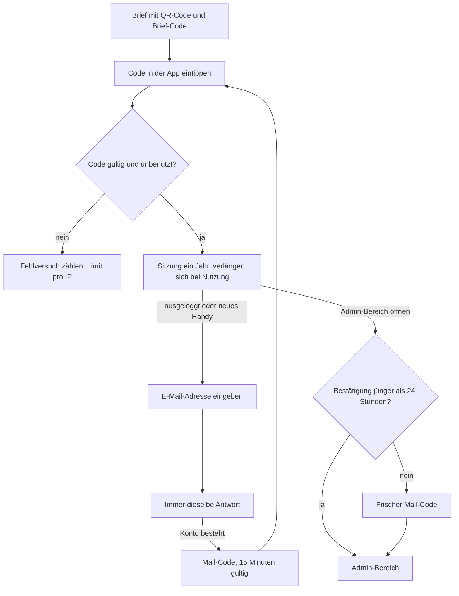

[← Übersicht](index.md)

# Sicherheitskonzept

Was MyTCO schützt, vor wem und womit. Die Vorgaben `SI-NN` sind verbindlich für ADRs, Code
und Tests; sie ergänzen die Datenschutz-Vorgaben `DS-NN` im
[Datenschutzkonzept](datenschutz.md). Massstab ist eine Vereinsapp: Schutz gegen
naheliegende Angriffe, kein Hochsicherheitsbetrieb.

**Vorschlag K-NN** = vom Vorstand noch zu bestätigen, Frage in den [Abklärungen](abklaerungen.md).

## Was geschützt wird

| Was | Warum |
|-----|-------|
| Mitgliederdaten | Adressen, E-Mail, Telefon, Jahrgang aller Mitglieder ([Welche Daten](datenschutz.md#welche-daten)) |
| Konten mit erweiterten Rollen | Admin, CM- und Lizenzverantwortliche sehen Daten aller Mitglieder ([Rollen und Rechte](rollen-und-rechte.md)) |
| Server und Auslieferung | Wer ausliefern kann, kommt an alle Daten ([CI/CD](ci-cd-und-release.md#schutz-des-auslieferungswegs)) |

## Bedrohungen und Massnahmen

| Nr | Bedrohung | Massnahme |
|----|-----------|-----------|
| B-01 | Ein Bot probiert Brief-Codes durch | 50 Bit pro Code, Limit pro IP (SI-01, SI-02) |
| B-02 | Jemand fordert massenhaft Mail-Codes an oder prüft, ob eine Adresse Mitglied ist | Immer dieselbe Antwort, Limits pro Adresse und IP (SI-04) |
| B-03 | Ein Brief wird aus dem Briefkasten gestohlen und der Code zuerst benutzt | Das Mitglied sieht beim eigenen Versuch «Code schon benutzt» und meldet sich; der Admin beendet die fremde Sitzung und stellt einen neuen Brief aus (SI-02, SI-07) |
| B-04 | Ein Handy mit offener Sitzung gerät in fremde Hände | Admin beendet alle Sitzungen des Kontos; der Admin-Bereich verlangt zusätzlich einen frischen Mail-Code (SI-07, SI-08) |
| B-05 | Das Sitzungs-Cookie wird gestohlen oder eine fremde Seite löst Aktionen aus | Cookie für Skripte unlesbar, nur eigene Inhalte, Herkunftsprüfung (SI-06, SI-10) |
| B-06 | Jemand mit fremder Sitzung ändert die E-Mail-Adresse und übernimmt das Konto dauerhaft | Neue Adresse gilt erst mit Code, die alte erhält einen Hinweis (SI-09) |
| B-07 | Ein Mitglied ruft per manipulierter Anfrage fremde Daten ab | Server prüft Rolle und Objektbezug bei jedem Zugriff (SI-11) |
| B-08 | Ein Admin oder Mitglied ändert Daten irrtümlich oder missbräuchlich | Änderungsverlauf (SI-12); wenige Konten mit erweiterten Rollen (K-18) |
| B-09 | Angriff auf den Server über SSH, offene Ports oder veraltete Software | Härtung (SI-13) |
| B-10 | Ein Schadpaket gelangt über eine Abhängigkeit in die App oder die CI | Prüfung der Pakete und getrennter Auslieferungs-Job (SI-14) |
| B-11 | Ein GitHub-, Hosting- oder Mailkonto wird geknackt | Zwei-Faktor-Login auf allen Betriebskonten (SI-15); Restrisiko siehe unten |

## Login

Ablauf nach [#29](https://github.com/konstantinniedermann/tco-app/issues/29) für die Etappe
*Mitglieder-Login*; Werte in den Vorgaben unten.

| | Brief-Code | Mail-Code |
|---|---|---|
| Form | 10 Zeichen ohne verwechselbare Zeichen (kein 0/O/1/I/L), rund 50 Bit | 6 Ziffern |
| Gültig | 90 Tage | 15 Minuten |
| Eingabe | ohne E-Mail-Adresse | nach Eingabe der E-Mail-Adresse |
| Bremse | 10 Fehlversuche pro IP und Stunde | 5 Fehlversuche, dann ungültig |

Beide Codes gelten nur einmal, sind nur als Hash gespeichert, und ein neuer Code ersetzt den
alten desselben Kontos (RR-04, FR-24).

## Vorgaben

| ID | Vorgabe |
|----|---------|
| SI-01 | Codes und Sitzungskennungen stammen aus einem kryptografisch sicheren Zufallsgenerator. Werte wie in der Tabelle [Login](#login) |
| SI-02 | Der Brief-Code ist an kein eingegebenes Konto gebunden, darum gibt es keine Sperre pro Konto, sondern höchstens 10 Fehlversuche pro IP und Stunde. Ein schon benutzter Code meldet «Code schon benutzt — wende dich an [Kontakt, K-21]» |
| SI-03 | Ein Mail-Code ist nach 5 Fehlversuchen ungültig; das Mitglied fordert einen neuen an |
| SI-04 | Code anfordern: für bekannte und unbekannte Adressen dieselbe Antwort und dieselbe Antwortzeit; höchstens 3 Code-Mails pro Adresse und Stunde, 10 Anfragen pro IP und Stunde. IP-Adressen nur dafür, höchstens 24 Stunden (DS-06) |
| SI-05 | Logs enthalten keine Codes, Sitzungskennungen oder Kontaktdaten (DS-06); Fehlversuche werden gezählt, nicht mit Inhalt geloggt |
| SI-06 | Sitzung: Cookie `HttpOnly`, `Secure`, `SameSite=Lax`, ein Jahr gleitend (A-LOGIN-09); beim Login eine neue Kennung; Logout beendet die Sitzung auf diesem Gerät |
| SI-07 | Widerruf über die Sitzungsversion (FR-24): Sperre und Austritt erhöhen sie automatisch, der Admin von Hand (Handy verloren, Code gestohlen) |
| SI-08 | Wer die Admin-Oberfläche öffnet (alle Rollen über *Mitglied*, RR-07), bestätigt höchstens einmal pro 24 Stunden mit einem frischen Mail-Code. Gilt für die Sitzung auf diesem Gerät (Projektleiter, 01.11.2026; **Vorschlag K-12**) |
| SI-09 | Eine E-Mail-Adresse gehört zu höchstens einem Konto (FR-25). Ändert ein Mitglied seine Adresse, gilt die neue erst nach Eingabe eines Codes, der an sie geschickt wurde; die alte Adresse erhält einen Hinweis «Falls du das nicht warst, melde dich bei …». Ändert der Admin die Adresse, erhält die alte denselben Hinweis |
| SI-10 | Nur HTTPS mit HSTS. Content-Security-Policy erlaubt nur die eigene Adresse (DS-03). Ändernde Anfragen nur mit passender Herkunft (Schutz vor gefälschten Anfragen fremder Seiten); Eingaben von Mitgliedern werden nie als HTML ausgegeben |
| SI-11 | Rechte prüft der Server bei jedem Zugriff nach Rolle und Objektbezug (RR-06); die Oberfläche blendet nur aus |
| SI-12 | Der Änderungsverlauf hält jede Änderung an Mitglied, Konto und Rollen fest, durch Admin oder Mitglied: wer, welches Feld oder welche Aktion (z. B. neuer Brief-Code, Sitzungen beendet, Export), bei welchem Mitglied, wann; ohne alte oder neue Werte. Nur Admins sehen ihn; Aufbewahrung 12 Monate (FR-26, [Löschen](datenschutz.md#löschen)) |
| SI-13 | Server ([#32](https://github.com/konstantinniedermann/tco-app/issues/32)): SSH nur mit Schlüssel, kein Root-Login über SSH, Firewall offen nur für 22, 80, 443; automatische Sicherheits-Updates; Datenbanken nur im internen Docker-Netz; Test und Live getrennt ([CI/CD](ci-cd-und-release.md#umgebungen)) |
| SI-14 | Abhängigkeiten, Auslieferung und Geheimnisse nach [CI/CD](ci-cd-und-release.md#abhängigkeiten): neue Pakete nur mit Freigabe, Installation ohne Paket-Skripte, Malware-Prüfung, nur der Auslieferungs-Job hat den Schlüssel, Geheimnisse nie im Repo (Secret-Scan) |
| SI-15 | Zwei-Faktor-Login auf allen Konten für Betrieb und Code: GitHub (alle mit Schreibrecht), Infomaniak, E-Mail-Versand, Domain |

Prüfbare Vorgaben erhalten Tests, wie die `DS-NN` ([Testkonzept](testkonzept.md#anforderung--testfall)).

## Restrisiken

Bewusst angenommen (Projektleiter, 01.11.2026):

- **Wer das Postfach hat, hat das Konto.** Folge des Logins ohne Passwort; Zwei-Faktor-Login
  für alle kommt später (A-LOGIN-06).
- **Ein entsperrtes Handy mit offenem Mailprogramm** überwindet auch SI-08. SI-08 schützt
  vor allem gegen ein gestohlenes Cookie auf einem anderen Gerät.
- **Schreibrecht auf GitHub reicht bis Live.** Ohne GitHub Pro kann jedes Konto mit
  Schreibrecht direkt auf `main` pushen oder einen Workflow mit dem Live-Schlüssel schreiben
  ([CI/CD](ci-cd-und-release.md#schutz-des-auslieferungswegs)). Angenommen unter zwei
  Bedingungen: Zwei-Faktor-Login auf beiden Konten (SI-15), und die Hauptansprechperson im
  Vorstand nutzt ihren Zugang nur zum Lesen (Absprache). Neu bewerten, sobald K-04 (wem
  gehören die Konten) beantwortet ist.
- **Ein Schadpaket im Bau** landet im Image und läuft live, auch ohne Schlüssel; dagegen
  hilft nur SI-14.

## Später

- Zwei-Faktor-Login oder Passkeys für alle (A-LOGIN-06, A-LOGIN-07).
- Store-App: Cookies und CORS unter der Adresse der Hülle
  ([ADR-002](adr/adr-002-sveltekit-postgresql.md#konsequenzen)) klärt der Entscheid zur
  Store-App, nicht dieses Konzept.

## Offene Fragen an den Verein

K-04 (Konten), K-12 (Admin-Bestätigung, weitere Vorgaben), K-18 (wer welche Rolle), K-21 (Kontakt bei Login-Problemen) — alle in den
[Abklärungen](abklaerungen.md).
