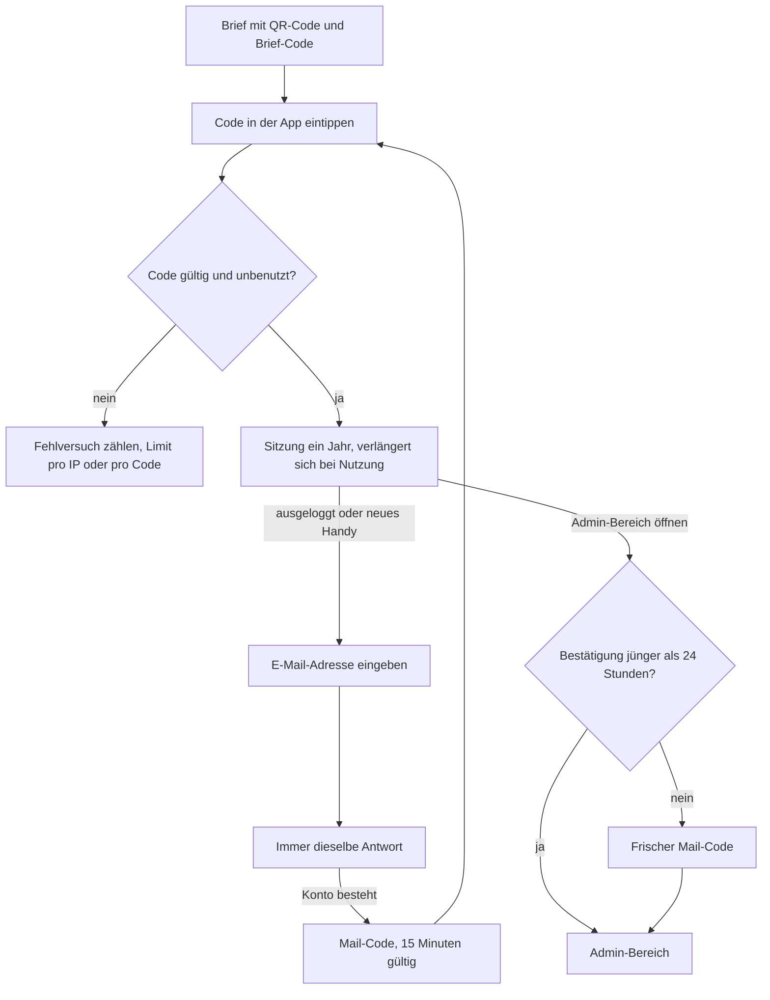

[← Übersicht](index.md)

# Sicherheitskonzept

Was MyTCO schützt, vor wem und womit. Die Vorgaben `SI-NN` sind verbindlich für ADRs, Code
und Tests; sie ergänzen die Datenschutz-Vorgaben `DS-NN` im
[Datenschutzkonzept](datenschutz.md). Massstab ist eine Vereinsapp: Schutz gegen
naheliegende Angriffe, kein Hochsicherheitsbetrieb.

**Vorschlag K-NN** = vom Vorstand noch zu bestätigen, Frage in den [Abklärungen](abklaerungen.md).

## Was geschützt wird

| Was | Warum |
|-----|-------|
| Mitgliederdaten | Adressen, E-Mail, Telefon, Jahrgang aller Mitglieder ([Welche Daten](datenschutz.md#welche-daten)) |
| Konten mit erweiterten Rollen | Admin, CM- und Lizenzverantwortliche sehen Daten aller Mitglieder ([Rollen und Rechte](rollen-und-rechte.md)) |
| Server und Auslieferung | Wer ausliefern kann, kommt an alle Daten ([CI/CD](ci-cd-und-release.md#schutz-des-auslieferungswegs)) |

## Bedrohungen und Massnahmen

| Nr | Bedrohung | Massnahme |
|----|-----------|-----------|
| B-01 | Ein Bot probiert Brief-Codes durch | 50 Bit pro Code, Limit pro IP, IPv6 pro /64-Netz (SI-01, SI-02) |
| B-02 | Jemand fordert massenhaft Mail-Codes an oder prüft, ob eine Adresse Mitglied ist | Immer dieselbe Antwort, Limits pro Adresse und IP (SI-04) |
| B-03 | Ein Brief wird aus dem Briefkasten gestohlen und der Code zuerst benutzt | Das Mitglied sieht beim eigenen Versuch «Code schon benutzt» und meldet sich; der Admin beendet die fremde Sitzung und stellt einen neuen Brief aus (SI-02, SI-07) |
| B-04 | Ein Handy mit offener Sitzung gerät in fremde Hände | Admin beendet alle Sitzungen des Kontos; der Admin-Bereich verlangt zusätzlich einen frischen Mail-Code (SI-07, SI-08) |
| B-05 | Das Sitzungs-Cookie wird gestohlen oder eine fremde Seite löst Aktionen aus | Cookie für Skripte unlesbar, nur eigene Inhalte, Herkunftsprüfung (SI-06, SI-10) |
| B-06 | Jemand mit fremder Sitzung ändert die E-Mail-Adresse auf seine eigene und übernimmt das Konto dauerhaft | Die Änderung braucht je einen Code an die alte und an die neue Adresse; wer nur die Sitzung hat, kommt nicht an den Code der alten (SI-09) |
| B-07 | Ein Mitglied ruft per manipulierter Anfrage fremde Daten ab | Server prüft Rolle und Objektbezug bei jedem Zugriff (SI-11) |
| B-08 | Ein Admin oder Mitglied ändert Daten irrtümlich oder missbräuchlich | Änderungsverlauf (SI-12); wenige Konten mit erweiterten Rollen (K-18) |
| B-09 | Angriff auf den Server über SSH, offene Ports oder veraltete Software | Härtung (SI-13) |
| B-10 | Ein Schadpaket gelangt über eine Abhängigkeit in die App oder die CI | Prüfung der Pakete und getrennter Auslieferungs-Job (SI-14) |
| B-11 | Ein GitHub-, Hosting- oder Mailkonto wird geknackt | Zwei-Faktor-Login auf allen Betriebskonten (SI-15); Restrisiko siehe unten |
| B-12 | Wer Zugang zum Server hat, liest die Live-Datenbank direkt | Zugang nur für den Betrieb, keine Kopien (SI-16) |
| B-13 | Ein Bot probiert Passkey-Antworten durch oder spielt eine abgefangene Antwort noch einmal ab | Challenge einmalig und höchstens 5 Minuten, Bestätigung am Gerät verlangt, Limit pro IP, nur aktive und ungesperrte Konten (SI-18) |

## Login

Ablauf nach [#29](https://github.com/konstantinniedermann/tco-app/issues/29) für die Etappe
*Mitglieder-Login*; Werte in den Vorgaben unten.

| | Brief-Code | Mail-Code |
|---|---|---|
| Form | 10 Zeichen ohne verwechselbare Zeichen (kein 0/O/1/I/L), rund 50 Bit | 6 Ziffern |
| Gültig | 90 Tage | 15 Minuten |
| Eingabe | ohne E-Mail-Adresse | nach Eingabe der E-Mail-Adresse |
| Ersetzt | nur den alten Brief-Code | nur den alten Mail-Code |
| Bremse | 10 Fehlversuche pro IP (IPv6: pro /64-Netz) und Stunde | 5 Fehlversuche, dann ungültig; 10 Versuche pro IP (IPv6: pro /64-Netz) und Stunde; höchstens 3 Code-Mails pro Stunde und 10 pro Tag je Adresse |

Beide Codes gelten nur einmal und sind nur als Hash gespeichert. Ein Login mit einem der
beiden macht beide ungültig; der Brief-Code gilt dann als benutzt (RR-04, FR-24). «Hash»
heisst mit geheimem Server-Schlüssel (HMAC), damit ein Datenbank-Leck die 50 Bit des
Brief-Codes nicht durchrechenbar macht.

## Vorgaben

| ID | Vorgabe |
|----|---------|
| SI-01 | Codes und Sitzungskennungen stammen aus einem kryptografisch sicheren Zufallsgenerator; Codes nur als HMAC gespeichert. Werte wie in der Tabelle [Login](#login) |
| SI-02 | Der Brief-Code ist an kein eingegebenes Konto gebunden, darum gibt es keine Sperre pro Konto, sondern höchstens 10 Fehlversuche pro IP und Stunde (IPv6 pro /64-Netz). Ein schon benutzter Code meldet «Code schon benutzt — wende dich an [Kontakt, hängt an K-21]» |
| SI-03 | Ein Mail-Code ist nach 5 Fehlversuchen ungültig; das Mitglied fordert einen neuen an. Falscher, abgelaufener oder ungültiger Code und unbekannte Adresse erhalten immer dieselbe Meldung (SI-04). Jeder Versuch wird vor dem Vergleich gezählt, damit parallele Anfragen die Grenzen nicht umgehen |
| SI-04 | Code anfordern: für bekannte und unbekannte Adressen dieselbe Antwort und dieselbe Antwortzeit; höchstens 3 Code-Mails pro Adresse und Stunde und 10 pro Tag, 10 Anfragen pro IP (IPv6: pro /64-Netz) und Stunde. IP-Adressen nur dafür, höchstens 24 Stunden (DS-06) |
| SI-05 | Logs enthalten keine Codes, Sitzungskennungen oder Kontaktdaten (DS-06); Fehlversuche werden gezählt, nicht mit Inhalt geloggt. Unerwartete Fehler loggt der Server nur mit festem Text, weil Meldungen der Datenbank Adressen enthalten können |
| SI-06 | Sitzung: Das Cookie trägt eine zufällige Kennung, die Datenbank nur ihren Hash, eine Zeile je Gerät ohne IP-Adresse und Gerätename ([ADR-004](adr/adr-004-login-einmal-code.md)). Cookie `HttpOnly`, `Secure`, `SameSite=Lax`, ein Jahr gleitend (A-LOGIN-09), verlängert höchstens einmal am Tag, darum endet sie bis zu einen Tag früher; beim Login eine neue Kennung; Logout löscht Zeile und Cookie. Ohne `Secure` nur im Entwicklungsserver (`make dev`, `make dev-handy`) und über `http://localhost` (Vorgabe von SvelteKit); dass der Produktions-Build es über http an einer anderen Adresse behält, prüft ein E2E-Test. `make dev-handy` öffnet nur den Entwicklungsserver fürs WLAN, Datenbank und Mailpit bleiben auf dem Laptop; es meldet die Namen `mytco-admin.local` und `mytco-mitglied.local` per mDNS im ganzen WLAN an (jedes Gerät sieht sie, ein anderes könnte sie beanspruchen; der Name gibt keine Rechte, die Anmeldung läuft per Code); nur im eigenen WLAN nutzen |
| SI-07 | Widerruf über die Sitzungsversion (FR-24): Sperre und Austritt erhöhen sie automatisch, der Admin von Hand (Handy verloren, Code gestohlen) |
| SI-08 | Wer die Admin-Oberfläche öffnet (alle Rollen über *Mitglied*, RR-07), bestätigt höchstens einmal pro 24 Stunden mit einem frischen Mail-Code. Gilt für die Sitzung auf diesem Gerät: Der Code ist an die Sitzung gebunden, ein Login-Code öffnet die Verwaltung nicht, und die Bestätigung endet mit der Sitzung (Projektleiter, 01.11.2026; vom Vorstand bestätigt, K-12.1) |
| SI-09 | Eine E-Mail-Adresse gehört zu höchstens einem Mitglied (FR-25). Ändert ein Mitglied seine Adresse, gilt die neue erst, wenn es je einen Code von der alten und von der neuen Adresse eingetippt hat (Werte wie beim Mail-Code). Ist die alte nicht mehr erreichbar, ändert der Admin die Adresse nach Rückfrage beim Mitglied, z. B. per Telefon; die alte erhält dann einen Hinweis «Falls du das nicht warst, melde dich bei …» (Stand Etappe 1: der Hinweis bei einer Änderung durch den Admin fehlt noch und kommt mit FR-25) |
| SI-10 | Nur HTTPS mit HSTS. Content-Security-Policy erlaubt nur die eigene Adresse (DS-03); einzige Ausnahme ist der feste Style von SvelteKits Screenreader-Hinweis, erlaubt über seinen Hash (`style-src-attr`). Ändernde Anfragen nur mit passender Herkunft (Schutz vor gefälschten Anfragen fremder Seiten): Sie nehmen nur JSON an, sonst Status 415, fremde Seiten scheitern am CORS-Preflight ([ADR-004](adr/adr-004-login-einmal-code.md#herkunftsschutz)); Eingaben von Mitgliedern werden nie als HTML ausgegeben |
| SI-11 | Rechte prüft der Server bei jedem Zugriff nach Rolle und Objektbezug (RR-06); die Oberfläche blendet nur aus |
| SI-12 | Der Änderungsverlauf hält fest, wer (Admin, Mitglied oder automatisch) bei welchem Mitglied wann welches Feld geändert oder welche Aktion ausgelöst hat (Umfang FR-26: z. B. neuer Brief-Code, Sitzungen beendet, Export); ohne alte oder neue Werte, ohne Login-Vorgänge. Nur Admins sehen ihn; Aufbewahrung 12 Monate (FR-26, [Löschen](datenschutz.md#löschen)) |
| SI-13 | Server ([#39](https://github.com/konstantinniedermann/tco-app/issues/39)): SSH nur mit Schlüssel, kein Root-Login über SSH, Firewall offen nur für 22, 80, 443; automatische Sicherheits-Updates; Datenbanken nur im internen Docker-Netz; Test und Live getrennt ([CI/CD](ci-cd-und-release.md#umgebungen)) |
| SI-14 | Abhängigkeiten, Auslieferung und Geheimnisse nach [CI/CD](ci-cd-und-release.md#abhängigkeiten): neue Pakete nur mit Freigabe, Installation ohne Paket-Skripte, Malware-Prüfung, nur der Auslieferungs-Job hat den Schlüssel, Geheimnisse nie im Repo (Secret-Scan); die CI meldet nur «ok» oder «Fehler», keine App-Logs (Logs liegen bei GitHub in den USA) |
| SI-15 | Zwei-Faktor-Login auf allen Konten für Betrieb und Code: GitHub (alle mit Schreibrecht), Infomaniak, E-Mail-Versand, Domain |
| SI-16 | Direkter Zugriff auf die Live-Datenbank nur über SSH auf den Server, nur der Projektleiter und im Notfall seine Stellvertretung (vorerst die Hauptansprechperson, K-05), nur für Betrieb und Fehlersuche; keine Kopien der Daten auf eigene Geräte (DS-08). Er steht nicht in der Matrix von [Rollen und Rechte](rollen-und-rechte.md), weil er ausserhalb der App liegt |
| SI-17 | Mail-Versand nur mit TLS (`smtps://` oder `requireTLS=true`); in Produktion lehnt die App jede andere SMTP-URL ab, ausser Loopback und `.invalid`. Die Umleitung `MAIL_NUR_AN` gilt nur für Test; `ausliefern live` und `zurueck live` verweigern sich bei gesetztem Wert ([CI/CD](ci-cd-und-release.md#schutz-des-auslieferungswegs)) |
| SI-18 | Passkey (A-LOGIN-07, [ADR-005](adr/adr-005-passkey-simplewebauthn.md)): Der Server verlangt die Bestätigung am Gerät (`userVerification` `required`) und keine Bescheinigung (`attestationType` `none`). Die Challenge gilt einmal, höchstens 5 Minuten, liegt im Arbeitsspeicher (höchstens 1000 offene, die älteste fällt weg) und ist mit jedem Versuch verbraucht, auch mit einem kaputten; dieselbe Antwort ein zweites Mal ergibt keine Sitzung. Jeder Anmeldeversuch zählt vor dem ersten `await` zur Grenze von 10 pro IP (IPv6: pro /64-Netz) und Stunde; ist sie erreicht, gibt es auch keine Optionen mehr. Hinein kommen nur Konten, die nicht gesperrt sind und deren Mitglied aktiv ist. Ein Passkey gilt nur für die Adresse (Relying-Party-ID), unter der er eingerichtet wurde. Entfernen geht nur für Passkeys des eigenen Kontos; ein fremder bleibt, die Antwort ist wie bei einem unbekannten. Die Sitzung entsteht wie beim Code (SI-06); ein Passkey-Login macht keinen Code ungültig. Logs nur mit festem Text (SI-05). Restrisiken unten |

Prüfbare Vorgaben erhalten Tests, wie die `DS-NN` ([Testkonzept](testkonzept.md#anforderung--testfall)).

## Restrisiken

Bewusst angenommen (Projektleiter, 01.11.2026):

- **Wer das Postfach hat, hat das Konto.** Folge des Logins ohne Passwort; Zwei-Faktor-Login
  für alle kommt später (A-LOGIN-06). Der Vorstand hat danach gefragt (K-16.3). Weder ein
  Passwort noch der freiwillige Passkey (A-LOGIN-07) helfen, solange sich das Konto per Mail
  zurückholen lässt; der Passkey ist nur Komfort (Projektleiter, 03.11.2026). Schutz brächte
  erst ein Passkey, der den Mail-Code für das Konto sperrt. Darum die Bitte an Admins und
  Verantwortliche, ihr E-Mail-Postfach mit einer Zwei-Faktor-Anmeldung zu schützen; ihr
  Postfach öffnet auch den Admin-Bereich (SI-08). Der Projektleiter sagt das bei der Vergabe
  der Rolle (Projektleiter, 03.11.2026).
- **Ein entsperrtes Handy mit offenem Mailprogramm** überwindet auch SI-08 und SI-09. Beide
  schützen vor allem gegen ein gestohlenes Cookie auf einem anderen Gerät; dagegen hilft erst
  ein Faktor wie ein Passkey (A-LOGIN-07). Ein SMS-Code hilft nicht, die SMS käme aufs selbe
  Handy (Projektleiter, 01.11.2026).

**Passkey** (SI-18, [ADR-005](adr/adr-005-passkey-simplewebauthn.md), Projektleiter, 04.11.2026):

- Das Anfordern der Anmelde-Optionen zählt nicht zur Grenze, wird aber abgelehnt, sobald sie
  erreicht ist; darunter ist es nicht begrenzt. Wer es massenhaft tut, füllt die
  höchstens 1000 offenen Challenges und verdrängt echte; das blockiert nur den Passkey-Weg,
  der Code-Login bleibt.
- Auch erfolgreiche Passkey-Anmeldungen zählen zu den 10 pro IP und Stunde (gezählt wird vor dem
  ersten `await`, parallele Anfragen umgehen die Grenze nicht). Mitglieder hinter einer
  gemeinsamen Verbindung fallen dann auf den Code zurück.
- Die Antwortzeit unterscheidet einen unbekannten von einem bekannten Passkey; messbar ist nur,
  ob eine zufällige Credential-ID existiert. Die IDs sind nicht erratbar, die Bremse gilt.
- Ein Konto, das in den Millisekunden zwischen Laden und Anlegen der Sitzung gelöscht wird,
  ergibt einen Fehler 500, keine Sitzung.
- Die Relying-Party-ID ist die Adresse, unter der die App läuft (in Produktion aus `ORIGIN`).
  Ein Adresswechsel (Übergangsadresse zu `my.tcolten.ch`, K-10) macht alle Passkeys ungültig:
  Mitglieder melden sich mit dem Code an und sehen den Hinweis wieder.

### Neu zu bestätigen (Stand 2026-11-02)

Beim Gesamt-Review von #32 richtiggestellt; die frühere Annahme deckt die neue Reichweite nicht.
Bis der Projektleiter bestätigt, gelten diese beiden Punkte als nicht angenommen.

- **Schreibrecht auf GitHub reicht bis root auf dem Server.** Ohne GitHub Pro kann jedes Konto
  mit Schreibrecht direkt auf `main` pushen oder einen Workflow mit dem Live-Schlüssel schreiben
  ([CI/CD](ci-cd-und-release.md#schutz-des-auslieferungswegs)). Weil die Einrichtung des Servers im
  Image mitreist, läuft das `ausliefern` eines Images auf dem Server selbst, als Benutzer
  `mytco` mit Zugang zu Docker. Das reicht so weit wie root: an die Geheimnisse beider
  Umgebungen und an den Sicherungszugang, aber auch an den Türsteher, die Schlüssel in
  `authorized_keys` und die systemd-Einheiten. Der Türsteher schützt nur den Eingang (er nimmt
  nur einen Digest an, die Umgebung kommt aus dem Schlüssel), nicht gegen ein schädliches
  Image. Getrennte Schlüssel für Test und Live helfen nur gegen einen gestohlenen Schlüssel
  allein; ein schädliches Image, das nur auf Test kommt, erreicht über denselben Server
  trotzdem Live. Die Annahme vom 01.11.2026 ging von einer kleineren Reichweite aus (Türsteher
  unveränderbar) und galt unter zwei Bedingungen: Zwei-Faktor-Login auf beiden Konten (SI-15),
  und die Hauptansprechperson im Vorstand nutzt ihren Zugang nur zum Lesen (Absprache).
  **Neu zu bestätigen durch den Projektleiter (Stand 2026-11-02).** Neu bewerten auch: Die
  Konten des Betriebs laufen künftig auf eine Vereinsadresse, den zweiten Zugang hat die
  Hauptansprechperson (K-04.1, K-04.2); das Repo bleibt bis zu einer Übergabe auf dem
  Privatkonto ([Betrieb und Übergabe](betrieb-und-uebergabe.md#konten)).
- **Ein Schadpaket im Bau** landet im Image und läuft live, auch ohne Schlüssel, und über das
  `ausliefern` des Images mit derselben Reichweite auf dem Server; dagegen hilft nur SI-14.
  Mit der Richtigstellung oben ebenfalls neu zu bestätigen.

## Später

- Zwei-Faktor-Login für alle (A-LOGIN-06); ein Passkey, der den Mail-Code für das Konto sperrt
  (Weiterführung von A-LOGIN-07; Weg zurück bei verlorenem Gerät dann über den Admin).
- Store-App: Cookies und CORS unter der Adresse der Hülle
  ([ADR-002](adr/adr-002-sveltekit-postgresql.md#konsequenzen)) klärt der Entscheid zur
  Store-App, nicht dieses Konzept.

## Offene Fragen an den Verein

K-12.2 (weitere Vorgaben), K-16.1 (Briefversand), K-18.2 (wer welche Rolle), K-21 (Kontakt bei
Login-Problemen) — alle in den
[Abklärungen](abklaerungen.md).
