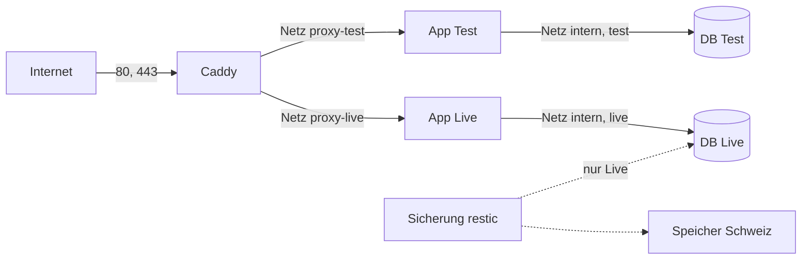

# Design: Test- und Live-Umgebung, Auslieferung, Sicherung (#32)

**Datum:** 2026-11-02 · **Issue:** [#32](https://github.com/konstantinniedermann/tco-app/issues/32)
· **Status:** zur Freigabe

## Absicht

#32 baut alles, was MyTCO zum Betrieb auf dem Server braucht. Ausgenommen ist nur, was den
bestellten Server selbst voraussetzt. Jedes Teil ist lokal mit Docker belegt. Der Server wird
damit zur reinen Inbetriebnahme: bestellen, härten, Geheimnisse setzen, einschalten. Bald
soll eine Demo (nur erfundene Daten) auf dem echten Infomaniak-Server laufen, danach eine
Testgruppe mit echten Daten auf Live. Deshalb ist der Aufbau das echte Ziel und kein
Provisorium. Er läuft ohne Umbau unter einer Übergangsadresse und später unter
`my.tcolten.ch`.

Massgebend und hier nicht wiederholt: [CI/CD und Release](../../ci-cd-und-release.md)
(Umgebungen, Auslieferung, Schutz des Auslieferungswegs, Geheimnisse),
[Sicherheitskonzept](../../sicherheitskonzept.md) (SI-05, SI-10, SI-13, SI-14, SI-16),
[Datenschutz](../../datenschutz.md) (DS-01, DS-06, DS-08), [ADR-003](../../adr/adr-003-hosting-infomaniak-vps.md).

## Ziele

1. Test und Live laufen lokal als getrennte Docker-Stapel hinter einem Webserver und sind
   nachweislich getrennt: Die Test-App erreicht die Live-Datenbank nicht.
2. Ein Auslieferungs-Skript liefert ein Image per Digest aus, prüft die Statusabfrage und
   fällt bei Fehlern auf das vorherige Image zurück. Bei Live sichert es vorher.
3. Sicherung (vor Live-Auslieferung und nächtlich), Wiederherstellung und eine
   Wiederherstellungs-Probe funktionieren lokal mit erfundenen Daten.
4. Die CI-Jobs für Bauen, Ausliefern, Tag und Release sind gebaut und bis zum Einschalten
   aus. Ein Rauchtest des Images läuft sofort. Eine Prüfung erzwingt die Rechte der Jobs.
5. Doku nachgeführt, die Beobachtungen zu #32 erledigt, Inbetriebnahme-Issue vorgeschlagen.

## Nicht-Ziele

- Server bestellen, härten, SSH-Benutzer anlegen, Firewall, automatische Updates (SI-13)
  → Inbetriebnahme-Issue.
- DNS-Einträge, Geheimnisse auf GitHub, Repo-Variable zum Einschalten → Inbetriebnahme-Issue,
  nur mit Freigabe des Projektleiters.
- Wahl des Sicherungsspeichers in der Schweiz (Anbieter, Kosten, Konto) → #10. #32 nimmt
  dazu nichts an, das Ziel bleibt eine Einstellung.
- E-Mail-Filter für Test: #32 legt nur die Einstellung an, den Filter baut #29 mit dem
  Versand (Entscheid Projektleiter).
- Monitoring, Betriebsanleitung, Übergabe → #10.

## Anti-Ziele (wäre ein Fehlschlag, auch wenn alles grün ist)

- Echte Daten auf Test, auch nicht für die Wiederherstellungs-Probe (DS-08).
- Ein Weg, auf dem die CI Logs der App, Datenbankinhalte oder Geheimnisse ausgibt.
- Ein Auslieferungs-Skript, das Eingaben über eine Shell auswertet, oder ein SSH-Schlüssel,
  der mehr kann als dieses Skript starten.
- Eine Sicherung, deren Wiederherstellung nie geprüft wurde.
- CI-Jobs, die vor dem Einschalten bei jedem Merge fehlschlagen oder Kosten verursachen.
- Wegwerf-Code für die Demo, den die Inbetriebnahme wieder ausbaut.

## Entscheide des Projektleiters (2026-11-02)

| Thema | Entscheid |
|-------|-----------|
| Schnitt | Zwei Teile: #32 umfasst das lokal Belegbare und wird dann geschlossen. Ein neues Issue «Server in Betrieb nehmen» wird nur mit Zustimmung angelegt |
| Webserver | Caddy (Vorschlag aus ADR-003) |
| Sicherung | restic: verschlüsselt, 30 Tage, Upload auf S3-kompatiblen Speicher |
| CI vor dem Server | Jobs eingebaut, aber aus bis zum Einschalten über eine Repo-Variable. Sofort aktiv ist nur der Rauchtest |
| Wiederherstellung | Auf Test nur erfundene Daten (DS-08 bleibt). Die echte Probe läuft mit den Daten der Testgruppe auf **Live**: Sicherung in eine Wegwerf-Datenbank auf dem Server, prüfen, löschen |
| Testgruppe | Pilotphase auf Live, nicht auf Test |
| E-Mail auf Test | Nur die Einstellung, der Filter kommt mit #29 |
| Demo | Auf dem echten Infomaniak-Server unter einer Übergangsadresse, nicht auf fly.io. Bestellung und Kosten auf dem Konto des Projektleiters, er bestellt selbst. Die Demo läuft **auf Test** (mit Passwort); Live bleibt leer bis zur Testgruppe |
| Einrichtung | Auch Änderungen an der Server-Einrichtung kommen über die CI, nicht von Hand (Ausnahme und Folge: [Einrichtung über die CI](#einrichtung-über-die-ci)) |
| `registry`-Image | Freigegeben, nur für den lokalen Nachweis |

## Aufbau

- **Zwei Compose-Projekte aus derselben Datei:** `mytco-test` und `mytco-live`. Jedes hat
  eine App, eine PostgreSQL-Datenbank (Image per Digest gepinnt), ein Volume und ein
  Netz `intern` mit `internal: true`. Die Datenbank hängt nur an `intern` und hat keinen
  veröffentlichten Port. Die App hängt an `intern` und am Netz `proxy-<umgebung>`.
- **Caddy als drittes Compose-Projekt** (`mytco-proxy`) hängt an beiden Proxy-Netzen und an
  keinem `intern`-Netz. Er veröffentlicht 80 und 443. So reicht die Test-App weder zur
  Live-Datenbank noch zur Live-App.
- **Caddy setzt für alle Antworten**, auch für `/_app/*`: HSTS, `nosniff`,
  `Referrer-Policy`, `Content-Security-Policy: frame-ancestors 'none'`. Damit sind zwei
  Beobachtungen erledigt. Test verlangt ein Passwort (Basic Auth, Hash nur auf dem Server).
  Caddy schreibt kein Zugriffsprotokoll, so werden keine IP-Adressen gespeichert (DS-06).
- **Adressen sind Einstellungen** (`MYTCO_ADRESSE_LIVE`, `MYTCO_ADRESSE_TEST`). Vorgesehen
  sind `my.tcolten.ch` und `test.my.tcolten.ch` (Annahme K-10). Bis dahin gilt eine
  Übergangsadresse. Lokal laufen die Stapel unter Namen auf `localhost` mit Caddys eigenem
  Zertifikat (`tls internal`), ebenfalls über eine Einstellung.
- **Geheimnisse** liegen je Umgebung in einer Datei `geheim.env` auf dem Server (nur für den
  Betriebsbenutzer lesbar). Im Repo steht `betrieb/vorlage.env` mit allen Schlüsseln ohne
  Werte: DB-Passwort, `DATABASE_URL`, Adresse, Passwort-Hash für Test, `MAIL_NUR_AN`
  (Test, hängt an K-11), restic-Ziel und -Zugang. Der Secret-Scan läuft auch über diese
  Dateien.
- **Logs:** Rotation bei Docker auf höchstens 30 Tage (DS-06). Wie das auf dem Server
  zeitlich begrenzt wird (z. B. journald), entscheidet das Inbetriebnahme-Issue. Lokal
  reicht eine Begrenzung nach Grösse.
- **Ablage im Repo:** neuer Ordner `betrieb/` (Compose-Dateien, Caddyfile, Skripte,
  systemd-Dateien, Vorlage). Er wird ins Image kopiert (siehe unten). Auf dem Server liegt
  die ausgelieferte Fassung unter einem festen Pfad, z. B. `/opt/mytco`.
- **Übergangsadresse:** zwei Namen, je einer für Test und Live, über einen Namensdienst, der
  den Namen aus der IP des Servers bildet (z. B. sslip.io). Caddy trennt die Umgebungen am
  Namen, deshalb reicht die nackte IP nicht. Es ist nur eine Einstellung, Code ändert sich
  dafür nicht. *(Entscheid Claude)*

### Einrichtung über die CI

Der Projektleiter will auch die Einrichtung über die CI ausliefern. Der Auslieferungsweg
bleibt trotzdem so eng wie im Konzept:

- **Die Einrichtung reist im Image mit.** Das Image enthält `betrieb/`. Das
  Auslieferungs-Skript entnimmt die Dateien dem Image mit dem geprüften Digest
  (`docker create` + `docker cp`, ohne das Image zu starten) und legt sie ab. Der SSH-Schlüssel
  übergibt weiterhin nur einen Digest.
- **Was zu einer Umgebung gehört** (Compose-Datei für App und Datenbank, eigener Teil der
  Caddy-Konfiguration), kommt mit der Auslieferung dieser Umgebung, also zuerst auf Test.
- **Was beide betrifft** (Caddy-Grundkonfiguration, Skripte für Sicherung und Probe),
  kommt nur mit einer Live-Auslieferung. Vor dem Neuladen prüft `caddy validate` die neue
  Konfiguration. Ist sie ungültig, bleibt die alte aktiv, und der Lauf meldet `fehler`.
- **Ausnahme Türsteher:** `ausliefern-ssh` (Eingabeprüfung, Zwangsbefehl), die
  systemd-Einheiten und `authorized_keys` aktualisiert die CI nie. Sie werden im
  Inbetriebnahme-Issue von Hand eingerichtet und bei einer Änderung von Hand nachgezogen.
  Der Türsteher ruft die ausgelieferten Skripte nur auf. Ein Image kann damit die
  Eingabeprüfung nicht ersetzen, und der nächtliche Timer startet immer ein Skript aus der
  zuletzt ausgelieferten Live-Fassung.
- **Folge, im Sicherheitskonzept nachzutragen:** Das Restrisiko «Schreibrecht auf GitHub
  reicht bis Live» reicht nun bis auf den Server. Ein Image kann Skripte liefern, die
  ausserhalb der Container laufen und damit an die Geheimnisse beider Umgebungen und an den
  Sicherungszugang kommen. Bisher kam es «nur» an die Live-Daten. Die Bedingungen des
  Restrisikos (SI-15, Absprache zum Lesezugang) bleiben dieselben.

## Auslieferung

**Aufruf.** Der SSH-Schlüssel der CI kann nur einen Zwangsbefehl (`command=` in
`authorized_keys`) starten, und **die Umgebung steht im Schlüssel**: Der Test-Schlüssel
startet `ausliefern-ssh test`, der Live-Schlüssel `ausliefern-ssh live`. Aus der
SSH-Anfrage (`SSH_ORIGINAL_COMMAND`) übernimmt das Skript nur den Digest. Er muss genau
`sha256:` und 64 Kleinbuchstaben-Hex sein, sonst bricht das Skript ab, ohne etwas
auszuwerten. Das kurzlebige Token für die Container-Ablage kommt über die
Standardeingabe, nie als Argument oder Umgebungsvariable. Es geht in eine temporäre
Docker-Konfiguration, die am Ende gelöscht wird. Für Handbetrieb (z. B. bei leerem
Actions-Kontingent) ruft der Projektleiter `ausliefern <test|live> <digest>` auf dem Server
direkt auf.

**Ablauf** (je Umgebung höchstens ein Lauf gleichzeitig, Sperre per `flock`):

1. Eingaben prüfen, Image `ghcr.io/<repo>@<digest>` holen, Einrichtung aus dem Image
   entnehmen (siehe [Einrichtung über die CI](#einrichtung-über-die-ci)).
2. Nur Live: Sicherung (siehe unten). Scheitert sie, bricht der Lauf ab, und die alte
   Version läuft weiter.
3. Nur Test: Datenbank neu aufsetzen (Volume weg, neu anlegen), wie im Konzept. Nach den
   Migrationen (Schritt 4) spielt das Skript erfundene Testdaten ein, sofern das Image ein
   Skript dafür enthält (`scripts/testdaten.ts`, Regeln aus dem Testkonzept:
   `@example.org`). Das Skript selbst baut #29 mit den ersten Tabellen; #32 baut nur den
   Aufruf. *(Entscheid Claude)*
4. Migrationen mit dem neuen Image (`node scripts/migrate.ts`). Scheitern sie, bricht der
   Lauf ab, die alte Version läuft weiter, bei Live gibt es die Sicherung aus Schritt 2.
5. App mit dem neuen Image starten.
6. Warten, bis der Healthcheck des Containers (`/api/status` meldet `ok`) gesund ist,
   höchstens 60 Sekunden (S, Einstellung).
7. Gesund: Der neue Digest wird «aktuell», der bisherige «vorher» (Zustandsdateien je
   Umgebung). Nicht gesund: App mit dem Digest aus «vorher» neu starten, Ergebnis «Fehler».

**Ausgabe:** nur Schrittnamen und am Ende `ok` oder `fehler`, nie Logs der App oder der
Datenbank (DS-01, DS-06). Details landen nur auf dem Server.

**Zurück von Hand:** `zurueck <test|live>` startet den Digest aus «vorher». Das geht ohne
Datenverlust, weil Migrationen nur hinzufügen (Konzept).

**Dockerfile:** kopiert `betrieb/` in die Laufzeit-Stufe (nur Dateien, nicht ausgeführt).
`HEALTHCHECK` ruft `/api/status` mit Node-Bordmitteln ab (kein curl im Image). Das redundante `svelte-kit sync` fällt weg, falls der Build ohne es nachweislich
gleich bleibt (Beobachtung aus #15).

## Sicherung und Wiederherstellung

- **`sichern <umgebung>`:** `pg_dump -Fc` aus dem DB-Container geht über die
  Standardeingabe direkt an restic (Image per Digest gepinnt), mit Tag `<umgebung>`. Es
  entsteht keine unverschlüsselte Datei. Dazu kommt eine kleine Zählung (Zeilen pro
  Tabelle) als eigener Snapshot mit demselben Lauf-Tag, denn ein Snapshot aus der
  Standardeingabe hält nur eine Datei. *(Entscheid Claude)* Danach `forget --keep-within 30d --prune`
  (DS-06). Ziel, Passwort und Zugang kommen aus `geheim.env`. Lokal ist das Ziel ein Ordner.
- **Nächtlich:** systemd-Timer und -Dienst für `sichern live`, danach automatisch
  `probe live` für die frische Sicherung. So ist jede Sicherung geprüft (Anti-Ziel). Die
  Dateien liegen in `betrieb/`, eingerichtet werden sie im Inbetriebnahme-Issue. Ein
  Fehlschlag steht vorerst nur im Journal des Servers; wer davon erfährt, regelt das
  Monitoring in #10. *(Entscheid Claude)*
- **`wiederherstellen <umgebung> [snapshot]`:** spielt einen Snapshot in die Datenbank
  der Umgebung zurück. Es nimmt **nur Snapshots mit dem Tag derselben Umgebung**. Eine
  Live-Sicherung kann so nie auf Test landen (DS-08).
- **`probe <umgebung> [snapshot]`:** startet eine Wegwerf-PostgreSQL in einem eigenen Netz
  ohne Verbindung nach aussen, spielt den Snapshot ein, vergleicht mit der Zählung aus dem
  Snapshot, gibt `ok`/`fehler` aus und löscht alles. Die Daten verlassen den Server nicht
  (SI-16). Das ist die echte Probe mit der Testgruppe auf Live, im Inbetriebnahme-Issue.

## CI

Erweiterung von `.github/workflows/check.yml`. Die neuen Jobs laufen nur bei einem Push auf
`dev`/`main` mit Code-Änderung, nachdem alle Prüf-Jobs grün sind, **und nur, wenn die
Repo-Variable der Umgebung eingeschaltet ist**: `AUSLIEFERUNG_TEST=an` für `dev`,
`AUSLIEFERUNG_LIVE=an` für `main`. So läuft die Demo auf Test, während Live noch aus ist.
Ohne Variable gelten die Jobs als übersprungen, nicht als fehlgeschlagen. *(Zwei Schalter:
Entscheid Claude)*

**Live bekommt genau das Image, das auf Test lief.** Gebaut wird nur auf `dev`. Das Image
erhält zusätzlich das Tag `code-<hash>`. Der Hash wird über alle versionierten Dateien
ausser der Doku gebildet, mit derselben Regel wie in `nur-doku.ts`: Pfade unter `docs/` und
Dateien mit `.md`. Ein reiner Doku-Merge nach dem letzten Code-Merge baut kein Image und
ändert den Hash nicht. Weil `main` nach dem Release-Merge denselben Code-Stand hat wie `dev`,
sucht der Lauf auf `main` das Image über diesen Hash, statt neu zu bauen. Fehlt es, bricht die Live-Auslieferung mit `fehler` ab, und es wird
nicht neu gebaut: Live bekommt nie ein Image, das nicht auf Test lief und nicht durch die
Checkliste ging. Docker-Builds sind nicht bitgenau wiederholbar, ein Neubau ergäbe einen
anderen Digest. *(Entscheid Claude, folgt aus dem Release-Ablauf im Konzept)*

| Job | Rechte | Was |
|-----|--------|-----|
| `image` (bestehend, erweitert) | `contents: read` | Bauen wie bisher, dazu **Rauchtest**: Container mit PostgreSQL starten, Migration, `/api/status` = `ok`. Sofort aktiv |
| `bauen` | `contents: read`, `packages: write` | Nur `dev`: Image bauen und in die Container-Ablage schieben (Tags `code-<hash>` und Commit), Digest als Ausgabe |
| `finden` | `contents: read`, `packages: read` | Nur `main`: Digest des Images zum Code-Stand von `main` ermitteln, sonst `fehler` |
| `ausliefern` | `packages: read`, sonst nichts | Kein Checkout, kein `uses:`, kein npm. SSH mit dem Schlüssel der Umgebung (`dev` → Test, `main` → Live) und dem Fingerabdruck des Servers aus den Geheimnissen, Digest als Befehl, Token über die Standardeingabe. Gruppe je Umgebung, kein Abbruch |
| `release` | `contents: write` | Nur nach Live: Tag `vX.Y.Z` aus `package.json` und GitHub-Release mit dem Abschnitt aus `docs/versionen.md` (mit `gh`, ohne npm) |

**Rechteprüfung:** Ein neues Skript `scripts/pruefungen/workflow-rechte.ts` (in
`npm run pruefungen`, mit Vitest-Tests, ohne neue Pakete) prüft alle Workflows. Jeder Job
hat einen eigenen `permissions`-Block. Nur `bauen` hat `packages: write`, nur `release` hat
`contents: write`. Nur `ausliefern` nutzt die SSH-Geheimnisse, und `ausliefern` enthält kein
`uses:`, kein `npm`/`npx`/`node`, keinen Cache und keine Artefakte. Die übrigen Jobs haben
`contents: read`. Ein Verstoss lässt die CI rot werden.

**Actions-Minuten:** Der Rauchtest kostet pro Code-Merge rund eine zusätzliche Minute (S).
Eingeschaltet kommen pro Merge rund drei Minuten dazu (S, messen).

## Lokaler Nachweis

- **Einheitstests (Vitest):** Prüfung der Eingaben von `ausliefern-ssh`/`ausliefern`
  (gültiger Digest, Müll, Shell-Zeichen, Umgebung nicht aus der Anfrage), Ablauf mit einem
  Docker-Ersatz im `PATH` (Rückfall, Sperre, Abbruch bei gescheiterter Sicherung oder
  Migration), Rechteprüfung der Workflows.
- **`make betrieb-nachweis`** (nicht Teil von `make check`, dafür zu lang) richtet einen
  Wegwerf-«Server» in einem temporären Ordner auf Docker Desktop ein. Dazu startet es eine
  lokale Container-Ablage (Image `registry`, nur für diesen Nachweis), damit das Holen per
  Digest echt läuft. Dann belegt es nacheinander:
  1. Auslieferung auf Test und Live mit demselben Digest, inklusive der Einrichtung aus
     dem Image, Statusabfrage über Caddy mit HTTPS. Test ohne
     Passwort ergibt 401, mit Passwort `ok`. Die Header (HSTS, `frame-ancestors`) stehen
     auch auf `/_app/*`.
  2. Trennung: Aus dem Test-App-Container scheitert eine Verbindung zur Live-Datenbank
     (Name nicht auflösbar, Adresse nicht erreichbar).
  3. Rückfall: Ein absichtlich kaputtes Image (abgeleitet vom echten, startet nicht) wird
     ausgeliefert, das Skript meldet `fehler`, das vorherige läuft wieder.
  4. Sicherung, Wiederherstellung und Probe mit erfundenen Daten. Ein Live-Snapshot wird
     auf Test abgewiesen.
  5. Einrichtung: Eine ungültige Caddy-Konfiguration im Image wird abgewiesen, die alte
     bleibt aktiv. Eine Test-Auslieferung ändert die gemeinsamen Teile nicht.
  6. Aufräumen.

  Die Ausgabe eines Laufs ist der Nachweis für den Abschluss.

## Was auf dem echten Server noch belegt werden muss (Inbetriebnahme-Issue)

Der Vorschlag wird nur mit Zustimmung angelegt: **«chore: Server in Betrieb nehmen»**,
Blocked by #32, Blocks #29, Verwandt #10.

- Bestell-Checkliste für den Projektleiter: VPS Lite 2 vCPU / 4 GB, aktuelles Ubuntu LTS,
  eigener SSH-Schlüssel.
- Härtung nach SI-13: Schlüssel-Login, kein Root über SSH, Firewall nur 22/80/443,
  automatische Sicherheits-Updates, Docker, Betriebsbenutzer, zeitliche Begrenzung der
  Logs.
- `betrieb/` einrichten, `geheim.env` je Umgebung, zwei CI-Schlüssel mit Zwangsbefehl, Timer.
- Übergangsadresse (z. B. über die IP des Servers), später `my.tcolten.ch` (hängt an K-10).
- Mit Freigabe: Geheimnisse auf GitHub, zuerst `AUSLIEFERUNG_TEST=an` (Demo), später
  `AUSLIEFERUNG_LIVE=an` (Testgruppe).
- Die DoD-Punkte, die einen Server brauchen: je ein Lauf auf Test und Live, Rückfall auf
  Test, nächtliche Sicherung, Probe mit den Daten der Testgruppe auf Live, Tag und Release.
- Sicherungsziel in der Schweiz, sobald #10 es festlegt (bis dahin nur auf dem Server, das
  im Issue offen benennen).

## DoD von #32 nach dem Schnitt

Die DoD von #32 wird auf den lokal belegbaren Teil angepasst. Die Punkte, die einen Server
brauchen, wandern ins Inbetriebnahme-Issue.

- [ ] `make betrieb-nachweis` grün: Auslieferung Test und Live, Rückfall, Trennung,
  Sicherung, Wiederherstellung, Probe
- [ ] Rauchtest in der CI aktiv, neue Jobs übersprungen, solange die Schalter aus sind
- [ ] Rechteprüfung der Workflows in `npm run pruefungen`, mit Tests
- [ ] CI-Ausgabe nur `ok`/`fehler` (Test auf die Ausgabe des Skripts)
- [ ] `docs/ci-cd-und-release.md`, `docs/sicherheitskonzept.md` (SI-13: Verweis; Restrisiko
  reicht bis auf den Server),
  `docs/context-scopes.md` (Zeile Betrieb), `docs/beobachtungen.md` nachgeführt
- [ ] Inbetriebnahme-Issue mit Zustimmung angelegt oder als offen benannt

## Datenschutz-Prüfung

Gegen `docs/datenschutz.md` geprüft. Nichts davon bringt eine neue Verarbeitung:

- Sicherungen bleiben verschlüsselt und werden nach 30 Tagen gelöscht. Das Ziel in der
  Schweiz kommt aus #10 (DS-01, DS-02, DS-06). Bis dahin liegen sie nur auf dem Server.
- Die Probe bleibt auf dem Server (SI-16), Test nur mit erfundenen Daten (DS-08).
- Kein Zugriffsprotokoll mit IP-Adressen (DS-06).
- **Offen für das Inbetriebnahme-Issue:** Ob die Testgruppe schon unter der Übergangsadresse
  startet. Die Adresse hängt dann an einem fremden Namensdienst. Ändert das etwas an
  Datenschutzerklärung oder Verfügbarkeit, wird es dort geprüft.

## Dem Builder überlassen

Namen der Skripte und Zustandsdateien, Bash-Details (`set -euo pipefail`, Shellcheck-tauglich
schreiben, ohne Shellcheck als neue Abhängigkeit), genaue Form der Zählung, wie der
Docker-Ersatz in den Tests aussieht, wie die Rechteprüfung die YAML-Struktur ohne
YAML-Paket liest, Grenzen der Log-Rotation lokal.

**Meine Entscheide (Claude), nicht vom Projektleiter:** Bash für die Server-Skripte (auf dem
Server gibt es ausserhalb der Container kein Node). Die Umgebung steht im SSH-Schlüssel statt
in der Anfrage. Die Einrichtung reist im Image mit, der Türsteher nicht. Live nur mit dem
Image von Test. Zwei Schalter. Testdaten-Aufruf ohne eigenes Testdaten-Skript. Probe nach
jeder nächtlichen Sicherung. Übergangsadresse mit zwei Namen. Caddy in einem eigenen Compose-Projekt mit zwei Proxy-Netzen. Lokale
Container-Ablage (`registry`) nur für den Nachweis. Der Nachweis läuft als eigenes
Make-Ziel ausserhalb von `make check`. Token über die Standardeingabe.

## Neue Abhängigkeiten

Nur Docker-Images, keine npm-Pakete. Alle per Digest gepinnt und Dependabot unterstellt:
`caddy`, `restic/restic`, `registry` (nur lokaler Nachweis). Alle drei vom Projektleiter
freigegeben (2026-11-02).
