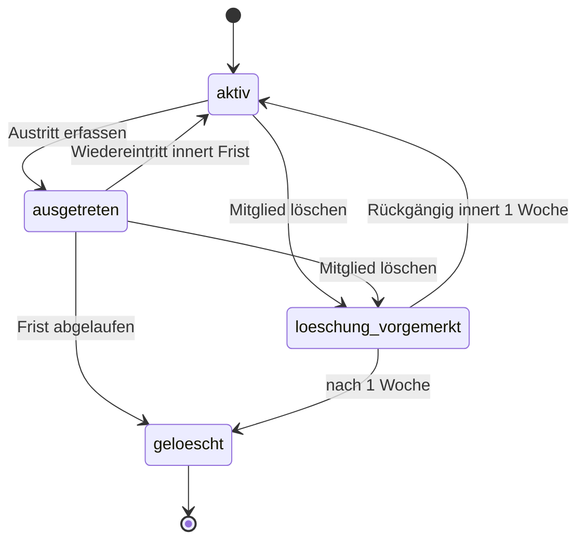

# Design: Admin-Oberfläche Mitgliederverwaltung (#43)

**Datum:** 2026-11-04 · **Issue:** [#43](https://github.com/konstantinniedermann/tco-app/issues/43)
· **Status:** freigegeben (Projektleiter, 04.11.2026)

## Absicht

Zum Start der Etappe *Mitglieder-Login* bringt der Projektleiter 300 bis 500 Mitglieder in
MyTCO (K-17.1, K-17.2), druckt ihnen die Login-Briefe und pflegt danach Nachzügler,
Korrekturen, Rollen und Austritte. Heute entstehen Mitglieder nur über das lokale
Seed-Skript. Dieses Issue baut den Admin-Bereich dafür.

Die Mitglieder kommen **automatisch über ein festes Einleseschema** in MyTCO, nicht von Hand.
Woher die Liste stammt (Fairgate-Export als Excel oder CSV, oder eine von der KI aufbereitete
Datei), ist offen (K-45). MyTCO legt nur fest, in welcher Form die Daten ankommen. Die
Umwandlung einer Fairgate-Liste in dieses Schema und der wiederkehrende Abgleich von Ein- und
Austritten entstehen später in #46. Für das Formular von Hand gibt es Nachzügler und
Korrekturen.

Massgebend und hier nicht wiederholt: [Fachmodell](../../fachmodell.md) (FR-01, FR-03, FR-04,
FR-24, FR-25, FR-26), [Rollen und Rechte](../../rollen-und-rechte.md) (RR-01 bis RR-09),
[Sicherheitskonzept](../../sicherheitskonzept.md) (SI-05, SI-07, SI-08, SI-09, SI-12),
[Datenschutz](../../datenschutz.md) (*Welche Daten*, *Wer sieht was*, *Löschen*, DS-07,
DS-08), [ADR-002](../../adr/adr-002-sveltekit-postgresql.md) (Bauregel: nur `+server.ts`,
SPA), [ADR-004](../../adr/adr-004-login-einmal-code.md) (Login),
[UI-Leitbild](../../ui-leitbild.md) (in der Fassung mit UI-08 und `.klappe`, siehe
*Oberfläche*), [Testkonzept](../../testkonzept.md).

## Ziele

1. Ein Admin öffnet den Admin-Bereich nur nach einem frischen Mail-Code, höchstens einmal pro
   24 Stunden je Gerät (SI-08, RR-09). Wer keine Rolle über *Mitglied* hat, sieht ihn nicht
   (RR-07).
2. Er liest eine CSV-Datei im MyTCO-Schema ein: Vorschau, dann Übernahme der neuen Zeilen.
3. Er druckt Login-Briefe für alle, die noch keinen haben, oder für eine Auswahl. Der
   Brief-Code entsteht erst beim Druck.
4. Er findet ein Mitglied in der Liste, bearbeitet seine Angaben, vergibt Rollen, stellt einen
   neuen Brief-Code aus und beendet alle Sitzungen.
5. Er erfasst einen Austritt. Wiedereintritt innert Frist geht, nach der Frist reduziert
   MyTCO das Mitglied auf den Namen (FR-04).
6. Er exportiert die Daten eines Mitglieds und löscht es, mit einer Woche Bedenkzeit (DS-07).
7. Jede Änderung und jede Aktion landet im Änderungsverlauf: wer, wann, welches Feld oder
   welche Aktion, ohne Werte (FR-26).

## Nicht-Ziele

- **Kein Abgleich beim erneuten Einlesen** (Ein- und Austritte, geänderte Adressen): Das
  macht #46. Hier werden bekannte Zeilen nur gemeldet, nicht geändert.
- **Keine Umwandlung von Fairgate-Listen** ins Schema (#46, hängt an K-45).
- **Keine Junioren ohne eigene E-Mail** (#45, K-08). Heute ist die E-Mail Pflicht; #45
  erweitert das Schema um eine eigene Spalte, statt die Pflicht aufzuweichen.
- **Kein «erstes Login» mit Ergänzen der Daten** (FR-02, A-LOGIN-03). Fehlende freiwillige
  Felder bleiben leer, bis diese Funktion kommt.
- **Keine Änderung der E-Mail durch das Mitglied selbst** (FR-25, SI-09). Der Admin ändert
  sie im Formular; der Hinweis an die alte Adresse gehört zu FR-25 und kommt mit dieser
  Funktion.
- Keine Bereiche für CM- und Lizenzverantwortliche. Der Admin-Bereich zeigt in diesem Issue
  nur *Admin*.
- Kein PDF auf dem Server: Briefe druckt der Browser.
- Kein pg-boss (ADR-002 sieht es für Hintergrundjobs vor). Für die eine tägliche Fristprüfung
  reicht ein Zeitgeber im Prozess. pg-boss kommt, wenn Push und Mails in Warteschlangen müssen.
- Kein Feinschliff am Aussehen: Funktion vor Ästhetik (Projektleiter, 04.11.2026).

## Anti-Ziele (wäre ein Fehlschlag, auch wenn alles grün ist)

- Ein Brief-Code ist nach dem Druck noch irgendwo abrufbar: in der Datenbank im Klartext, im
  Verlauf, in einem Log, im Browser-Speicher (RR-04).
- Die eingelesene Datei oder ihre Zeilen liegen nach dem Einlesen noch auf dem Server oder in
  einem Log (*Löschen*, DS-06).
- Der Änderungsverlauf enthält alte oder neue Werte (FR-26).
- Jemand wird über die Oberfläche zum ersten Admin, ohne schon Admin zu sein.
- Ein gesperrtes, ausgetretenes oder zur Löschung vorgemerktes Konto kann sich noch einloggen
  oder hat noch Rechte (RR-08).
- Eine Admin-Schnittstelle antwortet ohne gültige Admin-Sitzung mit frischer Bestätigung.
- Echte Mitgliederdaten in Tests, Fixtures oder Screenshots (DS-08).

## Entscheidungen des Projektleiters (04.11.2026)

- **Einlesen statt Erfassen von Hand:** MyTCO definiert ein Schema, die Verarbeitung der
  Fairgate-Liste dorthin entwerfen wir später (#46).
- **Schlüssel zum Wiedererkennen:** die Fairgate-Mitgliedernummer. Neues Personendatum, kommt
  vorher ins Datenschutzkonzept.
- **E-Mail ist beim Einlesen Pflicht.** Zeilen ohne E-Mail sind Fehler.
- **Umsetzung in Etappen:** ein Design, ein Plan, drei Bauetappen mit je eigenem Merge nach
  `dev`; #43 bleibt ein Issue.
- **Brief-Code beim Erzeugen der Briefe**, nicht beim Einlesen: «Briefe erzeugen» stellt die Codes aus und öffnet die Druckansicht, die der Browser druckt oder als PDF speichert.
- **Löschen mit Bedenkzeit:** Ein gelöschtes Mitglied ist eine Woche lang wiederherstellbar.
  Erst danach sind Konto und Angaben weg, und nur der Name bleibt (wie nach der Austrittsfrist).
- **Seite eines Mitglieds:** Variante A v3, siehe *Oberfläche*.
- **Erster Admin:** Ein Befehl auf dem Server legt den Projektleiter als Mitglied an und gibt
  ihm die Rolle Admin. Auf Test macht das Testdaten-Skript ein erfundenes Mitglied zum Admin.
- **Kein Sperren ohne Austritt oder Löschung.**

## Annahmen (an der wirkenden Stelle markieren)

| Annahme | Wert bis zur Antwort | Wo im Code |
|---------|----------------------|------------|
| K-38 Frist nach Austritt | 1 Jahr | Einstellung, ein Wert |
| K-45 Fairgate führt eine stabile Mitgliedernummer | ja | Schema, Pflichtspalte |
| K-18.2 wer Admin wird | Projektleiter per Befehl | Befehl *Admin festlegen* |
| K-21 Ansprechperson im Brief | wie heute (`MYTCO_KONTAKT`) | Brief |

## Bauetappen

Jede Etappe endet grün (`make check`), mit Nachweis und einem Merge nach `dev`.

| Etappe | Inhalt | Nachweis |
|--------|--------|----------|
| **1 Grundlage** | Rollen, Befehl *Admin festlegen*, Admin-Zugang mit Mail-Code (SI-08), Verwaltungsrahmen, Mitgliederliste mit Suche, Seite eines Mitglieds (Angaben, Login, Rollen, Verlauf), Anlegen von Hand, neuer Brief-Code, alle Sitzungen beenden, Änderungsverlauf | DB-Tests für Rechte, SI-08, RR-03, FR-26; E2E Anlegen → Bearbeiten → Rolle → Sitzungen beenden; Screenshot |
| **2 Einlesen und Briefe** | Einleseschema, Hochladen, Vorschau, Übernahme; Briefe einzeln und als Serie drucken | Einheitstests für Parser und Prüfung; DB-Test Übernahme; E2E Einlesen → Briefe; Screenshot der Druckansicht |
| **3 Austritt und Löschen** | Austritt, Wiedereintritt, Löschen mit Bedenkzeit, Rückgängig, tägliche Fristprüfung, Export | DB-Tests FR-04 mit gestellter Uhr; Einheitstest Export; E2E Austritt → Wiedereintritt |

Die Etappe 1 kommt zuerst, weil alle anderen Rechte, Verlauf und Verwaltungsrahmen brauchen.

## Rollen und Admin-Zugang

- **Rollen** als eigene Tabelle (Konto ↔ Rolle, mehrere je Konto, RR-01). Bekannte Rollen
  sind fest im Code: `mitglied` (implizit, jedes Konto), `admin`, `cm`, `lizenz`. In diesem
  Issue wirkt nur `admin`. `cm` und `lizenz` sind vergebbar, damit K-18.2 umgesetzt werden
  kann, öffnen aber noch nichts.
- **RR-03:** Der letzte Admin mit nicht gesperrtem Konto kann sich die Rolle nicht entziehen
  und wird nicht ausgetreten oder gelöscht. Die Prüfung läuft auf dem Server in derselben
  Transaktion wie die Änderung.
- **Erster Admin:** nur über einen Befehl auf dem Server (Skript, lokal als `make`-Ziel, auf
  dem Server über `docker compose exec`, Ablauf in `betrieb/README.md`). Auf Live ist die
  Datenbank anfangs leer, deshalb **legt der Befehl das Mitglied selbst an**: mit denselben
  Pflichtangaben wie eine Zeile des Einleseschemas (inkl. Mitgliedernummer) und mit derselben
  Prüfung (eine gemeinsame Prüffunktion, kein zweiter Regelsatz). Er legt Konto ohne
  Brief-Code an, gibt die Rolle `admin` und schreibt die Verlaufseinträge «angelegt» und
  «Rolle vergeben» mit Urheber *automatisch*. Besteht das Mitglied schon (gleiche Nummer oder
  E-Mail), gibt er nur die Rolle. Beim ersten Einlesen erscheint der so angelegte Admin unter
  «schon vorhanden». Einloggen kann er sich danach per Mail-Code (A-LOGIN-10).
  Der Befehl ist kein neuer Weg für fremde Personendaten: Er legt nur den Admin selbst an
  (Hinweis in `betrieb/README.md` und im Datenschutzkonzept unter *Welche Daten*).
- **Auf Test** macht `scripts/testdaten.ts` bei jeder Auslieferung eines der erfundenen
  Mitglieder (das mit der Adresse des Projektleiters) automatisch zum Admin, damit die
  Checkliste vor dem Release ohne Handarbeit läuft.
- **Kein Sperren als eigene Aktion** (Projektleiter, 04.11.2026): Ein Konto ist genau dann
  gesperrt, wenn das Mitglied *ausgetreten* oder *zur Löschung vorgemerkt* ist. Für ein
  verlorenes Handy gibt es «Alle Sitzungen beenden». Rechte-Matrix und FR-26 werden darauf
  angepasst.
- **SI-08, frischer Code:** Öffnet ein Admin den Admin-Bereich, schickt MyTCO auf Knopfdruck
  einen Code an seine E-Mail-Adresse. Nach der Eingabe gilt die Bestätigung für **diese
  Sitzung** 24 Stunden. Werte (Länge, Gültigkeit, Fehlversuche, Rate Limit) wie beim Mail-Code
  im Sicherheitskonzept. **Dieser Code ist kein Login-Code:** Er öffnet nur den Admin-Bereich
  der laufenden Sitzung, und ein Login-Code öffnet nicht den Admin-Bereich. Die Bestätigung
  endet mit der Sitzung und wenn die Sitzungsversion steigt.
- **Prüfung auf dem Server:** Jede Admin-Schnittstelle prüft Sitzung, Rolle `admin`, nicht
  gesperrt und frische Bestätigung. Eine einzige Funktion dafür, die jede Admin-Route
  aufruft; ein Test prüft, dass keine Route unter `src/routes/api/admin/` ohne sie auskommt.

## Einleseschema (CSV)

- **Datei:** CSV, UTF-8 (mit oder ohne BOM), Trennzeichen Komma oder Semikolon (aus der
  Kopfzeile erkannt), Felder mit Anführungszeichen nach RFC 4180. Erste Zeile sind die
  Spaltennamen, die Reihenfolge ist frei. Unbekannte Spalten sind ein Fehler der ganzen Datei,
  damit nichts Ungeplantes übernommen wird (*Welche Daten*).
- **Grenzen:** höchstens 1 MB und 2000 Zeilen.
- **Spalten:**

| Spalte | Pflicht | Form |
|--------|---------|------|
| `mitgliedernummer` | ja | Text, 1–20 Zeichen aus Ziffern und Buchstaben, in der Datei eindeutig |
| `vorname`, `nachname` | ja | Text, 1–100 Zeichen, Leerzeichen am Rand entfernt |
| `strasse` | ja | Text, 1–100 Zeichen |
| `plz` | ja | 4 Ziffern (Schweiz); andere Länder sind ein Fehler, bis jemand sie braucht |
| `ort` | ja | Text, 1–100 Zeichen |
| `email` | ja | eine Adresse, wird klein geschrieben, in der Datei eindeutig |
| `telefon` | nein | Text, Ziffern, Leerzeichen, `+`; 6–20 Zeichen |
| `geschlecht` | nein | `w`, `m` oder leer |
| `jahrgang` | nein | vierstellig, 1900 bis aktuelles Jahr |
| `lizenznummer` | nein | Text, 1–20 Zeichen |

- **Vorschau** in drei Gruppen: **neu** (wird übernommen), **fehlerhaft** (Zeilennummer und
  Grund je Feld, ohne die Werte zu wiederholen ausser dem Namen), **schon vorhanden** (gleiche
  Mitgliedernummer oder gleiche E-Mail wie ein bestehendes Mitglied; wird nicht geändert, #46).
- **Übernahme:** Der Admin bestätigt, dann legt der Server alle neuen Zeilen in **einer**
  Transaktion an (Mitglied + Konto ohne Brief-Code, FR-01), je ein Verlaufseintrag «angelegt
  (Einlesen)». Zwischen Vorschau und Übernahme prüft der Server die Datei erneut; die Datei
  wird zweimal geschickt statt auf dem Server zwischengespeichert.
- **Keine Aufbewahrung:** Die Datei wird nur im Arbeitsspeicher gelesen, nie gespeichert und
  nie geloggt.
- **Übertragung:** Der Browser liest die Datei und schickt ihren Text im JSON-Körper, weil
  ändernde Anfragen nur JSON annehmen (SI-10). Die Grösse der Anfrage muss dafür über die
  heutige Grenze des Servers (512 KB) auf gut 1 MB steigen, nur für diese Schnittstelle oder
  mit kleinster nötiger Erhöhung.

## Briefe

- **Seite *Briefe*:** Liste der aktiven Mitglieder ohne gültigen Brief-Code und ohne
  eingelöstes Login, mit Auswahl (alle oder einzelne). «Briefe erzeugen» stellt für die
  Auswahl je einen Brief-Code aus (bestehende Funktion `stelleBriefCodeAus`, FR-24) und
  öffnet eine Druckansicht mit einer Seite je Brief aus `baueBriefHtml`.
- **Einzelner Brief:** «Neuen Brief-Code ausstellen» auf der Seite eines Mitglieds öffnet
  dieselbe Druckansicht für ein Mitglied.
- **Code nur einmal sichtbar:** Die Druckansicht entsteht aus der Antwort des Servers und
  wird nicht gespeichert, auch nicht im Browser. Wer sie schliesst, ohne zu drucken, stellt
  neue Codes aus. Die Oberfläche sagt das vor dem Erzeugen.
- **Verlauf:** je Mitglied «Brief-Code ausgestellt».
- **Sicherheitsregeln des Browsers:** `baueBriefHtml` liefert heute ein eigenes Dokument mit
  eingebettetem `<style>`, das die Content-Security-Policy der App blockt. Der Brief wird für
  die Druckansicht umgebaut (Stil aus einer Datei bzw. aus `basis.css`), ohne Ausnahme in der
  Policy. Der Musterbrief (`make musterbrief`) muss weiter gleich aussehen.

## Austritt und Löschen

Zustände je Mitglied (Fachmodell ergänzen):

- **Austritt erfassen:** Status *ausgetreten*, Austrittsdatum heute (oder ein vom Admin
  gewähltes Datum, nicht in der Zukunft), Konto gesperrt, alle Sitzungen beendet.
- **Wiedereintritt:** nur aus *ausgetreten* vor Ablauf der Frist; Status *aktiv*, Konto
  entsperrt, Austrittsdatum leer. Ein neuer Brief-Code nur auf Wunsch.
- **Mitglied löschen:** Status *Löschung vorgemerkt* mit Datum, Konto gesperrt, Sitzungen
  beendet. Rückgängig innert einer Woche führt zurück auf *aktiv*. War das Mitglied vorher
  ausgetreten, führt Rückgängig auf *ausgetreten* mit dem alten Austrittsdatum.
- **Ende der Frist (*gelöscht*):** Konto mit Sitzungen und Rollen weg, alle Angaben ausser
  Vor- und Nachname weg (auch Mitgliedernummer und E-Mail), Verlaufseinträge des Mitglieds weg
  (*Löschen*). Ein *gelöschtes* Mitglied erscheint nicht mehr in der Mitgliederliste.
- **Fristprüfung:** beim Start der App und danach alle 24 Stunden ein Zeitgeber im Prozess;
  sie arbeitet nach Datum, damit ein ausgefallener Lauf beim nächsten nachgeholt wird. Fristen
  (Austritt: Einstellung, vorläufig 1 Jahr; Bedenkzeit: 7 Tage) zählen ab dem gespeicherten
  Datum.
- **Export (DS-07):** JSON-Datei mit allen gespeicherten Daten des Mitglieds: Angaben,
  Status, Rollen, Konto ohne Code-Hashes und Sitzungskennungen, Zahl der Sitzungen mit
  *zuletzt genutzt*, Verlauf. Verlaufseintrag «Export».

## Änderungsverlauf (FR-26)

- **Ein Eintrag** = Mitglied, Zeitpunkt, Urheber (Konto des Admins, das Mitglied selbst oder
  *automatisch*), Art (*Feld geändert* mit Feldname, oder eine Aktion: angelegt, Brief-Code
  ausgestellt, Sitzungen beendet, Rolle vergeben/entzogen mit Rollenname, Austritt,
  Wiedereintritt, Löschung vorgemerkt, Löschung rückgängig, Export). Nie Werte.
- Rollenname und Feldname sind keine Werte im Sinne von FR-26: Sie sagen, *was* geändert
  wurde, nicht *wie*.
- Speichern eines Formulars mit drei geänderten Feldern ergibt drei Einträge; unveränderte
  Felder ergeben keinen.
- **Löschung nach 12 Monaten** läuft in der Fristprüfung mit.
- **Urheber nach Löschung:** Wird das Konto des Urhebers gelöscht, zeigt der Eintrag weiter
  seinen Namen (Fachmodell, *Aenderung*); automatische Einträge zeigen *MyTCO*. Der Urheber
  muss darum vom Konto unabhängig erhalten bleiben (z. B. Verweis auf das Mitglied, dessen
  Name auch nach *gelöscht* bleibt, plus Art des Urhebers). Die Regel «Verlaufseinträge des
  Mitglieds weg» betrifft die Einträge **über** dieses Mitglied, nicht die, die es als Admin
  über andere geschrieben hat.
- **Anzeige:** auf der Seite eines Mitglieds (Gruppe *Verlauf*) und als Seite
  *Änderungsverlauf* über alle Mitglieder, neueste zuerst, filterbar nach Mitglied.

## Daten (Drizzle, neue Migrationen)

- `mitglied`: neu `mitgliedernummer` (eindeutig, leer erlaubt für von Hand angelegte und für
  *gelöscht*), `telefon`, `geschlecht`, `jahrgang`, `lizenznummer`, `austrittsdatum`,
  `loeschungVorgemerktAm`, `statusVorLoeschung`. `status` um `loeschung_vorgemerkt`
  erweitern. Bei *gelöscht* dürfen alle Felder ausser Vor- und Nachname leer sein; heute sind
  Adresse und E-Mail `not null` und müssen dafür lockerer werden (Prüfung über eine
  Bedingung je Status statt `not null`).
- `konto_rolle` (Konto, Rolle; eindeutig je Paar).
- `aenderung` (Verlauf, wie oben; Urheber als Konto oder leer für *automatisch*, Art, Feld).
- Bestätigung für SI-08 an der Sitzung (Zeitpunkt der Bestätigung) und ein eigener
  Admin-Code mit Ablauf und Fehlversuchen, getrennt von Brief- und Mail-Code.
- **Parallelarbeit:** #44 (Passkey) ändert gleichzeitig das Schema. Vor dem Erzeugen jeder
  Migration `origin/dev` einmergen, damit die Migrationen nicht kollidieren.

## Schnittstellen (`src/routes/api/admin/…/+server.ts`)

Alle unter `/api/admin/`, alle mit der Prüfung aus *Rollen und Admin-Zugang*. Ausgenommen sind
nur die beiden Schnittstellen für den Admin-Code (anfordern, bestätigen), die eine Sitzung mit
Rolle `admin` verlangen, aber keine frische Bestätigung. Fachlogik liegt in
`src/lib/server/admin/` (bzw. `mitglieder/`), die Routen sind dünn (ADR-002). Eingaben werden
auf dem Server geprüft, auch wenn die Oberfläche schon prüft.

## Oberfläche

- **Leitbild zuerst:** Massgebend ist das Leitbild in der Fassung aus #44 (UI-08, `.klappe`,
  `.kachel` neu). Die Fassung kommt mit dem Merge von #44 auf `dev`; ist #44 beim Start der
  Etappe 1 noch nicht gemergt, wird nur der Leitbild-Teil übernommen, ohne Fremdes
  anzufassen. Neu ins Leitbild, bevor sie in den Code kommen:
  - **Feld-Zeile** (`.feld-zeile`): Bezeichnung links, Eingabe rechts, gleiche Schriftgrösse
    für beide; nur in der Verwaltung; auf schmalem Bildschirm Bezeichnung wieder über dem
    Feld.
  - **Inaktive Taste:** Die Haupttaste ist grau, solange es nichts zu speichern gibt, und
    bekommt Farbe, sobald sich etwas geändert hat.
  - **Zwei Spalten in der Verwaltung** auf dem PC.
- **Seite eines Mitglieds (Variante A v3):** Kopf mit Name, Status-Plakette, Mitgliedernummer.
  Darunter Gruppen als weisse Karten zum Auf- und Zuklappen (`.karte.klappe`), auf dem PC in
  zwei Spalten: links *Angaben* (offen) und *Verlauf*, rechts *Login* (Brief-Status, Geräte,
  neuer Brief-Code, Sitzungen beenden), *Rollen*, *Mitgliedschaft* (Austritt, Wiedereintritt,
  Rückgängig), *Daten* (Export, Löschen). Zugeklappt zeigt die Titelzeile das Wichtigste
  (z. B. «Login · Brief offen · kein Gerät»). Jede Gruppe mit eigenem Speichern trägt dessen
  Namen («Angaben speichern», «Rollen speichern»).
- **Mitgliederliste** wie Mockup 5 in `docs/ui-mockups/index.html`, mit Spalte
  Mitgliedernummer, Suche (Name, E-Mail, Nummer) und Filter nach Status.
- **Seitenleiste Admin:** Mitglieder · Einlesen · Briefe · Änderungsverlauf · ‹ Zur App.
- **Rückfragen** vor Austritt, Löschen und Sitzungen beenden über `<dialog>` (Leitbild), nicht
  über `alert`/`confirm`.
- Das Mockup der Mitgliedseite kommt als Bild 6 nach `docs/ui-mockups/index.html`.

## Tests und Nachweis

- Testfälle tragen die Anforderungs-IDs (A-MITGLIED-01/-02/-03/-06, A-ROLLE-01/-02) bzw. Regeln
  (FR-04, FR-26, RR-03, RR-07, RR-08, RR-09, SI-08, DS-07), wie im Testkonzept.
- Nur erfundene Testdaten (DS-08), auch in der Beispiel-CSV für Tests.
- Fristen mit gestellter Uhr testen, nicht mit Warten.
- Je Etappe ein E2E-Lauf und ein Screenshot der neuen Seiten.

## Doku, die mitgeht

- **Vor dem Bauen** (Etappe 1): Datenschutzkonzept (*Welche Daten*: Mitgliedernummer; *Löschen*:
  Bedenkzeit 1 Woche, Zustand *Löschung vorgemerkt*) und Datenschutzerklärung; Fachmodell
  (Attribute, Zustand *Löschung vorgemerkt*, FR-04 ergänzt); UI-Leitbild (neue Bausteine).
- **Mit dem Bauen:** Rollen und Rechte (Status `umgesetzt`; Matrix ohne «Konto sperren»),
  FR-26 ohne Änderungen an *gesperrt* als eigene Aktion, Anforderungen, Testkonzept,
  `betrieb/README.md` (Befehl *Admin festlegen*), Context-Scopes (neue Pfade), `docs/versionen.md`.
- **Abklärungen:** K-45 um die Frage nach der Mitgliedernummer ergänzen.

## Dem Builder überlassen

- Namen von Tabellen, Spalten, Routen und Komponenten (nach den Namensregeln im Fachmodell).
- Der CSV-Parser selbst (ohne neue Abhängigkeit) und die genaue Fehlertextform.
- Ob die Bestätigung für SI-08 an der Sitzung oder in einer eigenen Tabelle liegt, solange sie
  mit der Sitzung endet.
- Seitenaufteilung der Druckansicht und CSS für den Druck (`@media print`).
- Reihenfolge der Aufgaben innerhalb einer Etappe.
