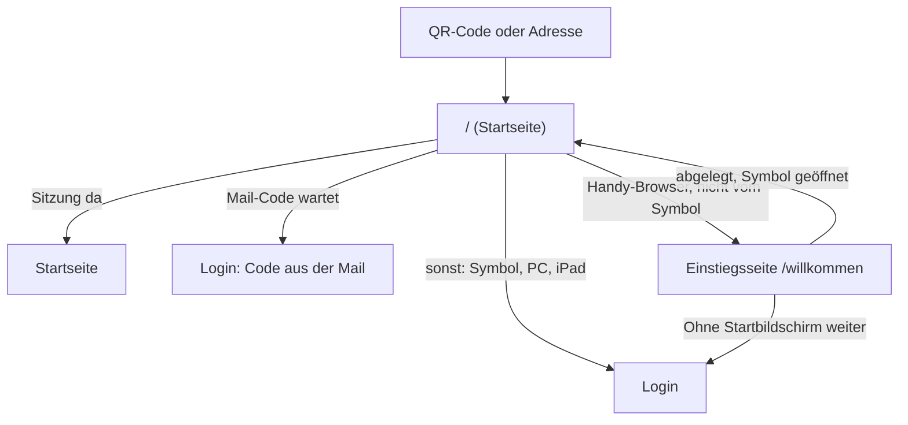

# Design: Hilfe beim Start (#47, A-HILFE-01, A-HILFE-02)

**Datum:** 2026-11-04 · **Issue:** [#47](https://github.com/konstantinniedermann/tco-app/issues/47)
· **Status:** freigegeben (Projektleiter, 04.11.2026)

## Absicht

Beim Start bekommen Mitglieder nur den Brief. Danach sollen sie MyTCO ohne fremde Hilfe auf den
Startbildschirm legen, sich anmelden und später einen neuen Code oder einen Passkey holen können.
Die Testgruppe ([Testgruppe](../../testgruppe.md), #40) prüft genau diese Hilfe. Darum muss sie
vor Lauf 1 stehen (Milestone *Pilot*).

**Wichtig ist die Reihenfolge auf dem iPhone:** Ein Symbol auf dem Startbildschirm hat einen
eigenen Speicher, getrennt von Safari. Wer sich zuerst in Safari mit dem Brief-Code anmeldet und
erst danach MyTCO ablegt, ist im Symbol abgemeldet. Dann ist der Brief-Code verbraucht, und es
braucht einen Code per Mail. Deshalb gilt: **erst ablegen, dann anmelden**, und die Einstiegsseite
im Handy-Browser zeigt nur diesen ersten Schritt.

Grundlage ist das Mockup [Hilfe beim Start](../../ui-mockups/hilfe.html) (Entwurf 2 mit Abschluss
«Fertig», im Brainstorming abgestimmt). Massgebend und hier nicht wiederholt:
[UI-Leitbild](../../ui-leitbild.md) (UI-01 bis UI-08, *Welche Fläche wofür*),
[ADR-002](../../adr/adr-002-sveltekit-postgresql.md) (Bauregel: unter `src/routes` nur `+server.ts`),
[Datenschutz](../../datenschutz.md) (DS-03: keine Inhalte von fremden Servern).

## Ziele

1. Wer den QR-Code mit dem Handy scannt, sieht im Browser zuerst die Anleitung zum
   Startbildschirm für sein Gerät (iPhone oder Android), als Animation mit nummerierten Schritten.
2. Auf Android mit Chrome öffnet eine Taste «MyTCO installieren» den Installationsdialog von
   Android direkt; die Anleitung über das Menü bleibt als Rückfall.
3. Die Animation macht klar, wann man fertig ist, und läuft nicht endlos.
4. Die Seite *Hilfe* ist ohne Login erreichbar, von jeder Seite der Mitglieder-App aus.
5. Brief, UI-Leitbild, Anforderungen und Testkonzept sind nachgeführt.

## Nicht-Ziele

- **Keine zweite iPhone-Animation für iOS 16–18** und keine eigene Animation für den
  Samsung-Browser. Annahme des Projektleiters: Alle iPhones haben iOS 26 oder neuer (das
  neueste iPhone ohne iOS 26 ist das XS/XR von 2018); Android-Handys sind höchstens 5 Jahre alt,
  Chrome ist aktuell. Für die anderen Fälle genügt ein Satz unter der Anleitung (siehe unten).
- **Kein Thema «Eigene Angaben ändern»** auf der Hilfe-Seite, solange A-KONTO-01 nicht gebaut
  ist. Es kommt mit A-KONTO-01.
- **Keine Videos und keine echten Bildschirmfotos.** Die Zeichnung folgt den Farben von MyTCO
  und veraltet nicht bei jedem Update von iOS oder Android.
- **Kein Merken der Wahl** «Ohne Startbildschirm weiter». Wer im Browser bleibt, tippt beim
  nächsten Mal wieder auf den Link.
- **Keine Einstiegsseite am PC und auf dem iPad.** Dort geht es wie bisher direkt zum Login.

## Anti-Ziele

- Ein Mitglied tippt den Brief-Code im Browser ein, bevor es MyTCO abgelegt hat, weil die
  Einstiegsseite den Login zuerst anbietet.
- Beschriftungen in Anleitung oder Zeichnung, die es auf dem Handy so nicht gibt.
- Eine Animation, die endlos läuft, sich nicht anhalten lässt oder «Bewegung reduzieren»
  übergeht.

## Ablauf

Die Weiche sitzt im Laden von `/` (`src/routes/+page.ts`), dort wo heute ohne Sitzung zum Login
umgeleitet wird. «Vom Symbol» heisst: `display-mode: standalone` trifft zu, auf dem iPhone
zusätzlich `navigator.standalone`. «Handy» heisst: iPhone oder Android laut User-Agent;
Android-Tablets zählen dazu, das iPad nicht (es gibt sich als Mac aus). Die Erkennung läuft nur
im Browser, wird nicht gespeichert und nicht an den Server geschickt.

## Einstiegsseite `/willkommen`

Titel «Willkommen bei MyTCO». Eine Karte «Zuerst auf den Startbildschirm» mit dem Satz «Dann
öffnest du MyTCO mit einem Tipp, wie eine App. Erst danach meldest du dich an.»

- **iPhone:** in der Karte die Anleitung iPhone. Unter den Schritten: «Siehst du das
  Teilen-Symbol schon direkt in der Leiste? Dann tipp gleich darauf.» Das deckt die
  Safari-Leiste «Unten» oder «Oben» und ältere iOS-Versionen ab. Läuft die Seite auf dem
  iPhone in einem anderen Browser (Chrome, Firefox, Edge), steht über der Anleitung «Öffne
  diese Seite zuerst in Safari.» (Entscheid Claude).
- **Android, Chrome bietet die Installation an** (`beforeinstallprompt`): in der Karte die
  Haupttaste «MyTCO installieren» und darunter «Android fragt nach. Tippe dort auf
  «Installieren», dann öffne MyTCO über das neue Symbol.» Darunter ein Aufklappbereich «Klappt
  nicht? Über das Menü» mit der Anleitung Android.
- **Android ohne dieses Angebot** (z. B. Samsung-Browser, oder schon abgelehnt): wie beim
  iPhone, mit der Anleitung Android.
- Unter der Karte der Link «Ohne Startbildschirm weiter» zum Login.

## Baustein Anleitung (neu im UI-Leitbild)

Eine vereinfachte, selbst gezeichnete Handy-Ansicht, darunter die Taste «Anhalten», darunter die
nummerierten Schritte. Die Zeichnung ist für Screenreader verborgen; die Bedeutung tragen die
Schritte (UI-05). Ein Schritt im Text gehört zu genau einem Bild der Zeichnung.

| Schritt | iPhone (Safari, iOS 26) | Android (Chrome) |
|---------|-------------------------|------------------|
| 1 | Tippe unten rechts auf •••. | Tippe oben rechts auf ⋮ «Menü». |
| 2 | Tippe auf (Teilen-Symbol) «Teilen». | Tippe auf «Installieren und Verknüpfung erstellen». |
| 3 | Scrolle nach unten und tippe auf «Zu Home-Bildschirm hinzufügen». | Tippe auf «Installieren». |
| 4 | «Als Web-App öffnen» muss eingeschaltet sein. Tippe auf «Hinzufügen». | — |
| ✓ | **Fertig!** Verlass jetzt den Browser und starte MyTCO über das neue Symbol auf deinem Startbildschirm. | gleich |

Die Beschriftungen stammen aus der Hilfe von
[Apple](https://support.apple.com/de-ch/guide/iphone/iphea86e5236/ios) und
[Google](https://support.google.com/chrome/answer/9658361?hl=de&co=GENIE.Platform%3DAndroid)
(Stand 04.11.2026). In der Zeichnung stehen nur Beschriftungen, die dort belegt sind; übrige
Menüeinträge und Tasten sind graue Balken. Ob Lage und Aussehen stimmen, zeigt die Prüfung auf
echten Geräten.

**Bewegung:**

- Ein Schritt dauert 3,5 Sekunden, das Bild «Fertig» 6 Sekunden. Die Bilder blenden weich
  ineinander über. Innerhalb eines Schritts klappt das Menü auf, das Teilen-Blatt fährt hoch und
  die Liste scrollt. Der Tipp-Kreis erscheint und «drückt». Der laufende Schritt ist in der
  Liste hervorgehoben (Fläche `--farbe-marke-zart`, Balken links).
- Der Tipp-Kreis ist Sandplatz-Rot (`--farbe-aktion`). Das ist eine ausdrückliche Ausnahme zur
  Regel «Rot nur für die Haupttaste»: Rot sagt hier wie dort «hier tippen».
- Nach **drei Durchläufen** hält die Animation beim Bild «Fertig» an. Die Taste heisst dann
  «Nochmals abspielen»; vorher wechselt sie zwischen «Anhalten» und «Abspielen» (WCAG 2.2.2).
- Bei **«Bewegung reduzieren»** gibt es keine Animation und keine Taste. Die Bilder stehen
  nummeriert in zwei Spalten still, jedes im Endzustand seines Schritts.

## Seite Hilfe `/hilfe`

Ohne Login erreichbar, oben «‹ Zurück». Jedes Thema ein Aufklappbereich, jeder mit einem Anker
(z. B. `/hilfe#startbildschirm-iphone`):

1. **Auf den Startbildschirm: iPhone**: «Öffne my.tcolten.ch in Safari, dann:» + Anleitung iPhone
2. **Auf den Startbildschirm: Android**: «Öffne my.tcolten.ch in Chrome, dann:» + Anleitung Android
3. **Neuer Code per E-Mail**: wann man ihn braucht, drei Schritte, «Er gilt 15 Minuten», Hinweis
   auf den Spam-Ordner
4. **Mit Passkey anmelden**: was ein Passkey ist, Einrichten über den Hinweis auf der Startseite
   oder im Profil
5. Karte **«Fragen?»**: Kontakt für Fragen aus der bestehenden Einstellung `MYTCO_KONTAKT`,
   dieselbe wie im Brief und in der Meldung «Code schon benutzt» (Entscheid Projektleiter).
   Die Seite holt ihn über einen neuen Endpunkt, der ohne Login antwortet (`+server.ts`,
   ADR-002). Damit ist der Kontakt für alle im Internet lesbar; er soll deshalb eine
   Vereins-Adresse sein, keine private Nummer. Dieser Hinweis kommt zu K-21 (**Annahme K-21**
   bleibt, solange die Antwort fehlt). Antwortet der Endpunkt nicht, zeigt die Karte «Den
   Kontakt findest du in deinem Brief.»

Auf dem eigenen Handy steht das passende Startbildschirm-Thema zuoberst, am PC zuerst das iPhone.
Die Adresse in den Texten ist die der jeweiligen Umgebung (Test oder Live), nicht fest
eingetragen.

**Erreichbar** über den Link «Hilfe» in der Fusszeile, neben der Version, auf jeder Seite der
Mitglieder-App, auch vor dem Login und auf der Einstiegsseite. Die Verwaltung bleibt ohne.

## Brief

Die Kurzanleitung im Brief (A-LOGIN-01) übernimmt die Schritte von oben in Kurzform. Heute
beschreibt sie den alten iPhone-Weg und die alte Android-Beschriftung.

- iPhone: Tippe auf ••• und dann auf (Teilen) «Teilen», dann auf «Zu Home-Bildschirm hinzufügen».
- Android: Tippe auf (Menü) «Menü», dann auf «Installieren und Verknüpfung erstellen».

## Was nachgeführt wird

| Dokument | Änderung |
|----------|----------|
| `docs/ui-leitbild.md` | Baustein *Anleitung* mit Teilen und Regeln zur Bewegung; Fusszeile mit Link «Hilfe»; Ausnahme Sandplatz-Rot für den Tipp-Kreis; Mockup «Hilfe beim Start» in der Liste |
| `docs/anforderungen/anforderungen.md` + Änderungsprotokoll | A-HILFE-01, -02 auf *umgesetzt* (mit Stern, solange die Geräteprüfung offen ist); A-HILFE-02 präzisiert: eigene Einstiegsseite, Android-Taste |
| `docs/testkonzept.md` | Tests zu A-HILFE-01, -02; Checkliste vor dem Release: Einstiegsseite und Anleitung auf iPhone (Safari) und Android (Chrome, Taste und Menü), Samsung-Browser beobachten |
| `docs/abklaerungen.md` | K-21: Kontakt steht auch auf der öffentlichen Hilfe-Seite, darum eine Vereins-Adresse |
| `docs/ci-cd-und-release.md` | `MYTCO_KONTAKT`: steht auch auf der Seite Hilfe, ohne Login lesbar |
| `docs/context-scopes.md` | Zeile *Hilfe und Einstieg* |
| Brief | Kurzanleitung wie oben |

## Nachweis

- Unit-Tests für die Erkennung (iPhone mit Safari bzw. anderem Browser, Android, Android-Tablet,
  iPad, PC; vom Symbol oder im Browser) und für die Weiche in `/`; Test des Kontakt-Endpunkts
  ohne Sitzung.
- E2E auf iPhone, Android und PC: Einstiegsseite nur im Handy-Browser, sonst Login; Hilfe ohne
  Login erreichbar; axe auf jedem neuen Bildschirm (UI-01); bei «Bewegung reduzieren» keine
  Animation und keine Taste.
- Screenshots der Einstiegsseite (iPhone, Android) und der Hilfe.
- Prüfung auf echten Geräten über die Checkliste vor dem Release.

## Dem Umsetzenden überlassen

- Aufteilung in Svelte-Komponenten, die Zeichnung als Markup mit Klassen aus `basis.css`
  (Farben nur aus Tokens, Masse in `rem`, keine `style`-Attribute).
- Wo das Ereignis `beforeinstallprompt` abgefangen wird (es kommt früh, also eher im Layout),
  und wie die Seite reagiert, wenn Android die Installation bestätigt oder ablehnt.
- Ob die Dauern als Tokens in `tokens.css` stehen.
- Wie E2E den Start «vom Symbol» nachstellt (z. B. `matchMedia` per Init-Skript).
