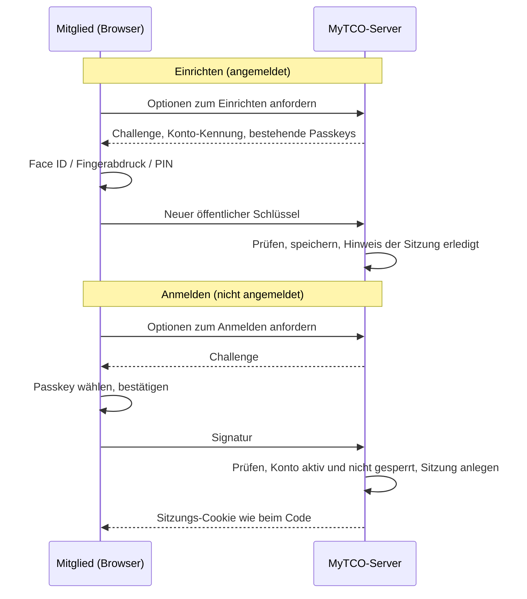

# Design: Freiwilliger Passkey (#44, A-LOGIN-07)

**Datum:** 2026-11-04 · **Issue:** [#44](https://github.com/konstantinniedermann/tco-app/issues/44)
· **Status:** freigegeben (Projektleiter, 04.11.2026)

## Absicht

Mitglieder sollen sich so einfach wie möglich anmelden. Der Vorstand wünschte ein Passwort, um
vom PC hineinzukommen und das Handy wechseln zu können (K-02.1). Entschieden ist: kein Passwort,
stattdessen ein **freiwilliger Passkey** (ADR-004, Nachtrag). Der Projektleiter nutzt Passkeys
selbst gern und will, dass MyTCO sie **aktiv empfiehlt**: Ein Passkey ist bequemer als jeder
Code, und er deckt beide Wünsche des Vorstands ab. Am PC scannt man mit dem Handy einen QR-Code
oder nutzt Windows Hello bzw. Touch ID. Ein neues Handy derselben Familie (Apple bzw. Google) hat
den Passkey über die Cloud schon.

Der Passkey ist **ein weiterer Weg zur selben Sitzung**. Der Brief-Code und der Mail-Code
bleiben unverändert gültig.

Massgebend und hier nicht wiederholt: [ADR-004](../../adr/adr-004-login-einmal-code.md),
[Design Login](2026-11-02-login-einmal-code-design.md), [Sicherheitskonzept](../../sicherheitskonzept.md)
(SI-01 bis SI-11), [Datenschutz](../../datenschutz.md) (Passkey-Zeilen unter *Welche Daten* und
*Löschen*, DS-06, DS-08), [UI-Leitbild](../../ui-leitbild.md) (UI-04, UI-08 *Welche Fläche wofür*),
[ADR-002](../../adr/adr-002-sveltekit-postgresql.md) (Bauregel: unter `src/routes` nur `+server.ts`).

## Ziele

1. Ein angemeldetes Mitglied richtet mit einem Tipp einen Passkey ein und meldet sich danach mit
   Face ID, Fingerabdruck oder Geräte-PIN an, ohne Code und ohne E-Mail-Adresse einzutippen.
2. Nach jedem Login per Code empfiehlt MyTCO den Passkey mit einem Hinweis auf der Startseite;
   «Nein, danke» blendet ihn aus.
3. Im Profil sieht das Mitglied seine Passkeys, entfernt einzelne und richtet auf weiteren
   Geräten einen ein.
4. Der Login per Brief- und Mail-Code funktioniert unverändert daneben.
5. Die Wahl der Bibliothek ist als ADR-005 begründet; Sicherheitskonzept, Anforderungen,
   Testkonzept, Datenschutz und UI-Leitbild sind nachgeführt.

## Nicht-Ziele

- **Kein Pflicht-Passkey.** Den Mail-Code braucht es ohnehin für verlorene Geräte, den Wechsel
  zwischen Apple und Google und Geräte ohne Bildschirmsperre. Solange er gilt, brächte eine
  Pflicht keine Sicherheit, nur eine Hürde. Ausserdem braucht ein Passkey iOS 16 oder Android 9
  mit Bildschirmsperre (Recherche vom 04.11.2026, Quellen im ADR-005).
- **Kein Passkey, der den Mail-Code sperrt** (bleibt *später*, ADR-004).
- **Keine Admin-Bestätigung per Passkey** statt des täglichen Mail-Codes (SI-08). Sie kommt
  mit der Admin-Oberfläche in #43, wenn überhaupt; das Datenmodell hier verbaut sie nicht.
- Keine Passkeys für Verwaltung durch den Admin (ansehen, löschen); das kommt mit #43.
- Kein Hinweis auf den Passkey im Brief; der Brief bleibt wie er ist.

## Anti-Ziele

Es wäre ein Fehlschlag, auch wenn es technisch läuft, wenn …

- … ein Mitglied ohne passkeyfähiges Gerät nicht mehr hineinkommt oder sich gedrängt fühlt
  (der Hinweis drängelt nicht: einmal pro Login per Code, mit einem Klick weg);
- … der Login per Code durch den Passkey schlechter, langsamer oder anders wird;
- … MyTCO mehr speichert als im Datenschutzkonzept steht (öffentlicher Schlüssel und Kennung
  je Passkey, dazu die unten genannten Verwaltungsangaben);
- … ein Passkey ein gesperrtes oder ausgetretenes Konto hineinlässt.

## Entscheide des Projektleiters (04.11.2026)

| Entscheid | Inhalt |
|-----------|--------|
| Freiwillig, aktiv empfohlen | Kein Zwang; nach jedem Login per Code ein Hinweis mit Empfehlung |
| Bibliothek | **SimpleWebAuthn** freigegeben: `@simplewebauthn/server` 14.x und `@simplewebauthn/browser` 14.x (MIT). Begründung in ADR-005 |
| Angebot als Hinweis (Variante B) | Hinweis-Fläche auf der Startseite, nicht als eigener Schritt nach dem Login |
| Login-Seite in zwei Flächen | Karte *Mit Passkey* oben (empfohlen), Karte *Mit Code* darunter |
| Profil mit Aufklappbereichen | Passkeys in einem eigenen Aufklappbereich, weil das Profil später wächst |
| UI-08 | Jedes Thema eigene Fläche; Fläche nach Funktion und Lebensdauer (schon im UI-Leitbild, Commit auf diesem Branch) |

Die Entwürfe liegen als HTML unter `docs/ui-mockups/passkey.html` (Runde 2, aus dem
Brainstorming übernommen).

## Bildschirme

### 1 · Hinweis auf der Startseite

Fläche: **Hinweis** (UI-08: vorübergehend, mit Erledigen und Wegklicken).

- Titel «Nächstes Mal ohne Code?», Text: «Mit einem Passkey meldest du dich mit Face ID,
  Fingerabdruck oder der Handy-PIN an. Das empfehlen wir: Es ist schneller und sicherer als ein
  Code.»
- Haupttaste «Passkey einrichten», daneben der Link «Nein, danke».
- **Wann er erscheint:** in einer Sitzung, die per Brief- oder Mail-Code entstanden ist, bis das
  Mitglied in dieser Sitzung einen Passkey einrichtet oder «Nein, danke» wählt. Eine Sitzung, die
  per Passkey entstanden ist, zeigt ihn nie. Der Merker gehört zur Sitzung in der Datenbank, nicht
  in den Gerätespeicher. *(Meine Wahl: Sitzungsbezug statt «für immer weg», damit ein Mitglied
  auf einem neuen Gerät, wo es wieder einen Code braucht, das Angebot erneut sieht.)*
- Klappt das Einrichten nicht (Abbruch, Gerät kann es nicht), bleibt der Hinweis stehen und
  zeigt darunter eine Fehlermeldung in Worten (UI-06), z. B. «Das hat nicht geklappt. Du kannst
  dich weiterhin mit einem Code anmelden.» Bricht das Mitglied selbst ab, keine Fehlermeldung.
- Kann der Browser gar keine Passkeys (keine WebAuthn-Schnittstelle), erscheint der Hinweis
  nicht.
- Der Hinweis wird auf der Startseite **über** «Jetzt aktuell» angezeigt.

### 2 · Login-Seite

Zwei **Karten** (UI-08: feste Themen):

1. **Mit Passkey:** Titel, Satz «Am schnellsten: mit Face ID, Fingerabdruck oder Handy-PIN.»,
   Nebentaste breit «Mit Passkey anmelden», darunter leise «Noch keinen? Nach dem Login richtest
   du ihn mit einem Tipp ein.»
2. **Mit Code:** das bisherige Feld für den Brief-Code mit der Haupttaste «Anmelden» und dem Link
   «Kein Brief zur Hand? Code per E-Mail».

Die Haupttaste bleibt beim Code (UI-04: höchstens eine; jedes Mitglied kommt beim ersten Mal mit
dem Brief). Die Taste «Mit Passkey anmelden» fragt ohne E-Mail-Adresse (auffindbare Passkeys);
das Gerät bietet die Passkeys an, die es für MyTCO hat. Kann der Browser keine Passkeys, fehlt die
Karte *Mit Passkey* ganz.

Fehler: Bricht das Mitglied ab, nichts. Kennt der Server den Passkey nicht (entfernt, andere
Adresse von MyTCO) oder ist die Prüfung gescheitert: «Mit diesem Passkey klappt es nicht. Melde
dich mit einem Code an.» Zu viele Versuche: dieselbe Meldung wie bei den Codes.

Die Seite «Code per E-Mail» (`/login/mail`) bleibt unverändert.

### 3 · Profil (neu) und Reiter

Neue Seite `/profil` mit **Aufklappbereichen** (UI-08):

- **Meine Angaben:** vorerst nicht gebaut. *(Meine Wahl: Der Bereich erscheint erst, wenn er
  Inhalt hat; ein leerer Platzhalter in der App wäre irreführend.)*
- **Anmelden mit Passkey** (aufgeklappt): je Passkey eine **Kachel** mit Gerät, «eingerichtet am
  …», «zuletzt …» und rechts der Aktion «Entfernen»; darunter Nebentaste breit «Passkey auf
  diesem Gerät einrichten» und leise «Gilt für alle Geräte mit demselben Apple- bzw. Google-Konto.
  Der Code per E-Mail funktioniert immer.» Ohne Passkey steht dort statt der Kacheln ein Satz,
  wozu ein Passkey gut ist.
- **Abmelden:** Karte mit der Nebentaste «Abmelden» (wandert von der Startseite hierher).

**Entfernen:** Ein Tipp auf «Entfernen» fragt in der Kachel selbst nach («Wirklich entfernen?»
mit «Entfernen» und «Abbrechen»), kein Browser-Dialog. Danach ist der Passkey auf dem Server
gelöscht. Er bleibt im Schlüsselbund des Geräts, funktioniert aber nicht mehr. *(Meine Wahl:
Wo der Browser es kann, meldet MyTCO dem Gerät, dass der Passkey nicht mehr gilt (WebAuthn Signal
API), damit das Gerät ihn ausblendet. Freiwillig, ohne Fehler, wo es fehlt.)*

**Gerätebezeichnung:** MyTCO leitet beim Einrichten eine grobe Bezeichnung aus dem Browser ab
(«iPhone», «iPad», «Android-Handy», «Mac», «Windows-PC», sonst «Gerät»), damit das Mitglied
seine Passkeys auseinanderhält. Gespeichert wird nur diese Bezeichnung, nicht die Browserkennung.
*(Meine Wahl.)*

**Reiter:** Die Reiter unten aus dem UI-Leitbild entstehen jetzt, vorerst mit **Start** und
**Profil**; *CM* kommt mit der Clubmeisterschaft. Auf dem PC wandern sie wie im Leitbild als
Textlinks in die Kopfleiste. Die Symbole folgen dem Baustein *Symbol*.

## Technik

### Ablauf

### Festlegungen

- **Bibliothek:** `@simplewebauthn/server` prüft auf dem Server, `@simplewebauthn/browser` ruft
  im Browser die Passkey-Abfrage auf. Keine weiteren Pakete.
- **Relying Party:** Name «MyTCO», ID = Hostname aus `ORIGIN` (lokal `localhost`), erwartete
  Herkunft = `ORIGIN`. *(Meine Wahl nach der Prüfung des Designs: `ORIGIN` ist in jeder Umgebung
  Pflicht und passt immer zur Adresse, unter der die App läuft; `MYTCO_ADRESSE` ist freiwillig
  und fällt auf `my.tcolten.ch` zurück, was auf der Übergangsadresse jedes Einrichten scheitern
  liesse. So haben Test (`test.my.tcolten.ch` bzw. Übergangsadresse) und Live (`my.tcolten.ch`)
  getrennte IDs, und Passkeys von Test tauchen auf Live nicht auf.) Keine neue Einstellung.
  Jeder Passkey speichert die ID, für die er eingerichtet wurde.
  Wechselt die Adresse (Übergangsadresse → `my.tcolten.ch`, K-10), gelten alte Passkeys nicht
  mehr; die Mitglieder melden sich per Code an und sehen den Hinweis erneut. Das kommt als
  Restrisiko ins ADR-005.
- **Auffindbare Passkeys mit Bestätigung:** `residentKey: required`,
  `userVerification: required` (Face ID, Fingerabdruck oder PIN, nicht nur Antippen). Keine
  Bescheinigung des Geräteherstellers (`attestation: none`): MyTCO prüft nicht, welches Gerät es
  ist.
- **Konto-Kennung im Passkey:** eine zufällige Kennung je Konto (nicht Name, nicht E-Mail, nicht
  die Datenbank-ID). Als Name im Passkey zeigt das Gerät die E-Mail-Adresse des Mitglieds, als
  Anzeigename Vor- und Nachname, damit eine Familie mit mehreren Konten auf einem Gerät die
  Passkeys auseinanderhält. *(Meine Wahl; die Kennung ist kein Personendatum, Name und Adresse
  liegen nur im Schlüsselbund des Mitglieds.)*
- **Challenge:** zufällig, einmal gültig, höchstens 5 Minuten, serverseitig gespeichert und beim
  Prüfen verbraucht. Wo genau (Tabelle oder Arbeitsspeicher), entscheidet der Plan; die
  bestehenden Bremsen leben im Arbeitsspeicher (ADR-004, Trigger 2), das passt auch hier.
- **Datenbank:** neue Tabelle für Passkeys je Konto: Kennung des Passkeys, öffentlicher
  Schlüssel, Zähler, Transportwege, Relying-Party-ID, Gerätebezeichnung, eingerichtet am, zuletzt
  benutzt am. Löschen mit dem Konto (Kaskade). Die Sitzung bekommt den Merker für den Hinweis
  (offen / erledigt) und woher sie stammt (Code oder Passkey). Spaltennamen sind Sache des Plans.
- **Anmelden prüft dasselbe wie der Code:** Konto nicht gesperrt, Mitglied aktiv; sonst gleiche
  Antwort wie für einen unbekannten Passkey. Danach entsteht die Sitzung mit derselben Funktion wie
  beim Code (`erstelleSitzung`), samt Aufräumen der alten Sitzung dieses Geräts.
- **Bremse:** Fehlgeschlagene Passkey-Logins zählen pro IP-Anschluss wie die Brief-Code-Fehler
  (eigener Zähler, gleiche Grenze und Logik wie SI-02, IP nach `ipSchluessel`). Einrichten und
  Entfernen nur mit gültiger Sitzung.
- **Widerruf:** «Alle Sitzungen beenden» (SI-07) löscht keine Passkeys. Gesperrte oder
  ausgetretene Konten kommen trotzdem nicht hinein (Prüfung oben). Passkeys eines verlorenen
  Geräts entfernt das Mitglied im Profil, sonst der Admin mit #43.
- **Schnittstellen:** nur `+server.ts` unter `src/routes/api/…` (Bauregel), Logik in
  `src/lib/server/login/` neben dem bestehenden Dienst, Antworten im Stil der bestehenden
  Login-Schnittstellen (`ergebnis`). Logs ohne Schlüssel, Kennungen oder Kontaktdaten (SI-05).
- **Content-Security-Policy** bleibt unverändert (die Passkey-Abfrage braucht keine fremde
  Adresse).
- **UI-Bausteine:** `.klappe` (Aufklappbereich) neu in `basis.css` nach UI-Leitbild; `.reiter`
  besteht schon. Keine Farbwerte oder `px` ausserhalb von `tokens.css`, keine `style`-Attribute.

## Nachweis

- **Einheitstests und DB-Tests** für Einrichten, Anmelden, Entfernen, Hinweis-Merker, Bremse,
  gesperrtes und ausgetretenes Konto, fremder Passkey eines anderen Kontos beim Entfernen.
- **E2E (Playwright, Chromium)** mit dem simulierten Passkey des Browsers (virtueller
  Authenticator über das Chrome DevTools Protocol): Code-Login → Hinweis → einrichten → abmelden
  → mit Passkey anmelden → Profil → entfernen → Passkey-Login scheitert → Code-Login klappt
  weiterhin. «Nein, danke» blendet den Hinweis aus. axe auf allen neuen Bildschirmen (UI-01).
  WebKit und Firefox kennen den simulierten Passkey nicht; dort prüft der E2E nur, dass Login-Seite,
  Hinweis und Profil erscheinen und der Code-Login unverändert klappt.
- **Screenshots** der drei Bildschirme aus dem E2E-Lauf (Handy-Grösse).
- **Echte Geräte** (iPhone in der Startbildschirm-App, Android, PC mit QR-Code): offen, bis die
  App über HTTPS erreichbar ist (#39). Kommt als Punkt in die Checkliste vor dem Release
  (`docs/ci-cd-und-release.md`) und bleibt in der Definition of Done von #44 offen, wie bei #29.

## Doku

- **ADR-005** Passkey mit SimpleWebAuthn: Optionen (selbst bauen, SimpleWebAuthn, andere
  Bibliotheken, Dienst eines Anbieters), Entscheidung, Konsequenzen, Restrisiken (Adresswechsel,
  Fehlerberichte zu Passkeys in iPhone-Startbildschirm-Apps, Apple-Forum Februar 2026),
  Reevaluations-Trigger; Quellen der Recherche vom 04.11.2026. ADR-Index nachführen.
- **ADR-004** Nachtrag: verweist auf ADR-005.
- **Sicherheitskonzept:** neue SI-Regel zum Passkey (Bestätigung verlangt, Challenge einmalig und
  kurz, Bremse, Prüfung von Sperre und Status, keine Bescheinigung), Restrisiko Adresswechsel.
- **Anforderungen:** A-LOGIN-07 auf *umgesetzt\** (wie A-LOGIN-08 bis -10), Änderungsprotokoll.
- **Datenschutz und Datenschutzerklärung:** gegen den gebauten Stand prüfen; neu sind
  Gerätebezeichnung, eingerichtet/zuletzt benutzt und die zufällige Konto-Kennung im Passkey.
- **Testkonzept:** virtueller Authenticator, Grenzen bei WebKit/Firefox, Gerätetest in der
  Release-Checkliste.
- **UI-Leitbild:** UI-08 und `.klappe` (schon committet); Abschnitt *Mockups* verweist auf
  `ui-mockups/passkey.html`.
- **Glossar:** Begriff *Passkey* prüfen bzw. ergänzen.
- `docs/versionen.md` unter *Unveröffentlicht*.

## Dem Bauenden überlassen

Spaltennamen, Aufteilung der Schnittstellen (z. B. getrennt für Optionen und Prüfung), wo die
Challenge liegt, Struktur der Svelte-Komponenten, genaue Testnamen, die Erkennung der
Gerätebezeichnung im Einzelnen.
