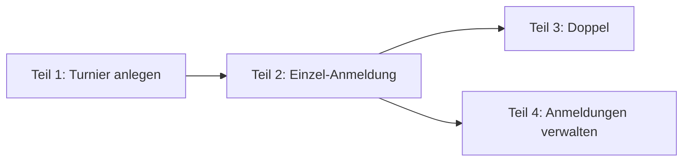

# Design: Anmeldung zur Clubmeisterschaft (#51)

**Datum:** 2026-11-06 · **Issue:** [#51](https://github.com/konstantinniedermann/tco-app/issues/51)
· **Status:** freigegeben (Projektleiter, 06.11.2026)

## Absicht

Ab dem 15.04.2027 (Etappe *CM-Anmeldung*) melden sich die Mitglieder am Handy selbst zur
Clubmeisterschaft (CM) an, statt dass der CM-Verantwortliche Listen von Hand führt. Der
CM-Verantwortliche legt das Turnier in der Verwaltung an, öffnet die Anmeldung und pflegt die
Anmeldungen. Die App nimmt ihm Routinearbeit ab, entscheidet aber nicht an seiner Stelle: Wo
er bewusst eine Regel übergeht, warnt sie nur.

Das Ganze ist zu gross für ein Issue. Es wird in vier Teile geschnitten, die in der Reihenfolge
ihrer technischen Abhängigkeiten gebaut werden (Entscheid Projektleiter). Dieser Entwurf
beschreibt alle vier; geplant und gebaut wird Teil für Teil.

**Wörter:** *CM-Verantwortlicher* ist die Rolle `cm`, seit dem Rollen-Umbau
([#43](2026-11-06-rollen-schaerfen-design.md)) *CM-Admin* genannt (der Projektleiter sagt auch
«CM-Organisator»). Was dort steht, darf nur der CM-Admin; der MyTCO-Admin liest nur. *Spieler* ist ein Mitglied in einer
Anmeldung. Begriffe sonst nach [Glossar](../../glossar.md).

## Schnitt und Reihenfolge

| Teil | Inhalt | Anforderungen |
|------|--------|---------------|
| 1 Turnier anlegen | CM-Verantwortlicher in der Verwaltung, Turnier, Turniernummern, Kategorien, Anmeldung öffnen und schliessen, Seed | A-TURNIER-01 bis -03, A-ANMELDUNG-07, A-ROLLE-07 (Teil Anmeldung) |
| 2 Einzel-Anmeldung | Klassierung im Profil, passende Kategorien, höchstens 3, Bestätigung per Mail, Abmelden | A-ANMELDUNG-01, -02, -03, -05 |
| 3 Doppel | Partner wählen, «Partner gesucht», Mail an den Partner, Paar zieht gemeinsam zurück | A-ANMELDUNG-04 |
| 4 Anmeldungen verwalten | Liste je Kategorie, von Hand anmelden, verschieben, löschen, Klassierung korrigieren, Wildcard-Antrag und Entscheid, Kategorie absagen | A-ANMELDUNG-06, -10 |

Teil 3 und Teil 4 hängen nur von Teil 2 ab und können in beliebiger Reihenfolge oder parallel
laufen. Jeder Teil wird ein eigenes Teil-Issue mit `Blocked by:` nach diesem Bild; #51 bleibt
das Dach und schliesst mit dem letzten Teil.

Der Wildcard-Antrag liegt in Teil 4, nicht in Teil 2: Er bleibt *beantragt*, bis der
CM-Verantwortliche entscheidet. Antrag und Entscheid gehören zusammen, sonst entstehen Anträge,
die niemand bearbeiten kann.

## Ziele

### Teil 1 — Turnier anlegen

1. **Zugang:** Wer die Rolle `cm` hat, kommt in die Verwaltung, wie jede Admin-Rolle nur mit
   frischem Mail-Code (SI-08). Er sieht dort nur den Bereich *Clubmeisterschaft*, nicht
   Mitglieder, Anlässe, Fairgate oder den Verlauf. Der MyTCO-Admin sieht den Bereich auch, liest
   aber nur (RR-07).
2. **Turnier:** Jahr, Name, Anmeldeschluss (Datum) und eine oder mehrere Swiss-Tennis-
   Turniernummern mit Bezeichnung (z. B. *Gruppenphase*, *Finalwochenende*; ob es zwei sind,
   hängt an K-25.4, das Modell erlaubt beides). Ein Turnier pro Jahr; ältere bleiben lesbar.
3. **Kategorien:** Name, Geschlecht (*Herren*, *Damen*, *Mixed*, *offen*), Jahrgang von–bis
   (optional, beide Enden einzeln optional), *Einzel* oder *Doppel*. Im **Einzel** gilt ein
   Klassierungsbereich von–bis. Im **Doppel** gilt stattdessen eine Mindestsumme der
   Klassierungen beider Spieler, vorbelegt mit 9 (R4+R5 oder R1+R8 gehen, R3+R5 nicht; Angabe
   Projektleiter, Annahme K-51); der CM-Verantwortliche kann sie je Kategorie ändern.
   *Mixed* gibt es nur im Doppel. Erfasst wird von Hand; «vom Vorjahr übernehmen» gibt es erst,
   wenn es ein Vorjahr gibt (Nicht-Ziel).
4. **Status:** Ein neues Turnier ist *in Vorbereitung* und für Mitglieder unsichtbar. Der
   CM-Verantwortliche öffnet die Anmeldung von Hand (*Anmeldung offen*). Am Anmeldeschluss
   um 24 Uhr (Schweizer Zeit) gilt sie von selbst als *Anmeldung geschlossen*. Er kann auch
   früher schliessen und wieder öffnen (Entscheid Projektleiter). *läuft* und *abgeschlossen*
   kommen mit *CM-Betrieb*.
5. **Kategorie ändern:** jederzeit, auch mit Anmeldungen. Passen danach Anmeldungen nicht
   mehr (Geschlecht, Jahrgang, Klassierung, Einzel/Doppel), zeigt MyTCO vor dem Speichern, wie
   viele es sind; nach Bestätigung bleiben sie stehen (Entscheid Projektleiter). Der
   CM-Verantwortliche kann sie dann in Teil 4 verschieben.
6. **Kategorie absagen** (= löschen): nur, wenn sie keine Anmeldungen hat, die nicht
   *zurückgezogen* oder *abgelehnt* sind. Hat sie welche, verschiebt der CM-Verantwortliche sie
   zuerst in andere Kategorien (bevorzugt) oder löscht sie (Teil 4), dann sagt er die Kategorie
   ab (Entscheid Projektleiter). Eine abgesagte Kategorie verschwindet für Mitglieder.

   Ziel 5 und 6 brauchen Anmeldungen, die es erst ab Teil 2 gibt. Teil 1 baut darum Ändern
   und Absagen ohne diese Prüfung (es kann noch niemand angemeldet sein); Teil 2 ergänzt
   Warnung und Prüfung zusammen mit den Anmeldungen (Entscheid Projektleiter, 06.11.2026).
7. **Seed:** `make seed` legt ein erfundenes Turnier 2027 mit offener Anmeldung an: Herren,
   Damen, Mixed, Junioren (mit Jahrgang), Senioren, Einzel und Doppel, verschiedene
   Klassierungsbereiche (z. B. R1–R6, R7–R9) und Doppel mit Mindestsumme 9. Die Teile 2 bis 4 ergänzen erfundene Anmeldungen.

### Teil 2 — Einzel-Anmeldung

1. **Klassierung im Profil:** neues Feld beim Mitglied mit den Werten N1–N4, R1–R9 und
   *keine Lizenz*. Das Mitglied pflegt es selbst im Profil (Annahme K-28, RR-Matrix). Fehlt
   es, fragt MyTCO beim ersten Öffnen der CM-Seite danach, bevor Kategorien erscheinen. Es
   gibt nur dieses eine Feld: Ändert das Mitglied es später, gilt das für neue Anmeldungen;
   bestehende bleiben stehen (wie bei Teil 1, Ziel 5). Eine Korrektur durch den
   CM-Verantwortlichen darf das Mitglied wieder ändern; der Änderungsverlauf zeigt, wer es war.
2. **Geschlecht und Jahrgang nachtragen:** Fehlt eines davon (beides ist beim Anlegen
   freiwillig), fragt die CM-Seite einmal danach, zusammen mit der Klassierung. Ist es
   eingetragen, ändert es nur noch der Mitglieder-Admin (Entscheid Projektleiter; Ausnahme in der
   RR-Matrix).
3. **Startseite:** Solange das Turnier *Anmeldung offen* ist, steht unter «Jetzt aktuell» eine
   Kachel *Clubmeisterschaft 2027* mit dem Anmeldeschluss und dem eigenen Stand (z. B.
   «2 Anmeldungen»). Nach dem Anmeldeschluss bleibt sie mit dem eigenen Stand stehen, bis
   *CM-Betrieb* sie ablöst.
4. **CM-Seite:** zeigt nur die Kategorien, die zum Mitglied passen (FR-07). Jede Kategorie hat
   einen eigenen Knopf *Anmelden*; die Anmeldung gilt sofort (*bestätigt*). Je Kategorie stehen
   die Namen der bestätigten Anmeldungen (RR-Matrix: Mitglieder sehen bestätigte).
5. **Höchstens 3** Anmeldungen je Turnier, die nicht *zurückgezogen* oder *abgelehnt* sind
   (FR-06). Bei 3 sind die übrigen Knöpfe gesperrt, mit einem Satz, warum.
6. **Hinweis Kontaktdaten:** Vor der ersten Anmeldung sagt MyTCO, dass Gegner und Doppelpartner
   E-Mail und Telefon sehen ([Datenschutz](../../datenschutz.md), *Kontaktdaten*).
7. **Bestätigung:** Nach jeder Anmeldung und Abmeldung eine Mail mit allen aktuellen Anmeldungen
   des Spielers (A-ANMELDUNG-05).
8. **Abmelden:** bis zum Anmeldeschluss selbst (FR-10, Annahme K-29); danach zeigt die Seite die
   Anmeldungen nur an.

**Präzisierungen vor dem Bau (06.11.2026):**

- **Geschlecht und Jahrgang sind Pflicht** wie die Klassierung: Fehlt eines, erscheinen die
  Kategorien erst nach dem Eintrag. Wer nicht will, lässt sich vom CM-Admin anmelden (Teil 4)
  (Entscheid Projektleiter).
- **Doppel-Kategorien sind ausgeblendet**, bis Teil 3 das Doppel bringt (Entscheid
  Projektleiter).
- **Früher geschlossen sperrt auch das Abmelden:** Massgeblich ist der wirksame Status
  *Anmeldung geschlossen* (von Hand oder durch den Anmeldeschluss), nicht nur das Datum
  (Entscheid Claude; `wirksamerStatus` aus Teil 1).
- **Nicht auf die Liste «Für Fairgate»:** Selbst eingetragenes Geschlecht und Jahrgang erscheinen
  dort nicht; Fairgate hat beides schon (Entscheid Claude).
- **Übergang bis Teil 4:** Der CM-Admin sieht die Anmeldungen noch nicht als Liste und kann eine
  Kategorie mit aktiven Anmeldungen nicht absagen. Das wird in Kauf genommen; live geht MyTCO
  erst mit dem Server (#39), und Teil 3 und 4 kommen vor dem 15.04.2027 (Entscheid Claude).

### Teil 3 — Doppel

1. **Partner wählen:** In einer Doppelkategorie wählt der Spieler den Partner über ein Suchfeld.
   Zur Wahl stehen aktive Mitglieder, die nach Geschlecht und Jahrgang in die Kategorie passen,
   dort noch in keiner Anmeldung stehen, ausser allein als *sucht Partner* (FR-07, FR-09), und mit dem Spieler zusammen die
   **Mindestsumme der Klassierungen** erreichen (Teil 1, Ziel 3). Gezählt wird R1 = 1 bis
   R9 = 9; *keine Lizenz* zählt 10, N1–N4 zählen 0 (Annahme K-51). Im *Mixed* eine Frau und ein
   Mann. Hat ein Mitglied keine Klassierung eingetragen, ist es wählbar und trägt den Vermerk
   *Klassierung fehlt*; der CM-Verantwortliche prüft. Wer *sucht Partner*, wird allein nicht
   an der Summe gemessen.
   Ein Paar, das zu stark ist (Summe zu klein), kann keinen Wildcard-Antrag stellen
   (Wildcard nur nach oben, Teil 4, Ziel 6); es kommt nur über den CM-Verantwortlichen hinein.
   Doppel kennen damit keinen Wildcard-Antrag.
2. **Keine Zustimmung nötig:** Der Partner wird per Mail benachrichtigt (Annahme K-27). Die
   Mail enthält den Hinweis, dass Gegner und Partner E-Mail und Telefon sehen, und wie man sich
   abmeldet, wenn man das nicht will (Entscheid Projektleiter). Die
   Anmeldung zählt für beide bei der Grenze von 3; hat der Partner schon 3, ist er nicht
   wählbar.
3. **Partner gesucht** (Entscheid Projektleiter): Man kann sich ohne Partner anmelden und steht
   in der Kategorie als *sucht Partner*. Wählt ein anderer Spieler ihn als Partner, wird daraus
   eine Anmeldung zu zweit (keine zweite), und beide bekommen eine Mail. Wer selbst sucht, kann
   später einen Partner nachtragen. Wer beim Anmeldeschluss noch allein ist, darüber entscheidet
   der CM-Verantwortliche (Teil 4).
4. **Abmelden:** Jeder der beiden kann bis zum Anmeldeschluss abmelden; dann ist die ganze
   Doppel-Anmeldung *zurückgezogen*, und der andere bekommt eine Mail (Entscheid Projektleiter).
5. **Kontaktdaten:** Partner sehen gegenseitig E-Mail und Telefon bis zum Ende der CM (FR-19).

**Präzisierungen vor dem Bau (08.11.2026, freigegeben Projektleiter mit dem Design-Entwurf):**

- **Zwei Etappen in einem Issue** (#59; Entscheid Projektleiter): *Etappe 1* baut die
  Mitgliederseite (Partnerwahl, «Partner gesucht» mit Kommentar, Abmelden, Austritt, Meldungen,
  Kontaktdaten). *Etappe 2* baut die Doppel in der Verwaltung (Präzisierung zu Teil 4 vom
  07.11.2026: Liste, von Hand anmelden, verschieben, löschen, Partner ändern, zwei *sucht
  Partner* zusammenlegen). Jede Etappe geht einzeln nach `dev`.
- **Partnerwahl ist eine Anfrage** (Entscheid Projektleiter; ersetzt Ziel 2 *Keine Zustimmung
  nötig* und die Annahme K-27 dazu): Wählt Lea einen Partner, bekommt er eine **Anfrage** und
  nimmt sie an oder lehnt sie ab. Das gilt, ob er *sucht Partner* oder noch gar nicht
  angemeldet ist. Erst mit dem Annehmen entsteht das Paar.
  - Mit der Anfrage sieht der Angefragte Leas Namen, Klassierung und Telefonnummer, damit er
    sie anrufen kann (Entscheid Projektleiter); ohne Telefon die E-Mail (Entscheid Claude).
    Die Rückfrage vor dem Senden sagt Lea das. Seine Kontaktdaten sieht Lea erst nach dem
    Annehmen.
  - **Mehrere Anfragen gleichzeitig** gehen, auch in derselben Kategorie; sie zählen nicht bei
    der Grenze von 3 (Entscheid Projektleiter). Senden geht nur, solange man selbst die Grenze
    nicht erreicht hat oder in der Kategorie schon allein sucht. *Überholt durch Etappe 2:
    höchstens eine eigene offene Anfrage je Kategorie.*
  - **Annehmen** prüft die Regeln neu: Geschlecht, Mindestsumme und die Grenze von 3
    für beide. Fehlen dem Angefragten Angaben, fragt die CM-Seite sie vorher ab (Teil 2). Mit
    dem Annehmen verfallen alle übrigen offenen Anfragen der beiden in dieser Kategorie, und
    wer sie gestellt hat, bekommt eine Meldung (Entscheid Claude).
  - **Wo das Paar landet:** Sucht der Angefragte schon, kommt Lea in seine Anmeldung; sucht nur
    Lea, kommt er in ihre; sonst entsteht eine neue. Suchen beide, wird Leas eigene
    *zurückgezogen* (Entscheid Claude).
  - **Ablehnen** ohne Grund; Lea bekommt eine Meldung. **Zurückziehen** geht, solange die
    Anfrage offen ist.
  - **Beim Anmeldeschluss offene Anfragen** bleiben stehen; der CM-Admin sieht sie in der Liste
    und legt die beiden zusammen oder nicht (Entscheid Projektleiter, Etappe 2). Danach
    nehmen Mitglieder nicht mehr an.
  - **Nicht gespeichert, was erledigt ist:** Eine Anfrage, die abgelehnt, zurückgezogen oder
    verfallen ist, wird sofort gelöscht (im selben Schritt, die Meldung geht danach);
    angenommen wird sie zur Anmeldung (Entscheid Claude, Datensparsamkeit). Erneut anfragen
    geht.
  - Der CM-Admin meldet Paare in Etappe 2 weiter ohne Anfrage an (Teil 4, Ziel 2).
- **Push, sonst E-Mail** für alle Meldungen zum Doppel (Entscheid Projektleiter): neue Anfrage,
  angenommen, abgelehnt, verfallen, Partner hat abgemeldet, Paar wegen Austritt
  zurückgezogen. Weg und Regeln wie in Teil 4 (FR-44; Themen-Schalter gelten nicht). Wer
  selbst eine Anmeldung ändert (allein anmelden, annehmen, abmelden), bekommt wie im Einzel die
  Mail mit allen eigenen Anmeldungen (Teil 2, Ziel 7); der andere nur die Meldung (Entscheid
  Claude). Ziel 2 bis 4 oben sind damit überholt, wo sie «Mail» sagen.
- **Die Meldungen nennen den anderen Spieler**, weil sie sonst nichts aussagen (Datenschutz
  unten: Einzelmeldung an Beteiligte); das gilt auch für Meldungen aus der Verwaltung in
  Etappe 2. Sie nennen keinen CM-Admin und keinen Grund wie einen Austritt, und keine
  Telefonnummer: Die steht nur in MyTCO, nicht auf dem Sperrbildschirm (Entscheid Claude).
  Texte mit einem, höchstens zwei Sätzen, z. B. «Lea Beispiel möchte mit dir Mixed Doppel
  spielen. Annehmen oder ablehnen kannst du in MyTCO.» Claude schreibt die Texte, der
  Projektleiter sieht sie am Schluss mit den Screenshots.
- **Nur mit eigenem Login wählbar** (Entscheid Projektleiter): Wer kein Login hat, kann keine
  Anfrage annehmen; ihn meldet der CM-Admin an (Teil 4, Ziel 2).
- **Im Doppel gibt es keinen Jahrgang** (Entscheid Projektleiter, 08.11.2026, Kommentar in
  #59): Doppelkategorien sind nur *Herren*, *Damen*, *Mixed* (und *offen*), ohne
  Alterskategorien. Passung und Suche im Doppel prüfen nur Geschlecht und Mindestsumme. Das
  Kategorie-Formular blendet den Jahrgang bei *Doppel* aus, der Server leert ihn dort; FR-34
  wird angepasst. Ziel 1 oben ist damit überholt, wo es «und Jahrgang» sagt.
- **Fehlt einem möglichen Partner das Geschlecht**, ist er wählbar und trägt den Vermerk
  *Angaben fehlen*, wie bei fehlender Klassierung (*Klassierung fehlt*) (Entscheid
  Projektleiter). In der Suche steht nur einer der beiden Vermerke: *Angaben fehlen*, sobald
  das Geschlecht fehlt, sonst *Klassierung fehlt* (Entscheid Claude). Ein Partner mit fehlender
  Klassierung wird in der Suche nicht an der Summe gemessen; das Annehmen prüft sie.
- **Wer in der Suche steht:** aktive Mitglieder mit Login ausser einem selbst, die nach
  Geschlecht passen (oder *Angaben fehlen*), in der Kategorie nicht schon zu zweit
  angemeldet sind, die Grenze von 3 nicht erreicht haben (eine eigene *sucht-Partner*-Anmeldung
  in dieser Kategorie zählt schon mit) und mit dem Spieler die Mindestsumme erreichen (Entscheid
  Projektleiter: nur passende). Im *Mixed* nur das andere Geschlecht. Die Liste erscheint erst
  nach zwei getippten Buchstaben. Sie zeigt **Name und Klassierung** (Entscheid Projektleiter),
  sonst den Vermerk, dazu *sucht Partner* mit Kommentar und ob man ihn schon angefragt hat.
- **Kommentar bei «Partner gesucht»** (Wunsch Projektleiter): Wer sich allein anmeldet, kann
  einen kurzen Kommentar schreiben, z. B. «Suche jemanden auf R5–R7-Niveau, eher abends».
  Freiwillig, höchstens 120 Zeichen, änderbar, solange er sucht. Ihn sehen alle Mitglieder,
  bei der Kategorie und in der Partnersuche; ein Hinweis beim Feld sagt das und bittet um keine
  Angaben zur Gesundheit (Entscheid Projektleiter). Findet sich ein Partner oder meldet er ab,
  wird der Kommentar gelöscht, nicht nur ausgeblendet (Entscheid Projektleiter). Er ist nicht
  der Wildcard-Kommentar (anderer Kreis, der ihn sieht); wie das Schema beide trennt, ist dem
  Bauenden überlassen.
- **Austritt und Löschvormerkung** eines Spielers bis zum **Datum des Anmeldeschlusses**, auch
  wenn der CM-Admin die Anmeldung vorher von Hand geschlossen hat (Entscheid Projektleiter,
  08.11.2026; gilt auch fürs Einzel): Die ganze Doppel-Anmeldung ist *zurückgezogen*, wie beim
  Abmelden, und der Partner bekommt eine Meldung ohne Grund (Entscheid Projektleiter; Hinweis
  aus #43). Seine offenen Anfragen verfallen. Nach dem Anmeldeschluss bleibt die Anmeldung
  stehen, der CM-Admin entscheidet. Bei der
  Löschung bleibt nur der Name (Datenschutz, *Löschfrist*); Kommentar und Anfragen werden
  mitgelöscht.
- **Auf der CM-Seite** (Variante A des Entwurfs, Entscheid Projektleiter): Jede Doppelkategorie
  ist eine Karte mit den bestätigten Paaren («Anna Probst / Sara Keller») und darunter, wer
  *sucht Partner*, mit Kommentar. **Anfragen an einen selbst** stehen oben in einer eigenen
  Karte mit *Annehmen* und *Ablehnen*; die eigenen offenen Anfragen bei ihrer Kategorie, mit
  *Zurückziehen*. Die Startseiten-Kachel nennt offene Anfragen an einen (Entscheid Claude).
- **Kontaktdaten des Partners** stehen auf der CM-Seite bei der eigenen Doppel-Anmeldung, als
  Links zum Anrufen und Schreiben, solange das Turnier läuft (Entscheid Claude; das *Ende der
  CM* kommt mit *CM-Betrieb*). Der Hinweis vor der ersten Anmeldung nennt neu auch den
  Doppelpartner; vor dem Annehmen sagt die Rückfrage dasselbe.
- **Partner ändern in der Verwaltung** (Etappe 2, Entscheid Projektleiter): Wer herausfällt,
  ist nicht mehr angemeldet und bekommt eine Meldung. Die alte Anmeldung bleibt als
  *zurückgezogen* stehen, das neue Paar ist eine neue Anmeldung, damit nachvollziehbar bleibt,
  wer wann dabei war.
- **Einzel oder Doppel wechseln** geht nur, solange die Kategorie keine aktiven Anmeldungen hat
  (Entscheid Projektleiter; ändert Teil 1, Ziel 5 für diesen Fall). Sonst würde aus einer
  Einzel-Anmeldung ungefragt ein *sucht Partner*. Altlasten aus dem früheren Weg («Trotzdem
  speichern») gibt es nicht, solange MyTCO nicht live ist; darum keine Bereinigung (Entscheid
  Claude).
- **Kategorie ändern im Doppel** (FR-36): Die Warnung zählt Paare, die nach den neuen Werten
  nicht mehr passen (Geschlecht, Mindestsumme), und Spieler, die allein suchen und nach
  Geschlecht nicht mehr passen (Entscheid Claude).
- **Anmelden sperrt das Turnier mit** (Befund aus der Beobachtungs-Auswertung, Kommentar in
  #59): Der gemeinsame Weg der Anmeldung liest das Turnier mit Sperre, damit ein gleichzeitiges
  Schliessen nicht zwischen Prüfung und Eintrag fällt; das gilt auch für Anfrage und Annehmen
  (Entscheid Claude).
- **Seed:** `make seed` ergänzt erfundene Doppel-Anmeldungen: Paare, zwei *sucht Partner*
  (einer mit Kommentar), eine offene Anfrage und einen Spieler mit fehlender Klassierung.
- **Oberfläche:** zuerst ein Design-Entwurf (Entscheid Projektleiter), siehe *Oberfläche*.

**Etappe 2 (Brainstorming 08.11.2026, freigegeben Projektleiter):** Doppel in der Verwaltung,
dazu vier Nachträge zur Mitgliederseite aus Etappe 1. Wo Etappe 1 oben anderes sagt, gilt das
hier.

*Nachträge zur Mitgliederseite* (Fragen aus `docs/beobachtungen.md`, Sammel-Eintrag
08.11.2026):

- **Login beider prüfen** (Entscheid Projektleiter): Annehmen setzt voraus, dass beide ein Login
  haben, auch der Anfragende. Hat er keins mehr (Konto gesperrt), zeigt die CM-Seite seine
  Anfrage nicht an; wird das Konto wieder freigegeben, erscheint sie wieder. Scheitert ein
  Annehmen daran (gleichzeitig gesperrt), wird die Anfrage gelöscht und der Angefragte erfährt
  es auf der Seite in einem Satz, ohne Meldung (Entscheid Claude: im CM-Modul, kein Eingriff in
  die Konto-Sperre). Ein solches Paar meldet nur der CM-Admin an.
- **Kontaktdaten nach Austritt ausblenden** (Entscheid Projektleiter): Ist der Partner
  ausgetreten oder zum Löschen vorgemerkt, sieht der andere bei der Doppel-Anmeldung nur noch
  den Namen, keine E-Mail und kein Telefon. Das gilt auch für eine Anmeldung, die nach dem
  Anmeldeschluss stehen bleibt, bis der CM-Admin entscheidet. Ergänzt Ziel 5 und FR-19.
- **Nach dem Anmeldeschluss sperrt auch der Server** Ablehnen und Zurückziehen einer Anfrage
  (Entscheid Projektleiter), wie die CM-Seite es schon zeigt. Danach entscheidet nur der
  CM-Admin über offene Anfragen.
- **Höchstens eine eigene offene Anfrage je Kategorie** (Entscheid Projektleiter; ersetzt
  *Mehrere Anfragen gleichzeitig*): Wer in einer Kategorie schon jemanden angefragt hat, kann
  dort erst wieder anfragen, wenn die Anfrage abgelehnt, zurückgezogen oder verfallen ist. Die
  Partnersuche sagt das in einem Satz und nennt, wen man angefragt hat. In verschiedenen
  Kategorien ist je eine offen erlaubt. Anfragen **an** einen selbst sind nicht begrenzt; mit dem
  Annehmen verfallen die übrigen wie bisher.

*Doppel in der Verwaltung* (auf der Kategorieseite statt «Doppel verwalten kommt später»;
Aufbau wie die Einzel-Liste aus Teil 4: Tabelle der Verwaltung, Aktionen je Zeile, Rückfragen als
Dialog, Warnung mit *Trotzdem …*):

- **Liste** in drei Teilen, jeder mit Anzahl:
  1. *Paare*: beide Namen, je Klassierung oder *Klassierung fehlt*, die Summe, Status und
     Plaketten zu Austritt oder Löschvormerkung wie im Einzel.
  2. *sucht Partner*: Name, Klassierung, Kommentar.
  3. *Offene Anfragen*: von wem an wen, seit wann; **immer sichtbar**, nicht erst nach dem
     Anmeldeschluss (Entscheid Projektleiter).
- **Von Hand anmelden** (Entscheid Projektleiter): Der CM-Admin wählt zwei Spieler (Paar) oder
  einen (*sucht Partner*). Login ist nicht nötig. Warnungen wie im Einzel, nach Bestätigung
  gilt die Anmeldung: Geschlecht passt nicht (im *Mixed*: nicht eine Frau und ein Mann),
  Mindestsumme nicht erreicht, Angaben fehlen, Grenze von 3 erreicht (je Spieler), Anmeldung
  geschlossen. Auch nach dem Anmeldeschluss. Steht ein gewählter Spieler in der Kategorie schon
  allein auf *sucht Partner*, kommt der andere in diese Anmeldung (wie beim Annehmen); steht er
  dort schon zu zweit, geht es nicht. Zwei, die beide allein suchen, behandelt *Zusammenlegen*.
- **Zusammenlegen** zweier *sucht Partner* (Aktion in Teil 2 der Liste, Partner aus der
  Liste wählen): wirkt wie ein angenommenes Paar. Der zweite kommt in die Anmeldung des ersten,
  dessen eigene wird *zurückgezogen*; beide Kommentare werden gelöscht (Entscheid Claude,
  gleich wie in Etappe 1). Warnungen wie beim Anmelden.
- **Offene Anfrage als Paar anmelden oder löschen** (Aktionen in Teil 3 der Liste): *Als Paar
  anmelden* wirkt wie das Annehmen, aber ohne Login-Prüfung und mit Warnungen statt Sperre.
  *Löschen* entfernt die Anfrage; der Anfragende bekommt die Meldung, dass sie hinfällig ist
  (Entscheid Claude). Beides geht vor und nach dem Anmeldeschluss.
- **Partner ändern** (Entscheid Projektleiter, Ergänzung mit oder ohne Ersatz): Der CM-Admin
  wählt, wer bleibt, und einen neuen Partner oder keinen. Die alte Anmeldung wird
  *zurückgezogen*, es entsteht eine neue (mit dem neuen Partner oder allein als *sucht
  Partner*), damit nachvollziehbar bleibt, wer wann dabei war. Wer herausfällt, bekommt eine
  Meldung. Suchte der neue Partner in der Kategorie schon allein, wird seine eigene Anmeldung
  *zurückgezogen*; seine offenen Anfragen in der Kategorie verfallen mit Meldung an die
  Anfragenden (Entscheid Claude). Warnungen wie beim Anmelden.
- **Verschieben** nimmt das Paar bzw. den Suchenden zusammen in eine andere Doppelkategorie
  desselben Turniers, Warnungen für beide (Entscheid Claude). Zwischen Einzel und Doppel wird
  nicht verschoben. Offene Anfragen der Verschobenen (von ihnen und an sie) in der alten
  Kategorie verfallen mit Meldung an die anderen; in der Zielkategorie verfallen sie wie beim
  Annehmen, wenn dort ein Paar ankommt, und bleiben, wenn ein Suchender ankommt (Entscheid
  Claude).
- **Regel für alle Paarbildungen durch den CM-Admin** (anmelden, zusammenlegen, Anfrage als Paar,
  Partner ändern, verschieben): Wer danach in der Kategorie zu zweit steht, verliert dort seine
  offenen Anfragen (von ihm und an ihn), mit Meldung an die anderen, wie beim Annehmen
  (Entscheid Claude).
- **Kategorie absagen und Wechsel Doppel → Einzel** gehen weiter nur ohne aktive Anmeldungen.
  Offene Anfragen der Kategorie werden dabei gelöscht, der Anfragende bekommt die Meldung, dass
  sie hinfällig ist (Entscheid Claude).
- **Löschen** zieht die ganze Doppel-Anmeldung zurück, auch nach dem Anmeldeschluss; der
  Kommentar wird gelöscht.
- **Klassierung korrigieren** je Spieler, wie im Einzel.
- **Meldungen** (Push, sonst E-Mail) an jeden Betroffenen, mit dem Namen des anderen Spielers
  (Präzisierung oben), ohne CM-Admin und ohne Grund: angemeldet (mit Partner oder als *sucht
  Partner*), Partner geändert (an Bleibenden, Herausgefallenen und Neuen), verschoben,
  gelöscht, Anfrage hinfällig. Wer vom CM-Admin angemeldet wird, bekommt den kurzen Hinweis zu
  den Kontaktdaten wie im Einzel. Texte schreibt Claude, kurz und knapp.
- **Änderungsverlauf:** jeder betroffene Spieler bekommt den neutralen Eintrag «CM-Anmeldung
  geändert» (Teil 4), ausser er ist gelöscht.
- **Wer was darf:** nur der CM-Admin ändert, der MyTCO-Admin sieht die Liste nur lesend (RR-07).
- **Nachweis:** Tests mit IDs (Einheit/DB), E2E mit Screenshot iPhone/Android und axe für die
  Liste und die Dialoge; die Nachträge zur Mitgliederseite mit Tests.

### Teil 4 — Anmeldungen verwalten

1. **Liste je Kategorie** mit Status (*bestätigt*, *beantragt* = Wildcard-Antrag) und Vermerk *sucht Partner*, dazu die
   Anzahl, die Klassierung der Spieler und der Vermerk *Klassierung fehlt*.
2. **Von Hand anmelden:** jedes aktive Mitglied in jede Kategorie, auch Junioren ohne eigenes
   Login und auch nach dem Anmeldeschluss. Passt die Kategorie nicht, ist die Grenze von 3
   überschritten oder die Anmeldung geschlossen, zeigt MyTCO eine Warnung; nach Bestätigung
   gilt die Anmeldung (Entscheid Projektleiter: Beispiel R6 nach Anmeldeschluss in R7–R9 → ja).
3. **Ändern:** in eine andere Kategorie verschieben, Doppelpartner ändern, zwei *sucht Partner*
   zu einem Paar zusammenlegen, Klassierung eines Spielers korrigieren. Für die Regeln gilt
   dasselbe wie beim Anmelden von Hand: warnen, nicht sperren.
4. **Löschen:** Die Anmeldung wird *zurückgezogen* und zählt nicht mehr (Entscheid Claude: kein
   echtes Löschen, damit Mail und Zählung nachvollziehbar bleiben).
5. **Mails:** Jede Änderung durch den CM-Verantwortlichen (anmelden, verschieben, Partner,
   löschen, Entscheid) geht per Mail an die betroffenen Spieler. Wer von ihm angemeldet wird,
   bekommt darin denselben Hinweis zu den Kontaktdaten wie ein Doppelpartner (Teil 3, Ziel 2).
6. **Wildcard-Antrag (Mitglied):** Auf der CM-Seite ein eingeklappter Bereich *Weitere
   Kategorien mit Wildcard-Antrag*. Er zeigt Kategorien, die **nur** wegen der Klassierung nicht
   passen, und zwar nur nach oben: Der Spieler ist schwächer als der Bereich (z. B. R8 in
   R4–R6). In eine schwächere Kategorie kommt ein stärkerer Spieler nur, wenn der
   CM-Verantwortliche ihn von Hand anmeldet (Entscheid Projektleiter). Pflichtfeld Kommentar. Die Anmeldung ist *beantragt* und zählt bei der Grenze
   von 3 mit (FR-06, FR-08). Kommentar und Wildcard sehen nur Spieler, CM-Verantwortlicher und,
   nur lesend, der MyTCO-Admin.
7. **Wildcard-Entscheid:** Der CM-Verantwortliche bekommt je Antrag eine Mail, bestätigt oder
   lehnt ab; der Spieler bekommt den Entscheid per Mail.
8. **Kategorie absagen** nach Verschieben oder Löschen der Anmeldungen (Teil 1, Ziel 6).

**Präzisierungen vor dem Bau (07.11.2026):**

- **Nur Einzel:** Teil 4 baut alles für Einzel. *Doppelpartner ändern* und *zwei «sucht
  Partner» zusammenlegen* baut Teil 3 (#59) mit, sobald es Doppel gibt (Entscheid
  Projektleiter).
- **Oberfläche direkt nach dem [UI-Leitbild](../../ui-leitbild.md)**, ohne vorherigen Entwurf;
  Screenshots am Schluss (Entscheid Projektleiter). Die Liste je Kategorie steht als Tabelle
  der Verwaltung (Leitbild: auf schmalem Bildschirm waagrecht scrollbar) auf der bestehenden
  Kategorieseite (Entscheid Claude).
- **Ablehnung mit freiwilligem Grund:** Lehnt der CM-Admin einen Wildcard-Antrag ab, kann er
  einen kurzen Grund schreiben; er steht nur in der Meldung an den Spieler und wird nicht
  gespeichert (Entscheid Projektleiter; Speichern: Entscheid Claude, Datensparsamkeit).
- **Push statt Mail:** Alle Meldungen aus Teil 4 laufen über den Weg *Push, sonst E-Mail*
  (FR-44): ein Push an jedes Gerät mit Abo, eine E-Mail nur, wer keines hat oder bei wem jeder
  Push scheiterte. Das betrifft den neuen Wildcard-Antrag (an alle Konten mit der Rolle
  CM-Admin), den Entscheid und jede Änderung durch den CM-Admin (an die betroffenen Spieler).
  Die Bestätigung nach der eigenen An- oder Abmeldung aus Teil 2 bleibt eine Mail mit allen
  eigenen Anmeldungen, auch nach einem eigenen Wildcard-Antrag (Entscheid Projektleiter). Die
  Themen-Schalter (FR-41) gelten nicht: Es sind persönliche Meldungen wie Bestätigungen
  (Entscheid Claude). Ziel 5 und 7 oben sind damit überholt, wo sie «Mail» sagen.
- **Nach einer Ablehnung** darf der Spieler erneut beantragen; die abgelehnte Anmeldung bleibt
  als *abgelehnt* stehen und zählt nicht (FR-06) (Entscheid Claude).
- **Zurückziehen eines Antrags** durch den Spieler wie eine Abmeldung: bis zum Anmeldeschluss
  (FR-10).
- **Klassierung korrigieren** ändert das eine Feld beim Mitglied (Teil 2, Ziel 1). Der
  Änderungsverlauf zeigt den CM-Admin als Urheber, mit Namen wie bei den übrigen Admins
  (Entscheid Claude).
- **Von Hand anmelden** sucht unter den aktiven Mitgliedern nach Namen. Fehlen beim Mitglied
  Klassierung, Geschlecht oder Jahrgang, ist das ein Grund für die Warnung, keine Sperre. Hat
  das Mitglied weder Push-Abo noch E-Mail-Adresse, entfällt die Meldung (Entscheid Claude).
- **Geschlecht und Jahrgang:** Der CM-Admin sieht sie bei den Spielern und in der Suche, weil
  er sonst nicht zuordnen kann; ändern darf sie weiter nur der Mitglieder-Admin. Fehlt eine
  Angabe, warnt MyTCO nur. Datenschutzkonzept, Datenschutzerklärung und RR-Matrix werden vor dem
  Bau nachgeführt (Entscheid Projektleiter).
- **CM-Admin als Spieler:** Er darf sich selbst von Hand anmelden und über den eigenen
  Wildcard-Antrag entscheiden; der Änderungsverlauf zeigt, wer es war (Entscheid
  Projektleiter, ein Satz in Rollen und Rechte).
- **Änderungsverlauf neutral:** Von Hand anmelden, verschieben, löschen und entscheiden erzeugen
  denselben Eintrag «CM-Anmeldung geändert», ohne Kategorie, Wildcard oder Entscheid. Den
  Verlauf sieht auch der Mitglieder-Admin; von einem Wildcard-Antrag erfahren nur Spieler,
  CM-Admins und MyTCO-Admins (Entscheid Projektleiter).
- **Erst ab offener Anmeldung:** Von Hand anmelden, verschieben und entscheiden gehen erst,
  wenn das Turnier nicht mehr *in Vorbereitung* ist, damit keine Meldung zu einem Turnier geht,
  das die Mitglieder noch nicht sehen (Entscheid Claude).
- **Texte kurz und knapp:** Push, Ersatz-Mail und Oberfläche mit einem, höchstens zwei Sätzen,
  z. B. «Der CM-Admin hat dich in Herren R7–R9 angemeldet.». Push und Ersatz-Mail nennen keine
  anderen Mitglieder, auch nicht den CM-Admin oder beim Wildcard-Antrag den Spieler (DS-05;
  Entscheid Claude). Wer es war, zeigt der Änderungsverlauf. Wer vom CM-Admin angemeldet
  wird, bekommt den Hinweis zu den Kontaktdaten als einen kurzen Satz. Claude schreibt die
  Texte, der Projektleiter sieht sie am Schluss mit den Screenshots (Entscheid Projektleiter).
- **Wildcard-Kommentar** bleibt nach dem Entscheid gespeichert und fällt unter die Löschfrist
  der CM-Anmeldungen, die vor dem Live-Gang festgelegt wird (Entscheid Claude).
- **Wer was darf:** Nur der CM-Admin ändert; der MyTCO-Admin sieht dieselbe Liste nur lesend
  (RR-07).
- **Seed:** `make seed` ergänzt erfundene Anmeldungen, darunter einen offenen Wildcard-Antrag.

## Regeln, die sich ändern oder neu sind

Nachzuführen in [Fachmodell](../../fachmodell.md), [Rollen und Rechte](../../rollen-und-rechte.md)
und [Anforderungen](../../anforderungen/anforderungen.md), bevor der jeweilige Teil gebaut wird:

- **Klassierung:** Reihenfolge von stark nach schwach N1–N4, R1–R9, *keine Lizenz*. *Keine
  Lizenz* passt in jeden Bereich, dessen schwaches Ende R9 ist. Die Skala ist eine Annahme
  (Glossar: *Vermutung*), bis K-25.1 beantwortet ist.
- **Doppel nach Summe:** Eine Doppelkategorie hat statt eines Klassierungsbereichs eine
  Mindestsumme (vorbelegt 9); R1 = 1 … R9 = 9, *keine Lizenz* = 10, N1–N4 = 0 (Annahme K-51).
  FR-07 und das Fachmodell (Kategorie) entsprechend ändern.
- **Kategorie:** neuer Status *abgesagt*; nur ohne aktive Anmeldungen (Teil 1, Ziel 6).
- **Anmeldung:** Doppel mit 1 Spieler ist erlaubt (*sucht Partner*; ergibt sich aus der Zahl
  der Spieler). Status *bestätigt* / *beantragt* / *abgelehnt* / *zurückgezogen*; *beantragt*
  kommt nur im Einzel vor (Wildcard). Das Schema dafür legt Teil 2 so an, dass Teil 3 und 4
  parallel darauf bauen können.
- **Wildcard nur nach oben und nur im Einzel:** Ein Antrag geht nur für Kategorien, deren
  Klassierungsbereich stärker ist als der Spieler (FR-08 präzisieren). Im Doppel gibt es keinen
  Wildcard-Antrag, weil die Mindestsumme nur zu starke Paare ausschliesst.
- **Geschlecht und Jahrgang:** Das Mitglied darf beides einmal selbst eintragen, wenn es fehlt
  (RR-Matrix: Ausnahme zu «L eigene»).
- **FR-02 (Pflichtangaben beim ersten Login):** Die Klassierung fragt nicht der erste Login ab,
  sondern die CM-Seite (Teil 2, Ziel 1). FR-02 entsprechend anpassen, damit sie nicht doppelt
  oder schon beim Login erzwungen wird.
- **Änderungsverlauf:** Korrekturen der Klassierung durch den CM-Verantwortlichen erscheinen mit
  Urheber *admin* und seinem Namen, wie bei den übrigen Admins (FR-26; überholt durch die
  Präzisierung zu Teil 4 vom 07.11.2026: kein eigener Urheber `cm`, keine Schema-Änderung).
- **Turnier:** Übergang *Anmeldung geschlossen* → *Anmeldung offen* (wieder öffnen) ist erlaubt;
  *Anmeldung offen* gilt nur bis zum Anmeldeschluss (FR-05).
- **Rechte:** Rolle `cm` öffnet die Verwaltung, nur den Bereich *Clubmeisterschaft* (RR-07
  erweitern). Der CM-Verantwortliche übergeht beim Anmelden und Ändern von Hand die Regeln
  FR-05 bis FR-07 nach einer Warnung.

## Datenschutz

Geprüft gegen [Datenschutzkonzept](../../datenschutz.md): Namen, Kategorien und bei der
Partnerwahl die Namen passender Mitglieder sind dort schon vorgesehen, ebenso die Klassierung
und der Hinweis zu den Kontaktdaten. Neu und nachzuführen (Konzept und Datenschutzerklärung):

- Der Vermerk *sucht Partner* ist für alle Mitglieder sichtbar.
- Der Vermerk *Klassierung fehlt* ist bei der Partnerwahl sichtbar, ebenso *Angaben fehlen*
  (das Geschlecht fehlt; Präzisierung zu Teil 3).
- Der freiwillige Kommentar bei *sucht Partner* ist für alle Mitglieder sichtbar und wird
  gelöscht, sobald ein Partner gefunden ist oder der Spieler abmeldet (Präzisierung zu Teil 3).
- Bei der Partnerwahl sehen Mitglieder die **Klassierung** der passenden Mitglieder
  (Präzisierung zu Teil 3).
- Wer eine Partner-Anfrage stellt, gibt dem Angefragten Name, Klassierung und Telefonnummer
  (sonst E-Mail) frei; die Kontaktdaten des Angefragten sieht er erst nach dem Annehmen. Erledigte
  Anfragen werden gelöscht (Präzisierung zu Teil 3).
- Die Mails an Doppelpartner nennen den Namen des anderen Spielers (Einzelmail an Beteiligte,
  keine Sammelmail; DS-05 bleibt erfüllt).
- Wer vom CM-Verantwortlichen angemeldet wird, bekommt den Hinweis zu
  den Kontaktdaten in der Mail statt vorher (ein Doppelpartner seit der Präzisierung zu Teil 3
  vor dem Annehmen der Anfrage); die Kontaktdaten sind sofort sichtbar, abmelden
  geht bis zum Anmeldeschluss (Entscheid Projektleiter). Ergänzt *Kontaktdaten* im Konzept.
- Mitglieder tragen fehlendes Geschlecht und fehlenden Jahrgang einmal selbst ein (beides steht
  schon unter *Welche Daten*).
- **Löschfrist für CM-Anmeldungen** (Entscheid Projektleiter, 06.11.2026, vor Teil 2): Die
  Anmeldungen bleiben beim vergangenen Turnier, wie Resultate. Wird ein Mitglied gelöscht,
  bleibt in seinen Anmeldungen nur der Name. Grund: Die Turniergeschichte mit Namen und
  Resultaten ist ohnehin jahrelang öffentlich bei Swiss Tennis einsehbar.
- **Etappe 2 von Teil 3** (vor dem Bau nachzuführen in Konzept, *Wer sieht was*, und
  Datenschutzerklärung): Der CM-Admin sieht die offenen Partner-Anfragen (von, an, seit) jederzeit,
  der MyTCO-Admin lesend. Die Kontaktdaten eines ausgetretenen oder zum Löschen vorgemerkten
  Doppelpartners sieht der andere nicht mehr. Meldungen aus der Verwaltung zum Doppel nennen den
  anderen Spieler (Einzelmeldung an Beteiligte); DS-05 präzisiert (Entscheid Projektleiter, 08.11.2026).

Alle Testdaten sind erfunden (DS-08).

## Oberfläche

Nach dem Design-Ablauf des Projekts: Pro Teil zuerst ein Entwurf als Design-Artifact auf dem
Design System *MyTCO*, Handy-Artboards, mit erfundenen Daten; Abnahme per Bildvergleich
(Playwright-Screenshot iPhone/Android neben dem Entwurf, axe). Jedes Thema bekommt eine eigene
Fläche; der Wildcard-Bereich ist eingeklappt. Fehlt ein Baustein, kommt er erst ins
[UI-Leitbild](../../ui-leitbild.md).

**Teil 1 (freigegeben 06.11.2026):** Design-Artifact
[MyTCO CM Turnier anlegen](https://claude.ai/artifact/HLSqjEwFmHVRD7QWChziPF). Eine
Turnierseite: oben die Karte *Anmeldung* mit Status-Plakette und Taste (*Anmeldung öffnen* ist
die Haupttaste, *jetzt schliessen* und *Wieder öffnen* sind Nebentasten), darunter die
Kategorien als Tabelle, unten die Angaben mit den Turniernummern als Zeilen (Bezeichnung,
Nummer, *Entfernen*; *Weitere Turniernummer*). Eine Kategorie bearbeitet man auf eigener
Seite; *Kategorie absagen* steht dort in einer eigenen Karte. Seitenleiste: Bereich
*Clubmeisterschaft* mit dem Eintrag *Turniere*; wer nur `cm` hat, sieht nur diesen Bereich.
Status-Plaketten: *in Vorbereitung* `plakette-offen`, *Anmeldung offen* `plakette-ok`,
*Anmeldung geschlossen* `plakette-gesperrt`. Kein neuer Baustein.

**Teil 2 (Entscheid Projektleiter, 06.11.2026):** ohne eigenen Design-Entwurf. Die
Startseiten-Kachel, die CM-Seite, die Abfrage von Klassierung, Geschlecht und Jahrgang und die
Warnung im Kategorie-Formular entstehen direkt aus den Bausteinen des UI-Leitbilds. Nachweis
per Playwright-Screenshot auf iPhone und Android und mit axe. Fehlt ein Baustein, kommt er
trotzdem zuerst ins Leitbild.

**Teil 3 (Entscheid Projektleiter, 08.11.2026):** zuerst ein Design-Entwurf für die
Mitgliederseite (Etappe 1): Design-Artifact
[MyTCO CM Doppel](https://claude.ai/artifact/5N9wh3oa2D9ULWvvZEya7q), Variante A. Doppelkategorie
als Karte mit Paaren und *sucht Partner*; Seite *Anmelden* mit den Karten *Partner anfragen*
(Suche, Treffer mit Klassierung oder Vermerk) und *Noch keinen Partner?* (Kommentar); Rückfrage
vor dem Senden; Karte *Anfrage für …* mit *Annehmen* (Haupttaste) und *Ablehnen*; eigene
Doppel-Anmeldung mit den Kontaktdaten des Partners. Neu ist die **Trefferliste** (Liste von
Kacheln mit Trennlinie, je eine Aktion); sie kommt vor dem Bau ins UI-Leitbild.
Die Verwaltung (Etappe 2) folgt dem UI-Leitbild ohne Entwurf, wie Teil 4 (Entscheid Claude).
Abnahme per Bildvergleich und axe.

## Nicht-Ziele

- Gruppen, KO-Tableaus, Spielplan, Resultate (*CM-Betrieb*).
- Export und Import mit Advantage und Swiss Tennis: offen, bis K-47 und der Datenaustausch
  geklärt sind; beide Richtungen sollen so einfach wie möglich gehen (Entscheid Projektleiter).
- Kategorien vom Vorjahr übernehmen.
- Benachrichtigung per Push, SMS oder WhatsApp im CM-Betrieb (A-ANMELDUNG-08, -09). Teil 2
  schreibt nur Mails; Teil 3 und 4 schicken ihre Meldungen *Push, sonst E-Mail*
  (Präzisierungen vom 07. und 08.11.2026).
- Anmeldung für ein Kind durch die Eltern (#45, Junioren); bis dahin meldet der
  CM-Verantwortliche Junioren von Hand an.

## Offene Fragen an den Verein

Die Regeln oben beruhen bis zur Antwort auf Annahmen: K-24.1/.2 (Kalender, Anmeldeschluss),
K-25.1 (Kategorien), K-25.4/.5 (Turniernummern), K-27.1–.3 (Doppel), K-28 (Klassierung),
K-29 (Abmelden), K-51 (Doppel nach Summe der Klassierungen). Keine davon blockiert den Bau; die Antworten ändern Seed-Daten oder einzelne
Regeln.

## Entscheide von Claude (zum Gegenlesen)

- Ein Turnier pro Jahr; ältere bleiben lesbar.
- Klassierungsskala N1–N4, R1–R9, *keine Lizenz* (= schwächste Stufe).
- Abgesagte Kategorie verschwindet für Mitglieder.
- Startseiten-Kachel bleibt nach dem Anmeldeschluss mit dem eigenen Stand stehen.
- Löschen einer Anmeldung durch den CM-Verantwortlichen = *zurückgezogen*, kein echtes Löschen.
- Wildcard-Mail an den CM-Verantwortlichen je Antrag.
- Klassierung nur am Mitglied, nicht an der Anmeldung; spätere Änderungen wirken nur auf neue
  Anmeldungen.
- Doppel-Summe: *keine Lizenz* zählt 10, N1–N4 zählen 0; Mindestsumme je Kategorie änderbar
  (Annahme K-51, beim Verein nachgefragt).
- Wer *sucht Partner*, wird allein nicht an der Summe gemessen.

## Dem Bauenden überlassen

- Ob *Anmeldung geschlossen* nach dem Anmeldeschluss gespeichert oder beim Lesen aus dem Datum
  abgeleitet wird (ohne Hintergrund-Job vorzuziehen).
- Aufbau der Seiten und Endpunkte im Rahmen von ADR-002 (nur `+server.ts`, keine Form Actions).
- Wie die Warnungen beim Übergehen von Regeln aussehen (Bausteine aus dem UI-Leitbild).
