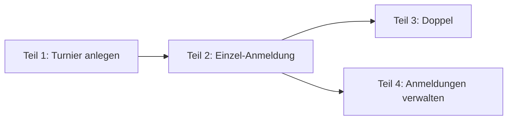

# Design: Anmeldung zur Clubmeisterschaft (#51)

**Datum:** 2026-11-06 · **Issue:** [#51](https://github.com/konstantinniedermann/tco-app/issues/51)
· **Status:** freigegeben (Projektleiter, 06.11.2026)

## Absicht

Ab dem 15.04.2027 (Etappe *CM-Anmeldung*) melden sich die Mitglieder am Handy selbst zur
Clubmeisterschaft (CM) an, statt dass der CM-Verantwortliche Listen von Hand führt. Der
CM-Verantwortliche legt das Turnier in der Verwaltung an, öffnet die Anmeldung und pflegt die
Anmeldungen. Die App nimmt ihm Routinearbeit ab, entscheidet aber nicht an seiner Stelle: Wo
er bewusst eine Regel übergeht, warnt sie nur.

Das Ganze ist zu gross für ein Issue. Es wird in vier Teile geschnitten, die in der Reihenfolge
ihrer technischen Abhängigkeiten gebaut werden (Entscheid Projektleiter). Dieser Entwurf
beschreibt alle vier; geplant und gebaut wird Teil für Teil.

**Wörter:** *CM-Verantwortlicher* ist die Rolle `cm`, seit dem Rollen-Umbau
([#43](2026-11-06-rollen-schaerfen-design.md)) *CM-Admin* genannt (der Projektleiter sagt auch
«CM-Organisator»). Was dort steht, darf nur der CM-Admin; der MyTCO-Admin liest nur. *Spieler* ist ein Mitglied in einer
Anmeldung. Begriffe sonst nach [Glossar](../../glossar.md).

## Schnitt und Reihenfolge

| Teil | Inhalt | Anforderungen |
|------|--------|---------------|
| 1 Turnier anlegen | CM-Verantwortlicher in der Verwaltung, Turnier, Turniernummern, Kategorien, Anmeldung öffnen und schliessen, Seed | A-TURNIER-01 bis -03, A-ANMELDUNG-07, A-ROLLE-07 (Teil Anmeldung) |
| 2 Einzel-Anmeldung | Klassierung im Profil, passende Kategorien, höchstens 3, Bestätigung per Mail, Abmelden | A-ANMELDUNG-01, -02, -03, -05 |
| 3 Doppel | Partner wählen, «Partner gesucht», Mail an den Partner, Paar zieht gemeinsam zurück | A-ANMELDUNG-04 |
| 4 Anmeldungen verwalten | Liste je Kategorie, von Hand anmelden, verschieben, löschen, Klassierung korrigieren, Wildcard-Antrag und Entscheid, Kategorie absagen | A-ANMELDUNG-06, -10 |

Teil 3 und Teil 4 hängen nur von Teil 2 ab und können in beliebiger Reihenfolge oder parallel
laufen. Jeder Teil wird ein eigenes Teil-Issue mit `Blocked by:` nach diesem Bild; #51 bleibt
das Dach und schliesst mit dem letzten Teil.

Der Wildcard-Antrag liegt in Teil 4, nicht in Teil 2: Er bleibt *beantragt*, bis der
CM-Verantwortliche entscheidet. Antrag und Entscheid gehören zusammen, sonst entstehen Anträge,
die niemand bearbeiten kann.

## Ziele

### Teil 1 — Turnier anlegen

1. **Zugang:** Wer die Rolle `cm` hat, kommt in die Verwaltung, wie jede Admin-Rolle nur mit
   frischem Mail-Code (SI-08). Er sieht dort nur den Bereich *Clubmeisterschaft*, nicht
   Mitglieder, Anlässe, Fairgate oder den Verlauf. Der MyTCO-Admin sieht den Bereich auch, liest
   aber nur (RR-07).
2. **Turnier:** Jahr, Name, Anmeldeschluss (Datum) und eine oder mehrere Swiss-Tennis-
   Turniernummern mit Bezeichnung (z. B. *Gruppenphase*, *Finalwochenende*; ob es zwei sind,
   hängt an K-25.4, das Modell erlaubt beides). Ein Turnier pro Jahr; ältere bleiben lesbar.
3. **Kategorien:** Name, Geschlecht (*Herren*, *Damen*, *Mixed*, *offen*), Jahrgang von–bis
   (optional, beide Enden einzeln optional), *Einzel* oder *Doppel*. Im **Einzel** gilt ein
   Klassierungsbereich von–bis. Im **Doppel** gilt stattdessen eine Mindestsumme der
   Klassierungen beider Spieler, vorbelegt mit 9 (R4+R5 oder R1+R8 gehen, R3+R5 nicht; Angabe
   Projektleiter, Annahme K-51); der CM-Verantwortliche kann sie je Kategorie ändern.
   *Mixed* gibt es nur im Doppel. Erfasst wird von Hand; «vom Vorjahr übernehmen» gibt es erst,
   wenn es ein Vorjahr gibt (Nicht-Ziel).
4. **Status:** Ein neues Turnier ist *in Vorbereitung* und für Mitglieder unsichtbar. Der
   CM-Verantwortliche öffnet die Anmeldung von Hand (*Anmeldung offen*). Am Anmeldeschluss
   um 24 Uhr (Schweizer Zeit) gilt sie von selbst als *Anmeldung geschlossen*. Er kann auch
   früher schliessen und wieder öffnen (Entscheid Projektleiter). *läuft* und *abgeschlossen*
   kommen mit *CM-Betrieb*.
5. **Kategorie ändern:** jederzeit, auch mit Anmeldungen. Passen danach Anmeldungen nicht
   mehr (Geschlecht, Jahrgang, Klassierung, Einzel/Doppel), zeigt MyTCO vor dem Speichern, wie
   viele es sind; nach Bestätigung bleiben sie stehen (Entscheid Projektleiter). Der
   CM-Verantwortliche kann sie dann in Teil 4 verschieben.
6. **Kategorie absagen** (= löschen): nur, wenn sie keine Anmeldungen hat, die nicht
   *zurückgezogen* oder *abgelehnt* sind. Hat sie welche, verschiebt der CM-Verantwortliche sie
   zuerst in andere Kategorien (bevorzugt) oder löscht sie (Teil 4), dann sagt er die Kategorie
   ab (Entscheid Projektleiter). Eine abgesagte Kategorie verschwindet für Mitglieder.

   Ziel 5 und 6 brauchen Anmeldungen, die es erst ab Teil 2 gibt. Teil 1 baut darum Ändern
   und Absagen ohne diese Prüfung (es kann noch niemand angemeldet sein); Teil 2 ergänzt
   Warnung und Prüfung zusammen mit den Anmeldungen (Entscheid Projektleiter, 06.11.2026).
7. **Seed:** `make seed` legt ein erfundenes Turnier 2027 mit offener Anmeldung an: Herren,
   Damen, Mixed, Junioren (mit Jahrgang), Senioren, Einzel und Doppel, verschiedene
   Klassierungsbereiche (z. B. R1–R6, R7–R9) und Doppel mit Mindestsumme 9. Die Teile 2 bis 4 ergänzen erfundene Anmeldungen.

### Teil 2 — Einzel-Anmeldung

1. **Klassierung im Profil:** neues Feld beim Mitglied mit den Werten N1–N4, R1–R9 und
   *keine Lizenz*. Das Mitglied pflegt es selbst im Profil (Annahme K-28, RR-Matrix). Fehlt
   es, fragt MyTCO beim ersten Öffnen der CM-Seite danach, bevor Kategorien erscheinen. Es
   gibt nur dieses eine Feld: Ändert das Mitglied es später, gilt das für neue Anmeldungen;
   bestehende bleiben stehen (wie bei Teil 1, Ziel 5). Eine Korrektur durch den
   CM-Verantwortlichen darf das Mitglied wieder ändern; der Änderungsverlauf zeigt, wer es war.
2. **Geschlecht und Jahrgang nachtragen:** Fehlt eines davon (beides ist beim Anlegen
   freiwillig), fragt die CM-Seite einmal danach, zusammen mit der Klassierung. Ist es
   eingetragen, ändert es nur noch der Mitglieder-Admin (Entscheid Projektleiter; Ausnahme in der
   RR-Matrix).
3. **Startseite:** Solange das Turnier *Anmeldung offen* ist, steht unter «Jetzt aktuell» eine
   Kachel *Clubmeisterschaft 2027* mit dem Anmeldeschluss und dem eigenen Stand (z. B.
   «2 Anmeldungen»). Nach dem Anmeldeschluss bleibt sie mit dem eigenen Stand stehen, bis
   *CM-Betrieb* sie ablöst.
4. **CM-Seite:** zeigt nur die Kategorien, die zum Mitglied passen (FR-07). Jede Kategorie hat
   einen eigenen Knopf *Anmelden*; die Anmeldung gilt sofort (*bestätigt*). Je Kategorie stehen
   die Namen der bestätigten Anmeldungen (RR-Matrix: Mitglieder sehen bestätigte).
5. **Höchstens 3** Anmeldungen je Turnier, die nicht *zurückgezogen* oder *abgelehnt* sind
   (FR-06). Bei 3 sind die übrigen Knöpfe gesperrt, mit einem Satz, warum.
6. **Hinweis Kontaktdaten:** Vor der ersten Anmeldung sagt MyTCO, dass Gegner und Doppelpartner
   E-Mail und Telefon sehen ([Datenschutz](../../datenschutz.md), *Kontaktdaten*).
7. **Bestätigung:** Nach jeder Anmeldung und Abmeldung eine Mail mit allen aktuellen Anmeldungen
   des Spielers (A-ANMELDUNG-05).
8. **Abmelden:** bis zum Anmeldeschluss selbst (FR-10, Annahme K-29); danach zeigt die Seite die
   Anmeldungen nur an.

**Präzisierungen vor dem Bau (06.11.2026):**

- **Geschlecht und Jahrgang sind Pflicht** wie die Klassierung: Fehlt eines, erscheinen die
  Kategorien erst nach dem Eintrag. Wer nicht will, lässt sich vom CM-Admin anmelden (Teil 4)
  (Entscheid Projektleiter).
- **Doppel-Kategorien sind ausgeblendet**, bis Teil 3 das Doppel bringt (Entscheid
  Projektleiter).
- **Früher geschlossen sperrt auch das Abmelden:** Massgeblich ist der wirksame Status
  *Anmeldung geschlossen* (von Hand oder durch den Anmeldeschluss), nicht nur das Datum
  (Entscheid Claude; `wirksamerStatus` aus Teil 1).
- **Nicht auf die Liste «Für Fairgate»:** Selbst eingetragenes Geschlecht und Jahrgang erscheinen
  dort nicht; Fairgate hat beides schon (Entscheid Claude).
- **Übergang bis Teil 4:** Der CM-Admin sieht die Anmeldungen noch nicht als Liste und kann eine
  Kategorie mit aktiven Anmeldungen nicht absagen. Das wird in Kauf genommen; live geht MyTCO
  erst mit dem Server (#39), und Teil 3 und 4 kommen vor dem 15.04.2027 (Entscheid Claude).

### Teil 3 — Doppel

1. **Partner wählen:** In einer Doppelkategorie wählt der Spieler den Partner über ein Suchfeld.
   Zur Wahl stehen aktive Mitglieder, die nach Geschlecht und Jahrgang in die Kategorie passen,
   dort noch in keiner Anmeldung stehen, ausser allein als *sucht Partner* (FR-07, FR-09), und mit dem Spieler zusammen die
   **Mindestsumme der Klassierungen** erreichen (Teil 1, Ziel 3). Gezählt wird R1 = 1 bis
   R9 = 9; *keine Lizenz* zählt 10, N1–N4 zählen 0 (Annahme K-51). Im *Mixed* eine Frau und ein
   Mann. Hat ein Mitglied keine Klassierung eingetragen, ist es wählbar und trägt den Vermerk
   *Klassierung fehlt*; der CM-Verantwortliche prüft. Wer *sucht Partner*, wird allein nicht
   an der Summe gemessen.
   Ein Paar, das zu stark ist (Summe zu klein), kann keinen Wildcard-Antrag stellen
   (Wildcard nur nach oben, Teil 4, Ziel 6); es kommt nur über den CM-Verantwortlichen hinein.
   Doppel kennen damit keinen Wildcard-Antrag.
2. **Keine Zustimmung nötig:** Der Partner wird per Mail benachrichtigt (Annahme K-27). Die
   Mail enthält den Hinweis, dass Gegner und Partner E-Mail und Telefon sehen, und wie man sich
   abmeldet, wenn man das nicht will (Entscheid Projektleiter). Die
   Anmeldung zählt für beide bei der Grenze von 3; hat der Partner schon 3, ist er nicht
   wählbar.
3. **Partner gesucht** (Entscheid Projektleiter): Man kann sich ohne Partner anmelden und steht
   in der Kategorie als *sucht Partner*. Wählt ein anderer Spieler ihn als Partner, wird daraus
   eine Anmeldung zu zweit (keine zweite), und beide bekommen eine Mail. Wer selbst sucht, kann
   später einen Partner nachtragen. Wer beim Anmeldeschluss noch allein ist, darüber entscheidet
   der CM-Verantwortliche (Teil 4).
4. **Abmelden:** Jeder der beiden kann bis zum Anmeldeschluss abmelden; dann ist die ganze
   Doppel-Anmeldung *zurückgezogen*, und der andere bekommt eine Mail (Entscheid Projektleiter).
5. **Kontaktdaten:** Partner sehen gegenseitig E-Mail und Telefon bis zum Ende der CM (FR-19).

### Teil 4 — Anmeldungen verwalten

1. **Liste je Kategorie** mit Status (*bestätigt*, *beantragt* = Wildcard-Antrag) und Vermerk *sucht Partner*, dazu die
   Anzahl, die Klassierung der Spieler und der Vermerk *Klassierung fehlt*.
2. **Von Hand anmelden:** jedes aktive Mitglied in jede Kategorie, auch Junioren ohne eigenes
   Login und auch nach dem Anmeldeschluss. Passt die Kategorie nicht, ist die Grenze von 3
   überschritten oder die Anmeldung geschlossen, zeigt MyTCO eine Warnung; nach Bestätigung
   gilt die Anmeldung (Entscheid Projektleiter: Beispiel R6 nach Anmeldeschluss in R7–R9 → ja).
3. **Ändern:** in eine andere Kategorie verschieben, Doppelpartner ändern, zwei *sucht Partner*
   zu einem Paar zusammenlegen, Klassierung eines Spielers korrigieren. Für die Regeln gilt
   dasselbe wie beim Anmelden von Hand: warnen, nicht sperren.
4. **Löschen:** Die Anmeldung wird *zurückgezogen* und zählt nicht mehr (Entscheid Claude: kein
   echtes Löschen, damit Mail und Zählung nachvollziehbar bleiben).
5. **Mails:** Jede Änderung durch den CM-Verantwortlichen (anmelden, verschieben, Partner,
   löschen, Entscheid) geht per Mail an die betroffenen Spieler. Wer von ihm angemeldet wird,
   bekommt darin denselben Hinweis zu den Kontaktdaten wie ein Doppelpartner (Teil 3, Ziel 2).
6. **Wildcard-Antrag (Mitglied):** Auf der CM-Seite ein eingeklappter Bereich *Weitere
   Kategorien mit Wildcard-Antrag*. Er zeigt Kategorien, die **nur** wegen der Klassierung nicht
   passen, und zwar nur nach oben: Der Spieler ist schwächer als der Bereich (z. B. R8 in
   R4–R6). In eine schwächere Kategorie kommt ein stärkerer Spieler nur, wenn der
   CM-Verantwortliche ihn von Hand anmeldet (Entscheid Projektleiter). Pflichtfeld Kommentar. Die Anmeldung ist *beantragt* und zählt bei der Grenze
   von 3 mit (FR-06, FR-08). Kommentar und Wildcard sehen nur Spieler, CM-Verantwortlicher und,
   nur lesend, der MyTCO-Admin.
7. **Wildcard-Entscheid:** Der CM-Verantwortliche bekommt je Antrag eine Mail, bestätigt oder
   lehnt ab; der Spieler bekommt den Entscheid per Mail.
8. **Kategorie absagen** nach Verschieben oder Löschen der Anmeldungen (Teil 1, Ziel 6).

## Regeln, die sich ändern oder neu sind

Nachzuführen in [Fachmodell](../../fachmodell.md), [Rollen und Rechte](../../rollen-und-rechte.md)
und [Anforderungen](../../anforderungen/anforderungen.md), bevor der jeweilige Teil gebaut wird:

- **Klassierung:** Reihenfolge von stark nach schwach N1–N4, R1–R9, *keine Lizenz*. *Keine
  Lizenz* passt in jeden Bereich, dessen schwaches Ende R9 ist. Die Skala ist eine Annahme
  (Glossar: *Vermutung*), bis K-25.1 beantwortet ist.
- **Doppel nach Summe:** Eine Doppelkategorie hat statt eines Klassierungsbereichs eine
  Mindestsumme (vorbelegt 9); R1 = 1 … R9 = 9, *keine Lizenz* = 10, N1–N4 = 0 (Annahme K-51).
  FR-07 und das Fachmodell (Kategorie) entsprechend ändern.
- **Kategorie:** neuer Status *abgesagt*; nur ohne aktive Anmeldungen (Teil 1, Ziel 6).
- **Anmeldung:** Doppel mit 1 Spieler ist erlaubt (*sucht Partner*; ergibt sich aus der Zahl
  der Spieler). Status *bestätigt* / *beantragt* / *abgelehnt* / *zurückgezogen*; *beantragt*
  kommt nur im Einzel vor (Wildcard). Das Schema dafür legt Teil 2 so an, dass Teil 3 und 4
  parallel darauf bauen können.
- **Wildcard nur nach oben und nur im Einzel:** Ein Antrag geht nur für Kategorien, deren
  Klassierungsbereich stärker ist als der Spieler (FR-08 präzisieren). Im Doppel gibt es keinen
  Wildcard-Antrag, weil die Mindestsumme nur zu starke Paare ausschliesst.
- **Geschlecht und Jahrgang:** Das Mitglied darf beides einmal selbst eintragen, wenn es fehlt
  (RR-Matrix: Ausnahme zu «L eigene»).
- **FR-02 (Pflichtangaben beim ersten Login):** Die Klassierung fragt nicht der erste Login ab,
  sondern die CM-Seite (Teil 2, Ziel 1). FR-02 entsprechend anpassen, damit sie nicht doppelt
  oder schon beim Login erzwungen wird.
- **Änderungsverlauf:** Korrekturen der Klassierung durch den CM-Verantwortlichen erscheinen mit
  eigenem Urheber `cm` (FR-26; Schema-Änderung beim Urheber).
- **Turnier:** Übergang *Anmeldung geschlossen* → *Anmeldung offen* (wieder öffnen) ist erlaubt;
  *Anmeldung offen* gilt nur bis zum Anmeldeschluss (FR-05).
- **Rechte:** Rolle `cm` öffnet die Verwaltung, nur den Bereich *Clubmeisterschaft* (RR-07
  erweitern). Der CM-Verantwortliche übergeht beim Anmelden und Ändern von Hand die Regeln
  FR-05 bis FR-07 nach einer Warnung.

## Datenschutz

Geprüft gegen [Datenschutzkonzept](../../datenschutz.md): Namen, Kategorien und bei der
Partnerwahl die Namen passender Mitglieder sind dort schon vorgesehen, ebenso die Klassierung
und der Hinweis zu den Kontaktdaten. Neu und nachzuführen (Konzept und Datenschutzerklärung):

- Der Vermerk *sucht Partner* ist für alle Mitglieder sichtbar.
- Der Vermerk *Klassierung fehlt* ist bei der Partnerwahl sichtbar.
- Die Mails an Doppelpartner nennen den Namen des anderen Spielers (Einzelmail an Beteiligte,
  keine Sammelmail; DS-05 bleibt erfüllt).
- Wer von einem Partner oder vom CM-Verantwortlichen angemeldet wird, bekommt den Hinweis zu
  den Kontaktdaten in der Mail statt vorher; die Kontaktdaten sind sofort sichtbar, abmelden
  geht bis zum Anmeldeschluss (Entscheid Projektleiter). Ergänzt *Kontaktdaten* im Konzept.
- Mitglieder tragen fehlendes Geschlecht und fehlenden Jahrgang einmal selbst ein (beides steht
  schon unter *Welche Daten*).
- **Löschfrist für CM-Anmeldungen** (Entscheid Projektleiter, 06.11.2026, vor Teil 2): Die
  Anmeldungen bleiben beim vergangenen Turnier, wie Resultate. Wird ein Mitglied gelöscht,
  bleibt in seinen Anmeldungen nur der Name. Grund: Die Turniergeschichte mit Namen und
  Resultaten ist ohnehin jahrelang öffentlich bei Swiss Tennis einsehbar.

Alle Testdaten sind erfunden (DS-08).

## Oberfläche

Nach dem Design-Ablauf des Projekts: Pro Teil zuerst ein Entwurf als Design-Artifact auf dem
Design System *MyTCO*, Handy-Artboards, mit erfundenen Daten; Abnahme per Bildvergleich
(Playwright-Screenshot iPhone/Android neben dem Entwurf, axe). Jedes Thema bekommt eine eigene
Fläche; der Wildcard-Bereich ist eingeklappt. Fehlt ein Baustein, kommt er erst ins
[UI-Leitbild](../../ui-leitbild.md).

**Teil 1 (freigegeben 06.11.2026):** Design-Artifact
[MyTCO CM Turnier anlegen](https://claude.ai/artifact/HLSqjEwFmHVRD7QWChziPF). Eine
Turnierseite: oben die Karte *Anmeldung* mit Status-Plakette und Taste (*Anmeldung öffnen* ist
die Haupttaste, *jetzt schliessen* und *Wieder öffnen* sind Nebentasten), darunter die
Kategorien als Tabelle, unten die Angaben mit den Turniernummern als Zeilen (Bezeichnung,
Nummer, *Entfernen*; *Weitere Turniernummer*). Eine Kategorie bearbeitet man auf eigener
Seite; *Kategorie absagen* steht dort in einer eigenen Karte. Seitenleiste: Bereich
*Clubmeisterschaft* mit dem Eintrag *Turniere*; wer nur `cm` hat, sieht nur diesen Bereich.
Status-Plaketten: *in Vorbereitung* `plakette-offen`, *Anmeldung offen* `plakette-ok`,
*Anmeldung geschlossen* `plakette-gesperrt`. Kein neuer Baustein.

**Teil 2 (Entscheid Projektleiter, 06.11.2026):** ohne eigenen Design-Entwurf. Die
Startseiten-Kachel, die CM-Seite, die Abfrage von Klassierung, Geschlecht und Jahrgang und die
Warnung im Kategorie-Formular entstehen direkt aus den Bausteinen des UI-Leitbilds. Nachweis
per Playwright-Screenshot auf iPhone und Android und mit axe. Fehlt ein Baustein, kommt er
trotzdem zuerst ins Leitbild.

## Nicht-Ziele

- Gruppen, KO-Tableaus, Spielplan, Resultate (*CM-Betrieb*).
- Export und Import mit Advantage und Swiss Tennis: offen, bis K-47 und der Datenaustausch
  geklärt sind; beide Richtungen sollen so einfach wie möglich gehen (Entscheid Projektleiter).
- Kategorien vom Vorjahr übernehmen.
- Benachrichtigung per Push, SMS oder WhatsApp (A-ANMELDUNG-08, -09); Teil 2 bis 4 schreiben
  nur Mails.
- Anmeldung für ein Kind durch die Eltern (#45, Junioren); bis dahin meldet der
  CM-Verantwortliche Junioren von Hand an.

## Offene Fragen an den Verein

Die Regeln oben beruhen bis zur Antwort auf Annahmen: K-24.1/.2 (Kalender, Anmeldeschluss),
K-25.1 (Kategorien), K-25.4/.5 (Turniernummern), K-27.1–.3 (Doppel), K-28 (Klassierung),
K-29 (Abmelden), K-51 (Doppel nach Summe der Klassierungen). Keine davon blockiert den Bau; die Antworten ändern Seed-Daten oder einzelne
Regeln.

## Entscheide von Claude (zum Gegenlesen)

- Ein Turnier pro Jahr; ältere bleiben lesbar.
- Klassierungsskala N1–N4, R1–R9, *keine Lizenz* (= schwächste Stufe).
- Abgesagte Kategorie verschwindet für Mitglieder.
- Startseiten-Kachel bleibt nach dem Anmeldeschluss mit dem eigenen Stand stehen.
- Löschen einer Anmeldung durch den CM-Verantwortlichen = *zurückgezogen*, kein echtes Löschen.
- Wildcard-Mail an den CM-Verantwortlichen je Antrag.
- Klassierung nur am Mitglied, nicht an der Anmeldung; spätere Änderungen wirken nur auf neue
  Anmeldungen.
- Doppel-Summe: *keine Lizenz* zählt 10, N1–N4 zählen 0; Mindestsumme je Kategorie änderbar
  (Annahme K-51, beim Verein nachgefragt).
- Wer *sucht Partner*, wird allein nicht an der Summe gemessen.

## Dem Bauenden überlassen

- Ob *Anmeldung geschlossen* nach dem Anmeldeschluss gespeichert oder beim Lesen aus dem Datum
  abgeleitet wird (ohne Hintergrund-Job vorzuziehen).
- Aufbau der Seiten und Endpunkte im Rahmen von ADR-002 (nur `+server.ts`, keine Form Actions).
- Wie die Warnungen beim Übergehen von Regeln aussehen (Bausteine aus dem UI-Leitbild).
